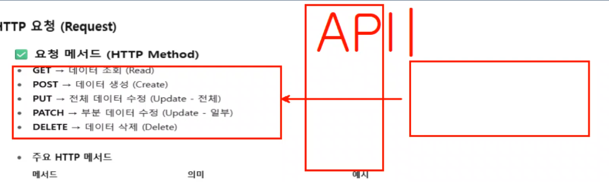

# STEP 1. 웹 서비스 이해
## 3강 : 동작 원리

### 웹 개발을 한다는 것
1. 개발 언어 선정
    - Java : 상업용 사이트에 가장 많이 활용되는 언어. 국내의 관공서, 금융권은 대부분 자바를 사용
    - Python : 데이터분석, 시각화, 인공지능 특화. 
        - 알파고를 계기로 화제가 되었음
        - 2000년대 후반에 만들어진 언어. 2016년도 인공지능에 주로 이용되기 시작하며 대두됨
        - 비즈니스 로직과 응용어플리션 개발이 가능하지만 자바에 비하면 부족함
2. 개발 도구 선정
    - IDE(Interated Development Environment) - 통합 개발 환경
3. 웹 서버 또는 어플리케이션 서버 : Nginx, Tomcat(주로 교육목적으로 사용) 등


### 웹 서비스 = 요청에 대한 응답

> [!] HTTP 요청 (Request)
```
- 요청 메서드 (HTTP Method)
    - GET > 데이터 조회 (Read)
    - POST > 데이터 생성 (Create)
    - PUT > 전체 데이터 수정 (Update - 전체)
    - PATCH > 부분 데이터 수정 (Update - 일부)
    - DELETE > 데이터 삭제 (Delete)
```
- CRUD : 사용자 입장에서 서버측에 요청할 수 있는 의미
    - Create : 입력
    - Read : 읽기
    - Update : 수정
    - Delete : 삭제

- API : 다양한 영역에서 다양한 의미로 사용될 수 있음.  

- 요청 또한 마찬가지임.
- 메서드의 방식으로 서버에 요청을 하며 크게 5가지로 요청방식이 나뉨


> [!] HTTP 요청 (Request)
> - 주요 HTTP 메서드

| 메서드 | 의미 | 예시(요청URL) |
| --- | --- | --- |
| `GET` | 데이터 조회 | `GET /users/1` |
| `POST` | 데이터 생성 | `POST /users` |
| `PUT` | 전체 데이터 수정 | `PUT /users/1` |
| `PATCH` | 일부 데이터 수정 | `PATCH /users/1` |
| `DELETE` | 데이터 삭제 | `DELETE /users/1` |


### 사용자의 영역은 위와 같은 바디영역과, 헤더 영역으로 나뉜다. 
### 바디 : 사용자의 요청정보가 담긴것
### 헤더 : 데이터가 아닌 메타정보를 담는 영역
### 바디와 헤더가 함께 서버측에 전달된다.

> [!] HTTP 요청 (Request) 
```
    - 헤더 (Headers)
        - `Content-Type` : 요청 본문 타입 (예: `application/json`)
        - `Authorization` : 인증 토큰 (예: `Bearer <JWT>`)
        - `Accept` : 클라이언트가 받을 수 있는 응답 형식
```

### 사용자가 어떠한 요청을 할 시, 요청 URL이 호출된다. URL도 일정한 규칙을 지켜주는 것이 좋다.(묵시적인 룰)
- 명사형 복수로 표현
- 계층적 구조 반영
- 요청방식 : 주로 JSON, PHARAM?

> [!] HTTP 요청 (Request)
```
- 요청 URL 설계 규칙 (RESTful)
    - 리소스(Resource)를 **명사형 복수**로 표현
        - **`/users` (O)**, **`/getUser` (X)**
    - 계층적 구조 반영
        - **`/users/{userId}/posts/{postId}`**
    - 동사는 URL이 아니라 **HTTP Method**로 구분
```

### REACT.JS, Vue.JS : 싱글페이지 어플기반? 
- 주로 백엔드에 JSON 방식으로 데이터를 요청함
- 실제 프론트엔드의 개발에 사용됨

> [!] HTTP 요청 (Request)
```
- 요청 본문 (Request Body)
    - 주로 **JSON** 형식 사용

        {
        "username": "testuser",
        "email": "test@example.com",
        "password": "1234"
        }
```

### 요청은 HTTP라는 프로토콜(통신규칙)을 통해 서버와 클라이언트간 통신이 이루어짐.
- 단점 : 암호화 되지 않은 데이터 > 도청, 변조 위험
- 그래서 사용하는게 HTTPS : 사용시 보안 수준이 올라감.
    금융, 쇼핑몰, 로그인 등 민감한 정보가 오가는 서비스에는 필수.

```
1. HTTP (HyperText Transfer Protocol)
    - 웹에서 클라이언트 ↔ 서버 간 통신 규칙
    - 요청(Request)과 응답(Response) 구조로 동작
    - 단점 : 데이터가 암호화되지 않음 → 도청/변조 위험
    - 예시 : `http://example.com`
    - 보안이 필요 없는 단순 테스트, 내부망 서비스에서만 주로 사용

2. HTTPS (HyperText Transfer Protocol Secure)
    - HTTP에 보안(SSL/TLS 암호화)을 추가한 프로토콜
    - 모든 데이터가 암호화되어 안전하게 전달됨
    - 브라우저에서 자물쇠 🔒 아이콘으로 표시됨
    - 예시 : `https://example.com`
    - 금융, 쇼핑몰, 로그인 등 민감한 정보가 오가는 서비스 필수
```

### 


> [!] 2. HTTP 응답(Response) 규칙
```
- 응답 상태 코드 (Status Code)
    - **200 OK** : 정상 처리
    - **201 Created** : 생성 완료
    - **204 No Content** : 성공했지만 본문 없음
    - **400 Bad Request** : 요청 오류 (잘못된 파라미터 등)
    - **401 Unauthorized** : 인증 실패
    - **403 Forbidden** : 권한 없음
    - **404 Not Found** : 리소스 없음
    - **500 Internal Server Error** : 서버 오류

- 응답 헤더 (Response Header)
    - `Content-Type` : 응답 데이터 형식 (예: `application/json`)
    - `Cache-Control` : 캐싱 정책
    - `Set-Cookie` : 세션/쿠키 설정
```

### 서버는 응답할 수 있어야 함
- 응답관련 헤더와 바디영역도 존재
- 바디영역 : 상태코드값 전달. 사용자의 요청 결과를 응답코드로 발송. 정상처리 되었는지 오류가 떴는지 등등.
- 헤더영역 : 응답에 필요로 하는 메타정보

> [!] 2. HTTP 응답(Response) 규칙
```
- 응답 본문 (Response Body)
    - 성공 응답 예시
        {
        "status": "success",
        "data": {
            "id": 1,
            "username": "testuser"
        }
        }

    - 오류 응답 예시
        {
        "status": "error",
        "message": "Invalid email format",
        "code": 400
        }
```
### 참고 : JSON 형식의 요청과 응답은 SPA  기준으로 함
- SPA (Single Page Application): react.js, vue.js


### 개발자 입장으로 용어 정리
- 개발 영역 : 프론트엔드, 백엔드
- 프론트 > 백엔드 요청 = 엔드포인트
    - 엔드포인트의 요청 방식 = 메서드
    - 요청안에 들어있는것 = 데이터와 헤더
- 이걸 받은 백엔드에서 사용자에게 응답이 돌아간다

> [!] 3. API 명세 작성 규칙
```
- 기본 구조
    1. 엔드포인트(Endpoint) : `/users/{id}`
    2. 메서드(Method) : GET, POST, PUT, DELETE
    3. 요청(Request)
        - URL 파라미터, 쿼리 파라미터, 요청 본문(JSON)
    4. 응답(Response)
        - 상태 코드, 응답 JSON 예시
```

### 명세 예시
- 사용자는 프론트의 ui를 보고 백엔드에 요청하게 된다.
- 개발자는 프론트와 백엔드 사이의 명세를 작성할 수 있어야 한다.

- API 명세 예시 (표 형태)

| 항목 | 내용 |
|---|---|
| URL | `/users/{id}` |
| Method | GET |
| 설명 | 특정 사용자 정보 조회 |
| Request Header | `Authorization: Bearer {token}` |
| Path Variable | `id` (Long, 필수) |
| Response 200 | `json { "id": 1, "username": "testuser", "email": "test@example.com" }` |
| Response 404 | `json { "status": "error", "message": "User not found" }` |

---
