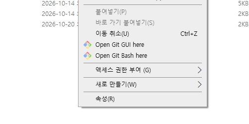
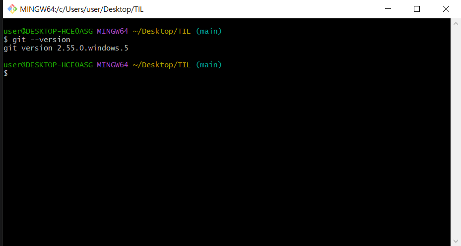
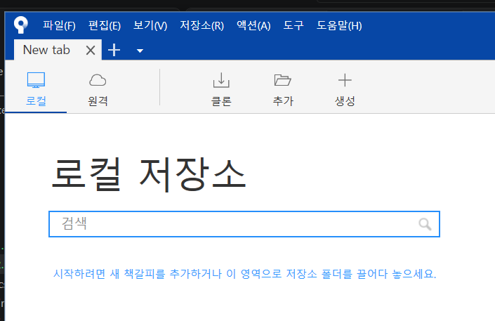

# STEP 2. 협업을 위한 필수 무기, Git
## 1강 : 버전 관리란?

### Git & Github (feat. JSLIM)
- 개발자가 코드를 관리하고 협업하기위해 사용하는 핵심 도구
- 개발자가 진행하는 프로젝트 중 혼자서 진행할 수 있는 프로젝트는 없다. 프로젝트에는 많은 인원이 팀으로 참여하여 필요한 정보를 공유하고 관리를 할 때 용이하게 사용할 수 있다.
- Git 사용의 이점
  - 특정한 소스코드의 변경이력 추적
  - 잘못된 코드가 발생할 경우 이전버전으로 롤백 할 수 있는 기능 제공
  - 인터넷 없는 로컬 환경에서도 사용가능
  - 여러 개발자가 동시에 코드를 병합할 경우 충돌을 최소화 하는 기능 제공

> [!] Git이란 무엇인가?
> - **분산형 버전 관리 시스템**(Version Control System)의 한 종류로, 빠른 수행속도에 중점을 둔다
> - 버전 관리
>   - 파일 수정을 거치며 복사, 백업, 저장 등을 하는 것.
>   - 예) 최종.txt, 최종의_최종.txt, 진짜진짜_최종.txt ... etc

> [!] 버전 관리란?
> - 버전관리 시스템은 파일변화를 시간에 따라 기록했다가 나중에 특정 시점의 버전을 다시 꺼내올 수 있는 시스템
>   - 각 파일을 이전 상태로 되돌릴 수 있다.
>   - 프로젝트를 통째로 이전 상태로 되돌릴 수 있다.
>   - 시간에 따라 수정 내용을 비교해 볼 수 있다.
>   - 누가 문제를 일으켰는지도 추적할 수 있다.
>   - 누가 언제 만들어낸 이슈인지 알 수 있다.
>   - 파일을 잃어버리거나 잘못 고쳤을 때도 쉽게 복구할 수 있다.

- 개발자들이 일종의 시간, 공간 여행을 하게 해주는 도구
- 프로젝트의 여러 모듈을 쉽게 전환하고 관리할 수 있다.
- 로컬로 혼자 하면 Git 몰라도 괜찮지만, 실제 개발이란 팀원들과 협업을 통해 시너지를 올리는게 중요하다. 이 과정에서 공유할 수 있어야하고, 수정이 반복되며, 수정된 것들을 버전으로 관리할 수 있어야 한다.
- 또한 특정 버전의 브렌치(Branch)를 이용해 공간을 만들어 필요에 따라 차원의 이동도 가능해야 한다. 

> [!] Git의 필요성
> - 나와 동료가 같은 웹사이트의 'A'페이지를 동시에 업데이트하는 상황을 가정한다.
> - 나는 무언가를 변경하고 저장한 다음 웹사이트에 'A'페이지를 업로드한다.
> - 이때 동료가 동시에 'A'페이지에서 작업을 하면 문제가 발생한다.
> - 만약 확인하지 않고 동시에 작업하면 누군가의 작업은 **겹쳐 쓰여지고 지워진다.**
> - Git은 이와 같은 일을 사전에 방지해준다.
> - 나와 동료는 같은 페이지에 각자 수정사항을 업로드할 수 있고, 두 개의 복사본을 각각 저장한다.

> - 즉, 모두 같은 환경에서 개발하여 불필요한 시간을 없애고, 서로 주고받는 와중에 일어나는 충돌을 최소화할 수 있다.
> - 프레임워크를 갖추고 공통으로 쓰는 코드를 미리 넣어두고, 테스트 코드나 샘플 코드를 넣어, 프로젝트 시작 전에 팀원 모두 같은 코드로 테스트할 수 있는 환경도 제공할 수 있다.


### Local에 깃 설치하기
  - git download를 검색해 다운로드 한다.
  - 설치하면 마우스 오른쪽 버튼 클릭 시 Git 관련 버튼이 생긴걸 볼 수 있다.
    
  - git bash로 버전 확인하기
    

- 깃 사용법
  - 터미널 명령어를 이용하는 CLI(Command Line Interface) 방식
  - Gui(Graphic User Interface) 방식 : source tree 등의 특정 툴을 다운받아서 사용해야 함

### Sourcetree 설치하기
- 설치완료! 추후 실제 로컬 파일을 연결해서 사용해볼 예정


### 1. Git 최초 설정
```
git config --global user.name "닉네임"
git config --global user.email "이메일"
```

- 확인
```
git config --global user.name
git config --global user.email
```

### 2. 기본 브렌치명 변경
```
git config --global init.defaultBranch main
```

### 3. 프로젝트 생성
- 폴더를 만든 후 VScode로 연다.
- 환경 세팅 완료!


## 2강 : Git 설치 및 초기 세팅

## 3강 : Commit 이해하기

## 4강 : Branch의 개념과 활용

## 5강 : Merge와 충돌 해결

## 6강 : Github 연동 및 원격 저장소

## 7강 : Push & Pull 실습

## 8강 : 협업 시나리오