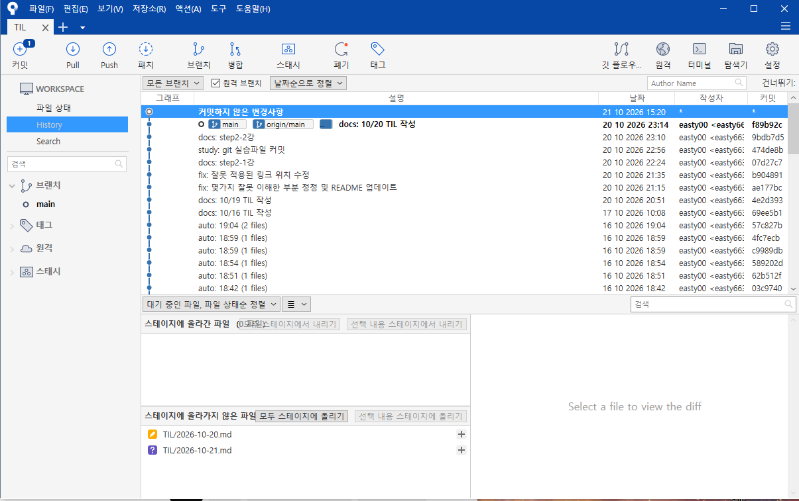
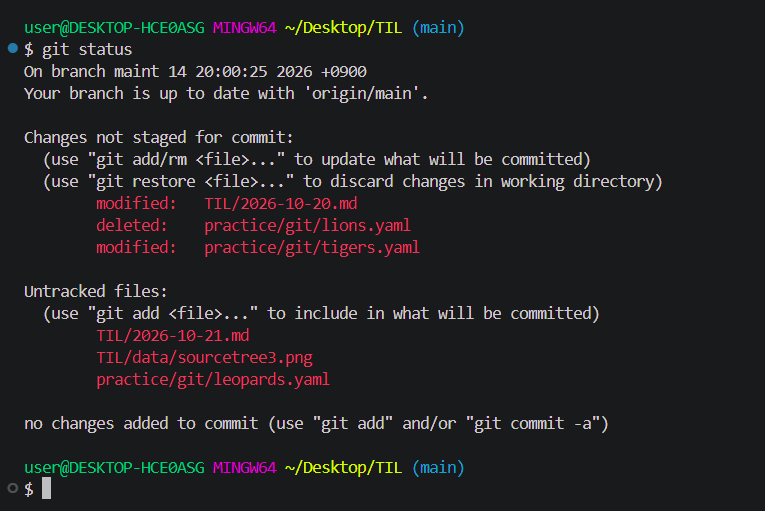
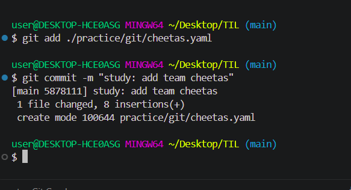
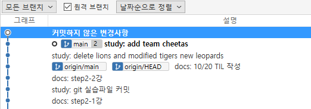
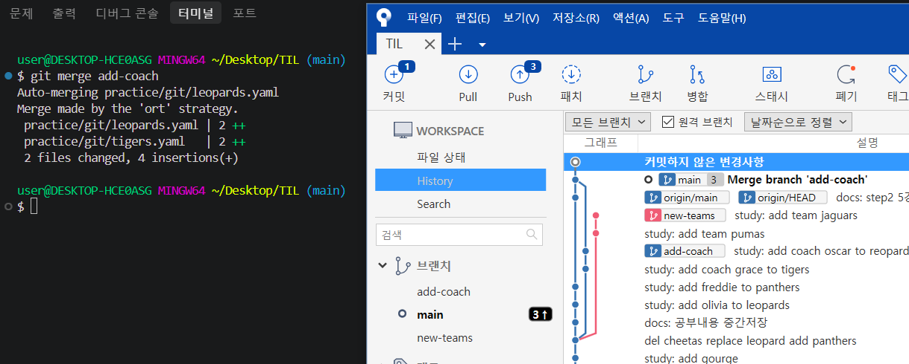
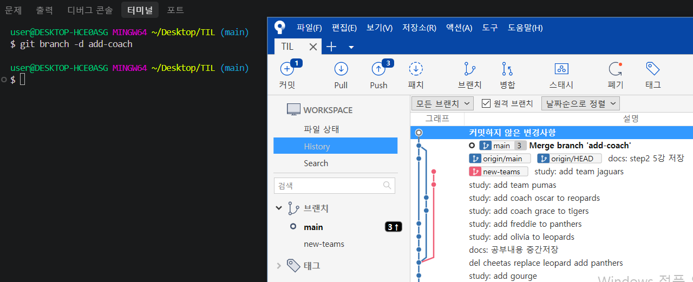

# STEP 2. 협업을 위한 필수 무기, Git

## 3강 : Commit 이해하기

### Sourcetree 이어서
  - Sourcetree 인터페이스 설명
  - 커밋된 기록들과 확인 및 관리를 시각적으로 보조해주는 프로그램



  - 상태와 작성자, 작성날짜 등을 브랜치 탭에서 확인 가능. 

### Commit 실습
  - 📂 [Git 실습](../practice/git)

#### lions 파일 삭제, tigers 파일 수정, 새로운 파일 생성
- git status로 수정내역 확인

  


- git commit -am : add, commit 을 동시에 하도록 하는 명령어. 하지만 git에 등록되지 않은 신규 파일을 만들었을 때는 사용할 수 없는 기능이다

- git add (단일파일경로) : 단일파일 커밋

  

- Sourcetree 에서도 확인가능

  

#### 과거로 돌아가는 방법
- reset : 원하는 시점으로 돌아간 뒤 이후 내역들을 지우는 것
- revert : 되돌리기 원하는 시점의 커밋을 거꾸로 실행하는 것

- 사전준비 : 깃 폴더를 다른곳에 백업해두고 시행
- 추가: 터미널에서 로그 등의 기록이 길어졌을 때, 나오고 싶다면 "q"를 누르면 나올 수 있음


---
## 4강 : Branch의 개념과 활용

#### 과거로 돌아가기 이어서
- reset : 원하는 시점으로 돌아간 뒤 이후 내역들을 지우는 것
  - 과거로 돌아갈 땐 반드시 해시 값을 가지고 있어야 한다
  - 실습은 혹시모를 대참사를 대비해 하지 않을 예정. 수업 메모만 한다.
  ```
  돌아가려는 커밋의 해시값을 복사
  git reset --hard (해시값) 
  ```
  - git log로 확인해보면 되돌아간 해시 값 이후의 커밋들이 사라진다
  - 백업한 깃 폴더를 다시 가져오면 되돌릴 수 있다(백업 전제)
  ```
  백업한 폴더를 가져온 후
  git reset --hard
  ```
  - 뒤에 해시값을 작성하지 않는 경우 마지막 해시값 상태로 되돌리는것으로 인식한다.

- revert : 되돌리기 원하는 시점의 커밋을 거꾸로 실행하는 것
  ```
  git revert (해시값)
  ```
  - 무언가 편집기가 나오고 수정했다라고 표시됨.
  - :wq <<를 입력하여 저장
  - sorcetree를 새로고침하면 revert 가 붙은 이전 커밋 메시지가 나오는 것을 볼 수 있다.
  - ? 이건 모르겠음   
    ```
    git revert --continue
    ```
  - 리버트 기록 원복
    ```
    git revert --no-commit (해시값)
    git reset --hard
    ```

### 브랜치
- 분기된 다른 차원(공간)
- 특정 프로젝트를 분기하여 작업할 때 사용. 제각각 브렌치마다 독립되어 진행할 수 있고, 통합할 수 있다.
- 생성
  ```
  git branch 브랜치명
  ```
- 이동
  ```
  git switch 브랜치명
  ```
  - 브랜치 생성과 동시에 이동
  ```
  git switch -c 브랜치명
  ```
- 삭제
  ```
  git branch -d 브랜치명
  ```
- 브랜치명 수정
  ```
  git branch -m (기존 브랜치명) (새 브랜치명)
  ```
- 브랜치 강제삭제(주의!)
  ```
  git branch -D 브랜치명
  ```

---
## 5강 : Merge와 충돌 해결

### 브랜치 실습
- 브랜치 생성

  
  ```
  - sourcetree 를 새로고침 하면 main에 다른 브랜치가 병합된 걸 확인할 수 있음

    

  - merge 또한 하나의 커밋이기 때문에 리셋을 이용해 병합 이전 상태로 되돌릴 수 있다.
    - sourcetree 에서 커밋 되돌리기를 누르는 것으로도 가능하다.

  - 병합이후, 병합된 브렌치는 더 필요없게 되므로 삭제할 수 있다.
    ```
    git branch -d (브렌치 명)
    ```

    

- rebase 를 이용하여 합치기. merge와 반대.
  - 주가 되는 브랜치가 아니라 병합되어질 브랜치로 이동하여 합친다

    
    
    - merge와 다르게 해당 브렌치가 main보다 앞서있는 것을 확인할 수 있다. 따로 진행되어있던 main의 커밋 데이터가 add-team에 합쳐지면서 add-team의 개별 브랜치가 완전히 사라진 것을 확인할 수 있다.

- main으로 돌아오면 new-team의 데이터는 병합되어있지 않다.
  - new-team을 merge 하여 데이터를 가져오면 동일한 위치에 두개의 브랜치가 동일한 데이터를 가지고 존재하는 것을 확인할 수 있다.
  - new-team 브랜치도 더는 사용하지 않으므로 삭제할 수 있다.


### Push & pull


---
## 7강 : Push & Pull 실습

---
## 8강 : 협업 시나리오