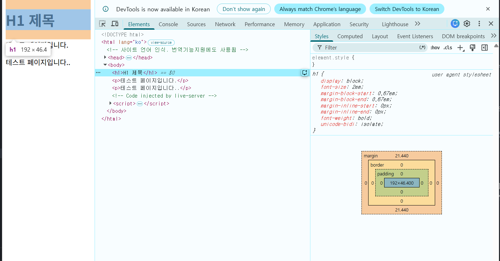
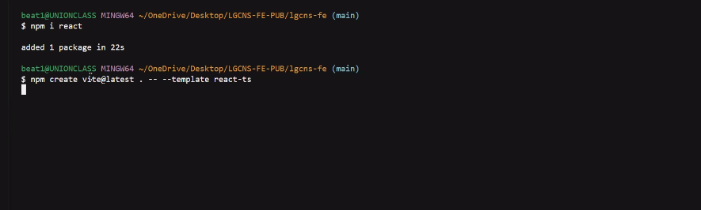

# 4일차 TIL : AI 서비스를 위한 프론트엔드 2

## 실습
- 넥스트 실습은 다음 레포지토리에서 진행한다.
  - 🔗 [실습 레포지토리](https://github.com/easty00/lg-front-app41)
  - 🔗 [실습 배포 도메인](https://lg-front-app41.vercel.app/)

- 오늘의 실습은 여기서!
  - 📂 [10/28 실습](../../실습/20261028)
---

## 깃허브
> 이미 어느 정도 기본은 숙지되어있으므로 간단히 수업 흐름에 따라 기록만 한다

- 깃허브 레포지토리 생성
- git clone
- html 작성 후 git add, commit, push, pull,

---

### html은 특별한 일이 없는 한 오류가 나지 않는다.
- html은 h1이 헤더에 들어가는 등의 문제가 생길 경우 등, 간단한 실수들은 어느정도 보정할 수 있는 능력이 있다.
- 그렇다고 실수해도 된다는 건 아니다.
- 보정해주는 대신 문제가 있다면, 정상작동하여서 만약 실수가 생겨 오류 디버깅을 할때 html 의 부분에서 오류를 찾기 어려울 수 있다.
- `<body></body>` 전체가 엘리멘트다. 기본적인 css 가 적용이 되어있다.

  
- 폰트를 예쁘게 쓰고 싶을 때
  - 일반적으로 폰트도 사이트를 보는 사용자들에게 보여주기 위해선 사용자의 로컬에 저장되어 있어야 한다.
  - 하지만 특정 폰트들은 가지지 않은경우도 있고, 이 때 폰트를 웹사이트에 진입하면 다운로드 하게 하는 방법 등을 이용해 보여줄 수 있지만 이건 무척 좋지 않은 방법이다. 폰트도 크기가 꽤 되기 때문.
- 기술을 쓸 수 있다면 유료라도 되도록 써봐라.
  - 특히 도커 같은 복잡한 도구를 사용할 때 ai를 활용하면 문제를 해결하는 시간을 줄일 수 있고 더 많은 일을 할 수 있다.

---

## CSS 연결과 로그인 화면

### css 일반적으로 링크하는 방식으로 많이 사용

### 현재의 체계는 분업. 각 분업한

### SCSS
- 한때 유행했지만 지금은 안쓰는게 좋은 스타일
- 기술을 발달하고 쇠퇴한다. 쓸 수 있다면 쓰면 좋겠지만 기본은 하고 하자.
- 만약 사용하는곳이 있다? 그런데 내가 못한다? : 제가 이걸 알고는 있지만 더 좋은 방법이 있고 제가 잘 하는 방식이 있습니다. 그와 같은 방법으로 마이그레이션 하여 해결할 수 있습니다.
- 사용하지 않게 된 이유 : 라이브러리 형태가 바뀌어 가고 있기 때문

### body
- 컴포넌트 형태로 되어있음
- 구조를 바꿔야 하는걸 소스코드로 해결하려고 하지 말아라.
- 현재에는 각각의 부분에 대한 css 파일을 만들어 임포트 하는 형태
- CSS의 임포트 : `@import`
- 각 태그에는 각자의 역할이 있다. 각 태그의 역할을 어기더라도 큰 문제는 없지만 적절한 엘리멘트를 쓰는걸 권장함.
- 버튼에는 기본 속성과 액션이 있음.
- Form : 조금 어려움. 잘 알아두어야 함. react에서 유용히 써야 함. `<div>` 만 사용하고 기본 속성을 무시하면 상태지옥에 빠지거나 종속이 생기게 됨
- 모바일에서 생각하면 좋을 점. 키보드을 올라오게 하는 것.
  - 적절한 용도의 키보드를 사용할 수 있게 만들 수 있음. 이런걸 프론트엔드 만들 때 센스있게 도구를 선택가능하다면 더 좋은 웹이 될 것.

### 로그인 화면 만들기
- 서브밋의 액션을 하는 동작을 받아 움직이게 함

---

## 수업 이어서
- 전통적인 코드

  

### React
- npm 사이트 접속

  
  ```bash
  npm i react

  npm create vite@latest my-app -- --template react-ts
  ```
- className : `class`는 JavaScript에서 이미 클래스 문법으로 사용중인 단어이므로,JS 기반인 리액트에서는 충돌을 피하기 위해 `className` 으로 정의함

> [!NOTE]
> **오후에 HTML 사용 방법을 더 디테일하게 설명하실 예정**

### 용어 설명
- flex : 상자들을 한 줄로 나란히 놓는 배치법
- gap : 요소 간격마다에 사용.
- column : 열로 입력창 나열
- row : 횡으로 입력창 나열
- onclick : 클릭을 하면 => 일어날 일
- queryselector -> html에는 `<button type="button" class="counter">Count is 0</button>` : 카운팅하는 버튼

---

## React
- 바뀌는 것을 바로 인지함
- html은 새로고침해야 반영됨
- 리액트에서는 변수를 유일하게 바꿔주는 것이 useState
- 자바스크립트 코드로 짜서(중괄호 안에 작성) 리턴문으로 작성. 카멜케이스로 작성. 움직이는 자바스크립트 위에서 동작하게 됨(일반 HTML과 차이점). value는 따옴표로 감싸주어야 함. value를 string으로 읽어 처리함.
  - React에서는 짧으면 `<div 작성 내용 />` <- 이런식으로도 가능함
    - HTML 에서 스스로 닫히는 것은 ``, `<input>`, `<br>` 같은 원래 내용이 없는 태그 뿐. 
- 리액트의 public 디렉토리 : 고정값. 이미지가 변하거나 데이터 받아 처리해야 하는 경우 절대 public에 넣어서는 안됨. 고착화됨. 고정해야하는 이미지등 외에는 src 디렉토이에 넣을것.
- ls : 현재의 파일 구조를 보여줌

> [!NOTE]
> **수업 끝나면 리액트와 html구조 확인. 리액트와 html문법, css 문법 영상보기**

### 컴포넌트 쪼개기 실습
- 컴포넌트 : 레고블럭같은 것. 한번 만들어두면 재사용성이 좋은 것이 장점
- props : App(부모)이 count를 컴포넌트로 쪼개진 CenterHero(자식)에게 전달하는 역할
- useState = 알림 기능이 달린 메모장. 그냥 변수(let cnt)는 조용히 숫자만 바뀜. useState를 넣으면 바뀔 때 React에게 화면을 다시 그려야 한다고 알려줌 

### 리액트와 html 주의사항
- 바이트인지 ? 어디인지는 모르겠지만 카운트를 사용했을 때 눌러도 0에서 숫자버튼이 변하지 않지만 콘솔창을 열어보면 카운터가 올라가는것을 확인할 수 있다.
- 말씀하신걸 다 못들어서 모르겠지만 리액트인 것 같음. 눌러도 겉으로는 반영되지 않는 것이 나름 단점이다. 이를 해소하기 위해 있는 것이 useState.
- let cnt = 0 을 사용하도록 App.stx 를 수정하였으니 직접 타이핑해보길 바란다고 하심. 나중에 해보기.
- 기술에 대한 이야기들은 꼭 2차 검증을 해볼것을 추천하심.

---

## 퍼블리싱, 자바스크립트, 타입 스크립트
- 카운트는 숫자로만 관리해야함.

### app.tsx를 타입스크립트로 바꾸기
- 코드에 문제가 생김 : 1이 뒤로 계속 111 .. 붙는 문제
  - 왜? 숫자가 문자열로 변경되어 뒤에 나열된 것.
  - 이런 것들이 내가 원하지 않는 곳에 서 발생할 수 있다.
  - 이때를 위해 타입스크립트가 필요한 것.
- html은 원래 이런걸 신경쓰지 않음.
  - 하지만 자바스크립트등의 함수화로 이런 사고들이 자주 발생한다.
- tsconfig.app.json 에 대한 설명

### 리액트의 분기처리 하기
- 주의할 점 : Fragment
  - 여러개를 한번에 묶는 역할
  - 대신 div를 쓰면 안되나요? css에 문제가 생김. 하나의 박스로 만들어지면서 엘리멘트가 생겨 구조가 종속이 되는 문제 발생.
  - fragment는 일종의 패키지를 만들어줌
  - 하지만 남발에는 주의해야 함. 의미없으니 문제는 없지만 구조상 소프트 웨어가 안정적이고 쾌적한 환경으로 동작하게 하려면 불필요한 코드나 주석은 없애는게 좋다.
  - 특히 리턴문에 주석을 넣는것은 무척 주의해야 함. 꼭 참조를 넣고 싶다면 백업을 만들어서 거기에 넣어라.
  - 넥스트는 특히나 소스코드가 노출이 됨. 주의하라.
  - div 컴포넌트로 만드는게 좋음.
- 규칙 : 리턴은 하나만 해야 한다.
- src 폴더에 컴포넌트 생성
  - 정책상 ㅎ에러함수로 넣으면 쉽다?
- 디벨롭 과정에서는 컴포넌트로 나눈것들이 정상작동 하지만 배포하는 순간 문제가 생기는 경우가 있음.
- 함수는 비동기 코드. 주지 않아도 열려있음
  - 버튼을 눌러서 count 가 들어오는걸 기다리지 않고 함수가 터진다. 이를 방지하기 위한 대책들이 있다.
    - count&&count
    - count || 0
    - 카운트를 내려주겠지만 못 줄 수도 있어! 라는 의미의 함수도 넣어두어야 함
      - count: number | undefined
  - 여러 기능들은 그냥 쓰면 어쩔수 없이 문제에 맞딱드린다.

### 싱크, 어웨이트, 프로미스
- 프로미스 형태로 소스코드 작성

#### 1. 프로미스의 3가지 상태 (States)
프로미스는 생성되어 처리되기까지 다음 중 하나의 상태를 가집니다:
- 대기 (Pending): 비동기 처리가 아직 완료되지 않은 초기 상태
- 이행 (Fulfilled): 비동기 처리가 성공적으로 완료되어 약속을 이행한 상태 (resolve 호출)
- 거부 (Rejected): 비동기 처리가 실패하거나 오류가 발생한 상태 (reject 호출)
- 정착됨 (Settled): 이행되었거나 거부된 상태 (더 이상 상태가 바뀌지 않음)

#### 2. new Promise()
new Promise() 생성자는 실행 함수(executor)를 인자로 받으며, 이 함수는 resolve와 reject 두 가지 콜백을 가집니다

```js
const myPromise = new Promise((resolve, reject) => {
  const success = true; // 비동기 작업 가정

  if (success) {
    resolve("성공 결과 값"); // Fulfilled 상태로 전환
  } else {
    reject(new Error("실패 이유")); // Rejected 상태로 전환
  }
});
```

#### async, await
    - async와 await는 자바스크립트에서 프로미스(Promise)를 기반으로 비동기 코드를 마치 동기식 코드(순차적으로 실행되는 코드)처럼 직관적으로 작성할 수 있게 해주는 문법

1. 핵심 키워드 개념
- async (Asynchronous)
  - 함수 선언 앞에 붙이는 키워드
  - async가 붙은 함수는 항상 프로미스(Promise)를 반환
  - 함수 내부에서 프로미스가 아닌 일반 값을 반환하더라도, 자바스크립트가 자동으로 이행된(fulfilled) 프로미스로 감싸서 반환
- await (Wait)
  - 반드시 async 함수 내부에서만 사용할 수 있는 키워드
  - 프로미스 앞에 await를 붙이면, 해당 프로미스가 처리(settled)될 때까지 함수의 실행을 잠시 중단하고 기다림
  - 프로미스가 성공적으로 이행되면 그 결과 값을 그대로 반환받아 변수에 할당할 수 있음

2. 기본 문법 비교
- 기존 Promise .then() 방식:
  ```js
  function fetchUser() {
    return fetch('https://example.com')
      .then(response => response.json())
      .then(user => user.name);
  }
  ```
- async / await 적용 방식:
  ```js
  async function fetchUser() {
    // fetch가 완료될 때까지 기다렸다가 response 변수에 담음
    const response = await fetch('https://example.com');

    // JSON 파싱이 완료될 때까지 기다림
    const user = await response.json();

    return user.name;
  }
  ```
- if를 이용한 어쩌구
  - 함수에서는 if else를 쓰지만 여기도 그렇게 쓰지만 조금 다름
- 한 단계 들어가면 데이터 패칭, 서스펜스가 들어감.

---

## HTML 에서 컴포넌트 만들기

### 위 버튼과 아래 버튼 각자 스스로 카운트 하도록 만들기 실습
- app.tsx 에서 함
- 각 버튼에 책임 분리하기
- 각각의 컴포넌트는 각각의 책임을 갖게 한다.
- 각 컴포넌트를 동기화 해야하는 경우엔 globalState? 를 사용하면 된다.

---

## CSS
- 체인형 구조가있어 용이하게 사용가능
    - 체인형 구조 : 선택자를 이어 점점 좁혀가는 구조
- 샵 : 아이디
  - ul : 순서가 없는 오더 목록. 순서가 있는 목록은 ol
  - a : 링크 태그
  - 하나하나 뎁스(depth) 를 타고 있기 때문에 유의해야함

### 하지만 타고 들어가는 구조가 너무 많으면 리액트같은 구조 설계가 어려움
- 한 묶음 안에 똑같은 구조(li) 가 반복됨.(하드코딩. 중복구조)
  - 개발자들은 반복되는걸 줄이고 싶어함.
  - 컴포넌트로 만들어 props로 만들어 부여하면 편리함.

### 컴포넌트(UI 체계)로 만들기
- 바이트가 만든 페이지는 같은 버튼만 6개임.
- 그 중 하나를 복사하여 컴포넌트로 뺀다.
- 미디어 쿼리와 반응형 쿼리, 등등 숙지할게 있는지 CSS를 확인한다.
    - 미디어 쿼리 : 화면 크기에 따라 다른 CSS를 적용하는 조건문
        ```
        @media (max-width: 1024px) {
            /** 화면 폭이 1024px 이하 일때만 적용*/
        }
        ```
- 보니까 두개의 버튼이 한묶음인 모양이다. 두개를 복붙한다.
- 버튼 변경의 터닝포인트는 1024다. 이런 터닝포인트와 버튼 변경을 정해주는게 미디어쿼리
  - 미디어쿼리를 배우는 방식
    - 화면을 키우면서 설정
    - 화면을 줄이면서 설정
    - 요즘 잘 쓰는 테일윈드 방식은? 작은것->큰것
      - 보통 모바일에서는 꽉 채워 쓰는것이 일반적이다. 키우면 구조가 넓어지며 없던 배경이 생긴다. 키우면서 만드는걸 보통 선택함.
      - 테일윈드 : 가장 작은 것을 (sm,md,lg,x1..)-col-(12,6,4,3) 이런식으로 표기한다. (참고: 그리드 하나에 12가 최대. 어떤 숫자가 제일 분리하기 쉬운지 연구하여 12를 채용했다는 썰이 있음. 즉 저건 전체를 쓰겠다는 말.)
      - 반대로 하면 큰게 줄어드는걸 하면 조금 문제가생긴다.
    - 모바일기준으로 만든 뒤 키우는 방식으로 설계하는것이 편하다.
- transform : 최근 나옴
- transition : 이건 좀 많이 씀: 호버가 부드럽게 반응함. 보통 border를 쓰지만 all 을 사용하면 모든 동작에 트랜지션이 들어가게 됨. 라이트 같은 효과를 이걸로 줄 수 있음
  - 카운터 버튼 참고
- css 만으로 다양한 그림을 그릴 수 있다. 물론 css 코드는 난리가 날 수 있다.
- 애니메이션적인 동적 성을 좋아한다면 그것도 가능
- 모달이나 창 띄우는 효과도 css 로 만들고 무척 다양함.
- border
- margin-(위 오른쪽 아래 왼쪽) : 기본적으로 시계방향임을 잊지말자
- 애니메이터가 들어가서 움직이기 시작하면 CPU를 잡아먹는다. 많이 동적여질수록 많이 먹는다.
- gpu가 잡아먹히는건 주로 ai 학습이나 대용량 데이터 연산이 있을때.

---

## 아이콘 컴포넌트화
- 기존의 아이콘 코드 컴포넌트화. 제각각 만들어서 svg 파일에 넣어준다.
- 타입 스크립트파일을 이용해 각 유형에 대한 타입을 정의하여 한번에 사용.
- 아이콘과 4개의 출처를 컴포넌트화 하여 지정하기
- 아토믹 디자인 설계라는것도 있음.
- 주의 : 리액트는 저장할 때마다 랜더링이 돌기 때문에 수동저장 권장
- 컴포넌트화 된 데이터를 풀어서 아래에 작성한다. (const)
- svg가 통째로 아이콘으로 들어가 타입 선언됨.
- 동일한 폼이 들어가는 경우 key 생성됨. id는 유니크해야한다. 리스트가 새로 생기면 정해진 키값이나 아이디를 만들어달라 요청하여 받으면 편하다.
- 컴포넌트화 된 버튼 완성! 만약 위치를 옮기거나 수정한다면 간편하게 바꾸고 관리할 수 있다.

### target
- '_blank' : 옵셔널 처리. 넣지않아도 자동입력되게 하는것.
- 필수값 처리 : 문제가 생김. 타겟을 넣어달라고.
- '_blank', '_parent' '_self' '_top'
- 받아야 할 값을 정의하여 받는다.
- 타겟을 만들어 추가하는 이유 ? 못들었음 ㅠ

## 컴포넌트화 된 파일 복기

## 다음 수업은 리액트와 넥스트js를 함께 써보기

---

## 5시 질문시간

### lib 폴더
- 넥스트는 소스 디렉토리 구조 안에서 자신이 원하는것을 자유롭게 할 수 있음
- 라이브 디렉토리는 해외에서 일반적으로 사용하는것.
- 내 폴더 안에 라이브러리 형태로 만든 코드를 모아둔것.

### 폴더 정리를어떻게 하면 좋을까?
- 리액트는 스타일이 굉장히 다양하다.
- lib 디렉토리도 폴더를 나눠도 좋다.
- 종종 래퍼클래스라는게 나온다.
  - div, 컨테이너, 섹션 같은 묶음 처리한 태그들을 태그가 아닌 컴포넌트로 쓰는 사람들이 있다. 이 경우 래퍼라고 따로 기능별로 빼서 관리하는 경우도 있다,
- 정형화 된게 많지 않으니 자유롭게 정리해도 된다

### socialData.ts 가 아이콘 컴포넌트를 직접 import하고 있는데, 나중에 API로 데이터를 받으면 컴포넌트를 담을 수 없을 것 같습니다.
- 맞는 말이다 못담는다.
- 데이터 처리시 이런식으로 관리 가능하다를 보여준 것.
- 컴포넌트는 편리하기 때문에 들어내는 것 뿐.
- 소셜 데이터 같은건 헤더 등에 쓰면 좋은 방식. 깊이가 깊어지는 곳에.
- 래핑은 각자의 스타일 별로 충분히 할 수 있다.
- AI랑 토의하는것도 방법이다.

### 거의 대부분의 교육은 중간층에 맞춤. 어느부분까지 어려운지 알려주면 이해가 될 수 있도록 돕겠다.

### 예습을 한다면 공식 문서를 읽어보라.
### REST API
### NEXT JS

### API를 만들 수 있는 개발자가 되면 좋겠다. 데이터패칭에 대하여, 데이터 설계를 할수있기를 바란다.
### Auth.js

### 커서

### 에이전트 화면
### 요즘 풀스택 많이 찾음 당연하다고 생각함

### 옆집보다 강하면 안 털리는게 보안이다. 보안은 어디가 세냐의 차이일 뿐임.

### 질문
- useState : 상황
- useEffect : 나오자마자 이펙트가 필요 할 때. 어떠한 상황들에대한 연결인 필요할 때 이용
- 상태가 변하지 않는것도 감지함 이것도 상태라서.
- 훅 : 기능 설명 잘 하시는 유튜버 있음.
  - 별코딩 : 기초설명 잘해둠
- 오늘 내용 중 꼭 이해해야 하는 부분이 있다면?

---

## 1차 면담 진행예정

## 사적인 일이 생겨 실습 복습을 못함. 추후 실습 후 정리 예정.