# 4일차 TIL : AI 서비스를 위한 프론트엔드 3

## 
- 앱을 제작하다보면 여러 기기로 테스트해야 할 필요가 생긴다. 
- 개발자 툴로 가면 여러가지 기기를 등록해 인터페이스가 어떻게 나오는지 확인해 볼 수 있다. 
- 물론 실물기기랑 좀 다르다. 

## 일렉트론js
- vs 코드를 만든 도구
- 어플리케이션을 데스크탑용으로 변경해주는 플랫폼
- 잘 아는 앱들이 이걸로 만들어져있음.
- 데스크 탑 툴을 사용할 수 있는 것이 특징. 
- 구글에서 만들어준거라 아이폰이나 사파리에서는 별로 안좋아함
- 강사님네 프로젝트 관리 툴


## expo
- 버셀이 인수함
- 리액트 같은 느낌. 리액트 덮어쓰는 플랫폼. 넥스트 js 같은것
- 다만 생태계가 다름. 히스토리 개념이 아니라 뒤로가기를 누르면 레이어를 쌓는 구조.

## Flutter
- 구글에서 만든것.

## os 버전도 알아두자.
- 앱은 모든 버전을 대응할 수 없다. 
- 크롬과 사파리는최신기준으로 대응되니 괜찮지만
- 아닌것은 보여야 할 게 안 보이고 깨지는 경우가 있음
- 국내에서 도커 같은거 하고싶은 사람은 토스로 많이 감. 외국에선 그런 곳이 버셀. 배울 것이 많음. 

## shadcn
- shad 도 버셀이 가져감

## tailwind
- 이거 나오고 이전 최강자인 부트스트랩이 죽음
- 최근 기술, 기업관리 관계, 요즘의 트렌드들을 잘 따라가야 함.
- 프론트는 앞에 보이는 만큼 남들이 많이 쓰는 기술을 사용해야함. 나를 사용해줄 사람을 구하려면 주류를 잘 따라가고 앞으로 뭐가 뜰지 캐치할 수 있는 안목이 있는 것이 도움된다. 
- 그 전에 떴던건 mui 대부분의 css 업계가 테일윈드를 써서 대부분 죽음.
- Heroui : 여기도 최근에 죽음. 버셀이 인수했다는데 ..

## turborepo, monorepo 등 도 알아두면 좋다.
- 관리자앱 유저앱 등의 주요 앱의 사이드를 같이 운용하고 싶을 때 사용 

## 기술 스택을 많이 알아두자. 

## npx
- npm, npx 두가지 명령어 비교해볼것

---

## 오늘 : Next js
- 리액트는 layout.tsx로 컨트롤을 함. 
- 페이지를 생성할 때마다 타이틀을 생성하는 등의 일을 함.
- 리액트와 미들웨어 서버가 다름: 시작은 npm run dev

### 넥스트에서 나오는 것
- children
- pagerouting : 이건 과거의 기술. 3~4년 전의 페이지를 유지 보수할때는 필요하겠지만 앱 라우터를 중점적으로 보는것을 권장

### 실습 이어서
- 완전 리액트와 동작방식이 조금 다른 부분이 있음. 이동할 때 약간은 깜빡임이 발생함.
- 두개가 완전히 다른 툴이라고 생각하고 접근하는것이 좋음.
- 넥스트는 항상 기본적인 바디가 추가되어있다고 생각하면 됨 

- 레이아웃은 해당되는 페이지에 고정적으로 있는것들을 설계함.
    - 랜더링이 유지된 상태로 움직이므로 로딩이 빨라짐

- 주의 : page.tsx 는 해당 페이지의 바뀌지 않는 큰 틀. 페이지는 페이지로 쓰는것이 좋다. 다른 용도로도 쓸 수 있겠지만 기본은 그렇다. 
    - 아토미 디자인 설계 : 가장 상위에서 템플릿을 조합하는 페이지

- 페이지는 기능별로 나누는 것이 좋음.
- 그리고 해당 기능외의 것은 따로 디렉토리를 갖는게 좋음. 
- 일반적으로느 또 나뉘고 나뉘면 불편해서 소스 디렉토리를 사용함

- 어떤 레이아웃은 형식이 다른곳도 존재함. 예를 들면 로그인, 비밀번호 페이지. 일반적인 페이지와 달리 헤더, 푸터가 없는 경우가 있음

- 유저가 로그인 한 것을 어떻게 알 수 있을까?
    - 이 웹사이트는 어떻게 내가 로그인 한 것을 알 수 있을까?
    - 페이지에 접근할 때 어떠한 조건들이 붙어있는 페이지가 존재함. api 인증절차등이 필요하니까.
    - 로그인 페이지는 로그인 하면 접근할 수 없다. 
    - 로그인을 한 경우 로그인 페이지에 접근할 수 없어야 한다. 
    - 쿠팡
        - 로그인 페이지로 돌아가려고 하면 다시 홈페이지로 오거나 넘기게 한다. 
        - 로그인페이지 주소를 치고 들어가면 변경들이 있어 들어갈 수 없는 화면이라고 뜬다. 
    - 웹을 만든다면 프론트와 백 모두 알아야 하는 부분이다.
    - 어플리케이션 탭의 쿠키를 보면 알 수 있다.
    - 그곳의 키를 보면 마지막 활성화를 확인할 수 있다.
    - 이런걸로 세션관리를 하고 만약 강제 로그아웃을 시키거나 할 때 이런걸 사용한다.
    - 토큰 방식도 있음. 
    - 쿠팡은 인증서버를 별도로 관리하며 그곳에서 접근한 사용자를 인증 확인하는 기술이 있을것임.
- 넥스트는 미들웨이기술로 프록시라는 것이 있음.
    - 방금처럼 로그인시 접근불가 규칙과 같은것을 만들면 화면을 열지도 않고 튕겨내버리는 것이 가능함.
    - 참고로 넥스트 서버가 미들웨어 역할을 함. 로그인 하면 넥스트가 중간에서 api를 처리함.
        - 세션이나 토큰을 사용하는것이 가능함.
- 항상 어떻게 동작하는지의 동작방식을 이해하는것이 중요하다
- 보안적 정책 : 토큰 시간관리 정책.
    - 백엔드의 리프레시 토큰, 넥서스토큰
        - 제이슨 형태의 토큰으로 네이티브 앱의 기술임

- 프론트엔드가 가져야 할 덕목 : ux를 좋게 만드는 것. 
- 리액트도 api를 던질때마다 토큰을 확인하는 등의 절타를 가짐 
- 이러한 것을을 할 때마다 동기, 비동기가 옴
- 어플리케이션에 있는 쿠키는 웹에 무조건 들어감.
    - 구글이 행동패턴가져간다고 소송받고 패소함. 
    - 우리가 하는 모든 행동을 가져감. 
    - 그래서 쿠키를 허락하는 요청을 하는것. 
- 세션이 뭔지, 쿠키가 뭔지, 토큰이 뭔지 에 대한 기본적인 공부가 필요함. 

### 레이아웃에서 로그인은 위아래가 안보기에 해야 한다. 글로벌로는 못씀
- 그래서 넥스트는 그룹을 따로 만들 수 있게 ㅎ ㅏㅁ
- 정해진 규칙은 바꾸는게 아니다. 그게 프레임워크다.

### 이미지 같은것을 넣었을 때 
- 아래로 툭툭 떨어지는 문제가 있을 때가 있음
- 그럴때를 위해 사용하는 기술이 스켈레톤
- 넥스트에서 이미지를 쓸 때 정해진 이미지 파일을 쓰라고 경고를 함 
    - 확장자가 svg 가 아니면 경고가 뜸

### priority
- 이미지 등에 대해 이러한 규칙을 우선적으로 처리해달라는 언어

### 넥스트 앱은 앱을 빌딩 할 때 데이터를 미리 가져와서 랜더링을 함
    - 이를 위해 a 말고 넥스트에서 쓰는 link를 사용할 것을 부탁함.
    - 넥스트는 링크를 쓰면 미리 어디로 가야할지 판단하고 미리 열어둔다

### 리액트 폴더에 넥스트와 같은 페이지파일을 만듦
- 리액트는 라우터돔을 활용하여 관리. 
- 다들 실행해서 차이점 봐볼것

### 리액트, html은 수업 끝나고 천천히 .. 넥스트는 최대한 수업 시간 내에 따라가볼 예정.

### 미들웨어 정책은 넥스트의 기술이 아님. 리액트도 가능한 기술.

### 리액트 이어서,
- 어바웃 페이지를 설계해야 함. 네비게이션도 만들어야함
- 넥스트가 훨씬 간편한 부분이 있음. 
- 컴포넌트 : 사용처나 용도별로 정리하는것이 좋음

### 넥스트의 레이아웃 그룹핑에 대하여
- 넥스트 공식문서 등 확인해볼것.
- _ 사용하는 경우 : 관리체계에서 레이아웃을 따로 빼지 않고 한곳에 관리하는 경우 : _components 폴더를 만들어 쓰기: 이건 사이트에 안나옴. 페이지 별로 컴포넌트를 관리하고 싶다면 사용할 수 있는 기능. 

### 여러개의 페이지를 하나로 관리하는 기능 : 페러렐
- 병렬구조로 페이지가 나오게 하는 기능.

### 넥스트에서 이름을 바꾸면 안되는 파일들. 
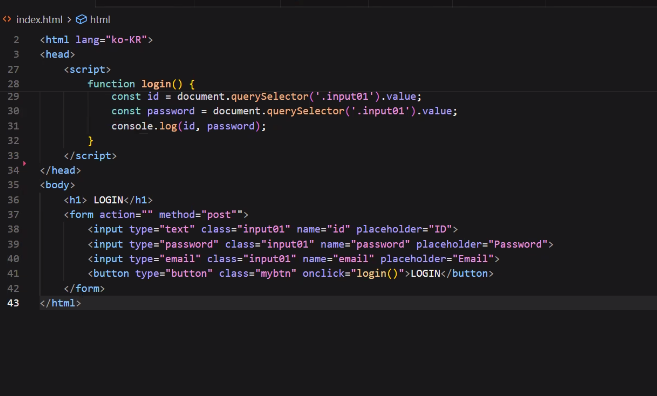

- 이런 바꾸면 안되는 파일들은 대개 소문자로 되어있음
- 사용하다보면 체계나 중첩들이 쌓인다. 이걸 관리하는것들이 root레이아웃에 옴. 체계나 중첩, 세션 관리에 대해서도 알려주실 예정

### 넥스트에 카운터 추가하기
- 데이터베이서에 끊임없이 통신하면 그것이 즉시 반영할 수 있음
- 짧은 시간 내에 빠른속도로 여러번 누를때: 불필요한 왕복이 짧은 순간 수십번 발생할 수 있다. 이럴땐 어떻게 하면 좋을까? 
    - 화면 이동시 한번에 발송을 하는 등의 방법이 있다. 

---

## 넥스트 이어서
favicon 이름으로 파일을 넣으면 이미지를 로고로 넣을 수 있음

### 예시 아이콘 수정을 위한 강사님의 피그마시연
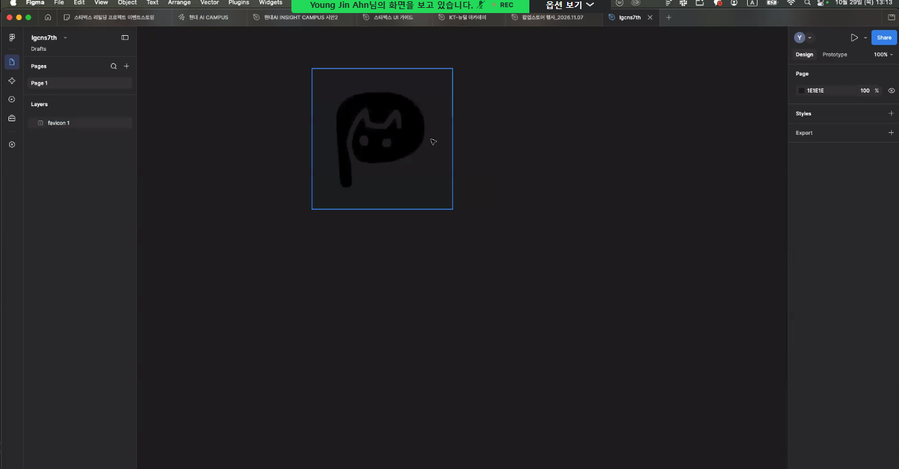
- 이미지 리무브를 이용해 자동으로 흰배경이 날아간 모습

- 지저분하게 정리가 되신 것 같다?
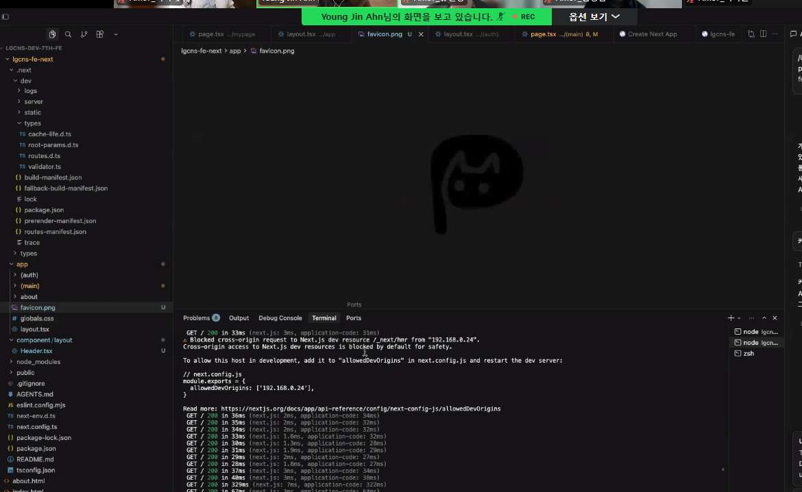

- 정상적이면 탭 이미지로 떠야 하는데 png가 뜨지 않는다. 그럴 경우 설정을 바꿀 수 있다.
- 아니면 확장자를 바꾸는 방법으로 ico로 바꿀 수 있다. 
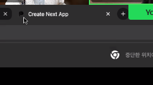

- 앱 아이콘도 만드는 것이 좋다.

#### 폰트추천
- 구글 폰트 고딕A1
- 시스템 폰트는 기종마다 다를 수 있기 때문에 경계해야한다

- 보통 폰트는 여기서 어떻게 쓰는지 확인 가능
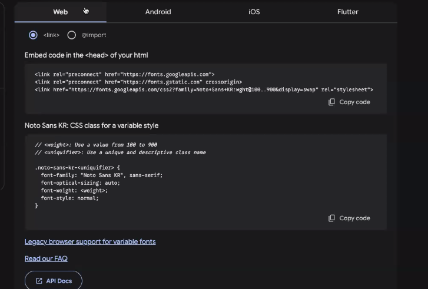

- 넥스트는 조금 다름. import로 선언하여 사용한다
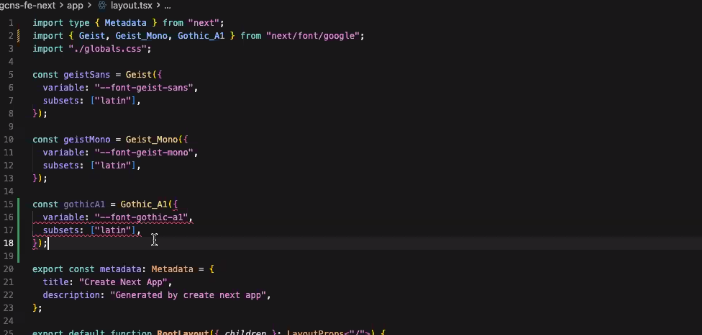

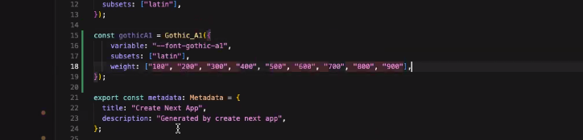

#### HTML 태그 중 `<code>`
    - 안에 있는 코드를 표현하기 보단 이런게 들어왔다 인식을 요청하는 용도의 태그? 새로생긴모양

- 폰트를 사용할 때 기본 디폴트보다 우선시해서 사용하고 싶은 부분과 바꾸고싶은 폰트가 있다면 layout.tsx 와 구글 css를 수정해주면 됨
- 코드 적용시에는 나름의 이름 규칙이 각자 폰트마다 존재한다. 사용전에 사용법을 확인하면 좋다. 

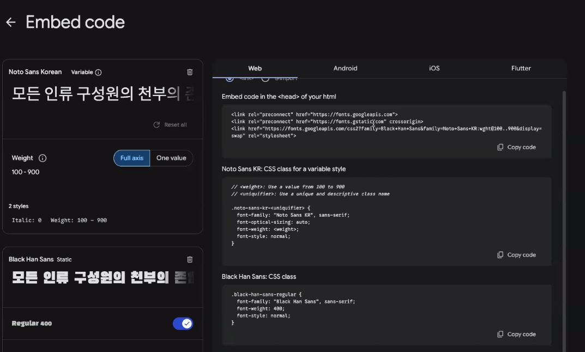

#### global.css는 종속관계에 있기에 layout.tsx > global.css 순서대로 적용된다. 

#### 모바일 사이트 기준으로 만들기 (피그마 시연)
- 먼저 기본형태 구상
- shadcn 이 사용하는 아이콘 : Lucid 아이콘
- 처음부터 메뉴 구현은 하지말고 일단 주소창으로만 이동하는걸 전제로 설계한다
- 폰트 사이즈는 보통 14~16을 사용함. 모바일은 16

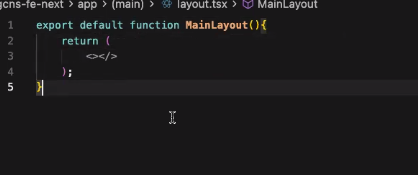
ㅣ레이아웃 함수 디폴트

### 리액트노드
- 낵스트가 정한 방식 

졸았다... 

---

### 넥스트 실습 이어서 
- 아토믹 형태로 페이지를 만들어갈 예정
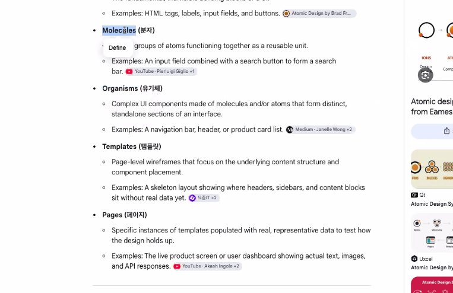

- 일반적으로 푸시전엔 린트와 빌드 테스트 후 넘기는 것이 맞음. 하지만 수업이라 린트만 확인하고 올리고 계시다고 하심

- 도메인에 대한 허락요청
    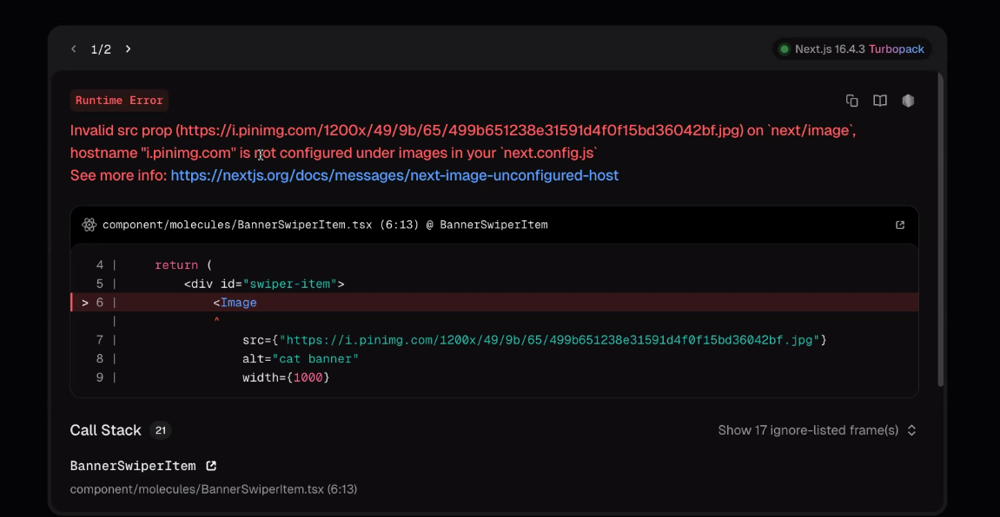
    - nextconfig에 가서 도메인 허락을 받는다.

- 엘리멘트의 장점 : 칠드런, 끼워넣는 형태로 만드는 것이 가능하다.
- customtitle 에 클래스네임 넣기 > 어트리뷰트 넣기 
- 유연한 대처가 가능한 원자로 만들어야 한다.
- 자세한건 샤드씨엔 봐라. 

- 기본값 외에 커스텀 할 수 있다. 
- twMerge
- 이제 만들어진 커스텀 타이틀을 어디에든 쓸 수 있다.

- 타입스크립트는 명확한 선언이 중요하다.  any 처럼 애매하 것을 쓰는건 좋지 않다.

---

### 이어서
- 컴포넌트의 장점은 태그처럼 열고 닫을 수 있다는 것

#### 헤더 푸터 만들기 
- 무조건 아톰이 되진 않는다.
- 이미지가 많으면 생각해볼일이지만.

#### 연동형 코드는 하나의 css 를 사용하는 것이 기본
- 하지만 리액트쪽은 상태관리가 중점으로 갈아끼우는 방식
- 테일윈드덕분에 분기나누는게 쉽다

#### 모바일, 데스크탑 네비게이션
- 조건분기 하기보단 두개의 컴포넌트를 넣는게 편하다
- 아톰에는 데스크탑 버튼 등이 들어갈 예정
- 아이콘 레벨의 버튼
- 항상 공통되는것을 먼저 만들고 하는것이 좋다. 그렇지 않으면 팀프로젝트하다가 힘들 수 있다.
- 현재 배우고있는건 올드한 방법. 요즘은 컴포넌트로 먼저 빼내는 원자방식으로 진행하는 편.

---

### 리액트는 하나의 기술이기 때문에 보조적인 도구를 사용할 수 있어야한다
- 네이티브 리액트를 찾는다면 기존 것의 유지 보수를 찾는것일 가능성이 크다.

### css 를 좀 더 들여다 볼 예정
- 이미지 위로 제목을 올리기. 이미지를 누르게 하기. lgcns 글자를 오른쪽으로 옮기기

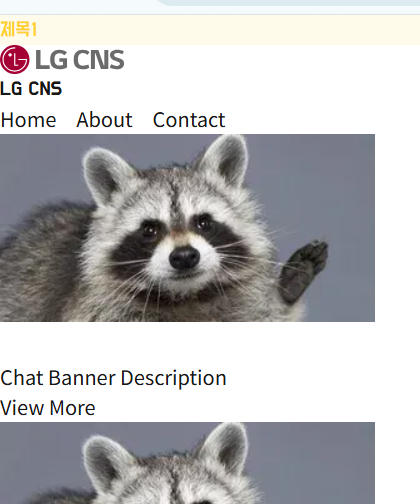

- 왼쪽에 딱 붙은 이유는 padding 과 margin 이 없기 때문
- 한편으로 이미지는 화면을 꽉 채우고 싶음(모바일기준)
- 프론트엔드에는 정답이 없지만 공통적인 설계상 방해하지 않는 범위의 맞지않는 코드가 올 수 있음.
- 현재 원하는 설계상 바디에 주는게 아니라 꽉 차게 만든 다음 내부적으로 오는 것들의 섹션에 padding을 각각 넣어 관리를 하는것이 좋음.

```
.main-header {
  display: flex;
  flex-direction: column;
  justify-content: space-between;
  align-items: end; << 위치
  padding: 2lrem; <<사이 
  gap <<간격
}

.logo-text {
  position: absolute;
  top: -300px;
}
```

- 이걸 테일윈드로 적으면 

#### CSS 그리드
- 플렉스가 1차원이라면 그리드는 2차원
- 표는 아니고 박스를 쌓는 구조 
- 상품 표시되는 리스트를 쓰는 상품몰 등이 대개 사용함
- fr(균등하게 나눈다는 말) : 1배 2배.. 사이즈가 계산식으로 들어감
- 보통 이런건 테이블을 사용했었음. 테이블 선언하고 컬럼, 로우를 사용해서. 하지만 표의 단점은 반응형을 할 수 없다는 점임. 그리드를 쓰면 반응할 수 있게 가능함.
- repeat(3, 1fr)
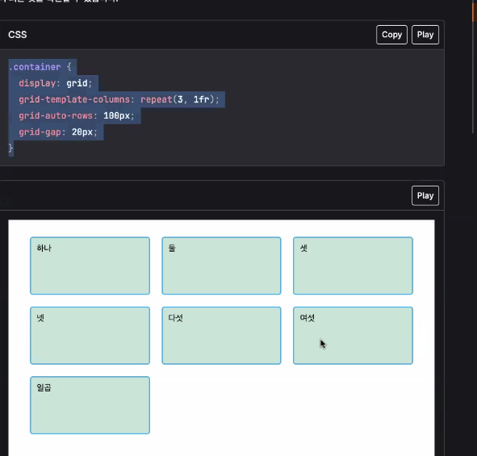
- flex로 그리면 복잡하지만 그리드를 사용하면 가능함
- min, max...

- 쌓이는 구조만 그리드 써라. 다 사용되는 이유가 있고 위치가 있다. 간단한 건 flex 써라. 

- row/column-reverse
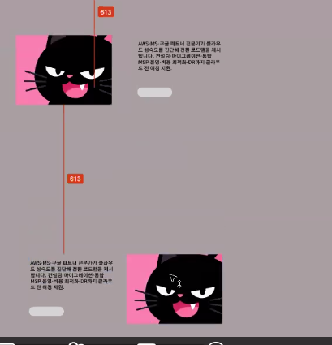
- 이런 형태를 세로로 세웠을 때 
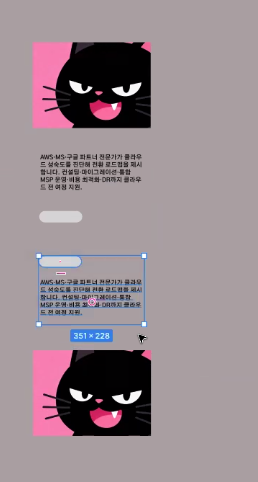
- 이런 식으로 나와서 뒤집는 식

#### 라이브러리가 제공을 멈추는 순간 프로젝트는 터진다
- 모듈등등은 계속 업데이트된다
- 서비스가 멈추는 건 중대한 사항
- 그러므로 사용에 큰 회사들은 검토 후 허가등을 받아 사용한다.

### css 배울 때 레이아웃이 어렵다. 
- 포지션이나 디스플레이, absolute 등, 조심히 배워야 하는것도 있다.

---


