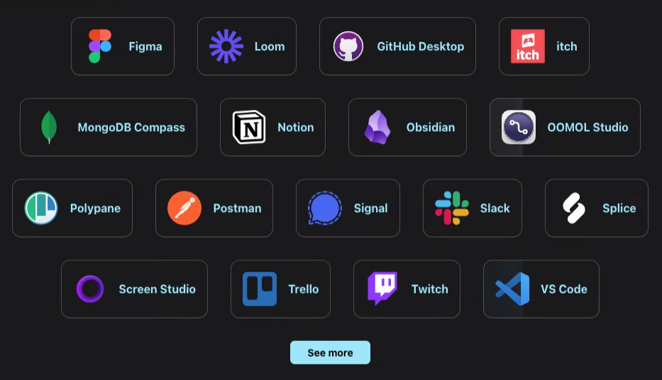

# 4일차 TIL : AI 서비스를 위한 프론트엔드 3

## 
- 앱을 제작하다보면 여러 기기로 테스트해야 할 필요가 생긴다. 
- 개발자 툴로 가면 여러가지 기기를 등록해 인터페이스가 어떻게 나오는지 확인해 볼 수 있다. 
- 물론 실물기기랑 좀 다르다. 

## 일렉트론js
- vs 코드를 만든 도구
- 어플리케이션을 데스크탑용으로 변경해주는 플랫폼
- 잘 아는 앱들이 이걸로 만들어져있음.
- 데스크 탑 툴을 사용할 수 있는 것이 특징. 
- 구글에서 만들어준거라 아이폰이나 사파리에서는 별로 안좋아함
- 강사님네 프로젝트 관리 툴

## expo
- 버셀이 인수함
- 리액트 같은 느낌. 리액트 덮어쓰는 플랫폼. 넥스트 js 같은것
- 다만 생태계가 다름. 히스토리 개념이 아니라 뒤로가기를 누르면 레이어를 쌓는 구조.

## Flutter
- 구글에서 만든것.

## os 버전도 알아두자.
- 앱은 모든 버전을 대응할 수 없다. 
- 크롬과 사파리는최신기준으로 대응되니 괜찮지만
- 아닌것은 보여야 할 게 안 보이고 깨지는 경우가 있음
- 국내에서 도커 같은거 하고싶은 사람은 토스로 많이 감. 외국에선 그런 곳이 버셀. 배울 것이 많음. 

## shadcn
- shad 도 버셀이 가져감

## tailwind
- 이거 나오고 이전 최강자인 부트스트랩이 죽음
- 최근 기술, 기업관리 관계, 요즘의 트렌드들을 잘 따라가야 함.
- 프론트는 앞에 보이는 만큼 남들이 많이 쓰는 기술을 사용해야함. 나를 사용해줄 사람을 구하려면 주류를 잘 따라가고 앞으로 뭐가 뜰지 캐치할 수 있는 안목이 있는 것이 도움된다. 
- 그 전에 떴던건 mui 대부분의 css 업계가 테일윈드를 써서 대부분 죽음.
- Heroui : 여기도 최근에 죽음. 버셀이 인수했다는데 ..

## turborepo, monorepo 등 도 알아두면 좋다.
- 관리자앱 유저앱 등의 주요 앱의 사이드를 같이 운용하고 싶을 때 사용 

## 기술 스택을 많이 알아두자. 

## npx
- npm, npx 두가지 명령어 비교해볼것

---

## 오늘 : Next js
- 리액트는 layout.tsx로 컨트롤을 함. 
- 페이지를 생성할 때마다 타이틀을 생성하는 등의 일을 함.
- 리액트와 미들웨어 서버가 다름: 시작은 npm run dev

### 넥스트에서 나오는 것
- children
- pagerouting : 이건 과거의 기술. 3~4년 전의 페이지를 유지 보수할때는 필요하겠지만 앱 라우터를 중점적으로 보는것을 권장

### 실습 이어서
- 완전 리액트와 동작방식이 조금 다른 부분이 있음. 이동할 때 약간은 깜빡임이 발생함.
- 두개가 완전히 다른 툴이라고 생각하고 접근하는것이 좋음.
- 넥스트는 항상 기본적인 바디가 추가되어있다고 생각하면 됨 

- 레이아웃은 해당되는 페이지에 고정적으로 있는것들을 설계함.
    - 랜더링이 유지된 상태로 움직이므로 로딩이 빨라짐

- 주의 : page.tsx 는 해당 페이지의 바뀌지 않는 큰 틀. 페이지는 페이지로 쓰는것이 좋다. 다른 용도로도 쓸 수 있겠지만 기본은 그렇다. 
    - 아토미 디자인 설계 : 가장 상위에서 템플릿을 조합하는 페이지

- 페이지는 기능별로 나누는 것이 좋음.
- 그리고 해당 기능외의 것은 따로 디렉토리를 갖는게 좋음. 
- 일반적으로느 또 나뉘고 나뉘면 불편해서 소스 디렉토리를 사용함

- 어떤 레이아웃은 형식이 다른곳도 존재함. 예를 들면 로그인, 비밀번호 페이지. 일반적인 페이지와 달리 헤더, 푸터가 없는 경우가 있음

- 유저가 로그인 한 것을 어떻게 알 수 있을까?
    - 이 웹사이트는 어떻게 내가 로그인 한 것을 알 수 있을까?
    - 페이지에 접근할 때 어떠한 조건들이 붙어있는 페이지가 존재함. api 인증절차등이 필요하니까.
    - 로그인 페이지는 로그인 하면 접근할 수 없다. 
    - 로그인을 한 경우 로그인 페이지에 접근할 수 없어야 한다. 
    - 쿠팡
        - 로그인 페이지로 돌아가려고 하면 다시 홈페이지로 오거나 넘기게 한다. 
        - 로그인페이지 주소를 치고 들어가면 변경들이 있어 들어갈 수 없는 화면이라고 뜬다. 
    - 웹을 만든다면 프론트와 백 모두 알아야 하는 부분이다.
    - 어플리케이션 탭의 쿠키를 보면 알 수 있다.
    - 그곳의 키를 보면 마지막 활성화를 확인할 수 있다.
    - 이런걸로 세션관리를 하고 만약 강제 로그아웃을 시키거나 할 때 이런걸 사용한다.
    - 토큰 방식도 있음. 
    - 쿠팡은 인증서버를 별도로 관리하며 그곳에서 접근한 사용자를 인증 확인하는 기술이 있을것임.
- 넥스트는 미들웨이기술로 프록시라는 것이 있음.
    - 방금처럼 로그인시 접근불가 규칙과 같은것을 만들면 화면을 열지도 않고 튕겨내버리는 것이 가능함.
    - 참고로 넥스트 서버가 미들웨어 역할을 함. 로그인 하면 넥스트가 중간에서 api를 처리함.
        - 세션이나 토큰을 사용하는것이 가능함.
- 항상 어떻게 동작하는지의 동작방식을 이해하는것이 중요하다
- 보안적 정책 : 토큰 시간관리 정책.
    - 백엔드의 리프레시 토큰, 넥서스토큰
        - 제이슨 형태의 토큰으로 네이티브 앱의 기술임

- 프론트엔드가 가져야 할 덕목 : ux를 좋게 만드는 것. 
- 리액트도 api를 던질때마다 토큰을 확인하는 등의 절타를 가짐 
- 이러한 것을을 할 때마다 동기, 비동기가 옴
- 어플리케이션에 있는 쿠키는 웹에 무조건 들어감.
    - 구글이 행동패턴가져간다고 소송받고 패소함. 
    - 우리가 하는 모든 행동을 가져감. 
    - 그래서 쿠키를 허락하는 요청을 하는것. 
- 세션이 뭔지, 쿠키가 뭔지, 토큰이 뭔지 에 대한 기본적인 공부가 필요함. 

## 레이아웃에서 로그인은 위아래가 안보기에 해야 한다. 글로벌로는 못씀
- 그래서 넥스트는 그룹을 따로 만들 수 있게 ㅎ ㅏㅁ
