# 6일차 TIL : AI 서비스를 위한 프론트엔드 4

- 넥스트 실습은 다음 레포지토리에서 진행한다.
  - 🔗 [실습 레포지토리](https://github.com/easty00/lg-front-app41)
  - 🔗 [실습 배포 도메인](https://lg-front-app41.vercel.app/)

- HTML과 REACT실습은 여기서!
  - 📂 [10/28 실습](../../실습/20261028)

## 오프닝

### Husky
    - 커밋할 때 린트랑 검사 후 푸시하는 부분을 유용하게 도와줌
    - 커밋 직전 npm run lint를 자동으로 돌려줌
- 여럿이 같이 일을 할 때 동일한 소스코드를 사용하는 팀원들과 머지요청 등 상호작용을 하던 중 문제가 많이 나온다.
- 이를 해소하기 위해 커밋 전 먼저 자동으로 검사하게 해두는 것

### 그 외의 협업방법
- Git Flow
    - 브랜치 이름, 합치는 순서 등 팀 규칙
    - 예 : 메인으로 직접적으로 합치지 않는다, 메인이전 각각의 기능을 담당하는 브렌치에 먼저 합친 뒤 메인으로 합친다.
- 지라 등의 협업툴을 사용하여 조율하기
- 요즘의 기업에서 원하는 인재상 중 하나가 협업에 적극적이고 팀에 빠르게 융화되는 것이니 이런걸 알아두고 실제 실습 때 해보는 것이 좋다.

### 이번에 할 것
    - tailwind와 전통 css 비교하기
    - 순수한 자바스크립트로 작성하면 어떻게 할 것인가

## HTML
- DOM : 도큐먼트 오브젝트 모델
    - 브라우저가 HTML을 읽어서 만드는 지도. JS는 이 지도에서 태그를 찾고(querySelector) 바꿈
### 기존 CSS 와 Tailwind
| 부분 | 하는 일 | HTML에서 | 어제 Next에서 |
|---|---|---|---|
| **데스크톱 네비게이션** | 넓은 화면에서 메뉴 3개(Home·About·Contact)를 **늘 펼쳐서** 보여 줌 | `<ul class="desktop-nav">` | `DesktopNavigation` |
| **모바일 네비게이션** | 좁은 화면에서 **햄버거 버튼 + 접힌 메뉴** | `<div class="mobile-nav">` | `MobileNavigation` |
| **네비게이션 토글** | 햄버거를 누르면 메뉴를 **열고 닫기** | `js/main.js` | `useState(isOpen)` |

```css
.desktop-nav { display: none; }                 /* 기본(모바일): 데스크톱 메뉴 숨김 */
@media (min-width: 768px) {                     /* 768px 이상이면 */
  .mobile-nav  { display: none; }               /*   햄버거 숨기고 */
  .desktop-nav { display: flex; }               /*   데스크톱 메뉴 보이기 */
}
```

- Tailwind로는 `hidden md:flex`, `md:hidden` 한줄임

### HTML과 리액트
- HTML 은 돔에서 가져와서 컨트롤 하고 상태관리 하는 기능이 존재함
- 리액트 방식으로 간다면 open close를 하기 위해 (넥스트 파일 참고) setIsOpen 같은 함수 사용.
  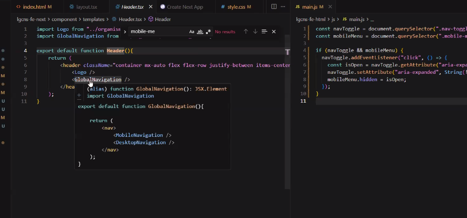
  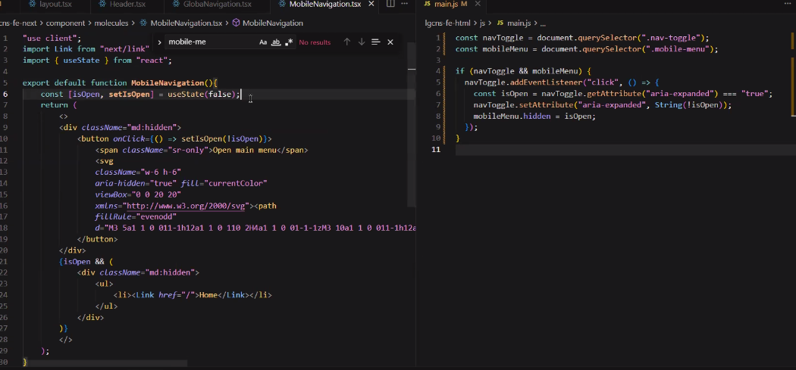

| | React·Next 방식 (사진) | 순수 HTML·JS 방식 (`main.js`) |
|---|---|---|
| "열림" 기억 | `const [isOpen, setIsOpen] = useState(false)` (메모장) | 버튼에 붙은 `aria-expanded="true/false"` (**쪽지**) |
| 클릭 연결 | JSX의 `onClick={() => setIsOpen(!isOpen)}` | `navToggle.addEventListener("click", ...)` |
| 메뉴 보이기 | `{isOpen && <div>메뉴</div>}` → 열릴 때 **새로 그림** | 처음부터 있는 메뉴의 `hidden`을 **켰다 껐다** |
| 비유 | 메모장만 바꾸면 React가 **알아서** 다시 그려 줌 | 내가 **직접** 스위치를 찾아가서 켜고 끔 |

- HTML 은 TRUE, FALSE를 지정하여 해당 상태에 따라 클릭등의 이벤트를 부여함
    - `aria-expanded` : `main.js`가 클릭할 때마다 이 값을 읽고(`getAttribute`) 반대로 바꿔 적음. 이에 따라 화면에서도 이 값을 보고 메뉴를 펼치고 접음

- 자바스크립트 즉시로딩 - `defer`, `async`
    - `<script>` 가 언제 실행되느냐
- 아직 자바스크립트가 불려지지 않은 경우, 스크립트가 위쪽에 있는 경우, 아래쪽까지 보고 동작하겠다 하는 것이 `defer`, `async`는 즉시

| 방식 | 내려받는 동안 HTML 읽기 | 언제 실행? | 비유 |
|---|---|---|---|
| `<script>` (기본) | **멈춤** | 받자마자 | 책 읽다가 택배가 올 때까지 **멈춰서 기다림** |
| `<script async>` | 계속 | 받자마자 (HTML을 다 읽었든 말든) | 책 읽는 중에 택배 오면 **바로 뜯음** |
| `<script defer>` | 계속 | HTML을 **다 읽은 뒤**, 적힌 순서대로 | 책을 **다 읽고** 택배를 뜯음 |
| `<script type="module">` | 계속 | defer처럼 | Vite React가 이 방식 |


### 자바스크립트 호이스팅
    - 코드 실행 전 변수와 함수의 선언이 코드의 최상단으로 끌어올려지는 것처럼 동작하는 현상
- 아래 있는 코드를 위에 있는것처럼 동작시켜주는 기술
    - 초기부터 있던 기능으로, 2015년에 현대적 보완이 있었음 (`let`, `const`)
    - 호이스팅이 위치를 옮기는건 유용하지만 문제를 발생시키기도 했음

### 자바스크립트 압축
- 자바 스크립트들은 압축을 많이 한다. 압축기술이 있음
    - 10mb를 500kb로, 300kb 로 이미지나 파일을 압축할 수 있음
    - aaaa.js
      aaaa.min.js
        - 요즘은 보기 어려움.
        - 자바스크립트 소스코드를 경량화 하기 위해 압축해주는 파일. 
        - UglifyJS, Terser 같은 압축도구를 이용하며 일반적인 소스코드를 한줄정도로 주석이나 공백, 함수 등을 압축함
        
### iframe
    - 페이지 안에 **다른 페이지를 창문처럼** 끼우는 태그. 옛날에는 헤더·사이드를 각각 html로 두고 iframe으로 끼워서 컴포넌트처럼 사용
- 초기 원시적으로 유행했던 스타일. 현재에는 잘 사용하지 않음.
- 이때 사용했던 주 기능은 메모장이었음
    ```
    - 헤더 html
    - 사이드 html
    - 홈 html
    ```
- 초기 컴포넌트 형식을 사용해봐서 기존에 컴포넌트 나누는데 도움되었던 것 같다고 하심. 

#### MDN 많이 봐라

---

### 리뷰어에게도 책임소재는 발생한다.
    - 프로젝트 코드에 관여 한 부분이 있다면 그 부분에 대해서는 어느정도 책임이 발생하는것이 당연하다.

--- 

### shadcn 들여다보기
- 아토믹 설계와 유사.
- 근본을 쌓아서 만들어짐
- Lucide : shadcn 아이콘모음

- cn : 하나의 라이브러리.
    - 리액트는 리턴문을 쓰고싶으면 중괄호를 쓸 수 있음.
        - 자바스크립트 안에 자바스크립트를 쓸 수 있음 -> inner HTML의 방식을 사용하고 있기 때문.
        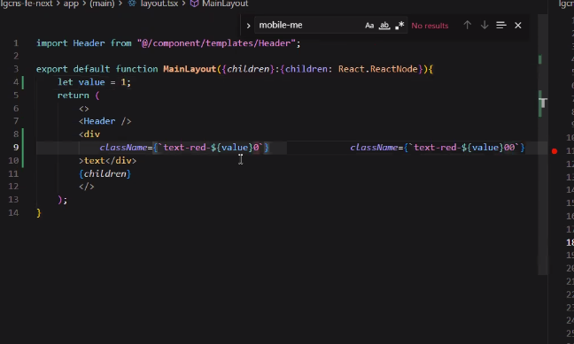
        - 이 안에 조건문 동기문을 사용할 수도 있음. 그럼 줄이 점점 길어짐.
    - 테일윈드의 충돌 해소 목적으로 사용
    - 실무 사용 예시 
    - 넥스트에서도 cn이 일을 하고 있음. 추후 파일 확인해보기!

### Tailwind, Lucide, shadcn 동적페이지에대한 설명 예정

### search param
- 데이터베이스가 일련번호로 긁어가기 쉬워지면 크롤링으로 끊임없이 가져갈 수 있게 되고, DB에 부하가 걸리기 쉽다. 
- 되도록 일련번호를 피하는게 좋다.

> [!TIP] 넥스트 홈페이지의 Layouts and Pages 참고

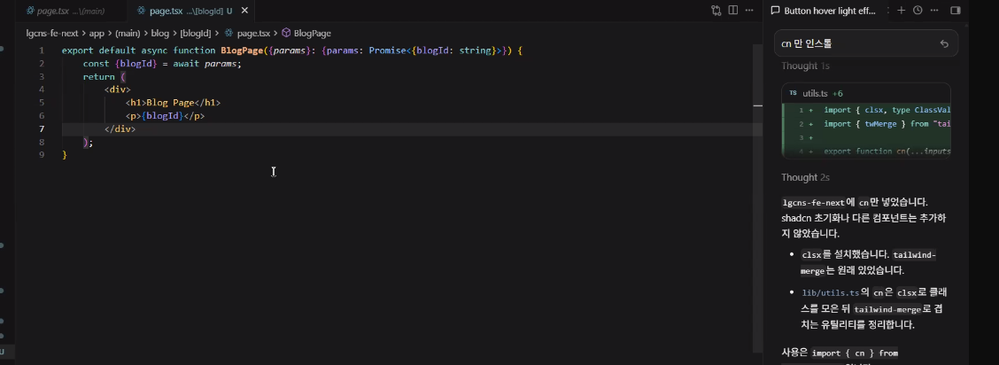
- 넥스트는 실제 사이트 렌더링이 아닌 하는 척을 하는 방식으로 동작함. 실제로 값을 읽지 못하는 일이 발생할 수 있다.
- 주소에 따라 달라지는 값은 param을 Promis로 주는 방식을 사용함.
- 이로 인해 acync/await 등의 비동기 코드가 생긴 것이다. 사용하면 백엔드와 상호작용시 해당 요청이 돌아올때까지 기다리게 함. 
- 동기코드를 잘 작성해야한다. 어플리케이션 - 스토리지로 갔을 때 실제 빌드시 느려지는 경우가 있다.
- 스켈레톤 : 완충재 (로딩중.. 하고 뜨는것)

- 동적으로 생성한 이유가 뭘까? 
    - 데이터를 패칭하기 위해서.

---

### 텍스트 에디터 
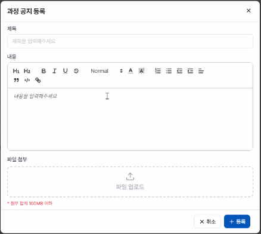
- 라이브러리를 쓸때 검증을 하고 쓰는게 좋다
- 텍스트 에디터의 경우 대부분 외국기준이다.
- 우리는 한국이니 한국기준으로 서비스 사용감이 좋은걸 쓰는것이 좋다. 

### 테일윈드
- 버전마다 해결책이 다르다. 다른 툴도 그렇다.
- 각 버전마다 문제가 생기는 경우 대응할 수 있는 방안들이 존재한다
- 라이브러리 업데이트의 문제점 : 독단적으로 진행된다. AI를 직접 믿지말고 스스로 대응해보는 것도 좋은 공부가 될 것

### searchparam
- ?? 같은 것 사용. 어떤 데이터가 오는지 모르기에 붙는 것. 이 내부에 채워지는 것이 결정되지 않을 때 사용 .

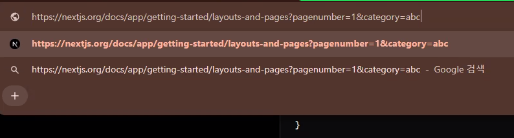
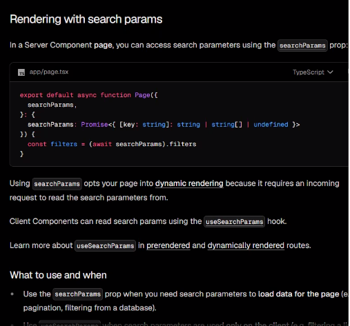

```
https://nextjs.org/docs/app/getting-started/layouts-and-pages ? pagenumber=1 & category=abc
└──────────────────────── 경로 (param이 여기서) ──────────────┘   └─── searchParams (? 뒤) ───┘
```

| | param | searchParam |
|---|---|---|
| 모양 | `/blog/hello`의 `hello` | `?page=1&category=abc` |
| Next에서 | `[blogId]` 폴더 + `params` | 폴더 없이 `searchParams` |
| 주로 | **무엇**인지 (글 하나, 상품 하나) | **어떻게 보여 줄지** (페이지, 필터, 정렬) |
| 비유 | 택배 **주소** (몇 동 몇 호) | 택배 **요청사항** ("문 앞에 두세요") |

- 필터링
    - 쿠팡 예시
    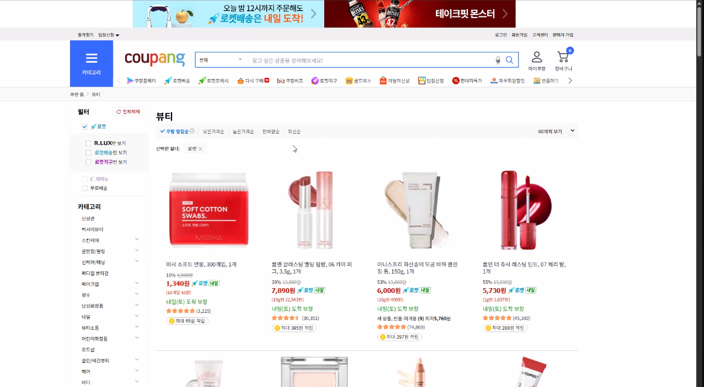
    - 카테고리로 들어오는것은 빠르지만 하단의 필터를 사용하면 카테고리에 비해 느린 것을 알 수 있다.
- 필터링은 하나하나의 상품에 대응해 필요한것을 뽑아내기에 시간이 상대적으로 소요된다

- param은 구분할 수 있으면 된다.
- searchparam은 ? 이후 뒤에 있는 것을 말함.
> [!NOTE] 이 부분은 여전히 애매하기에 공부 필요

- csr ssr 구조에서 액션을 제외하고 헷갈리는 부분은 : 그림이 먼저냐 주소가 먼저냐 이다. 
    - 쿠팡에서 1페이지에서 2페이지로 이동을 한다 = 상태를 바꿨기에 2로 바뀌고 그것이 csr. 클릭이라는 이벤트로 인한 상태가 변한 것을 확인하면 주소가 뒤따라오는 방식
    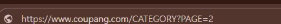
    - 다음과 같이 2로 변한 주소가 나오면 이를 api 를 보내 상호작용하여 해당하는 페이지를 뒤따라 보내주는 방식
    - 무한스크롤 : 현재 스크롤 위치에 대한 페이지를 기억하지 않고 현재의 화면에 보여지는 것에만 집중되어있음. 이를 막으려면 스크롤을 고정하는 방법이 있음. 문제가 있다면 데이터를 가지고 있어야하는데..

    - SSR
    - 프론트엔드에 있어서 주소창을 활용할 때 , searchparam, param을 활용하는 능력이 중요하다. 

    - 이 기능이 뭐가 중요하고 이 기능을 왜 써야하는지 이해하는것이 중요하다. 

---

## 점심시간 

---

## 강사님 개인사정으로 수업은 3시까지 진행
    - 이후 수업은 ai 에이전트 특강

## 수업 이어서
### 자바스크립트 주소창 관리
    - 브라우저에는 생각보다 많은 정보가 담겨있다

- JS Web API
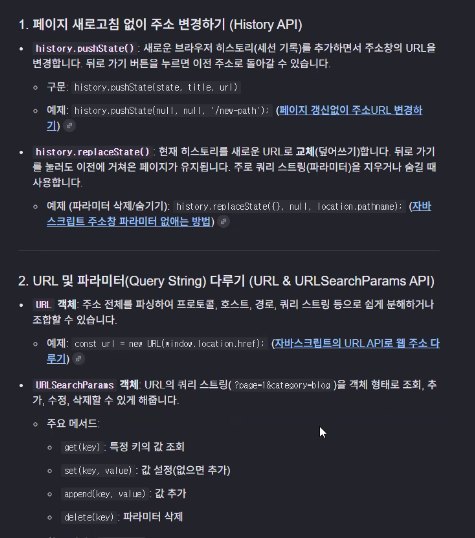
- 윈도우 로케이션
- 리엑트나 넥스트에서도 라우터 푸시라는 용어가 나옴

- query String
    `?page=1&sort=new` 부분 = Next의 searchParams.

- 자바스크립트 이너 윈도우 박스
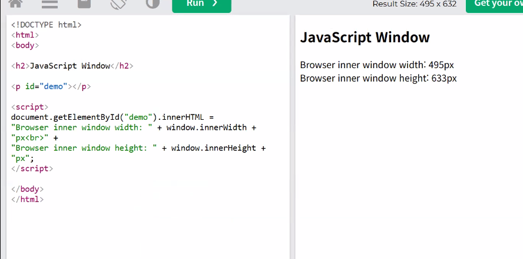
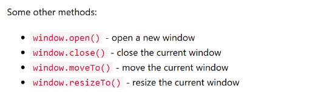

- 윈도우 스크린 (해상도)
    - 현재의 PC 모니터의 해상도를 가져오므로 수정하는 건 아님. 

- 보안이 약한 pc라면 이런게 노출되어 접근당했을 때 대참사가 일어날 수 있음.

- 윈도우 로케이션 : 주소체계. 현재 웹사이트 주소창에 있는거
```
https://www.example.com:443/feed?page=1#top
└protocol┘ └─hostname─┘ └port┘└pathname┘└search┘└hash┘
```

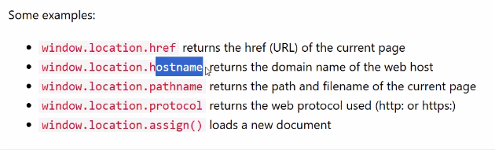

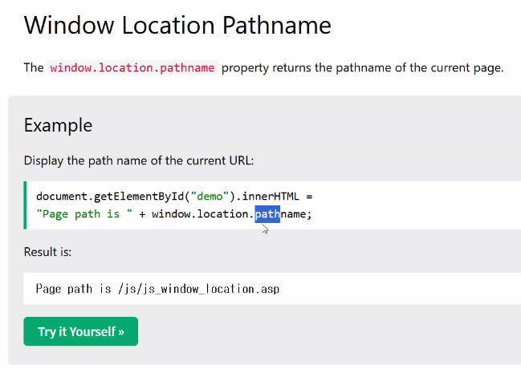

| 속성 | 비유 (택배) | 오늘 어디서 |
|---|---|---|
| `protocol` (`https:`) | 배송 방법 | |
| `hostname` | 건물 이름 | |
| `port` | 출입문 번호 | 아래 포트 |
| `pathname` | 몇 층 몇 호 | **params**, `[...slug]` |
| `search` | 요청사항 | **searchParams** |
| `hash` | "현관 왼쪽에" | |

- path variable 에서 많이 이야기하는 것 

- 프로토콜에 대해서 쓰면 어떤게, 안쓰면 어떤일이 일어나는지도 한번 알아봐라

### 포트
- 웹에서 주는 도메인 디폴트는 80 (http의 기본 문 번호) : 개인으로 주로 씀. 
- 닫혀있는 것은 433. 기본적으로 보안을 신경씀. (https) 
    - 네이버 같은 곳 = 443. 서비스 쓰는 포트들은 443으로 열려있음.
- 포트번호로 생각보다 여러가지가 나옴.
- 현재 pc 통신용 포트 개수는 6만 5천 여개정도 있다고 함

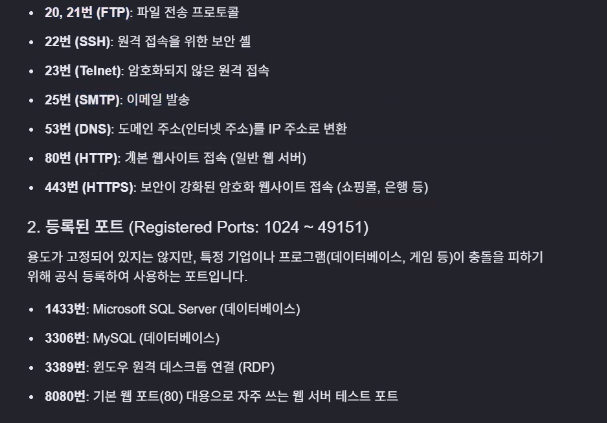

### 넷스케이프 
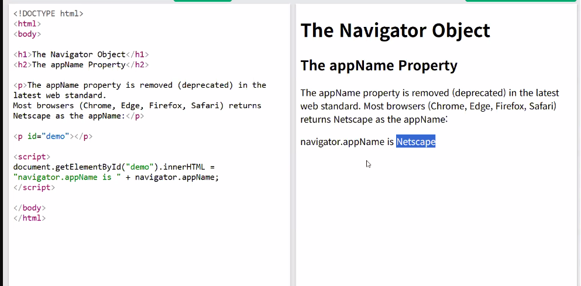

- 90년대 사용하던 웹 브라우저 기술
- 크롬, 엣지, 파이어폭스, 사파리 등이 네스케이프로 만듦
- 네스케이프 기반으로 동장하는게 꽤 있음
- 네스케이프 기반의 앱 코드는 모질라. 엔진은 게코
- 에이전트로 넘어가면 에이전트가 웹 등 사용할 때 사용 

- 자바 스크립트 패치 api는 담주 실습 때 상세히 설명 예정

- JSON : 자바스크립트, XML 형식으로 대화를 주고받음 

- Zod :  레귤러, 익세션 등 상태 관리를 줄여주는 역할을 함. 현재 실무에서도 많이 사용되고 있음.


### 넥스트 실습 이어서
- 동적 구성을 중첩이나 여러개로 하고싶은 경우
- [slug] : 지속적으로 들어가도 읽어주겠다.
- [...slug] : 몇칸이 오든 다 받는다.
- 값은 글자 목록(list)으로 받음

- 이런식으로 카테고리를 계속 들어가는 경우
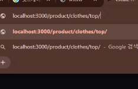

- 슬러그를 쓰면 패스네임으로 들어감

-파라미터는 페이지가 별도로 존재하는 게 아님
    - 별도로 존재하는게 홈페에지에는 유리함. 
    - 넥스트에선 ㄱ별 차이가 없지만 메타테그에 이 내용을 꽂아넣을 수 있으니 유용함.일반 사용자가 주소창을 알아보기도 쉬움
    - 일단 마지막에 페이지만 넣으면 만사오케이임, 

---

### 넥스트 실습 이어서 
- 폴더에 ... 있으면 동적으로 받겠다는 연산자. 
- suspense 의 기능 
    - lazy 동기 비동기. 용도. 
    - 너는 어떤 값을 불러올거야 하고 정해주고 기다리도록 한 뒤 이에 필요한 컨텐츠를 생성하도록 함

- 참고자료는 게시판에. 영상복기하며 같이 보면 도움 될 것 같다.

- 라우팅에 대하여 
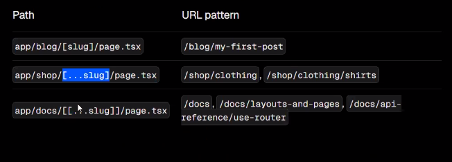
- 하나가 아니라 중첩으로 오는 경우 : [[...slug]]
- 캐치 올 세그먼트 옵셔널 : 올 수도 있고 아닐수도 있고. 
- 하위 단계는 많을 수도 있음.
- [...slug]와 차이점 : 하위경로의 유무. [...]은 반드시 한 칸 이상 있어야 하지만 [[...]]은 선택적이므로 없을수도 있음.

| 폴더 | `/product` | `/product/a` | `/product/a/b` |
|---|---|---|---|
| `[slug]` | ❌ | ✅ `"a"` | ❌ |
| `[...slug]` | ❌ | ✅ `["a"]` | ✅ `["a","b"]` |
| `[[...slug]]` | ✅ | ✅ `["a"]` | ✅ `["a","b"]` |

- [[]] 는 그렇게 많이 쓰는 일이 없음. [] 도 마찬가지. 종종 원하지 않는 값을 가져오기 때문. 예외처리가 복잡해지므로 일반적으로는 잘 안씀. 정적인, 잘 바뀌지 않는 페이지라면 굳이 쓰지 않음. 

#### 피드 폴더 생성
폴더에 넣은 후 그 안에서 알 수 있는 것과 알 수 없는 것을 searchParams(? 뒤) 가 있어 검색비슷한게 가능하다. 

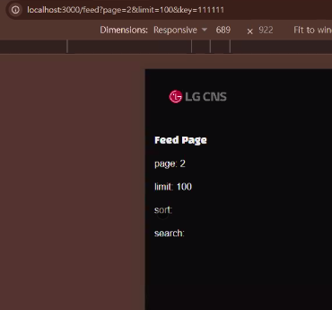

- 서스펜스를 넣어 로딩이 완료될 때까지 나오지 않고 기다리도록 동작함. 
- 있는것은 출력되고 없는것 (키)은 출력되지 않는다.
    - 주소에 없는 값은 `undefined`로 빈 값

```
app/(main)/feed/page.tsx                  ← 서버 : searchParams를 Suspense 안으로 넘김
 └─ component/templates/FeedContent.tsx       ← 서버 : await로 열고 화면에 보여줌
      └─ component/molecules/FeedNextButton.tsx  ← 클라이언트("use client") : 누르면 주소 바꿈
```

- use client
    - 버튼은 클릭(유저 행동)에 반응해야 하므로 클라이언트 컴포넌트
- use Router
    - Next가 주는 주소 바꾸기 리모컨. `next/navigation`에서 가져옴

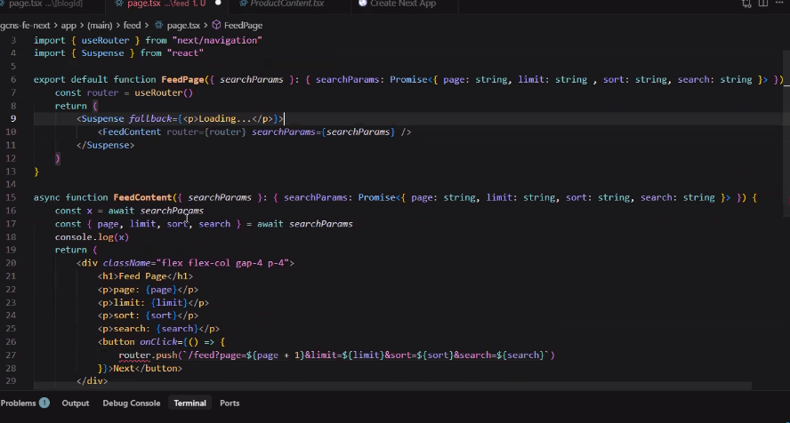

```tsx
router.push(`/feed?page=${parseInt(page) + 1}&limit=${limit}&sort=${sort}&search=${search}`)
```
- 주소에서 온 값은 항상 글자("1")라서 `parseInt`로 숫자로 바꾼 뒤 +1

- 줄이 길어지므로 템플릿으로 빼서 작성
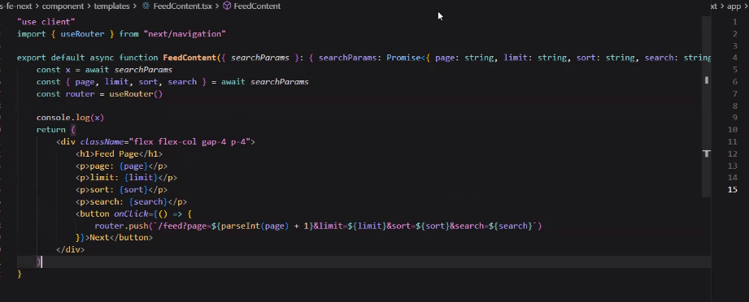
- 훅 : `useRouter` 처럼 `use`로 시작하는 함수들

- searchparam 을 통해 데이터가 넘어옴.
- 실무에서는 searchparam 을 그대로 넘기지 않고 키 밸류를 풀어서 넘김
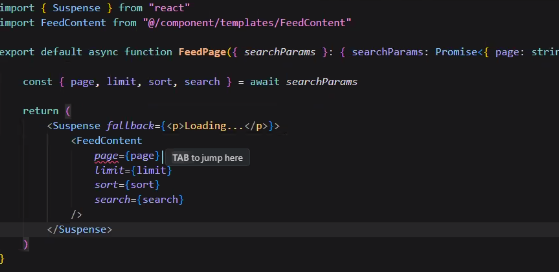

- 이는 서버 컴포넌트에서 사용하는 용어들 (page의 `searchParams` props)
- 클라이언트 컴포넌트("use client")에서는 `useSearchParams()` 훅을 쓰는게 정석.

- 넥스트는 주소창에서 페이지가 넘어가면 화면에 반영하는 방식으로 움직인다.

#### 정리

- SSR? 서버 컴포넌트는 서버에서 그림을 그린다
- 클라이언트 컴포넌터는 유저 행동에 따라 그림을 그린다

- 단순히 보기만 하면 문제 없지만 열린 이후에 

- 데이터를 주소창에을 통해 읽어오는 형태.
    - 주소를 입력받은걸 넥스트가 받아오고 컨텐츠를 그리는 영역에 전달. 
    - 답을 받아오는 것을 기다림

- 유저 액션용 버튼을 만듦. 버튼을 누르면 페이지가 넘어가도록 함.
    - 버튼을 누르면 주소창의 페이지가 넘어감.
    - 개발자 창을 같이 켜놓고 버튼을 눌러보면 라우터를 통해 주소가 바뀌면 이걸 엘리멘트들이 바뀐 주소를 보고 반응하려 바뀌도록 함. 

- 넥스트의 정상적인 소통방식(연락와서 못들음)
    - 리액트는 서버라는 컴포넌트 자체가 없고 100퍼센트 유저클라이언트 방식으로 진행됨.
        - 동작방식은 일단 무조건 열려있어야 하고 (setPage)
        - 열려있는 상태에서 페이지 이동등의 작용이 있으면 그때 동작을 함
    - 넥스트는 상태변화보다는 좀 더 안정적으로 동작한다

| | React (`useState`로 기억) | Next (주소로 기억) |
|---|---|---|
| 페이지 번호 | `setPage(2)` | `?page=2` |
| 새로고침 | 지워져서 1페이지로 | 주소가 남아 2페이지 그대로 |
| 링크 공유 | 친구는 1페이지 | 친구도 2페이지 |

### 2:40 정리
- 오늘 패스네임, 콜 스트링 등 , 주소창을 활용하는 방법에 대한 이야기를 하셨음
- 프론트엔드에게 주소창을 다루는건 중요한 일임
- 쿼리스트링을 넣어 동작하는 방식과 페이지로 이동하는 방식에 대한 차이를 이용하고 운용하는 것이 역량에 많은 도움이 될 것.
- 검색 : 값은 리턴해서 돌아오는 방식. 하지만 새로고침은 안됨.
- 페이지는 검색하는 경우 해당 키워드가 들어왔음을 인지하고 화면이 바뀜
- 하지만 새로고침은 데이터가 안옴. 만약 주소창에 새로고침시의 기록이 남아있으면 해당 기록이 남아있는 상태로 동작할 수 있음, 이것이 리액트의 방식
- 넥스트는 주소창에 검색어가 바로 적혀서 해당 검색어를 바로 전달하는 방식. 
- 실전으로 해보면 좀 더 이해할 수 있을 것임

#### 과제,.. 는 아님 : 코드를 만들어두었음.
- 할 사람은 인트박스랑 한번 만들어와라
- 다음시간에 인트박스를 만들고 샤드cn으로 유아이를 직접 추가해볼 예정

---

## 수업 이어서 15:00

### shadcn 설치
```
npx --yes shadcn@latest init -d
```
| 부분 | 뜻 |
|---|---|
| `npx` | 설치하지 않고 **한 번 빌려 실행** |
| `--yes` | "설치할까요?"에 자동으로 예 |
| `init` | 내 프로젝트에 shadcn **처음 준비** |
| `-d` | 질문 없이 **기본값**으로 |

- 넥스트가 설치된 폴더에 설치
- components: 로 폴더에 추가됨. 
    - 내부를 보면 아토믹 설계로 되어있음. 
- 샤드의 버튼 내에 호버기능이랑 기본적인 디자인을 가지고 있음.
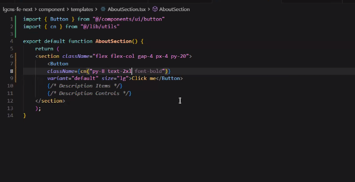
- 버튼 수정도 가능. 테일윈드 방식으로 꾸밀 수 있음. 
- css 공부를 한다면 자유롭게 조절할 수 있음. 

- shadcn에서 쓰는건 주로 아이콘이나 유아이, 정도를 다운받아 사용하는건 가능. 하지만 여러개가 들어있는 패키지 같은건 권장하지 않음. 
- 샤드를 받아서 단순히 복붙이 아닌, 해당 단추의 코드같은것도 수정해 보고 공부하는데 사용하면 도움이 될 것임.

- git stash 설명해주심 

## 지라 
이슈번호를 브렌치명으로 쓰는 경우가 있음. 이걸 깃허브에 연결하여 등록하고 관리하는 관리체게. 일정관리등등 . 프로젝트 매니저 같은것. 
대부분 유료임
지라와 깃허브를 연동하여 프로젝트를 관리할 수 있음

## 다른분 질문 
    - shadcn에서 가져온 버튼을 눌렀을 때도 onClick으로 값을 바꿀 수 있나요?
- 붙일 수 있음 
- const로 단추에 들어갈 글씨같은걸 정의 한 뒤, onclick 를 넣고 동작 시 해당 함수를 사용할거라 지정해두면 됨.
- 단순히 버튼을 눌러 페이지 이동을 하는 경우 버튼을 써서는 안됨.
    - 버튼 말고 링크를 쓴다.
    - 버튼 모양을 갖고싶다면 링크로 선언한 후 css로 꾸며주는게 좋다.
    - 2p, 3p 등 페이지 이동의 경우에도 버튼이 아닌 링크를 사용하는것이 훨씬 안정적이다.
    - 클릭하면 데이터를 주고받는 것을 말하는것. 단순히 누르면 확장되는 메뉴창 같은 것 말고 

---

## 4시 수업 : 강사님 대신 특강 진행

### 김재현 강사님. ai 에이전트 툴 소개

- 오르카!
- 오르카는 깃의 워크트리를 기반으로 움직임
- Pain Point : 여러 프로젝트 또는 하나의 프로젝트에서 여러개의 에이전트를 운용하는 경우 여러 에이전트를 하나로 관리하는데 편리한 툴. 
- ADE(에이전트 중심 개발 환경)
    ```
     IDE(통합 개발 환경) + Agent 관리 기능
    ```

- 모델 = 두뇌 : 지피티, 클로드 LLM
- 에이전트 = 대신 일해줌 : 코덱스, 지피티워크, 코워크, 클로드코드 
- 관제 = 오르카

- 오르카는 코덱스나 클로드 코드를 한번에 관리해줌

- 오르카는 AI 오케스트레이터(지휘자)다. 100배 빠르게 업무를 수행. 많은 에이전트들을 지원함.
- 각자 자신만의 워크트리에서 작업함

- 워크트리는 깃의 기능임. 에이전트에게 각자 사용할 폴더를 지정해줌.
- 브랜치와 워크트리의 차이점
    - .git = 서류함. 커밋하면 여기에 기록을 저장함
    - 브랜치는 대체로 기능마다 작업.
    - 브랜치는 기록을 남겨두고 다른브랜치로 넘어가는데 넘어가면 폴더 내용이 바뀜. 폴더 하나에서 관리하는것.
    - 워크트리는 새로운 책상을 두는것. 폴더를 물리적으로 새롭게 생성함. 
    - 서류함(.git)은 같이 써서 커밋한 기록은 공유됨. 하지만 커밋 안 한 수정은 책상마다 따로라 안 섞임. 같은 브랜치를 두 책상에 동시에 펼칠 수는 없음.

| | 브랜치만 | 워크트리 |
|---|---|---|
| 폴더 | 하나 | 브랜치마다 따로 (책상 하나 더) |
| 작업 바꾸기 | 하던 걸 커밋하거나 stash | 다른 폴더로 가기만 하면 됨 |
| 동시에 두 작업 | 어려움 | 쉬움 (책상마다 다른 에이전트) |

```
git worktree add ../새폴더 -b 브랜치이름   # 책상 하나 더
git worktree list                          # 책상 목록
git worktree remove ../새폴더              # 책상 치우기
```

- 오르카는 각 책상에 다른 에이전트를 앉혀놓고 일을 시킨 뒤, 가장 좋은 것을 채용하거나, 합칠 수 있음. 

- 특징 3가지
    - 작업이 서로 안 섞인다. stash 필요없음
    - 병렬로 시킨다
    - 결과 제대로 검토 가능

- 언제 쓸 수 있을까? 
    - 같은 업무를 동시에 맡겨서 제일 잘 한 결과 고르기
    - 교차 검증 (한 에이전트 결과를 다른 에이전트가 검사)
    - 나만의 팀을 만들어 역할 별로 다른 에이전트를 붙이고 싶을 때. 
    - 각각의 에이전트를 통합관리 하고 싶을 때
    - 통합개발 환경 유지. 

- 관련있는 깃 레포는 그들을 그룹으로 묶어서 관리하면 편함
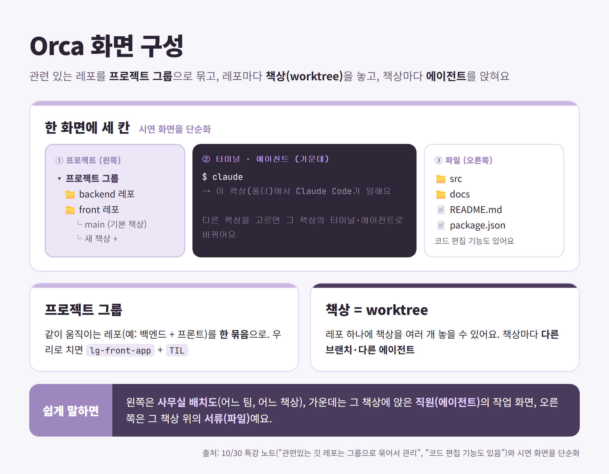

- 코드 편집 기능도 있음.

- 무료로 사용가능한 에이전트 : 안티그라비티 코덱스 추천 (무료 범위는 자주 바뀌니 쓰기 전에 확인)
- 에이전트는 오르카 설정 들어가면 추가할 수 있음. 

- 키미 큐웬 제브.. (다른 회사 모델들. Kimi, Qwen 등)

### 시연. 클로드에게 책상 하나 놓아주고 프롬프트 부여. 
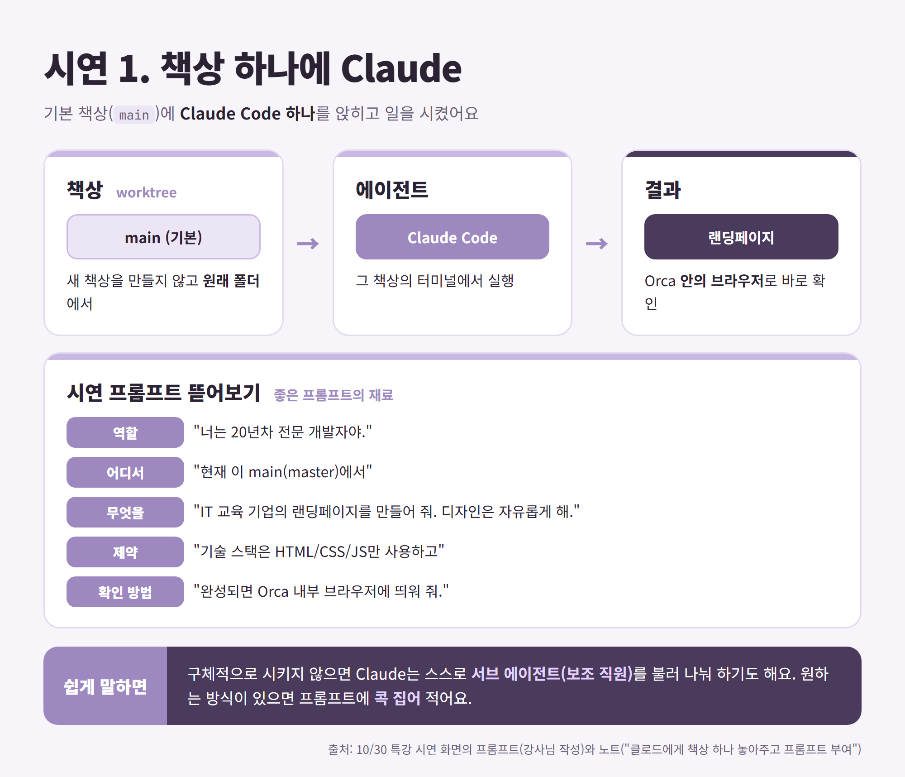
- 좋은 프롬프트 : 역할 / 어디서 / 무엇을 / 제약 / 확인 방법을 다 적음

### 사용량 통계 분석은 지원 되는 게 있고 없는 게 있음 
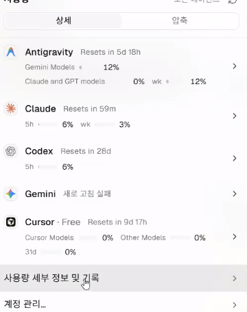

### ai에게 구체적으로 시킬 일을 안 시키면 클로드의 경우 개인적으로 서브 에이전트 만들어서 시킴. 클로드에게 에이전트 만들지 않고 다른 에이전트랑 같이 일하라고도 명령할 수 있음
- 서브 에이전트 = 에이전트가 자기 밑에 보조 직원을 불러 일을 나눠주는 것

### 오르카 기능 설명
- 안에서 웹을 키고 캡쳐하여 해당 캡쳐 내의 정보를 얻을 수 있음. 이걸 붙여서 할 일을 명령할 수 있음. 만들어놓은것에 캡쳐같은걸로 코멘트도 남길 수 있음
  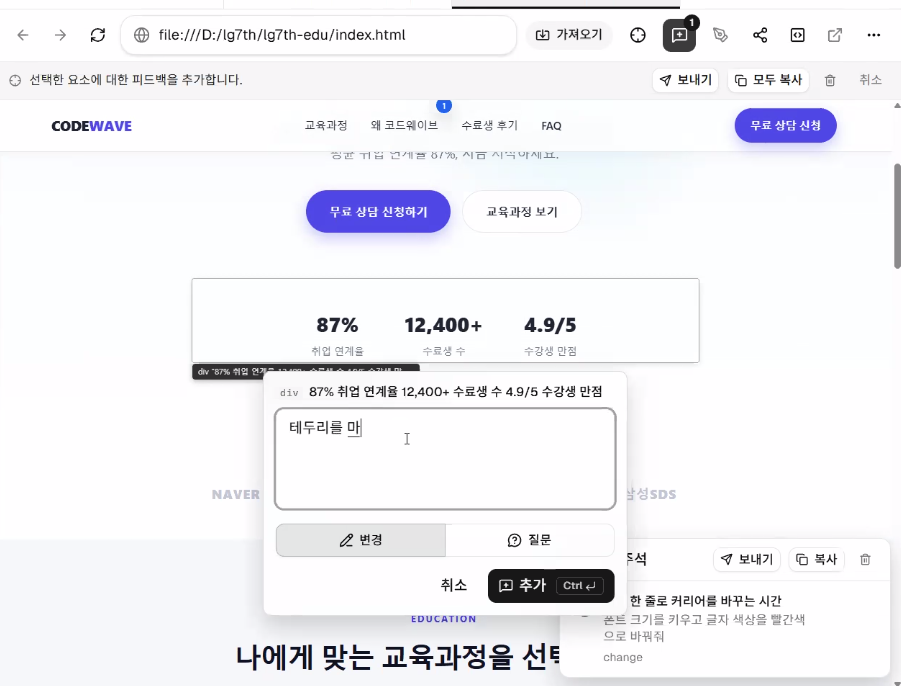
- 글로 표현하기 어려운건 그 위에 그려서 내 의사를 전달할 수 있음. 
- 파일을 끌어 지정하여 명령을 내리기도 가능.

### 다중 워크트리 병렬작업 시연
- 에이전트에게 오케스트라 스킬을 줄 수 있음.
- 에이전트가 오르카 워크트리 조작하는 기능, 그 외의 크롬이나 사파리 등 ui조작할 수 있게 하는 것
- 에이전트가 다른 에이전트를 불러서 작업을 분배하고 협업하는 기능
- 예전엔 복잡했지만 요즘은 원클릭으로 설치 가능

- 다른 에이전트를 불러 디자인을 만들게 시킴
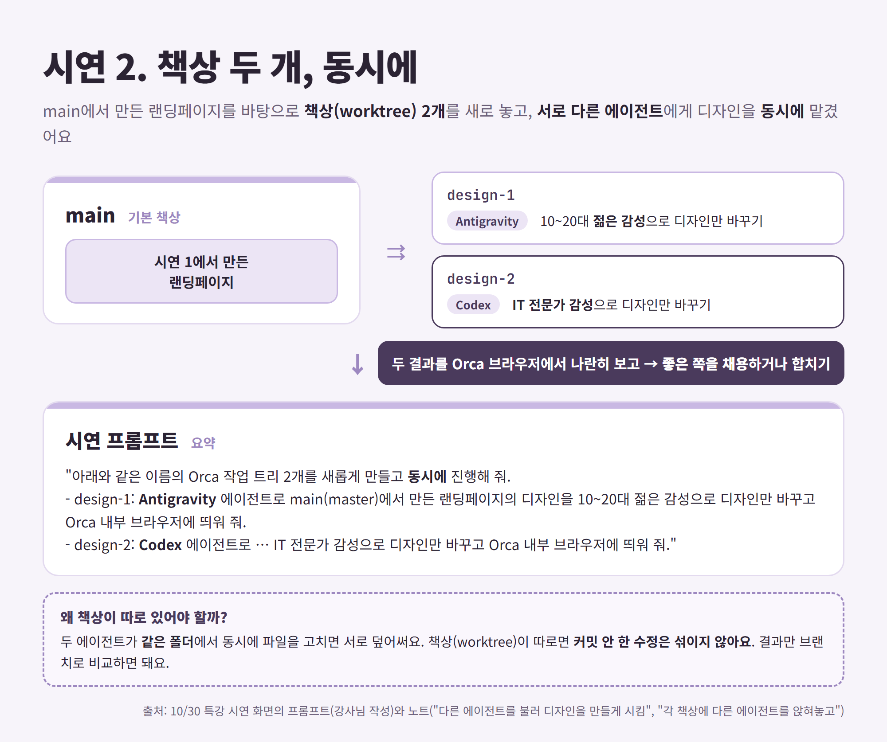
    - design-1 책상은 Antigravity, design-2 책상은 Codex에게 동시에 맡기고 결과 비교

- [Prompt] Orca 랜딩페이지(https://www.onorca.dev/)의 내용을 분석한 뒤, 알기 쉽게 정리해서 md 파일로 만들어줘. 새 워크트리를 만들지 말고 현재 워크트리에서 다중 터미널로 Claude, Codex 2개의 에이전트를 띄운 뒤, 서로 토론 및 협업하면서 정리된 내용에 오류가 없는지 교차 검증하고 하나의 md 파일로 내용을 정리해줘.

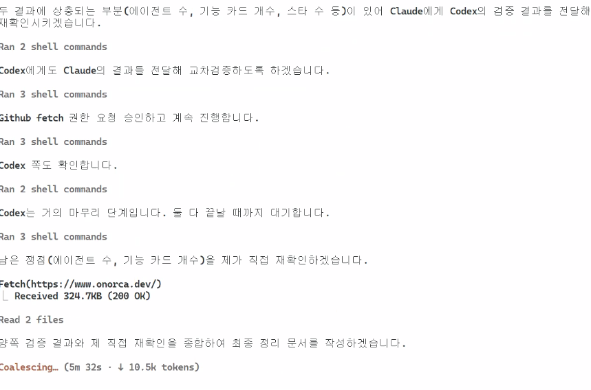
- 프롬프트 작성 방법에 따라 서로 대화하는 것도 볼 수 있음
- 서브에이전트 방식은 아님 (보조 직원이 아니라 동료 둘이 대화)


---
---

# 🗂️ 파트별 다시 보기

> 노트 여기저기 흩어진 내용을 **주제별로** 다시 묶었어요. 자세한 설명은 위 노트 순서 부분에 있어요.

## 파트 1. 네비게이션 (모바일 · 데스크톱)

**오늘 나온 곳**: 노트 `## HTML`(모바일·데스크톱·토글, setIsOpen 사진), `## 다른분 질문`(링크 vs 버튼). 어제(10/29) Next `MobileNavigation`·`DesktopNavigation`, 10/29 노트 "조건 분기보다 두 개의 컴포넌트를 넣는 게 편하다".

### 1-1. 구조: 메뉴는 두 개를 다 두고, 하나씩 숨긴다

```
<nav>
 ├─ 모바일 네비게이션    : 햄버거 버튼 + 접힌 메뉴   ← 768px 미만에서만 보임
 └─ 데스크톱 네비게이션  : Home · About · Contact   ← 768px 이상에서만 보임
```

| | 순수 HTML·CSS | Next + Tailwind |
|---|---|---|
| 데스크톱 숨김/보임 | `.desktop-nav{display:none}` + `@media (min-width:768px){ display:flex }` | `hidden md:flex` |
| 모바일 숨김 | `@media (min-width:768px){ .mobile-nav{display:none} }` | `md:hidden` |

> 비유: 집에 **여름 옷장, 겨울 옷장**을 둘 다 두고 계절(화면 폭)에 맞는 것만 여는 것. 옷장 하나에 "여름이면 이거, 겨울이면 저거" 쪽지를 붙이는 것(조건 분기)보다 관리가 쉬워요.

### 1-2. 토글: 햄버거로 열고 닫기

| | 순수 JS (`main.js`) | React·Next (`MobileNavigation`) |
|---|---|---|
| 상태 | 버튼의 `aria-expanded="true/false"` | `useState(false)`의 `isOpen` |
| 클릭 | `addEventListener("click", ...)` | `onClick={() => setIsOpen(!isOpen)}` |
| 보이기 | 메뉴 `hidden`을 켰다 껐다 | `{isOpen && <메뉴/>}` |
| 꼭 필요한 것 | 스크립트가 버튼 **뒤에서** 실행 (`</body>` 앞 또는 `defer`) | 파일 맨 위 `"use client"` |

### 1-3. 모바일 네비게이션 만들 때 체크할 점 (조언) ⭐

| 체크 | 이유 | 오늘 코드에서 |
|---|---|---|
| 햄버거는 **`<button>`**, 메뉴 안 항목은 **링크**(`<a>`, `<Link>`) | 열고 닫기는 **동작**, 페이지 가기는 **이동** (노트 `## 다른분 질문`) | ✅ 둘 다 그렇게 돼 있어요 |
| 버튼에 **보이지 않는 이름** | 아이콘만 있으면 화면 읽기 프로그램이 "버튼"이라고만 읽어요 | ✅ `<span class="sr-only">Open main menu</span>` |
| `aria-expanded`, `aria-controls` | "펼쳐짐/접힘", "어떤 메뉴를 여는지"를 알려 줘요 | ✅ HTML 버전에 있음. Next 버전에는 없어요 → 붙여 볼 만해요 |
| 지금 페이지 표시 | 내가 어디 있는지 알려 줘요 | ✅ HTML 버전 `aria-current="page"` |
| **모바일 메뉴 항목이 데스크톱과 같은가?** | 선생님 코드는 지금 모바일 메뉴에 **Home 하나만** 있어요 (HTML·Next 둘 다). 연습 단계라 그래요 | 🤔 링크 3개를 두 메뉴에 **두 번 쓰지 않으려면**? → 10/28에 배운 **데이터 배열 + map** |
| 링크를 누르면 메뉴가 닫히나? | 같은 페이지 안에서 이동하면(Next) 메뉴가 열린 채로 남을 수 있어요 | 🤔 지금 코드엔 없어요. 어디서 `setIsOpen(false)`를 하면 될지 생각해 보세요 |
| 768px 기준 | Tailwind `md`와 CSS `@media`를 **같은 숫자**로 맞추기 | ✅ 둘 다 768px |
| JS가 버튼을 못 찾는 경우 | 스크립트 위치가 틀리면 에러 없이 **조용히** 안 열려요 | ✅ `if (navToggle && mobileMenu)` 안전장치 |

> 직접 만들어 보는 순서는 [실습따라하기 1장](2026-10-30-실습따라하기.md#1장-html-버전-모바일데스크톱-네비게이션-lgcns-fe-html)에 있어요.

## 파트 2. 자바스크립트 실행 시점 (defer · async · 호이스팅)
- `<script>` 기본 = 받는 동안 멈춤 / `async` = 받자마자 / `defer` = 다 읽은 뒤 / `module` = defer처럼.
- DOM을 건드리는 스크립트는 **대상보다 뒤에서** 실행돼야 해요 → `</body>` 앞 또는 `defer`.
- 호이스팅: 함수 선언은 위에서 불러도 OK, `const`·`let`은 선언 전에 쓰면 에러.
- 자료: `data/2026-10-30-js-hoisting-and-script-loading.pdf`

## 파트 3. CSS · Tailwind · shadcn
- **Tailwind ↔ CSS**: `md:hidden` 한 단어 = `@media (min-width:768px){...}` 몇 줄. `container` = 화면 폭별 `max-width` 5개.
- **동적 클래스 이름 금지**: `` `text-red-${n}00` ``처럼 조각으로 만들면 안 나와요 → 완성된 이름 중에서 고르기. (자료 `tailwind-dynamic-class-*.pdf`)
- **`cn()`** = 조건부로 모으기(clsx) + 충돌 정리(twMerge).
- **shadcn**: `npx --yes shadcn@latest init -d` → `components/ui/`에 부품이 **복사**돼 들어옴 → 고쳐 써도 됨. `variant` × `size` 옵션표(cva).
- **링크 vs 버튼**: 이동은 링크, 동작은 버튼. 버튼 모양 링크는 `buttonVariants`.

## 파트 4. Next 주소 (params · slug · searchParams · Suspense)

| 주소 예 | 폴더 / 받는 법 | 값 |
|---|---|---|
| `/blog/hello` | `[blogId]` → `params` | `"hello"` |
| `/product/a/b` | `[...slug]` → `params` | `["a","b"]` |
| `/product` 까지 | `[[...slug]]` | 없음도 OK |
| `/feed?page=2` | 폴더 없음 → `searchParams` | `{ page: "2" }` |

- `params`·`searchParams`는 **Promise(봉투)**. 이 프로젝트 설정(`cacheComponents`)에서는 **Suspense 안의 자식에서 await**.
- 서버 컴포넌트는 `searchParams` props, 클라이언트 컴포넌트는 `useSearchParams()`.
- 주소에서 온 값은 **항상 글자** → 숫자 계산은 `parseInt`.
- 자료: `next-params-searchparams`, `next-dynamic-params-suspense`, `next-feed-searchparams-client-server`

## 파트 5. 주소창과 브라우저 정보
- `window.location` = protocol · hostname · port · **pathname**(params) · **search**(searchParams) · hash.
- 포트: http 80, https 443, 0~65535. `localhost:3000` = Next, `:5173` = Vite.
- `window.innerWidth`(창) vs `window.screen`(모니터), `navigator.userAgent`(브라우저 자기소개, 맨 앞 `Mozilla/5.0`).
- JSON = JS 객체 모양 글자, Zod = 데이터 검사 도구.

## 파트 6. CSR vs SSR
- CSR: 브라우저가 그림, 클릭 → 화면 → 주소가 뒤따라옴. React(Vite), `"use client"`.
- SSR: 서버가 그림, 주소 → 서버 → 화면. Next 기본(서버 컴포넌트).
- 상태를 **주소에** 두면 새로고침·공유해도 유지 (feed의 `?page=`). `useState`에 두면 새로고침 시 사라짐.
- 자료: `react-csr-vs-next-ssr-data`

## 파트 7. 협업 도구
- **Husky**: 커밋 직전 자동 린트 (신발 털이 매트).
- **Git Flow**: 기능 브랜치 → PR → main. 선생님이 오늘부터 이 방식.
- **Jira**: 할 일 카드 ↔ 브랜치 이름.
- **git stash**: 작업물을 서랍에 잠깐.
- **리뷰어 책임**: Approve한 사람도 책임.

## 파트 8. AI 에이전트 (특강)
- 모델(두뇌) · 에이전트(직원) · 관제 Orca(팀장).
- **git worktree** = 책상 하나 더. 커밋 기록은 공유, **커밋 안 한 수정은 따로**.
- 쓰임: 같은 일 동시에 맡겨 고르기, 교차 검증, 역할별 팀.
- 좋은 프롬프트 = 무엇을 · 어떻게 · 검증 · 결과물.