# 7일차 TIL : AI 서비스를 위한 프론트엔드 5

- 넥스트 실습은 다음 레포지토리에서 진행한다.
  - 🔗 [실습 레포지토리](https://github.com/easty00/lg-front-app41)
  - 🔗 [실습 배포 도메인](https://lg-front-app41.vercel.app/)
  
## 오프닝
### 오늘의 수업 : Tailwind css, Shadcn, NEXT JS 컴포넌트 설계 2, REST API
- REST API : 프론트와 서버가 **주소 + 동작**(GET 가져오기, POST 보내기 ...)으로 데이터를 주고받는 약속

### 각자의 포트번호와 로컬호스트를 확인하고 관리할 수 있는 것이 좋다. 
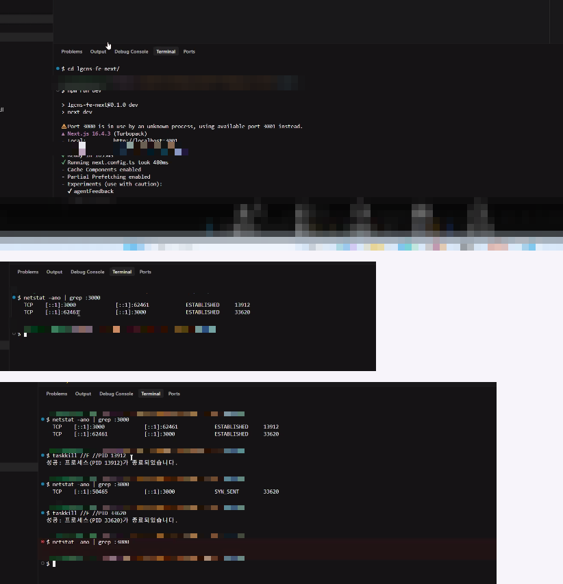
- 포트 = 우리집 문 번호
    ```
    localhost:3000(Next)
    :5173(Vite)
    ```
    - 프로그램마다 문을 하나씩 차지함. 이미 누가 쓰는 문이면 "port already in use" 에러가 남. 또는 3000번을 누가 쓰고 있으니 3001 번으로 배정됨

- 윈도우 기준. 맥은 다름
```
netstat -ano | grep :3000      # 3000번 문을 누가 쓰고 있나 (맨 끝 숫자 = PID, 프로그램 번호)
taskkill //F //PID 13912       # 그 프로그램 강제 종료 (Git Bash라서 // 두 번)
```

- api 직접 만드는 것도 해볼 예정. 회원가입. 로그인, 채팅, 웹소켓과의 소통 방법까지 이번주에 배워 볼 예정.


### npm 검색하면 
- `swiper` 등의 모듈을 받아 구현하는 것이 일반적임.

### shadcn
- 샤드에 있는 걸 직접 고쳐서 커스텀하고싶다면 그대로 복사하여 버튼을 만들어 넣고 수정한다.
- 하지만 복사해오며 이름은 다르게 쓰는 것이 좋다. 다른것과 컴퓨터가 헷갈릴 수도 있고 사람도 헷갈릴 수 있기 때문. 
- 직접만들고 추가할 게 있다면 커스텀 하며 직접 추가하면 된다
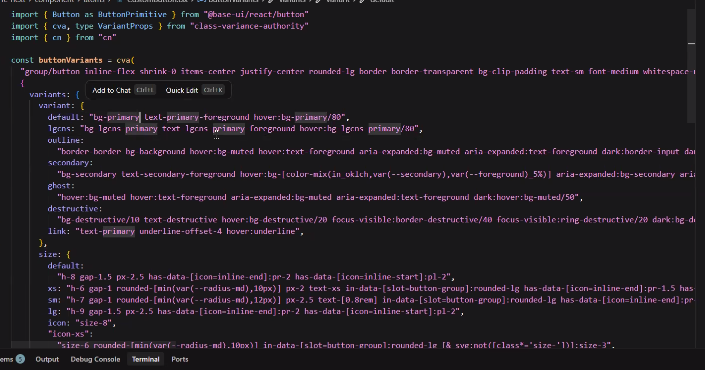
- 현재 써져있는 꾸밈은 tailwind 방식. css 에 선언 후 한줄로 간편하게 사용하는 것.

- 디폴트 값은 손을 대지 않는 게 좋다. 다시 받으면 다시 바뀌기 때문. 불러오는 쪽에서 버튼을 사용을 할 때 그곳에 커스텀을 붙인다. 그쪽이 훨씬 안정적이다.
- 굳이 shadcn을 쓸 필요는 없다. 홈페이지에 맞지 않다면 직접 만드는 것이 낫다. 하지만 충분히 커스텀 할 수 있고 아토믹 디자인의 방식을 사용할 수 있으며 스스로 버튼을 만드는 코드를 작성할 수 있다면 한사람의 프론트 엔드 개발자로서 서는 것에 도움이될 것이다. 

### ZOD 라이브러리
- 입력된 값이 규칙에 맞는지 검사하며 상태를 관리하는것을 도와주는 라이브러리

### shadcn 과 HTML 엘리먼트의 인풋 박스 
- 종류가 아주 많음 . 

- shadcn 인풋 다운로드
```
npx shadcn@latest add input
```
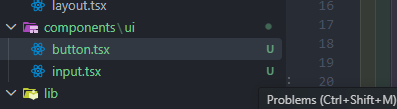

### 로그인 창 만들기에 대한 이야기
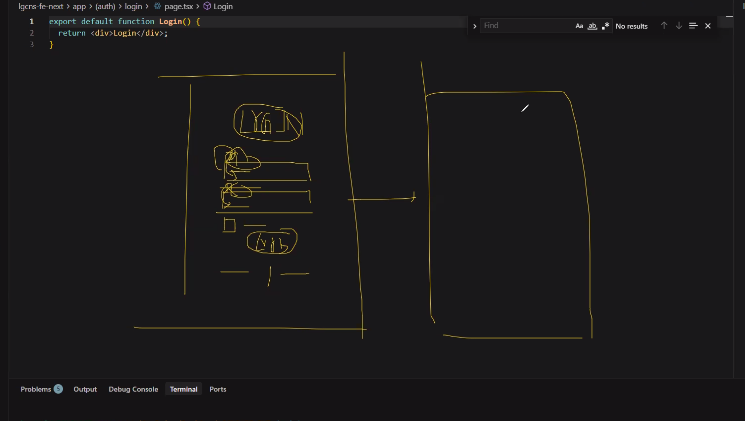
- 미국 : 1년에 1개 이상의 어플리케이션을 설치하는 인구 수를 조사한 적이 있다고 함.
    - 미국은 1년에 한개를 못넘긴다 기준, 그런 사이트의 회원가입을 유도하는 난이도가 얼마나 높은지에 따라 회원가입을 포기하는 이탈률 등이 달라질 수 있다. 

- 어떻게 UX 를 좋게 할까? 하고 ui 디자이너들이 고민한 결과 Stepper 방식을 사용함
    - Stepper : 긴 가입 양식을 1/3 → 2/3 → 3/3 단계로 나눠 한 번에 조금씩 묻는 방식
- 국내의 경우 : 제일 골머리를 앓는건 인증서비스임. 
    - 어떤 인증서비스가 가장 사람을 끌어들일까 하고 노력하고, 특히 토스가 이부분을 주도하는 편. 선생님 왈 토스에 변태적 개발자들이 많고 회사가 훨씬 도전적인 편이라고 함. 
    - 요즘 아이디 중복확인도 잘 없다고 함. 자동으로 중복확인하는 시스템. -> 미친듯이 코드 써서 만드는것. 사실 기술이 오래전부터 있었지만 필요한 코드양과 검증할것도 많았기에 사용하는 일이 거의 없었을 뿐임. 요즘은 AI 가 발달하여 그게 편해진 것.

- 다음시간, 로그인창 구현을 할 예정

---

## 10시 수업

## NEXT는 플레인한 방식으로 진행하는것을 지향함
- 플레인(plain) : 기본 HTML 방식에 가깝게. 로그인 폼을 React처럼 상태(useState)로 다 들고 있지 않고, HTML 원래의 <form> 방식을 살린다는 뜻

### React의 경우
- state 선언 후 상태관리로 로그인과 비밀번호 입력을 진행함 .

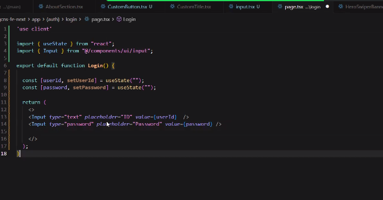

```
LoginFetch : 값을 묶어서 fetch 로 서버 API에 보냄
```
- { userId, password } 객체로 만들어 API에 보내고 결과를 받음
- 위의 두개를 감싼 후 객체로 담아 api 전달 후 되돌려받는 방식

### NEXT의 경우
- Form 이라는 형태로 감쌈.
- Change 를 사용하여 인터랙티브한 형태로 만들긴 해야하지만 Form 이라는 형태 내에서 만드는 것

    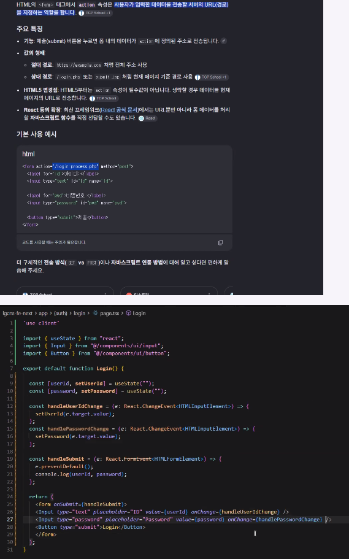

    - `"use server"` : 서버에서 실행하는 함수라는 의미
    - `const userId = formData.get("userId");` : input 의 name 으로 꺼냄

- 넥스트는 리액트에 HTML의 Form 형태를 사용
    - React : 총 3개의 함수로 이루어져 있음 (handleUserIdChange, handlePasswordChange, handleSubmit)
    - Next식은 handleSubmit 1개로 끝

- 차이점을 명확하게 이해해야 한다

| | React식 (`client-login`) | Next식 (`login`) |
|---|---|---|
| 파일 맨 위 | `'use client'` | 없음 (기본 = 서버) |
| 입력값 기억 | `useState`에 **칠 때마다** 저장 | 기억 안 함. **제출할 때** 한 번에 꺼냄 |
| input에 필요한 것 | `value` + `onChange` | **`name`만** |
| 제출 | `onSubmit` + `e.preventDefault()` | `action={함수}` |
| 값 꺼내기 | 변수 `userId` | `formData.get("userId")` |
| 함수가 실행되는 곳 | **브라우저** | **서버** (`"use server"`) |
| `console.log`가 찍히는 곳 | 브라우저 F12 Console | **VS Code 터미널** (사진 `07`, `08`) |
| 비유 | 손님이 주문서를 **한 글자씩 직원에게 불러 줌** | 손님이 주문서를 **다 채워서 한 번에 창구에 냄** |

### 로그인 페이지 만들어서 서버 콘솔을 보기

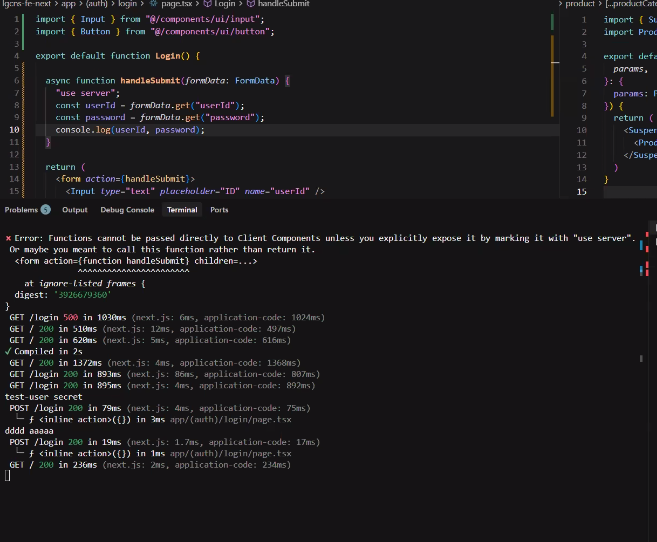

- 넥스트에서는 개발자 탭에서 편하게 보도록 만들어주는 것도 있다고 함.
- FormAction, FormData을 통해 서버로 전달하는 형태

- 기존의 브라우저에서 서버로 다이렉트 통신을 하는 게 React. 아이디, 패스워드 전달시 노출이 되는 형태로 보안에 취약함
- 넥스트는 브라우저와 브라우저 사이 api로 통신을 하여 서버로 전달해주는 형태로 통신체계가 달라짐. 
- 단점이 있다면 아이디 변화 등을 감지하지 못함. 감지를 client 형태로 감싸서 가져와 인지할수는 있지만, 형식이나 시늉정도이며 대신 조금 복잡해진다.
    - 서버 액션은 **제출할 때만** 값을 받음. 칠 때마다 반응(중복 확인, 버튼 켜기)하려면 그 부분은 **클라이언트 컴포넌트**(onChange)로 따로 만들어야 함 → 실습의 `LoginForm`
- 넥스트는 React 처럼 ui 적 편안하면서 보안을 강화하는 것을 추구함. 대신 보안적 문제 때문에 프론트엔드 개발자가 해야할 일들이 좀 있음. 

### FormAction, FormData

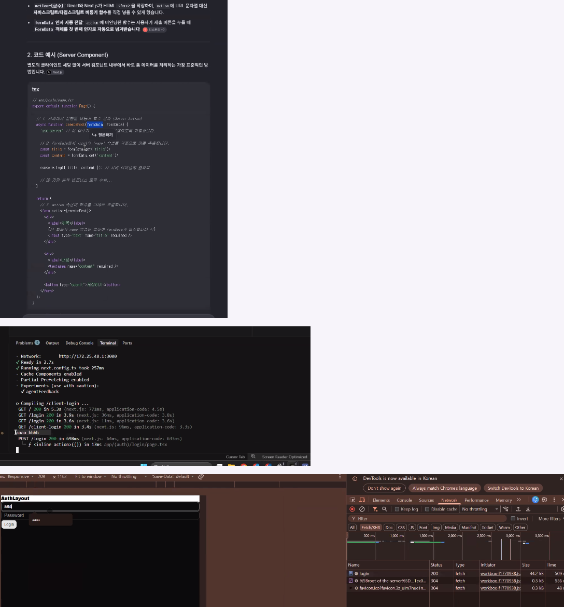

- useState 없이 작동할 수 있음
- 액션을 통해 서브밋에 동작하면 서버 쪽에 아이디 패스워드가 찍힘 
- 콘솔이 동작해도 아무런 것이 변한게 없는 경우 실패하기도 함

- 서버 통신한 경우 헤더를 확인하면 서버와 어떤 데이터가 통신했는지 알 수 있다.
- 현재에는 다 보이지만 수업예제라 그럼. 나중에 암호화 할 예정

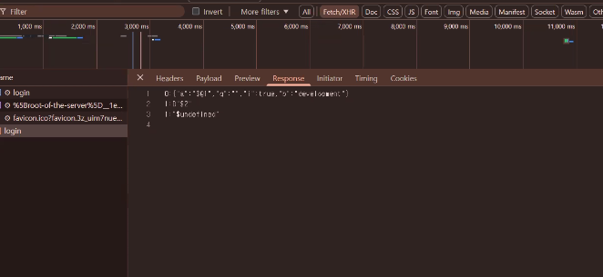

- 넥스트를 사용하는 경우 FormAction 을 사용하는것이 기본. 이건 리액트와 다른부분. 넥스트를 사용하는 이유는 보안때문이 큼
- 이부분은 잘 숙지하는 것이 좋다. 

- page.tsx에서는 풀려있는 형태를 쓰지 않아야 함. 액션을 컨트롤 해야 하니까.
    - 컴포넌트로 묶어서 폼을 채운다. 
- 버튼활성화의 조건 : 글자의 유무
    - 아이디, 아이디 비밀번호 둘 다 채워져야 로그인이 켜지도록.
    - 이걸 하려면 칠 때마다 글자 유무를 알아야하기 때문에 상태(useState) 가 필요함. 그래서 `payload`를 만든 것
        - payload : 보낼 값 묶음 `{ userId, password }` = 택배 상자 내용물

- 현재 상태를 깃에 올려줄 테니 테스트 해보아라. 
- 보통 리액트는 콘솔창 볼 일이 없음. 브라우저만 보면 되었음. 

- 액션은 다이렉트로 와서는 안됨. 책임분리가 되지 않기 때문. 
- 페이지는 그 곳을 사이트로 선언하는 용도. 관리가 용이하려면 그 안에 들어갈 파츠들을 컴포넌트화 하여 분리하는 것이 좋음
    - page = 주소 간판, 폼 = 부품

### 로그인 폼 컴포넌트화

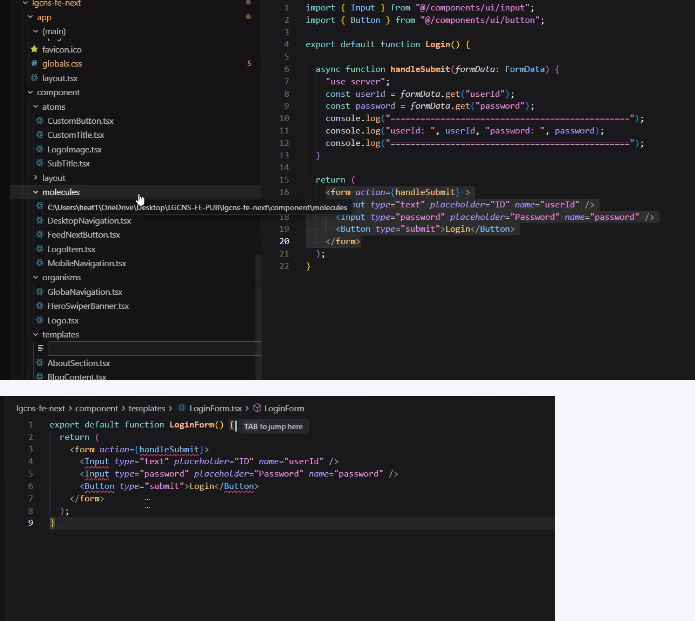

- 부모에게 받아올 데이터들이 있음. 받아올 데이터를 입력함 
- 넥스트에는 정해진 폼데이터가 있음. 규칙을 지켜주어야 함
- LoginForm으로 Form action을 모두 옮김. page.tsx 에는 `<LoginForm/>` 하나만.
- `Form` : `next/form` 에서 가져오는 Next의 폼 부품
- `FormData` 라는 정해진 상자로 받고 값은 input의 `name`(Id 등) 으로 꺼내는 규칙으로 움직임

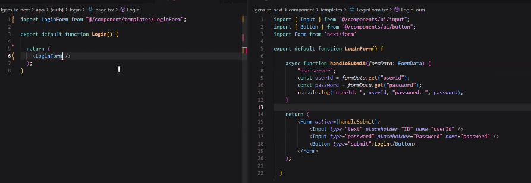
- 로그인에서 로그인 폼 형태로 보여줄 예정. 서버 액션 생성.
- 폼에서 하는 역할들을 잘 보자 

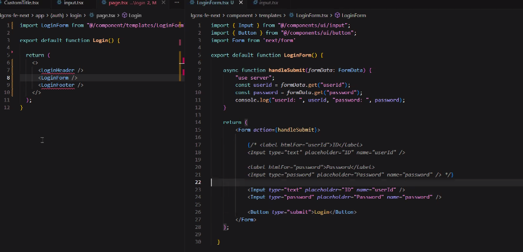
- Depth 가 깊어짐 : page → LoginForm → Input처럼 **부품 안의 부품**(깊이, depth)이 늘어남. 하지만 page는 조립만 하기 때문에 깊어져도 괜찮음.

- 리콰이어를 주면 필수값이 됨

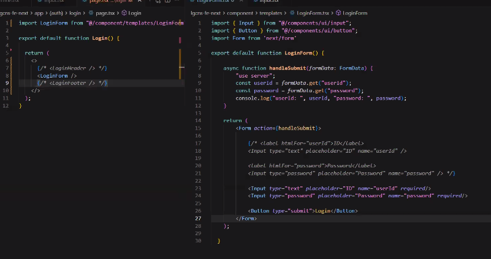

- input 에 required 추가. 비워두고 제출하면 브라우저가 "이 입력란을 작성하세요" 말풍선을 띄우게 함.
- 보통은 더 예쁘게 만들기 위해 에러 핸들러를 이용해 아이디 밑에 핸들러를 붙이기도 함.
- Next는 기본값이 서버. 서버 액션은 `async` 비동기 코드 필요 

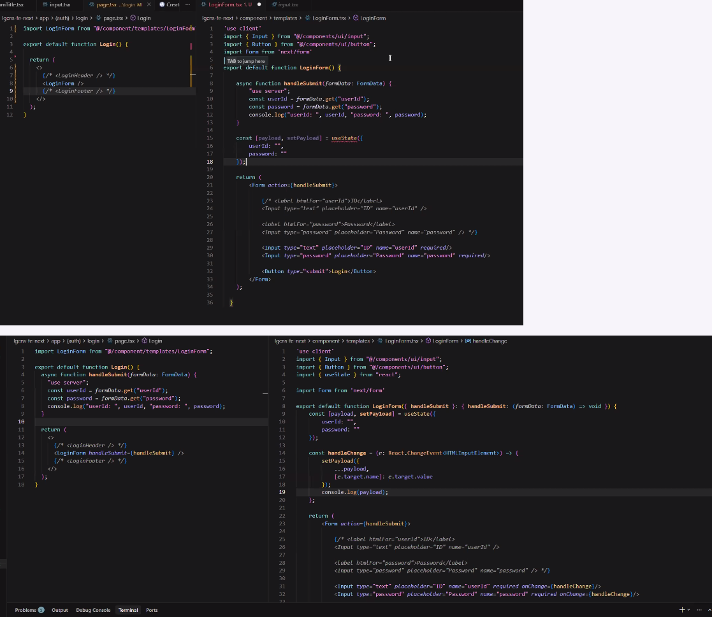

- 상태를 객체로 선언. 
- 서버 액션은 page 로, 상태는 LoginForm에
```
app/(auth)/login/page.tsx  (서버)
  └ handleSubmit  "use server"  ← 서버 액션은 여기서 만듦
  └ <LoginForm handleSubmit={handleSubmit} />   ← props로 내려줌
        component/templates/LoginForm.tsx  ('use client')
          └ payload (useState) + handleChange  ← 칠 때마다 반응
          └ <Form action={handleSubmit}>       ← 받은 서버 액션을 그대로 연결
```

> 비유: **창구 직원**(서버 액션)은 은행 안(서버 page)에 있어야 해요. 손님 쪽 **번호표 기계**(클라이언트 LoginForm)는 손님이 버튼을 누르는 걸 바로 알아채지만, 돈을 처리하는 직원을 기계 안에 넣을 수는 없어요. 그래서 기계는 "창구로 보내기" 버튼(`action={handleSubmit}`)만 받아서 연결해요.

- handleChange
```tsx
setPayload({ ...payload, [e.target.name]: e.target.value });
```
- `...payload` = 지금 들어 있는 `userId`, `password`를 **그대로 복사**
- `[e.target.name]: e.target.value` = 방금 친 칸의 **name**(`"userId"` 또는 `"password"`) 자리만 새 값으로 바꿈
- 그래서 handleChange **하나로** 두 입력칸을 다 처리함. (React식 client-login은 함수가 2개였음)

> ⚠️ `setPayload(...)` 바로 다음 줄의 `console.log(payload)`는 **한 박자 늦은 값**을 찍어요. state는 바로 바뀌지 않고 **다음 화면을 그릴 때** 바뀌기 때문이에요. "a"를 쳤는데 Console엔 빈칸이 나와도 정상이에요.

---


## 수업 이어서
### LoginForm
- 에러 메시지를 만들어 넣을 예정. 
- 아톰 파일에 에러메시지용 파일 생성. LoginForm에 import

  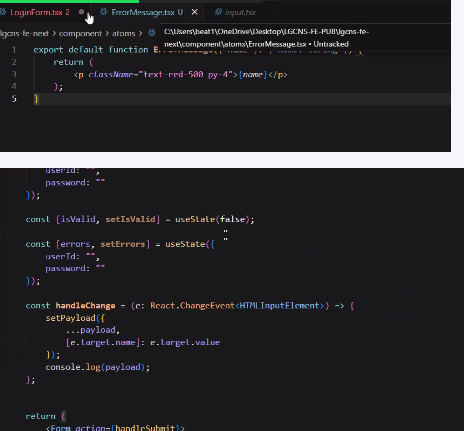

    - `component/atoms/ErrorMessage.tsx` = 빨간 글씨 한 줄 부품. `role="alert"`라서 화면 읽기 프로그램이 바로 읽음. 에러가 없으면 `opacity: 0`(투명)으로 숨겨서 자리는 유지 → 글자가 생겨도 화면이 덜컥 밀리지 않음

- 나중에 에러에 대해 Zod를 이용해 관리할 예정 (`#### 라이브러리 사용하기` 참고)

- ai 에게 수정 맡겼더니 디스에이블 등의 선생님의 의도와 반대로 수정해주셨다고 함. 종종 ai 의 코드가 내 의사와 다를때가 있음을 설명하심
    - `disabled` = 버튼끄기. 조건을 거꾸로 쓰면 다 채울 때 꺼지고, 비어있을 때 켜짐.

- payload를 사용하면 인풋한 바뀐 값을 볼 수 있음. 

- 비동기 코드에서 문제가 좀 있음.
- 이런식으로 써서 보면되는 거 아닐까? 하지만 되지 않음. 

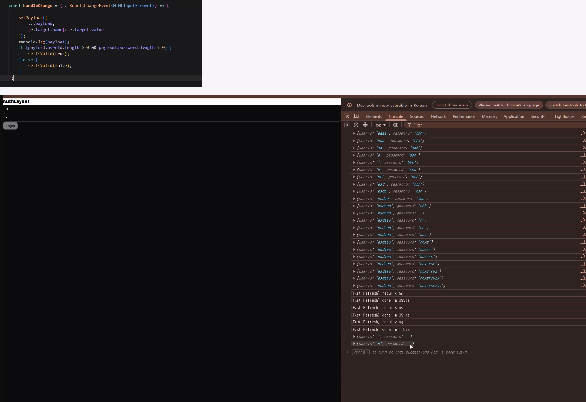

- 소스코드상으로는 바뀌지만 안바뀌는 경우가 있음. 
- 리렌더링이 한 박자 늦게 발생하기 때문에 한 글자가 더 찍혀야 콘솔에 찍힘. 이것이 state의 문제.

- 그래서 input 시 한꺼번에 가져오는 것이 좋음
- 찍히는 방법 : e.target 이용

  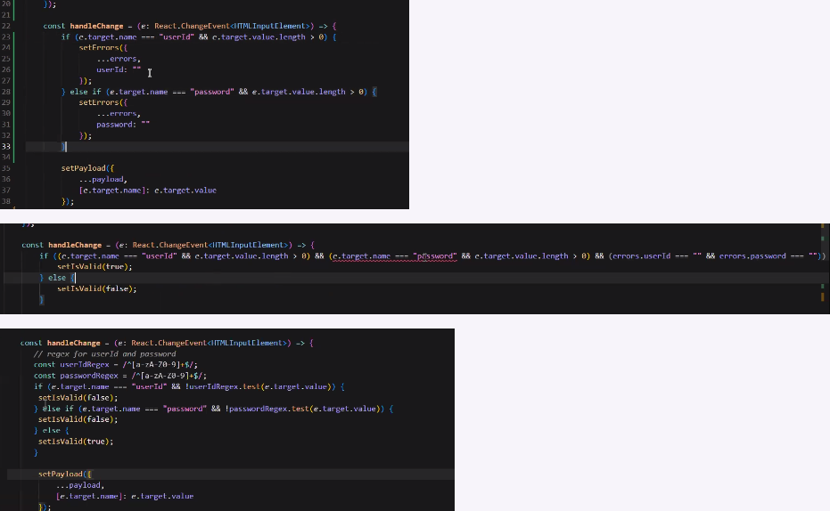
    - **`e.target.value`에서 바로** 읽으면 늦지 않음

- `value.length > 0` : 0이상 찍혀야 함. 비어있지 않아야한다는 말.
- 에러코드도 찍으려면?
    - 점점 길어지는중... 
    - 타겟의 이름, 패스워드 둘 다 valid에 채워져야 함 
- valid 를 한꺼번에 처리하는 방법
    - 칸마다 하나하나 작성 시 점점 길어짐. 이를 규칙을 한곳에 모은 Zod 를 이용하면 좀 더 편안하게 관리가 가능함

#### 라이브러리 사용하기 (Zod)
```
`npm i zod` + `schema/loginSchema.ts`
```
- 조드 라이브러리 설치 후 타입 스크립트로 조드가 검사할 기준 작성.

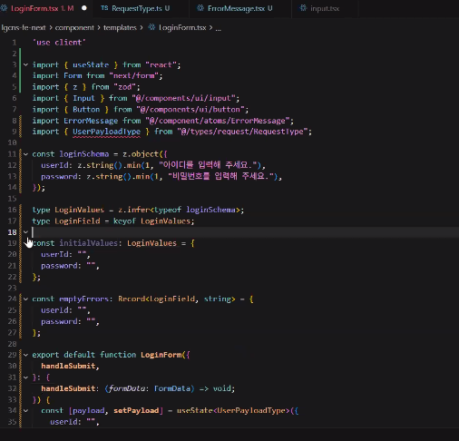

- AI가 만든 건 복잡하기에 몇가지를 types/ 폴더의 타입스크립트쪽으로 보냄.
- ai 가 변경한 코드 설명을 오후에 해주실 예정.
- zod가 좀 처리할게 많긴 함. 

---

## 1시 수업 

### ZOD 예제
- Zod 스키마 = 입력값의 규칙표

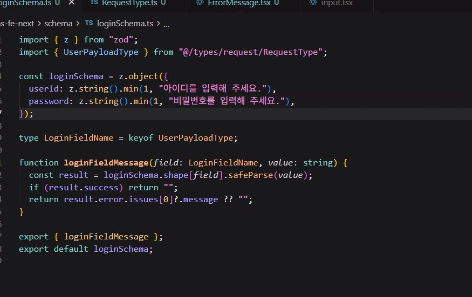

```ts
const loginSchema = z.object({
  userId: z.string().min(1, "아이디를 입력해 주세요."),
  password: z.string().min(1, "비밀번호를 입력해 주세요.")
});
```
| 부분 | 뜻 |
|---|---|
| `z.object({...})` | "이런 칸들이 있는 객체여야 해" |
| `z.string().min(1, "문구")` | 글자이고 **1글자 이상**. 아니면 이 문구를 에러로 |
| `loginSchema.safeParse(payload).success` | 규칙표에 대 보고 **통과했나**(true/false). 버튼 켜기에 사용 |
| `loginFieldMessage(field, value)` | 칸 **하나만** 검사해서 에러 문구를 돌려줌 (통과면 빈 글자) |

> 비유: Zod = **출입 검사표**. "아이디 칸 빈칸 금지", "비밀번호 빈칸 금지"를 적어 두면 검사는 Zod가 알아서 해요. 칸이 늘어도 표에 한 줄만 추가하면 돼요.

- 개발자는 유행이 빠르게 바뀜. 되도록이면 라이브러리도 좋지만 스스로 관리할 수 있는 수준이 되는것을 권장

- FormField
    - 많이 쓰게 함. 각 요소에 네이밍을 해줌
    - 입력칸 + 눈 버튼 + X 버튼 + 에러 문구를 **한 덩어리**로 만든 분자 부품
    - id·name·type·placeholder를 props로 받아 **아이디칸·비번칸 둘 다** 이걸로 만듦

- 온체인지 함수체계를 내림. 상위에서 관리하게 하려고.(핸들체인지를 온체인지라고 명명한것)
    - 값과 바꾸는 함수는 위에 (LoginForm)
    - FormField에는 `onChange={ handleChange }` 로 내림.

- state를 사용하지 않는 이유 : Form 데이터를 전달받고 있어서
    - 서버로 보내는 값은 state 가 아니라 `<form action>`의 FormData(input의 `name`)로 감. state는 화면 용도. (버튼 켜기, 에러 문구)

    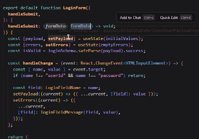

- 컴포넌트에 타입 선언은 따로 꺼내서 관리하는 것이 편함 

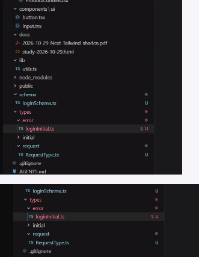

- 하나의 파일에 들어가는 코드를 줄여서 보기 쉽게 정리한다는 느낌으로 나누는것 
- 강사님은 리액트 따로, 라이브러리에 따라 위로 빼고 아래로 빼고 등의 규칙을 팀원들과 정해두면 좋다라고 말씀하심. (나는 이전 safefarm 프로젝트 당시 알파벳순이었음)

- 실시간으로 조정되는것이 보임

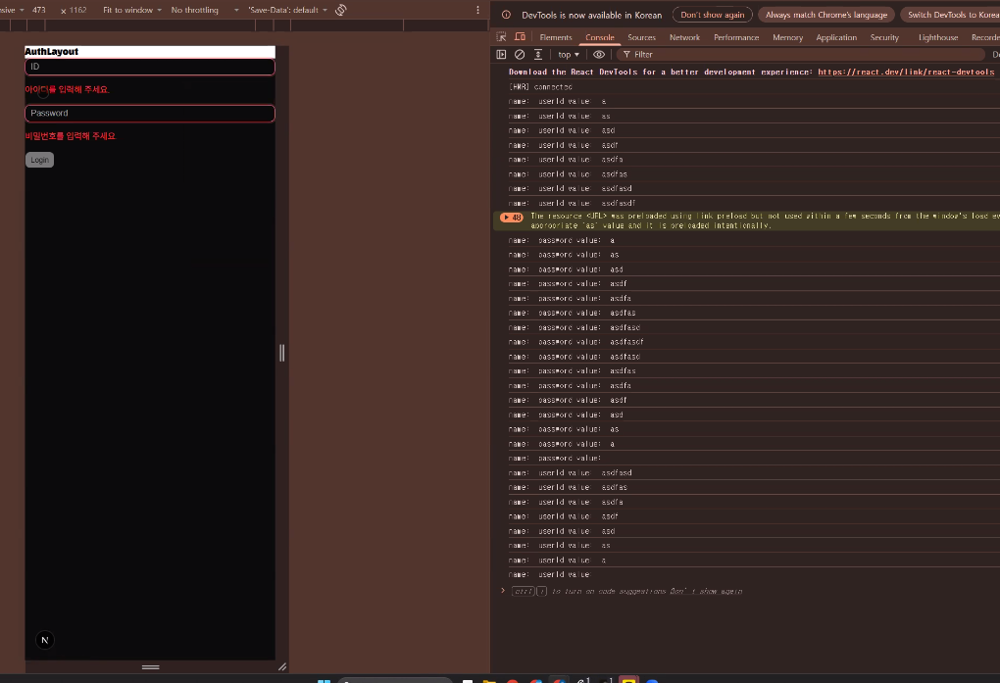

- 아이디 비밀번호 작성시 무언가 이펙트를 넣고싶다면 스타일 등을 넣을 수 있음

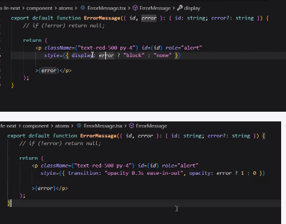

- 아이디 비밀번호 입력창도 디자인을 이쁘게 넣을 수 있다 
- 클래스 하나의 형태로 동일하게 선언해서 쓰면 좋다. 

- 로그인 하는 페이지에 어떤 컴포넌트가 있고, 서버와 소통하기 위한 명령어가 들어있음. 데이터 패칭을 위한 api 연결이 일어남. 즉, 모든 계산이 끝난 valid 결과값들이 들어가는 장소.

### 로그인 화면 예제
- 아래의 이미지는 플레이스홀더는 실제로 없음. 

    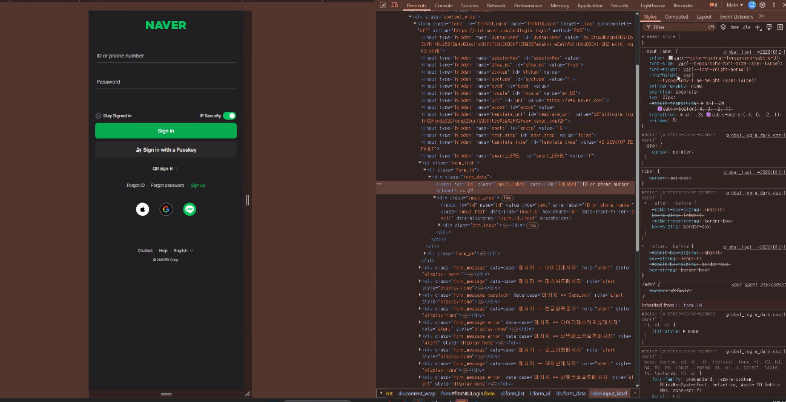

    - 클릭을 하면 위로 올려 포커싱에 대한 감지를 하고 글자를 쓸 수 있게 만든 것
    - X 자가 뜨면 유저 편의 

    - 동적 구성으로 언제 연동이 되는지 우리는 위처럼 정해두었다. 만약 요소를 추가하고싶다면 추가할 수 있다. 

    - 로그인 시 비밀번호에 눈 버튼을 누르면 글씨가 나오게 하는 것
        - 폼필드에 사용하는 패스워드의 아이디를 사용하거나 전용으로 새롭게 만들 수 있음.
        - 눈 버튼을 누르면 패스워드 타입에서 텍스트 타입으로 변경되는 로직. 
        - 루시드 아이콘을 사용하여 구현


### 하이드레이션 에러

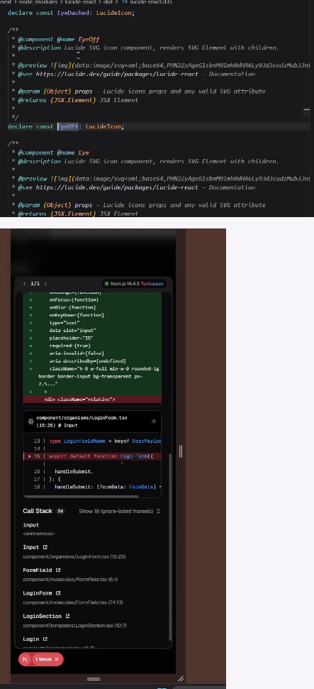

- 하이드레이션 에러 : 넥스트 쓸 때 제일 많이 만나는 에러. 타입이나 컴포넌트에 대한 문제를 지적함.
    - **하이드레이션** = 서버가 그려 보낸 HTML에 브라우저 JS가 **살을 붙이는**(이벤트 연결) 과정. 서버가 그린 것과 브라우저가 처음 그린 것이 **다르면** 에러 (예: 서버엔 없는데 브라우저에만 있는 값)
- 클라이언트 컴포넌트가 있으면 일반적으로 'use client' 선언 하지 않아도 된다. 서버 컴포넌트, ssr 방식으로 동작하는것이 우선시됨. 그러나 만약 유저 ui 쪽을 우선시 하고싶다면 'use client' 선언을 하는것이 안전
    - `use client` 파일에 import 한 부품은 자동으로 클라이언트화 됨. useState, onClick를 직접 쓴다면 붙이는 게 안전함

- 구조 설계를 잘 해야 해저드에 빠지지 않는다. 

    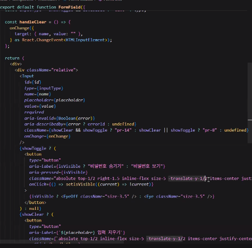

- z스타일. 
- 최근은 인셋을 많이 쓰는 추세긴 함
    - `inset` = `top/right/bottom/left`를 한 번에 정하는 CSS

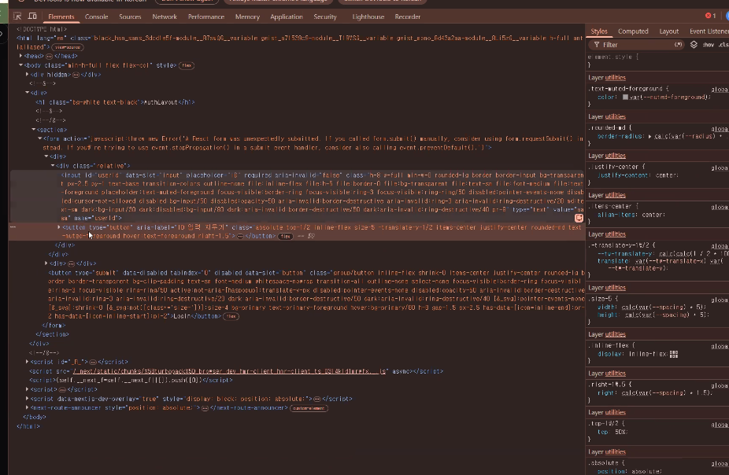

- 코드 스타일 많이 복잡해짐. 
- 왜 예제를 이렇게 세심하게 만드느냐. 프론트엔드를 만드는 사람이 많지 않음. 
- ai는 단편적으로밖에 만들지 못함. 이러한 복잡한 것은 쉽게 만들기 어려울 것 .

### 최종 파일 구조
```
app/(auth)/login/page.tsx         서버  : 서버 액션 handleSubmit
 └ component/templates/LoginSection.tsx  서버  : <form action={handleSubmit}>
    └ component/organisms/LoginForm.tsx   클라이언트 : payload·errors state, Zod, 버튼 켜기
       ├ component/molecules/FormField.tsx  클라이언트 : Input + 눈·X 버튼 + ErrorMessage
       │  └ component/atoms/ErrorMessage.tsx
       └ <Button disabled={!isValid}>
schema/loginSchema.ts   types/request·initial·error/
```
> 오전에 `templates/LoginForm`이던 것이 `organisms/LoginForm`으로 옮겨지고, `<form>`은 서버 부품 `LoginSection`이 가져갔어요. LoginForm은 이제 **form 안의 내용물**만 그려요.

---

## 2시 수업
### 1시 수업까지 깃에 정리해둠

- git 에 1시까지의 파일 올림
- 프로젝트시 필요한 기본세팅에 대해 지금까지 이야기 함. 
- 클라이언트, 서버 컴퓨터의 차이
- 콘솔창의 어디를 봐야하는지 설명
- ssr, 아토믹 설계, 하위 단계를 어떻게 형성하면 좋을지 설명
- 트렌드 잔기술 설명과 시연하며 상태관리를 최소화 하고 기본설정함

### 깃의 주의점 = 스토리지가 아님
- 스토리지 사용자가 변경하면 모든 파일이 변함. 원하는 파일은 따로 보존하는 것 권장

## 수업 재개 : LoginForm
- 조드, 온체인지
- 클라이언트 코드가 다 되면 확인할 수 있는게 있음

- 체인지 함수 자체가 스테이트? 를 뭐 하지 않음. 자주 바뀌기 때문에 불필요한 부하를 많이 받음. 

  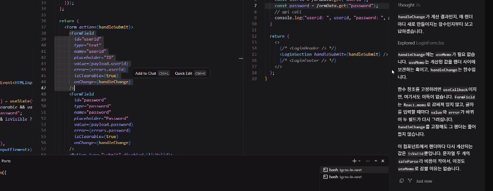

    - 렌더링 개선을 위해 온메모가 필요할수도 있지만, 현재는 조드를 사용중이기에 안정적이라는 답변이 옴
    - 리액트로 코드를 만들고 상태개선시 사용하면 좋은 기술
    - use 계열의 기술을 쓰지 않아도 정상적으로 돌릴 수 있음. 

- 토글: 마우스를 올리면 보이는 형태. 
- 불필요한 것 까지 상태관리를 하지 말아라
- 리액트에서는 쇼 토글 버튼 등을 사용함. 길어지면 컴포넌트화 후 주입하는 경우가 있음. 열리는 때의 동작 액션만 넣으면 되어서. 
- 비지블 언비지블. 무척 코드에 많은걸 볼 수 있음. 상태코드를 최소화 하라. 


## 데이터 패칭을 위한 준비
### 구조설계
- api call
- spring 쓴다면 불필요하게 제이슨 서버를 만들지 않을것. 
- 도커를 이용해 강사님이 만든 서버를 이용하시겠다고 함.

- 도커 실 사용 화면

    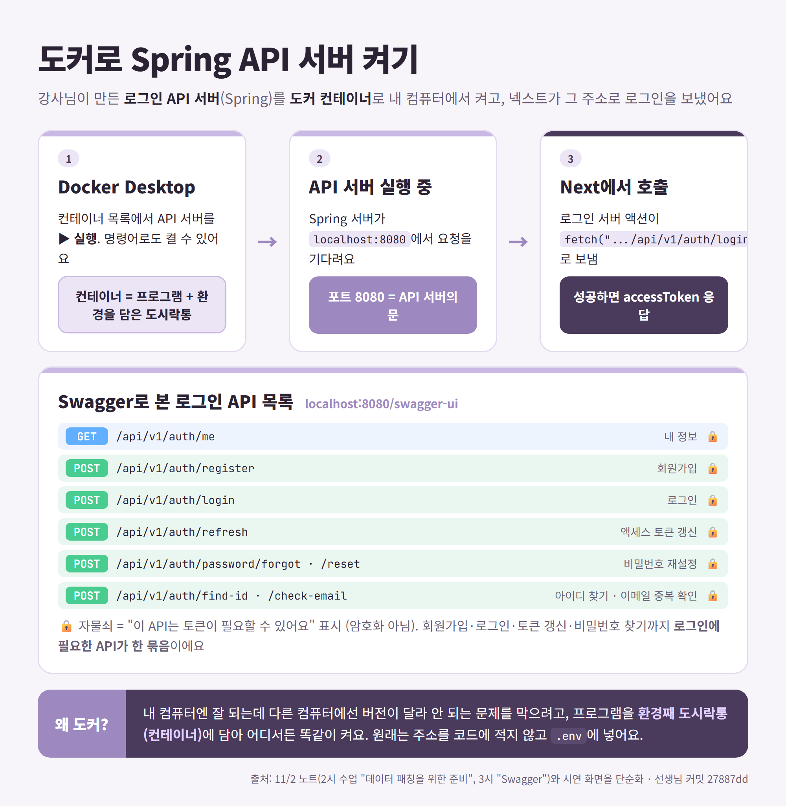

- 현재 개발환경은 노드 기반의 넥스트 js와 이런저런 모듈이나 라이브러리가 있음. 일반적으로 내 컴퓨터에는 잘 되지만 다른 컴퓨터에서는 개발환경이 없어 제대로 실행되지 않는 경우가 많다.(버전까지 세세하게 맞춰주는것 등)
    - 이런 환경들을 어디서든 켤 수 있으면 좋겠다는 생각. 같은 환경으로 실행할 수 있으면 좋겠다는 마음에서 컨테이너라는 개념이 대두. 

- api 서버를 로컬에서 동작하게끔 만들어둔 서버 하나를 여심. 스프링으로 만드셨다고 함. 명령으로 사용가능. 데스크탑이라면 아이콘으로 실행 가능. 

- 도커의 api 주소로 연결
- 일반적으로 env 파일을 만들어 주입시켜서 사용함. 지금은 시연이니 그대로 붙여서 보여주심 

    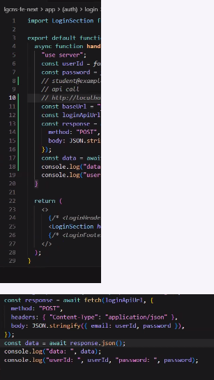

- 테스트로 로그인 성공시의 데이터를 받음. 서버와 통신 성공

- 하지만 로그인 성공했음에도 화면은 바뀌지 않음. 
    - 로그인 화면은 바뀌지 않는다. 성공 시 리다이렉션 등 로그인 이후의 정의가 필요함.

    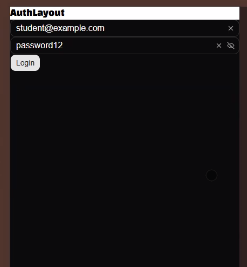

    - 그리고 로그인 화면 내에서는 반복해서 로그인 요청을 할 수 있음. 이 요청을 막는것도 프론트엔드의 역할

    - 현재 로그인 화면은 제각각의 기능이 분리되어있음.
        - 로그인 화면 내 파츠하나하나가 자기 일만 할 수 있고, 어떤것은 데이터를 알지 못한 채 주고받는걸 돕기만 하기도 함. 

#### http stateless
- 서버가 클라이언트의 이전 상태나 요청을 기억하지 않는 성질
- 주요 특징
  - 독립적인 요청처리 : 각 요청은 완전히 독립적인 트랜잭션으로 취급되며, 이전 요청의 맥락이나 데이터를 서버가 따로 저장하지 않음
  - 클라이언트의 책임 : 클라이언트(브라우저 등)가 매 요청마다 필요한 모든 정보(인증 토큰, 사용자 ID등)를 직접 담아서 보내야 함
  - 확장성(Scalability) : 서버가 클라이언트의 세션 정보를 유지할 필요가 없으므로, 서버를 쉽게 늘리거나(Scale out) 다른 서버로 요청을 분산하기가 매우 유리함
  - 단점 보완 : 로그인 상태 유지나 장바구니 기능처럼 상태를 이어가야 하는 경우에는 HTTP의 무상태성을 보완하기 위해 쿠키, 세션, 또는 JWT(토큰) 등을 활용함
- 무상태 = 서버는 요청마다 초기화 하여 늘 첫 손님처럼 대함. 그러므로 "로그인 여부"를 증명하려면 매번 **입장권**(토큰)이나 **도장**(쿠키)을 같이 보내야 함
    - 장점: 서버를 여러 대로 늘리기 쉬움(확장성). 단점보완
    - 단, 매번 증표를 보내니 그 증표를 **훔치면** 위험함

----

## 3시 수업
- 단순명료하게 액세스 토큰을 주고 있으면 ok 없으면 no 같은 것이 가능

### Swagger
- 백엔드 API **설명서 + 직접 눌러 보는 화면**

- Swagger의 자물쇠 : 해당 API 접근시 토큰이 필요함 의미

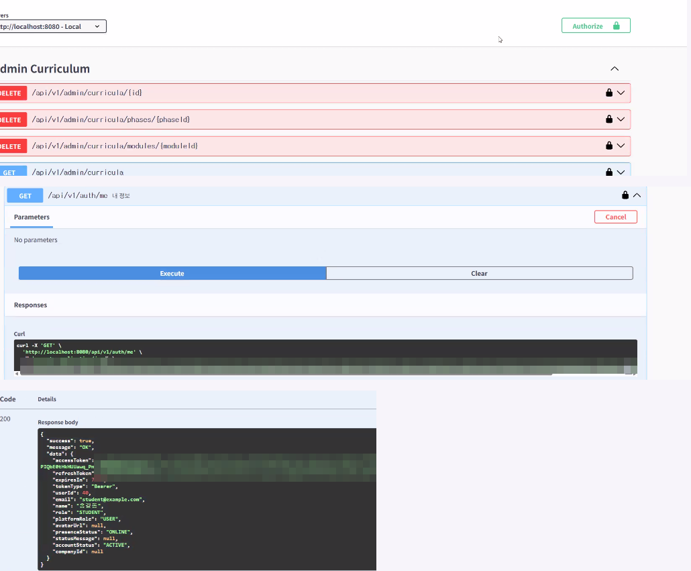

- 로그인 시 데이터를 받아야 다음과 같은 로그인 성공 데이터를 돌려준다 

- 통신시 인증정보를 감춰야 한다는 것이 강사님의 생각. 그렇기에 넥스트 쪽을 더 선호하심. 서버 액션은 브라우저가 백엔드 주소, 토큰을 직접 다루지 않기 때문

- 로그인 시 서버와 어떤 기록을 주고받는지 숨겨진 화면

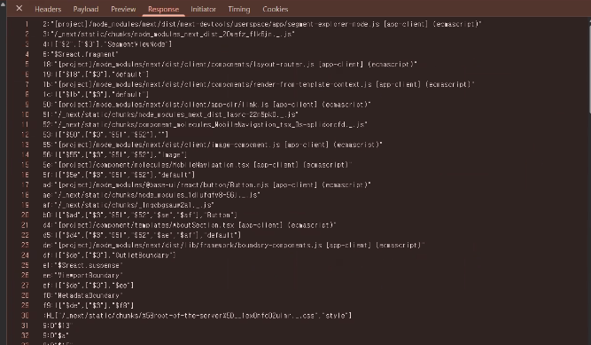

- 보안도를 올리는 만큼 코드가 복잡해질 예정이다.


### 전체적인 동작방식 생각하기

### 실습 다시 재개. 
- 액세스 토큰을 만들고 로그인하는데 성공함. 
- 원하든 원하지 않든 통신을 위한 쿠키가 만들어짐
- 쿠키 선언 후 쿠키에 액세스 토큰이 있는지 확인. 

- 이제 난관이 생김

    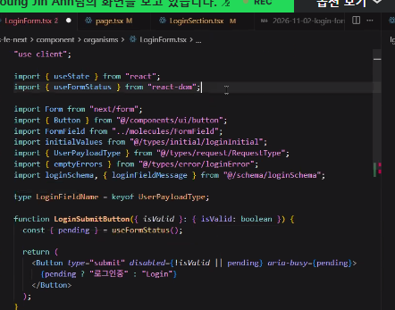

    - 페이지에서 선언이 끝나지 않고 한겹 더 깊이 들어와서 선언을 함. 이 경우 use client를 사용해야함. 또한 기존의 것을 지우고 라우터를 이용함
        - 로그인 상태를 화면 여러곳(헤더의 "로그인 됨", 로그인 폼)이 알아야 하므로 `AuthProvider`를 만들고 `layout`에서 감쌈
    - router.replace. 로그인이 반복되지 않도록. 로그인을 객체로 풀고 기록이 남지 않게 함.
        - `push`: 방문 기록에 **추가**, `replace`는 지금 기록을 **바꿔치기**. 기록이 바뀌므로 로그인 후 뒤로가기를 눌러도 이력이 없어 로그인 화면으로 돌아가지 않게 함.

    - 넥스트는 하이드레이션?에러가 정말 많이 나옴. 이게 좀 짜증나긴 함. 

### 로그인 상태 공유 및 로그아웃 
- 로그아웃 구현. 서버와 클라이언트 양쪽 다 구현해야 할까?
    - **쿠키만 지우면** 화면은 로그아웃이지만, 토큰 자체는 **만료 전까지 살아있음**
    - 로그아웃은 상태관리만 하지 않음. 
    - 세션, 토큰 관리. 만료시까지 사용이 가능하기에 탈취되면 곤란함. 이 토큰을 어떻게 관리할 수 있을까? 
    - 토큰은 서버에서 관리를 함. 재로그인하면 재발급을 해줌. 살아있고 복사하면 쓸 수 있음. 이건 발급해준거라 서버에서 회수를 할 수 없음. 제일 빠른 해소방법은 키를 발급한 사람이 요청을 해야 처리를 할 수 있음, 하지만 그 키를 모르면 막을 수 없음.
    - 그렇기에 토큰을 발급 당시에 따로 목록에 적어 별도 보관하여 관리해야 함. 로그아웃을 하면 목록에서 지워 **입장권한을 무효** 하는 방식

    - 레디스 데이터 베이스? 기반이라고 함. 고성능의 데이터 베이스, 키밸류 형태로 관리하게됨. 그러면 로그인 절차가 복잡해짐.
        - **Redis** = 아주 빠른 **메모장형 DB**. `토큰 → 사용자` 짝으로 적고, **유효시간**(TTL)이 지나면 저절로 지워짐
        - 레디스를 이용하는 이유는 로그아웃등을 할 때 자동 파쇄가 가능함. 보안 정책을 강화할 겸 백엔드에서 많이 사용한다고 함. DB에 담아도 되긴 함 
    
    - 로그인 시 페이지에 상태 확인을 하기보다 접근을 막는 것으로 방법을 바꾸시려고 함. 그렇다면 토큰이 아닌 세션방식을 사용함.
        - `NextAuth(Auth.js)`를 사용할 예정. (넥스트 용 로그인 라이브러리)

    - 로그인, 인증 절차가 제일 까다롭지만 이걸 꼭 배워야 함. 이걸 못하면 안됨.
    - 리액트에서 주는 useContext를 이용하면 리덕스(앱용 전역 상태 도구) 등을 이용한 글로벌 스테이트 관리를 할 수 있음. 
        - 브라우저에서 무얼 하는지 끌고 와서 확인 후 상태 리셋을 하는게 보통의 동작임. 
        - 이걸 보완하려고 추가적인 이것저것이 나왔다고 하심

---

## 4시 수업

### FastAPI
- 연습용 툴에 가깝다고 생각하면 됨
- 일반적으로는 백엔드가 스웨거를 만들어서 그걸 사용하게 될 것임. 

## 실습 이어서. 

### 20분쯤 도커 설치
- node에서 api를 생성하는것이 가능. 
    - **라우트 핸들러**(`app/api/.../route.ts`)로 Next 안에 API를 만듦.

- 몽고DB 경험하고 싶은 사람은 ATLAS DataBase 무료체험 가입. 데이터베이스를 여기서 클라우드로 생성. 
    + 아틀라스 mongoDB compass : mySQL의 워크트리에 접근 가능.
        - nosqldb 채팅등을 구현할 때 많이 사용함. 
        - 마리아DB는 라이센스 없이 사용가능하지만 비추
        - mysql 커뮤니티 서버 추천. 오라클이 인수해서 제대로 쓰려면 유료로 받아야함 
    - 강사님은 mySQL 을 도커에 연결해 쓰고 계신듯?

    - spring reactive web : 논블로킹 서버를 쓸 수 있음. 

    - 몽고DB 무료클러스터에 연결 성공함!

        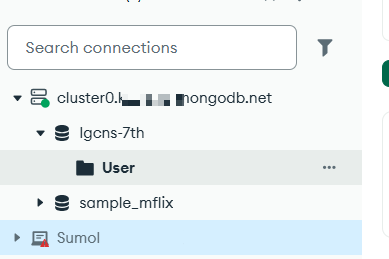

---

## 5시

### .env / .env.local
- 환경 변수 파일. DB 비밀번호·주소처럼 **코드에 적으면 안 되는 비밀**을 따로 두는 곳

### node 계열 api로 넥스트와 통신 시연 

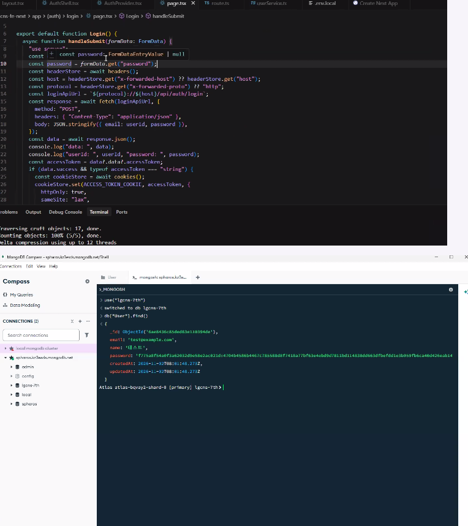

- const들 설명하심 

### ORM 
- 단점이 있지만 DB 설계를 잘하면 됨
- DB 명령(SQL·Mongo 쿼리)을 직접 안 쓰고 **JS 함수로** DB를 다루게 해 주는 통역사. 
- **Prisma**가 그 역할을 할 예정

### 몽고랑 끙끙대는 사이 수업이 진행되는중
- userService 의 코드에 대한 설명
- api 관련.

## 오늘 최종 로그인 흐름
```
[브라우저] LoginForm에 입력 → Login 클릭 (FormData)
   ↓
[Next 서버] login/page.tsx 의 handleSubmit ("use server")
   ↓  POST 함수를 직접 호출 (`import { POST as login } from "@/app/api/auth/login/route"`)
[Next 서버] app/api/auth/login/route.ts — Zod로 email·password 검사 (실패 400)
   ↓
[Next 서버] service/userService.login — Prisma로 MongoDB에서 email 찾기 → 비밀번호 비교 (실패 401)
   ↓  성공: accessToken(랜덤 64글자) + expiresIn 7200초
[Next 서버] page: cookies().set("accessToken", ..., httpOnly) → redirect("/")
   ↓
[브라우저] 홈으로 이동, 헤더에 "로그인됨"
```

| 파일 | 하는 일 |
|---|---|
| `prisma/schema.prisma` | `model User { id, email(@unique), name?, password, createdAt, updatedAt }` = MongoDB 컬렉션 **`User`의** 설계도 |
| `lib/prisma.ts` | Prisma 연결을 **하나만** 만들어 재사용 |
| `service/userService.ts` | `list`(목록), `create`(가입), `login`(로그인). 비밀번호는 `scryptSync`로 **해시**해서 `소금:해시`로 저장, 비교는 `timingSafeEqual` |
| `app/api/user/route.ts` | `GET /api/user` 목록, `POST /api/user` 가입 (이메일 형식, 비번 8자 이상, 중복이면 409) |
| `app/api/auth/login/route.ts` | `POST /api/auth/login` 로그인 (성공 200 + 토큰, 실패 401) |

> **해시 + 소금** 비유: 비밀번호를 **믹서기에 갈아서**(해시) 저장해요. 갈린 걸로는 원래 과일을 못 되돌려요. 로그인할 땐 입력한 걸 **같은 방법으로 갈아서** 비교해요. **소금**(salt) = 사람마다 다른 **양념**을 섞어서, 같은 비밀번호여도 저장 모양이 달라지게 해요.


# 🗂️ 파트별 다시 보기

## 파트 1. 로그인 폼: React 방식 vs Next 방식
- **React식**: `'use client'` + `useState` + `onChange` + `onSubmit`(`preventDefault`). 값은 칠 때마다 메모장에. 함수는 브라우저에서.
- **Next식**: `<form action={서버액션}>` + input에 `name` + `formData.get("name")`. 함수는 서버에서(`"use server"`), 로그는 VS Code 터미널.
- **섞어 쓰기 (오늘 최종)**: 서버 액션은 **서버 page**에서 만들고 → props로 → **클라이언트 LoginForm**의 `<Form action>`에 연결. 칠 때마다 반응해야 하는 것(버튼 켜기, 중복 확인)은 LoginForm의 `useState`가 담당.
- 규칙 하나: **클라이언트 컴포넌트 안에서 `"use server"` 함수를 만들 수 없다.**

## 파트 2. shadcn 커스텀
- 원본(`components/ui/*`)은 다시 받으면 덮어써짐 → **복사해서 이름 바꾸기**(`CustomButton`) 또는 **쓰는 곳 className**.
- 새 색: `globals.css`에 변수(`--lgcns-primary`) → `@theme inline`에 `--color-lgcns-primary` → `bg-lgcns-primary`로 사용 → `variant: lgcns`.
- `npx shadcn@latest add input`으로 Input 추가. HTML input 속성 그대로.

## 파트 3. 폼 기본기
- `name` = 서버로 보낼 때의 **이름표**. 없으면 `formData.get()`이 `null`.
- `required` = 브라우저 기본 검사. 실무는 에러 문구를 직접.
- `label` + `htmlFor` = 입력칸 이름표.
- Zod = 입력값 **검사** 규칙 도구 (곧 사용).
- UX: 스테퍼, 자동 중복 확인, 버튼 활성화.

## 파트 4. 개발 환경
- 포트 = 문 번호. Git Bash `netstat -ano | grep :3000` → `taskkill //F //PID 번호`.
- 서버 로그는 VS Code 터미널, 클라이언트 로그는 브라우저 F12.
- F12 Network → Payload에서 보낸 값 확인. https는 **가는 길**을 지키는 것.
- **도커 컨테이너** = 프로그램 + 환경을 통째로 담은 도시락통. **.env.local** = 비밀 값 보관(커밋 안 됨).

## 파트 5. 폼 검사와 화면 상태 (Zod, FormField)
- 서버로 가는 값 = **FormData**(input `name`). 화면용 값 = **state**(payload, errors).
- state는 **한 박자 늦다** → 방금 친 값은 `e.target.value`.
- **Zod** 규칙표: `z.object({ userId: z.string().min(1, "문구") })`, `safeParse(...).success`로 버튼 켜기.
- `FormField` = Input + 눈(Eye)·X 버튼 + ErrorMessage. 눈 버튼은 `type` password ↔ text.
- `useFormStatus().pending` → 보내는 중엔 버튼 끄고 "로그인중" (중복 요청 막기).
- **하이드레이션 에러** = 서버가 그린 HTML ≠ 브라우저가 처음 그린 것.

## 파트 6. 로그인 상태와 보안
- **http stateless**: 서버는 매번 처음 보는 손님 → 토큰·쿠키로 증명.
- 로그인 성공 → 서버 액션에서 `cookies().set("accessToken", ..., { httpOnly })` → `redirect("/")`.
- `AuthShell`(서버, 쿠키 읽기) → `AuthProvider`(클라, `createContext`로 방송) → `useAuth()`로 듣기.
- `router.replace` = 기록 바꿔치기 (뒤로 가기로 로그인 화면 안 돌아감).
- 로그아웃 = 쿠키 삭제 + 서버에서 토큰 무효화(Redis 등에 토큰 목록). 다음 수업: NextAuth.
- Swagger 자물쇠 = "토큰 필요" 표시 (암호화 아님).

## 파트 7. 내 API + DB (Prisma, MongoDB)
- 라우트 핸들러 `app/api/.../route.ts`에 `export async function POST` = Next 안의 API.
- **ORM(Prisma)**: `schema.prisma`에 `model User` → `prisma.user.findUnique/create/findMany`.
- **MongoDB Atlas**(클라우드 DB) + **Compass**(보는 프로그램). NoSQL = JSON 문서.
- 비밀번호는 **해시 + 소금**으로 저장. 비교는 같은 방식으로 갈아서.
- 컬렉션 이름은 **`User`**(대소문자 구분). 사용자는 `POST /api/user`로 만들기.