# 8일차 TIL : AI 서비스를 위한 프론트엔드 6

- 넥스트 실습은 다음 레포지토리에서 진행한다.
  - 🔗 [실습 레포지토리](https://github.com/easty00/lg-front-app41)
  - 🔗 [실습 배포 도메인](https://lg-front-app41.vercel.app/)

## 오프닝 - 실습 이어서
- 도커 없이 몽고DB를 이어 하는 방식으로 진행

### 하이드레이션 : 넥스트 13버전 이후 SSR 도입되면서 나온 고질병 
- 넥스트나 리액트 같은 서버사이드 렌더링(SSR) 및 정적 사이트 생성(SSG) 프레임워크에서, 서버가 미리 그려서 보낸 정적HTML에 자바스크립트(JS) 이벤트와 리액트기능을 붙여서 인터랙티브하게 만드는 과정  
- form 을 사용하면 SSR이 동작해야 하는데 안의 컴포넌트들이 별개로 csr로 동작을 하게 됨. 서버와 클라이언트 간의 경계에 버튼 또는 조건 분기(`isOpen ? A : B`)가 생기면, 서버가 그린 것과 브라우저가 처음 그린 것이 달라지기 쉬움. => 하이드레이션 관련 에러가 발생함. 
    - 이를 해소하려면 꼼꼼하게 찾고 옮겨야함 
    - 그런데 하이드레이션 에러는 공통에러메시지 같은게 튀어나와 찾기 어려워짐.
        - 어딘가 다르다만 알려주고 어느줄인지 잘 안알려주거나, 코드에 없는 글자가 튀어나와 잘못되었다고 지적하기도 함. 그래서 사람이 하나하나 의심하며 찾아봐야 했음
        - 그래도 요즘은 ai 가 있으니 형편이 좀 나아짐

### Next.auth 말고 새로운 게 또 나옴 - Better Auth
- 요즘 나온 로그인 라이브러리
- 아이디 찾기등, 보안정책에 따라서 아이디도 다 주진 않음

### OAuth(Open Authorization)
- 사용자가 비밀번호를 직접 제공하지 않고 다른 서비스의 자신의 정보에 대한 접근 권한을 제 3자 애플리케이션에 위임할 수 있게 해주는 개방형 표준 프로토콜

### 오쓰의 단점
- 회원 가입 정보 없이 사용자들이 편안하게 가입하게 만든 것. 
- 개발자 입장에선 잘 안보임. 서비스 a는 구글의 계정 소유자는 접근하기 쉬워짐. 
- 단점 : 그 사람의 개인 정보를 알 수 없음. 구글에 의존하게 됨. 
- 우리가 받는 건 오쓰가 **허락한 몇 가지**(이메일, 이름 정도)뿐. 우리 회원이지만 서비스를 키우는데 있어 핵심 고객 정보 확보가 어려움.
- 카카오는 온전한 정보를 주는게 아님. 약간 변형된 값을 줌 

- 해외서비스는 개인을 특정하지 않아 1인이 여러개의 계정을 가짐.
- 하지만 국내 서비스는 개인이 특정 되어야 함
    - 쓱닷컴의 경우 : 카카오로 오든 네이버로 오든 인물을 특정하기 위해 개인인증을 하게 함. 주로 전화번호. 
- 그래서 국내에서는 오쓰가 오쓰로 동작하지 않는 문제가 발생. -> 국내는 오쓰가 아니고 간편 로그인임. 회원가입을 하면 연동을 해주겠다는 구조. 또는 오쓰로 가입 후 본인인증 요구
- 백엔드에 오쓰를 달거나, 프론트에 오쓰를 달거나 둘 중 하나임. 두개가 만드는 방식이 다름. 

---

## 10시 수업

### 오쓰를 사용하기 전 사전 준비
- 내일 : 네이버, 카카오, 구글 개발자 사이트의 오쓰기능을 사용하기위한 사전 준비를 미리 해둘것.
- 요즘은 개발자 사이트를 많이 쓰게 되어 카카오톡의 경우 많이 까다로워짐. 네이버는 처음부터 까다로웠음. 디벨로퍼 계정 하나를 연동해와라.(네이버나 카카오)
- 오쓰는 내일 할 예정. 오쓰 전 상태관리도 몇가지 추가 예정

## 오늘 할 것 : 회원가입페이지

### 키클락(Keycloak) 서비스 
- 오픈소스 통합 인증 및 권한 부여 솔루션 서비스.
- Red Hat이 개발하고 현재 클라우드 네이티브 컴퓨팅 재단에서 관리하는 오픈소스 통합 인증 및 권한 부여 솔루션
- 애플리케이션마다 반복해서 개발해야 하는 로그인, 회원가입, 비밀번호 찾기, 소셜 로그인 등의 기능을 중앙에서 한번에 관리할 수 있도록 하는 '보안 컨트롤 허브' 역할을 함

- 싱글 사인 온 (SSO: Single Sign-On) : 한번의 로그인으로 여러개의 서로 다른 애플리케이션 및 서비스를 추가 로그인 없이 이용가능하게 함
- 표준 프로토콜 지원 : 업계 표준인 OpenID Connect(OIDC), OAuth 2.0, SAML 2.0을 기본 지원하며 다양한 앱과 손쉽게 연동
- 소셜 로그인 및 아이덴티티 브로커링: 구글, 깃허브, 카카오톡 등 외부 소셜 로그인 연동을 코드수정 없이 관리자 콘솔에서 설정할 수 있음
- 사용자 페더레이션 (User Federation) : 기존에 기업에서 쓰던 LDAP 나 Active Directory(AD) 등과 연동해 사용자 정보를 그대로 활용할 수 있음
- 중앙 관리 콘솔: 관리자용 콘솔을 통해 사용자, 권한, 세션, 정책 등을 직관적으로 제어 가능


- 사용 전 설계 : 오쓰 쓸건지 안쓸건지? 멤버인지 아닌지?

### 넥스트 오쓰 설치
```
npm i next-auth
```
- 넥스트 오쓰 설치 후에는 수동으로 할 일들이 있음. 파일 3개 직접 생성
    - 주소 담당(`route.ts`)
    - 설정(`authOptions.ts`)
    - 타입(`next-auth.d.ts`).

- 넥스트오쓰의 치명적 문제 : 넥스트 오쓰 설정할 때 세션 프로바이더(`SessionProvider`)라고 전체 컴포넌트를 묶어주는 것이 만들어짐. 이것이 사용하는 use 세션이 서버 사이드가 아닌 클라이언트사이드에서 호출하는 함수가 있음. 이 함수로 인해 클라이언트 감춰둔 정보들이 노출되기 쉬워짐. 세션에 토큰이 담겨있다면 그게 브라우저까지 내려가기 때문

- NextAuth가 하는 것 : 암호화된 쿠키로 유저와 통신.(암호키 `NEXTAUTH_SECRET` 필요) 
- 세션을 관리하여 유저의 무분별한 사용 제한
- 프로바이더 : 오쓰 구현하는데 편리함
    - NextAuth의 **Provider** = 로그인 방법 하나하나. `CredentialsProvider`(아이디·비번), `GoogleProvider`, `KakaoProvider` … 고르기만 하면 됨

### 오쓰 동작 방식
```
[사용자] "구글로 로그인" 클릭
   ↓
[우리 Next 서버] 구글에 "로그인 창 열어 줘" 요청
   ↓
[구글] 이미 로그인돼 있나? 없으면 구글 로그인 창 (← 우리 서비스 아님)
   ↓  로그인 성공
[구글 → 우리 서버] 구글 토큰 + 구글 아이디 등
   ↓
[우리 서버] 이 사람 우리 DB에 있나? 없으면 가입시키고
            → 우리 서비스용 accessToken 발급 → 쿠키(세션)에 저장
```
- 이걸 내가 만들지 라이브러리를 쓸건지의 차이. 프로바이더가 그 라이브러리. 


- 넥스트의 넥스트 오쓰가 필요.. 조금 가이드가 난해함.

- 우리는 몽고디비로 접속할 예정. 

- `NextAuthOptions` = NextAuth 설정표의 **모양(타입)**

- 프리즈마를 이용
    - `userService.login(credentials)` → 안에서 Prisma로 MongoDB 조회

- `authorize` : 아이디·비번을 받아서 **맞으면 사용자 정보, 틀리면 `null`**

- 유저가 애니타입으로 되어있음. 나중에 해당 유저 함수를 선언해둘 예정 
    - 그래서 `types/next-auth.d.ts`에서 NextAuth의 `User`·`Session` 모양을 **우리 것으로 다시 적어둠**(id, email, name, accessToken …)

- req(요청) 을 확인하고 세션에 무엇을 담을지 정함 (주로 프로필 이미지 등)


- `lib/prisma.ts`에 **DB 주소 고르기** 추가: `.env`의 `DATABASE_URL_LOCAL`(내 컴퓨터용) / `DATABASE_URL_DEVELOP`(개발 서버용) 중 `APP_ENV` 값에 따라 하나를 골라 씀
  - 비유: 집 열쇠와 회사 열쇠를 둘 다 들고 다니다가, "지금 어디야?"(`APP_ENV`)에 따라 맞는 열쇠를 꺼내는 것
  - `scripts/with-database-url.mjs` + `npm run db:push` = 그 열쇠로 `prisma db push`를 해 주는 도우미

---

## 11시 수업

- 세션, JWS 토큰의 하이브리드 형태로 진행하는 중 
- 뺏기기 쉬운 토큰을 세션으로 감싸 안전하게 숨기며 하는 느낌?

### 순수 리액트 수업은 많이 줄어드는 추세
넥스트에 만든 내용은 틈틈이 리액트와 html 폴더에 마이그레이션 하는중. 나중에 비교하겠음

### 어제 프리즈마를 붙여 로그인 확인 절차를 했음 -> 이걸 넥스트오쓰로 수정할것
- 로그인 신호를 넥스트 오쓰쪽으로 보냄 
- 선생님이 그 사이 조금 수정하셨다고 함. 

- 원래 프로바이더스 등을 이용해 관리하는 경우가 있음.
    - `SessionProvider` 안에 여러 Provider를 **양파처럼 겹겹이** 감싸고, 루트 layout에서 `getServerSession`으로 세션을 꺼내 넘겨주는 방식

- 관리 체계 비교
    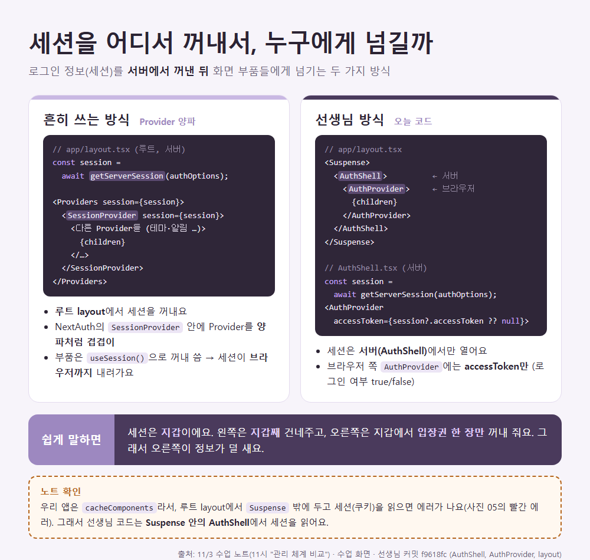
    - 넥스트는 필요한 세션을 가져와 로그인이 필요한지 판단하도록 함 
    - `AuthShell`(서버)이 `getServerSession(authOptions)`으로 세션을 꺼내 → `AuthProvider`에는 **accessToken만** 넘겨줌

### 리다이렉트 처리
- 주소창에 들어오는 로그인 절차를 보면 로그인 이후 실패하게 되면 넥스트 쪽에서 실패값 뒤에 파라미터를 붙여줌
- `/login?error=CredentialsSignin`처럼 **주소 `?` 뒤**에 이유를 붙임. (searchParams)
- 그 주소들을 처리하기 위한 절차

- 오쓰 옵션에 콜백 추가함

| 칸 | 뜻 |
|---|---|
| `secret: process.env.NEXTAUTH_SECRET` | 세션 봉투를 잠그는 **열쇠** |
| `session: { strategy: "jwt", maxAge: 7200 }` | 세션을 DB가 아니라 **암호화 쿠키(JWT)** 에 보관, 2시간 |
| `pages: { signIn: "/login" }` | NextAuth 기본 로그인 화면 대신 **우리 `/login`** 을 써라 |
| `callbacks.jwt` | 로그인 직후 한 번, `authorize`가 돌려준 user에서 **accessToken·id를 봉투(token)에 옮겨 담기** |
| `callbacks.session` | 화면이 세션을 물어볼 때, 봉투에서 **보여 줄 것만** 꺼내 주기 |

- 국내에서는 백엔드(Spring)가 오쓰를 맡는 경우가 많음


### 쿠키 · 로그 확인
- 개발자 창 어플리케이션으로 가면 넥스트 오쓰 쿠키가 보임. DB에서 보낸 토큰과 동일한지 추후 확인 예정
- 로그아웃은 쿠키에 있는 기록들을 지우면 로그아웃이 된다. 
- "개발자 창 → 애플리케이션 → 넥스트 오쓰 쿠키"
    - 이 쿠키를 가지고 넥스트 서버로 들어옴. 로그아웃이 되면 바로 인지 가능함

| 쿠키 | 뜻 |
|---|---|
| `next-auth.session-token` | **세션 봉투**(암호화된 JWT). 이게 있으면 로그인 상태 |
| `next-auth.csrf-token` | 가짜 요청(다른 사이트가 몰래 보내는 로그인) 막는 확인표 |
| `next-auth.callback-url` | 로그인 뒤 돌아갈 주소 |

- 어떤 값이 콘솔에 오는지 확인. 로그를 몇가지 찍는다. 
  - 순서: `userService.login` → `authOptions.authorize` → `getServerSession` → `AuthShell` → `AuthProvider`

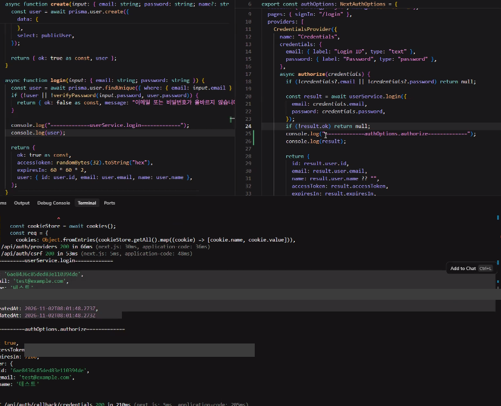

- 액세스토큰은 추후 JWS 토큰으로 바꿀 예정
    - JWT로 바꾸면 토큰 안에 "누구·언제까지"가 들어감
- 프로바이더와 세션도 봄 
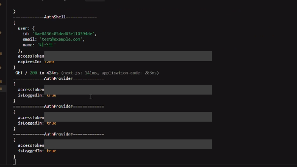

- 같은 시기 개발화면에서 보이는 모습. server 라고 붙어있는 건 서버에서만 보임. 실제 배포에선 안 보이는것.
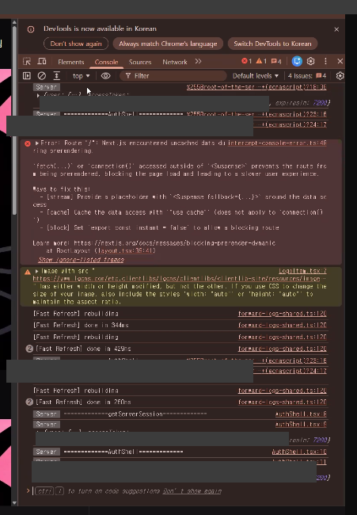

- 이렇게 하면 유저정보 노출을 줄일 수 있어 백엔드 서버와 넥스트 오스 서버간의 통신으로 유저정보 관리는 끝난다. 

- 오후에는 카카오로그인 등을 붙여볼 예정.
    - 오쓰도 데이터 베이스들 처럼 토큰이랑 코드가 있음. 
    - 넥스트오스 시크릿은 랜덤으로 뽑히므로 뒤의 시크릿 코드 쓰실거면 살짝 바꿔서 써라. (물론 수업용도임)

### 지금까지 배운것
- 로그인 이후의 절차를 어떻게 처리할 지 판단하고 오쓰를 적용하는 과정을 진행함. 브라우저에서 정해둔 값이 있다면 이를 인지, 컨텍스트 프로바이더를 하는. 리액트 스러운 동작
- 넥스트는 프론트에서 넘어온 데이터를 세션에 담고 여기에 필요한 액세스 토큰을 발급하고 프로바이더 안에서 상태관리를 하게끔 함
- 프로바이더의 주의점. 열려야 동작함, 클라이언트 사이드에서 유즈계열을 사용하면 클라이언트 정보 세션을 다 밖에 넘겨주니 주의, 그래서 쌤은 세션을 가져와 액세스 토큰만 주는 방식을 썼음. 하지만 액세스 토큰 굳이 안주고 트루폴스만 돌려줘도 됨, 
- 그래서 강사님은 오쓰 프로바이더를 커스텀 하여 사용함. 기존의 넥스트 오스 프로바이더의 문제점이 있기 때문. 

---

## 1시 수업

- 콘솔을 찍은건 어떤식으로 동작하는지 보여주시려고 하는 것. 
- 어떤 DB를 붙이던 리퀘스트가 붙어 액션이 일어나는 것은 동일함 
    - MongoDB든 다른 DB든 `요청 → 서버 → DB → 응답` 순서는 같아요. 바뀌는 건 `userService` 안쪽뿐

### 인증절차
- 몇가지 절차를 통해 승인하는 것.

- 해외에서는 아이디를 만든 유저를 특정하는 키값을 어떤걸 쓸까? 이메일.
    - 그래서 오늘 회원가입 코드는 아이디(`userId`)와 이메일 둘 다 `@unique`(하나뿐)로 둠
- 개인정보인건 확인하는 키만 갖는 형식. 주민등록번호, 전화번호, 상세주소 이런건 조심해야하므로 DB 저장시에도 마스킹을 함
    - 마스킹 = `010-****-5678`처럼 가려서 저장·표시. 비밀번호는 아예 해시(`scrypt`)로 저장
- 그럼 개인정보 아닌 것은?

- signup 하는 도메인이 있다고 할 때. 했다라는 행위를 말하려는 액터는 무엇일까? 사용자. 로그인 하는사람은 회원. 
- 아이디 중복확인 절차의 유래 

- 액터는 누구일까? 사용자
- 관리자 웹사이트에 회원가입을 하는 사람들은 누구일까? 사용자. 다만 관리 설정값을 조정할수 있는 사람들이라 볼 수 있음 

- step 1, step 2 단계적 가입절차. 
    - 한 화면에 다 받지 않고 나눠서 받기 → 오후 실습의 ①아이디 ②비밀번호 ③관심사 ④프로필
- 비밀번호를 왜 두번 입력할까?
    - 유저 책임전가
    - 오타 방지
    - 유저를 위한 게 아님
- 또 필요한것 : 비밀번호 정책
    - 비밀번호를 받는다 이거 한줄로는 안된다.
    - 외에도 아이디나 이메일등의 정책을 쓸 수 있다.
    - 이름 : 귀화한 사람들도 간혹 있음. 20자정도? 그리고 한글만 쓰려면 다른 글자를 막아야 함. 그런 게 밸리데이션(validation, 유효성 검사) → 우리는 Zod로 함
    - 시키는 대로 하는것보다 알고 하면 더 좋다
- 이용약관 동의 : 책임전가. 이또한 데이터. 허락을 했다라는 증거를 남김. 
    - 동의 안하면 다음단계로 못가게 막을 수 있지만 대체적으로 뚫림. 프론트엔드는 DB를 책임지려 하지 말것. 
        - 화면 검사는 F12로 우회 가능 → 서버에서 한 번 더 검사 (`actions.ts`, `userService`)
- 추가 옵션
    - 선호사항 등의 카테고리 : 스킵 필요. 데이터 담아서 보낼지 비워서 보낼지
        - 오후 코드 ③관심사·④프로필의 "건너뛰기" 버튼
    - 프론트엔드 api 설계 쉽다. 할 수 있는 것이 좋음. 이런 선택사항 등 백엔드에게만 맡기지 마라. 같이 협업해라 프론트 주도개발을 해라

- 중간저장, 단계, 사용자가 어디서 포기하는지에 대한 걸 알기 위한 데이터 (쿠키발급으로 할 수 있음) - 주로 대기업이 함. 모든 데이터와 절차를 알고 분석함
- 개인인증 이후엔 조심해야 함
- 스텝이 바뀌더라도 전체 페이지에 들어가는 요소만 바뀌는 형태
    - 주소(`/signup`)는 그대로, 안의 칸만 갈아끼움
- 스텝이 바뀔때마다 채워지는 형식을 취할 수 있음 (폼형식)
- 또는 상태관리 

--- 

## 2시 수업
- signup 을 스텝업 방식으로 진행
- step 1 : 아이디, 중복체크, 에러에 대한 핸들링 ← 스텝업 관리
- 최소 최대 몇자까지? 조건분기
    - 대문자 불가, 첫글자 숫자 불가, 4자리 이상 20자리 이하, 특수기호 불가
        - 정규식 `/^[a-z][a-z0-9]{3,19}$/` : 첫 글자 소문자 + 나머지 소문자·숫자 3~19개 = 4~20자
    - 이게 통과하지 않으면 올바른 아이디 입력 또는 가이딩을 주도록 함
    - 글자가 적히는 경우, 어느 타이밍에 중복확인을 할까? 
    - 선생님이 만든 건 4개부터 아이디 사용 가능.
        - 유저가 어떤식이든 아이디를 적는다. 적은 뒤 포커싱을 벗어나는 것보다 타이핑 시작 후 일정시간이 경과하거나 약간의 멈추는 틈이 있다면 그 때 검사하는 방법등이 좋음
        - 이름이나 생년월일 같은 정해진 것들. 전화번호같은건 포커싱으로 넘기는게 괜찮음
        - 잠깐 멈추면 검사하는 기술 = **디바운스(debounce)**. 오늘 완성본은 "다음" 버튼을 누를 때 서버에 중복확인함
- 1 완성 후 버튼으로 넘어가게 하심. 이후 스텝을 넘어갈 때 스텝을 인식하게 하는 것이 필요함.
- 두번째 페이지에서 이메일 등을 작성하게 함. 그리고 앞이나 뒤로 가는 버튼을 만듦.
- 중복확인이나 알림 글자가 사라지거나 있을때 버튼이 덜컹이며 움직이는 문제 해결
    - 버튼에 사이즈, 패딩, 위치를 옮기는 것으로 덜컹이는 문제를 해결함.
        - 이 현상 이름 = 레이아웃 시프트
- 폼에 들어간 데이터가 있는지 테스트. 
- 이메일 입력이 끝나면 3단계로 넘어가고, 3단계 작성하면 회원가입 글자가 보이도록 설계 
- 단계를 밟으면 회원가입 버튼이 나옴. 기본구조를 만들었음
- 기초적인 형태를 보여주었으니 이제 전체적으로 프로그레스등을 넣고 갈아끼울 것임. 코드도 많아지고 좀 많이 달라질것.
- 폼으로 데이터를 쌓아나가도록 변경할 예정

- 미리 만들어둔 코드를 보여주심. 현재 만든 것들을 상세하게 풀어 쓴 형태라고 하심. 

- 브랜치를 옮기신다고 함. 
    - 브랜치 `feature/signup-step1` (선생님 커밋 `ad13628`, 14:46)

- 선생님이 미리 만드신 형태. 이런식으로 만들거고 api랑 db가 붙어야 다음 단계로 넘어갈 수 있다고 함
  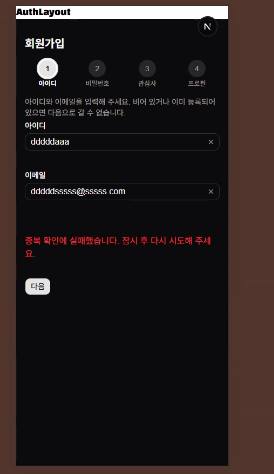
    - 빨간 글자 "중복 확인에 실패했습니다" = DB에 `userId` 칸이 아직 없어서 서버 에러 → `npx prisma db push` 필요

---

## 3시 수업

- 브랜치 바꿔서 진행.
    - 브랜치 `feature/signup-stepper-formaction` (선생님 커밋 `56d5f2c`, 15:17)
- SignupSection
    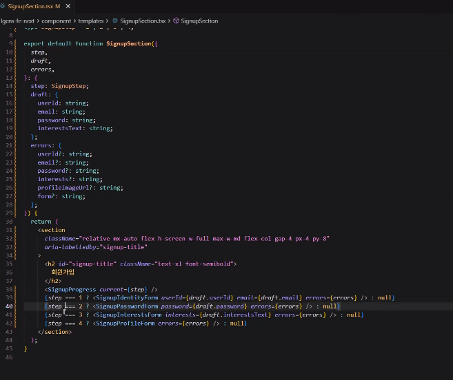
    - 추후 Zod 붙일 예정 

- 이전과 다른건 서버사이드로 작동을 하며 state 가 줄었음 
    - 입력값을 브라우저 `useState` 대신 서버가 쿠키(`signup-draft`)에 보관 → `useState`가 필요 없어짐
    - 그래서 입력칸도 `value`(React가 글자마다 관리) 대신 `defaultValue`(처음 값만 넣어 줌)를 씀
- 현재 테스트의 애로사항. 중복 체크 등이 어려움. DB 자체의 설계 및 수정이 대대적으로 필요한 상태.

- 넥스트도 무조건 상태를 쓰긴 써야 함. 쿠키등을 관리하기 위함
    - 상태를 두는 곳: `useState`(새로고침하면 사라짐) / 쿠키 / 주소창 `?step=2` / DB
- 액션 드래프트 
    - 드래프트 = 임시저장. `draft.ts`의 `readSignupDraft()`·`writeSignupDraft()`로 쿠키를 읽고 씀, 30분 뒤 자동 삭제

### 스켈레톤 사용해보기
- 로더 파일을 컴포넌트에 생성. 로딩중에 스켈레톤 사용이 좋음. 
    - 스켈레톤 = 내용이 오기 전에 보여 주는 회색 깜빡이 막대. 자리를 미리 잡아서 화면이 덜컹이지 않음
- 회원가입시 로딩을 하는 것.
- 로딩중입니다를 지우고 스켈레톤 호출로 수정 
  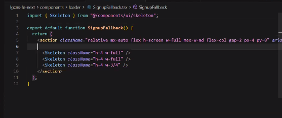

- 액션스에 드래프트

### 로딩페이지
- 링크의 경우 전환되는 경우 동작방식이 바뀜. 이부분이 넥스트가 애매함. 
- a 태그는 페이지가 바뀌고 프리패치, 프리렌더링이 옴 
    - 그냥 `<a>`는 페이지 전체를 새로 받고, Next `<Link>`는 바뀐 부분만 갈아끼우며 다음 페이지를 미리 받아 둠(프리패치)
- 넘어갈 때 부분부분 로딩이 있어 이를 맞추기 위한 펜딩 같은 기능도 존재함. 문제들이 있음.
    - pending = 처리 중 표시. `useFormStatus()`로 버튼 글자를 "다음" → "확인 중"으로 바꿈
- 사인업 폴백, 스켈레톤을 이용.
    - `<Suspense fallback={<SignupFallback />}>` = 안쪽이 준비될 때까지 스켈레톤을 보여 주는 가림막. `app/loading.tsx`를 만들면 자동으로 감싸 줌
  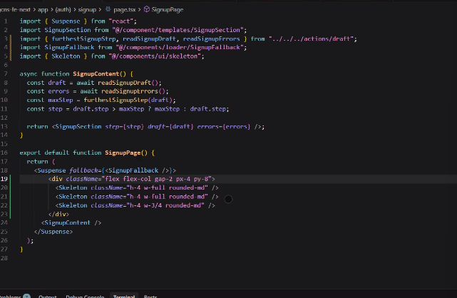

- signupContent를 덜어내고 이동할 예정임. (컴포넌트화)
- 스켈레톤 실제 적용된 모습 시연하심.
  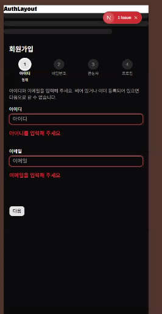

- 주소 체계를 갖고 스켈레톤으로 위치를 잡고 상태를 유지하면서 갈아끼울 수 있게 할 예정 
- 해당되는 부분만 각각 CSR로 인지하게 하고 현재의 STATE를 유지할 수 있게 하는 것이 최종 목적. 
    - CSR = 브라우저가 그림, SSR = 서버가 그림

- undefined에 대한 처리
  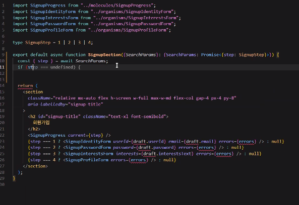
    - `?step=` 없이 `/signup`으로 들어오면 `step`이 `undefined` → 1단계로 보여 줘야 함

- `??` 공통처리함
  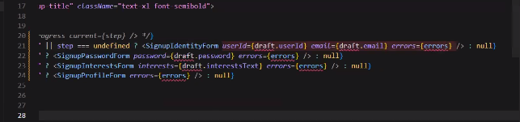
    - `a ?? b` = a가 비어 있으면(`null`·`undefined`) b
- 폼 데이터 안에서 데이터를 뽑아올 수 있게 함

### 이제 3단계 갈것임

- 렌더링과 슬러그가 발생하지 않음. 

--- 

## 4시 수업

- 브랜치 `feature/signup-stepper-formaction-step3` (선생님 커밋 `15532ec`, 16:50)

- 모양만 넘버로 받겠다고 선언하면 숫자를 받을 수 있는듯? 
  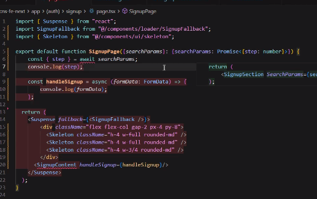
    - **노트 확인**: 타입은 이름표일 뿐 값을 바꾸지 않음. 주소에서 오는 값은 항상 글자 → `parseInt`로 숫자로 바꿈
- 스텝을 넘겨주고 진행할 수 있도록 함.

- `handleSignup`을 이용하여 코드를 줄이고 복잡도를 줄임 
  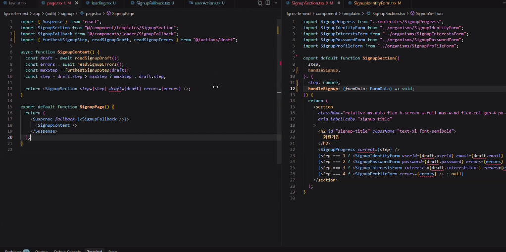
- `SignupProgress`를 열어 숫자로 관리하게 함
    - step 이 오면 아이디와 매칭하여 넘김 

- 추후 Zod를 쓸 것이기에 error 코드를 지움
  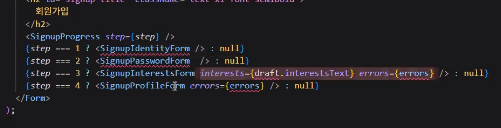

- 에러도 스텝별로 나눌 예정
  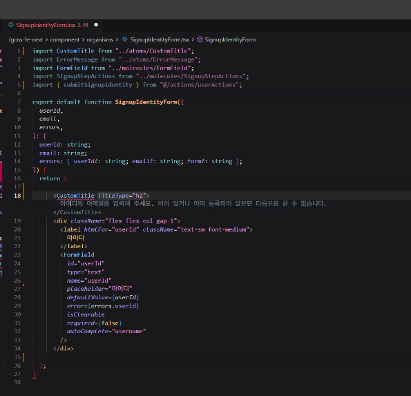

- 유저 아이디 등이 제대로 쓰였는지에 대한 상태관리가 필요함
  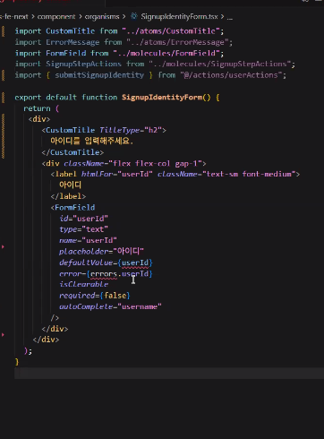

- 스텝이 잘 찍히는지 확인 
  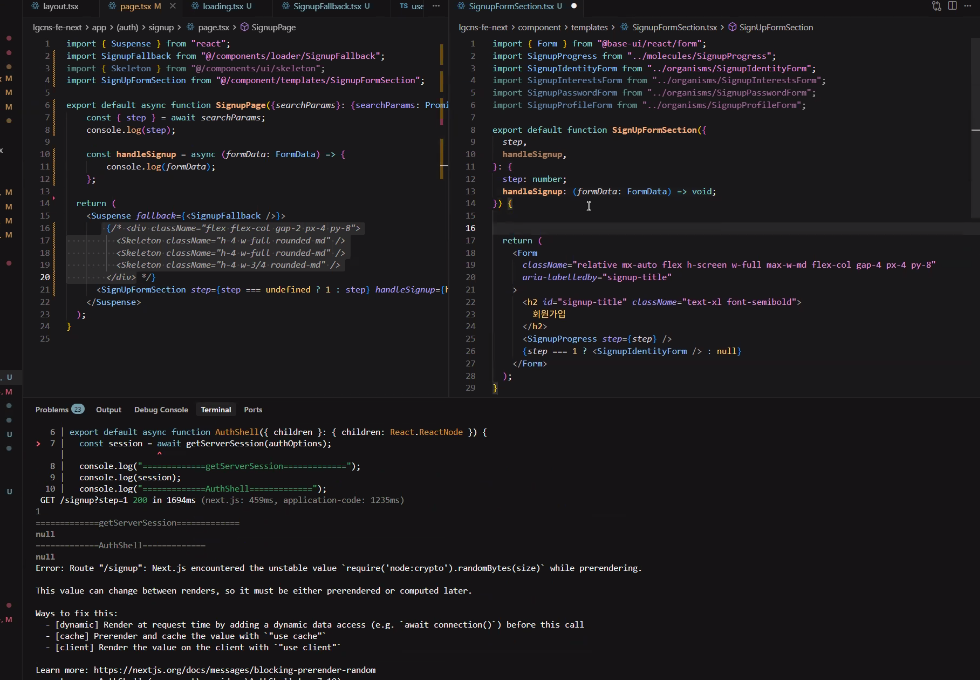

- nextjs 주소창으로 스텝을 넘기는 방식으로 구현중
- 주소창을 키면 렌더링이 돌지만 다음 버튼을 누르는 방식으로 이동하면 로딩 없이 깨끗하게 넘어가도록 될 예정. 
- 라우터를 쓸 때부터는 CSR임
    - `useRouter`·`useSearchParams`는 브라우저에서만 동작 → `"use client"` 필요
- 페이지 이동버튼 생성 
- 레이아웃에 들어가야만 리렌더링이 발생하지 않는다. 
  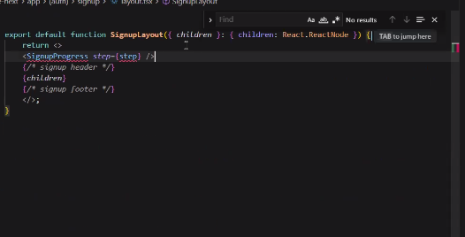
    - 기본 틀로 만든다는 말씀이신듯? 
    - layout = 액자(그대로), page = 그림(갈아끼움). 진행바를 layout에 넣으면 단계가 바뀌어도 그대로 있음

- `searchParams`는 use 계열 사용

  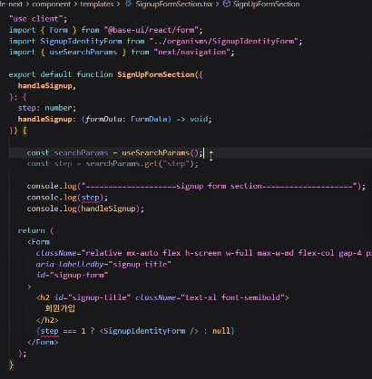
  
    - page(서버)는 props `searchParams`(await), layout 안·client 부품은 `useSearchParams().get("step")`
    - **노트 확인**: `get()`은 값이 없으면 `undefined`가 아니라 `null`을 줌 → `?? "1"`로 처리

- 회원가입이 확정되려면 모든 스텝이 확정되어야 한다는 규칙 삽입

- 사인업 프로그레스가 스스로 판단하여 움직이게끔 레이아웃에 삽입

- 설계시 렌더링이 발생하는 부분과 아닌 부분을 구별하라. 

- 브랜치를 두개 나누어 줄 예정
    - 단계를 쿠키에 저장(`signup-stepper-formaction`) / 주소에 저장(`signup-stepper-formaction-step3`)
- 둘 중 정답은 없다. 자신이 맞다고 생각하는 걸 하라
- 넥스트와 프론트엔드를 끊임없이 탐구하는것을 권장한다. 
- 상태에 대한 이해를 습득한다면 앞으로 진행하는 api 에 대한 이해를 높일 수 있을것이다. 

- 하이드레이션을 회피하려면 극단적인 ssr, csr을 해야한다. 서버 위주로 프론트엔드 개발을 권장한다 

---

## 5시 수업

이렇게도 할 수 있다. 제안하는 느낌으로 만들어보았다고 함. 현재 ai가 가진 코드는 강사님의 의도와 다른 코드라고 직접 짜셨다고 함. 

- signin signup 과정에서 보안을 위한 기술 제안을 하심
- 오쓰를 사용해보기 위해 디벨로퍼 계정을 만들어와라. 네이버 할까 ..? 
- 오늘은 넥스트 오쓰. 여기는 소스코드가 정해져있음
    - 만들어야 하는 것들이 있고 옵션이라는 이름의 별도의 상태는 커스텀하여 빼셨음
    - signout, error 등도 설정 가능

- 어제 만든 로그인에 서비스를 태우고 리턴값을 얻기위해 오쓰라는 타입을 선언함. 

### npm run build
- 현재 상태에선 무조건 터질 것 
- 코드 오류 등을 검수해줌 

### 로그인은 세션으로 작동중
- 로그아웃 없으니 콘솔에서 쿠키 삭제하면 로그아웃됨

### 회원가입시 스텝을 통해 렌더링 하고 각자가 일을 맡는 책임 패칭을 사용함
- `searchParams`를 사용해보기도 함

### 질문
- 회원가입시 오쓰를 쓰면 해외에선 추가적인 정보를 받지 않는다고 하셨는데, 관심사가 필요한 서비스의 경우에 선택사항으로 관심사를 적게 하는 것도 오쓰답게 사용하는게 아닌건지 궁금합니다.
- 해외도 관심사같은건 필요하면 받음 사용자 맞춤으로 커스텀을 해주기 위한 목적
- 추가적으로 받지 않는것은 사용자의 개인정보
- 오쓰를 통해 유입되어온 사람은 해당 오쓰의 회사. 그 회사에서의 아이디를 받고 그렇게 들어온 유저에게 우리 서비스의 uuid와 일련 번호를 부여함. 이 때 그 회사의 아이디 키값은 노출되어선 안됨. 이건 고정값이라 얼마든지 사용돼 버리는 개인정보이기때문에 유출되지 않도록 주의해야 함

- 오쓰 쓰고 개인인증을 하면 간편로그인으로 분류

- 또한 오쓰 회사마다 유저에게 부여되는 아이디는 다름. 이름이나 전화번호는 달라도 CI(연계정보)나 특정 개인정보가 동일한 것을 키값으로 간편로그인을 여러개 추가할 수 있음. 아니면 중복이니 이건 빼고 다른걸 하라는 식으로도 안내할 수 있음. 사용자의 ux를 생각한다면 어떤것으로든 로그인 할 수 있게 해주는 편이 좋다 생각한다 하심.

### 내일부터는 디자인도 입힐 예정. 프론트 엔드 개발자이자 디자이너로서 예쁘지 않은 디자인은 싫다. 
### 퍼블리셔가 없을 땐 어떻게 할건지
### 디자이너가 없을 때 어떻게 할건지 

- 알려주실 예정

### 중복체크를 한다 - true/false 
- get 통신을 하는 느낌을 느낄 수 있다. 하지만 get은 하나밖에 못쓴다. 그래서 보안 취약 가능성이 있다. 
- 하지만 그렇다고 많은게 노출되진 않는다.
- 그래도 이메일조차 노출이 싫다면 body를 써서 post update 를 이용한 보안체계를 쓴다. 
- https 인증서를 사용해야 회원 관련된 모든것을 쓸 수 있다. 그래야 정보가 암호화 되어 날아간다 
- 데이터 통신 시 넥스트 서버를 까서 콘솔을 찍거나 하는 짓은 하면 안됨 
- 내부로 들어가는 과정등이 노출 안됨. 인터셉트를 막으려고 ssl을 쓰는것임. 
- 넥스트 서버를 중간에 볼 수 있는 사람이 없고 콘솔이 없다면 털릴 일은 없음. 
- api 서버에서 서블렛이나 필터링을 써서 암호화를 걸 수 있음. 
- 이게 또 걱정되면 넥스트에서도 암호화 가능. 하지만 단방향 암호이기때문에 암호화 로직을 들킬 수 있기에 api 쪽에 넣는 것이 훨씬 안전할것이다.
- 콘솔 안찍으면 그냥 메모리다. 큰 걱정하지 말라 

### 몽고DB에는 데이터가 바뀌는 것을 인지하는 기능이 있음 (클러스터로 사용시. CDC)
- 채팅방식 간단 설명 
- A와 B가 상호작용함. 일반적으로 전화를 하면 수동으로 하는게 아니면 저장이 안됨.
- 기존의 문자방식은 데이터 베이스에 별도로 저장되어 관리되는것
- SSE 방식을 사용하면 작성을 한다는 것을 DB에 올린다는 인식으로 바꿔 트랜잭션 한 후 다른 사용자에게 보여준다라는 로직이 돌아가는것, 
    - 입력창은 post api, 출력창은 또 다른데에 쌓임. 재접을 하면 이전날짜를 get 형태로 가져가고 아래쪽으로 다시 쌓이는 방식. 일반적으로 웹소켓을 사용함. DB 개발자가 할 일이 많고 복잡함
- 몽고 DB로 SSE 방식으로 채팅 만드는걸 알려주고자 함. 이게 CDC임
- 리액트로는 SSE 쪽
- 스프링은 아파치, WAS 쪽
- 블로킹? 인가 미리 공부해두면 취업에 도움될것이다. 