# 9일차 TIL : AI 서비스를 위한 프론트엔드 7

- 넥스트 실습은 다음 레포지토리에서 진행한다.
  - 🔗 [실습 레포지토리](https://github.com/easty00/lg-front-app41)
  - 🔗 [실습 배포 도메인](https://lg-front-app41.vercel.app/)

## 오프닝
### 오늘은 피그마쪽을 사용해서 디자인 개선과 오쓰 연결을 해볼 예정.

- 서버사이드 랜더링 이야기가 있었음 (문장이 끊김. 영상 확인)

- 어카운트 CI 국내의 동일한 키값. 이게 가장 중요함.

### 카카오로 만듦
```
앱 - 플랫폼키 - REST API 키
```
- 카카오 예전엔 정보 많이 줬는데 지금은 너무 많은 정보유출을 우려해 정식 서비스로 등록 후 대부분의 정보를 받을 수 있는 것으로 바뀌었다

- 키 발행하여 `.env.local`에 작성. REST API 키가 아이디, 시크릿이 시크릿

- 강사님이 카카오 버튼 만드셨고 카카오로 로그인 시도하심. 하지만 리다이렉션 주소가 없어 응답이 돌아올 길이 없음.
  - 리다이렉션 주소
    ```
    http://로컬 또는 해당 도메인/api/auth/callback/kakao
    ```
    - 구글은 kakao 쪽이 google 로 바뀌는 것 같음.

- 리다이렉션 후 카카오 재 로그인

  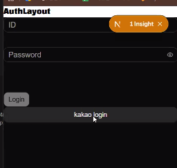

- 정상적으로 콜백되는 것 확인 가능. 그러나 정보를 옮겨담을 처리를 하지 않아 로그인에는 성공했지만 정보가 들어오지 않음.

  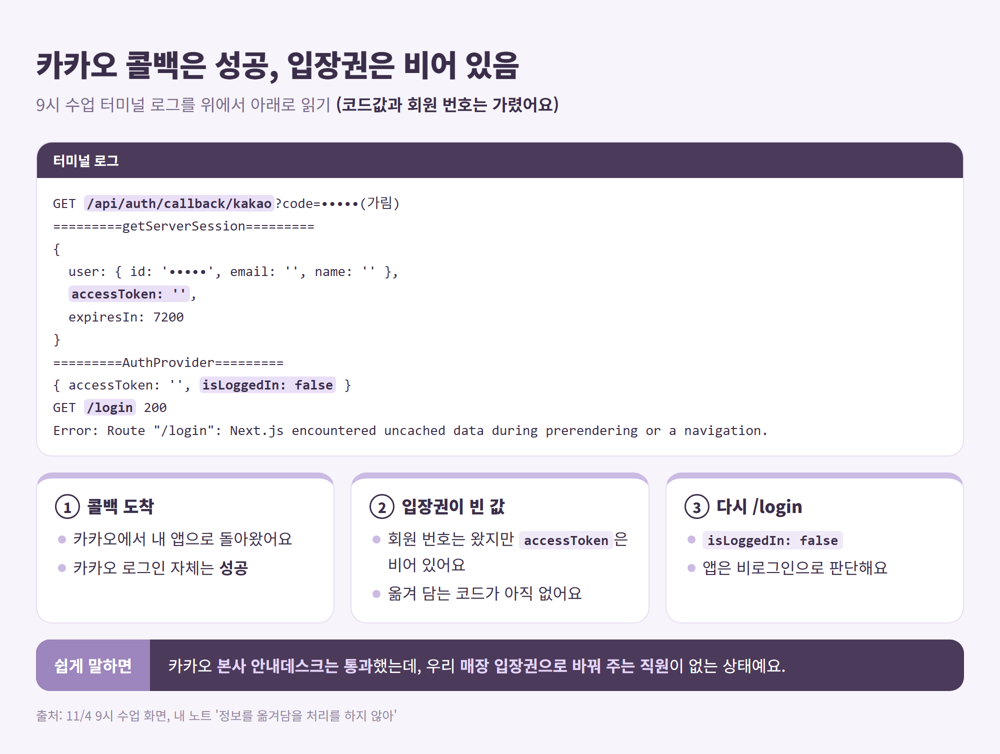

- 카카오와 주고받는 정보값은 무척 많음. 우리는 오쓰나 api, 라이브러리로 간편하게 사용하게 된것.

- 정보가 오면 유저의 세션으로 옴
  - 넥스트에서 쿠키를 받아 옴
  - 세션에 담기 전에 `jwt` 콜백을 먼저 거침. 여기서 정보를 토큰에 옮겨 담고, 크레덴셜 로그인과 소셜 로그인은 길을 나눔

  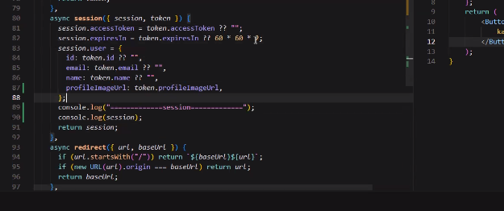

  - 한번에 오는게 아님. 던지고 받고 던지고 받고 핑퐁을 2번 해야 함.

  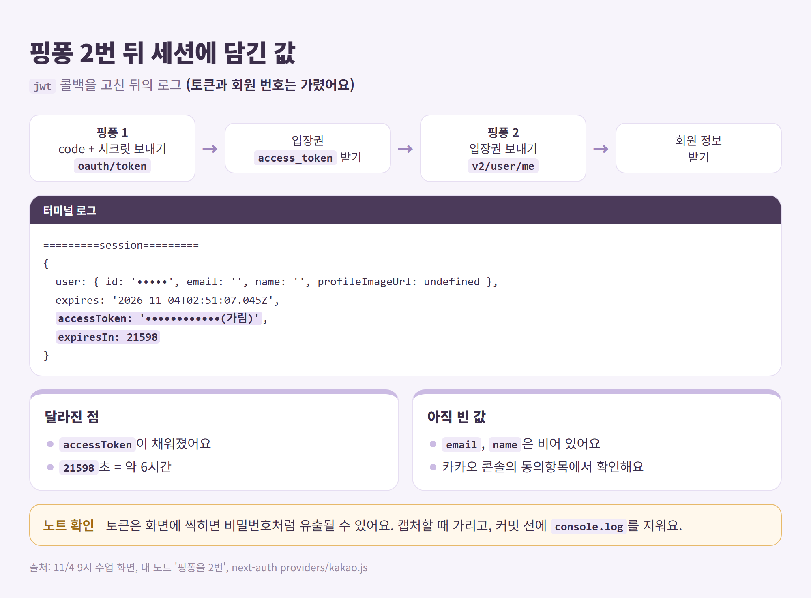

---

## 10시 수업
- 아틀라스 가입 시 구글 아이디로 로그인이 되었을 것 (뒷부분이 끊김. 영상 확인)

- 이후 추가 브랜치 커밋 따라하느라 흘려들음 영상 올라오면 봐야할듯

### 구글 오쓰 따라하기
- 난 어제 만듦

### 구글 단추도 만드심
- `GoogleLoginButton`에서 `signIn("google")` 호출

### 분기 만들기
- 만약에 구글이면? `jwt` 콜백에 `account?.provider === "google"` 분기를 추가하고, `account`의 토큰을 옮겨 담음

### 실습한다고 선생님 해설을 많이 못들음 오전부분 영상 꼭 확인할것

---

## 11시 수업

- 실제로는 로그인시 분기 처리에서 할 일이 많다. 이번 수업에선 하지 않는다.
  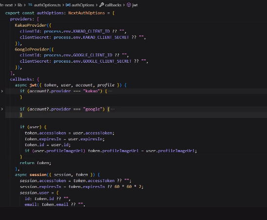
  - 어떤 분기 처리를 할까?
    - 회원인가? -> 회원인데 소셜은 처음인가?
    - 회원인가? -> 회원인데 소셜 네이버인가?
  - 등등의 API 분기를 어떻게 처리하고 리턴하고 다시 받는것들을 관리하여야 한다. 물론 이걸 백엔드에서 하라고 던질 수 있긴 함.
    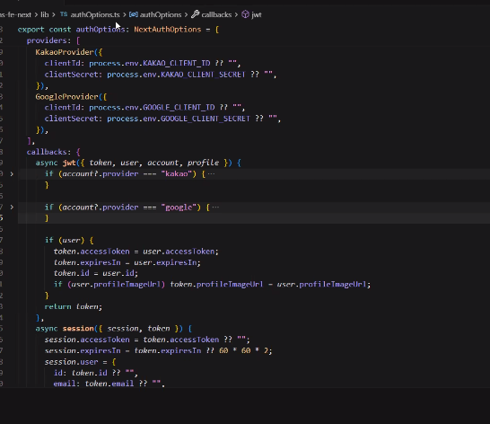
    - 프론트가 DB를 만질 일은 없어야 하는게 좋음 하지만 필요하다면 요청하거나 만지는 다른 툴을 사용하는 방법이 있음
- 대부분의 서비스들은 하나의 계정을 갖는것을 선호함
  - 국내의 모든 유저는 CI를 가지고 있음. 이는 신용과 묶여있고 핸드폰 개설시 같이 생김
  - 국내 서비스는 조금 폐쇄적 해외는 그냥 카드 번호랑 cvc 넣으면 그냥 통과됨 우리나라는 앱이나 페이등으로 개인인증시 결제되도록 막아두고있음. 이런 보안 측면과도 연결되어있음. ("소셜 로그인은 우리나라에 거의 없다"고 적었는데 카카오 로그인과 맞지 않음. 영상 확인)

- 구글, 카카오 각각은 각자의 키값을 가지고 있음
  - 구글에 내 아이디의 데이터베이스에 연동될 수 있다.
- 프론트도 DB 설계를 하고 백엔드의 지식을 알고있으면 좋다.

### 프리즈마쪽에 ORM 넣고 유저 서비스쪽에서 노드를 타지 않고 api를 탈 수 있게 패치 레이어로 만들어 DB에 연결하는 설계를 할 예정 : 미니 클린 아키텍처? 같은 것이라고 함. (아직 코드 없음)

### 오후에 할것
- 미들웨어 :로그인 한 사용자가 회원가입 페이지에 접근하지 못하도록 튕겨내기
- 로그아웃
- 로그인 상태에서 회원가입창에 접근이 되지 않도록 막기

- 현재 로그인 창도 로그인성공시 히스토리가 남지 않도록 하고 로그인 한 사용자는 접근하지 못하게 막아둔 상태다.

- 리액트 사용자들이 특히 이 부분을 간과할 때가 있음. 리액트는 한 페이지의 컴포넌트를 갈아끼우는 방식이기 때문.
- http나 넥스트와 같은 페이지 방식에서는 페이지 이동의 엄밀함이 있음. 이 부분을 인지하여야 함

- 또다른 문제: 크롬 내 계정이 달라지면 쿠키가 달라짐. 아니면 웹이 달라진다던가. 다른 곳에서도 로그인을 유지해야 하는경우 코드가 좀 복잡해진다.

---

## 1시 수업
### 로그인 버튼 수정과 트랜지션
- 1시 계획 : 로그아웃, 미들웨어 생성. 페이지 열리기 전 리다이렉션

  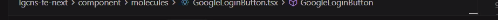
- 구글 버튼에 콜백 추가 : `signIn("google", { redirect: true, callbackUrl: "/" })`

  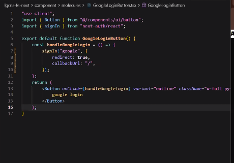

- 토큰이 발생하고 세션이 생기면 리다이렉트.

  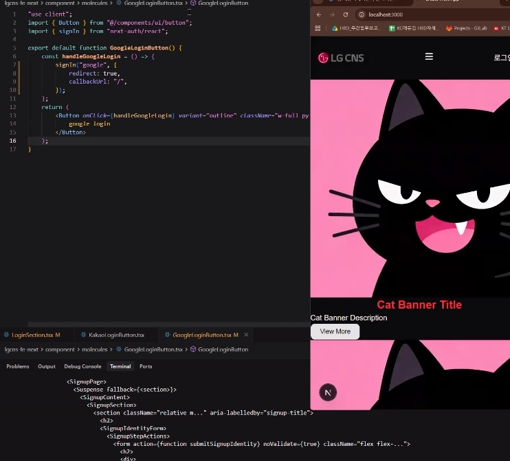

- 로그인 버튼의 대기 표시를 `useState`에서 트랜지션으로 바꿈
- 로딩 또는 동작중임을 엄밀하게 알고싶다면 트랜지션 사용
- 트랜지션은 리액트 18부터 있었고, 19부터 `startTransition` 안에 `async` 함수를 넣을 수 있게 됨

- 1시 25~29분 신명나게 조는중... 이 구간은 영상 확인

### 프록시 생성

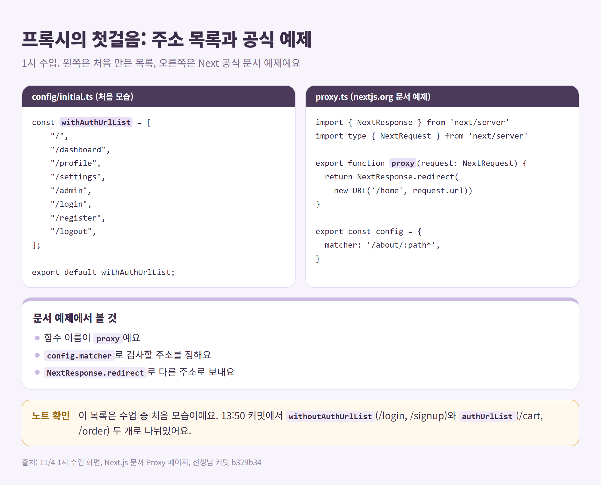

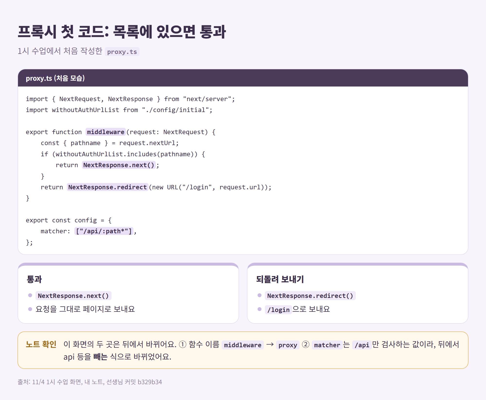

- 로그인 된 상태일 경우 바로 리다이렉트를 해야 하므로 세션을 가져옴
- 세션이 불러와지면, 엑서스 토큰이 있는지 보고 있으면 통과(`NextResponse.next()`)

  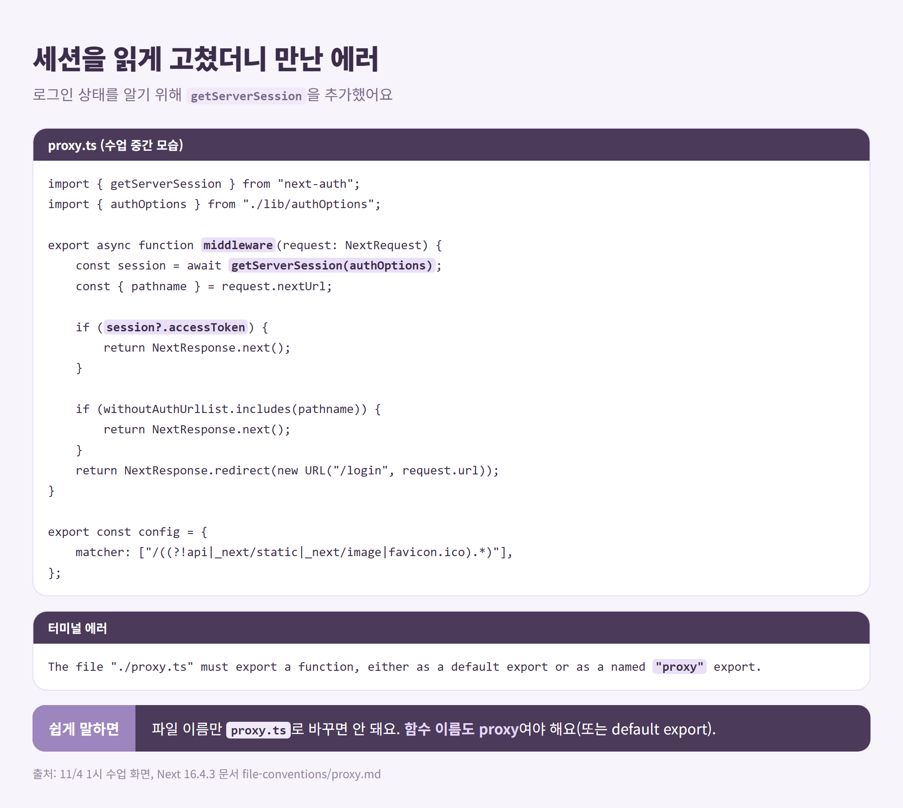

- 하나 더 추가. 로그인 페이지에 만든다.
  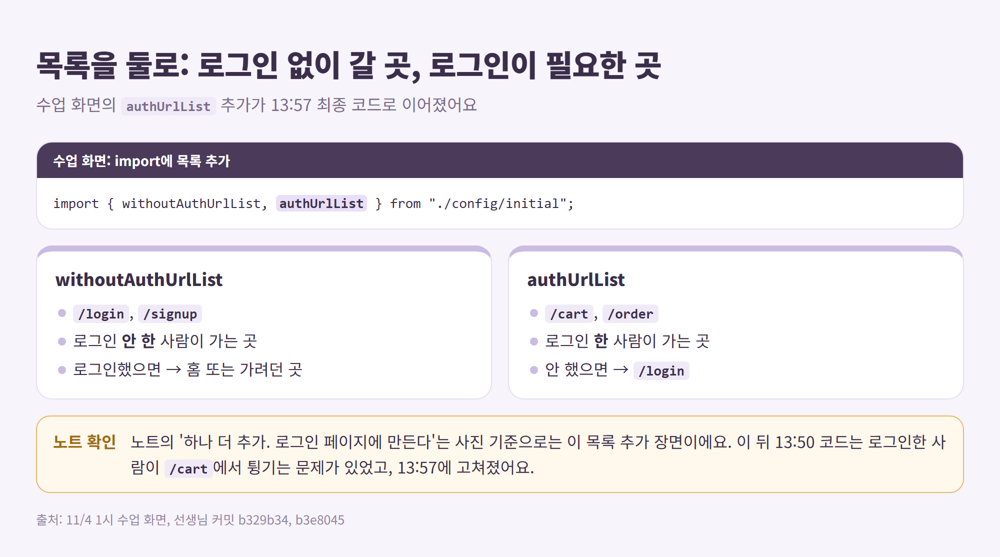

- 세션이 있을 때, 세션이 없을 때. 제각각 리다이렉트를 만듦.
- 오쓰 url 리스트에 패스가 포함이 되어있으면 로그인을 넘기고 그렇지 않으면 리다이렉트로
- 미들웨어는 예전 이름 현재 이름은 프록시. 파일은 `proxy.ts`, 함수 이름도 `proxy`

- 현재와 과거의 코드가 섞여있음.
- 미들웨어가 프록시로 바뀐건 얼마되지 않았음
- 사이트 확인하기

  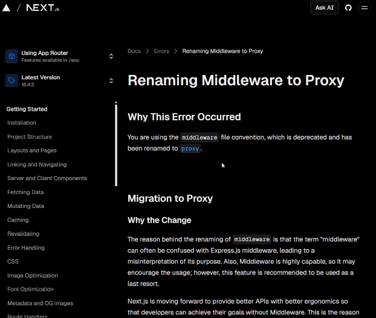

  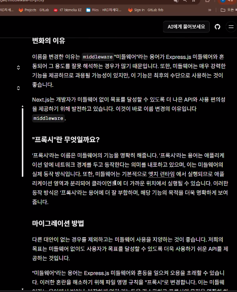

---

## 2시 수업

- 프록시가 작용하고 리다이렉트가 잘 되는 것 확인함. 화면이 깜빡이는 건 개발자모드라서 그런것. 실 배포시에는 깜빡임도 없음

- 주의해야 할 점. 보통은 다른 페이지로 바로 넘기지 않음. 프로세스상 맞지만 유저들이 자신이 뭘 눌렀는지 알지 못하는 경우도 있음 팅겨나오면 당황하게 됨. 그렇지 않도록 친절한 안내를 해주어야 함.
- 로그인 하지않고 로그인이 필요한 곳에 접근을 한다면 "로그인이 되어있지 않으니 로그인 하세요." 처럼 사유와 함께 친절한 설명과 함께 리다이렉트를 해주면 좋다.
- 로그인이 되어있는지 아는게 필요함. 보통은 카트 에 있는 창 등을 통해 자신이 로그인 되어있는지 확인할 수 있음.
- 로그인을 하거나 하고싶지 않아하는 사람도 있음. 그럴때를 위해 꼭 확인 뿐 아니라 취소버튼도 있는것이 유저의 편의를 올릴 수 있는 방법 중 하나
- 요즘의 트렌드는 친절한 웹사이트
- 프록시(미들웨어) 많이 활용하기 권장

  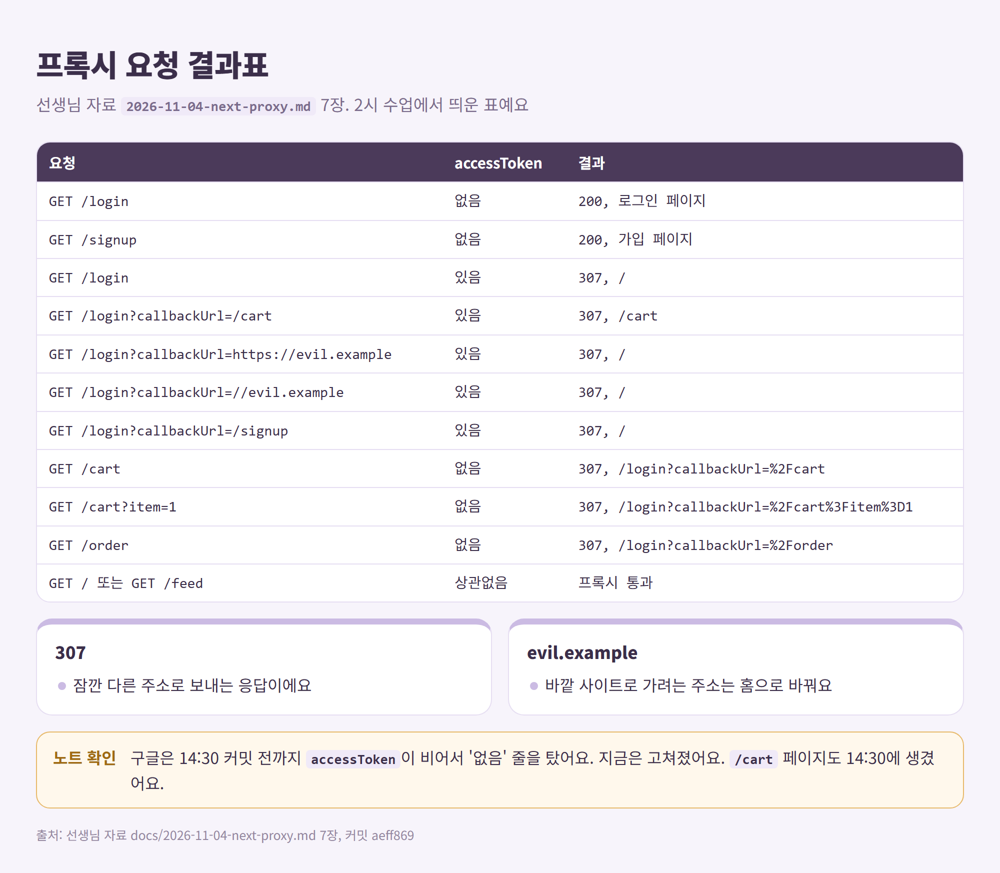

### 로그인 스테이터스
- 로그인 상태 파악. 로그아웃 버튼 추가
- 간편로그인에 콜백과 리다이렉트를 설정하지 않아 로그인 페이지에 접근할 수 있는 문제 발생

  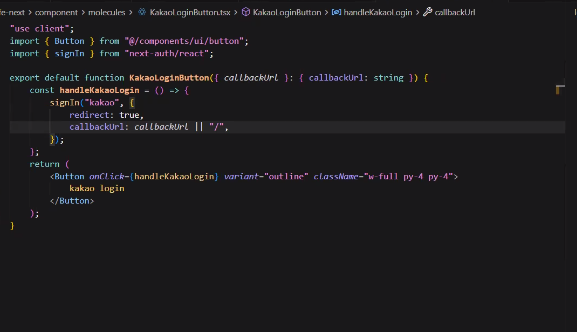

- 간편 로그인 등이 요구하는 정보등이 달라 세션을 저장하는 과정에서 잘못되기도 함
- 로그아웃 시 넥스트 오스의 사인아웃을 사용해야 로그아웃용 쿠키가 날아감. 또는 응답을 받은 다음 처리해야하는 경우가 있을 수 있음.
  - 그럴 땐 별도로 핸들러를 만들어 다루어 주는것이 맞음.

    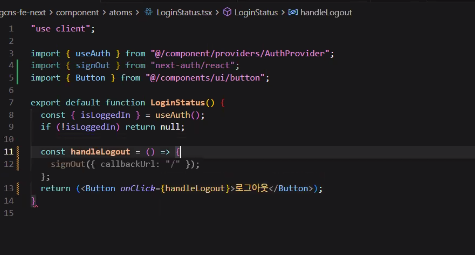

  - 로그아웃 할 때도 로그아웃중... 이라고 중간에서 서버 응답 돌아오는 사이 로딩을 띄움

    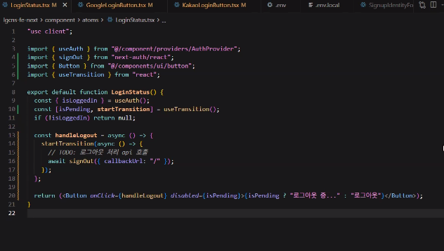

- 로그인시 카트페이지로 리다이렉션 하는 구조를 완성하심
- 카트 페이지 간단히 구현
- 미들웨어 설정 완료
- 따라치는게 예전보다 그렇게까지 중요도가 높지 않아졌다, 내가 만들어서 주면 잘 써라

- 리액트 19 트랜지션 : 나름 최신기능인데 벌써 1년이 넘었다..

  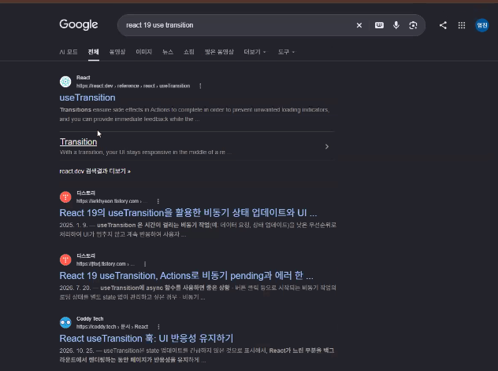

  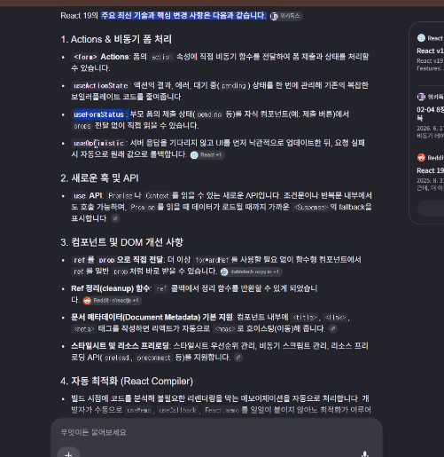

  - useOptimistic : 서버응답을 기다리지 않고 ui를 먼저 낙관적으로 업데이트 한 뒤 요청실패시 자동으로 원래값으로 롤백하는 기능
    - 버튼을 클릭하면 로딩이 돌고 연타를 불가능하게 함 (이건 트랜지션의 `isPending`으로 한 부분)
    - 데이터를 한번에 모아서 던지는 방법도 있음
- 리액트의 이 기술들은 서버액션과 함께 쓰는 기능들임. 다만 트랜지션은 오늘처럼 `signIn`, `signOut`에도 씀
- 코드는 아는 만큼 좋아진다. ai도 아는 만큼 좋아진다.

- 요즘은 로그인 창 뒤에 움직이는 화면을 놓는걸 많이 한다고 하심

  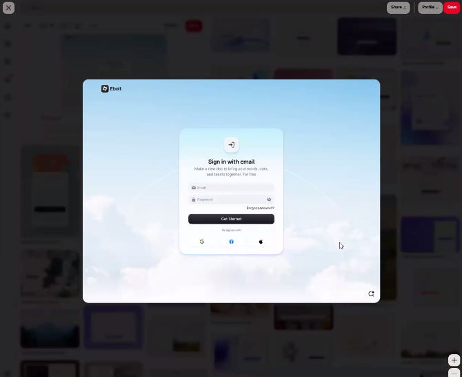

- 강사님은 피그마도 요금제 사용하신다고 하심. 퀄은 좋지만 그만큼 돈이다. 이정도는 사람이 스스로 만들 수 있으니 돈을 쓰지 않고싶다면 직접 만드는것도 방법이다.

  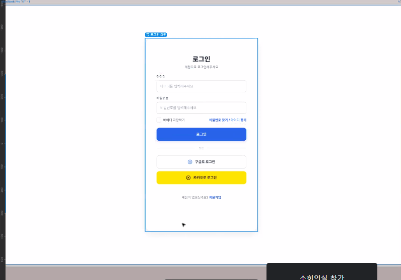

---

## 3시 수업
- 피그마 시연

- 버셀에서도 AI를 만듦

- 피그마에서 만든 디자인을 복사하여 ai에게 줄 때 순차적으로 조금씩 주는 것이 좋다.

- AI가 이렇게 뛰어나게 발전하면 굶어죽는거 아니냐고 그러는데, 그렇지 않다. 디자인으로 먹고살려면 그걸 써먹을 수 있어야 하는게 요즘 세상이다. 이거 써서 옆사람보다 3배 더 일하면 되는거 아니냐.

- 이거 중요! CSS의 `appearance: none` (Tailwind는 `appearance-none`). 체크박스의 브라우저 기본 모양을 지우는 기술

  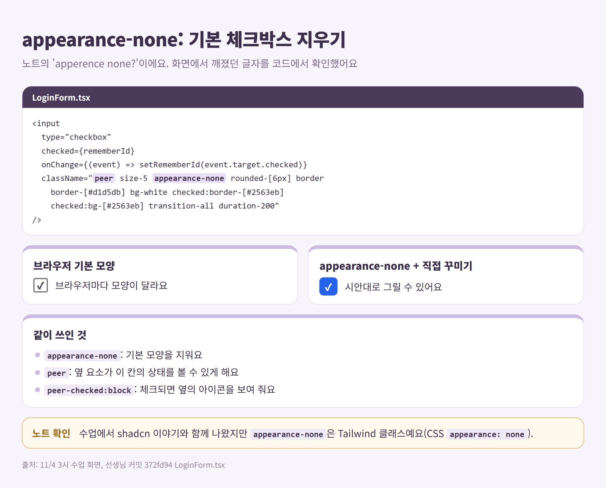

- 덜컹거리는 디자인 싫다. 처음부터 공간 만들거나 아웃라인 제어 하거나 툴팁처럼 띄우거나 다양한 대처방법을 사용하는 편이다.

- 회원가입 창도 몇가지 수정사항이 있지만 잘 완성됨

  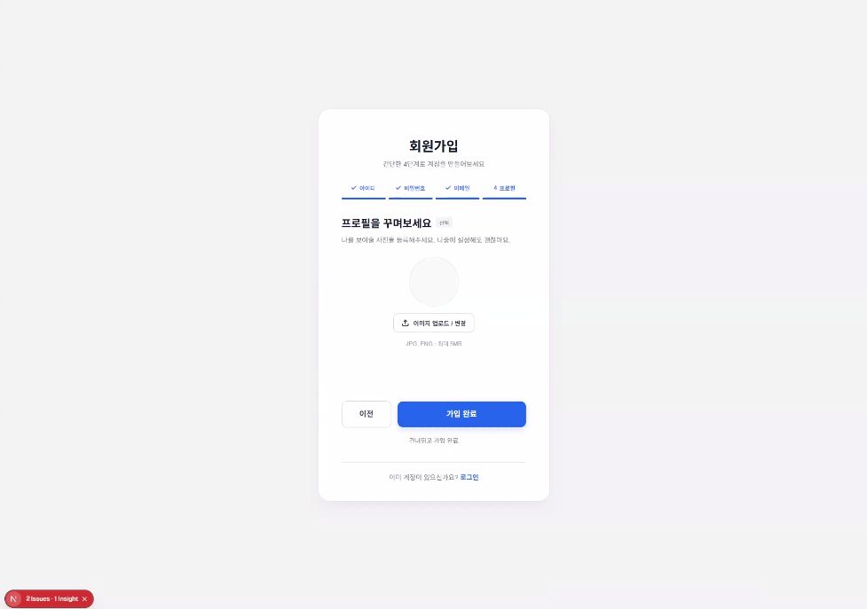

- 하루종일 만들어야 하는 내용이지만 ai가 순식간에 만들어주었다. 물론 기초 코드가 있기에 가능한것.

- 일부러 비밀번호 틀려봄. 에러핸들러를 어떻게 표시할지도 정의할 필요가 있음.

  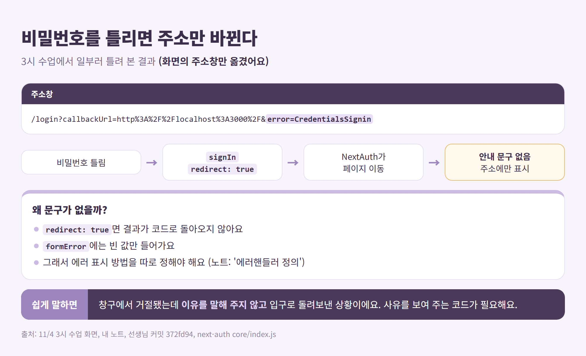

- 그런데 로그인 후 로그인 창 접근을 막아뒀는데 뚫려버림
- 액세스 토큰으로 판단하게 해두었는데 토큰을 얘가 인식을 하지 못했음.
  - 14:30 커밋에서 `jwt` 콜백의 `if (user)` 칸이 지워져 ID/비번 로그인의 토큰에 `accessToken`이 담기지 않은 것으로 보임 (코드로 찾은 원인. 영상과 비교)
- 구글 카톡은 잘됨.
- 로그아웃 후 카트로 접근할 시 자동으로 로그인 창으로 리다이렉트 하는 로직도 정상작동함.
- 프로필 이미지는 등록되어있지만 사용하지 못하고 있음. 웹서버가 없기 때문. 프로필 이미지를 쓰려면 웹서버를 만들어야 함.

### 수정된 회원가입창에 대한 설명
- `SignupSection` 템플릿에 4개의 스텝을 넣어둠. 클릭하면 다음, 이전으로 이동하도록 만들어야하는데 버튼이 보이지 않음.
- 그 버튼은 모큘 `SignupStepActions`에 넣어두고 내용은 칠드런으로 받음. 칠드런을 어떻게 만들어 넣는지에 따라 상위가 달라짐.
- 다음 이메일 폼으로 가면 틀은 똑같지만 칠드런이 바뀌어 명령이 바뀜 하지만 거의 동일한 틀을 사용하고 칠드런이 옴
  - 칠드런 명시 없이 폼으로 닫혀있지만 칠드런이 들어갈 자리를 마련해둠
  - 래퍼(wrapper, 감싸는 틀)를 만들어놓고 그 사이에 내용을 집어넣는 형태로 구성함
- 조금 난이도가 있는 방법. 이정도면 준수한 편
- 하지만 만들어둔 코드 몇가지가 날아갔다.
- 강사님은 사인업에서 서치파람을 받았음. ai는 뭘 줄지 모르니 뭐든 받을 수 있게 만들어둠
- 사인업에 스텝을 주고 분기를 만들어줌. 페이지에 대체로 하드코딩으로 들어가있음. 이건 수정이 필요함
- ai가 내가 시킨것보다 더 많은 일을 함. 내가 시킨 권한밖의 일. 그건 어느정도 범위를 교정해줄 필요가 있음
- 좀 바꿔야 할 코드가 있다.

### 추후 할 것
- 파일 정리를 좀 할 예정. 컴포넌트와 컴포넌츠 통합, 난잡하게 흩어져 관리가 어려운 것들을 감싸 소스 디렉토리로 모으고 env를 밖으로 빼내는 작업을 할 예정
- 만든 디자인에 코드를 붙이고 싶다면 오른쪽 탭에 해당 코드들을 볼 수 있고 박스모델, 색상. 이런게 나옴. 이건 ai없이 얻을 수 있는 정보들임. 이런게 가능한 api나 확장을 사용하는것 추천

---

## 4시 수업
### 캐싱전략
- 캐시의 단점 DB가 바뀌면 모름 static하지 못하면 답이 없음
- 피드를 바꾸는 사람 = 작성자. 넥스트를 써서 바꿀것임, 업데이트도.
- 피드 크리에이트 리퀘스트
- 피드 업데이트 리퀘스트
- 피드 겟 리퀘스트
- 넥스트에서 작은 프로젝트 정도 페스트로 할 경우 서버리스로 메모리만 가지고 라이트한 동작으로 할 수 있음. ("페스트"가 무엇인지 영상 확인)
- 스프링이 오면 국내 시장이 독특한 것이 있음
  - 백엔드 == JAVA(스프링) ===(완벽한 일치)
  - 국내는 자바가 많으니 자바로 하는게 맞음
- 캐시 중요하다고 생각한다. 백엔드 부분에서. 서버가 느려지고 버벅이지 않으려면 캐시가 없을 수 없다.
- CRUD 만드는걸로 우쭈쭈하는 부캠들이 있다. 그건 그리 중요하지 않다.
- MSA의 목표가 있다. 왜 필요할까? 너무 많이 쓰니까 문제가 생김
- db를 유저들이 한방에 뭘 넣거나 조회를 한다고 생각해보라. 이를 어떻게 해소해야할까?
- 백엔드가 더 어렵긴 함. 알고리즘이나 db가 무척 중요하기 때문
- db 는 살아있어야함. 모든것의 핵심임 . 그렇기에 db 위주의 개발을 해야함 . 개발을 할 때 db의 부하 감소를 목적으로 가져야 함

- 넥스트로 돌아옴
  - 캐시 정책
  - SSG

- 100 만건의 데이터를 조회하는 예시 : 조회 시간을 줄여 성능 향상을 실현했다. << 가 아님 어떤 조회도 짧은게 기본이다. 시간초 줄이는건 당연하게 필요한 일

- 넥스트는 CSR 방식을 SSR 방식으로 전환하는 과정에서 나오는 문제들을 보정하며 서비스를 하는것.
- 넥스트의 독스들을 하나하나 설명해주는 시간이었나봄?
- 패칭데이터
  - 개발은 플레인하게 하는걸 권장한다. 실력을 키우는것도 그렇고. 플레인으로도 충분히 만들어낸다.
  - 서스펜스 : 랜더링 문제 회피를 위해 서스펜스 꼭 쓰라고 권장하고 있는 듯함
  - 병렬 패치 : 병렬 처리를 하도록 함
- 캐싱 서비스
  - 캐싱은 지금은 말 안하면 무조건 쓰는 시스템. (설치된 Next 문서는 `fetch`가 기본으로 캐시되지 않는다고 적음. 영상 확인)
  - 그런데 넥스트는 그때그때 다르다.
  - 캐시쪽은 좀 많이 바뀐것같다. 제대로 다시 살펴보고 알려드리겠다. 문법 체계가 아예 달라졌다.
- 패칭이 아닌 컴포넌트 자체의 캐싱으로 보임 (문서상 함수 단위, 컴포넌트 단위 둘 다 가능)
  - 넥스트는 독스가 업데이트 해도 공지를 안줌, 그거때문에 선생님 좀 빡쳐계심
  - 과거엔 패치 함수 안에 캐시를 넣었음.
  - 그런데 최근에 갑자기 컴포넌트로 선언하여 사용하게 바뀌었음. 패칭은 모르겠고 `"use cache"` 쓸거야.
  - 코드 자체는 단촐하고 명시적이어졌지만 왜 이렇게 바꾼건지 의도는 알기어려움. (일단 빨리 보여주고 챗지피티에게 번역과 간단정리 시키셨음)
  - 캐시 동작방식은 열심히 설명해준것과 큰 방식이 바뀌지는 않았음.
  - 기존 데이터를 먼저 보여주고 갱신하는 동작이 갑자기 캐시 방식이 바뀐 이유가 아닐까 의심하시는중
  - 해당되는 부분은 선언하여 캐시를 걸음. 방식은 쉬워지긴 했음.
  - 하지만 단점이 있음. 이렇게 바뀌면 현재와 과거가 섞인 코드가 나오게 됨. 그리고 동작한다고 우기고 실제로는 터짐
  - 나온지 얼마 되지 않아 고정되지 못했기 때문.
  - 책 영상 보지말고 넥스트는 꼭!! 공식문서로 공부해라. 이놈들 잠수함 패치 너무 많이 한다.

- 이런 기술들을 어떻게 스스로 업데이트 해나갈까?
  - 리액트의 경우 : 기술이 만들어지면 요청하거나 기술제안을 할 수 있고 깃을 통해 공부할 수 도 있음. 개발자들이 적극적으로 이슈등에 대한 제안들을 하는걸 깃허브에서 볼 수 있음
  - 넥스트도 깃허브가 있음.

- SSR은 렌더링 관련 기술. DB에 비하면 부하가 크게 없는 편 (서버 부담이 없는 건 아니라서 캐시로 줄임)
- AI를 사용할 땐 엄밀해야함. 기준을 줘야함 안그럼 이번처럼 막 쓸것임. 하지마를 꼭 적고 룰을 적을 것.
  - 디테일하게 가이드를 해야 문제가 생기지 않는다.

- 질문 : ai 랑 같이 디자인 하면서 토큰 절약하는 꿀팁도 있는지
  - 그냥 디자인만 있으면 AI에게 맡겨서 뽑음
  - 디자인을 아예 AI에게 맡기진 않음. 기능 설명을 하려고 AI 스러운 디자인을 사용할수는 있음. 그정도는 오케이. 쨌든 디자인쪽을 AI를 아예 쓰는건 자중하는 편
  - 토큰 절약 답변은 못 적음 (영상 확인)

- 드래프트는 안쓰려고 노력하는중 (무엇을 말하는지 영상 확인)

- PWA, 일렉트론JS 로 데탑 앱 뽑는 가이드도 드릴 예정. 미니프로젝트는 어떻게 하는게 좋을까 고민해보겠음. 워낙 숫자가 많으니까.

- useOptimistic : 이 기능은 가르쳐주실 예정. - 서버액션 보완책
  - 쿠팡 : 데이터 패칭 때문에 갯수 늘리는데 시간이 걸림.
  - 쓱닷컴으로 옴 : 쓱은 바로바로 바뀌는 정상상태. 화면의 숫자를 즉각 올리고 저장은 뒤따라가는 것. 이후 패칭시 실패할 수 있음(재고가 적거나 데이터가 오지 않을 때). 실패하면 숫자가 되돌아감. 그래도 유저 사용감 향상에는 도움을 주고 숫자를 부드럽게 올리게 해주는 기능이 useOptimistic

- 실패를 많이 해봐라. 실패를 많이 할 수록 공부를 많이 할 수 있고 더 단단해진다.
- 백엔드는 오류가 명확하지만 프론트는 모호한 시장임.

- 캐시문제는 내일 좀 더 정리한 뒤 다 같이 해보는 시간을 가지자

---

## 오늘 최종 로그인 흐름
```
[브라우저] 로그인 버튼 → signIn("credentials" 또는 "kakao", "google")
   ↓
[크레덴셜] authorize → userService.login → 입장권을 우리가 만듦
[카카오·구글] 회사 로그인 화면 → /api/auth/callback/회사이름 으로 복귀 → 핑퐁 2번 → 입장권을 회사가 줌
   ↓
[Next 서버] jwt 콜백 : 입장권을 토큰에 담음 → 쿠키에 저장
   ↓
[브라우저] callbackUrl(가려던 곳 또는 홈)로 이동
   ↓
[Next 서버] proxy.ts : 페이지 열기 전에 getToken으로 accessToken 확인
   ↓  로그인 안 함 + /cart, /order → /login?callbackUrl=가려던곳
   ↓  로그인 함 + /login, /signup → 홈으로
[Next 서버] session 콜백 : 토큰에서 꺼내 앱에서 쓰는 모양으로 정리 → 헤더에 로그인 상태 표시
```

| 파일 | 하는 일 |
|---|---|
| `lib/authOptions.ts` | 로그인 방식(크레덴셜, 카카오, 구글)과 `jwt`, `session` 콜백 |
| `types/next-auth.d.ts` | 토큰, 세션에 넣는 칸의 타입 |
| `config/initial.ts` | 로그인이 필요한 주소 목록, 돌아갈 주소 검사(`safeCallbackPath`) |
| `proxy.ts` | 페이지가 열리기 전에 로그인 여부를 보고 통과 또는 리다이렉트 |
| `app/component/templates/LoginSection.tsx` | 주소의 `callbackUrl`을 읽어 폼과 버튼에 전달 |

# 🗂️ 파트별 다시 보기

## 파트 1. 소셜 로그인 (카카오, 구글)
- 준비물 : 키 2개(REST API 키, 시크릿), 리다이렉트 주소 등록, `.env.local`.
- 리다이렉트 주소 : `http://도메인/api/auth/callback/kakao`. 구글은 끝이 `google`.
- 흐름 : 버튼 `signIn("kakao")` → 카카오 로그인 → 복귀 → 핑퐁 2번 → `jwt` → 쿠키 → `session` → 화면.
- 크레덴셜은 `authorize`를 거치고, 소셜은 안 거침. 입장권이 크레덴셜은 `user`에, 소셜은 `account`에 있어서 `jwt` 콜백에서 길을 나눔.
- `account`, `profile`은 로그인 순간에만 있음. 그때 옮겨 담아야 함.

## 파트 2. 실무의 로그인
- 로그인 뒤 분기 : 회원인가? 소셜은 처음인가? 다른 소셜로 가입했는가?
- 계정은 하나로 합치는 것을 선호. 국내는 CI가 동일한 키값.
- 쿠키는 브라우저, 크롬 프로필마다 따로.

## 파트 3. 프록시
- 예전 이름 미들웨어. 지금은 `proxy.ts`, 함수 이름도 `proxy`.
- 비유 : 방마다 입장권을 묻지 않고 건물 입구 경비원이 한 번에 검사.
- `withoutAuthUrlList` : 로그인 없이 가는 곳. `authUrlList` : 로그인이 필요한 곳.
- `callbackUrl` : 가려던 곳 메모. `safeCallbackPath` : 그 주소가 안전한지 검사.
- `matcher` : 검사하지 않을 문 (`api`, `_next/...`).
- 튕겨낼 때는 이유를 알려 주는 친절한 안내가 필요.

## 파트 4. 트랜지션과 로그아웃
- `useTransition` : `startTransition` 안의 일이 끝날 때까지 `isPending`이 자동으로 `true`.
- 트랜지션 ≠ 트랜잭션. 트랜잭션은 DB에서 여러 작업을 한 묶음으로 처리하는 것.
- 로그아웃은 `signOut`으로. 서버에서 쿠키를 지움. 처리 중에는 "로그아웃 중..." 표시.
- `useOptimistic` : 화면을 먼저 바꾸고, 저장에 실패하면 되돌림. 추후 수업.

## 파트 5. 디자인과 AI
- 피그마 디자인은 AI에게 순차적으로 조금씩. 범위를 정하고 결과를 검사.
- `appearance-none` : 기본 체크박스 모양 지우기.
- 덜컹거리는 화면 막기 : 공간을 미리 만들기, 아웃라인 제어, 툴팁처럼 띄우기.
- 회원가입 구조 : 공통 틀(`SignupStepActions`) + `children`.
- AI에게는 기준을 주고 "하지마"를 규칙으로 적기.

## 파트 6. 캐시와 DB
- 캐시 : 자주 찾는 답을 메모해 두는 것. 빠르지만 원본이 바뀌면 메모는 모름.
- 개발할 때 DB 부하 감소를 목적으로 가져야 함.
- CSR은 브라우저에서, SSR은 요청마다 서버에서, SSG는 빌드할 때 화면을 만듦.
- 서스펜스 : 준비된 부분부터 보여 줌. 병렬 패치 : `Promise.all`로 동시에 시작.
- 캐시 문법 변화 : `fetch` 옵션 → `"use cache"`, `cacheLife`, `cacheTag`.
- 넥스트는 공식문서로 공부. 내 버전 문서는 `node_modules/next/dist/docs/`.

