# 10일차 TIL : AI 서비스를 위한 프론트엔드 8

- 넥스트 실습은 다음 레포지토리에서 진행한다.
  - 🔗 [실습 레포지토리](https://github.com/easty00/lg-front-app41)
  - 🔗 [실습 배포 도메인](https://lg-front-app41.vercel.app/)

## 오프닝
- 오늘 캐싱
- 채팅에 대하여
- 채팅에 들어가는 많은 기술들에 대하여

### ORM(Object-Relational Mapping, 객체 관계형 매핑)
- 객체 지향 프로그래밍(OOP) 언어의 '객체'와 관계형 데이터베이스(RDB)의 '테이블'을 자동으로 연결(매핑)해 주는 코딩 기술

- 다양한 데이터베이스 지원: 관계형 데이터베이스(MySQL, PostgreSQL, SQLite, SQL Server)뿐만 아니라, NoSQL 데이터베이스인 몽고DB(MongoDB)도 함께 지원
- 타입 안전성(Type Safety): 자바스크립트나 타입스크립트 개발자가 코드를 작성할 때, 데이터베이스에 어떤 값이 들어있는지 미리 알고 자동 완성이나 에러 체크를 해줌
- Prisma Schema: `schema.prisma`라는 하나의 파일에 데이터 구조를 정의해두면, 프리즈마가 데이터베이스 테이블을 자동으로 만들어주고 관리(마이그레이션)해줌

### 몽고DB(MongoDB)
- 관계형 데이터베이스(RDB)가 아니라 NoSQL(비관계형) 문서 지향(Document-oriented) 데이터베이스
- 몽고쉬 : 명령어나 스키마, 모델등을 만들 때 사용. 복잡하게 들어가는 코드를 생략하게 해줌 (몽고쉬 mongosh인지 몽구스 Mongoose인지 영상 확인)
- JPA 장점도 있지만 단점도 큼

### 프리즈마(Prisma)
- 데이터베이스가 아니라, 데이터베이스와 소통하는 것을 도와주는 차세대 ORM(Object-Relational Mapping) 프레임워크
- 데이터베이스 자체가 아니라 개발자가 데이터베이스를 더 쉽고 안전하게 다룰 수 있도록 도와주는 번역기이자 도구

- 몽고DB / MySQL / PostgreSQL = 데이터를 실제로 담아두는 "창고"
- 프리즈마(Prisma) = 그 창고에서 물건을 쉽게 넣고 빼기 위해 사용하는 "최신식 관리 시스템"

- 관계형DB는 하나가 바뀌면 연쇄적으로 다 바뀌어야 함. 하지만 관계형이 아닌 DB는 이에 비해 자유로움. DB가 멈추는 일이 잘 없음 (구조 변경 부담이 덜하다는 맥락으로 보임. MongoDB도 요청이 몰리면 느려질 수 있음)

### 콘솔 탐방

- 콘솔은 깨끗한게 좋다고 생각함
- 개발자들이 남긴게 꽤 많다 깨끗하게 유지하자.

---

## 10시 수업

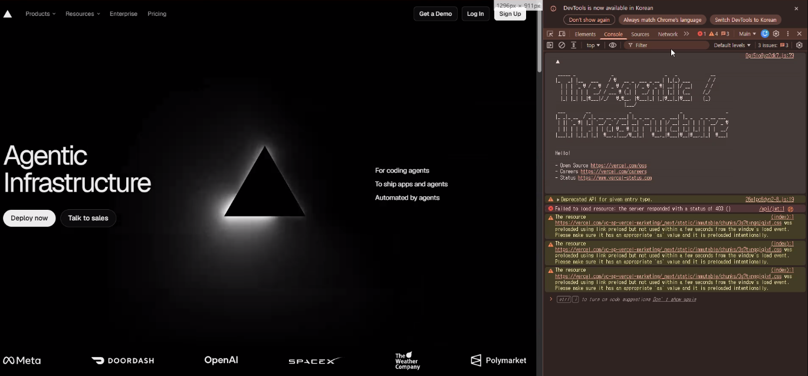

- 종종 개발자들은 의도적으로 이스터에그 같은 흔적을 남겨두기도 함

### 프리티어(Prettier)
- 자동 정렬 확장 프로그램
- 코드를 엉망으로 줄 바꿈 하거나 들여쓰기를 제각각으로 해도, 저장(Ctrl + S)을 누르면 코드를 보기 좋고 깔끔하게 자동 정렬
- 협업 시 좋은 툴
- 프리티어 설정은 한명이 하는것이 좋음

### 채팅의 기초
- 라이브 채팅은 데이터 베이스에 넣을까?
  - 들어가긴 하지만 실시간으로 한 건씩 들어가진 않을것이다. (앞뒤가 부딪혀 뒷말 기준으로 정리. 영상 확인)

- 실시간 이라는 것은 무서운 것이다.
  - 마이크로 배치
  - api 요청을 십만분의 1로 줄일 수 있는 기술
  - 채팅이라 해서 방대한 양을 적어 보내는 사람도 가끔 있음.

### 캐싱
- 왜 쓰는지 모르면 문제다.
- 자주 사용되는 데이터나 연산 결과를 속도가 빠른 임시 저장소(주로 메모리)에 미리 복사해 두고 사용하는 기술.

#### 캐시 사용 핵심 이유
1. 응답 속도 향상 (Latency 개선)
   - 메모리와 디스크/DB의 속도 차이: 디스크나 원본 데이터베이스에서 데이터를 읽어오는 것보다, RAM 같은 메모리에서 읽어오는 것이 훨씬 빠름
   - 자주 요청되는 데이터나 무거운 연산 결과를 캐시에 저장해 두면, 사용자가 요청했을 때 지연 시간 없이 즉시 응답 가능

2. 서버 부하 감소 및 비용 절감
   - 매번 데이터베이스(DB)에 직접 쿼리를 날려 데이터를 조회하면 DB 서버에 과부하가 걸림
   - 캐시를 활용하면 DB로 가는 요청 횟수를 대폭 줄여 전체 시스템이 더 많은 트래픽을 안정적으로 버틸 수 있게 됨

3. 데이터베이스 장애 위험 감소
   - 트래픽이 폭증할 때 DB 서버가 다운되는 것을 막아주는 방어선 역할

### Event Driven Architecture
- 이벤트 기반 아키텍처(Event-Driven Architecture, EDA)는 시스템에서 발생하는 상태의 변화인 '이벤트(Event)'를 중심으로 독립된 서비스들이 서로 소통하는 소프트웨어 설계 패턴

#### 핵심 구성 요소
1. 이벤트 생산자 (Producer)
   - 사건(이벤트)을 감지하고 이를 메시지 형태로 만들어 보냄. (예: 결제 서비스가 '결제 완료' 이벤트 발행)
2. 이벤트 브로커 (Broker)
   - 생산자가 보낸 이벤트를 받아서 필요한 소비자들에게 전달해 주는 중개자. (예: Kafka, RabbitMQ, AWS EventBridge 등)
3. 이벤트 소비자 (Consumer)
   - 브로커로부터 이벤트를 전달받아 실제 비즈니스 로직 수행. (예: 배송 서비스가 '결제 완료' 이벤트를 받아 배송 시작 처리)

#### 왜 써야 할까? (장점)
1. 느슨한 결합 (Loose Coupling): 서비스들이 서로의 존재를 몰라도 됨
   - 생산자는 이벤트만 발행하고 끝내며, 소비자는 브로커만 봄. 덕분에 한 서비스가 다운되어도 전체 시스템이 마비되지 않음
2. 높은 확장성 (Scalability)
   - 트래픽이 몰릴 때 특정 소비자 서비스만 서버를 늘려서 처리(Scale-out)하기 매우 쉬움
3. 비동기 처리 (Asynchrony)
   - 사용자가 주문을 누르고 결제가 끝나면, 메일 발송이나 포인트 적립 같은 후속 작업이 끝날 때까지 화면에서 기다릴 필요가 없음. 후속 작업은 백그라운드에서 이벤트로 처리되기 때문에 사용자 경험이 쾌적해짐

#### 직관적인 비교: REST API vs EDA

| 구 분 | 일반적인 요청/응답 (REST API 등) | 이벤트 기반 아키텍처 (EDA) |
| --- | --- | --- |
| 방식 | 동기식 (Synchronous) | 비동기식 (Asynchronous) |
| 소통 | 직접 대상 서비스를 호출함 (1:1 강한 결합) | 브로커에 이벤트를 던짐 (1:N 느슨한 결합) |
| 비유 | 전화를 걸어 상대방이 받을 때까지 기다림 | 단체 톡방에 "나 퇴근함"이라고 남겨두기 |

#### 고려해야 할 단점 및 복잡성

1. 디버깅과 추적의 어려움: 요청이 여러 서비스를 비동기적으로 거쳐 가기 때문에, 에러가 발생했을 때 데이터의 흐름을 한눈에 파악하기 어려움. (분산 트레이싱 도구 필수)
2. 최종 일관성 (Eventual Consistency): 모든 서비스의 데이터가 실시간으로 일치하지 않을 수 있음. 약간의 시차가 발생한 후 결국 데이터가 맞아떨어지는 구조를 수용해야 함.

- 성능향상보다 효율이 좋아짐
- 라이브 채팅 그대로 두면 1초마다 업데이팅이 되면 쓸모가 없다. 반응형 구조를 써야 더 절약가능.

- 채팅(액션)으로 API 가 들어오면 서버, DB와 상호작용하는 것
  - 유저는 자신의 채팅에 대한 응답이 와야 제대로 상호작용했다고 생각함.
  - 채팅을 한 뒤 들어오는 캐시가 들어왔음을 어떻게 알려줄까?
    - 백에서 레디스, DB 등을 써서 메모리를 만들어줌
    - 넥스트에서 이 용도로 쓰는게 리밸리데이트 ( 넥스트로 했을 시에만 해당 )
  - 유저가 포스트를 작성하면 그 글을 어떤 유저가 댓글을 달았을 경우 : DB 로 가져간 뒤 유저에게 보여줌 - > 이 과정에서 성능 좋게 보여주기 위해 넥스트의 경우 데이터를 가지고 있음 -> 이때 또다른 유저가 또 리뷰 댓글을 담음 -> 이를 또 넘기고 유저가 볼 수있게 함.
    - 그렇다면 데이터를 저장하고 보내는 시점을 언제로 보아야 할까?

- 카프카를 쓴다면 EDA가 중요.

- 캐시를 쓰기 위해 패치를 할것이고 read를 사용할 예정.
- 이벤트에만 캐시를 사용할것
- 많이 사용하는건 부담스럽기 때문에 필요한 곳에만 사용하는 것이 좋음

- 이벤트의 부하를 줄이기 위해 캐시를 쓸것
- 너무 기술로만 접근하지 않는 것이 좋다. 소스코드 안에 캐시의 기능을 어떻게 썼고 어떤 이득과 효율을 얻었고 손실을 줄일 수 있는지에 대해 설명할 수 있는것이 이점이 될 것 이다

- 개발자는 개발자스럽게 설득할 수 있어야 한다

- 패치 등을 제대로 쓰려면 api 등도 필요함.
- 다음시간부터는 코드 작성도 해볼것임

---

## 11시 수업

### 글 쓰는 페이지
- 로그인을 한 사람만 쓸 수 있게 하여야 한다.

- 몽고DB에 글 쓰는 용도의 스키마 추가 (예시코드 추가 예정)
- 사용하는 폴더가 늘어남. 이 경우 관계형 DB를 쓰는 것이 더 유용하긴 함.
- 조회 시스템이 들어오는 것이 좋음

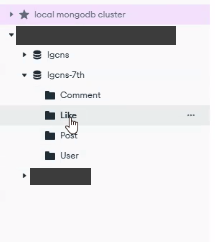

- 관계형으로 하면 id를 여러개 가질 수 있음. 현재는 포스트를 리스트로 가져가는 형식으로 설계 예정.
- 이를 객체 지향으로 만들 수 있는것이 프리즈마. 좀 더 코드를 추가하고 전체를 갈아엎어야 함.

- 글 작성하는 페이지가 들어오려면 : 에디터가 들어와야 함
  - 텍스트 에리어
  - 컨텐츠 : 화면에 보이는 글, 그림
  - 카테고리
- 단순 글작업용 페이지를 만들예정. 이미지 첨부는 조금 다른 이야기
- DB구조가 좀 더 바뀌어야 함
- 글 쓰기 또는 업데이트를 하고, 포스트를 쓸것이라면? 개인의 페이지를 만든다면?
  - 일단 요점은 관리하기 편해야 함. : 너무 깊어지면 안된다. 그룹으로 묶는다.

    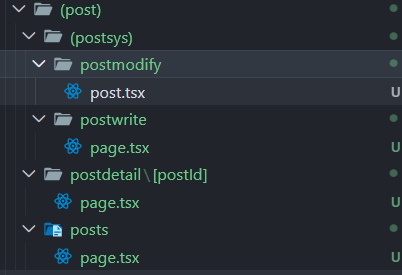

- JPA를 보면 save 하는 개념만 있다.  : DB에 들어가는 pk 값이 들어가면 업데이트, 없으면 크리에이트 라는 단순한 방식으로 구동
  - 패치는 영속성에 안맞아 쓰지 않음
  - 바뀌지 않는것은 두고 바뀌는것만 바꾸어 새로운 객체를 만들어 세이브 하는 것이 업데이트의 방식. 세이브와 동일한 방식을 갖기에 크리에이트와 똑같은 부하를 가짐
  - 좋아요 라는 것을 포스트와 묶는 경우가 있다. DB를 잘못 설계하면 위험한게 이 예시로 알 수 있다.
  - 포스트 시스템을 만들 때 : 바뀌지 않는것은 블로킹이나 고정을 하는 등의 방법을 사용한다. 구조 설계에 대한 이해가 필요하다

- 모달: 종류가 2개임
  - 반드시 확인해야 하는 종류는 뒤의 백그라운드를 막아 무조건 버튼을 선택하게 해야하는 경우
  - 해도 그만 안해도 그만인 경우: 밖에서 그냥 닫게 하면 됨
  - 필요없는 것은 지우는 로직

- Delete는 엄밀하게 보아야 함
  - 삭제 같은 버튼을 사용할 경우 한번더 물어보는 등의 주의를 기울여야 함

- form 다룰 때 할 일이 무척 많다. 각오하라

---

## 1시 수업
- 분기처리
- 작성창은 에디터를 사용하여 분기처리를 할 예정
- Quill 라이브러리 (다운로드 필요)

- 포스팅 후 서버사이드로 랜더링? 됨

  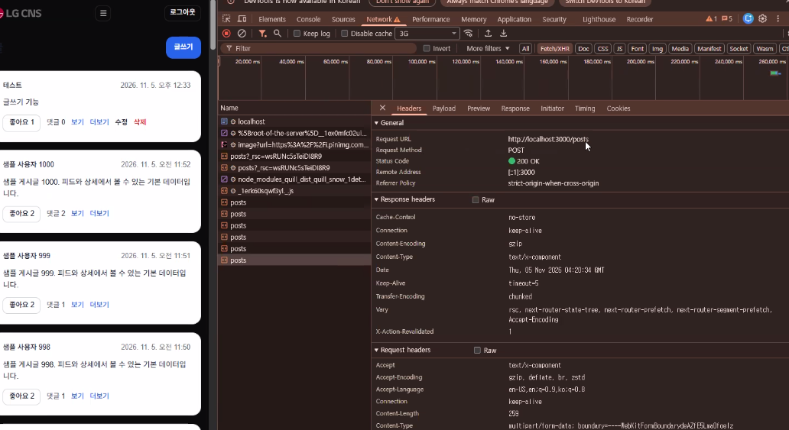

  - 콘솔을 보면 어느 아이디의 게시글인지, 어떤 세션을 주고받았는지 이런것을 알 수 있음
  - 패칭 또한 볼 수 있음.
  - 콘솔에 캐시라고 뜨는것 : 넥스트에서 캐시로 가져오는 것과 DB에서 가져오는 것을 구분할 수 있음

- 패치가 동작하면 DB에서 가져옴

- 좋아요를 누르면 다른 페이지에 연동이 안됨. 실시간 연동은 아직 되어있지 않은 상태. 이걸 2로 만들려면 실시간 패칭을 해야 함

- 포스팅 : 현재 각각 완벽히 분리되어있음. 서비스 사이드에서

  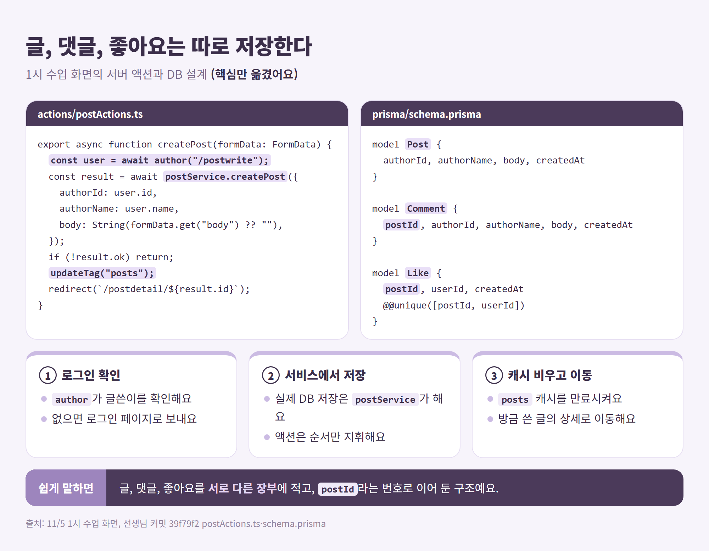

- 이 방식은 좋지 못함. 몽고DB를 사용하는 의미가 없다. 이렇게 만들면 안됨

  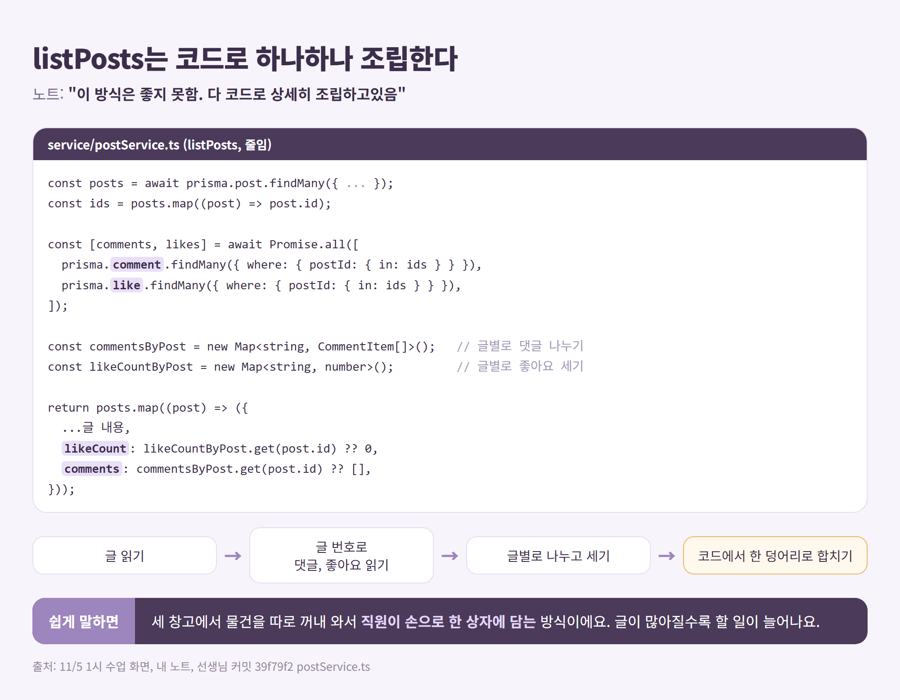

  - 다 코드로 상세히 조립하고있음

- 페이지에서 글을 쓰면 -> 캐시에 넣음 -> 캐시 업데이트

  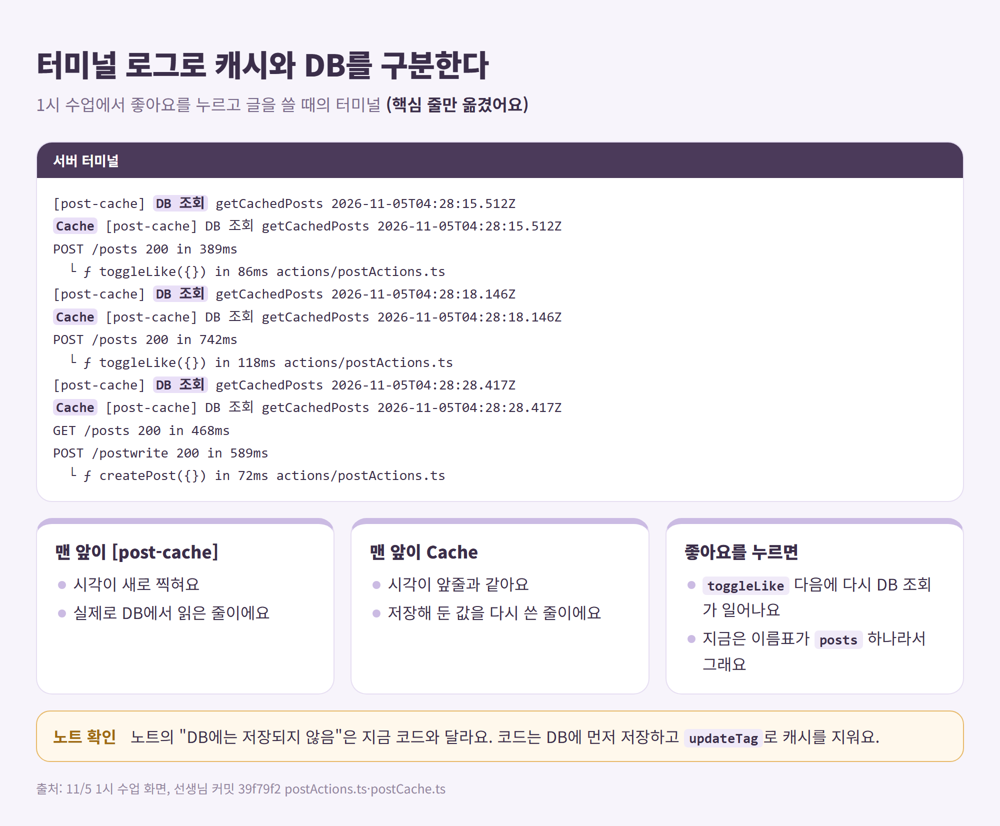

- 캐시가 없는 상황도 테스트 예정
- 누군가 글을 쓰면 넥스트 서버에 업데이트가 됨 -> DB에는 저장되지 않음 (지금 코드는 DB에 먼저 저장하고 캐시를 지움)
- 알고리즘을 만들고 분기처리 필요
- 만약 글이 자주 업데이트가 된다면? 캐시를 걸지않고 증분하는게 낫다는 의견이 있을수도 있음.
- 글의 내용이 자주 안바뀔 것 같다면 글의 내용은 캐시를 거는게 더 좋을것.
- 어떤 부분에 캐시를 걸지 적용하는 것이 중요함
- 분기처리에 따라 성능이 결정된다
- 하지만 섬세하게 결정할수록 구조는 복잡해진다. 따로따로 해두면 열어야 하는 API 도 늘어난다.
- 단순한 성능 비교를 해선 안된다. 성능이야기는 무척 단편적인 이야기다. 각 기능의 장단점을 명확히 알고 적절히 사용하는것이 더 도움이 된다.

- 수정하기 : 에디터는 같기 때문에 굳이 길게 쓰지 않고 수정버튼의 분기처리를 하는 방법도 존재한다
  - 올리기와 같은 값이지만 안에 내용이 있고 없고의 차이.

---

## 2시 수업

### ai 의 현시점 판단 기준을 맹신하지 말것
- 유저가 늘어나거나 줄어들면 추천이 얼마든지 변동할 수 있음. 데이터 처리 방법도 달라짐
- 무조건이라는 것은 없음

- 소규모 프로젝트 할 때는 리렌더링 효과를 주는 넥스트를 선호하는 경향이 있음
- 그러나 대규모로 운용하는 경우엔 한계가 있음. 대표적으로 챗gpt가 넥스트로 만들어져있었음. 지금은 아님. 이용유저가 너무 들이닥치다보니 넥스트로 견디기는 쉽지 않았던 모양임 (공식으로 확인된 이유는 아님)
  - 노션의 경우 실시간 통신을 많이 하고 관리하는 체계라 조금 다른 패턴임
- 업계에서 살아남으려면 정확한 이해가 필요하다. 쓰고 배포하는게 끝이 아님.

### 글 쓰는/ 업데이트하는 / 조회하는 페이지 만들기 :: 기존의 만들어진 코드를 컴포넌트로 나누기

- 페이지가 들어가므로 서치 파람이 들어가고 api도 추가되어야 함
  - 페이지, 소트 추가
  - 페이지 넘버처리
  - 캐시에서 가져오는 api
- 포스트 리스트는 완전히 빼서 리스트끼리 따로 섹션으로 빼 놓음 `organism` / `post list`
- 추가된 아이템에 대한 타입 선언 : `response` 타입
- 페이지에 대한 api 설계

  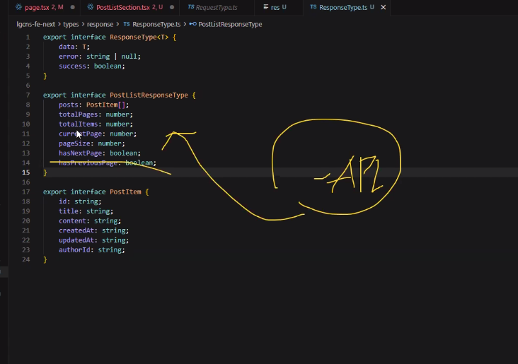

  - ID : 아이템에 대한 고유 넘버링
  - 에러 코드(에러핸들러)
  - 아이템에 대한 상세가 들어간 리스트
- 데이터를 받아와야 함. 데이터 유형에 따라 `"use client"`를 선언할 수 있지만 `Link` 등 훨씬 간단하게 할 방법도 존재함

  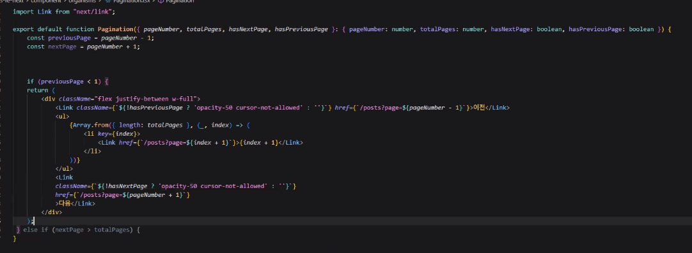

  - 페이지를 가로로 나열하게 함.
  - 페이지를 유동적으로 늘어나게 하고 끝 페이지면 "다음"이 출력되지 않도록 함 (최종 코드는 회색 글자로 남기고 누를 수 없게 함)
  - 샤드cn의 페이지네이션을 써도 됨. 강사님은 만드시는 중

- 현재 동적 api 만드는중. 내일 필터링을 붙일 예정

### 지금 만들고 있는것 정리
- 이 페이지 아래에 1,2,3 페이지가 나오게 만드는 중

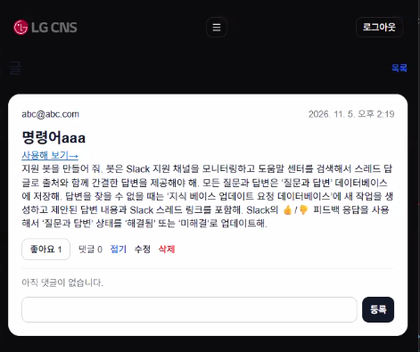

- 이게 몇페이지 인지는 api를 통해 가져오도록 함

- 캐시에 저장할것들도 따로 정리하고 책임분리

  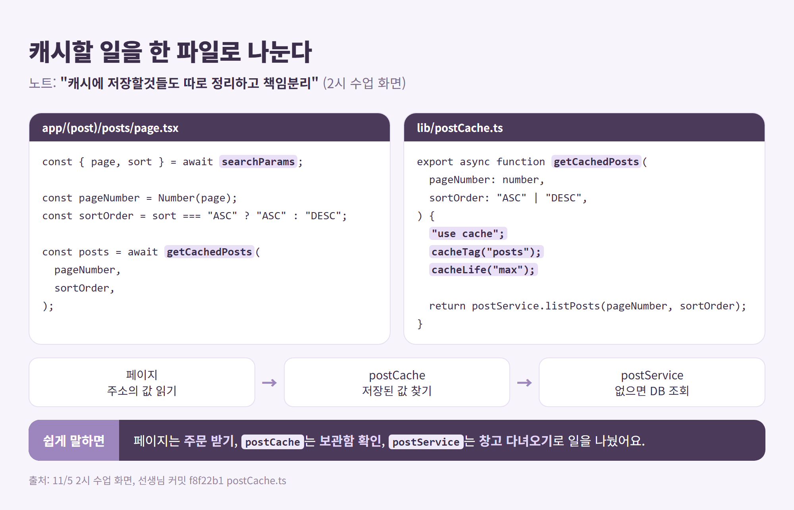

### 포스트와 아이템 정리 할 예정

---

## 3시 수업

- 캐싱할 수 없는 데이터도 있음을 말씀하시는 중

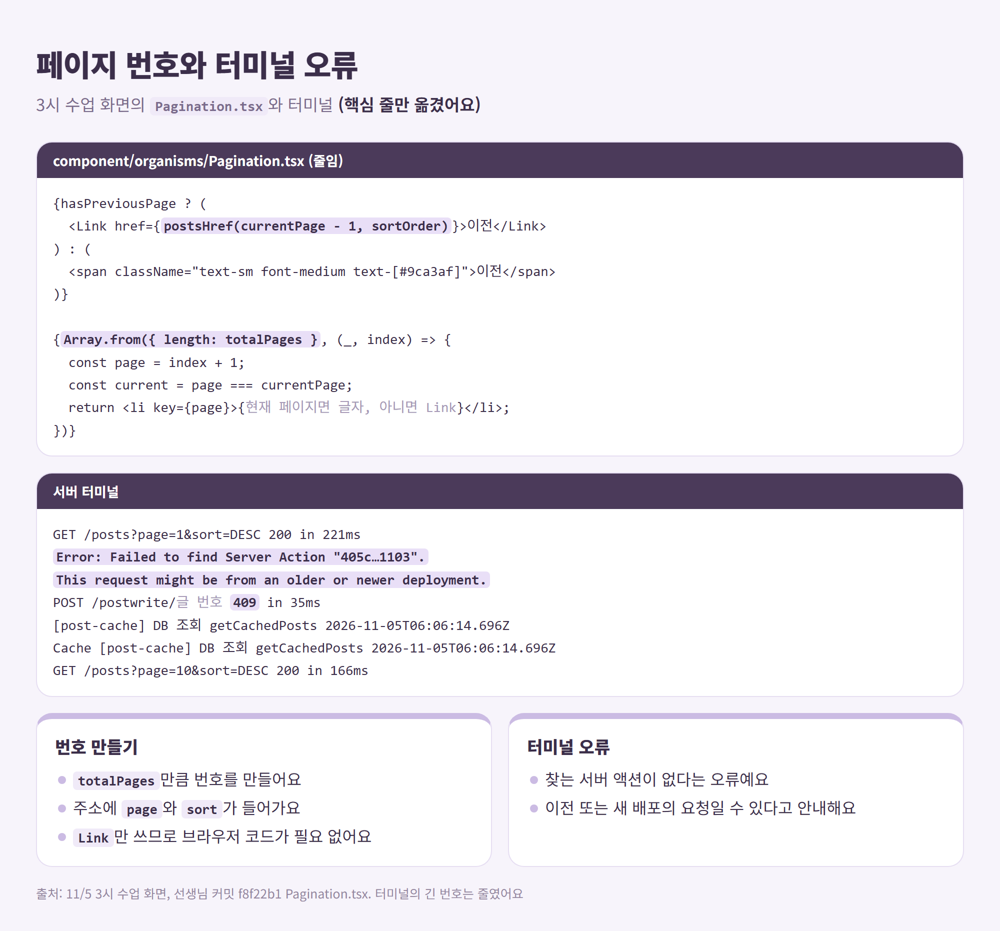

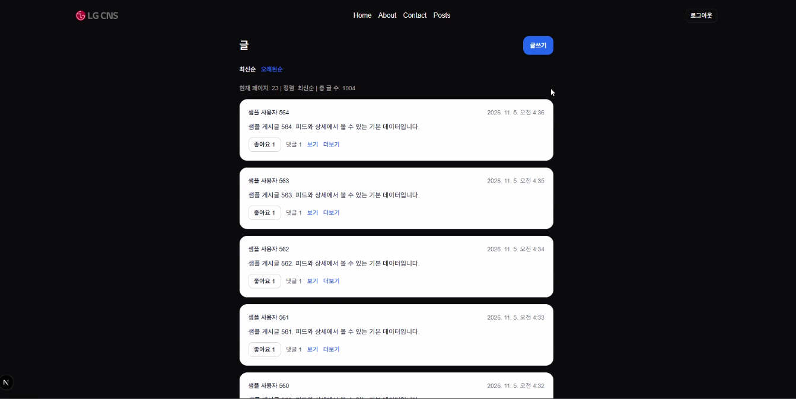

- 소트가 먼저일수도 있고 페이지가 먼저일수도 있고 반드시 존재하는 것이 아님. undefined가 올때 어떻게 정렬을 할 것인가. 이런 체계를 프론트가 만들어야 함. 이러한 것을 백엔드와 api를 어떻게 설계할 것인가에 대해 대화를 주고받아야 한다.

- DB 는 데이터로 구성되어 인덱스를 만들어준다.

  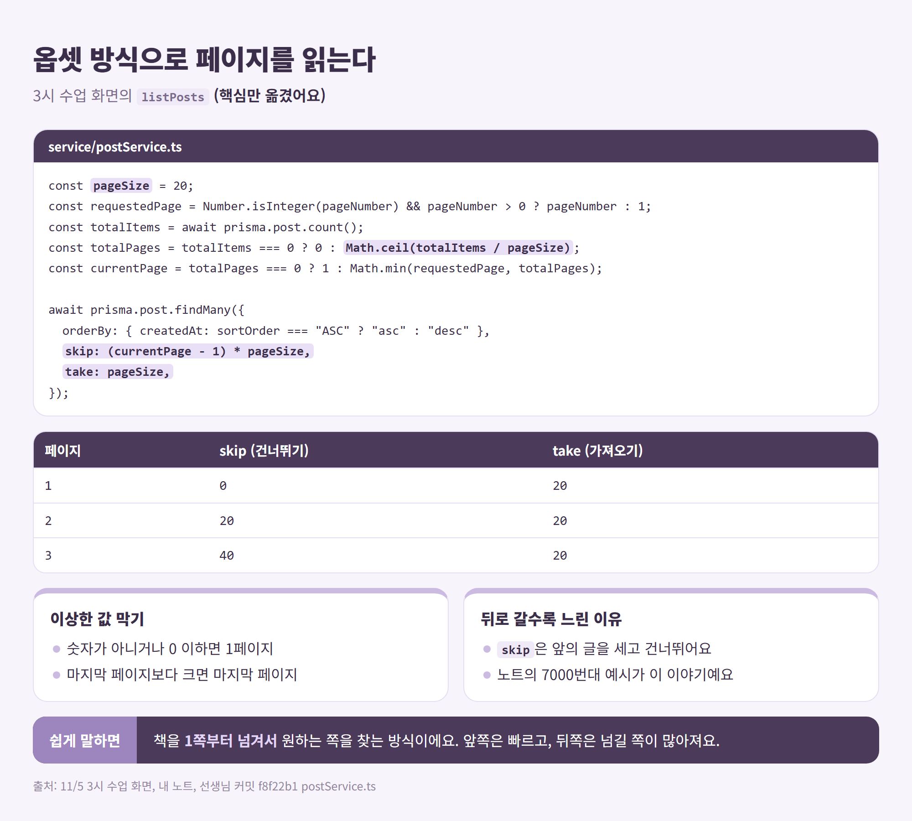

- 몽고 DB는 암호로 생성됨 (암호가 아니라 24자리 16진수 ObjectId)
- 오라클이나 마이에스큐엘은 숫자로 생김
- 삭제되거나 제외되는 번호 자리는 공석으로 뒤의 숫자가 땡겨지는것도 아님.
- 만약 만개 중 7000번 대에서 20개를 찾아야 한다고 하면?
  - 7000번대를 찾는 행위를 함. 데이터가 늘어나면 그만큼 데이터를 로드할게 많아진다. 그래서 뒤로갈수록 늘어지는 현상이 발생함
  - 다이나믹 api를 할 때 커서해주시면 안되나요 하고 백엔드에게 요청하라. 커피한잔 사주면서.
  - 동적 api에서 커서 호출
    - 커서 방식 : 책갈피처럼 본 곳 다음부터 가져옴. 깊어도 빠르지만 번호 이동이 어려움
    - 옵셋 방식 : 앞을 세고 건너뜀. 번호 이동은 쉽지만 뒤로 갈수록 느림
    - 자바스프링 기준 예시

      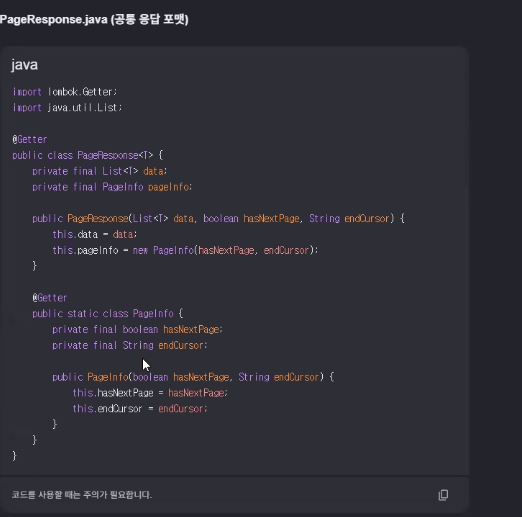

- 키워드 검색 : 데이터가 많아지면 진짜 오래걸림
  - 키워드 사용할때 얼마나 빨리 로드될것이냐가 서비스의 성능이 됨

- app.envato.com 강사님의 스승님같은 사이트. 아이디어를 많이 얻으시는듯?

- 동작하기 위한 해시태그 확인 필요함
- 동작방식에 대해 새로운 코드로 적음. 정리도 다시 함.

---

## 4시 수업

### 넥스트 캐시
- 캐시가 동작하는 데 있어서 (문장이 끊김. 영상 확인)
- 컴포넌트 구조 상 유즈캐시를 하면 캐시가 걸림. 이 동작을 기존 값이 없으면 가져옴. 한시간 설정이면 한시간 후 가져오는 일을 하고, 캐시가 살아있으면 가져오지 않고 기존값을 유지함. (시간이 지나도 혼자 가져오지는 않음. 다음 요청이 와야 갱신)
- 리밸리데이트와는 다름

  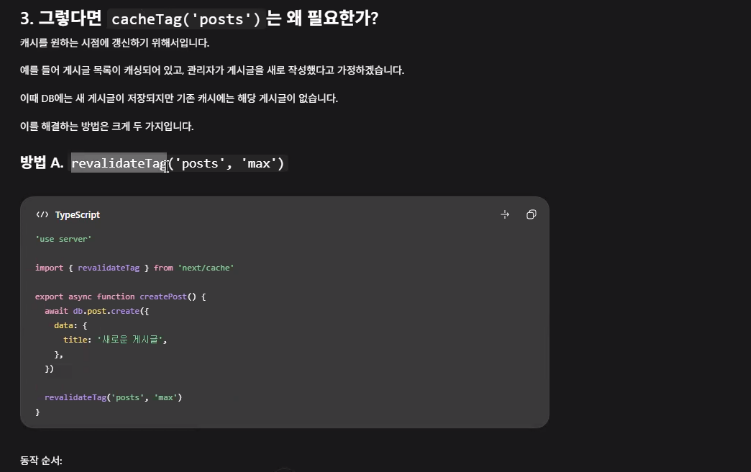

- 다시 가져오는 설정을 할 때 오로지 캐시 태그만 사용함

  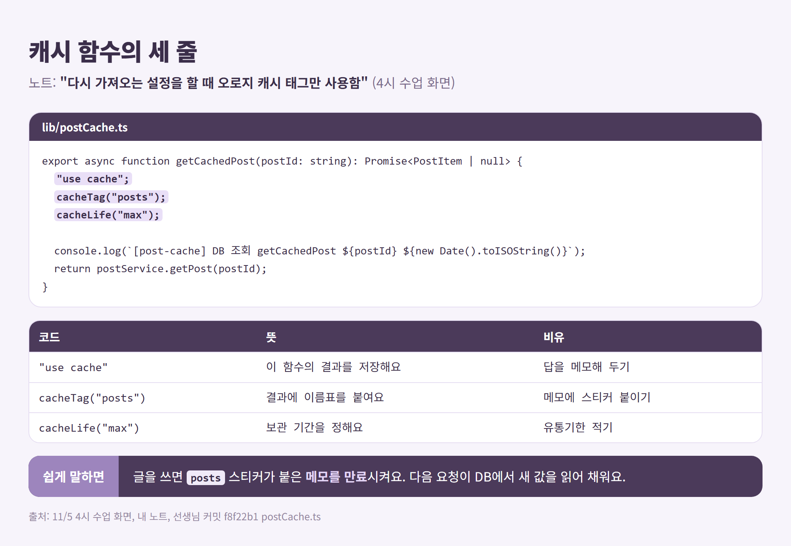

- 바뀌는 건 캐시가 안걸리고 바뀌지 않는것은 캐시가 걸리는 구조 (지금 코드는 좋아요 수도 캐시 안에 있음. 캐시 밖은 사람마다 다른 값)
- 포스트 태그에 업데이트 태그가 붙음

  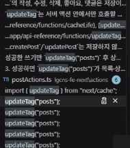

  - 캐시가 붙어도 무시하고 덮어쓰고 갱신하여 업데이트가 동작하는 구조 (덮어쓰기보다 만료. 새 값은 다음 요청이 DB에서 읽어 채움)
- 글을 쓴 액션에 캐시를 별도로 빼서 만들어둠 : 이 서비스를 캐시로 사용하겠다고 라이브러리의 포스트 캐시쪽에 알려줌
- 새로운 이슈가 생기지 않으면 유지. 포스트를 불러주는 친구가 리밸리데이트와 업데이트 하는 형식으로 설계.
- 요청을 기다리면서 갱신함
- 정제를 해나가는 식으로 코드를 작성해 나가고 있음.

- 앱의 전체 레이아웃들 현재 그 중 모바일 네비게이션을 봄
  - 헤더쪽임. 글로벌적으로 관리해주면 좋겠지만 일단 최상단에 걸려있긴 함. 샤드cn UI로 갈아끼울 수 있음 .
  - 샤드cn : 드로워 등등 쓸만한게 많음. 사이드랑 좀 다름. 반응형임. 드롭다운메뉴
- 샤드cn의 사이드 메뉴를 적용. `sr-only`를 사용하여 로고를 감춤

- 글이 없을 경우에 어떻게 나올지도 설계하면 좋음 . 그리고 가장자리의 빈 레이아웃을 놓아두고 가운데 안쪽만 바뀌게 하는것도 좋음
- 레이아웃을 뺄지 말지의 정책

- 참고로 슬러그로 가면 페이지를 전체를 다시 만듦. 파라미터를 사용해야 다른 렌더링이 발생하지 않고 갈아끼울 곳만 갈아끼움. 이를 매퍼로 리액트에서는 갈아 끼울 곳에만 데이터를 뿌림. 각각의 키값이 유니크해야한다
  - 유니크한 값이 없으면 받아서 만들거나 백엔드에 api 설계시 요청하여야 함

- 데이터 캐싱처리에 대한 이야기들을 했음

- 업데이트 태그를 쓰면 누군가 글을 쓰면 리프레시 하지 않아도 보임. (글 쓴 내 화면 기준. 다른 사람 화면은 5초 새로고침 덕분)
- 집계 데이터를 고정적으로 가져오게 하거나 주기적으로 요청하는 방법등이 있음
- 마이크로 배치는 1초에 1번도 무척 큼.

- 프론트는 1초도 괜찮은데
- 유저는 좋아요 후의 액션이 돌아오는데 시간이 걸리는 것을 싫어함

### `useOptimistic` 사용

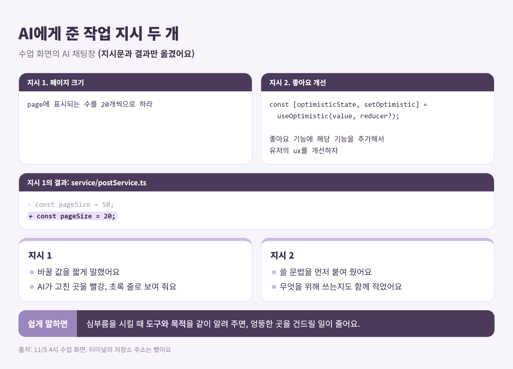

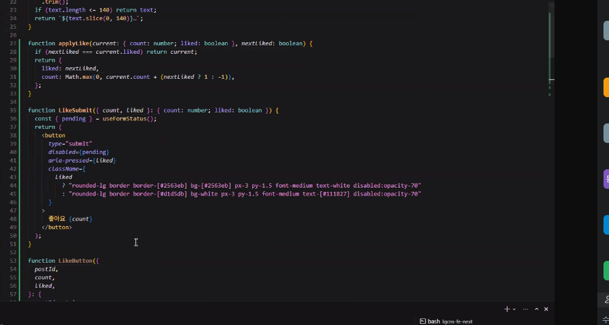

- 라이크 버튼 사용하여 나오지 않는 것 정정

  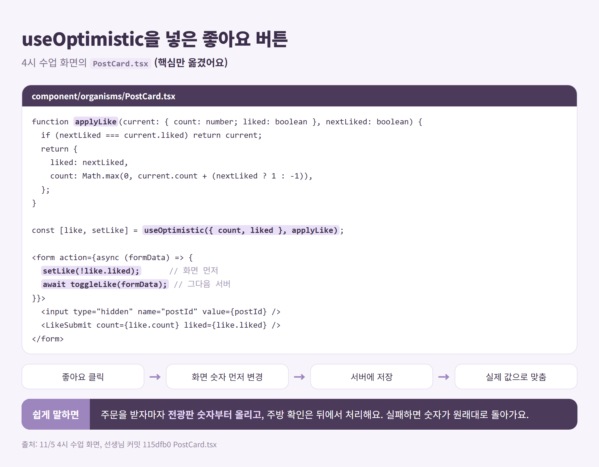

- 좋아요 클릭 시 반응이나와야하지만 지금은 오류. 차이점을 살펴봐라.

---

## 5시 수업

- 코드는 실무에 가깝게 변화했음
- 천천히 검토해봐라
- 그러나 아주 단편적인 예제임

### 강사님 버셀에 배포중
- 개인 미니프로젝트 다음주 화요일부터 4일간 진행 예정.
- 하지만 현재 있는걸로는 파일서버가 없어서 S3를 쓰면 좋음. 프론트에 붙일 수 있어서.
- 백엔드에 던져서 S3로 업로드하자
- 이미지나 영상을 프론트 화면에 업로드 할 때 이 파일이 미리보기가 필요함.
- 백엔드 1과정이 미니프로젝트와 함께 하는걸로 되어있나봄? 확인요망
- 어쨌든 인스타그램이 그런 방식을 채택중이라고 알고있음. 릴스 등의 파일을 업로드 하는 경우 용량이 큰것들은 오래걸릴텐데 작성하자마자 보이는걸까? => 업로드 버튼 올리기 전에 이미지 등록했을 때 이미 서버로 보내고 있기 때문. 취소하면 서버에 도착한 파일을 그냥 지우면 됨. (확인된 건 예전 사진 업로드 이야기. 릴스도 같은지는 못 찾음)
- 데이터를 올리는 동작은 CSR. 브라우저가 있고 넥스트가 있는 서비스로 전송해야 함.
- 넥스트로 전송을 위한 바이너리를 만들고 넥스트에서 또 파일을 넘김. 넥스트 다음과정에 S3가 붙으면 속도가 느림
- 방식을 잘 짠다면 우리도 인스타처럼 만들 수 있음.
- 이렇게 하면 UX를 향상시킬 수 있음.
- 들어오는 값과 나가는 값이 일치해야 승인함 (결제인지 업로드인지 영상 확인)
- 백엔드가 만들어지면 그곳에 맞춰서 만들어야 함. 서드파티를 쓰는 가이드 문서를 받아 문서대로 하면 넥스트에서 값을 들고 던지고 받아들때 만드는 페이지를 만들고 리턴 후 서버 액션으로 전달해주는 구조로 할 수 있다.
- 영상올리는 다른 방법 : 영상클립으로 나눠서 앞부분 먼저 올리고 실시간으로 다음 거 올리기.
- 숫자같은건 옵티미스틱.
- 파일과 DB를 구분하여야 한다.
  - 파일 : 열면 코드화 되어있지 않고 실행되는것 (사진은 실행보다 프로그램이 읽어서 보여주는 데이터에 가까움)
  - DB : id, name, image 등이 정의된 텍스트뭉치. 아니면 파일이 코드화 된것(이건비추). 이미지에는 파일을 다운로드하는 주소같은건 들어갈수있음.
    - 하지만 파일의 저장소의 http 주소가 풀로 들어가는것도 안좋음. 주소를 떼고 파일명만 저장하는 방법도 있음.

### 누가 질문함 몽구스와 프리즈마
- Node.js 환경에서 데이터베이스 작업을 쉽게 만들어주는 도구

| 비교 항목 | Mongoose | Prisma |
| --- | --- | --- |
| 지원 데이터베이스 | MongoDB 전용| PostgreSQL, MySQL, SQLite, MongoDB, SQL Server 등 |
| 데이터 정의 방식 | JavaScript/TypeScript 코드로 스키마 정의 | 별도의 `schema.prisma` 선언형 파일 사용 |
| 타입 안정성 (Type Safety) | 기본적으로 TS 지원이 약해 추가 플러그인 또는 스키마, 타입 동기화 작업 필요 | TS 최적화. 스키마를 기반으로 자동 타입 생성하여 완벽한 자동완성 지원 |
| 마이그레이션 도구 | 없음(MongoDB특성상 스키마가 자유로워 수동 관리) | Prisma Migrate 제공 |
| 학습 곡선 | MongoDB 친화적. 단순하고 직관적 | DB 추상화계층이 있음. 초기장벽 |

- 웹, 카프카

- 쌤 파일에 있는건 DB만 갈아끼우면 되는 구조. 몽고DB 지만 데이터 타입등을 바꾸면 쉽게 바꿀 수 있음. 이런점에서 프리즈마가 편하다 (그래도 `provider` 한 줄로 끝나지는 않음)

#### Mongoose 장단점 (AI 답변 화면에서 옮김. 위쪽이 잘려 있음)
- 장점
  - MongoDB 기능 완벽 활용 : 집계 파이프라인(Aggregation), 지리 공간(Geospatial) 쿼리 등 MongoDB만의 강력한 고유 기능을 제한 없이 쓸 수 있음
  - 빠르고 직관적인 데이터 정의 : 별도의 빌드 과정 없이 코드 내에서 즉시 스키마를 정의하고 바로 사용할 수 있어 초기 개발 속도가 빠름
- 단점
  - 데이터베이스 종속성 : 프로젝트 도중 PostgreSQL이나 MySQL 같은 관계형 데이터베이스(RDBMS)로 전환해야 한다면 코드를 전부 새로 짜야 함
  - 느슨한 타입 시스템 : TypeScript와 함께 쓸 때 스키마와 TS 인터페이스를 이중으로 정의해야 하거나, 동기화가 까다로움

#### Prisma 특징과 장단점
Prisma는 최신 웹 개발 트렌드(특히 TypeScript)에 맞춰 설계된 차세대 ORM. `schema.prisma`라는 직관적인 파일에 데이터 구조를 선언하면 클라이언트 코드와 타입을 자동으로 빌드해 줌

- 장점
  - 최고 수준의 TypeScript 지원 : 데이터베이스 결과물의 타입이 완벽하게 자동 생성되므로, 오타로 인한 런타임 에러를 컴파일 단계에서 철저히 방지함
  - 멀티 DB 지원 : 동일한 Prisma 문법으로 MySQL, PostgreSQL은 물론 MongoDB까지 제어할 수 있어 유연성이 높음
  - GUI 툴 제공 : `npx prisma studio`를 실행하면 웹 브라우저에서 데이터베이스 내부를 쉽게 조회하고 수정할 수 있는 관리자 화면 기본 제공.
- 단점
  - MongoDB 고유 기능 제약 : Prisma의 공통 문법 계층을 거치기 때문에, MongoDB 전용 고급 기능이나 복잡한 Aggregation 쿼리를 작성할 때 까다롭거나 원시 쿼리(Raw Query)를 써야 할 수 있음
  - 빌드 단계 필요 : 스키마 파일이 바뀔 때마다 `prisma generate` 명령어를 통해 클라이언트를 재생성해 주어야 함.

#### 무엇을 선택해야 할까?
- Mongoose를 추천하는 경우
  - 데이터베이스로 MongoDB를 사용하기로 100% 확정한 경우.
  - 복잡한 대용량 NoSQL 쿼리나 MongoDB 고유의 강력한 기능(지리 정보, 정교한 집계 등)을 100% 활용해야 하는 경우.
  - 가볍고 빠르게 프로토타입을 만들어야 하는 JavaScript 중심 프로젝트인 경우.
- Prisma를 추천하는 경우
  - TypeScript를 주력으로 사용하며, 코드의 안정성과 완벽한 자동완성(Type Safety) 기능이 최우선인 경우.
  - PostgreSQL, MySQL 등 RDBMS를 사용하거나, 추후 데이터베이스 종류를 바꿀 가능성이 있는 경우.
  - 스키마 설계와 데이터베이스 마이그레이션 과정을 도구(Prisma Migrate)를 통해 체계적으로 관리할 경우

- 빌드단계는 프리즈마가 좀 어렵긴 함

### 하이드레이션은 왜 나는거야

#### 1. 백엔드 & DB 관점 (Mongoose 등 ODM/ORM)
데이터베이스 관점에서 하이드레이션은 "조회한 데이터에 생명을 불어넣는 과정"

- 왜 발생하나요?
  - 데이터베이스(MongoDB 등)에서 데이터를 조회하면 처음에는 단순히 텍스트나 바이너리 형태의 raw 데이터(JSON/BSON)로 넘어옴
  - 하지만 개발자는 코드에서 이 데이터를 `user.save()`, `user.speak()`처럼 라이브러리가 제공하는 메서드나 Getter/Setter, 가상 필드(Virtuals) 형태로 다루고 싶어 함
  - 따라서 Mongoose가 디비에서 꺼낸 뼈대(Raw 데이터)에 살을 붙여, 기능이 살아있는 하나의 완성된 '객체(Document)'로 변환하는 작업이 일어남. 이 과정을 하이드레이션(Hydration)이라고 부른다.
- 문제점과 해결책
  - 데이터가 수천 수만 개로 많아지면 이 객체 변환 작업 때문에 CPU와 메모리 소모가 심해져 속도가 느려짐.
  - 단순히 화면에 데이터만 뿌려줄 목적(Read-only)이라면 Mongoose에서 `.lean()` 옵션을 켜서 하이드레이션 과정을 생략하면 2~5배 이상 훨씬 빨라짐.

#### 2. 웹 프론트엔드 관점 (Next.js, React SSR)
- 프론트엔드(특히 서버 사이드 렌더링)에서 하이드레이션은 "정적인 HTML에 자바스크립트 이벤트와 기능을 결합하는 과정"

- 왜 발생하나요?
  1. 빠른 초기 로딩 : 서버(Next.js 등)는 사용자가 페이지를 요청했을 때 화면의 뼈대가 되는 정적인 HTML 파일을 미리 만들어서 브라우저로 보냄. 덕분에 사용자는 빈 화면 대신 글자와 그림이 채워진 화면을 아주 빠르게 보게 됨.
  2. 상호작용 심기 (이게 하이드레이션) : 하지만 서버가 준 HTML은 자바스크립트가 연결되지 않아 버튼을 눌러도 아무 반응이 없는 '메마른' 상태
  3. 뒤이어 브라우저가 자바스크립트 번들 파일을 다운로드하면, React가 이 정적 HTML 위에 이벤트 리스너를 결합하고 상태(State)를 부여하여 클릭이나 입력이 가능한 '촉촉하고 살아있는' 동적 웹 페이지로 만듦
- 자주 발생하는 에러 (Hydration Mismatch)
  - 개발하다 보면 자주 보게 됨. 이는 "서버가 만들어준 HTML 구조"와 "브라우저가 자바스크립트를 실행해 처음 그린 HTML 구조"가 서로 다를 때 발생
  - 예 : `new Date()`나 `Math.random()`처럼 서버와 클라이언트에서 실행 시간이 달라 텍스트가 어긋나거나, HTML 태그 문법을 잘못 작성했을 때(`p` 태그 안에 `div`를 넣는 등) 발생

### 번들링
- 번들링은 압축하는 과정 (핵심은 여러 파일을 묶는 것. 압축은 그 일부)
- 넥스트의 경우 자신들의 툴이 있다. 웹팩같은걸 사용하면 워닝이 많이 남
- 동작방식은 자바스크립트의 압축, 생성과정의 오류를 잡아냄

- `npm run build` 자주 해야 한다. 아마 이 코드는 안해서 난리가 날것이다. 빌드 안되는거 올리면 팀장님한테 욕먹는다.

- 번들링 기술은 다양하다
- 현재 우리는 웹팩 기술을 디벨롭 기술에서 경험하는 중이다 (Next 16은 개발과 빌드 모두 Turbopack이 기본. 영상 확인)
- 번들링은 따로 공부할만한건 아닌것같음

### Webpack과 Turbopack을 따로 공부해야할지?
- Webpack과 Turbopack은 자바스크립트 및 타입스크립트 기반 웹 애플리케이션을 빌드하기 위한 번들러(Bundler)

#### 핵심 요약 비교
| 구분 | Webpack | Turbopack |
| --- | --- | --- |
| 개발 언어 | 자바스크립트 (Node.js 기반) | Rust 기반 (병렬 처리 구조) |
| 속도 및 성능 | 프로젝트 규모가 커지면 빌드 및 HMR(Hot Module Replacement) 속도 저하 | 최대 10배 이상 빠른 속도 및 초고속 HMR 지원 |
| 작동 방식 | 전체 의존성 그래프(Dependency Graph)를 미리 구축 및 처리 | 필요한 부분만 지연 로딩(Lazy bundling) 및 셀(Cell) 단위 증분 연산 |
| 설정 (Config) | 복잡한 커스텀 설정 및 러닝커브 높음 | Next.js 등에서 제로(Zero-config) 기본 설정 지원 |
| 생태계 및 안정성 | 10년 이상 검증된 거대한 플러그인 생태계와 높은 안정성 | Next.js(15/16 등) 기본 채택 및 빠르게 성장 중 |

#### 상세 차이점
- 개발 언어 및 속도
  - Webpack : 자바스크립트로 작성되어 대규모 프로젝트에서 파일 수정 시 전체적인 의존성 그래프를 다시 처리하느라 빌드 및 HMR 시간이 오래 걸림
  - Turbopack : Webpack 제작자(Tobias Koppers) 등이 참여해 Rust로 새로 설계한 차세대 번들러. 메모리 효율이 좋고 멀티코어 병렬 처리를 통해 개발 서버 시작과 HMR 속도가 획기적으로 빠름
- 캐싱 및 번들링 방식
  - Webpack : 모듈 단위로 캐싱하며 전체 애플리케이션의 에셋 트리를 미리 구축
  - Turbopack : 모듈보다 더 세밀한 '셀(Cell)' 단위의 증분 연산과 지연(Lazy) 번들링을 사용하여, 변경된 최소한의 부분만 다시 계산
- 호환성과 생태계
  - Webpack : 오랜 기간 표준으로 쓰이며 수많은 로더(Loader)와 플러그인을 지원. 레거시 프로젝트나 커스텀 플러그인 의존성이 높은 기업 환경에 적합함
  - Turbopack : Vercel의 Next.js(15 및 16 버전 등)에서 기본 개발(Dev) 번들러로 채택됨. (Next 16은 개발과 빌드 모두 기본) Next.js 환경에서는 별도 설정 없이 뛰어난 생산성을 보여주지만, 일부 구형 Webpack 플러그인이나 커스텀 로더는 호환성 이슈가 있을 수 있음.

#### 어떤 것을 선택해야 할까?
- Turbopack 추천 : 최신 Next.js 프로젝트를 시작하거나, 느린 HMR과 개발 서버 속도를 개선하고 싶은 경우.
- Webpack 추천 : 기존에 구축된 복잡한 커스텀 Webpack 플러그인/로더 체인에 크게 의존하고 있어서 마이그레이션 리스크가 큰 레거시 또는 대규모 엔터프라이즈 프로젝트인 경우.

- 번들러 한번 봐봐라. 그런데 알기로 터보팩은 유료라고 함. (확인한 범위에서는 유료 아님. Next에 내장되어 있고 패키지는 MIT. 유료인 것은 Vercel 호스팅)

### 백엔드와 api 설계하는 법
- 프론트가 어떤걸 요청해야하는지 잘 이해하고 있어야 한다
- 테이블 정의서를 정의하는 것도 api와 관련이 있다.
- 테이블이 조인이 필요한지 그런것
- 하지만 싹 무시하면 백엔드랑 싸우게 됨
- 테이블 설계를 다같이 하는게 좋다.

### 학원 공지
- pdf로 교재 구해옴. 그거 배포할거다.

---

## 오늘 최종 글 흐름
```
[쓰기] 에디터 → form → 서버 액션 → 서비스(검사, DB) → updateTag → redirect
[읽기] 프록시 → 페이지 → 캐시 함수 → (없으면) 서비스 → DB
[표시] 서버가 목록 + 번호 그림 → 브라우저에서 좋아요, 더보기 동작
[갱신] PostLiveRefresh가 5초마다 다시 요청
```

# 🗂️ 파트별 다시 보기

## 파트 1. 데이터 저장
- 창고: MongoDB, MySQL, PostgreSQL / 관리 시스템: Prisma
- ORM: 코드와 DB의 통역사. Java 진영은 JPA
- 관계형은 표, MongoDB는 문서
- 몽고쉬는 명령 도구, 몽구스는 스키마·모델 라이브러리 (영상 확인)

## 파트 2. 협업과 콘솔
- 콘솔은 누구나 볼 수 있음. 의도한 내용만 남기기
- Prettier는 모양, ESLint는 문제. 설정은 레포에 공유

## 파트 3. 채팅과 실시간
- 한 건을 받아 수천 명에게 보내는 것이 어려움
- 마이크로 배치: 잠깐 모아서 처리
- 폴링 / 롱 폴링 / SSE / 웹소켓
- Redis는 메모지, Pub/Sub은 라디오, Kafka는 게시판 기록

## 파트 4. 캐시
- 이유: 속도, 부하 감소, DB 보호
- 위험: 옛 데이터, 무효화, 미스 폭주, 비용
- 방식: Cache Aside, Write Through, Write Behind
- 필요한 곳에만, 설명할 수 있게

## 파트 5. EDA
- 생산자 → 브로커 → 소비자
- 장점: 느슨한 결합, 확장성, 비동기 처리
- 단점: 추적 어려움, 최종 일관성

## 파트 6. 글쓰기 데이터 설계
- 컬렉션: `User`, `Post`, `Comment`, `Like`
- 외래 키: 데이터가 다른 데이터를 번호로 가리킴
- 좋아요는 글과 분리. 자주 바뀌는 값을 글 전체와 묶지 않기
- JPA `save`: PK가 있으면 수정, 없으면 생성
- Prisma `update`: 바꿀 값만 적을 수 있음

## 파트 7. 글쓰기 화면과 권한
- 라우트 그룹 `(이름)`: 폴더로 묶지만 URL에서는 빠짐. 페이지 파일은 `page.tsx`
- `/postwrite?postId=글번호`: 주소 값으로 작성과 수정 구분. 같은 `PostEditor` 사용
- Quill 내용 → 숨은 input → 서버 함수
- `sanitize-html`: 서버에서 허용 태그만 남김
- 프록시는 입구, 서버 함수 안에서도 권한 확인
- 작성자 id는 세션에서 꺼내기

## 파트 8. 모달과 삭제
- 꼭 답해야 하는 모달 / 닫아도 되는 모달
- 삭제는 한 번 더 묻고, 서버에서 본인 확인
- 소프트 삭제: 지우지 않고 삭제 표시

## 파트 9. 글 캐시 적용
- 쓰기 순서: 권한 확인 → 정제 → DB 저장 → `updateTag` → 이동
- 읽기: `"use cache"`, `cacheTag`, `cacheLife`
- 터미널: 새 시각은 DB, `Cache` + 같은 시각은 메모리
- 캐시 안에서 쿠키 금지. 사용자 확인은 밖에서
- 쓰기가 잦으면 캐시 효과 없음. 느려지는 것은 아님
- 이름표가 하나면 좋아요 하나가 전체를 지움
- 잘게 나누면 빨라질 수 있지만 구조와 API가 늘어남

## 파트 10. Next 캐시 갱신
- 시간 기준 `cacheLife`, 요청 기준 `revalidateTag`, `updateTag`
- 내가 바로 봐야 하면 `updateTag`, 조금 늦어도 되면 `revalidateTag`
- 재검증은 메모 교체이고 방송이 아님
- `revalidateTag("posts", "max")`: 옛 값을 먼저 주고 뒤에서 갱신
- `updateTag("posts")`: 새 값을 기다림. 서버 액션 전용

## 파트 11. 낙관적 업데이트와 화면
- `useOptimistic`: 서버 응답 전에 화면부터 변경. 끝나면 실제 값으로
- 사람마다 다른 값은 공용 캐시 밖
- `key`: 목록 항목을 알아보는 고유 번호. 배열 순서는 피하기
- `sr-only`: 눈에는 안 보이고 화면 읽기 프로그램은 읽음
- 빈 상태까지 설계

## 파트 12. 페이지와 정렬
- `?page=&sort=`를 캐시 함수 밖에서 읽고 인자로 넘김. 인자가 곧 캐시 키
- `Math.ceil(전체 수 / 20)` = 전체 페이지 수
- 응답에 글 + 페이지 정보
- 번호는 `Link`만으로 가능. `"use client"` 불필요
- 없거나 이상한 값은 기본값으로

## 파트 13. DB와 검색
- 기본 키는 고유 번호, 인덱스는 찾아보기
- MongoDB ObjectId는 암호가 아닌 24자리 16진수
- 삭제된 번호는 당겨지지 않음
- 옵셋: 앞을 세고 건너뜀. 번호 이동 쉬움, 뒤로 갈수록 느림
- 커서: 책갈피 다음부터. 깊어도 빠름, 번호 이동 어려움
- 키워드 검색은 전문 검색 인덱스나 검색 도구 필요

## 파트 14. 파일 업로드
- 파일은 저장소, DB에는 찾아갈 이름
- 서버를 거치면 쉽지만 느림. 직접 올리면 빠르지만 허가증이 필요
- 미리 올려 두면 빠르게 보임. 취소 파일 정리까지 설계
- 파일 고르기와 미리보기는 브라우저 일(`"use client"`)
- 큰 파일은 조각내서 올림

## 파트 15. 도구와 구조
- Mongoose: MongoDB 전용. Prisma: 여러 DB, 타입 자동 생성, `prisma generate` 필요
- `service`에 DB 코드를 모으면 교체 범위가 좁아짐. 그래도 `provider` 한 줄로 끝나지는 않음
- 하이드레이션: 서버 HTML에 동작 연결. 처음 그린 HTML이 다르면 오류
- 번들링: 묶기 + 줄이기. Next 16은 dev와 build 모두 Turbopack
- 빌드는 타입까지 검사하므로 올리기 전에 실행
- API와 테이블은 프론트, 백엔드가 함께 설계
