# 11일차 TIL : AI 서비스를 위한 프론트엔드 9

## 오프닝
- 기존에 있던 소스코드를 활용하라.
- 강사님의 경우, 이미 만들어둔 코드들을 최대한 모아두었다가 조합하며 활용하는 편이시다.
- 컴포넌트방식이 각광받고 발달하게 된것도 ai가 없는 시기 빠르고 편안하게 코딩을 하기 위해 변화해온 그런 역사인것같음

### 어제의 코드 확인
- 글 쓰는 부분 : /postwrite
- 액션이 들어오기 전의 판단 필요. 로그인이냐 아니냐.

- 기존의 개발방식
    - 좋아요에 문제가 생김 -> 찾기 시작. 전체적인 프로세스를 그림. csr. isAuth True... 하고 어떻게 찾을지 설계. -> 누가 호출함 -> 돌아오면 다시 처음부터 생각해야함
    - 업무 보다보면 창이 3~40개 생김. 도중에 생각이 끊기고, 길을 잃게 되면 그걸 다 지우고 처음부터 다시 시작하게됨. 집중해서 5분 만에 할 수 있는것이지만 2~3시간 걸려버림. 그리고 시간이 오래걸린다고 혼남

- 목표까지 전부 끝낼때까지 한 자리에서 일어나지 않는 것이 제일 짧게 걸린다. 
    - 소스코드를 한번에 끝내라는 것이 아님. 코드 전체가 아니라, 하나의 흐름을 끝까지 끝을 내라는 말임.
    - ai를 사용하며 업무효율성도 많이 향상되었다. 
    - 파일명은 공통적인 것으로 사용해야 한다. 나만 아는걸로 하면 같이 협업하는 사람에게도 큰일이고 그거 설명하는것도 큰일이다. 또한 PostCard, PostLikeForm처럼 이름만 봐도 역할이 보이면 검색도 쉽고, 서로 협업하기도 좋다. 

### 좋아요 코드    
- Like 는 폼 안에서 동작하게 만들어두었음. 
    - `<form action={...}>` 안의 postId 버튼으로 서버액션을 부름
    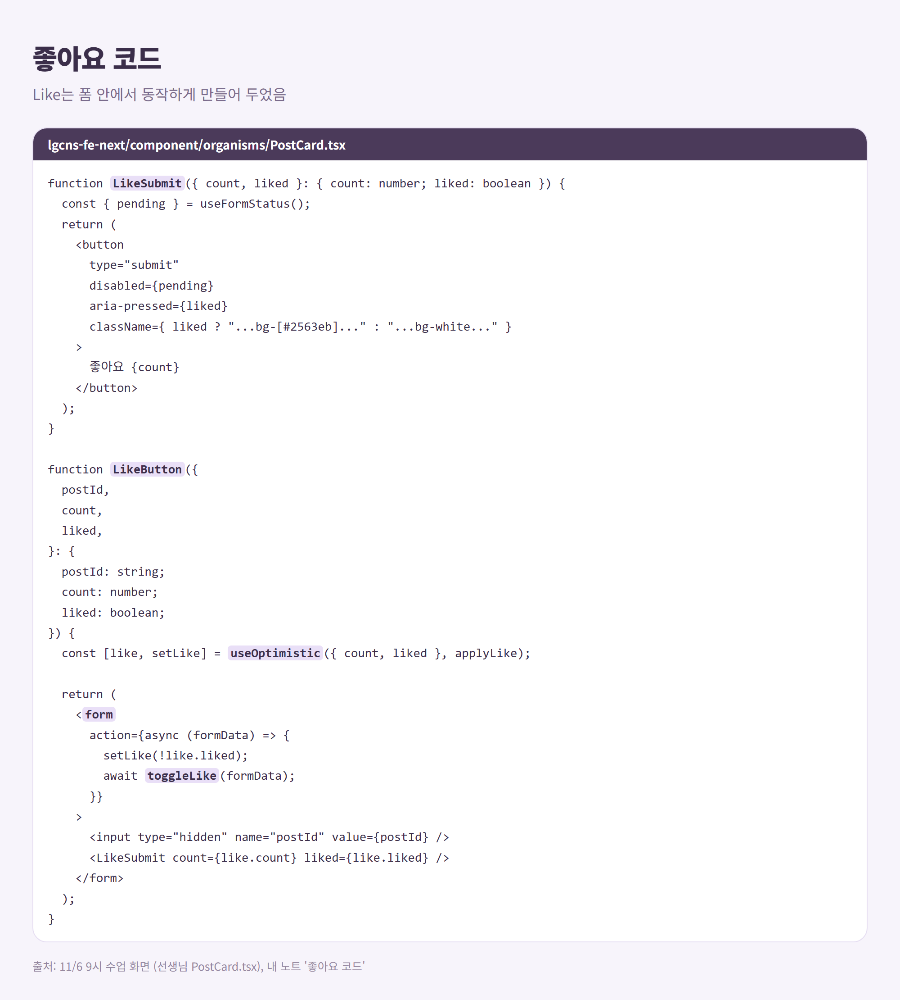
    - "useClient" 가 붙어있어 상태관리가 가능
        - `useOptimistic`, `useState` 등의 훅 사용 가능 (리액트발)
    - 액세스 토큰을 관리해주는 api. 사용하면 applylike 등이 추가로 동작을 함
    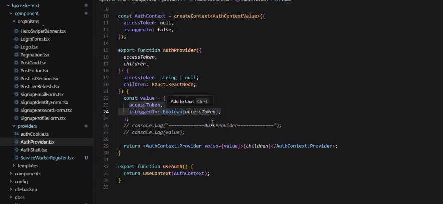
    - 분기처리를 위한 함수 추가 : handlelike 
    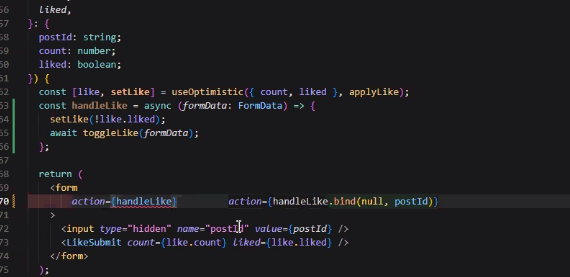
    - 훅을 만들어 로그인인지 아닌지 판단하게 함
        - 로그인인이 아니라면 로그인창으로 리다이렉트하게 함

- 잘 되지 않아 콘솔 찍으심 
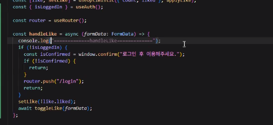
- 해결하신 후 로그인으로 접근. 그런데 리다이렉트로 가야하는데 홈페이지로 넘어가버림. 리다이렉트로 다시 이전 페이지로 접근할 수 있게 함.
- 현재 위치를 콜백으로 리다이렉팅을 하려면 어떻게 하면 좋을까? 
    - 리엑트라는 원초적인 기술을 사용한다.
    - 클릭할 때 현재 주소를 같이 전달하게 한다? 
    - 쿠키를 쓴다? 
    - DB나 서버에 정보를 저장한다?

- 내가 어디에 있는지 찾아야 함
- use계열로 사용자가 있는 패스를 찾는 기능이 있음 : usePathname
    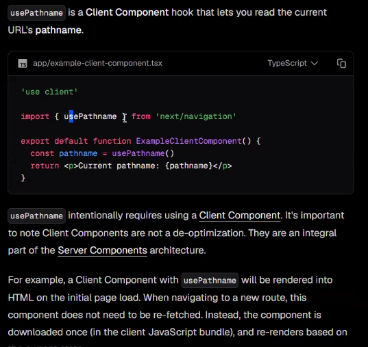
- 자바 스크립트에도 자체 기능이 있음
    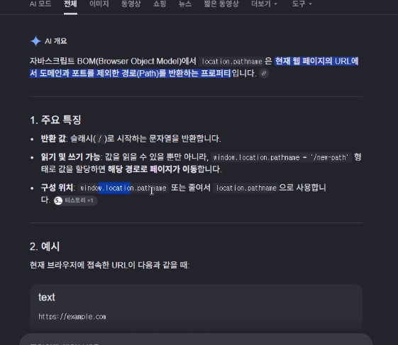
- 넥스트, 리액트에서 제공하는 api를 사용하면 내부에서 서로 자신들의 언어로 동작하여 무언가 가져옴. 그런데 각자 일반 자바가 아닌 자신들의 언어를 사투리처럼 사용하기 때문에 해석하는 딜레이가 생기긴 함. 이럴땐 자바스크립트 자체의 플레인한 언어를 사용하는 것도 방법임

- 라우터를 붙이고 콜백을 위한 usePathname 삽입
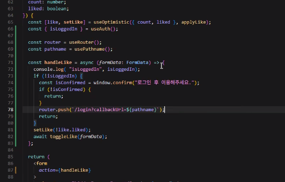

- 왜 문제가 있고 어떻게 해결하는지 스스로 해보는것도 좋은 공부다

- 로그인하자마자 좋아요가 되는건 어떨까요? 
    - 1차원 적인 생각이다. 로그인을 하려는데 회원이 아닐수도 있다
    - 참고로 알림창의 언어도 다들 신경을 많이 쓴다. 
    - 그런데 로그인으로 다이렉트 붙여서 던지긴 했지만 회원가입창은 아니다. 회원가입 후 경로를 잃어버릴 수 있다. 유저에게 보상처럼 글까지 한번에 안내해주면 유저도 행복할것이다. 
    - 유저 편의성을 생각해야 한다. 그리고 이 유저는 어떤 경로로 들어올지 알 수 없다. 내가 어디까지 구현해줄 수 있는지 고민해봐야한다.
    - 쿠키도 나쁘지 않은 생각이다. 코드로 하면 유저의 경로를 생각하고 프록시, 조건분기 등도 생각하면서 코드가 길어진다.
    - 현재도 회원확인이라는 조건 분기가 1단계 존재한다. 

- 채용인에게 내 포폴을 경험하게 해줄 때
- 내 페이지의 테스트용 아이디를 만들어둔다
    - 각 유형별로 만들어두면 좋다.
- 링크만 주는 방법도 가능함
    - 그 링크로 들어가면 딱 아이디 패스워드가 들어있어서 해당 케이스 선택하면 그대로 들어가서 확인할 수 있다.
- 프론트엔드의 핵심은 동작하는 화면을 보여주는것이 중요함. 어디까지 신경썼는지 

---

### 10시 수업

- 지금 만들고 있는 코드 무척 많다. 하지만 우리가 구현한 페이지는 몇 장 되지 않는다. 실무와 비교하면 적은 분량이다. 놀랍게도.
- 프로그레시브 앱
    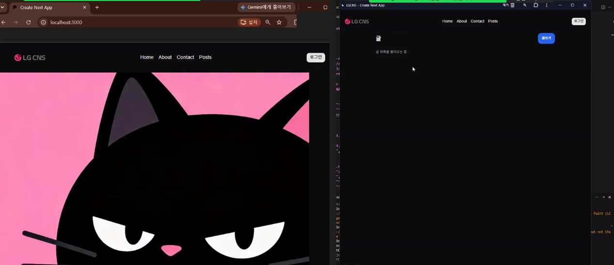
    - 구글이 구현한걸로 앎. 현재 크롬에 들어있음. 앱과 동일한 기능임 이걸 도입하면 안드로이드나 앱 스토어가 망하기때문에 쉽게 열리진 않을것같음. 
    - 나중에 일렉트론 js 도 간략하게 알려주신다고 함
    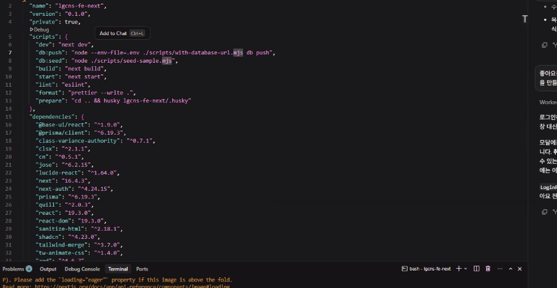
- 모달을 띄울 때, 이 모달이 어떤 용도인지, 중요하면 다른데랑 소통 못하고 버튼으로만 상호작용할수있게 해야 하는 것 등. 세심히 보고 도입해라.
    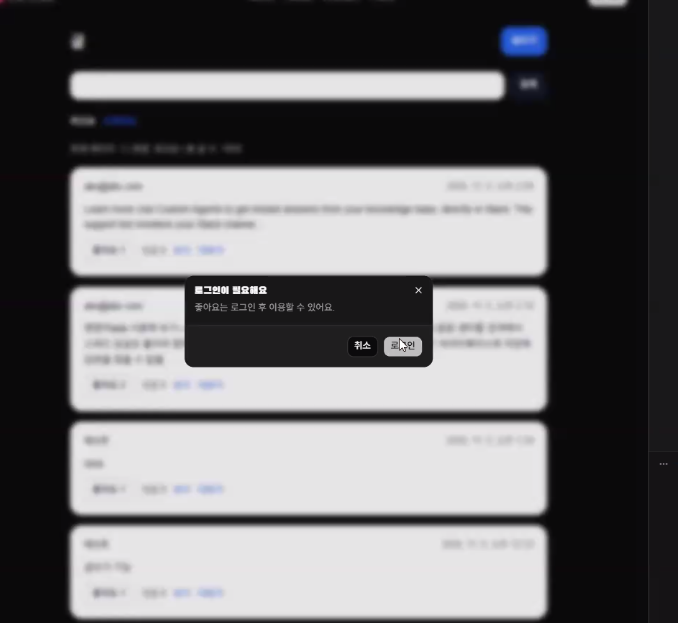

- 이전의 좋아요 - 로그인 리다이렉트문제 : 쿠키 쓰면 아주 좋다. 

    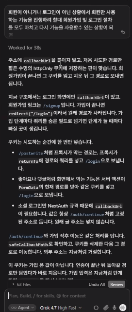

    - 긴 시간이 아닌 짧은 시간에 회원가입을 한다면 그 쿠키를 읽고 지운 뒤 그 경로로 보내면 된다고 함. 
    - 요즘 시장은 신입이라는 명분을 세워서 3년차를 구한다고 함 아놬
    - 실력에 동반한 대응을 하기는 함
    - 좋아요 - 로그인 누르면 로그인 페이지로 이동하며 쿠키를 생성함 

    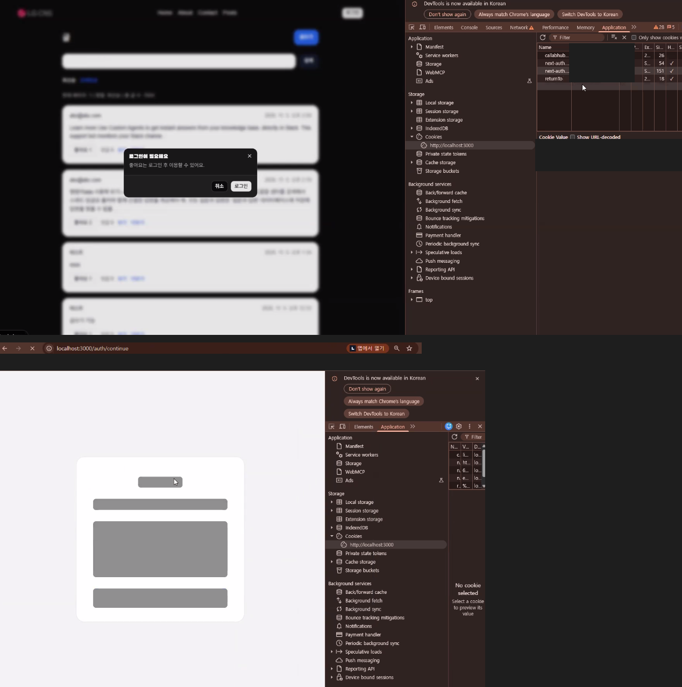

    - 커서가 무언가 잘못만듦. 컨티뉴 창에서 쿠키를 찾아서 그 쿠키에 담긴 경로를 통해 이전의 좋아요 햇던 위치 페이지로 돌아가게 함
    - 쿠키로 유저들의 행동패턴도 수집할 수 있음. 만약 쿠키를 사용한다면 쿠키허용 요청란이 있는것이 유용할 것

### 좋아요 버튼

- 좋아요는 이 버튼 하나로 동작한다. page.tsx 에서 컴포넌트로 꺼내면 여기저기에서 활용할 수 있다.

    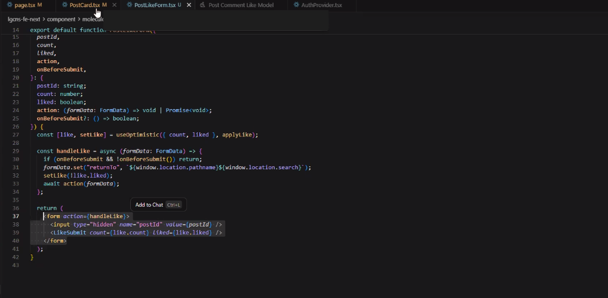
    
    - 그러기 위해선 해당 버튼이 얼마나의 종속을 가졌는지를 먼저 확인해야 한다

    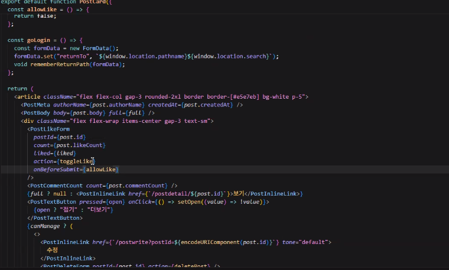

    - 버튼 따로 빼내는 중

    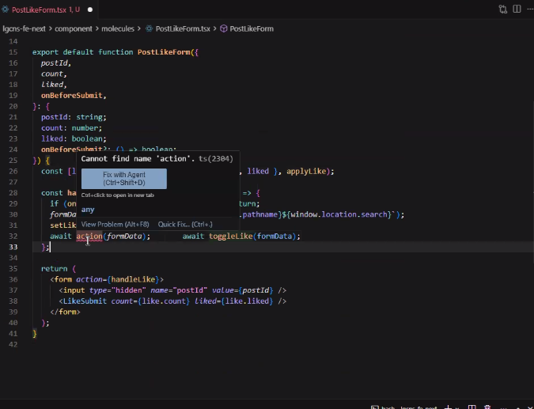

    - 하지만 만약 글에 종속이 되어있다. 함부로 빼낼 수가 없음
        - 현재 종속이 많이 되어있다고 함

        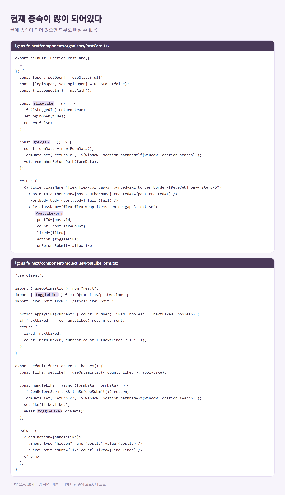

        - 이런 경우 만약 댓글 좋아요를 구현한다면 댓글용 좋아요 버튼을 구현해야 할 필요가 있다. 
    - 글, 댓글 좋아요에 쓸 수 있게 단독으로 뗄 수 있는 부분만 떼어온다

    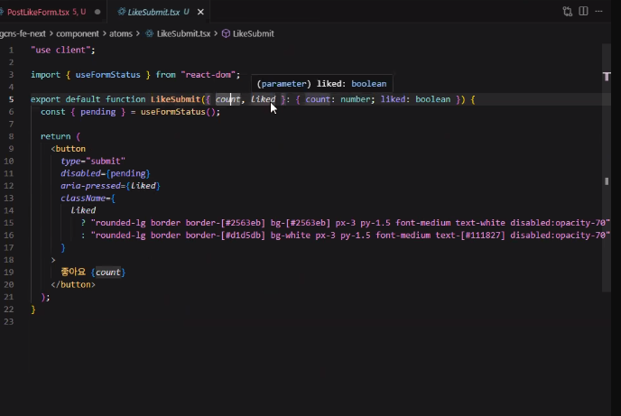

        - 못 가져오는건 포기한다

### 누군가 나의 글에 좋아요를 하거나 댓글을 달 경우 알림을 주는 기능 만들기
- SSE의 특징
    - 헤더값을 쓸 수 없다. 쿠키를 담을 수 없다
    - 액세스 토큰을 쓰거나 한 겹을 다른걸로 감사서 쓰는 방법이 필요하다.
    - sse 이벤트소스

    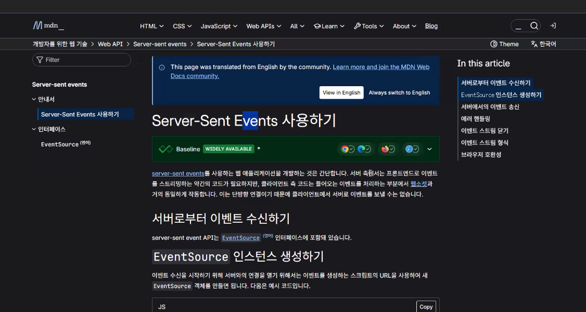

- 글 검색 기능 추가. 하지만 지금은 간단히 넣은거고 원래 이렇게만 넣으면 안된다. 

---
## 11시 수업

- 알림에 SSE를 건다

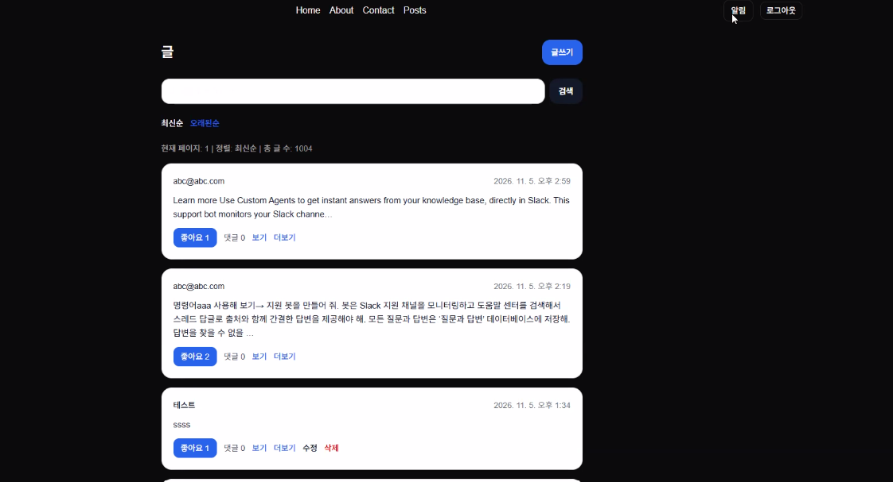

- 푸시 알림 : 디바이스에 대한 키값(토큰)을 받아 핸폰자체에 알림을 건다 
    - 인터넷이 없어도 알림을 보냄

- 생각보다 캐시를 쓰는게 유저를 판단해야 한다. 
- 신세계 - 이미 비회원의 캐시도 수집한다. 수집한 정보는 해당 이용디바이스와 함께 서버에 저장되어 추후 회원가입을 할 경우 이 수집된 캐시가 해당 디바이스로 가입한 유저의 성향 파악에 이용되는 구조. 국내는 아직 캐시관련 이슈가 없는모양?
- 비회원으로 담아두었던 장바구니가 가입을 하거나 로그인을 하면 비회원 당시의 기록을 옮겨서 ux 향상을 위해 그대로 장바구니에 넣어준다. 

---

## 1시 수업

- 몽고 DB 써도 되고. api 만들어진 걸 사용가능하게 공유하실 예정

- 6일 pdf 참고

### 댓글에도 좋아요를 붙임
- 컴포넌트화 한 거=버튼을 부침

-코드 직접 실행해서 붙여보면 가능할거다 .

### 코드설명

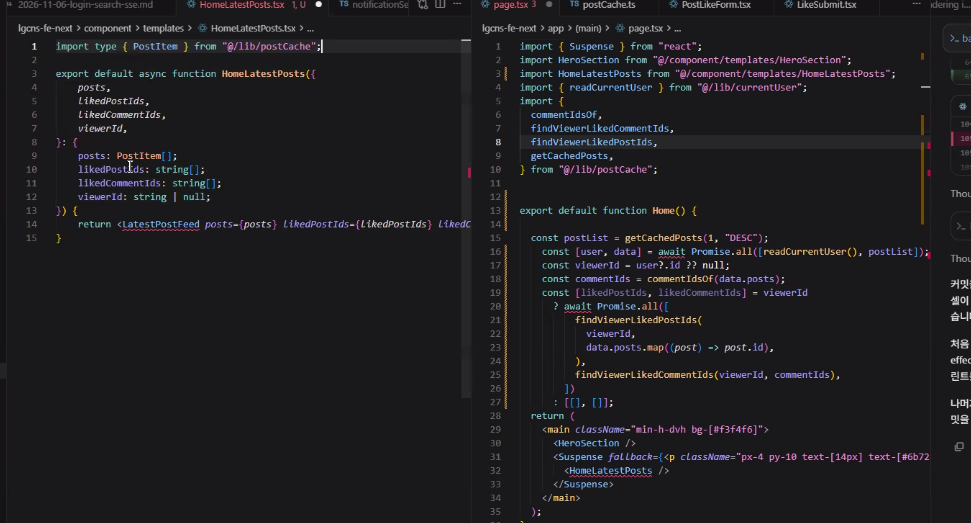

- 1시 왕창 졸았음 

### 조언

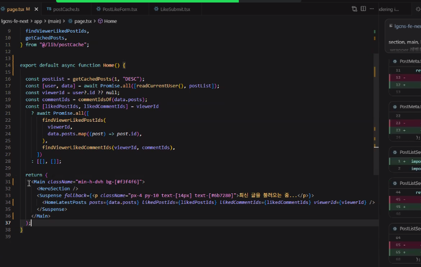

    - 대부분의 코드, 테일윈드
    - 이렇게 쓰면 재활용 가능해지는 코드다

### 1시 수업 전체적으로 졸았다.

---

## 2시 수업

- 프론트 조직이 큰 곳이 생각보다 많지 않다. 
- 코드를 조금 바꿨다.
- 오 기절한 사이 선생님의 웹페이지가 이뻐졌다.. 위기감을 느낀다

### 무한스크롤 만들기

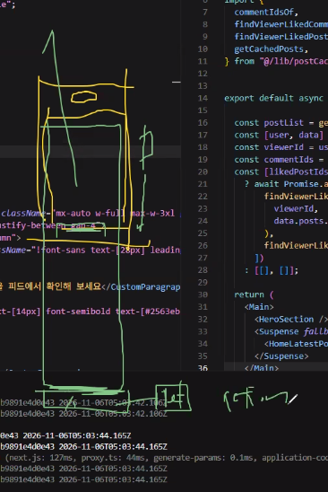

- 리액트 : 액션이 오면 기존 값에 이전 데이터 + 다시 받아온 데이터를 합쳐 데이터 상태관리를 함. 마지막에 도착하면 더는 받아올 데이터가 없으니 데이터 끝 담당 친구를 불러와 붙인다. 
- 넥스트 : 동일하게 스테이트 관리를 함. 1블럭, 2블럭, 3블럭 형식을 이어붙여 무한스크롤 구현. 섹션을 세군데로 나눠서 아래로 내려가면 이전의 페이지 섹션을 중간 섹션으로 갈아끼워 180개 정도의 데이터를 유지하는것
- 이것저것 많이 해보았는데 브라우저에 너무 부담을 주는건 좋지 않았음. 
- 장점 : 새로고침 대응
- 무조건 고착화 해선 안된다 

- 페이지네이션
- 무한페이지

- 개인 공부 많이 해라

#### 스와이퍼
- 히어로섹션에 만듦
- 이건 컨테이너로 만들 수 있음 -> containerWrapper

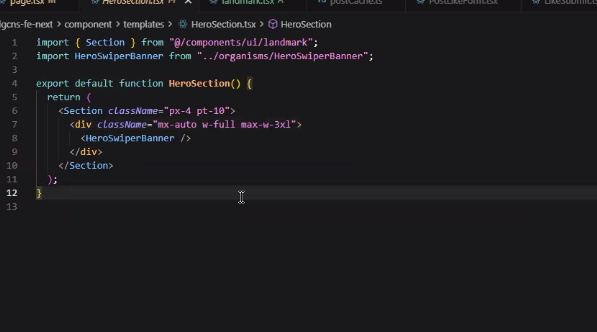

- 스와이퍼를 쓰려는데 케라셀을 썼다 -> 샤드씨엔의 유아이임
- 케라셀로 배너 넘기는 걸 만드셨다 설명
    - 릴레이션 
    - 샤드씨엔이 많이 쓰는것: 프리비어스 - 어떤 동작이 일어나는것 대비. 기본에 충실한 코드를 씀
    - 캐러셀에 들어오면 상태관리는 3개 뿐.

- 리액트 공부하다보면 이펙트 때문에 머리아플때가 있음. 컨트롤러를 이용함
- 유즈는 이게 기본, 유즈 컨텍스트는 컨텍스트 api로 써봄

    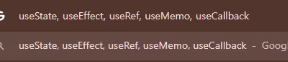 
    
    이것만 잘 봐라.
    - 최근 기술들도 있긴하지만 기본을 먼저 숙지하자

- 배너이미지 : 반응하여 배너의 이미지 사이즈 용량등을 조절하게 되어있음. jpg를 넣었지만 이미지를 다운받으면 webp로 다운로드 받아짐 

    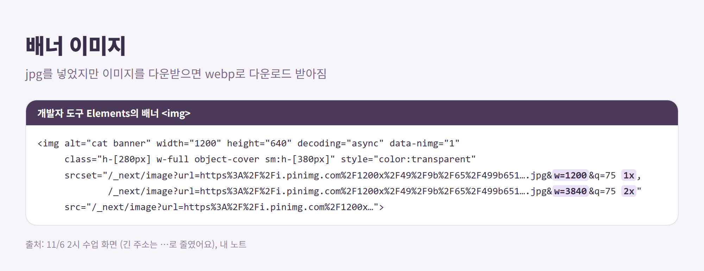

- 그림, 움직임, svg 자체 애니메이션도 전부 css 로 들어갈 수 있음

- 댓글을 열 때 : 그냥 땅 열리는것보단 아래로 스르륵 열리게 하려면 문제가 있음. 높이가 정해져 있어야 함.

    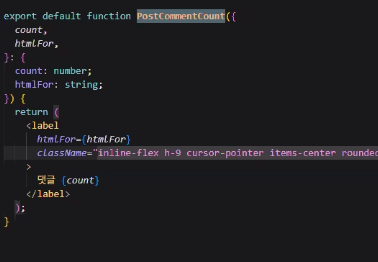

- 현재의 버튼: 버튼은 버튼인데 tailwind 코드로 적혀있는 버튼인데 버튼이 아닌 상태라고 하시는 듯함? css컨트롤 커맨드 토글을 찾아서 수정하여야 함
    - 유즈스테이트 , 이펙트를 최대한 줄여 만들라고 했더니  ai가 css 컨트롤 로 만들어냈음

---

## 3시 수업

### 스와이퍼 이어서
- 현재 단추가 이렇게 만들어져있다고 보여주심
    - 이렇게 하면 좋은 점 : 어디서든 동일하게 사용할 수 있다. CSS니까. 
    - 나타났다가 없어지는 건 히든박스로 동작

    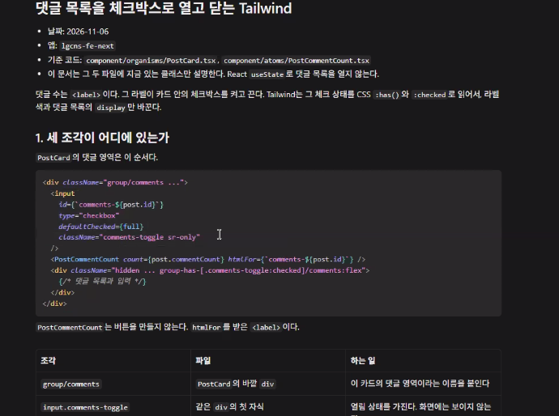

    - 레이블로 표시하는 편법같은것

### 알림 구조 이어서 
- SSE를 하는 데 필수 조건 : 값을 내려주기 위해서는 이벤트가 발생해야 하는거고 SSE 가 열리면 백엔드와 파이프라인이 이어져야함. 파이프라인이 언제 닫힐지 모르기 때문에 관리와 지켜보는것이 필요함 

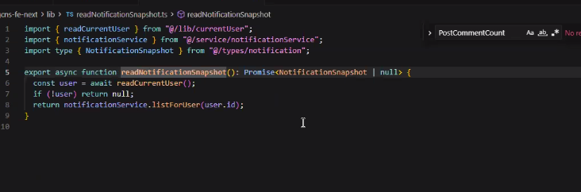

- 알림을 하렴면 스냅샷이 필요함
    - 그런데 하려면 유저의 이름을 전부 업데이트해야하는 문제가 있음. 물론 휘발되어도 상관없긴  하지만 그때 그 시점의 값을 저장하는 것이 필요함
    - 유저의 이름이 업데이트 된다면? 

    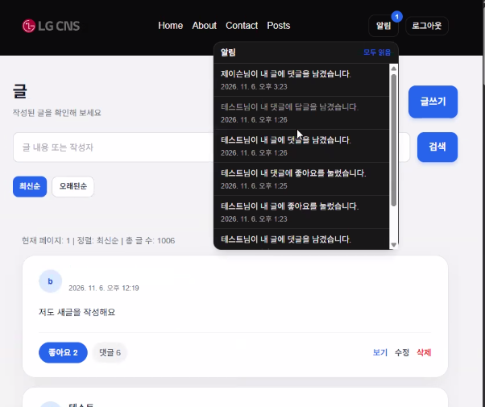

    - 테스트와 제이슨은 동일인물이지만, 이것이 알림에 반영되지 않음. 주의해야 한다.
    - 읽음 처리 : 내게 알림이 5개가 왔다면 
    
    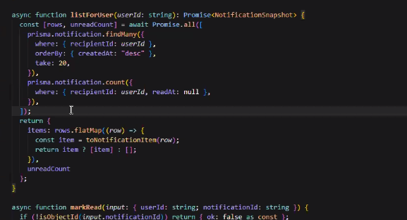

    - 해당되는 동작을 네트워크를 들여다보고 처리하는 코드가 필요. 리액트도 마찬가지 
    
    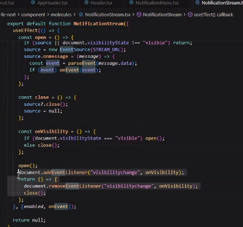

    - 네트워크를 본다. 스트림이 있음. 

    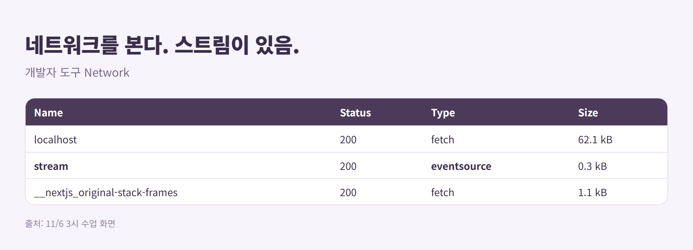

    - 레스폰스가 들어오면 쌓이는 구조 
        - 10초에 한번 리트라이 하는 코드가 들어있음

        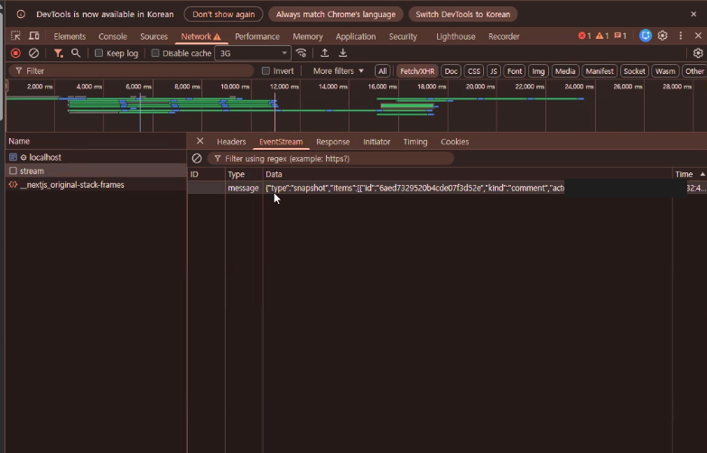

        - 댓글이 들어오면 확인하고 코드가 추가됨 

        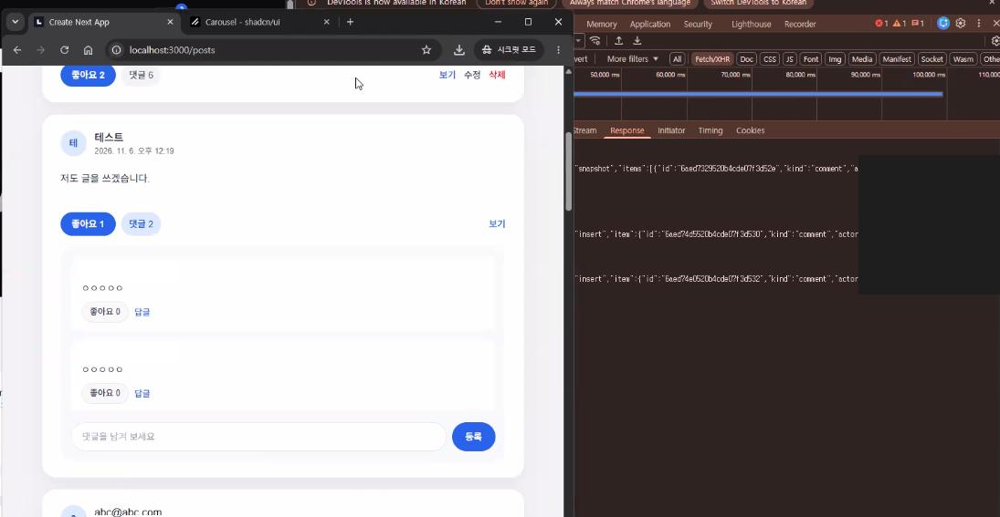

        - 페이지를 넘어가면 새로운 스트림이 생성됨
        - 원래 같은 곳이 그대로 유지가 되어야 함. 새로운 스트림이 생기면 이전 스트림은 닫힌다

        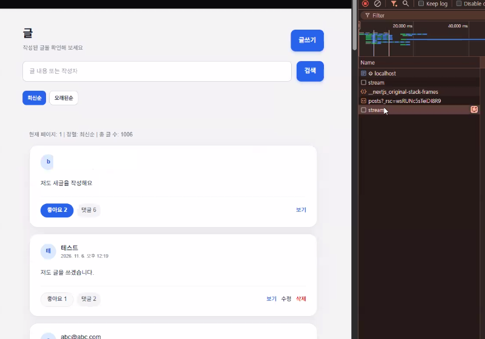

        - 계속 열려있으면 스트림이 여러개가 동작하는 문제가 생길 수 있다. 그러므로 스트림이 하나가 유지되고 새로운것이 열리지 않게 잘 만들어야 한다. 
        - 정제를 한번 더 해야함

- 스프링을 쓰면 조금 달라짐 

    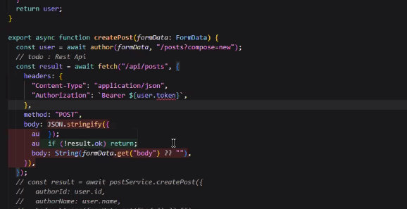

    - 문제가있다면 헤더가 이벤트 소스를 안받아줌

        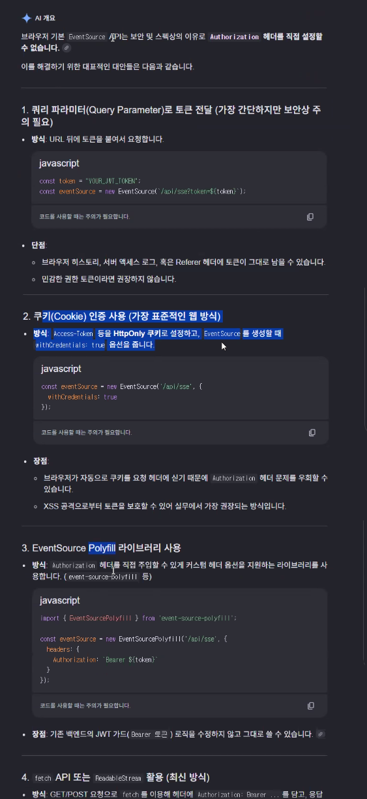
        
    - 이를 어떻게 대응할지가 고민거리.
    - SSE로 토큰을 주지 않고 판단하려면 바디에서 유저의 키값을 던지는 방식으로 바꿔야 함. 이를 대개 액세스 토큰으로 이용함 
    - 가능하게 하려면 오쓰라이제이션은 보안이 강화된 친구임. 얘 없이 바디에 담아 주소창에 넣는건 굉장히 위험할 수 잇음 
    - 엑세스 토큰은 위험한 토큰임. 
    - 그래서 알림을 만들때는 폐쇄적인 구조로 만드는 걸 권장함 
    - 대신 사용하는 평범. 공식은 아님 
        - 이벤트 소스를 쓰려고 창문 하나 열어뒀다가 대참사가 날 수 있음.
        - 항상 주의를 해야 함
    - 백엔드는 노티서버 CDC 등의 이벤트 동작을 배워두면 좋겠다. SSE는 만능이 아니다. 항상 사용에 주의하라. 

### 이후엔 오늘까지 한걸 쭉 훑어볼 예정
다음주에는 옵션으로 만든 api를 사용해 채팅서비스를 구현해볼. 프론트엔드가 채팅 구현하는 법에 대해 설명하실 예정 

---

## 4시 수업 

### api 공유
- 함부로 수정하거나 지우지 말라. 누가 했는지 까보면 다 나온다
- 포스트맨 사용해서 시험 한번 해봐도 됨

### 강사님이 지금껏 만든 pdf 파일들에 대한 소개
- 옵티미스틱 실무에대한 이야기 밸리드 등등 검토 잘 하고 폼액션에 대한 강조 로그인, ssr적 이해.
- 그럼 리액트는 어떻게 하나요? 
    - 당연히 리액트도 서버액션 강화되어있음

- 채팅은 몽고디비, 프리즈마. 정형적인건 스프링 땡겨와서 두개의 DB를 다루는 프로젝트를 만드는 방법도 있음

- 리액트 : 오류가 나면 어디서 오류가 난지 명확히 알 수 없음. 콘솔에 찍어야만 알 수 있음 .

### 채팅 관련 

- 백엔드: 웹소켓 
- 웹소켓 주소가 따로 있음. 라이브킷이라고 하여 화상채팅 가능한 라이브러리가 존재함 
    - api로 땡겨 쓸 예정. 3002번

- 채팅은 어떻게 만들 수 있을까?
    - 수신자와 발신자가 대화가 오가야 함
    - 양방향 통신이 되어야 함
    - 보내는 사람이 클라이언트, 리시버가 서버가 됨
    - 채팅방이 있어야 함. 이 안에 포함된 사람들이 교류를 함
    - 채팅방 내의 사람들 모두 리시버나 센더가 될 수 있음. 누군가가 쓰면 나머지가 읽는 사람이 됨
    - 유저 아이디, 메시지, 언제 보냈는지의 데이터가 있으면 채팅을 구현할 수 있음
    - 물론 알림이나 그런건 좀 어렵긴 함
    - ui 구조는 단순함 어렵지 않음
    - 채팅 대화 아이템들을 컴포넌트로 만들어 넣는다. 다들 대화상자 안에 텍스트가 들어가고 프로필 사진이 나오는건 동일할테니까. 붙이는 위치만 달라지는 것
    - 안읽은 기록은 접속 시간 기준으로 쌓인 데이터로 표기
    - 채팅 타입 : 메시지면 글자, 이미지면 그림, 영상이면 영상
    - 다 컴포넌트로 넣는다. 
    - 그럼 이걸 조립해야한다. 
    - 소켓은 좀 다름. 흐름대로 주는것. 먼저 주는 사람에게 흐름대로 데이터를 보내는것
    - 프론트는 언제 이벤트의 타이밍을 발생시키는지를 정하는일을 해야함
    - 채팅창을 나갔다는 어떻게 알 수 있을까? 
    - 나가기를 누르거나 컴퓨터가 꺼지는 등 웹소켓이 끊어지는 타이밍에 나가기를 인지하게 할 수 있다. 
    - 카카오톡 : 소켓은 연결되어있지만 최소화 해두면 읽지 않음이 쌓임. 어디에 어떻게 데이터를 줄지 여러 포인트를 지정할 수 있음. 카카오톡 창은 엄청 많은 api를 주고받을 수 있음
    - 카카오도 팀바팀이긴 한데 하드코어한 팀이 살아남지만 거의 날마다 밤새신다고 함
    - 우리는 읽음 처리까지는 구현할 수 있을것같다. 이미 api만들어놨음
    - api는 있으니 가지고 한번 만들어봐라. 
    - callab-hub.com 등록법 알려줬으니 등록하면 승인해주겠다. 들어와서 살펴봐라 

---

## 5시 수업

### ai 시대의 수업은 아키텍처와 체계를 잘 알고 있어야 한다. 또한 구걸을 잘 해야 한다.
- 아키텍처를 설계하고 하겠다 선언한 것이 될 때 까지 해야한다,. 

### 처음부터 끝까지 코드를 짤 수 있게 공부해야한다.
- 할 수 있는데 시키는 것과 할 수 없을 때 시키는 것이 다르다.
- 응답이 왔을 때 잘못되었는지 아닌지 판단 할 수 있다. 알아야!

### 리액트+바이트 조합에 채팅 구현이 넥스트보다 어려울까
- 채팅 구현은 거의 CSR 담당. 통신은 서버가 담당. 
- 다만 리액트는 서버 액션이 없어서 노출이 된다는 문제가 있음. 
- 다만 코드를 쓰기 위한 라이브러리가 많이 필요함. 
- SSE 방식으로 한다면 차이가 좀 있을 것 이다.
- 단순한 구현은 금방 한다. 

###
- 리액트는 반드시 보안정책이 중요함. 주의할것
- 페이로드는 보안체계를 갖고 던져서 노출된다는 말과는 맞지 않음. 레스폰스도 마찬가지. api 설계를 기가막히게 잘하도록 구성하고 암호화를 붙이면 좋아지긴 한다. 다만 일이 많다. 리액트로만 보안까지해서 주라고 하면 돈 많이 주라고 해라

### 수업 후 공지사항

- 팀플 예정: 11/10~13 작은 파일럿 프로젝트를 할 예정
    - 프론트엔드를 간단하게라도 플젝으로 했음 좋겠다. 팀 빌딩 이야기가 나온게 그것 때문.
    - ux/ui는 중요함. 백엔드는 코드를 만지는 사람. 풀스택 개발자를 목표로 한다면 디자인적 미감과 ux적 감각도 잘 알아야 함.
    - 월요일에 팀 만들기 위한 상담을 할 예정
    - 공지는 lms 에 올릴 예정.
    - 교재랑 pdf 랑 다 보고 개인공부 꼭 해라 
    - 공식과목상 백엔드지만 실습 및 포트폴리오를 만들예정이다. 
    - 성적으로 반영되진 않음. 실습목적프로젝트이기 때문. 
    - 여기 온거 팀플하러 온거 아니겠느냐 꼭 팀플해보라.
    - 안 강사님은 디자이너였다가 개발자가 되신 분. 그래서 안 강사님은 그부분을 잘 아심