# 11일차 TIL : AI 서비스를 위한 프론트엔드 9

## 오프닝
- 기존에 있던 소스코드를 활용하라.
- 강사님의 경우 이미 만들어둔 코드들을 최대한 모아두었다가 조합하며 활용하는 편이시다.
- 컴포넌트방식이 각광받고 발달하게 된것도 ai가 없는 시기 빠르고 편안하게 코딩을 하기 위해 변화해온 그런 역사인것같음

### 어제의 코드 확인
- 글 쓰는 부분 : /postwrite
- 액션이 들어오기 전의 판단 필요. 로그인이냐 아니냐.

- 기존의 개발방식
    - 좋아요에 문제가 생김 -> 찾기 시작. 전체적인 프로세스를 그림. csr. isAuth True... 하고 어떻게 찾을지 설계. -> 누가 호출함 -> 돌아오면 다시 처음부터 생각해야함
    - 업무 보다보면 창이 3~40개 생김. 그거 다 지우고 다시시작하게됨. 집중해서 5분 만에 할 수 있는것이지만 2~3시간 걸려버림. 그리고 시간이 오래걸린다고 혼남

- 목표까지 전부 끝낼때까지 한 자리에서 일어나지 않는 것이 제일 짧게 걸린다. 
    - 소스코드를 한번에 끝내라는 것이 아님. 하지만 하나의 흐름을 한번에 하는것이 나중에 사고도 줄어든다.
    - ai를 사용하며 업무효율성도 많이 향상되었다. 
    - 파일명은 공통적인 것으로 사용해야 한다. 나만 아는걸로 하면 같이 협업하는 사람에게도 큰일이고 그거 설명하는것도 큰일이다. 
    - search 기능 사용해서 찾는 방법도 있긴 함

- 라이크는 폼 안에서 동작하게 만들어두었음. 
    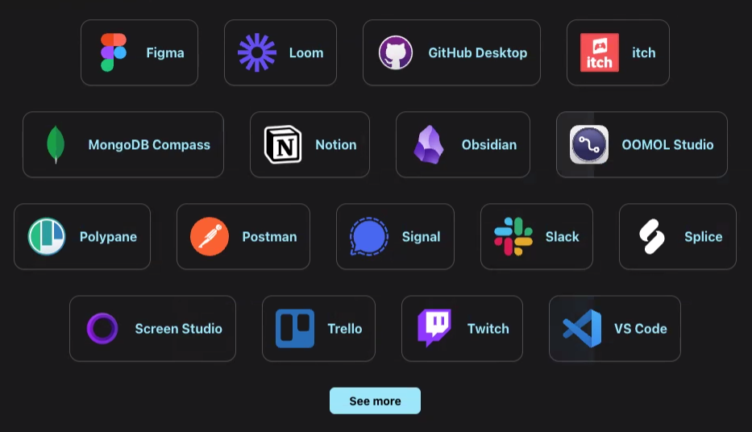
    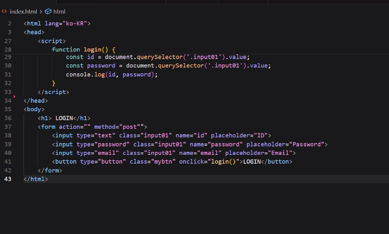
    - useclient 가 붙어있어 상태관리가 가능
    - 액세스 토큰을 관리해주는 api. 사용하면 applylike 등이 추가로 동작을 함
    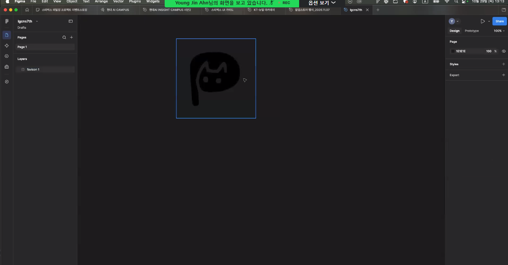
    - 분기처리를 위한 함수 추가 : handlelike 
    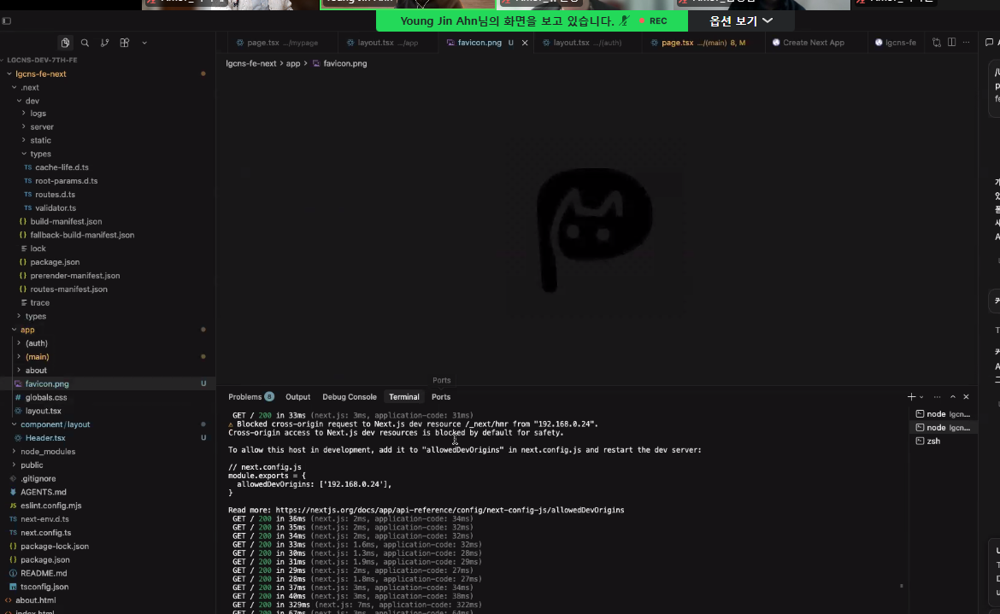
    - 훅을 만들어 로그인인지 아닌지 판단하게 함
        - 로그인인이 아니라면 로그인창으로 리다이렉트하게 함

- 잘 되지 않아 콘솔 찍으심 
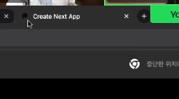
- 해결하신 후 로그인으로 접근. 그런데 리다이렉트로 가야하는데 홈페이지로 넘어가버림. 리다이렉트로 다시 이전 페이지로 접근할 수 있게 함.
- 현재 위치를 콜백으로 리다이렉팅을 하려면 어떻게 하면 좋을까? 
    - 리엑트라는 원초적인 기술을 사용한다.
    - 클릭할 때 현재 주소를 같이 전달하게 한다? 
    - 쿠키를 쓴다? 
    - DB나 서버에 정보를 저장한다?

- 내가 어디에 있는지 찾아야 함
- use계열로 사용자가 있는 패스를 찾는 기능이 있음 : usePathname
    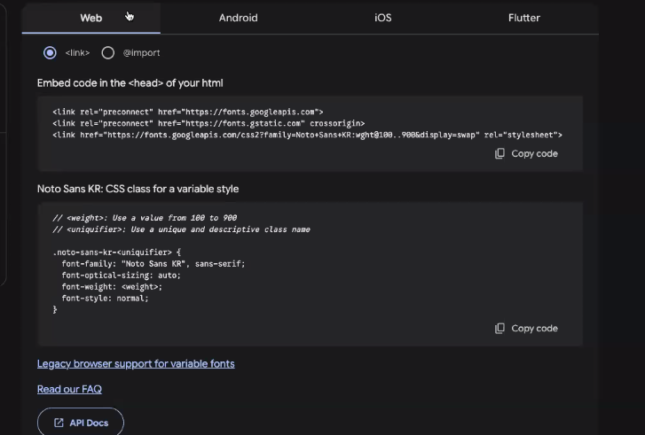
- 자바 스크립트에도 자체 기능이 있음
    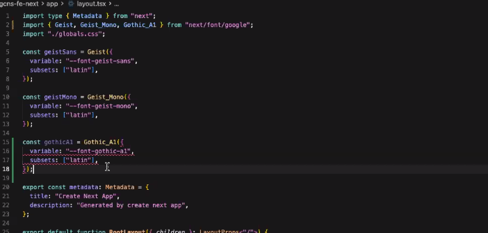
- 넥스트, 리액트에서 제공하는 api를 사용하면 내부에서 서로 자신들의 언어로 동작하여 무언가 가져옴. 그런데 각자 일반 자바가 아닌 자신들의 언어를 사투리처럼 사용하기 때문에 해석하는 딜레이가 생기긴 함. 이럴땐 자바스크립트 자체의 플레인한 언어를 사용하는 것도 방법임

- 라우터를 붙이고 콜백을 위한 usePathname 삽입
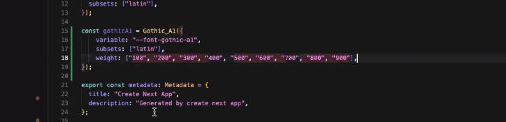

- 왜 문제가 있고 어떻게 해결하는지 스스로 해보는것도 좋은 공부다

- 로그인하자마자 좋아요가 되는건 어떨까요? 
    - 1차원 적인 생각이다. 로그인을 하려는데 회원이 아닐수도 있다
    - 참고로 알림창의 언어도 다들 신경을 많이 쓴다. 
    - 그런데 로그인으로 다이렉트 붙여서 던지긴 했지만 회원가입창은 아니다. 회원가입 후 경로를 잃어버릴 수 있다. 유저에게 보상처럼 글까지 한번에 안내해주면 유저도 행복할것이다. 
    - 유저 편의성을 생각해야 한다. 그리고 이 유저는 어떤 경로로 들어올지 알 수 없다. 내가 어디까지 구현해줄 수 있는지 고민해봐야한다.
    - 쿠키도 나쁘지 않은 생각이다. 코드로 하면 유저의 경로를 생각하고 프록시, 조건분기 등도 생각하면서 코드가 길어진다.
    - 현재도 회원확인이라는 조건 분기가 1단계 존재한다. 

- 채용인에게 내 포폴을 경험하게 해줄 때
- 내 페이지의 테스트용 아이디를 만들어둔다
    - 각 유형별로 만들어두면 좋다.
- 링크만 주는 방법도 가능함
    - 그 링크로 들어가면 딱 아이디 패스워드가 들어있어서 해당 케이스 선택하면 그대로 들어가서 확인할 수 있다.
- 프론트엔드의 핵심은 동작하는 화면을 보여주는것이 중요함. 어디까지 신경썼는지 

---

### 10시 수업

- 지금 만들고 있는 코드 무척 많다. 하지만 우리가 구현한 페이지는 몇 장 되지 않는다. 실무와 비교하면 적은 분량이다. 놀랍게도.
- 프로그레시브 앱
    - 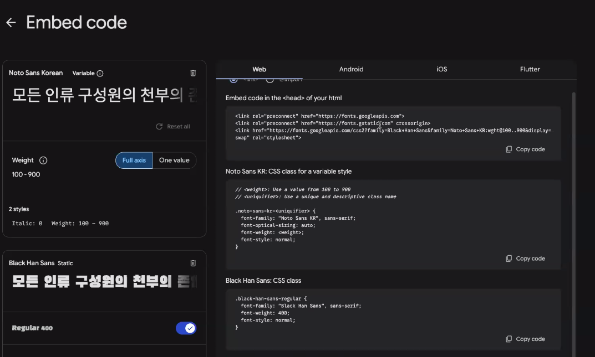
    - 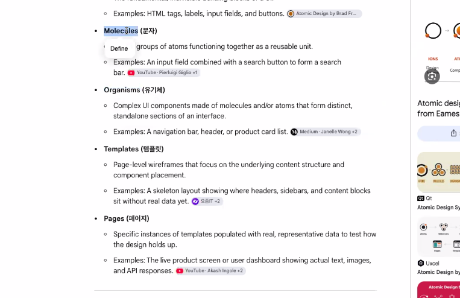
    - 구글이 구현한걸로 앎. 현재 크롬에 들어있음. 앱과 동일한 기능임 이걸 도입하면 안드로이드나 앱 스토어가 망하기때문에 쉽게 열리진 않을것같음. 
    - 나중에 일렉트론 js 도 간략하게 알려주신다고 함
    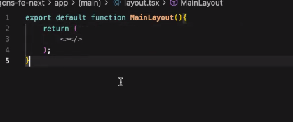
- 모달을 띄울 때, 이 모달이 어떤 용도인지, 중요하면 다른데랑 소통 못하고 버튼으로만 상호작용할수있게 해야 하는 것 등. 세심히 보고 도입해라.
    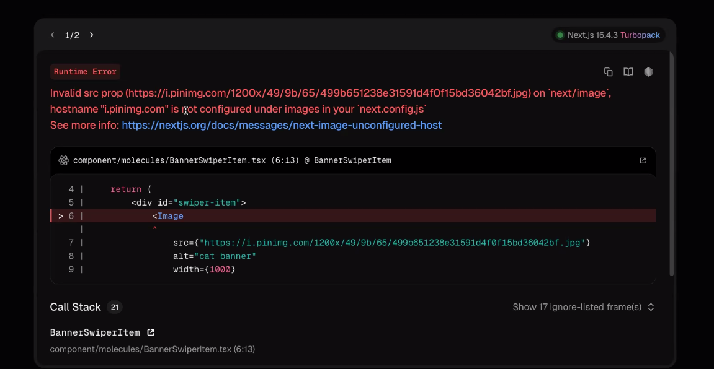

- 이전의 좋아요 - 로그인 리다이렉트문제 : 쿠키 쓰면 아주 좋다. 
    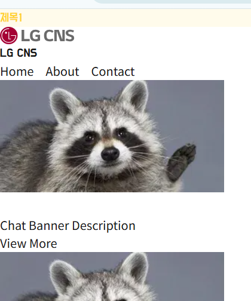
    - 긴 시간이 아닌 짧은 시간에 회원가입을 한다면 그 쿠키를 읽고 지운 뒤 그 경로로 보내면 된다고 함. 
    - 요즘 시장은 신입이라는 명분을 세워서 3년차를 구한다고 함 아놬
    - 실력에 동반한 대응을 하기는 함
    - 좋아요 - 로그인 누르면 로그인 페이지로 이동하며 쿠키를 생성함 
        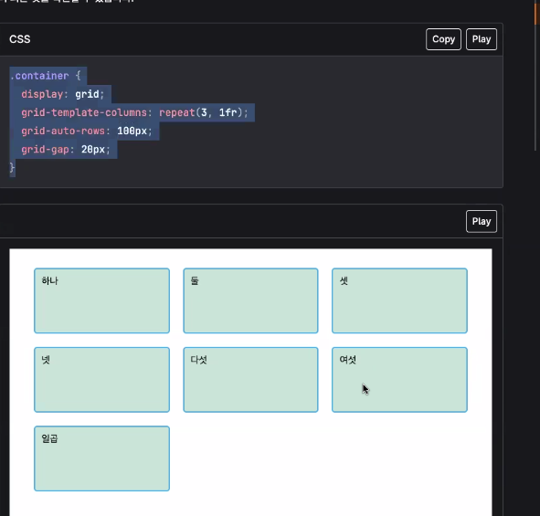
    - 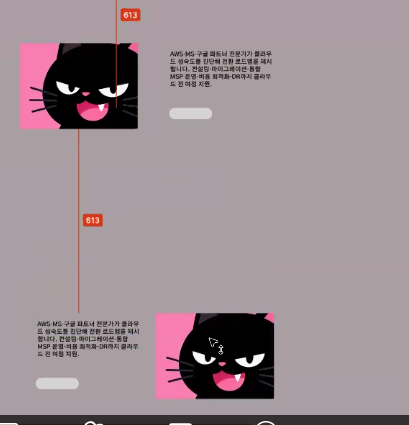
    - 커서가 무언가 잘못만듦. 컨티뉴 창에서 쿠키를 찾아서 그 쿠키에 담긴 경로를 통해 이전의 좋아요 햇던 위치 페이지로 돌아가게 함
    - 쿠키로 유저들의 행동패턴도 수집할 수 있음. 만약 쿠키를 사용한다면 쿠키허용 요청란이 있는것이 유용할 것

### 좋아요 버튼

- 좋아요는 이 버튼 하나로 동작한다. page.tsx 에서 컴포넌트로 꺼내면 여기저기에서 활용할 수 있다.
    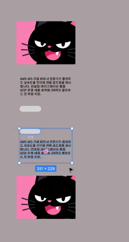
    - 그러기 위해선 해당 버튼이 얼마나의 종속을 가졌는지를 먼저 확인해야 한다
    
    - 버튼 따로 빼내는 중
    
    - 하지만 만약 글에 종속이 되어있다. 함부로 빼낼 수가 없음
        - 현재 종속이 많이 되어있다고 함
        
        - 이런 경우 만약 댓글 좋아요를 구현한다면 댓글용 좋아요 버튼을 구현해야 할 필요가 있다. 
    - 글, 댓글 좋아요에 쓸 수 있게 단독으로 뗄 수 있는 부분만 떼어온다
        
        - 못 가져오는건 포기한다

### 누군가 나의 글에 좋아요를 하거나 댓글을 달 경우 알림을 주는 기능 만들기
- SSE의 특징
    - 헤더값을 쓸 수 없다. 쿠키를 담을 수 없다
    - 액세스 토큰을 쓰거나 한 겹을 다른걸로 감사서 쓰는 방법이 필요하다.
    - sse 이벤트소스
    

- 글 검색 기능 추가. 하지만 지금은 간단히 넣은거고 원래 이렇게만 넣으면 안된다. 

---
## 11시 수업

- 알림에 SSE를 건다

- 푸시 알림 : 디바이스에 대한 키값(토큰)을 받아 핸폰자체에 알림을 건다 
    - 인터넷이 없어도 알림을 보냄

- 생각보다 캐시를 쓰는게 유저를 판단해야 한다. 
- 신세계 - 이미 비회원의 캐시도 수집한다. 수집한 정보는 해당 이용디바이스와 함께 서버에 저장되어 추후 회원가입을 할 경우 이 수집된 캐시가 해당 디바이스로 가입한 유저의 성향 파악에 이용되는 구조. 국내는 아직 캐시관련 이슈가 없는모양?
- 비회원으로 담아두었던 장바구니가 가입을 하거나 로그인을 하면 비회원 당시의 기록을 옮겨서 ux 향상을 위해 그대로 장바구니에 넣어준다. 