# 12일차 TIL : AI 서비스를 위한 프론트엔드 10

## 오프닝. 지난주에 한 것 리뷰

### 오늘 배울것 채팅 훅, 백엔드api접속 테스트 , DB 갈아끼우기

- 할 일이 있을 때 가장 좋은 것 같다. 아무 할 일 없을때는 별로 좋지 않은 것 같다.

### 지난 코드 상황 확인
- Optimistic
- 실제 데이터가 들어갔는지 확인
- 목록 보기, 알림기능, 추가적인 파라미터를 사용하는 방법
- 페이지네이션 - 무한스크롤 만들기를 붙여보려고 했지만 시간상 어려웠다.
- 다 할지는 의문이다. 계속 하려고 한걸 추가하고있다.

### 오늘의 목표
1. 채팅
2. 무한스크롤
3. 사이트의 자잘한 부품만들기
4. DB소스 마이그레이션
    - 마이그레이션(migration): "이사"
    - 채팅 api를 위해 DB를 갈아타야함

### 서비스 수정 
- MySQL로 이동할 예정이다.

#### postService

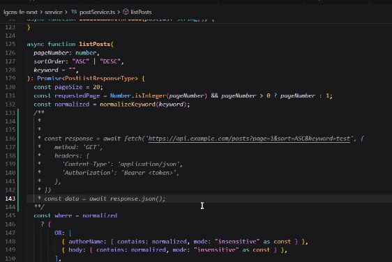

```ts
const response = await fetch('https://api.example.com/posts?page=1&sort=ASC&keyword=test', {
  method: 'GET',
  headers: {
    'Content-Type': 'application/json',
    'Authorization': 'Bearer <token>',
  },
});
const data = await response.json();
```

- 코드의 일부를 넘기고 넥스트 토큰에 담아 백엔드로 넘겨 백엔드가 할 일, 백엔드의 api 에서 한 턴으로 처리할 예정.

- 데이터를 처리하는 체계를 컨피그해서 쓸 예정. 
- api 에 넥스트 토큰을 보내 사용하는 체계 : 중괄호를 넣어 받아야 할 데이터를 넣는다. 
- 이건 프론트엔드가 써야 할 코드다. 익혀라. 

- 좀 더 깊게 들어가면 에러 핸들러까지 할 수 있다. 함부로 하면 안되고 백엔드에서 주는 메시지를 그대로 전달하고 하드코딩 하지 않는것이 좋다. 고정된 값을 정하는것보다 api수정이 더 빠르다. 때로는 YAML 파일 하나 수정으로 끝나기도 한다

- `then`을 이용해 동기코드를 만들수도 있지만 보통은 json으로(`await`) 보기쉽게 풀어쓴다.

```ts
// then을 이용하는 경우
fetch(...).then(r => r.json()).then(...)
```

#### 백엔드 응답 모양은 정해져 있다

- api는 정해져 있는 편이다

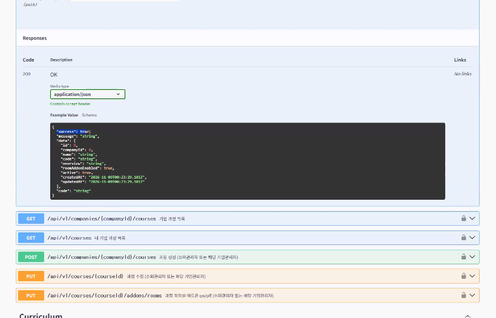

- 백엔드 api가 오면 코드가 좀 더 단순해질 수 있다. 
- 리스폰스 타입을 정해놓고 데이터를 받게 되는 구조가 되어 코드가 훨씬 짧아지기도 한다.

#### 타입은 한 곳에 모은다

- 타입의 경우 한 곳에 종속시켜선 안된다. 
- 특정한 코드 안에 분산된 코드들을 한 곳으로 모은다.

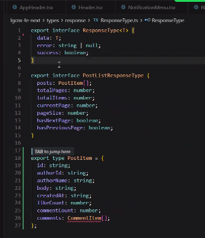

- 인터페이스 : 타입스크립트는 중복 선언할 수 없지만 여러가지 선언을 중첩할 수 있음. 인터페이스는 중복 가능. 타입스크립트로 안해도 되는건 굳이 안하고 인터페이스 방식을 사용하는것도 좋다. 특정부분에서는 인터페이스가 장점이 크니까.

> [!NOTE] Type VS Interface

> TypeScript에서 type(타입 별칭)과 interface(인터페이스)는 주로 객체의 구조를 정의할 때 쓴다. 90% 이상 비슷하게 동작하지만, 지원하는 기능과 쓰는 목적이 다르다.

| 기능 / 특징 | type (타입 별칭) | interface (인터페이스) |
| --- | --- | --- |
| 기본 용도 | 원시값, 유니언, 튜플, 함수 등 모든 타입 정의  | 객체의 구조(Shape) 정의 |
| 객체 확장 방식 | 교차 타입(&) 사용 | extends 키워드 사용 |
| 선언 병합 (Declaration Merging) | 불가능 (같은 이름으로 다시 선언하면 에러) | 가능 (같은 이름으로 다시 선언하면 자동으로 합쳐짐) |
| 유니언(\|), 튜플, 원시값 정의 | 가능 (string \| number, [number, string] 등) | 불가능 |
| 계산된 속성(Computed value) 사용 | 가능 | 불가능 |
| 에러 메시지 / 캐싱 성능 | 교차 타입이 복잡하면 에러 메시지가 길어질 수 있음 | 인터페이스 관계를 캐시해서 큰 규모로 조합할 때 유리 | 


- 타입들을 한곳에 모은 후, 기존의 코드들을 정리한다.
    - 이런식으로 리스폰스 타입끼리 떼어놓는것이 관리나 운용이 편하다.

        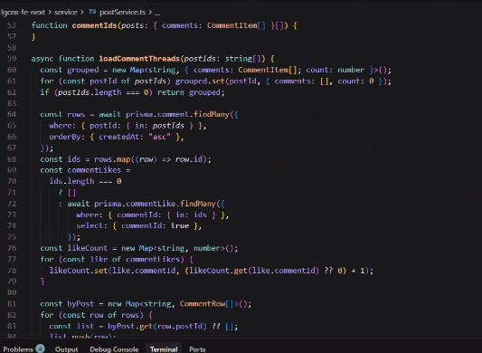

#### 서비스 갈아끼우기 

- api가 스프링 기반이다. 현재 체제는 프리즈마이므로 마이그레이션을 하려면 수정이 필요하다.

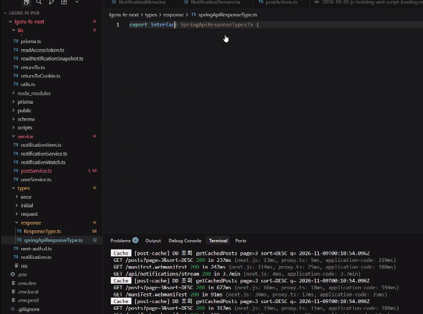

- 서비스 버전나누기로 처음엔 v1, v2를 생각했다.

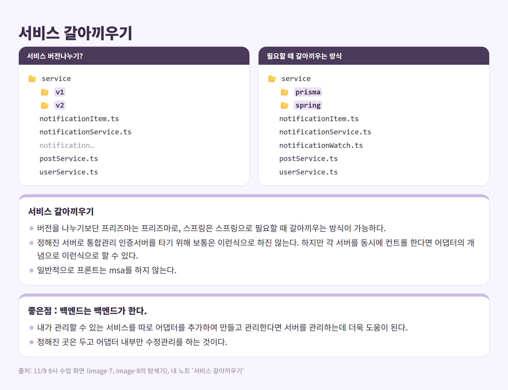

- 버전을 나누기보단 프리즈마는 프리즈마로, 스프링은 스프링으로 필요할 때 갈아끼우는 방식이 가능하다.
    - 정해진 서버로 통합관리 인증서버를 타기 위해 보통은 이런식으로 하진 않는다. 하지만 각 서버를 동시에 컨트롤 한다면 어댑터의 개념으로 이런식으로 할 수 있다. 일반적으로 프론트는 msa를 하지 않는다. 
- 좋은점 : 백엔드는 백엔드가 한다.
    - 백엔드 서버 하나가 아니라 지금처럼 2개 이상 존재하는 경우, 이 서버의 코드들이 곳곳에 퍼져있으면 서버 하나 바뀔 때마다 전부 고쳐야 하는 문제가 발생한다.
    - 그럴 때 내가 관리할 수 있는 서비스를 따로 어댑터를 추가하여 만들고 관리한다면 서버를 관리하는데 더욱 도움이 된다. 정해진 곳은 두고 어댑터 내부만 수정관리를 하는 것이다. 

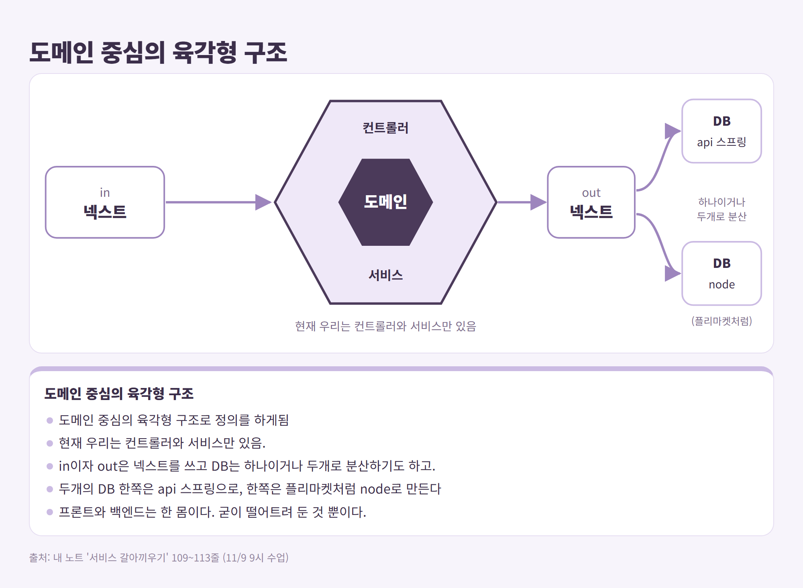

- 도메인 중심의 육각형 구조로 정의를 하게됨
- 현재 우리는 컨트롤러와 서비스만 있음.
- in이자 out은 넥스트를 쓰고 DB는 하나이거나 두개로 분산하기도 하고.
    - 두개의 DB 한쪽은 api 스프링으로, 한쪽은 플리마켓처럼 node로 만든다
- 프론트와 백엔드는 한 몸이다. 굳이 떨어트려 둔 것 뿐이다. 

#### 래퍼 Wrapper : 페이지네이션 / 무한스크롤

- 페이지네이션은 잠시 미뤄두고 wrapper 체제로 할 생각이다.
- 페이지네이션/무한스크롤 두 가지로 동작인식 분기처리를 할 예정

```ts
// 📁 강사님 파일 lgcns-fe-next/component/organisms/postListShell.ts
export type PostListShellProps = {
  posts: PostListResponseType;
  pageNumber: number;
  sortOrder: "ASC" | "DESC";
  keyword: string;
};
```

- 두 래퍼가 같은 PostListShellProps 를 받아서 페이지 파일의 한 줄만 바꾸면 방식이 바뀌도록 만들었다.
- 모달을 박스만 만들고 내부만 바꾸게 하는 것
    - 생각보다 api 구조설계가 복잡하다. 상황에 따라 내부에 들어가야 할 상황과 출력 규칙등을 규정하여 갈아끼워주도록 해야하기 때문이다.
    - 초심자에게는 복잡하겠지만 한번 이해하면 쉬워진다. 

- 하지만 실무에서 그렇게 하려면 처음에 설계를 잘 해야 한다. 코드가 다 꼬이니까.

- 에러 핸들러 용도 모달을 추가한다.  따로 뺀다

- 두 줄은 래퍼로 갈아끼우고 템플릿 형태로 만든다. => PaginataionWrapper / InfinityWrapper

  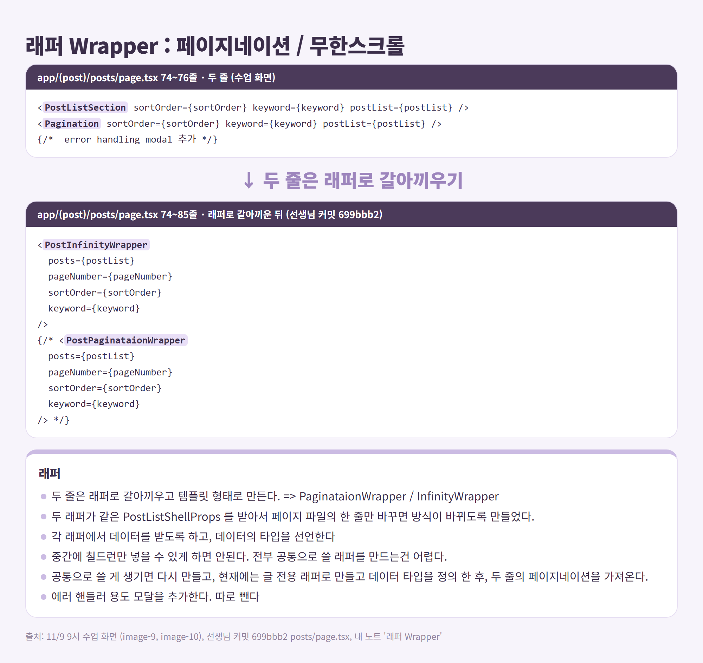

    - 각 래퍼에서 데이터를 받도록 하고, 데이터의 타입을 선언한다
    - 중간에 칠드런만 넣을 수 있게 하면 안된다. 전부 공통으로 쓸 래퍼를 만드는건 어렵다. 공통으로 쓸 게 생기면 다시 만들고, 현재에는 글 전용 래퍼로 만들고 데이터 타입을 정의 한 후, 두 줄의 페이지네이션을 가져온다.

- 인피니티 스크롤을 만들고 통합작업을 할 예정

--- 

## 10시 수업

- 로버트 마틴에 대해 알아보면 도움된다

> [!NOTE] 로버트 C. 마틴(Robert C. Martin, 1952년생)
>   - 전 세계 소프트웨어 엔지니어들 사이에서 '엉클 밥(Uncle Bob)'이라는 애칭으로 불리는 미국의 소프트웨어 엔지니어, 작가이자 강사

> 주요 업적 및 활동
>    - SOLID 원칙 제창 : 객체 지향 프로그래밍(OOP)에서 유지보수와 확장이 쉬운 코드를 만들기 위한 5가지 기본 원칙(SRP, OCP, LSP, ISP, DIP)을 널리 알림
>    - 애자일(Agile) 선언: 2001년 발표된 애자일 소프트웨어 개발 선언(Agile Manifesto)의 서명자 중 한 명이며, 애자일 얼라이언스(Agile Alliance)의 초대 회장을 역임했습니다.
>    - 소프트웨어 장인정신: 테스트 주도 개발(TDD)과 코드 품질, 프로그래머의 윤리적 책임을 강조해 왔습니다.

> 대표 저서
>   - 『클린 코드 (Clean Code, 2009)』: 가독성 높고 유지보수하기 좋은 코드 작성법을 다룬 소프트웨어 업계의 고전.
>   - 『클린 아키텍처 (Clean Architecture, 2017)』: 소프트웨어 구조 및 설계의 원칙을 다룬 안내서.
>   - 『클린 코더 (The Clean Coder, 2011)』: 전문 프로그래머가 가져야 할 태도와 행동 강령을 다룬 책.

- 최근에는 클린 아키텍처 - 원론에 가까운 아키텍처와 설계로 돌아가는 분위기

- 프론트엔드도 원칙에 맞춰 만드는것이 나름 중요하다

> SOLID 원칙
>   - SOLID 원칙은 로버트 C. 마틴(Robert C. Martin)이 정립한 객체지향 프로그래밍(OOP) 및 설계의 5가지 핵심 원칙.

> 소프트웨어를 유지보수하기 쉽고, 확장할 수 있고, 변화에 유연하게 대응할 수 있도록 돕는 지침입니다. 자세한 내용은 위키백과 SOLID 문서와 인파 티스토리의 객체 지향 설계 5가지 원칙 글에서 확인할 수 있습니다.
> 1. S — 단일 책임 원칙 (SRP, Single Responsibility Principle)
>   - 핵심 내용: "클래스는 단 하나의 책임만 가져야 하며, 클래스를 변경해야 하는 이유는 오직 하나여야 한다."
>   - 설명: 한 클래스가 맡은 기능이 너무 많으면, 그중 하나만 수정해도 다른 기능에 영향을 줄 수 있습니다(스파게티 코드 방지).
>   - 예시: 유저 정보를 관리하는 클래스가 데이터베이스 저장과 이메일 발송까지 직접 한다면, 책임을 나눠 UserRepository, EmailService 등으로 쪼개야 합니다.
> 2. O — 개방-폐쇄 원칙 (OCP, Open/Closed Principle)
>   - 핵심 내용: "소프트웨어 엔티티(클래스, 모듈 등)는 확장에 대해서는 열려 있어야 하지만, 수정에 대해서는 닫혀 있어야 한다."
>   - 설명: 새 기능을 추가할 때 기존 소스 코드는 수정하지 않고(닫힘) 기능만 덧붙일 수 있어야 합니다(열림). 주로 다형성과 추상화를 이용해 구현합니다.
>   - 예시: 새 결제 방식(예: 카드 → 카카오페이)을 추가할 때 기존 결제 처리 코드를 뜯어고치지 않고, 인터페이스를 구현하는 새 클래스를 추가합니다.
> 3. L — 리스코프 치환 원칙 (LSP, Liskov Substitution Principle)
>   - 핵심 내용: "서브타입(자식 클래스)은 언제나 자신의 기반 타입(부모 클래스)을 교체할 수 있어야 한다."
>   - 설명: 부모 클래스 자리에 자식 클래스를 넣어도 프로그램이 깨지지 않고 의도한 대로 정확히 동작해야 합니다. 상속 관계(is-a)를 만족하는 것만으로는 부족하고, 행동도 호환되어야 합니다.
>   - 예시: '새(Bird)' 클래스를 상속받은 '펭귄' 클래스가 날 수 없어서 날기 메서드에서 예외를 던진다면 LSP 위반입니다.
> 4. I — 인터페이스 분리 원칙 (ISP, Interface Segregation Principle)
>   - 핵심 내용: 클라이언트는 사용하지 않는 인터페이스에 의존하면 안 됩니다. 여러 용도를 다 담은 거대한 인터페이스 하나보다, 목적에 맞는 작은 인터페이스 여러 개로 나누는 것이 바람직합니다.
> 5. D — 의존성 역전 원칙 (DIP, Dependency Inversion Principle)
>   - 핵심 내용: 고수준 모듈은 저수준 모듈에 의존하면 안 되고, 둘 다 추상화에 의존해야 합니다. 자주 바뀌는 구체 클래스 대신 추상화된 인터페이스나 상위 클래스를 바라보게 설계하며, 이것이 의존성 주입(DI)의 바탕이 됩니다.

| 글자 | 원칙 | 한 줄 | 🔍 프론트로 바꿔 보면 |
|---|---|---|---|
| S | 단일 책임 | 한 부품은 한 가지 이유로만 바뀐다 | LikeSubmit은 버튼 모양만, 서버 일은 밖에서(11/6) |
| O | 개방-폐쇄 | 기능 추가는 열려 있고, 기존 코드 수정은 닫혀 있다 | 래퍼를 새로 끼우되 목록 코드는 그대로 |
| L | 리스코프 치환 | 자식은 부모 자리에 넣어도 문제없어야 | 노트 160줄: 클래스를 거의 안 써서 프론트에선 잘 안 나옴 |
| I | 인터페이스 분리 | 안 쓰는 기능에 기대지 않게 작게 나누기 | props를 필요한 것만 받기 |
| D | 의존성 역전 | 구체적인 것 말고 약속(추상)에 기대기 | 화면은 "서비스 약속"만 보고, Prisma/스프링은 몰라도 됨 |

- 3번은 프론트는 잘안나옴 클래스는 타입스크립트 정도만 사용. 요즘은 함수방식으로 감
    - 프론트 엔드는 S.O.I 정도만 지키면 된다. 객체지향이 아니므로

- 프론트는 최대한 순수하고 변하지 않아야 함

| 개념 | 뜻 | 🔍 비유 |
|---|---|---|
| 순수 함수 | 같은 입력 → 항상 같은 출력, 바깥을 안 바꿈 | 자판기: 같은 돈, 같은 버튼 → 같은 음료 |
| 불변성 | 원본을 고치지 않고 새로 만든다 | 원본 사진은 두고 복사본에 낙서 |
| 선언형 | "어떻게"보다 "무엇을" | "목록을 카드로 그려" (`map`) |

> [!NOTE] 함수형 코딩 (Functional Programming)
>   - 프로그램을 순수 함수와 불변성을 중심으로 구성하여, 부수 효과(Side Effect)를 최소화하고 예측 가능한 코드를 작성하는 프로그래밍 패러다임

> 핵심 개념
>   - 순수 함수 (Pure Function): 똑같은 입력값을 넣으면 항상 똑같은 결괏값을 반환하며, 외부 상태를 변경하거나 의존하지 않는 함수입니다.
>   - 불변성 (Immutability): 데이터 원본을 직접 수정하지 않고, 변경이 필요하면 새로운 데이터(사본)를 만들어 반환합니다.
>   - 선언형 프로그래밍 (Declarative Programming): 어떻게(How) 풀어 나갈지 나열하는 명령형과 달리, 무엇(What)을 처리할지 명시합니다.
>   - 일급 함수와 고차 함수 (First-class & Higher-Order Functions): 함수를 변수에 할당하거나, 다른 함수의 인자로 전달하거나, 반환값으로 사용할 수 있습니다. 이를 통해 반복문을 줄이고 코드를 추상화합니다.
>   - 액션과 계산의 분리: 부수 효과가 있는 작업(액션)과 부수 효과가 없는 순수한 연산(계산)을 철저하게 구분하여 설계합니다.

> 장점
>   - 예측 가능성 및 테스트 용이성: 외부 상태의 영향을 받지 않아 디버깅과 단위 테스트가 쉽습니다.
>   - 병렬 및 동시성 처리 유리: 공유되는 가변 상태가 없어 멀티코어 환경에서 락(Lock) 없이 안전하게 여러 작업을 동시에 실행할 수 있습니다.
>   - 재사용성과 조합성: 작은 순수 함수들을 레고 블록처럼 조합해 큰 기능을 만들 수 있어, 코드를 재사용하기 쉽습니다.

> 단점
>   - 높은 학습 곡선: 명령형(반복문·변수 변경) 방식에 익숙하면 고차 함수, 불변성 같은 개념이 처음에는 낯설고 어렵습니다.
>   - 성능·메모리 부담: 데이터를 직접 고치지 않고 매번 사본을 만들기 때문에, 데이터가 크거나 자주 바뀌면 메모리를 더 쓰고 느려질 수 있습니다.
>   - 부수 효과를 완전히 없앨 수는 없음: 화면 출력, 파일 저장, 서버 통신 같은 일은 본래 부수 효과(액션)라서, 실제 프로그램에서는 이것들을 따로 모아 관리하는 설계가 필요합니다.
>   - 재귀 사용 시 주의: 반복문 대신 재귀를 많이 쓰는데, 언어에 따라(예: JavaScript) 재귀가 너무 깊어지면 스택 오버플로가 날 수 있습니다.


### 무한 스크롤 만들기 이어서

- 파일 이름은 직관적인 것이 최고. 길어도 괜찮다
- 내부를 섹션으로 만듦.
- ul 하단에 div 를 주고 파일의 끝을 인지하고 멈출 수 있도록 useRef 를 사용

  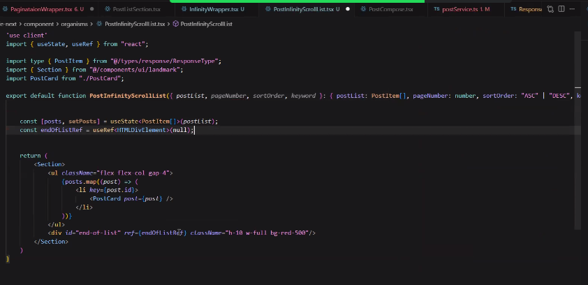

- searchParam 대신 다른걸 사용하심
- 라우트를 사용하고 페이지를 가져옴. 기존의 페이지와 데이터를 만든 다음 라우터를 붙임

- 페이지에 최신순, 오래된 순 붙이기

  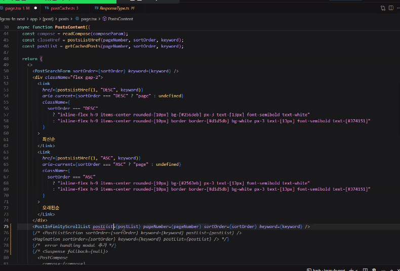

- 테스트. 페이지가 1, 2, 3 섹션으로 나뉘었다. 라우터가 제대로 걸리고 있다. 하지만 연결되지 않고 페이지가 끊기고, 스크롤바가 뚝 끊기며 다음페이지로 이동되고 다시 상단으로 올라온다. 각 페이지가 자연스럽게 이어져서 연결되지 못하고 있다. 

  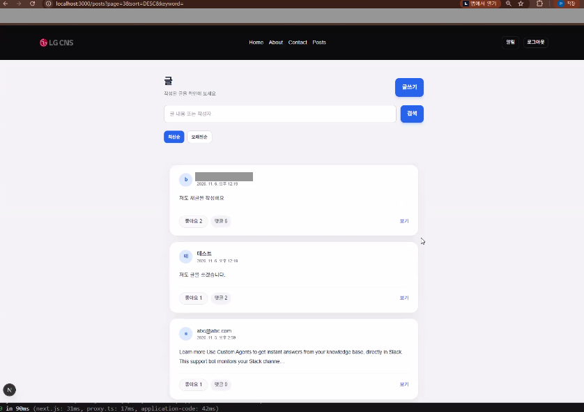
  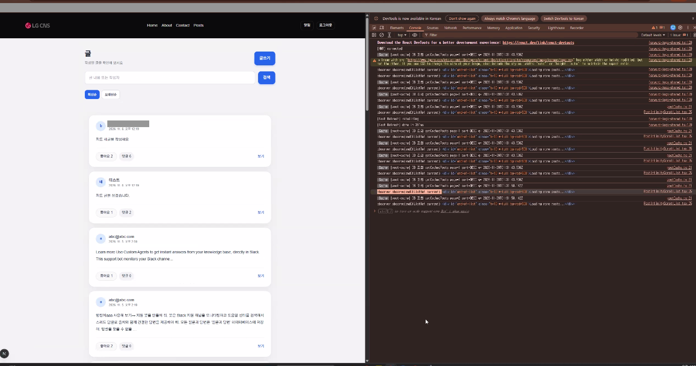

- 실무에서는 useEffect 를 별로 안좋아하신다고 함. 의존성 때문에. 

    - 일정 위치에 오면 새로운 데이터를 로드하도록 수정

      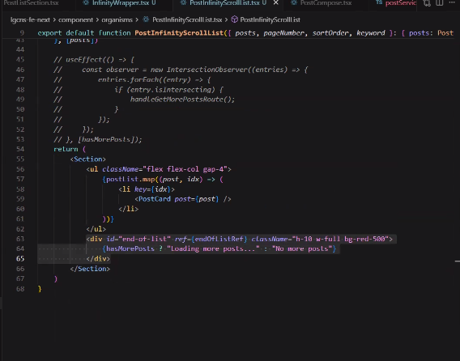

        - 그런데 의존성 설정이 잘못되었다. 화면에 나올때만 새로운 게시글이 호출되어야 하는데 그렇지 않고 주기적으로 새 데이터를 호출. 이러면 서버가 뻗으므로 화면으로 보일때만 데이터가 로드되도록 수정
        - 데이터가 작동하는 순서도 잘 생각해야한다. 꼬이면 전체수정이 필요하다.

    - 코드 작성하다보면 무한반복이 생길때가 있다. 연관관계를 생각하고 주의하라

      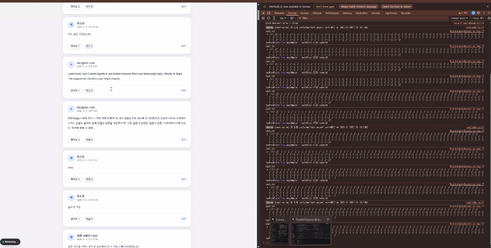

- `searchParams`를 직접 읽는 대신 페이지 주소를 바꾸는 방식으로 서버가 다른 페이지를 주도록 수정. `scroll: false`로 스크롤이 내려가면 탑으로 올라가지 않고 현재위치를 고정하고 아래로 새 데이터를 받아오도록 바꾼다.

  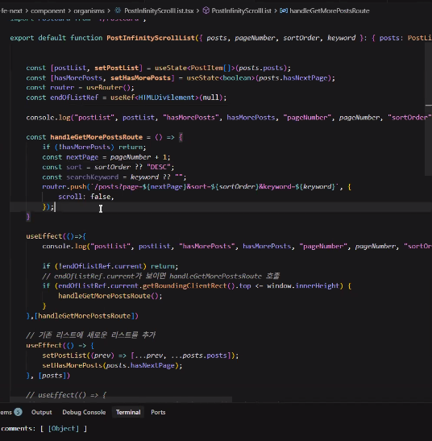

```ts
router.push(`/posts?page=${nextPage}&sort=${sortOrder}&keyword=${keyword}`, { scroll: false });
```


---

## 11시 수업

- 쉬는 시간 사이 코드 수정을 좀 하셨다.

- CSR과 SSR 하이브리드 구조이다. 무한 스크롤은 SSR 쪽에서 문제가 터짐. 
    - 데이터 로딩중 박스를 본 페이지가 이 체크 박스를 로딩을 한번 하면 사라지게 만들어야 한다. 이전의 문제는 이 로딩 박스가 남아있어 무한반복이 발생했다는 것 같다. 현재에는 수정하여서 괜찮다.

### 무한로딩이 되기위한 레프 추가

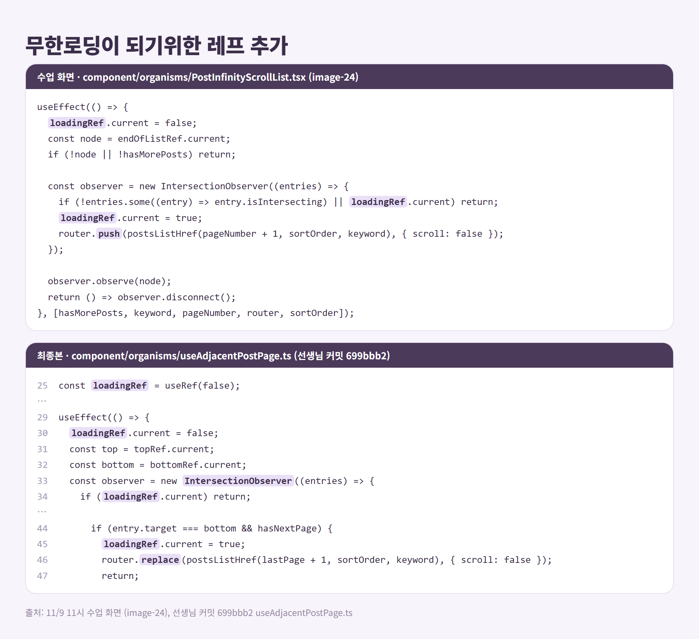

| 줄 | 하는 일 |
|---|---|
| 25 | `loadingRef` — "지금 부르는 중" 깃발 |
| 30 | 새 페이지가 오면 깃발 내림 |
| 33 | `IntersectionObserver` — 센서 `div`가 **화면에 들어오는 순간**만 알려 주는 브라우저 도구. 계속 검사할 필요가 없어요 |
| 34 | 깃발이 올라가 있으면 무시 → 같은 페이지를 두 번 안 불러요 |
| 46 | `router.replace` — `push`가 아니라 `replace` |

- usestate 를 사용할수도 있지만 갱신하면 날아가므로 observe, ref 로 고착화 하는 방식으로 활용하였음
    - `useState`를 바꾸면 화면이 **다시 그려진다**. `useRef`는 값을 바꿔도 다시 안 그린다. 그래서 "부르는 중" 같은 **표시용 아닌 메모**는 ref에 둔다.
- 이동 발생 시 레프로 고착화 후 이동을 하는 구조.
- 고착화 되어 있기에 리렌더링이 발생하지 않고 위의 게시글은 고정된 채 아래가 로딩이 된다

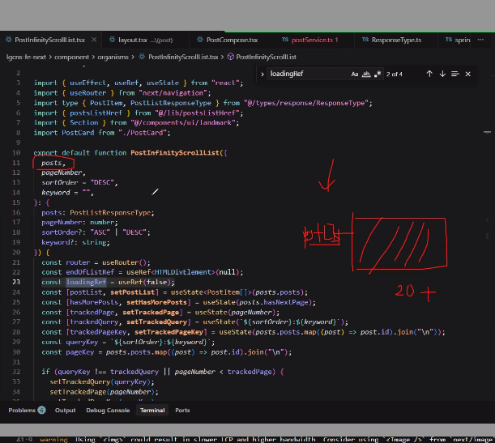

### 새로고침 보정

- 새로고침을 할 시 데이터 기준의 보정 처리가 필요함.
    - 데이터 로딩중 박스가 나타나는 위치가 무척 중요함. 센서 역할을 하는 로딩 박스가 너무 위에 있으면 바로 또 보여서 계속 게시글을 불러와 무한 반복을 초래함

    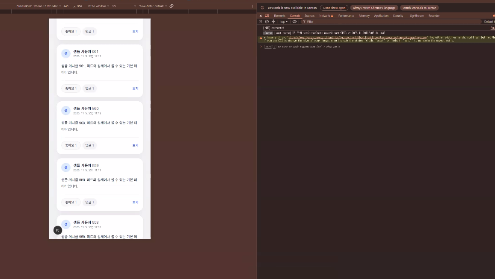

    - 스크롤 되어온 페이지가 어디쯤인 지 알 수 있게 하는것도 좋다

    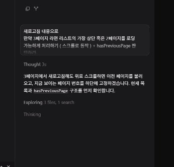

- 무한스크롤의 개선책 및 메모리 대응까지 신경썼다는 포폴을 만든다면 아주 유용한 지식들이다. 

- 페이지별로 히스토리가 달려있음. 이 히스토리는 뺄 예정. 페이지 이동을 하거나 그 전으로 가는것은 다르다.
- 뒤로 갈 때 문제가 생기는 현상 : 히스토리를 쌓지 않고 리플레이스 하는 형태로 코드 수정 예정
    - `push`는 페이지마다 뒤로 가기 기록이 쌓여서, 뒤로 가기를 누르면 3→2→1페이지로 하나씩 돌아가요. `replace`는 **기록을 바꿔치기**한다
- 페이지 네이션은 잘 되었다. 로딩으로 느린건 프리렌더링, 프리패칭을 이용하여 개선하면 됨. 
- 현재 코드는 별로라고 하심. 동작만 보고 코드는 추후 개선해서 다시 주신다고 함

### 채팅에 대해
- 알림서비스와 채팅은 좀 다르다.

| | 알림(11/6, SSE) | 채팅 |
|---|---|---|
| 방향 | 서버 → 나 (한쪽) | 나 ↔ 상대 (양쪽) |
| 기술 | `EventSource` | 웹소켓(WebSocket) |
| 🔍 비유 | 안내 방송 | 전화 |

- 채팅창은 글을 입력할 때 상태 창도 열려있음을 가정하에 내가 글을 작성하면 상대의 창에도 글이 나타나고 서로의 문자가 보이는 구조.
- 이를 웹소켓을 이용함. 서로의 화면이 전달되는 사이에서 우리는 서버로 데이터를 가져와 DB에 저장하고 서로의 소통을 도움.
- 그런데 웹 소켓 한쪽이 만약 끊어진다면?
    - 끊긴 사이 온 메시지는 다시 연결해도 저절로 전송되지 못한다. 그래서 그 경우 메시지를 DB에 저장한 뒤, 재 연결시 놓친 메시지들을 DB를 통해 읽도록 만든다.

---

## 1시 수업

### 조언
- 어느정도 투자를 해라. aws 가입하고 EC2 서버 열고 닫으면서 써라.
- 도메인 구매도 할지 등등 .. 매달 지출이 나오면 부담될수 있긴 하다. 하지만 나의 취업에는 이점이 될것이다. 커피한잔 아껴 서버돌린다는 생각으로.
    - EC2 : AWS의 빌려 쓰는 컴퓨터. 안 쓸 때 꺼 두면 요금이 줄어든다.
    - AWS 한국 리전은 검색해보니 저렴하게 하면 월 2만원 정도였다. 한번 사용해볼만도 한 것 같다.

- api 내용을 각자 보고 이정도만 구현하자 하고 팀끼리 합의 해라. 에이전트 써도 됨. 이해하고 설명할수 있다면 가능

- 팀작업에 대한 이야기는 하지 않았으므로 자유
    - build, 테스트 시 없어야 합치기 담당이 사라지지 않을 수 있다. 
    - 이를 대비하기위한 허스키 설정을 만들어서 주긴 할 것임 api 서버 테스트 local 서버 테스트. 까지 다 해보기
- 머지할땐 리퀘스트 걸고 리뷰어가 다같이 컨펌을 한 뒤 추가하는 시스템으로 해봐라
- pr템플릿을 만드는 경우도 있음
- 깃 이슈도 할건지. 하고싶으면 해라. 이슈 넘버를 가지고 브랜치를 만들고 해결되면 이슈삭제. 이슈업무 할당. 언제까지 할 것인지 선언. 선언 특히 중요함. 못하면 빠르게 공유하기.
- 각자 담당한 부분은 명확히 개발자스럽게 공유하는것이 필요함
- api 설계는 없어도 타입설계를 위한 토의를 할게 많을것이다. 이게 빨리 되어야 재미있게 프로젝트를 할 수 있을것이다.
- 그리고 남탓 하지 말아라 


### 실습 이어서

- 점심시간에 페이지네이션, 인피니트 래퍼를 나누셨다고 함 

- 래퍼들의 종속을 줄인다면 다른 곳에서도 쉽게 라이브러리처럼 사용할 수 있게 만들 수 있다. 

- 현재: 무한스크롤 사용 시 이미 로드 된 데이터는 그대로 있음. 넥스트는 새 데이터 만들때 렌더링 되는 과정에서 편법을 이용함
    - 기존에 만들어진 데이터에 새 데이터 로드시 추가로 렌더링을 해야함 

- 무한스크롤을 오래된 스크롤로 바꾸려면 어떻게 해야할까?
    - 60개 로딩된 것을 뒤집는다고 그게 오래된 순인지는 알 수 없다. 
    - 블럭은 현재 총 51 개다. 가장 뒤쪽부터 뽑아야 할텐데 현재 오래된순 로직엔 그게 없을 것이다. 오래된순을 클릭하면 첫페이지 맨 위부터 다시 로딩이 시작된다. 
    1페이지로 리셋해주는 것이 가장 깔끔하다. 하지만 일정 위치에서 오래된 순으로 바꿨을때 어느 페이지를 보이게 할지 생각하면 고민거리다. 
- api를 만들 때 백엔드와 잘 상의해라. 만약 섹션으로 한다고 해도 2페이지 부르는데 같은섹션에 다른 페이지도 부를지도 생각해봐라.
    - 페이지마다 API를 부르면 요청이 많아지고 그만큼 요청에 대해 값을 되돌려주는 시간이 지연된다. 이 경우 백엔드에게 섹션으로 받고, 프론트쪽에서 조절하는 등, 프론트엔드가 할 수 있는 일을 하는것이 협업에도 성능적으로도 유리하다. 


### 채팅 api
- 이제 해야하는데 대공사가 필요하다. api가 MySQL 기반이기 때문

| 바꿀 것 | 그대로 |
|---|---|
| DB 연결, 서비스 로직, **로그인**, DB 주소 | 소셜 로그인(카카오, 구글) |

- 소셜로그인은 두고 DB, 서비스로직, 로그인, DB url도 바꿔야 함

- `.env.local`에 `NEXT_PUBLIC_API_URL`(받은 API 주소)을 추가
- api 에 맞춰 연결선을 만듦

```ts
// 📁 강사님 폴더 lgcns-fe-next/config/apiuri.ts
const matchApiUrl = [
  {
    "login": "/api/v1/auth/login",
    "apiUrl": "/api/auth/login"
  }
]
```

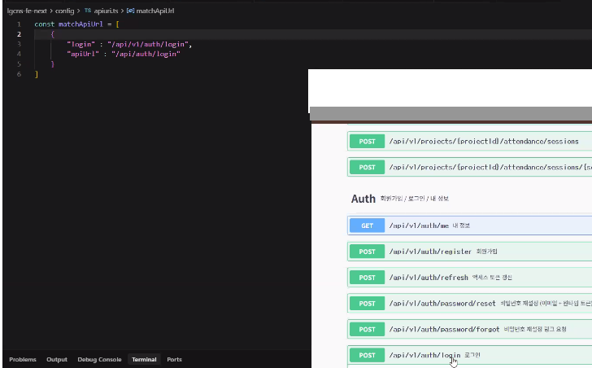

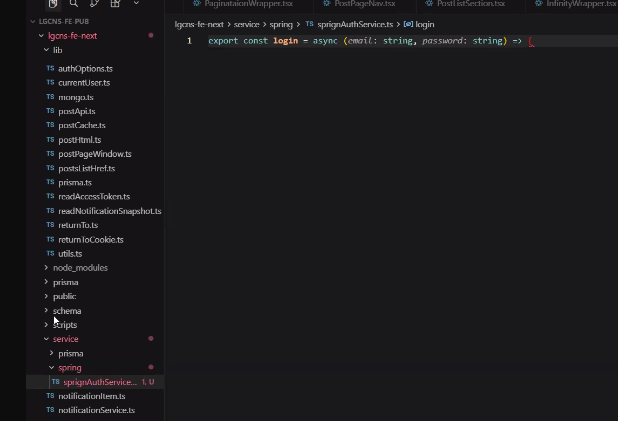

---

## 2시 수업

### 로그인을 스프링 API로 갈아끼우기

- 오쓰옵션을 api의 spring Auth서비스를 불러와 갈아끼움
    - 오쓰옵션 = `lib/authOptions.ts`의 `authorize(credentials)`. 그 안의 `userService.login(...)`을 주석 처리하고 `springAuthLogin(...)`을 새로 불렀다.
- 타입선언을 잘 해주어야 한다. 이렇게 스왑해서 사용을 전제로 제작할 경우에는
    - 스프링이 돌려주는 로그인 데이터가 우리 것보다 훨씬 많아서, 그 모양을 `SpringLoginData` 타입으로 먼저 적었다.
    - `userId`가 숫자(MySQL 번호)라 `toString()`으로 바꿔 넣고, `| null`이 붙은 칸(사진, 상태 메시지, 회사)은 `?? ""`로 채운다.

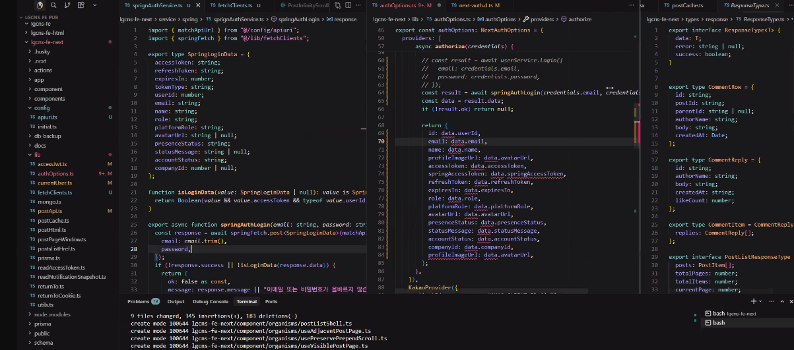

- api 갈아타는 것이 쉬운 일은 아님. api 에 있는 아이디와 패스워드를 쓸 예정

- api는 아무데나 흩지 말고 config 등에 한데 모아둠
    - 서버 주소 앞부분은 `.env.local`의 `NEXT_PUBLIC_API_URL`, 뒷부분 경로는 `config/apiuri.ts`에 둔다. 주소가 바뀌면 이 파일 한 곳만 고친다.

```ts
// 📁 강사님 파일 lgcns-fe-next/config/apiuri.ts (14:50 커밋 cf5ee7c)
export const matchApiUrl = {
    auth: {
        login: "/api/v1/auth/login",
        signup: "/api/v1/auth/register",
        getUserData: "/api/v1/auth/me",
    },
    post: {
        list: "/api/v1/post/list",
        detail: "/api/v1/post/detail",
        create: "/api/v1/post/create",
        update: "/api/v1/post/update",
        delete: "/api/v1/post/delete",
    }
}
```

- 2시 1시간 동안 로그인을 api에 연결하려고 했지만 이에 필요한 액션이 없었음.
    - 그래서 바로 넥스트 api를 쓰고 있었음
    - 이것은 오쓰옵션에 정의되어 있고 기존의 서비스는 스왑을 대비해 주석처리 후 api 로 오는 오쓰 서비스를 새로 작성하였음
    - 이는 스프링 기반이므로 스프링 패치 클라이언트와 함께 공유할 예정. 이번 파일럿 프로젝트에서 라이브러리로 사용하라.

### 유저 정보 오쓰 세션을 불러 만들기

- 아이디가 아닌 액세스 토큰을 주도록
    - `springUserGetData`: `/api/v1/auth/me`에 `Authorization: Bearer 토큰` 헤더를 붙여 "내 정보"를 묻는 함수.
    - 사진의 빨간 줄은 `matchApiUrl.user.getUserData`라고 써서 난 오류(`user`가 없음). 레포에서는 `matchApiUrl.auth.getUserData`로 고쳐졌다.

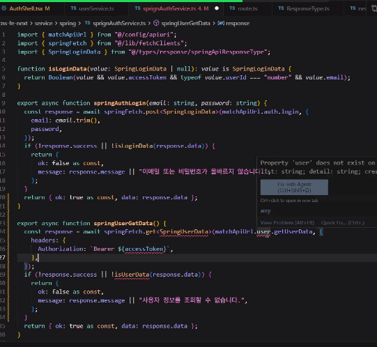

- 엔드 포인트는 api 주소를 옮겨둔다.
- 오쓰 쉘에 예시코드 기입. 스프링 오쓰 api 로그인을 이용할 수 있게 만듦.

### 서버가 한 단계 늘어난 구조

- HTTP -> 프리즈마를 이용한 DB Mysql과 몽고DB 드라이버를 사용함. 훨씬 빠름 .하지만 한단계가 추가로 들어가 조금 느려질 예정
- 기존의 통신방법 : 브라우저가 있고 클라이언트가 있음. 클라이언트가 넥스트로 요청해 서버액션을 하게 되면 넥스트 서버를 타고 동작함: 넥스트 앱
    - 브라우저에서 요청받은 넥스트가 모드를 통해 몽고 디비에 붙었음
    - "모드"는 노드(Node, Next 서버가 도는 곳) 또는 Prisma 드라이버를 말한 것으로 보인다.
- 현재에는 스프링 서버가 붙었고 스프링은 MySQL과 몽고DB가 붙어서 스프링에서 DB와 통신 후 스프링 서버가 넥스트와 교신을 하고 넘어오는 방식.
    => 기존의 넥스트에서 한단계 서버가 추가되는 구조.

| | 전 (오늘 아침까지) | 지금 |
|---|---|---|
| 길 | 브라우저 → Next 서버 → **Prisma로 DB에 바로** | 브라우저 → Next 서버 → **HTTP로 스프링** → 스프링이 DB |
| 속도 | 드라이버로 바로 붙어서 빠름 | 서버를 하나 더 거쳐서 조금 느려짐 |

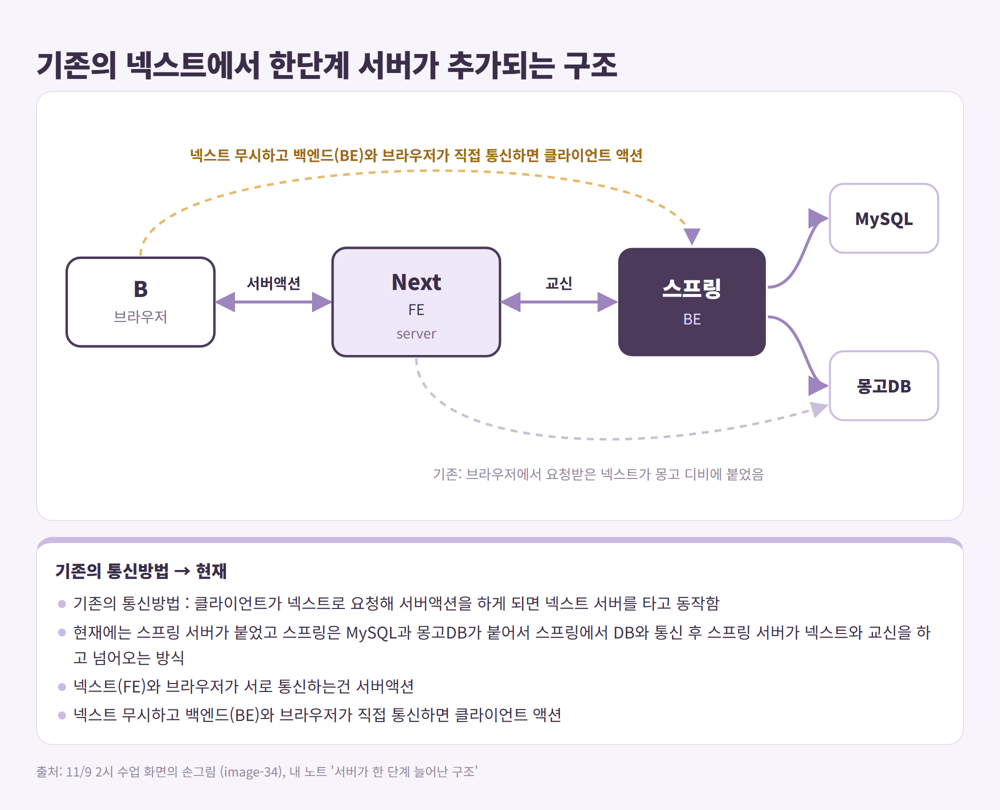

- 넥스트(FE)와 브라우저가 서로 통신하는건 서버액션
- 그런데 여기서 넥스트 무시하고 백엔드(BE)와 브라우저가 직접 통신하면 클라이언트 액션임
    - 브라우저가 스프링에 직접 `fetch`하면 스프링이 CORS를 허락해야 하고, 토큰이 브라우저에 있어야 한다. "클라이언트 액션"은 Next 공식 용어는 아니고 서버 액션과 대비해 부른 말.

---

## 3시 수업

- 현업스타일로 프로젝트를 하면 좋을 것 같아 욕심부려서 예제를 만들고 있다.
- 어느정도 가이드가 된 것과 S.O.L.I.D 에 맞춰 만들고있다

- 현재 컴포넌트로 통합관리 하기 위해 정리를 시키는 중.
    - 폴더 `component/` → `components/`로 이름을 바꿨다. shadcn의 `components/ui/`와 한 폴더에 모였다. import도 전부 `@/components/...`
- 그리고 여기저기 흩어져있던 것들을 정리하여 규칙과 루틴을 만드는 중
    - 크레덴셜을 타는 경우 동일한 액션을 타도록 바꿈
        - 새 파일 `actions/authActions.ts`. NextAuth와 `/api/auth/login` 둘 다 이 액션만 부른다.
    - 서비스를 탈 때 동일하게 타도록 수정
        - 새 폴더 `service/auth/`: `authPort.ts`(약속), `prismaAuthAdapter.ts`, `springAuthAdapter.ts`
- 허스키를 사용함. 데이터 날아가지 않도록 빌드를 올려둠
    - `.husky/pre-commit`: `npm run lint` → `npm run lint && npm run build`. 커밋 전에 빌드까지 돌려서 import 경로 하나 틀린 것까지 잡는다.

```ts
// 📁 강사님 파일 lgcns-fe-next/actions/authActions.ts (15:35 커밋 24fe0a2)
"use server";

import { prismaAuthAdapter } from "@/service/auth/prismaAuthAdapter";
import { springAuthAdapter } from "@/service/auth/springAuthAdapter";
import type { AuthPort, SocialLinkInput } from "@/service/auth/authPort";

function authAdapter(): AuthPort {
  if (process.env.AUTH_ADAPTER === "prisma") return prismaAuthAdapter;
  return springAuthAdapter;
}

export async function loginWithCredentials(email: string, password: string) {
  return authAdapter().login({ email, password });
}

export async function linkAuthSocialAccount(input: SocialLinkInput) {
  return authAdapter().linkSocialAccount(input);
}
```

- env `AUTH_ADAPTER`가 `prisma`면 Prisma 어댑터, 아니면(값이 없어도) 스프링 어댑터. 고르는 곳은 이 함수 하나뿐이다.
- 스프링 어댑터의 소셜 연결은 Prisma 어댑터를 그대로 부른다. 스프링 API에 소셜 연결이 없어서 카카오·구글 로그인은 여전히 Prisma.

### 팀플용 디자인 엔바토에서 받아서 강사님께 보내기

- 엔바토(Envato): 디자인 템플릿 판매 사이트

### 채팅에 대하여
- 시간이 너무 소요되어서 가르쳐주기가 쉽지 않다.
- 채팅은 구현보다 api 제작에 시간이 많이 소요된다. 백엔드가 힘든부분이기도 함

- 되도록이면 팀별로 다같이 프론트엔드 담당하고 해라. 각자의 페이지 만드는거 추천 그럼 충돌이 덜하다

### 중복코드
- 중복된 ui인데 코드나 형식이 다를때가 있음
- 처음부터 ui 를 하나로 통일하고 협의를 보는게 가장 좋다.
    - 11/6의 shadcn `components/ui/`가 그 공용 부품 상자다.
- 사람수가 많다고 프로젝트가 빨라지진 않는다.
- 같은 급의 사람이 여럿이면 일사불란하지만 도메인이 많거나 그게 아니면 지연이 커지기도 한다. 오히려 혼자가 빠를 때가 있음.
- 사람마다 편차는 있음 감정은 배제하라.

- 평소 관계성 잘 만들어라. 말이 아 다르고 어 다르고 문자로 대화하다 부드러운 말인데도 쌈 날 때가 있다.

---

## 4시 수업

### 팀플에 대한 조언

- 참조해라. 예시로 배포예정

- 문서가 있으면 좋은 점
    - 같은 문서를 보고 팀원들이 같이 개발하니 시간이 단축됨
    - 이미 만들어진 api를 쓴다

### 무한스크롤
- 무한스크롤 동작방법이야기했다(오늘 수업)
- 코드는 난잡하니 정제해서 올려주겠다.
    - 선생님 자료 `docs/2026-11-09-infinite-scroll-spring-fetch.md`(+ pdf)로 올라왔다.

- 스크롤 액션은 윈도우 계열을 많이 사용한다. 페이지 이동시 확인용 코드로 보인다.
    - 윈도우 계열 = `window.scrollBy`, `window.scrollY`, `window.innerHeight`처럼 `window`에 붙은 것들.
    - 사진은 `usePreservePrependScroll.ts`. 확인용이 아니라 **새로고침 보정** 코드다. 위에 이전 페이지를 붙여도 읽던 줄이 그대로 보이게, 늘어난 높이만큼 스크롤을 밀어 준다.

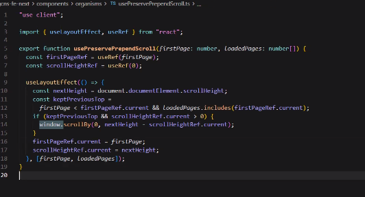

| 줄 | 하는 일 |
|---|---|
| 9 | `useLayoutEffect`: 화면에 그리기 직전에 실행 (`useEffect`면 한 프레임 밀린 화면이 보임) |
| 10 | 지금 문서 전체 높이 `scrollHeight` 재기 |
| 11~12 | 맨 앞 페이지 번호가 줄었고(이전 페이지를 위에 붙였고), 예전 맨 앞 페이지가 아직 있나 |
| 13~14 | 그렇다면 `window.scrollBy(0, 새 높이 - 예전 높이)` |
| 16~17 | 지금 값을 ref에 저장 |

### 패칭에 대하여
- 패치 클라이언트 : 조금 어려울수있다 어려우면 안써도 된다.
- 그래도 공부는 필요하다. 많이 쓰는 듯 하다.
    - `lib/fetchClients.ts`의 `springFetch`. 서버 주소, JSON 헤더, 시간 제한, 오류 처리를 대신 해 줘서 `springFetch.post(경로, 보낼 것)`만 쓰면 된다.
    - 실패해도 오류를 던지지 않고 항상 `{ success, code, message, data }` 모양으로 돌려준다. 그래서 부르는 쪽은 `try/catch` 없이 `response.success`만 보면 된다.

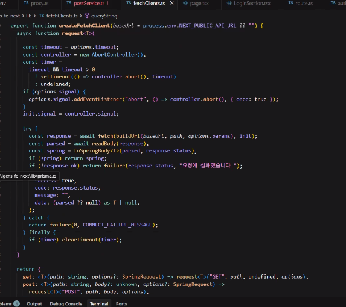

### next oauth
- 필수아님 선택

### 테일윈드 길어지면 두줄로 쓸 수 없는지
- 가능함 프리티어에 설정함.
    - 레포의 `.prettierrc.json`에는 `semi`, `singleQuote`, `trailingComma` 세 줄뿐이고 테일윈드 줄 나누기 설정은 없다. 사진 속 수정도 레포에는 아직 없다.
- 내려서도 작성할 수 있다. 주로 레이아웃과 색깔을 구별해서 쓰는 경우가 있음.

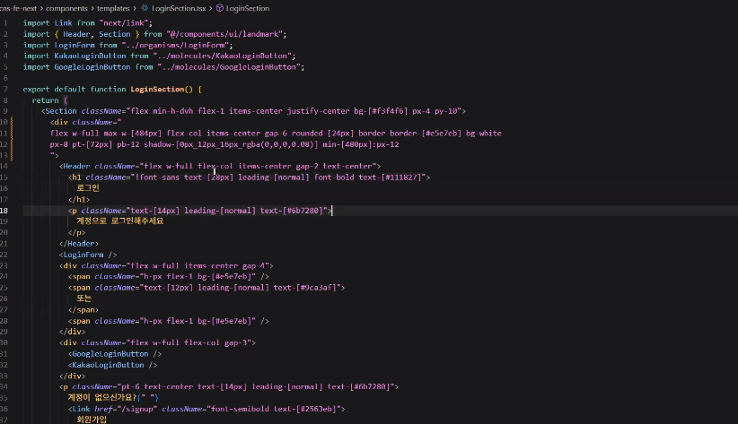

- cn 쓰면 편하다. 안에서 구분자를 써서 쓸 수 있다.
    - 11/6에 받은 `@/lib/utils`의 `cn`. `cn("레이아웃 클래스", "색·모양 클래스")`처럼 쉼표로 나눈다.

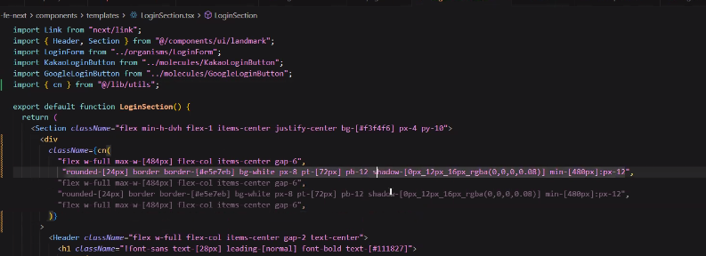

### 로그인
- 데이터 가져오는데 래핑을 하는데 캐시를 사용?
- 민감정보일수록 캐시에 담지 않는게 좋다 휘발되는것이 최고다.
- 가지고 있어야 하는 정보는 제한적으로 쥐고 있는것이 좋다.
    - 우리 앱의 `"use cache"`는 글 목록(`getCachedPosts`)에만 쓴다. 로그인 정보는 세션 쿠키(JWT)에 있다.
    - 스프링 토큰(`springAccessToken`)은 JWT 안에만 두고 세션으로 복사하지 않는다. 화면 쪽에 넘어가는 토큰은 우리가 서명한 토큰뿐.

### 로그인 한 뒤 메인화면으로 가는 속도가 빠르면 좋겠다.
- 실제 배포할 땐 빠르다. 하지만 메인페이지에 불러오는 양이 많거나 데이터 핑퐁이 많으면 느려진다.

### global.css
- import 하는 게 아니다. 넥스트 아니라면 임포트 아닌 인라인이 빠를것임.동작 자체는 렌더링쪽임.
- css 자체가 무척 길다면 import도 고려할 수 있는 듯 함
    - Next에서는 `layout.tsx`의 `import "./globals.css"`를 빌드할 때 CSS 파일로 따로 뽑아 `<link>`로 넣는다. JS처럼 실행하는 import가 아니다.

### 레이턴시
- 요청시 얼마나 빨리되돌아오느냐
    - 요청을 보내고 답이 돌아오기까지 걸리는 시간. 2시 수업처럼 서버가 한 단계 늘면 레이턴시도 늘어난다.

### 유저는 우리가 내린 액세스 토큰이 유효하냐를 본다
- uuid는 보안화된 아이디
    - 추측하기 어려운 무작위 id. 1, 2, 3 같은 번호를 그대로 쓰면 다른 사람 번호를 짐작할 수 있다.

- 요즘 스타일 : 자주 바뀌는건 프로필사진, 닉네임 개인정보는 아니니 내려놓는 경우가 있음. 로그인은 정보가 마스킹되어도 남는다. 그냥 키값은 까다롭게 하고 완전 암호화, 블랙박스로 만드는 것이 가장 좋다. 쓰고나면 날려버리고

### 디자인은 다르다.
- 디자이너의 ux : 유저 사용성과 디자인적 미감.
- 기획자의 ux
- 개발자의 ux : 데이터 흐름이 잘 가는지

- 다 다르다.
- 디자인쪽은 프론트엔드가 보는 영역은 아님. 그런데 필요하면 하는듯?

- 프론트엔드는 백엔드와 좀 다름 로그인 버튼이나 그런 상호작용을 담당하니까.

- 만들어진건 한명이 관리하고 조직으로 만들어진건 포크나 클론 떠서 무료짜리 쓰라.
- 조직은 돈든다.

### 공부는 css 자바스크립트, html 꼭 해야함

---

## 5시 수업

### 로그인, 회원가입 만들기
- 도메인 단위로 분리되는 편. 팀원들끼리 잘 상의해보시오
    - 회원정보 오쓰
    - 유저 서비스
    - 글쓰기 피드, 포스팅, 댓글 대댓글, 좋아요 북마크
    - 채팅
    - 상품판매

- 있는 api 말고 필요하면 다른 api 요청을 해도 됨
- 배포는 첫날부터 하는 것 추천
- 발표자료 만들기

- 주제는 자유. 다만 크게 범위를 벗어나면 쉽지 않음
- 회원가입 로그인은 구현되면 좋겠음
- 데이터 베이스에 데이터가 들어가고 로그인 할수있을정도로 다룰 수 있으면 좋겠음
- 글을 쓰거나 api 많이 활용해봐라.
- 넥스트 오쓰는 선택. 까다로움
- 아키텍처 : 솔리드의 SOI 클린 아키텍처는 못해도 액션정도는 분리해주길 바란다
    - SOI = SOLID 중 S(한 가지 일), O(고치지 말고 덧붙이기), I(필요한 것만 약속). 액션 분리는 3시 수업의 `actions/authActions.ts`처럼 화면 → 액션 → 서비스.
- page.tsx 에서 바로 fetch 처럼 날것의 코드가 나오지 않으면 좋겠다
    - `fetch`는 서비스(또는 `fetchClients.ts`) 안에 두고, 페이지는 결과만 받아 그린다.
- 프리즈마로 별도의 db나 api를 만들어도 됨
- 백엔드 있으면 스프링 있어도 좋고
- 풀스택 하고싶으면 노드로 api 만들기는 오케
- 백엔드만 하면 안됨 프론트도 연습해라 그런목적으로 하는 플젝이니까
- 마지막날 아무것도 안 되어 있어도 괜찮다 채점도 없으니까.
- 하지만 되도록이면 코드를 참조하면서 직접 써보고 ai 에이전트를 사용한다면 어떤걸 말하면 좋을지 경험하는 기회가 될것
- 오픈 api를 통해 조언 해주도록 만들어둔것도 있음 작성한 글에대한 llm 돌리기

- 최근 유행 : 에이전트 툴 만들기
    - 내부 로컬 에이전트 만드는게 유행 제미나이를 그냥 쓰지 않고 로컬 LLM 만들기