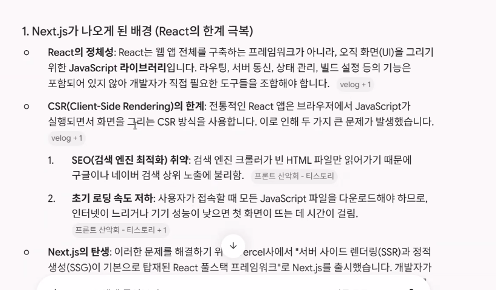
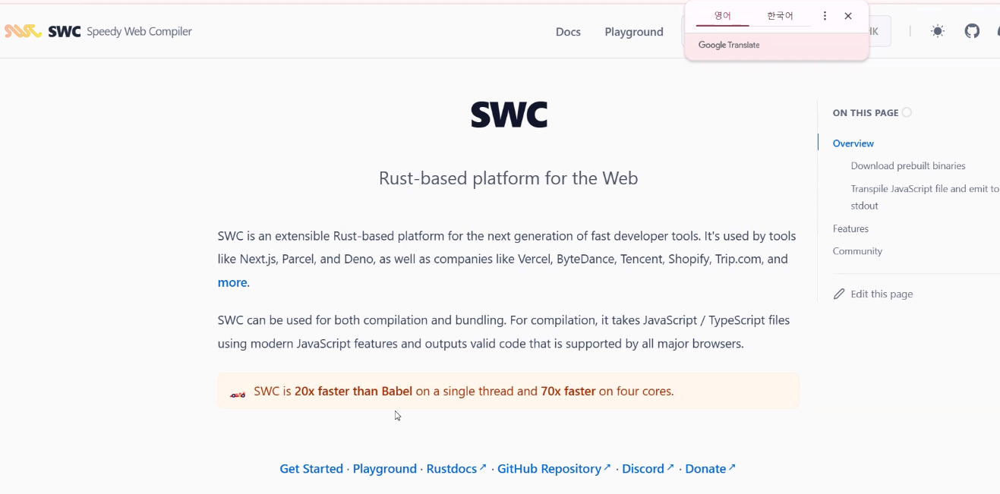
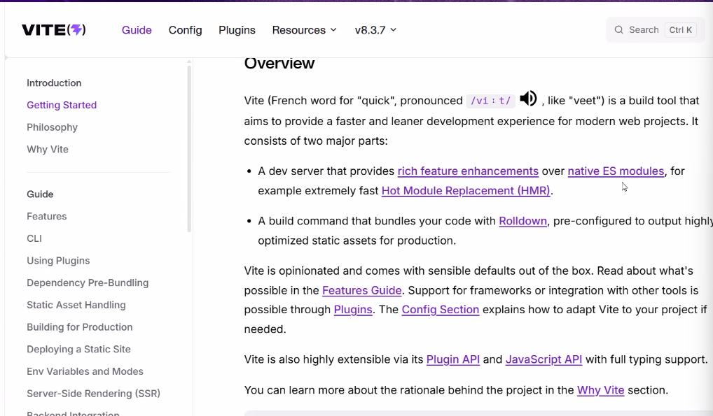
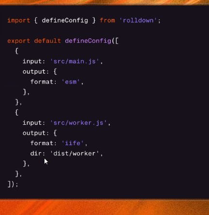
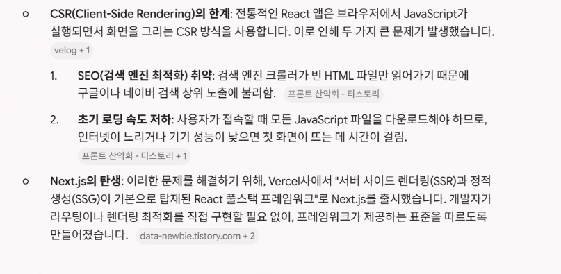
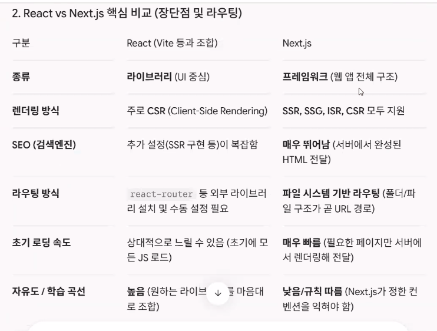
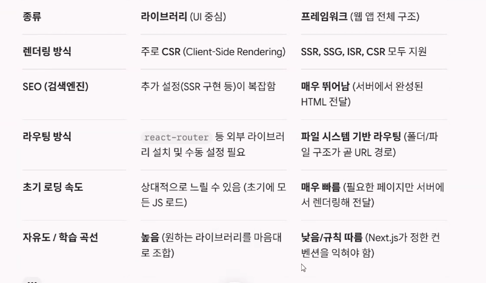
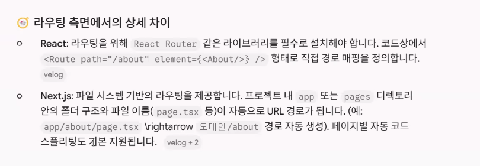
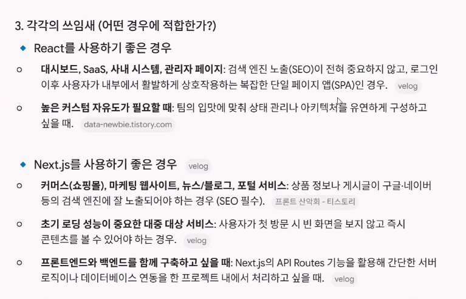
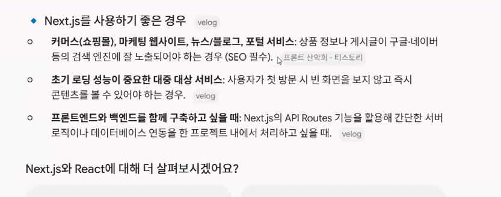

# 16일차 TIL : AI 서비스 개발을 위한 백엔드 I 1일차

## 오프닝
- 강의 공유해주심
- DB는 마리아
- 자바 등 할 예정

## 루트 문서(일정이 적혀있음) 확인
- ~12월 21까지 한달간 수업예정
- 플젝은 프론트까지 할 예정.
- 넥스트와 리액트 이야기를 나중에 하실것인데 스프링부트를 배울거라 좀 더 적합한 리액트를 사용할것
- 스프링부트와 리액트 예제를 설명해주실 예정. 
- 기술의 배경. 원리. 내부적 구조. 왜 이런 기술이 나왔는지에 대해서 중점적으로 설명하실 예정
- 오늘 상담 예정. 없는 사람은 과제있음

- ai 로 과제해도 되지만, ai를 맹신해선 안됨. 검증하는 능력이 필요함
- 또한 자신이 공부에 대한 의지가 없으면 ai 복붙해도 상관은 없음
- ai에게 답 받지 말고 문제를 풀고, 어떤 과정을 거쳐야 답을 잘 도출할 수 있는지 반대로 물어보면서 하는 것을 권장한다
- 깃허브에 올리는 예제는 보고 많이 따라해봐라 도움이 될 것 이다.

### AI 서비스 개발을 위한 백엔드 I 1~4일차
  - 16~19일 : Java 프로그래밍 ( 캡슐화, 상속, 다형성, 인터페이스, 추상클래스)
  - 스프링 프레임워크 : ioc(inversion of control), DI(dependency injection)
    - 스프링 이전에 나왔던 것. 스프링은 백엔드 개발자들이 편히 만들기 위해 만들어진 프레임워크라 숨겨진 게 많음 동작방식을 좀 더 이해하기 위해 간단하게 위의 두가지만 배울 예정. 

### AI 서비스 개발을 위한 백엔드 II 1~12일차
  - 20~7일 : 본격적으로 스프링부트

- 틈새수업 : 리액트와 넥스트js 비교
  - 젬미니에게 : 리액트와 넥스트js의 차이점
  - 질문 : 장단점, 각각의 쓰임새(어떤 경우에 해당 기술을 사용하면 적합한지), 라우팅 측면에서의 차이점을 중심으로 넥스트js가 나오게 된 배경
  

    - 리액트 : 개발자가 도구를 직접 만들어야 함
      - 예를 들면 바이트 : 왜 바이트라는 빌드 도구를 써야 할까?
      - ECMA Script 기초 파일 열람
        - ECMAScript 는 그 언어가 어떻게 동작해야 하는지를 적어 둔 표준 규격의 이름
        - 동적 규격이나 이벤트 처리등의 용도로 사용하는 자바스크립트. 문법 응용이 너무 다양해서 표준화를 하자는 이야기가 대두함.
        - 왜 리액트를 말하다가 애크마 스크립트가 나왔지? 
          - 애크마 스크립트로 표준적 규격이 나오면서 리액트가 만들어졌기 때문임
        - 자바스크립트는 ES5임
        - 6버전이 나오면서 많은 용어가 추가됨. 
            - 2015년 ES6 에서 let/const, 화살표 함수, 템플릿 리터럴, 구조 분해, 모듈, Promise, class 가 한꺼번에 들어오면서 언어의 모습이 완전히 달라짐
        - 왜 바이트가 필요할까? 최신 문법 기준이 나올때마다 최신용어로 자바스크립트를 작성하면 과거의 브라우저가 해석할 수 없음. 바이트는 오래된 브라우저에서 자바스크립트의 문법을 해석하기 어려운 것을 도와줌
        - 코딩을 할 땐 최신 문법을 사용하여 개발함. 그리고 배포하고 실행환경에서는 다운그레이드하여 낮은 버전으로도 마이그레이션이 필요함.
          - 트랜스파일(transpile)은 "ES6+ 코드를 뜻이 같은 ES5 코드로 바꿔 쓰는 일"입니다. 사람이 읽는 코드는 최신 문법으로 쓰고, 브라우저에 보내는 코드는 변환된 결과를 보냅니다.
            - 호환성 : 최신 문법으로 쓴 코드가 오래된 브라우저에서 안 돌아간다
            - 파일 수 : js 파일이 수십 개가 되면 `<script>` 태그를 순서까지 맞춰 일일이 넣어야 한다.
            - 실수 : 오타나 안 쓰는 변수를 실행하기 전에는 알 수 없다. 오타같은거 찾아줌
        - 가장 대표적인 예 : 바벨 - 가장 널리 쓰이는 변환기. JavaScript 로 만들어짐.
                           SWC : 요즘 러스트 기반으로 만드는 일이 대세라 러스트가 여기서도 나오네..
                          
        - 바이트는 트랜스파일러를 둘 중 선택할 수 있음.
        - 정리 첫번째 : 바이트를 쓰는건 트랜스파일링을 하기 위함
        - 두번째 : 번들러 때문
          - 다시 애크마 파일 참고
            - 배포 할 땐 하나의 js로 묶어줘야함 다양하게 js 를 만든걸 브라우저에 보낼 땐 bundle.js 하나로 묶어 보내줌 
              - 번들러 종류 : 웹팩 - 가장 오래되고 설정이 많다. 큰 프로젝트에서 여전히 널리 쓰임
                                - 각 js 를 모듈화 하여 js 파일 하나로 묶어 번들화?
                            롤 업 - 결과물이 깔끔하고 라이브러리 제작에 적합. Vite 가 내부에서 사용
              - 번들러는 css 도 묶어줌. 롤업을 이용해 내부에서 흩어진 파일들을 묶어줌
        - 세번째 : ESLint - 실행 전 코드 문제점을 찾아주는 정적 분석 도구. 각 언어의 규칙들을 개발자가 실수하면 틀렸다고 말해줌. 
        - 바이트는 이런 도구들을 일일히 개별적으로 다운받지 않고 한꺼번에 들어있어 바이트 하나 다운받으면 개발에 용이한 툴을 한꺼번에 받을 수 있음
          - 바이트는 빠름을 강조함.
          - 과거 리액트 기반 빌드도구들은 굉장히 느렸음.
          
          - 최근 트렌드는 롤 다운. 롤업 만든데서 만들었음 
            
          - 최신 버전에 맞춰서 사용할수있음.
          - 비트는 리액트 뿐 아니라 바닐라로도 만들 수 있음. 타입도 가능
        - 리액트는 이런 빌드 도구가 없음. 그래서 빌드 도구를 추가로 쓰는 것. 반면에 넥스트는 버셀에서 제작한 자체 빌드 도구를 소지하고 있음.
    - CSR : php,jsp 이건 SSR임. 서버에서 랜더링을 함. 그럼 인터넷 속도가 굉장히 느려짐
      - CSR은 한번 서버를 접속 후 클라이언트쪽에서 렌더링을 함. 그래서 리액트는 처음 구동이 느림.
      - SEO 검색엔진 최적화에 취약. 렌더링이 처음엔 안되어있어 엔진 크롤러가 빈 HTML 파일만 읽어가므로 검색 상위 노출에 불리함
      - 이를 극복하기 위해 넥스트 JS가 대두함. 
      
        - 풀스택 목적으로 만들어짐 서버도 있으니까.

    - 리액트와 넥스트 js의 핵심 비교
    
    - 최종 프로젝트는 리액트로 할거라서 리액트+스프링부트 연동 예제를 많이 주실거라고 함
    
    - 학습 곡선은 비슷함 정정하라

    - 라우팅 측면 : 디렉터리 구조의 차이
      - 리액트는 라우팅을 위한 라이브러리 필요
      - 넥스트는 폴더가 페이지
      
    
    - 쓰임새 각자 사용하기 좋은 경우가 존재함
    
    
      - 넥스트는 초기 로딩 성능이 중요하거나 노출이 중요한 웹에서 사용하는 게 유리함

### 코드 퀄리티 플랫폼 기반의 생성형 AI를 활용한 REST API 개발 1~5일
  - 8~14일 :

### 미니 PJT :

--- 

## 10시 11분 수업

- 본격적으로 백엔드 해보자

### 설치

