# 18일차 TIL : AI 서비스 개발을 위한 백엔드 I 2일차

## 오프닝

### 어제 수업에 대한 정리
1. 백엔드 과정에 대한 개요
  : Java, 스프링프레임워크, 스프링부트

2. 프론트엔드 React 와 NextJS 비교 및 빌드도구(Vite) 사용이유
  : 변환(Babel), 번들링(Webpack, RollUp), ESLint

3. 백엔드 관련 SW 설치
  ( MariaDB, JDK8, STS(Spring Tool Suite), IntelliJ IDEA, PostMan)

    : 윈도우 사용자와 Mac 사용자 모두를 위한 SW 및 설치가이드 제공

4. GitHub에 Repository 생성 및 GitHub CLI를 사용한 GitHub 토큰인증 방식으로 각자의 Java 프로젝트 예제를 Push 하기

5. 클래스 다이어그램 소개

    : 접근제한자(public, protected, default, private)와 연관관계(Association과 Dependency 차이점에 대한 이해)

6. Encapsulation(캡슐화)

    : private 변수, Getter와 Setter Method

7. 생성자의 역할 이해하기

    : 기본생성자와 생성자 오버로딩

- 반복적으로 작성되는 코드를 보일러 플레이트 코드라고 함
  - 프로그램의 핵심 비즈니스 로직과는 직접적인 관련이 없지만, 프로그램이 정상적으로 작동하기 위해 반복해서 작성해야 하는 표준화된 코드
  - 예시 (주로 자바 등 객체지향 언어):
	  - 객체의 필드값을 조회하거나 설정하기 위한 Getter와 Setter 메서드
	  - 객체 동등성 비교를 위한 equals() 및 hashCode() 메서드
	  - 객체 정보를 문자열로 출력하기 위한 toString() 메서드
  - 특징: 수정할 내용은 거의 없고 형태가 똑같아서 작성하는 데 시간이 걸리고, 코드의 가독성을 떨어뜨리는 주범

- 롬복에서 코드를 제너레이션함
  - Project Lombok

    : 자바(Java) 개발 시 반복적으로 작성해야 하는 보일러플레이트 코드를 줄여주는 라이브러리

    - 주요 장점
      - 소스 코드가 짧아져서 가독성이 좋아짐
      - 반복적인 메서드를 직접 타이핑할 필요가 없어 개발 생산성이 올라감
      - 필드가 추가되거나 변경될 때마다 Getter/Setter 등을 일일이 수정하지 않아도 되어 유지보수가 편리함
    - 단점
      - IDE(이클립스, 인텔리제이 등)에서 롬복 플러그인 설치 및 Annotation Processing 활성화 설정 필요
      - 실제 메서드가 눈에 보이지 않기 때문에 초보자가 디버깅하거나 동작 원리를 파악하기 어려울 수 있음
    
    - 주요 특징 및 어노테이션

        - @Getter / @Setter: 필드의 Getter와 Setter 메서드를 자동으로 생성
        - @NoArgsConstructor / @AllArgsConstructor / @RequiredArgsConstructor: 기본 생성자, 모든 필드를 받는 생성자, final이나 @NonNull 필드만 받는 생성자를 생성
        - @ToString: 클래스의 toString() 메서드 생성
        - @EqualsAndHashCode: equals()와 hashCode() 메서드 생성
        - @Data: @Getter, @Setter, @ToString, @EqualsAndHashCode, @RequiredArgsConstructor를 한 번에 적용해 주는 복합 어노테이션 (JPA 엔티티 등에서는 순환 참조 위험으로 사용을 권장하지 않음)
        - @Builder: 복잡한 객체 생성을 위한 빌더(Builder) 패턴 코드를 자동으로 만듦
        - @Slf4j (또는 @Log4j2 등): 로깅을 위한 Logger 객체를 자동으로 생성

- 투스트링(ToString)은오늘 배울 예정

### 이번주에 할 거
BackEnd 
=> 백엔드 I 
개발환경 : JDK8, STS(Spring Tool Suite, Eclipse)
 - Java 객체지향( Encapsulation, Inheritance, Polymorphism, Abstract, Interface,Collection), 
 - Spring Framework ( DI - dependency injection )
 - IDE (Integrated Development Environment) 통합개발환경 
 -  Eclipse (이클립스), STS(Spring Tool Suite)  
c:\sts3.9-bundle 폴더가 생성 되도록 압축을 풀어야 합니다.

=>백앤드 II: 
개발환경 JDK17, IntelliJ IDEA 
- SpringBoot, 
- Spring Data JPA, 
- Spring Validation, 
- Spring Security, JWT(Json Web Token)인증

Java 프로그래밍 ( 캡슐화, 상속, 다형성, 추상클래스, 인터페이스, 컬렉션)
수업 중 Java Project Git  주소
https://github.com/inspirecamp7/JavaSE_Project

Spring Framework ( DI(Dependency Injection ) )
수업 중 Spring Framework Project Git 주소   

### 오늘 예습해야할것
Spring framework
  - DI(Dependency Injection) 의존성주입, 
          Ioc(Inversion of Control) 제어의 역전
          @Component, @Repository, @Service, @Controller
          @Autowired, @Qualifier, @Resource 역할의 이해
          @Bean, @Configuration ,@ComponentScan
          <context:component-scan base-packages=”” /> 
	Java Config

| 노트 | 무리 | 하는 일 (한 줄) |
|---|---|---|
| `@Component` | 이름표 | "이 클래스는 스프링이 만들어서 관리해 주세요" |
| `@Repository`, `@Service`, `@Controller` | 이름표 (층 이름 적힌 판) | `@Component`와 같은 일 + "나는 DB층 / 업무층 / 요청 받는 층" 표시 |
| `@Autowired` | 연결 | 필요한 객체를 **타입**으로 찾아 넣어 줘 |
| `@Qualifier` | 연결 | 같은 타입이 여럿일 때 "이 이름의 것으로" |
| `@Resource` | 연결 | **이름**으로 찾아 넣어 줘 (자바 표준 어노테이션) |
| `@Configuration` + `@Bean` | 설정 | 이름표를 못 붙이는 클래스(남이 만든 라이브러리 등)를 "이렇게 만들어 주세요"라고 **설정 파일에** 적기 = Java Config (66줄) |
| `@ComponentScan`, `<context:component-scan … />` | 찾기 | 이름표 붙은 클래스를 **어느 패키지에서** 찾을지. 앞은 자바 방식, 뒤는 XML 방식 |


### 이후 할 것 계획 설명

- Spring Boot + JPA(Java Persistence API)
  - Spring Boot AutoConfiguration
  - Spring MVC( REST API, Thymeleaf( SSR 방식 ) : 웹 
  - JPA(Java Persistence API, Hibernate) : DB 연동, SQL(은 제대로 안 할 예정. JPA를 더 중심으로 할 것)
  - Spring Actuator : 스프링부트에서 제공하는 모니터링 기능(health 체크)
  - Spring Security (인증처리)

- [ReactJS + SpringBoot REST API 연동하기](https://www.notion.so/ReactJS-SpringBoot-RestAPI-AWS-8fa8183a7bcd426c9240ef17d88a466a)

- 수업 중 ReactJS + SpringBoot REST API 연동 Git Source 
  ```
  Controller -> Service -> Repository 구조
  DTO(Data Transfer Object) 객체 사용하기
  Flyway 사용하여 Schema History 관리하기
  JPA Query 튜닝하기
  JWT(Json Web Token) 인증처리
  ```

### 본 진도 나가기 전

#### JDK ( Java Development Kit ) /  JRE( Java Runtime Environment )
- JDK 와 JRE의 차이점은??
- JDK 
  - JRE 포함 
  - for Developer
- JRE
  - for User

#### Java는 플랫폼(OS) 독립적이다.
  - 윈도우즈에서 .java 를 컴파일 하면 .class( byte code) - 컴파일 방식
  - 리눅스에서 .class 를 컴파일 하지 않고 실행 가능할까? 
    - 실행 가능하다 ( 전제 조건 - 리눅스를 위한 JRE 설치 )
  - JRE가 byte code를 assembly code로 변환해 주는 역할  - 인터프리터 방식

#### JDK 버전
- [JDK 8버전](https://docs.oracle.com/javase/8/docs/api/)
  - 현재는 25까지 나왔음
  - 꽤 의미 있는 버전.  변동이 많았기 때문.
  - 간단히 8에서 나온 기능들을 소개해주시고 듣기만 함

- [JDK 17버전](https://docs.oracle.com/en/java/javase/17/docs/api/index.html)
  - 패키지가 많아지기 시작. 패키지를 묶어 모듈로 만들게 됨 (java.base)
  - java.sql

#### Java SE와 Java EE
- JavaSE(Standard Edition) : Oracle 소유
  - Stand Alone Java Application ( DB와의 연동 라이브러리 JDBC(java.sql, javax.sql) 포함 )
  - SE는 단독실행으로 서버가 필요없음

- JavaEE(Enterprise Edition) ⇒ JakartaEE 이클립스 재단에 기부함
  - 스프링 프레임 워크나 부트의 베이스가 됨
  - 표준 스펙 ( 기능만 선언되어 있음 , 구현은 하지 않음 )
  - Java Based Web Application ( Servlet, JSP ) , Thymeleaf ( J2EE 에 포함된 라이브러리는 아님)
  - 트랜잭션 관리, JPA(Java Persistence API), EJB (Enterprise Java Beans) 등의 기능이 있음
  - SE와 달리 WAS(Web Application Server), 웹 컨테이너가 필요함
    - class -> jar -> ear(enterprise archive)

- 자바는 원래 다른 회사꺼였지만 오라클에 2005년에 인수합병되었음.
  - 주도권은 거의 스프링이 쥐고 있음. 하지만 자바를 관리할 인력이 없었음. 그래서 이클립스 재단에 EE를 기부함. 현재의 이름은 JakartaEE 로 바뀜. => EE의 주인은 이클립스가 됨

#### javax → jakarta
- 오라클 소유일 땐 javax* 였음.
  - [공식문서](https://javaee.github.io/javaee-spec/javadocs/)
  - 웹앱 베이스

    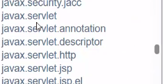

- 이후 오라클에 넘어가 자카르타가 되며 패키지 명이 바뀜
- [공식문서](https://jakarta.ee/specifications/platform/9/apidocs/)

  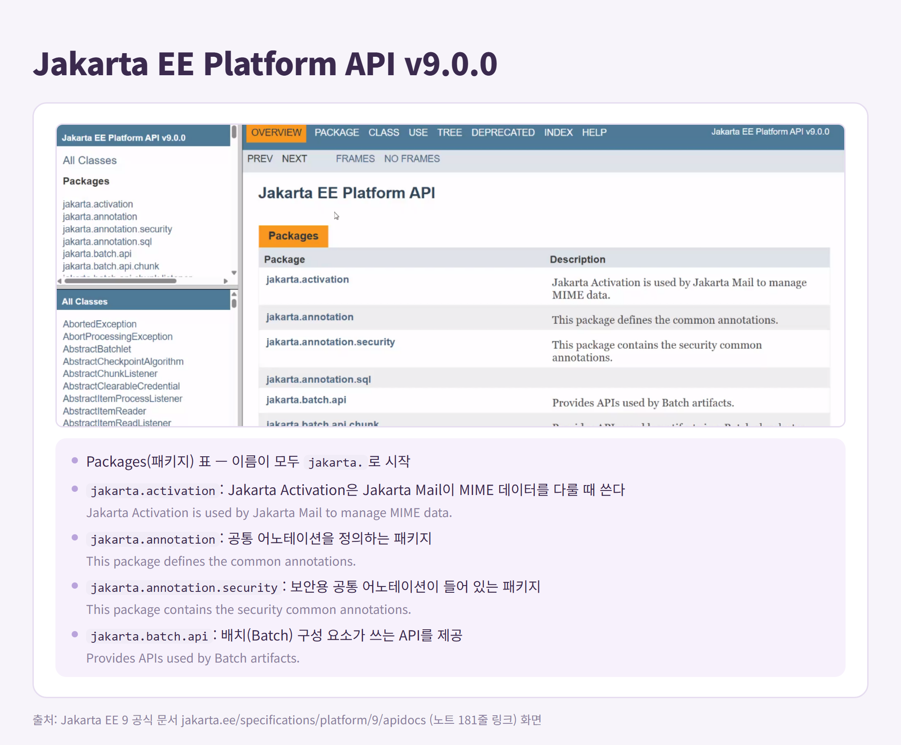

- 스프링부트가 현재는 4버전까지 왔음. 2버전에서는 자바 EE, 이후 버전은 자카르타EE 를 사용하게 됨
- 그런데 뭔가 이슈가 있음. 클래스는 없고 인터페이스만 있음

    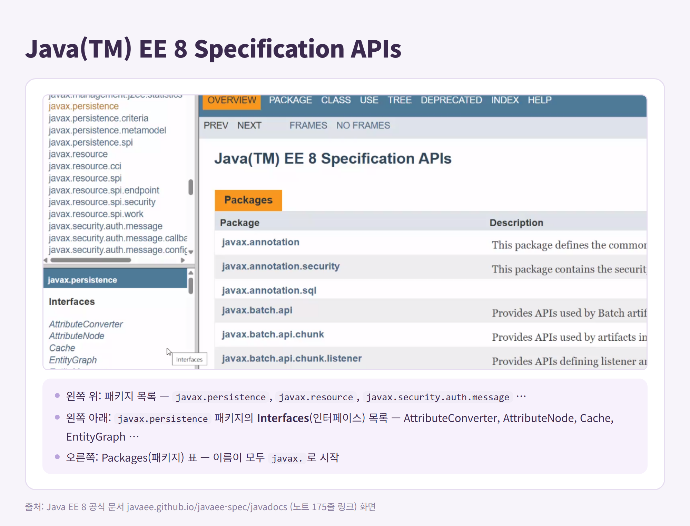

  - 다 인터페이스라는 소리는 메서드가 많고 선언만 하고 구현을 하지 않았다는 뜻. 즉 기능 명세만되어있음

    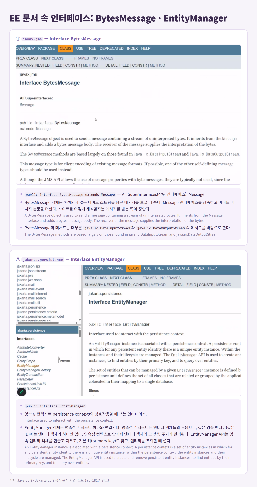

    - 그렇다면 구현은 누가 해야할까? (아래 WAS)

#### 웹 서버 · 웹 컨테이너 · WAS 비교
- Web Server - Apache, Nginx 
  - html, Javascript, CSS
  - 프론트엔드쪽 기술기반(html, js, css)으로 만들어진 페이지는 웹페이지에서 해석이 됨
- Web Container  - Tomcat 
  - JVM 을 내장한 Web Server 같은 역할을 수행하는 서버
  - 자바 기반의 웹 앱을 만든 경우 JVM이 필요함. 그래서 톰캣이 나옴
- WAS(web application server) - JBoss, WebSphere, WebLogic, JEUS
  - J2EE 표준스펙을 구현한 구현체를 제공함
  - EJB Container + Web Container 
  - j2ee는 구현 없이 인터페이스, 즉 표준 스펙만 만들어져있음. 이 규칙을 준수한 구현체를 만들라고 만들어둔것임. 
    - JEUS(티맥스라는 국내기업) 등이 인터페이스만 준 규칙뭉치에 따라 Was 를 만듦. 우리는 인터페이스만 있고 그걸 기반으로 만들어진 것을 제공받아 사용함
- [자카르타 EE](https://jakarta.ee/)
  - tmax, lg, redhat 등에서 파트너가 되어 있는 것 확인 가능 

#### Spring Framework / Spring Boot
- JakartaEE 표준스펙에 있는 기술들을 기반으로 하였고 구현한 프레임워크
- WAS 와 같은 미들웨어가 없이도 모든 기술들이 동작 가능하도록 설계함
- POJO( Plain Old Java Object) 로 자바 클래스를 작성함
- Spring Core/Context, Spring DataJPA, Spring MVC, Spring Test

---

## 10시 수업

🔗 [실습 레포지토리](https://github.com/easty00/JavaSE_Project)

### STS 실습
  - 연습문제 보면서 캡슐화에 대해 풀 예정
  - 어제 수업 : 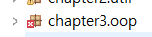

- 오늘은 실습 1번 할것임

- 10시 수업 막바지
  - 아래 사진대로 해서 무언가 만듦
  - super() 가 있었는데 지웠음. 나중에 알려주신다고 함

    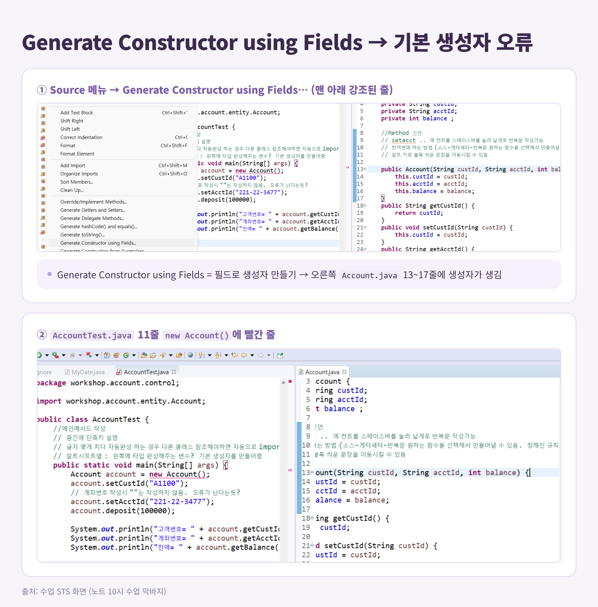

- 오류가 남. 이유? 기본생성자가 없기 때문.

#### 단축키·메서드 정리

| 단축키 / 코드 | 하는 일 |
|---|---|
| Ctrl + Space | 자동 완성. `setAcct`까지 치고 누르면 setter 하나를 만들어 줌. 다른 패키지 클래스를 고르면 import도 같이 생김 |
| Source → Generate Getters and Setters… (Alt + Shift + S) | 변수를 골라 getter·setter를 한꺼번에 만듦 |
| Alt + ↑ / ↓ | 고른 줄을 위아래로 옮김 |
| Alt + Shift + L | 지역 변수로 뽑기. `new Account(...)`처럼 오른쪽만 쳐 두고 누르면 왼쪽 `Account account2 =`를 만들어 줌 (기본 생성자를 만드는 단축키는 아님) |
| Source → Generate Constructor using Fields… | 변수를 골라 생성자를 만듦. 처음엔 `super();`가 들어 있음 |
| Ctrl + F11 | 지금 파일 실행 |
| `setCustId` / `getCustId`, `setAcctId` / `getAcctId`, `getBalance` | 고객번호·계좌번호 넣고 꺼내기. 잔액은 getter만 |
| `setBalance()` 안 만듦 | 잔액은 입금(`deposit`)과 출금(`withdraw`)으로만 바뀌게 |
| `deposit(int amount)` | `this.balance += amount;` (`this.balance = this.balance + amount;`의 줄임) |
| `withdraw(int amount)` | `this.balance -= amount;` |
| `Account()` / `Account(String custId, String acctId, int balance)` | 빈 생성자 / 값을 한 번에 넣는 생성자 |

---

## 11시 수업

### ToString
```  
public class Account {
	//public class Account extend Object 의 줄임이다. 숨겨져있음.
	private String custId;
	private String acctId;
	private int balance ;
```

- 공식문서의 java.lang 의 오브젝트 설명 확인
  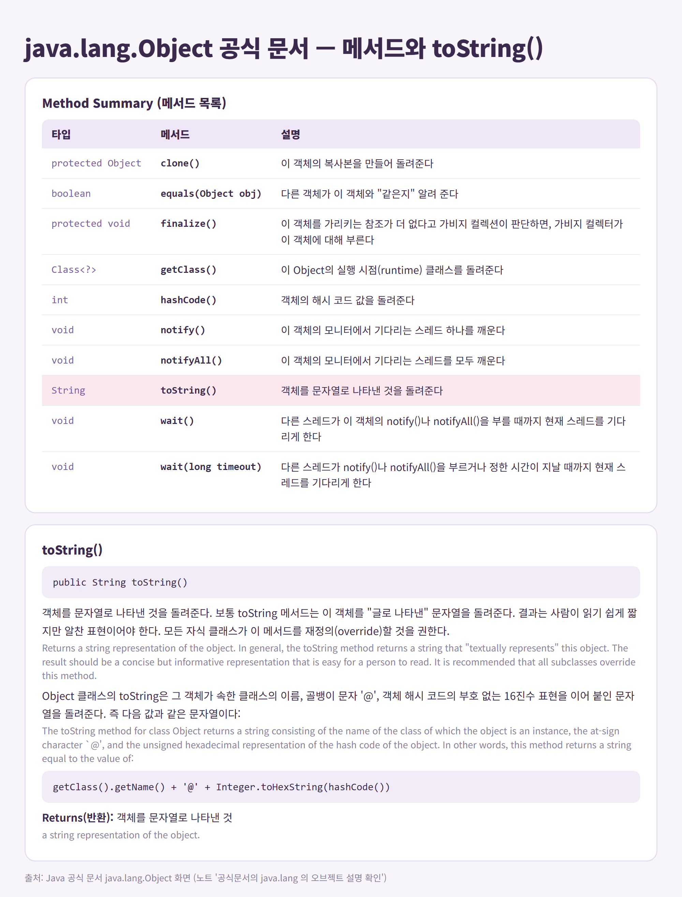
  - 오브젝트마다 해시코드가 있음. 해시코드를 숫자 코드로 조합하여 뿌려줌
- 자바 교재파일
  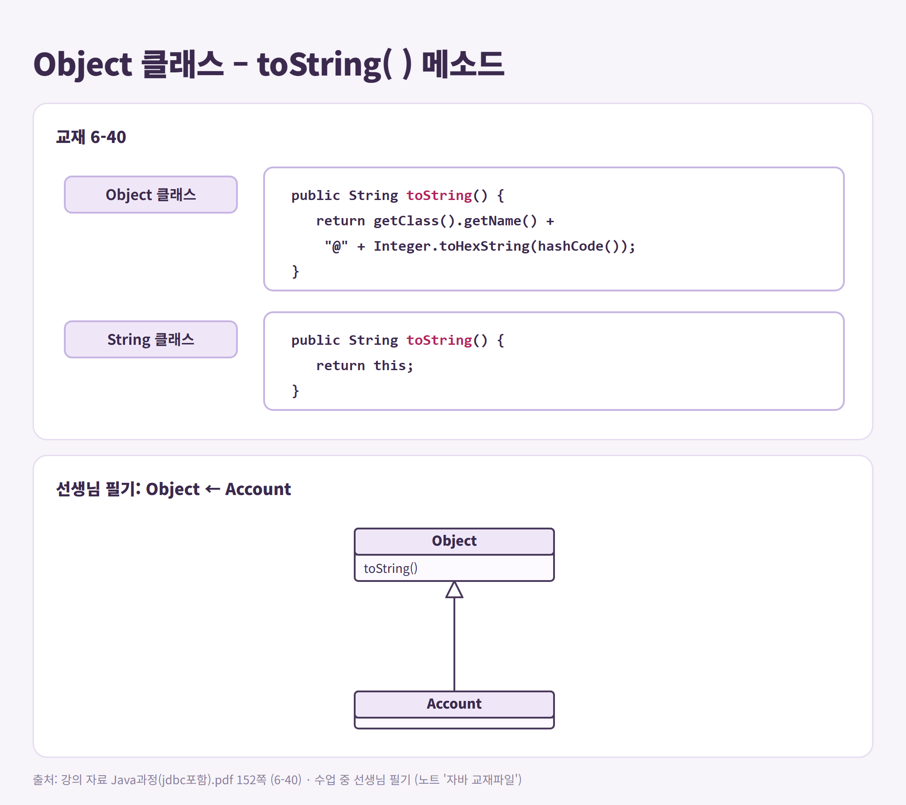

- 명시적으로 호출해도 되지만 보통은 안에 tostring이 있는 경우 자동 호출함
  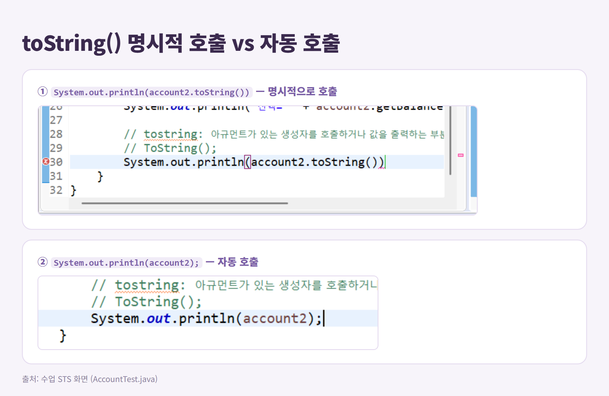

- 컨트롤 키 쓰면 밑줄이 나옴. 그거 누르면 프린트 스트림으로 들어가짐
  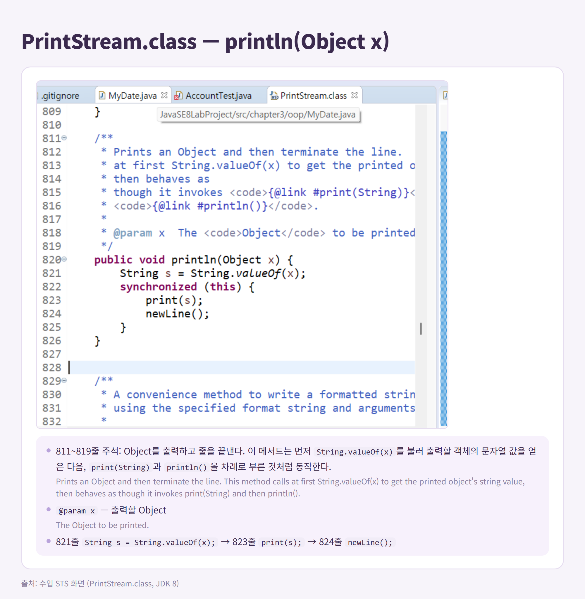

- 강사님 따라하다 오류 떴는데 강사님 화면 보니까 빈 퍼블릭 어카운트 있었음. 넣으니까 정상출력 됨
  - 이게 그건가 그 중복하는거?

    >  - 맞습니다. 생성자 오버로딩(Overloading, 중복정의)입니다. 이름은 `Account`로 같고 매개변수가 다른 생성자를 여러 개 두는 것입니다. 어제 `MyDate()` / `MyDate(int, int, int)`와 같은 모양입니다.
    >  - 생성자를 하나라도 직접 만들면 컴파일러가 기본 생성자를 자동으로 넣어 주지 않습니다. 그래서 빈 `public Account() { }`를 따로 만들어야 `new Account()`가 다시 됩니다.

  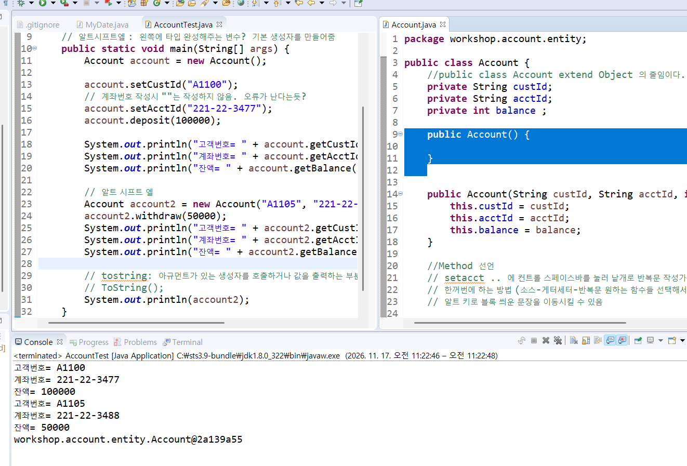

- 결과 본 후 사진 보면서 설명하심

  - 오버라이딩에 대한 설명

    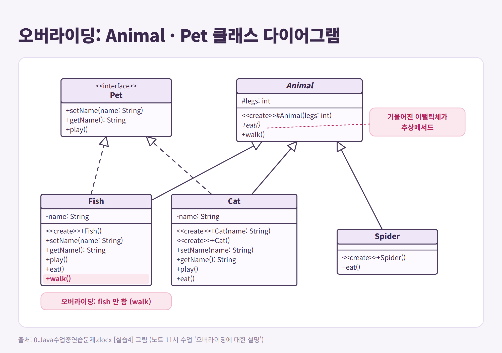

    - 애니멀의 기울어진 이탤릭체가 추상메서드
    - 그림상으로 오버라이딩 된 부분 찾기 : fish 만 함. 왜?
      - 이건 추상이 아닌 구현된 메서드임. 그래서 자식이 재정의해도 안해도 됨. 그럼에도 왜 fish만? fish에게는 walk가 필요없어서? 고양이랑 거미는 걸어다닐수있지만 물고기는 아님. 부모에게 그대로 상속받아도 행위에 큰 문제가 없어서 오버라이딩 안해도 됨. 하지만 물고기는 물 속에서 헤엄침. 특화된 동작을 구현해주어야 함 그래서 오버라이딩 해주어야함.
      - 추상은 무조건 선택해야하기 때문에 필요 없으면 무조건 오버라이딩이 강제됨
      - 오버라이딩이 무엇이길래?

        >  - 오버라이딩(Overriding, 재정의)은 부모 → 자식 사이에서, 부모에게 물려받은 메서드를 자식이 같은 이름·같은 매개변수로 다시 만드는 것입니다. 예: `Account`의 `toString()`, Fish의 `walk()`
        >  - 오버로딩(Overloading, 중복정의)은 한 클래스 안에서 이름은 같고 매개변수는 다른 메서드·생성자를 여러 개 두는 것입니다. 예: `Account()` / `Account(String, String, int)`
        >  - 본점 레시피(부모의 `walk()`)를 그대로 써도 되는 분점은 손대지 않고, 현지 사정이 다른 분점(Fish)만 레시피를 바꾸는 것이 오버라이딩입니다.

- 투스트링 생성 메뉴
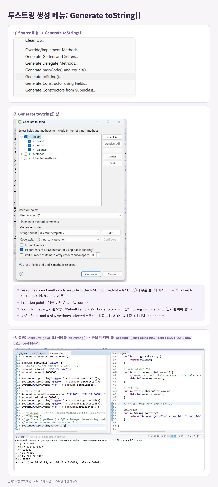
- 오버라이드쪽 주석화 하고 뭔가 설명하셨는데 제대로 설명 못들음

  >  - `@Override`는 "이 메서드는 부모 메서드를 재정의한 것"이라는 표시입니다. 컴파일러가 부모(`Object`)에 정말 같은 메서드가 있는지 검사해 줍니다.
  >  - `toString()`을 따로 써 두지 않으면 부모 `Object`가 준 기본 `toString()`이 쓰여서 `workshop.account.entity.Account@2a139a55`처럼 "클래스이름@해시코드"만 나옵니다. 직접 재정의해 두면 `Account [custId=A1105, acctId=221-22-3488, balance=50000]`처럼 내용이 보입니다.

#### 단축키·메서드 정리

| 단축키 / 코드 | 하는 일 |
|---|---|
| Ctrl + 클릭 (또는 F3) | 메서드가 정의된 곳으로 이동. `println`을 눌러 `PrintStream.class`로 들어감 |
| Source → Generate toString()… | 고른 변수(custId, acctId, balance)로 `toString()`을 만들어 줌 |
| `extends Object` | 안 써도 모든 클래스는 자동으로 `Object`를 상속 |
| `toString()` | 객체를 글자로 바꿔 돌려줌. 재정의 안 하면 `클래스이름@해시코드` |
| `@Override` | 부모 메서드를 재정의했다는 표시. 컴파일러가 부모에 같은 메서드가 있는지 검사 |
| `System.out.println(account2)` | 안에서 `String.valueOf(x)` → `x.toString()`을 불러서 `println(account2.toString())`과 결과가 같음 |

---

## 1시 수업

### 실습 이어서 
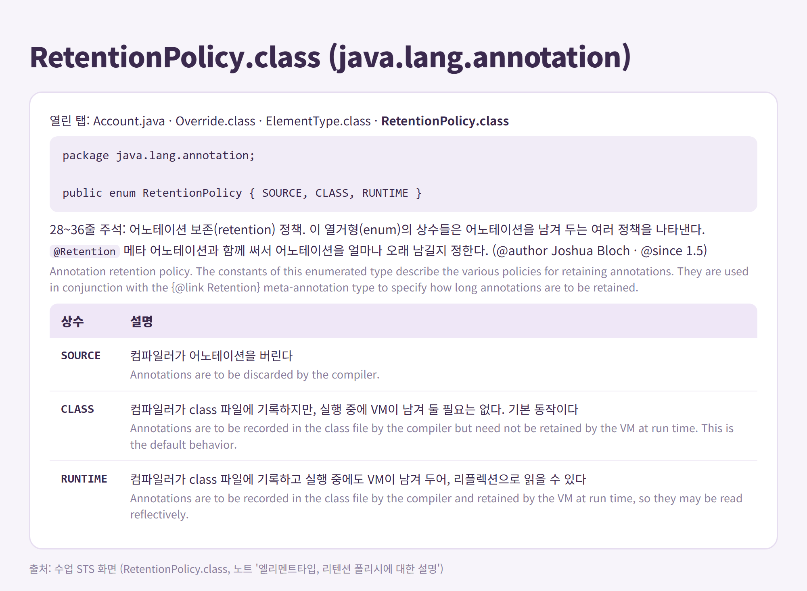
모르는 사이 또 알트 클릭하신 듯. 엘리멘트타입, 리텐션 폴리시에 대한 설명

>  - 선언으로 들어가는 건 Ctrl + 클릭(또는 F3)입니다. `@Override`를 따라 들어가서 `Override.class`, `ElementType.class`, `RetentionPolicy.class`를 연 화면입니다.
>  - `@Override`는 `@Target(ElementType.METHOD)`, `@Retention(RetentionPolicy.SOURCE)`로 만들어져 있습니다. 메서드에만 붙일 수 있고, 소스 코드에만 남습니다.
>  - RetentionPolicy는 어노테이션 표시를 언제까지 남길지 정합니다. `SOURCE`는 컴파일러가 보고 버리고(`.class`에 안 남음), `CLASS`는 `.class`에는 남지만 실행 때 JVM이 읽지 않으며(기본값), `RUNTIME`은 실행 중에도 남아서 읽을 수 있습니다.
>  - 오버라이딩 수칙을 지키는지 검사하는 것은 컴파일러입니다. 리텐션은 그 표시를 언제까지 남길지를 정할 뿐이고, `@Override`는 `SOURCE`라서 컴파일이 끝나면 버려집니다.

- 오버라이딩의 수칙을 잘 지키고 있는지 리텐션이 체크함

- 잔액부족 구현
- 사용자 정의 예외 클래스 작성. 익셉션 클래스 필요 

  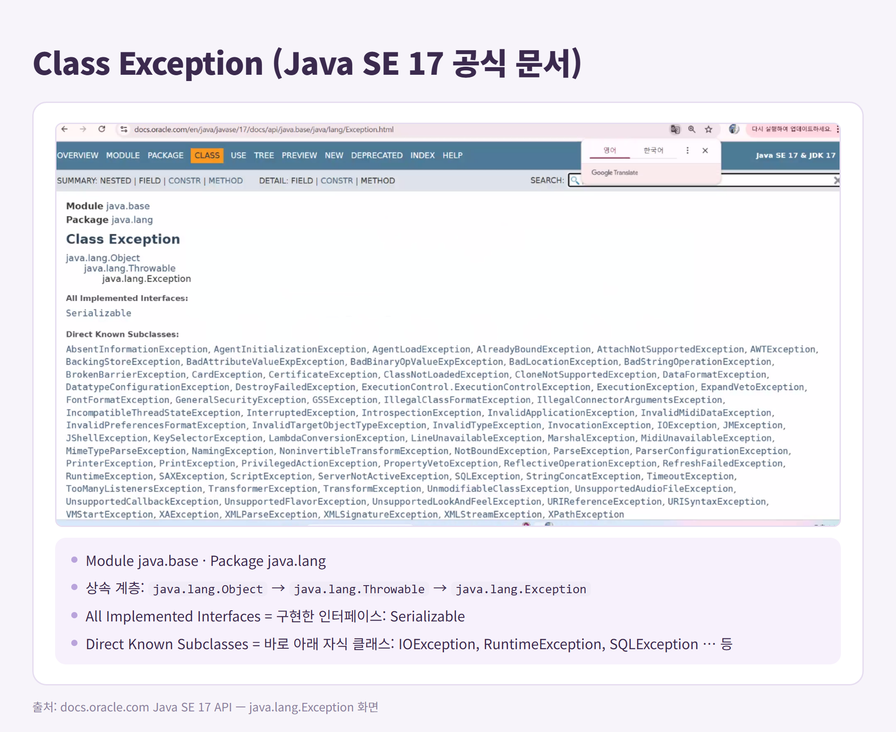

- Throwable

  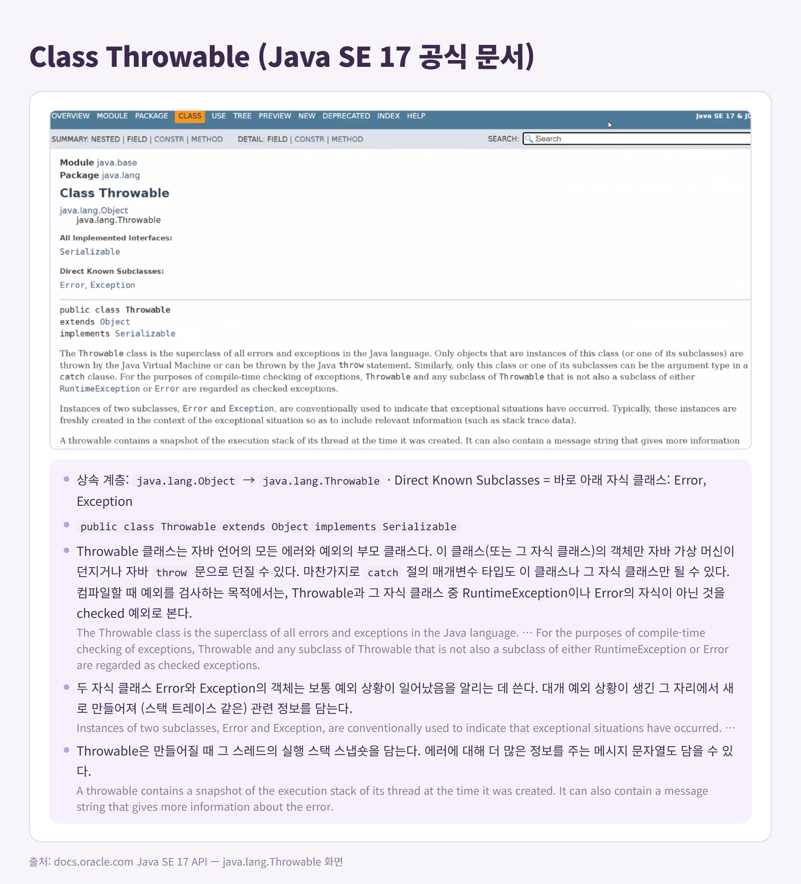

- 에러시 에러 정보를 뿌려주는 필드를 가짐

  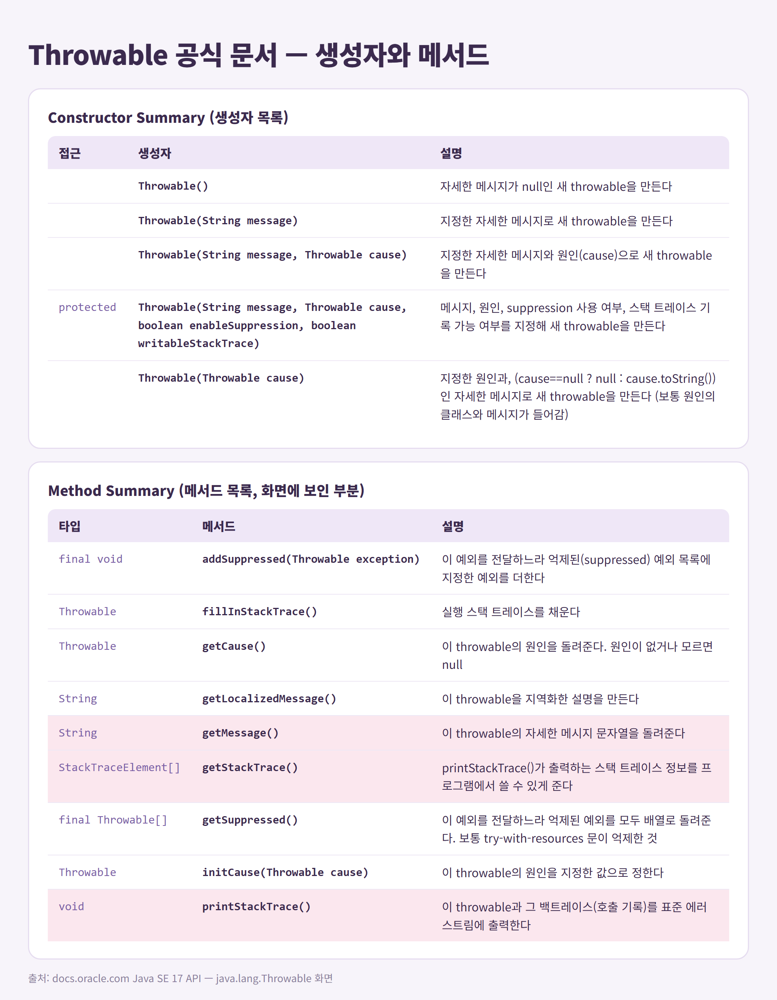

- 메시지가 들어오면 getMessage 를 통해 출력함

- getStackTrace : 쌓이는 에러를 주르륵 추적해줌

  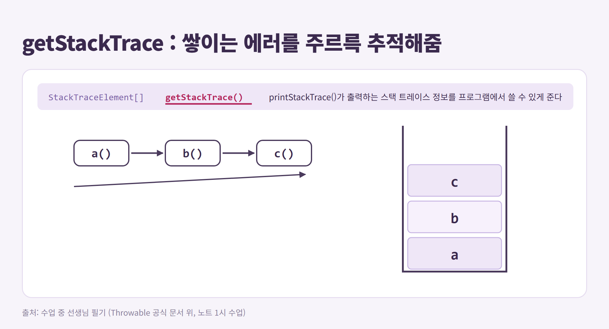

  - 외부에 노출되면 안되는 메서드. 보안이 취약해짐.
- printStackTrace : 쌓인 에러 출력

  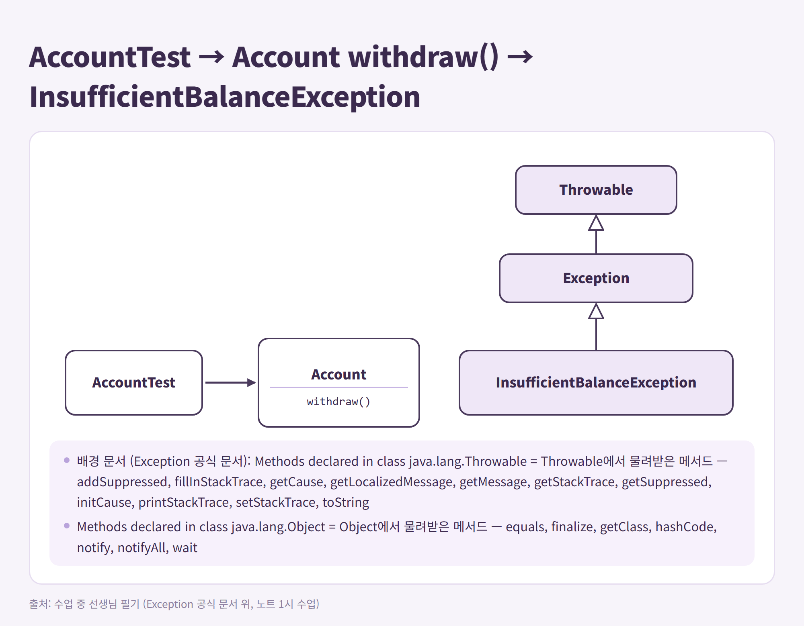

- 익셉션 패키지와 클래스 생성

  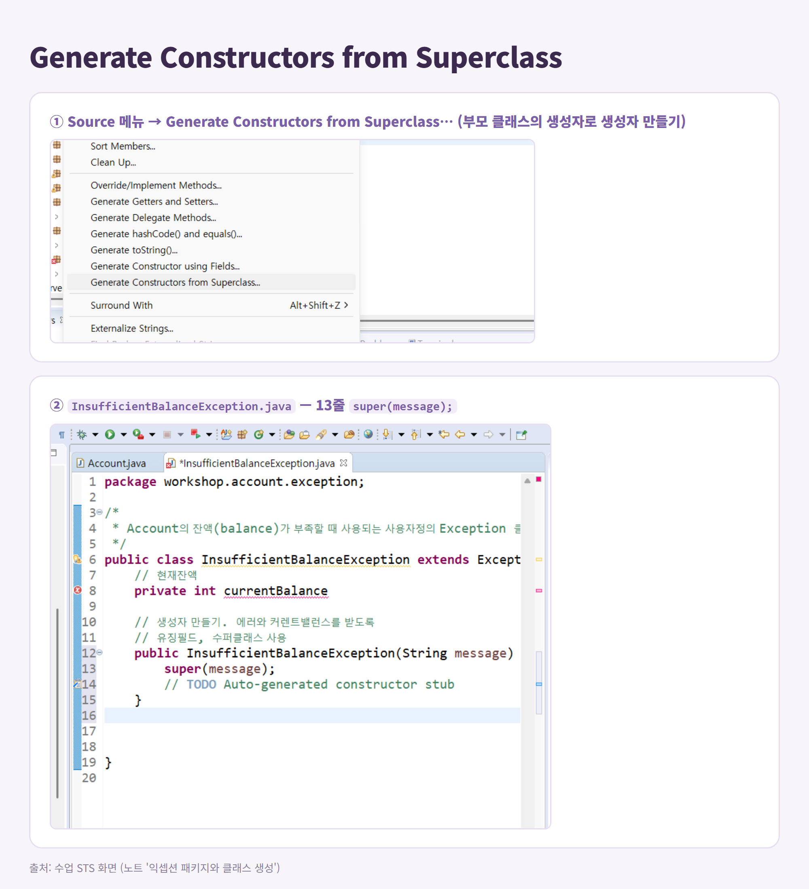

  - 수퍼 : 부모 클래스의 생성자를 호출한다

- 만든 익셉션은 어카운트의 withdraw에서 사용

  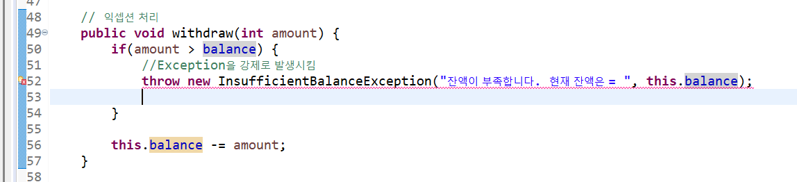

- 그런데 오류남. 핸들링이 없다고 함
- 이럴땐 뭔가 위임을 해줘야 한다고 함

  >  - `throw`는 메서드 안에서 지금 예외를 던지는 문장이고, `throws`는 메서드 선언 끝에 붙여 "이 메서드는 이 예외를 던질 수 있으니 부른 쪽이 처리하라"고 알리는 것입니다. 이렇게 처리를 부른 쪽에 넘기는 것이 위임입니다.
  >  - `InsufficientBalanceException`은 `Exception`을 상속하고 `RuntimeException`은 아니라서 Checked Exception입니다. 컴파일러가 처리했는지 검사하기 때문에 `try-catch`나 `throws`가 없으면 `Unhandled exception type ...` 오류가 납니다.
  >  - 위임을 받은 `AccountTest`도 이제 처리해야 해서 `account2.withdraw(50000);`에 빨간 줄이 생기고, `try { ... } catch (InsufficientBalanceException e) { ... }`로 감싸서 받아 처리합니다.

  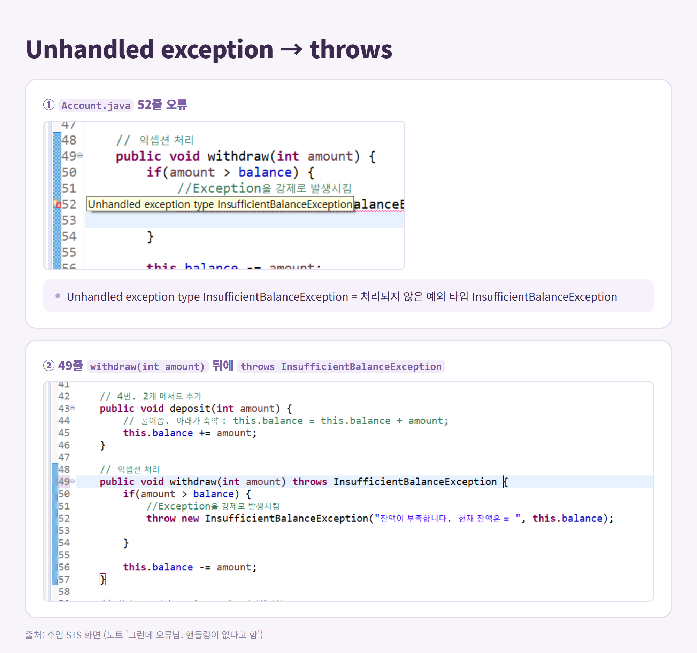

  - 이번엔 여기서 에러 남. 받았으니 처리해야하니까.

  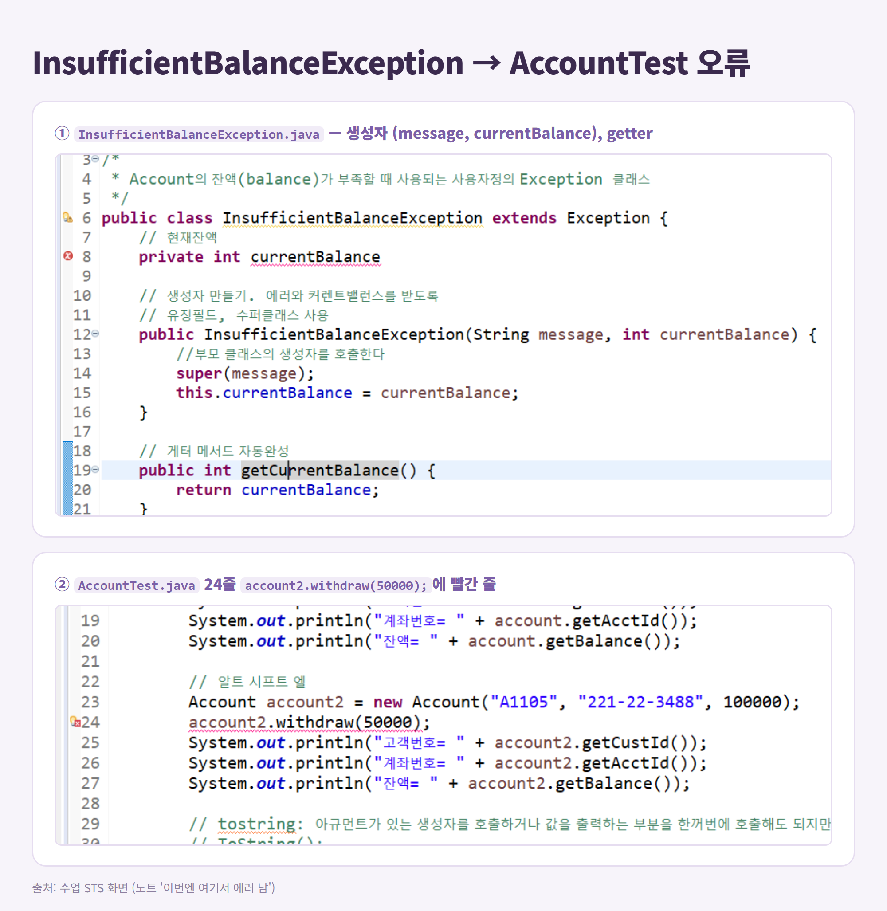

#### 단축키·메서드 정리

| 단축키 / 코드 | 하는 일 |
|---|---|
| Ctrl + 클릭 | `@Override` 선언으로 들어감 (`Override.class`, `ElementType.class`, `RetentionPolicy.class`) |
| Source → Generate Constructors from Superclass… | 부모(`Exception`) 생성자를 골라 `super(message)`가 든 생성자를 만듦 |
| 빨간 줄 위에 마우스 | `Unhandled exception type ...` 같은 오류 이유 보기 |
| `extends Exception` | 사용자 정의 예외 만들기 (Checked) |
| `super(message);` | 부모 클래스의 생성자를 불러 메시지를 맡김 |
| `getCurrentBalance()` | 예외가 났을 때의 잔액 꺼내기 |
| `throw new InsufficientBalanceException("잔액이 부족합니다. 현재 잔액은 = ", this.balance);` | 잔액보다 많이 빼려 하면 예외를 던짐. 여기서 메서드가 끝남 |
| `throws InsufficientBalanceException` | 메서드 선언 끝. 처리를 부른 쪽에 넘김 |
| `try { ... } catch (InsufficientBalanceException e) { ... }` | 넘겨받은 예외를 처리 |
| `e.getMessage()` | 만들 때 넣은 메시지 꺼내기 |
| `getStackTrace()` / `printStackTrace()` | 호출이 쌓인 기록 / 그 기록 출력 (사용자 화면에 보이면 안 됨) |

--- 

## 2시 수업

### Array(배열)
- 동일한 타입의 여러 데이터를 하나의 이름을 관리하는 것
- 종류 
  - Primitive type array

    | Primitive Data Type | Wrapper Class |
    |---|---|
    | boolean | Boolean |
    | byte | Byte |
    | char | Character |
    | short | Short |
    | int | Integer |
    | long | Long |
    | float | Float |
    | double | Double |

  - Reference type array
- 배열은 객체이다.
- 배열의 이름은 배열객체의 주소 값을 갖는 Reference 변수이다.

- 선언 : 어느 type을 배열의 element로 가질지 선언한다.
  - int[ ] numbers;  int numbers[];
  - MyDate[ ] dates;  MyDate dates[];

- 생성 : 배열도 객체이므로 new 키워드로 생성하며, [ ] 안에 몇 개의 element를 가질지 size를 지정한다.
  numbers = new int[10];
  dates = new MyDate[10];
  - 크기를 생성시 선언해야하는 제약이 필요할 때 있음 그럴 땐 다른거 사용

- 초기화 : 사용하기 전에, 처음 값을 할당하는 것을 말한다.
  - numbers[0] = 1;
  - dates[0] = new MyDate();

- 선언시 주의점.
  - int[ ] a, b; // a, b 둘다 Array에 대한 Reference
  - int a[ ], b; // a는 Array에 대한 Reference, b는 int 형

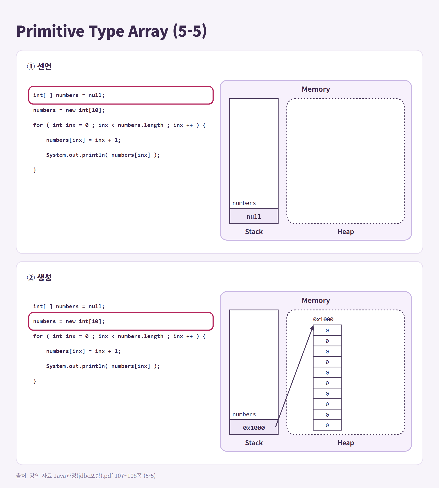

- 레퍼런스값이 주소값이 들어가서 이런식으로 메모리가 잡힌다
- 방이 10개 생김 

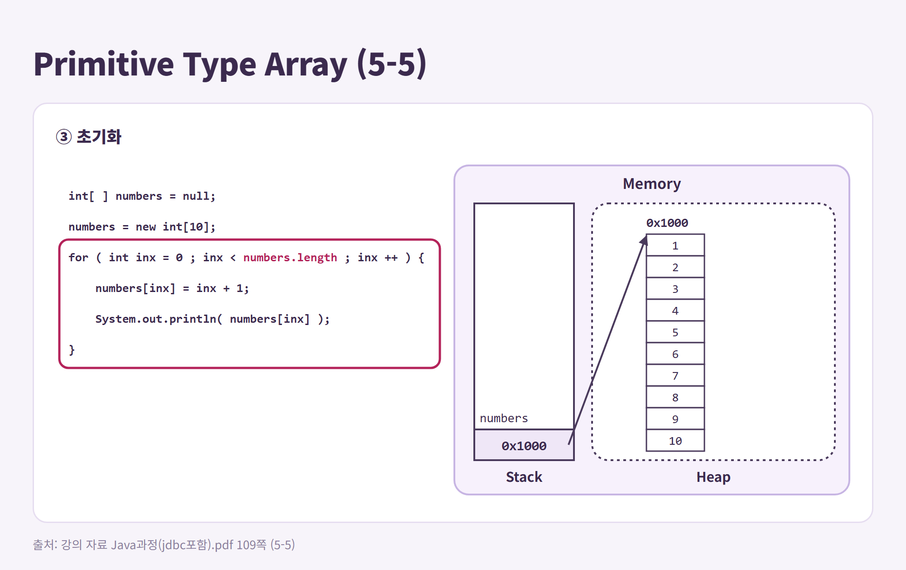

- 연습파일의 array

  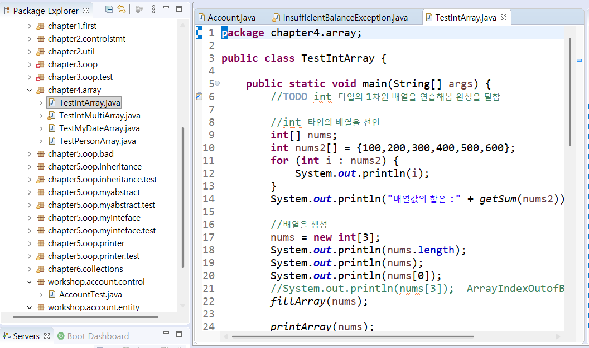

  - //enhanced for loope

    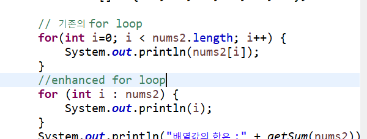

  - i 는 value값. nums2의 값을 불러오는 것 
  - 방법은 같음. 다만 최신방법을 권장함 

  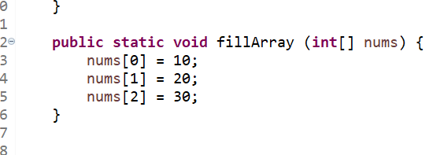

  - 같은 스테이트끼리는 어쩌구 하셨는데 잘 못알아들음

    >  - 화면의 `public static void fillArray`와 이어 보면 "static끼리는 객체 없이 바로 부를 수 있다"는 이야기로 보입니다.
    >  - `getSum`, `fillArray`, `printArray`가 모두 `static`이라, `static`인 `main`에서 `fillArray(nums);`처럼 이름만으로 바로 부를 수 있습니다.

  - 프린트 어레이

- 교재 110페이지

  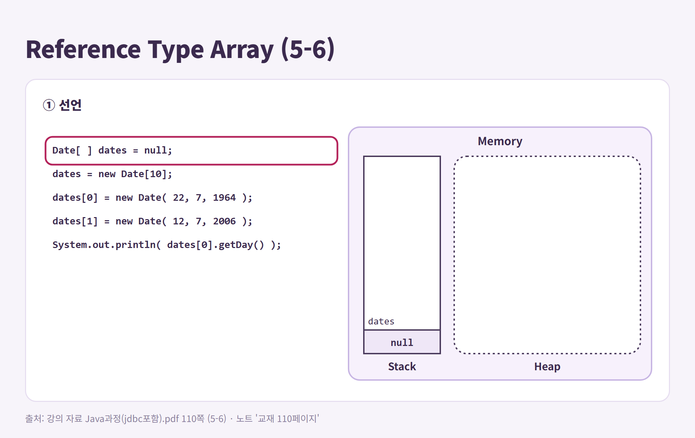

  - date 는 레퍼런스타입임
  - 방이 하나 생김
  - 각 타입이 어쨌든 방 하나가 생기는 배열이기 때문에 초기값은 null로 되어있음

  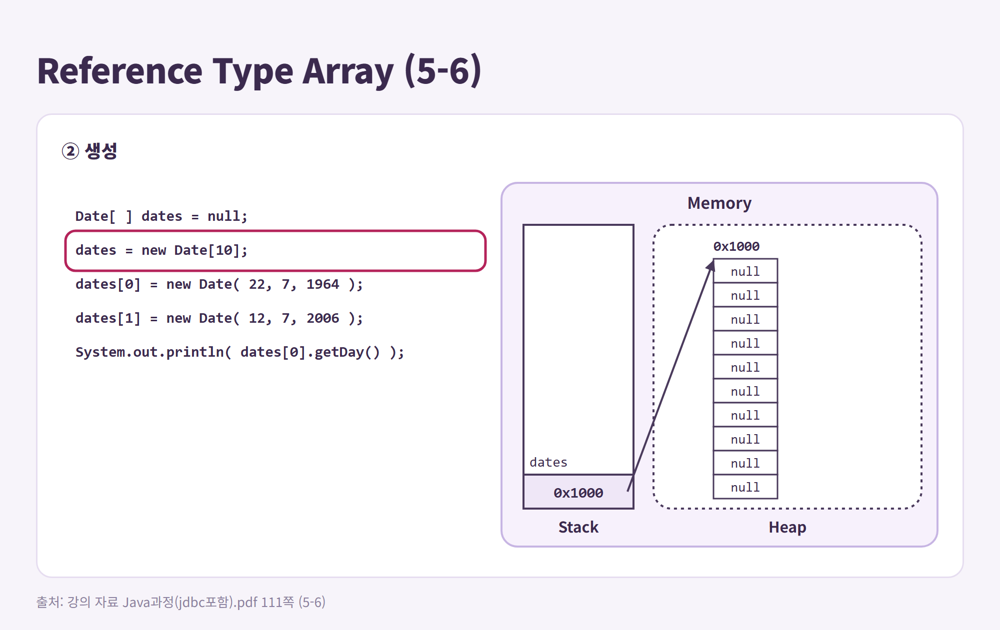

  - 전자와 달리 숫자가 들어가진 않고 null로 초기치가 들어간 방들이 생성됨

  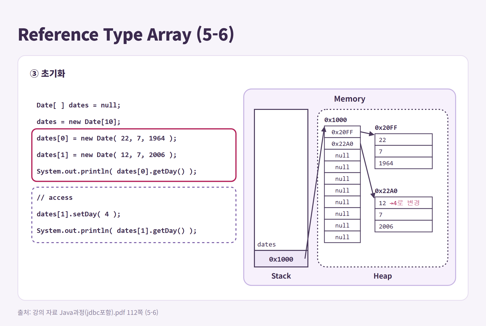

  - dates는 무슨 타입일까? date 타입임. 다른 영역을 가진 객체가 생성되고 그 객체들이 자신에게 지정된 방 안에 만들어짐.

- 다시 STS 파일로

  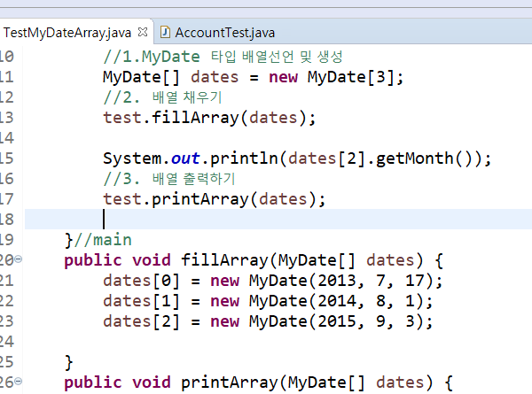

  - 넌 스테틱으로 했다고 하는데 잘 모르겠음

    >  - `TestIntArray`는 메서드(`getSum`, `fillArray`, `printArray`)가 `static`이라 `main`에서 `fillArray(nums);`로 바로 부릅니다.
    >  - `TestMyDateArray`의 `fillArray`, `printArray`는 `static`이 아닙니다(non-static). 그래서 `main`에서 먼저 `TestMyDateArray test = new TestMyDateArray();`로 객체를 만들고, `test.fillArray(dates);`처럼 객체를 거쳐 부릅니다.
    >  - 왜 그래야 하는지는 바로 아래 질문(static 메서드에서 non-static 메서드를 바로 못 부르는 이유)의 답과 같습니다.

- Java 에서 static 메서드에서는 왜 바로 non-static 메서드를 바로 호출하지 못하나요? 반드시 객체를 생성하고 참조변수로 접근해야 하나요?
  - 생성 시점이 다르기 때문!

>  - Java의 static 메서드에서 non-static(인스턴스) 메서드를 직접 호출할 수 없는 이유는 메모리 생성 시점(Life Cycle)과 객체 소속 여부 때문입니다.

>  1. 메모리 로드 시점의 차이

>  - static 멤버 (클래스 메서드/변수): 프로그램이 실행될 때 클래스가 메모리에 로드되면서 클래스 로더에 의해 동시에 static 영역에 생성됩니다. 즉, 객체가 전혀 생성되지 않은 상태에서도 메모리에 존재합니다.
>  - non-static 멤버 (인스턴스 메서드/변수): new 연산자를 통해 객체(인스턴스)가 생성될 때 비로소 힙(Heap) 영역에 생성됩니다.
>  - 따라서 static 메서드가 실행되는 시점에는 해당 non-static 메서드가 메모리에 존재하지 않을 수 있기 때문에, 자바 컴파일러는 이를 허용하지 않고 에러를 발생시킵니다.

>  2. 객체 참조(Context)의 부재 (this 키워드)

>  - non-static 메서드는 특정 객체에 속해 있기 때문에 내부적으로 자신이 속한 객체를 가리키는 this 참조값을 암묵적으로 가지고 있습니다. 하지만 static 메서드는 특정 객체에 소속된 것이 아니라 클래스 자체에 속하므로 this 참조값이 아예 존재하지 않습니다.
>  - 객체 정보(this)가 없는 상태에서 어떤 객체의 non-static 메서드를 실행해야 할지 알 수 없기 때문에 바로 호출할 수 없습니다.

>  반드시 객체를 생성하고 접근해야 하나요?

>  - 네, 맞습니다. static 메서드에서 non-static 메서드나 인스턴스 변수를 사용하려면 반드시 객체를 먼저 생성하고, 그 참조변수를 통해서만 접근해야 합니다.

  ```
  public class Example {
      int instanceVar = 10;

      void nonStaticMethod() {
          System.out.println("인스턴스 메서드 호출");
      }

      public static void main(String[] args) {
          // 1. static 메서드 안에서 바로 호출하면 컴파일 에러!
          // nonStaticMethod(); 

          // 2. 반드시 객체를 생성한 후 참조변수로 접근해야 합니다.
          Example obj = new Example();
          obj.nonStaticMethod(); // 정상 작동
      }
  }
  ```

- 추가질문 . 

>  - 모든 메서드를 `static`으로 만들지 않는 이유는 다음과 같은 치명적인 한계들 때문입니다.

>  1. 객체의 고유한 상태(State)를 유지할 수 없습니다

>  - `static` 메서드와 변수는 프로그램 전체에서 **단 하나만 존재**하며 모든 객체가 공유합니다.
>  - 만약 모든 메서드와 변수를 `static`으로 만들면, 여러 사용자의 데이터나 서로 다른 객체들의 개별적인 상태(예: 로그인한 유저의 정보, 쇼핑몰 장바구니 등)를 독립적으로 관리할 수 없게 됩니다.
>  - `non-static`(인스턴스) 메서드는 각 객체가 가진 고유한 인스턴스 변수(`this`)를 다루기 위해 존재합니다.

>  2. 다형성(Polymorphism)과 오버라이딩이 불가능합니다

>  - 자바의 강력한 무기 중 하나는 상속과 오버라이딩(Overriding)을 통한 다형성입니다.
>    - `static` 메서드는 클래스에 속하므로 컴파일 시점에 호출될 메서드가 결정됩니다(Method Hiding). 즉, 자식 클래스에서 부모의 `static` 메서드를 재정의(Override)해도 다형성이 적용되지 않습니다.
>    - `non-static` 메서드는 런타임 시점에 실제 생성된 객체의 타입을 보고 메서드를 찾아가는 동적 바인딩(Dynamic Binding)이 일어나므로, 유연한 설계와 디자인 패턴(예: 팩토리 패턴, 전략 패턴 등)을 구현할 수 있습니다.

>  3. 멀티스레드 환경에서 심각한 동시성 문제(Thread Safety)가 발생합니다

>  - `static` 멤버는 메모리의 공유 영역에 위치하기 때문에, 여러 스레드가 동시에 접근하여 값을 읽고 쓰면 경쟁 상태(Race Condition)가 발생하여 데이터가 오염될 수 있습니다.
>  - 반면, `non-static` 메서드 안에서 선언된 지역변수나 각 객체의 인스턴스 변수는 객체마다 메모리가 따로 존재하므로 상대적으로 스레드 안전성(Thread Safety)을 확보하기 쉽습니다.

>  4. 절차적 프로그래밍으로 회귀합니다

>  - 자바는 철저한 객체지향 언어입니다. 모든 것을 `static`으로 처리하는 것은 객체들이 서로 메시지를 주고받으며 협력하는 구조가 아니라, 단순히 C언어 같은 **절차적(Procedural) 함수들의 집합**처럼 코드를 짜는 것이 됩니다. 이렇게 되면 코드가 비대해지고 유지보수와 확장성이 크게 떨어집니다.

>  언제 `static`을 쓰고 언제 `non-static`을 써야 할까요?

>  - **`static`을 써야 하는 경우:** 객체의 상태와 무관하게 **동일한 입력에 대해 항상 같은 결과를 내는 유틸리티 메서드**(예: `Math.random()`, `Math.abs()`)나 상수 처리에 적합합니다.
>  - **`non-static`을 써야 하는 경우:** 객체의 고유한 속성(데이터)을 활용하거나, 다른 객체들과 협력해야 하는 대부분의 비즈니스 로직에 적합합니다.

- 또 추가질문
  - Java 에서 static 메서드에서는 왜 바로 non-static 메서드를 바로 호출하지 못하나요? 반드시 객체를 생성하고 참조변수로 접근해야 하나요?
  - 위 질문(Java 에서 static 메서드에서는 왜 바로 …)과 같은 질문이라 답도 위와 같음

#### 단축키·메서드 정리

| 단축키 / 코드 | 하는 일 |
|---|---|
| `int[] nums;` | 선언만 (배열 주소를 담을 변수) |
| `int nums2[] = {100,200,300,400,500,600};` | 선언 + 생성 + 초기화를 한 번에 (칸 6개) |
| `nums = new int[3];` | 3칸 생성. 칸마다 처음 값 0 (참조형 배열은 `null`) |
| `nums.length` | 칸 수. 마지막 칸 번호는 `length - 1`, 넘으면 `ArrayIndexOutOfBoundsException` |
| `for(int i=0; i < nums2.length; i++)` | 기존 for. `i`는 칸 번호 |
| `for (int i : nums2)` | 향상된 for (자바 5부터). `i`는 칸 값 |
| `System.out.println(nums)` | `[I@2a139a55`처럼 나옴. 배열도 객체라서 |
| `fillArray(nums);` | 배열의 주소를 넘겨서 메서드 안에서 칸을 채움. static끼리라 이름만으로 부름 |
| `MyDate[] dates = new MyDate[3];` | 참조형 배열. 칸에는 객체 주소 |
| `TestMyDateArray test = new TestMyDateArray();` → `test.fillArray(dates);` | non-static 메서드는 객체를 만들고 객체를 거쳐 부름 |

---

## 3시 수업 

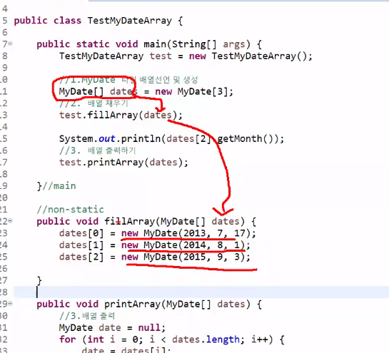

- 실습 2는 컬렉션까지 진행하고 숙제로 준다고 함

- 수업예제 2
  - 같은 문자 동시 작성 기능 
  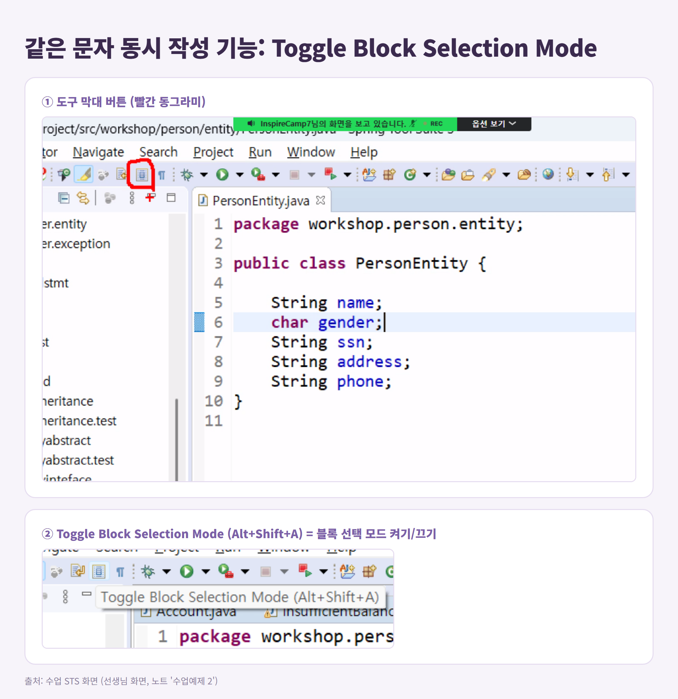
  - 생성자 만들기 
  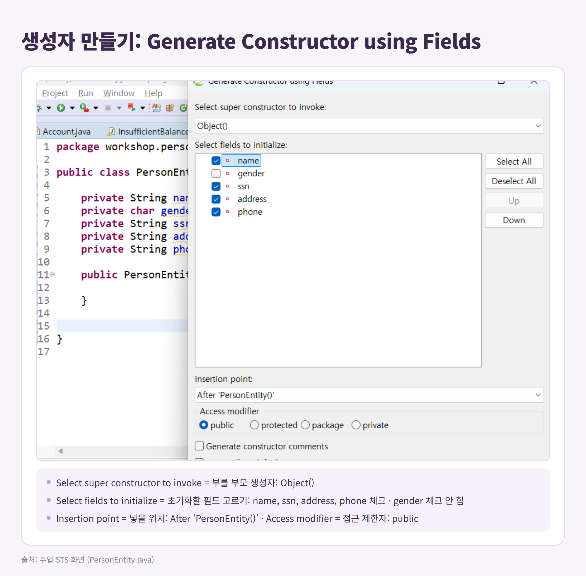

  - 게터세터 추가

  - class String
  [공식문서](https://docs.oracle.com/en/java/javase/17/docs/api/java.base/java/lang/String.html)

  - 게터세터에 7째 숫자에 따른 남녀구별
    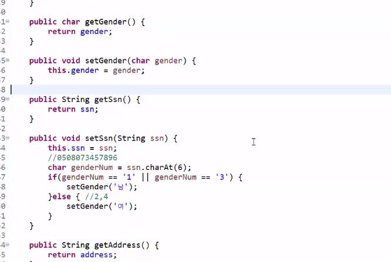
  - 게터세터 메서드를 사용하는 경우 :
    - 생성자에 set으로 감싸야 함
      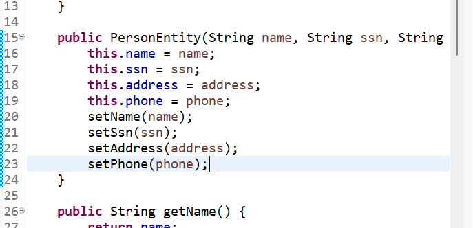
      - 왜 여기 들어오는지는 모르겠지만 여기 들어와야하고 아규먼트 어쩌고 저쩌고 함

        - **아규먼트와 매개변수**
        ```
        public void setSsn(String ssn) { ... }   // 받는 쪽: String ssn = 매개변수(parameter)
        person.setSsn("7212121028102");          // 보내는 쪽: "7212121028102" = 아규먼트(argument)
        ```
          - 비유: 메서드가 자판기라면 동전 넣는 구멍이 매개변수, 실제로 넣는 동전이 아규먼트
          - 붙이는 이유: 메서드가 할 일은 같아도 매번 다른 값으로 일하게 해야 함. setSsn은 하나지만 사람마다 다른 주민번호를 넣어야 하기 때문.
        - **main(String[] args)의 args**
          - 프로그램을 실행할 때 밖에서 넣어 주는 글자들을 받는 칸(String 배열).
            - 콘솔에서 java TestGreeting 안녕 반가워라고 실행하면 args[0]은 "안녕", args[1]은 "반가워"가 됨.
            - STS에서 Ctrl + F11로 그냥 실행하면 아무것도 안 넣으니 빈 배열(길이 0)이에요. 그러므로 안 써도 문제가 없었음.
          - 안 쓰는데도 꼭 적는 이유: 우리가 쓰는 JDK 8에서는 JVM이 public static void main(String[] args) 모양만 프로그램 시작점으로 인정하기 때문. 괄호 안을 비우면 시작점을 못 찾음.
          - 다만 args는 이름일 뿐이라 바꿔도 됨. 관례상 args라고 작성하는 것.

        >  - 생성자에서 `this.ssn = ssn;`으로 바로 넣으면 주민번호만 들어가고 성별은 비어 있게 됩니다. 성별을 정하는 코드가 `setSsn` 안에만 있기 때문입니다.
        >  - 그래서 생성자가 `setSsn(ssn)`을 불러야, 주민번호를 넣으면서 성별까지 정해집니다.
        >  - 어제 `MyDate`의 13월 문제와 같은 이유입니다. 생성자 문은 검사(계산) 없이 바로 넣으니, 생성자도 setter를 거치게 합니다. 실습 문서에도 "멤버변수들을 초기화하는데, 이때 setter 메서드를 사용한다"고 적혀 있습니다.

      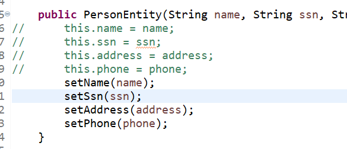
      - 오버로딩 어쩌고 하는데 모르겠음

        >  - `PersonEntity()`와 `PersonEntity(String name, String ssn, String address, String phone)`는 이름이 같고 매개변수만 다릅니다. 이것이 생성자 오버로딩입니다.
        >  - `new PersonEntity()`는 빈 사람, `new PersonEntity("이성호", "7212121028102", ...)`는 정보가 다 든 사람을 만듭니다.

#### 단축키·메서드 정리

| 단축키 / 코드 | 하는 일 |
|---|---|
| Alt + Shift + A | 블록 선택 모드(Toggle Block Selection Mode). 여러 줄을 세로로 잡아 같은 글자를 한 번에 입력 |
| Source → Generate Constructor using Fields… | `gender`만 체크 빼고 생성자 만들기 (받지 않을 변수는 제외) |
| Source → Generate Getters and Setters… | getter·setter 추가 |
| `char`, `'남'` | 글자 한 개 (작은따옴표). `String`은 큰따옴표 `"남"` |
| `ssn.charAt(6)` | 주민번호의 7번째 글자 (위치는 0부터) |
| `\|\|` | 또는(OR). 둘 중 하나만 맞아도 통과 |
| `setGender('남')` | `setSsn` 안에서 성별 넣기 |
| 생성자 안 `setName(name); setSsn(ssn); setAddress(address); setPhone(phone);` | 생성자도 setter를 거치게 함 |

---

## 4시 수업

### owasp 10
> OWASP Top 10은 전 세계 웹 애플리케이션에서 가장 중요하고 위험도가 높은 보안 취약점들을 정리한 표준 인식 문서입니다. 오픈소스 웹 애플리케이션 보안 프로젝트인 OWASP(Open Web Application Security Project)에서 실제 보안 데이터와 전문가 설문을 기반으로 수년마다 개정하여 발표하고 있습니다.

> 최신 기준인 OWASP Top 10 (2025년 버전)의 주요 항목과 핵심 내용은 다음과 같습니다:   

>  1. A01: Broken Access Control (취약한 접근 통제)   설명: 사용자가 자신의 권한을 벗어난 리소스나 기능에 접근하는 것을 적절히 제한하지 못할 때 발생합니다. (권한 상승, 무단 데이터 열람/수정 등)   특이사항: 2025년 버전에서는 기존에 별도 항목이었던 SSRF(Server-Side Request Forgery)가 이 카테고리에 흡수되었습니다.   
>  2. A02: Security Misconfiguration (보안 오설정)   설명: 시스템, 클라우드 서비스, 프레임워크 또는 컨테이너가 안전하지 않은 기본값으로 설정되어 있거나, 불필요한 기능·포트가 열려 있어 공격에 노출되는 위험입니다.   특이사항: 클라우드 인프라와 복잡한 개발 환경이 늘어나면서 순위가 상위로 올랐습니다.   
>  3. A03: Software Supply Chain Failures (소프트웨어 공급망 보안 실패)설명: 기존의 '취약하고 오래된 구성 요소(A06:2021)'에서 범위가 확장된 항목입니다. 서드파티 라이브러리, 오픈소스 패키지, 빌드 및 배포 파이프라인(CI/CD) 과정에서의 취약점과 변조 위험을 다룹니다.   
>  4. A04: Cryptographic Failures (암호화 오류)   설명: 민감한 데이터(비밀번호, 개인정보 등)를 제대로 암호화하지 않거나, 취약한 암호 알고리즘을 사용하거나, 키 관리를 소홀히 하여 데이터가 노출되는 위험입니다.   
>  5. A05: Injection (인젝션)설명: 신뢰할 수 없는 데이터가 SQL, OS 명령어, LDAP 쿼리 등으로 유입될 때, 애플리케이션이 이를 데이터가 아닌 실행 가능한 코드로 오인하여 실행하게 되는 취약점입니다 (대표적으로 SQL Injection).   
>  6. A06: Identification and Authentication Failures (식별 및 인증 실패)설명: 사용자 계정이나 세션 관리 과정에서 인증 절차가 미흡하여, 공격자가 타인의 계정(크리덴셜 스터핑, 약한 비밀번호 등)을 탈취할 수 있는 위험입니다.   
>  7. A07: Software or Data Integrity Failures (소프트웨어 또는 데이터 무결성 실패)설명: 코드나 데이터의 출처 및 무결성을 검증하지 않고 사용하여 발생하는 문제로, 안전하지 않은 역직렬화(Deserialization)나 무결성이 검증되지 않은 자동 업데이트 등이 이에 해당합니다.
>  8. A08: Security Logging and Monitoring Failures (보안 로깅 및 모니터링 실패)설명: 보안 이벤트(로그인 실패, 권한 상승 시도 등)가 기록되지 않거나 모니터링 체계가 부실하여, 침해 사고가 발생해도 이를 인지하거나 대응하는 데 오랜 시간이 걸리는 문제입니다.   
>  9. A09: Mishandling of Exceptional Conditions (예외 상황 처리 미흡)설명: 2025년 버전에 새로 추가된 항목으로, 시스템이 예상치 못한 에러나 예외 상황에 직면했을 때 적절하게 예방·감지·대응하지 못해 장애나 보안 취약점으로 이어지는 복원력(Resilience) 부족 문제를 다룹니다.   
    - 💡 참고: 웹 애플리케이션 외에도 API 보안(API Security Top 10)이나 LLM 및 인공지능 애플리케이션(OWASP Top 10 for LLM Applications) 등 기술 트렌드에 맞춘 다양한 파생 Top 10 리소스가 함께 활용되고 있습니다.   

- 정리중 또 뭘 물어보심
  - Software Supply Chain Failures / npm audit / npm i ci 와 어떤 관련이 있나요?

>  - OWASP A03: 소프트웨어 공급망 보안 실패(Software Supply Chain Failures)는 개발할 때 직접 작성한 코드뿐만 아니라, 외부에서 가져다 쓰는 서드파티 라이브러리, 오픈소스 패키지, 그리고 빌드 및 배포(CI/CD) 파이프라인의 취약점을 노리는 공격을 방어하는 것과 깊은 관련이 있습니다.
>  - Node.js 환경에서 널리 쓰이는 `npm audit`과 `npm ci`는 이러한 공급망 보안 위협을 방어하고 무결성을 유지하는 핵심적인 도구들입니다. 각각 어떤 연관이 있는지 살펴보겠습니다.

>  1. `npm audit` : 알려진 취약점(Known Vulnerabilities) 탐지

>  - 현대 소프트웨어의 대다수는 오픈소스 패키지로 구성되어 있습니다. 만약 내가 설치한 오픈소스 패키지 내부에 보안 취약점(CVE)이 존재한다면, 내 애플리케이션 전체가 공격에 노출됩니다.
>  - **역할:** 프로젝트의 `package.json`과 `package-lock.json`을 분석하여 알려진 보안 취약점이 있는 패키지가 있는지 npm 레지스트리 데이터베이스와 대조·검사합니다.
>  - **공급망 보안과의 연관성:**
>    - 공급망 공격 중 상당수는 '취약한 구성 요소 사용'이나 **'오픈소스 패키지 변조/오염'** 형태로 나타납니다.
>    - `npm audit`은 개발 단계나 CI/CD 파이프라인에서 취약한 패키지를 조기에 발견하고, `npm audit fix` 등을 통해 안전한 버전으로 업그레이드하도록 유도함으로써 공급망 취약점을 사전에 차단합니다.

>  2. `npm ci` : 빌드 무결성 보장 및 재현성(Reproducibility) 확보

>  - `npm i`(또는 `npm install`) 대신 CI/CD 환경에서 주로 사용하는 `npm ci`(Clean Install)는 빌드 파이프라인의 무결성을 지키는 데 핵심적인 역할을 합니다.
>  - **역할:**
>    1. 기존 `node_modules` 폴더를 완전히 삭제하고 시작합니다.
>    2. `package.json`이 아닌 `package-lock.json` 파일에 명시된 정확한 버전과 무결성 해시값(Integrity Hash)만을 기준으로 패키지를 엄격하게 설치합니다.
>    3. `package-lock.json`이 없거나 버전이 일치하지 않으면 에러를 발생시킵니다.
>  - **공급망 보안과의 연관성:**
>    - **의존성 변조 방지:** `npm i`는 `package.json`의 세미버전(SemVer) 범위(예: `^1.2.3`)에 따라 의도치 않게 최신 버전이나 변조된 패키지를 다운로드할 위험이 있습니다.
>    - **공급망 오염(Supply Chain Pollution) 차단:** `npm ci`는 락파일(`package-lock.json`)의 무결성 체크섬을 검증하므로, 레지스트리에 등록된 패키지가 누군가에 의해 몰래바뀌거나(의도치 않은 버전 스윙) 하는 등의 공급망 변조 시도를 빌드 단계에서 원천 차단할 수 있습니다.

  - npm ci 사용 권장. 요즘 취약점 따라 나쁜게 들어오기도 하니까.

- 완성

### 191~204 페이지 string / string buffer 읽어볼 것

### 207페이지 컬렉션
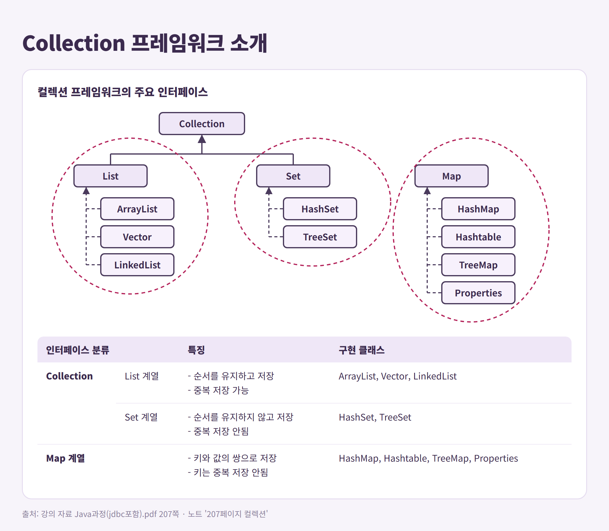

- 리스트쪽을 사용해볼 예정 
  - 배열
    - 장점 : 객체를 저장하고, 검색하는데 가장 효율적이다, 사용하기 편하다.
    - 단점 : 사이즈 변경이 불가하다.

#### Collection

- 객체를 저장할 때 마다, 크기를 자동으로 늘려 준다.
- Set 계열 : 중복을 허용하지 않고, 추가되는 순서를 유지하지 않는다.
- List 계열 : 중복을 허용하고, 추가되는 순서를 유지한다.
- Map 계열 : 키와 값의 쌍으로 저장 된다. (키와 값 모두 객체여야 한다.)
- java.util package에 있다.

  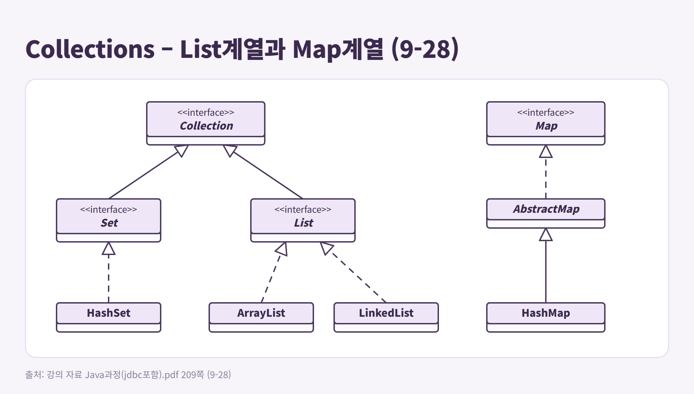

- 다형성에 대하여
- 챕터 6 컬렉션 sts 예제파일 확인 

  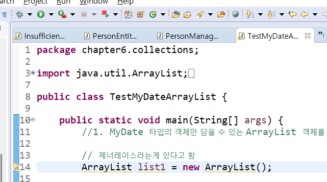

- 오류가 뜸 : 어레이리스트에 스트링을 달건지 뭘 담을것인지 해당 리스트에 저장할 객체 타입을 명시하라는 경고

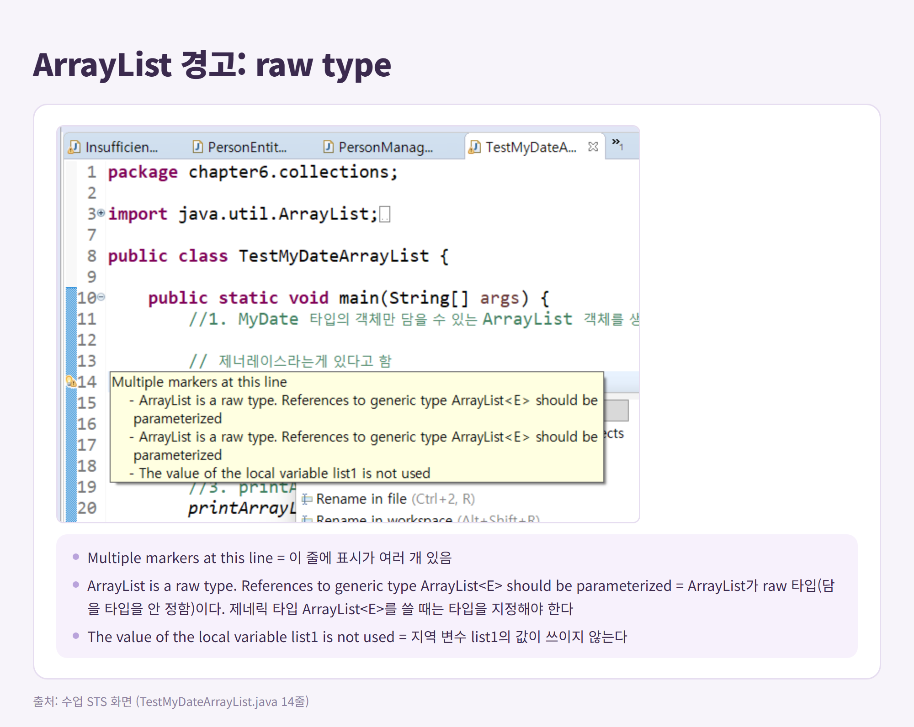

- 제너레이스가 나온 배경에 대해 설명중
- 넣을 때 아무거나 다 들어가다보니 꺼낼 땐 오브젝트 하나만 꺼내는데 문제가 생김. 그래서 제너레이스가 나옴
- 특정 형식만 담고 뺄 수 있기에 만약 다른게 들어가면 오류가 남

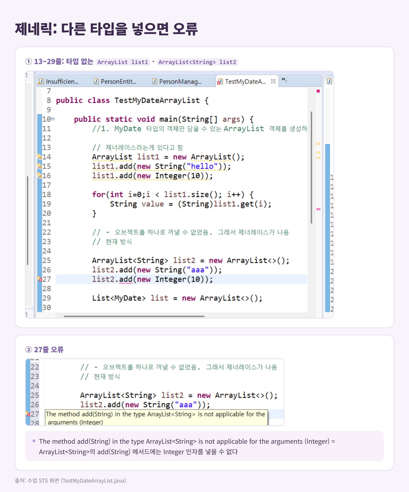

- 오류를 빨리 잡아낼 수 있는 특징들이 추가됨

- 두 개의 차이점이 무엇일까? 

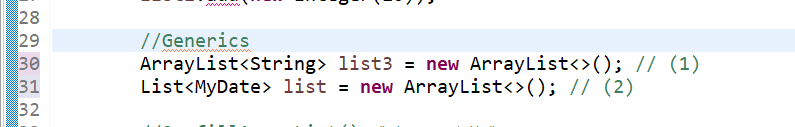

- (1) 이 일반적임. 고유하게 가진 메서드, 더 많은 메서드를 모두 호출 할 수 있음. 대신 linked? 로 호출할 때 유연하지 못함
- (2) 받을 수 있는 메서드는 한정적이지만 더 유연성 있게 교체할 수 있음

#### 단축키·메서드 정리

| 단축키 / 코드 | 하는 일 |
|---|---|
| `PersonManager pManager = new PersonManager();` | static `main`에서 non-static 메서드를 부르려고 객체를 만듦 |
| `pManager.fillPersons(persons);` | 배열 주소를 넘겨 10명 채우기 |
| `for (PersonEntity person : persons)` | 한 명씩 꺼내기 (향상된 for) |
| `person.getGender() == gender` | `char`는 `==`로 값 비교 |
| `person.getName().equals(name)` | `String`은 `equals`로 글자 비교 (`==`는 같은 객체인지를 봄) |
| `personCnt++` | `personCnt = personCnt + 1` |
| `break;` | 찾으면 반복을 바로 끝냄 |
| `System.out.print` / `println` | 줄을 안 바꿈 / 찍고 줄 바꿈 |
| `"\t"` | 탭(칸 띄우기) |
| `ArrayList list1 = new ArrayList();` | 담을 타입을 안 정한 리스트(raw type). 노란 경고 |
| `(String)list1.get(i)` | 꺼낸 `Object`를 `String`으로 형변환 |
| `ArrayList<String> list2 = new ArrayList<>();` | String 전용 리스트(제네릭). 다른 타입을 넣으면 빨간 줄 |
| `<>` | 다이아몬드. 왼쪽에 적은 타입을 보고 자동으로 채움 |
| `List<MyDate> list = new ArrayList<>();` | 왼쪽은 `List`(인터페이스), 오른쪽은 실제 `ArrayList` 객체 |
| `list.add(...)` / `list.get(i)` / `list.size()` | 넣기 / 꺼내기 / 개수 (배열의 `arr[i] = ...` / `arr[i]` / `arr.length`) |