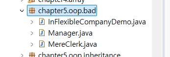
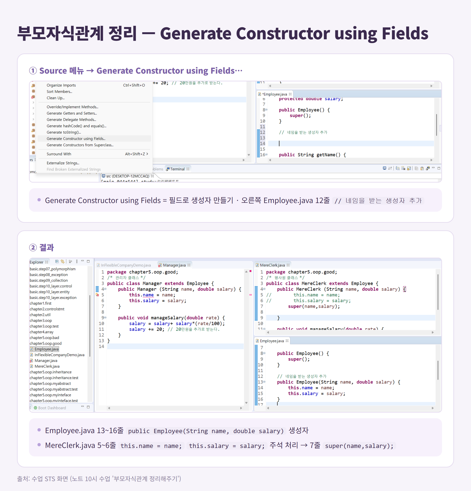
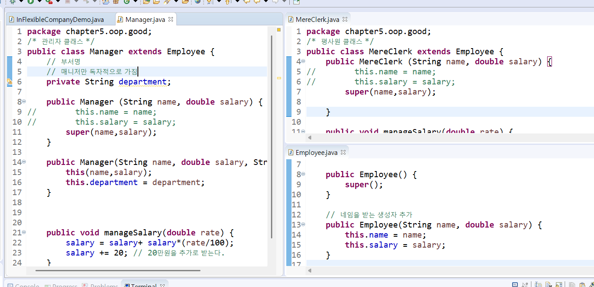
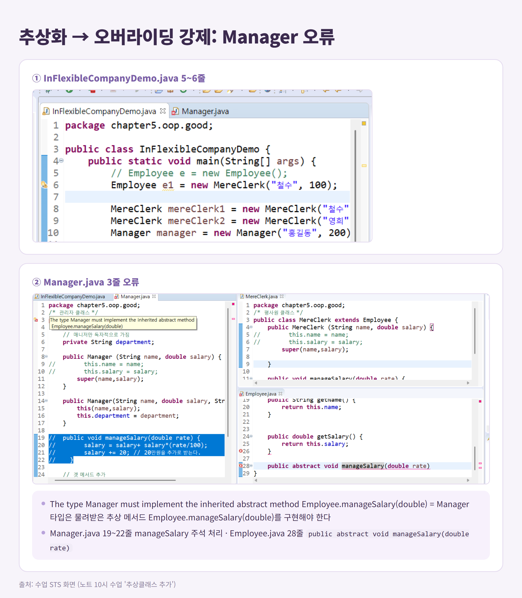
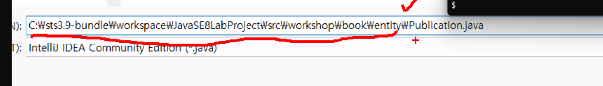
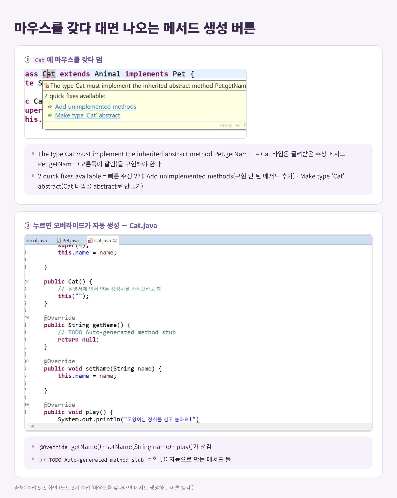
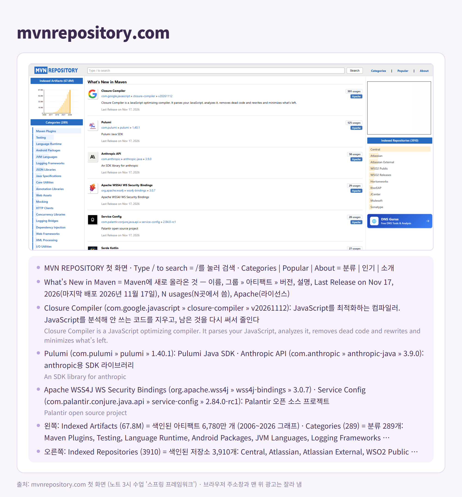
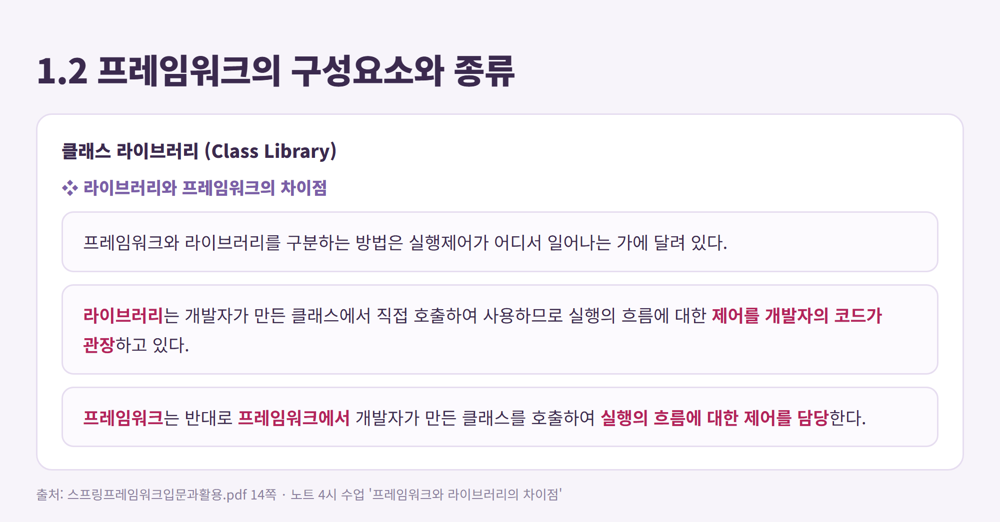

# 19일차 TIL : AI 서비스 개발을 위한 백엔드 I 2일차

## 오프닝

### 복습
- J2SE와 J2EE 플래폼에 대한 이해
- 메서드의 오버로딩에 대하여 
  
  - PrintStream.out
  - 오버로딩 된 메서드가 무척 많다. 왜 이렇게 많이 선언해두었을까?
  - 아규먼트 메서드를 이렇게 만들어놓아야 하는 이유가 있다.
  - 찍을때마다 메서드를 하나하나 찍어두어야 하면 신경쓸게 많아진다. 
  - 인터페이스를 단순화 하기 위해서이다.
    - 사용자 측면에서 생각해보자.
    - 같은 기능에 같은 메서드를 사용하는 것으로 일관성을 유지한다. 
    - 생성자 뿐 아니라 메서드 또한 오버로딩을 하여 어떤 타입을 출력하든 단순하게 Println 원툴로 사용하는것으로 인터페이스를 간편하게 할 수 있다
    - 교재 129페이지~ 오버로딩파트
  - super
    - 수퍼랑 디스는 같이 쓸 수 없다
    - 수퍼랑 디스는 위에 작성해야한다

    | Overriding(재정의) | Overloading(다중정의) |
    |---|---|
    | 메소드를 하위 클래스에서 정의 (필기: `@Override`) | 메소드를 같은 클래스에서 정의 |
    | 메소드 이름 동일 | 메소드 이름 동일 |
    | Parameter(개수 및 데이터 타입) 동일 | Parameter(개수나 데이터 타입) 다름 |
    | Return 타입 동일 | Return 타입 다를 수 있음 |
    | 접근 제한자 : 하위 메소드의 접근 범위가 상위 메소드의 접근 범위 보다 넓거나 같아야 한다. (필기: super `protected` → sub `public`, 아래로 넓어지는 △) | 접근 제한자 : 관계 없음 |
    | 예외 처리 : 예외 발생시 같은 예외 형식이거나, 더 구체적인 예외 형식이어야 한다. (필기: super → sub, 아래로 좁아지는 ▽) | 예외 처리 : 관계없음 |

- 오늘 inheritance 할 예정

### 실습. 컬렉션 예제 이어서 
- ArrayList [공식문서](https://docs.oracle.com/javase/8/docs/api/java/util/ArrayList.html)
  - 멀티스레드 환경에서는 안전하지 않을 수 있음. 그래서 처음에 만들 때 동기화 처리가 필요함. 
  - 각 배열에 필요한 요소를 추가 하기 위해 필요한 메서드 : add (E e)  << 현재 수업에선 엘리멘트, PersonEntity 가 해당함

  - 함수의 인터페이스 설명
    - 자바에서도 에로우 함수를 사용함. 일종의 람다같은 형식으로 가능함. 추후 설명예정
  
  - get 인덱스를 하나 주고 꺼내는것

### 수업 실습3
  - 상속, 다형성에 대한 이해가 필요함.

- 교재 119 페이지

  - 코드의 재 사용 방법
    - copy&paste
    - 함수, 메서드로 만들기 function
    - 상속 - 객체 지향 프로그래밍
    - AOP (Aspect Orientied Programming) 관점지향 프로그래밍
      - OOP 를 대체하거나 하는 것은 아님. 상속같은 경우, 특히 함수나 메서드 방식은 불러다 쓸 경우, 메서드의 파라미터가 바뀌면 호출한 쪽에서 영향을 받는다. 그러한 것 조차 하지 않고 나도모르게 공통적으로 사용하는 로직 앞 뒤로 삽입시켜주는 방법. 공통 프로그램을 직접 호출하지 않고도 적용하는 개념 . 

---

## 10시 수업

- 교재 120페이지
  - 122 페이지 : 무조건 상속관계를 갖는 것은 아님. 예를 들면 매니저도 Employee 에 속해있는 직책이다. 이 경우엔 상속관계를 맺어 줄 수 있다.
    
  
- 리팩토링을 해줄 예정.
- 리팩토리란? 
  - [Erich Gamma](https://en.wikipedia.org/wiki/Erich_Gamma)
    - 이클립스, vs코드 만든 사람
    - [디자인패턴](https://ko.wikipedia.org/wiki/%EB%94%94%EC%9E%90%EC%9D%B8_%ED%8C%A8%ED%84%B4_(%EC%B1%85))
      - 구체적으로는 몰라도 스프링에는 gof 패턴이 라이브러리에 녹아있다.
      - 코딩 구현 전 설계 원칙에 따라 먼저 설계 후 시작하는 것
  - Martin Fowler
    - 리팩토링을 만든 사람
    - [리팩토링](https://refactoring.com/)
      - 코드를 짜고 나서 재구성하는것
      - https://refactoring.com/catalog/
      - https://refactoring.com/catalog/extractSuperclass.html

  - 두 방법 모두 확장성 높게 객체 지향적으로 만드는 것을 목적으로 함

### 리팩토링 실습
- 리팩토링을 이용해 상속되지 않던 코드를 상속하도록 만들어볼 예정

  

- 위 패키지를 복사하여 새 패키지를 만듦
  

- 리팩토링 끝. 하지만 리팩토링 과정에서 오류가 있었다. 남은 이전의 데이터를 정리한다
  

- 부모자식관계 정리해주기


- 한눈 판 사이 매니저에 디파트먼트 추가


#### 추상클래스 추가
- 교재 161 페이지
- 오버라이딩을 강제하고 싶을 때
- 바디 구현 없이 선언만 함
  

- 예시
``` java
public abstract class Employee {
  // abstract(추상)이 들어가는 순간 스스로 객체 생성. 즉 직원 추가(new employee) 가 안됨. 대신 하위에서 객체를 생성하여 타입을 주는 것은 가능함
  // 안되는 것 : Employee = new Employee
  // 되는것 : Employee = new manager
  //         Employee = new MereClerk   
	private String name;
	protected double salary;

	public Employee() {
		super();
	}
```



  - 추상화를 하면 구현의 강제성, 오버라이딩을 필요로 함

- Employee 와 Manager의 차이

  - 매니저에 추가한 getDepartment가 보이지 않음. 추상화 된 employee 의 메서드만 나옴


  - 얘는 보임

- 매니저는 고정된 콘크리트 메서드만 나옴.
  - 물론 부서를 사용할 방법이 있긴 하다.
- 매니저2는 상속받은 것 뿐 아니라 자기 자신 타입이 가진 메서드도 접근할 수 있음. 부모쪽은 자식의 메서드를 사용할 수 없음.

---

## 1시 수업

### RAG
- 업스테이지 : 국내 기업 
  - 솔라 LLM : 한국어로 학습함
  
  > 업스테이지(Upstage)는 2020년 10월에 설립된 대한민국의 인공지능(AI) 스타트업입니다. 자체 개발한 대규모 언어 모델(LLM)과 문서 AI 솔루션을 바탕으로 기업용 AI 시장을 공략하고 있습니다.
  >
  > 주요 기술 및 솔루션
  >  - Solar LLM (솔라): 속도와 그라운디드니스(사실 기반 응답)에 최적화된 엔터프라이즈급 언어 모델 패밀리입니다. 한국어, 일본어 등 아시아권 언어와 영어 처리에 탁월한 성능을 보입니다.
  >  - Document Parse (문서 파스): PDF, 스캔 문서, 이메일 등을 AI 파이프라인에서 즉시 쓸 수 있는 기계 판독 텍스트로 변환합니다.
  >  - Information Extract (정보 추출): 인보이스, 보험 청구서, 계약서 등에서 구조화된 키-값 데이터를 높은 정확도로 추출합니다.
  >  - Upstage AI Space / Workspace: 수십~수백 페이지의 문서에서 자연어 질문을 통해 정확한 출처와 답을 찾아주는 문서 기반 AI 솔루션입니다.

- [AWS 문서](https://aws.amazon.com/ko/what-is/retrieval-augmented-generation/)
- 이 그림이 중요

  

- OCR 
  > OCR(광학 문자 인식, Optical Character Recognition)은 이미지나 스캔한 문서, PDF 속의 글자를 컴퓨터가 읽을 수 있는 디지털 텍스트로 변환하는 기술입니다.
  >
  > 주요 개념 및 작동 원리
  >  - 정의: 사람이 종이에 쓴 글씨나 인쇄물, 사진 속의 텍스트를 인식해 편집·검색 가능한 데이터로 바꿔줍니다.
  >  - 작동 단계:
  >    1. 이미지 획득: 스캐너나 카메라로 문서나 사진 입력.
  >    2. 전처리: 밝기·대비 조절 및 노이즈 제거.

### 실습 이어서

- 상속이 많아지자 하나의 타입으로 핸들링 하고 싶어 나온 것이 


- 상속

- 



report 에서 경로 복사

- 졸아버림... 한 30분 쯤 부터
  - 헤테로와 다형성에 대한 설명을 떨구게 되어버린듯?

--- 

## 2시 수업

### 수업 실습 3 Book

- 예제 실습 끝난 후 2시 30분 : 실습 2, 3번을 금요일까지
- 실습 4는 월요일까지

- 인터페이스 : 교재 165페이지
- 169 페이지
  

### 수업실습 4 동물

---

## 3시 수업

### 실습4 이어서

- 프로텍트 쓰면 오류 난다. 그래서 안쓴다.
  

- 고양이 클래스 생성
- 생성자 없음 오류. 부모 생성자를 호출해야 함
   
  - 다리 생성자 삽입
    

- 기본 생성자가 부모에게 없는 경우 반드시 자녀쪽에서 생성자를 호출해야 함. 일반적으로 기본생성자가 있으면 자동으로 상속됨

- 마우스를 갖다대면 메서드 생성하는 버튼 생김. 누르면 오버라이드가 자동 생성
  

- 클래스 생성 시 브라우즈를 눌러 부모 지정 가능

### 스프링 프레임워크

- [공식문서](https://spring.io/projects/spring-framework)

> Apache Maven은 아파치 소프트웨어 재단(Apache Software Foundation)에서 개발한 자바(Java) 중심의 프로젝트 관리 및 빌드 자동화 도구입니다.
>
> 주요 특징
>  - 표준화된 빌드 라이프사이클: 소스코드 컴파일, 테스트, 패키징(JAR/WAR 등), 배포(Deploy) 등의 빌드 과정을 표준화된 단계로 자동 처리합니다.
>  - 자동 의존성(Dependency) 관리: 프로젝트에 필요한 라이브러리와 그 라이브러리가 의존하는 다른 하위 라이브러리까지 `pom.xml` 파일에 명시만 하면 아파치 메이븐 중앙 저장소를 통해 자동으로 다운로드하고 버전 충돌을 관리합니다.
>  - 프로젝트 객체 모델(POM): `pom.xml` 이라는 XML 기반의 설정 파일을 통해 프로젝트 정보, 의존성, 빌드 옵션, 플러그인 등을 통합 관리합니다.
>  - 확장성: 다양한 플러그인(컴파일, 테스트, 리포팅 등)을 지원하여 빌드 기능을 쉽게 확장할 수 있습니다.



> Gradle(그래들)은 자바(Java), 코틀린(Kotlin), 안드로이드(Android) 등을 포함한 다양한 프로그래밍 언어의 빌드 자동화 오픈소스 도구입니다.
>
> 주요 특징
>  - 유연한 DSL(Domain Specific Language): Groovy 또는 Kotlin 언어 기반의 스크립트를 사용하여 간결하고 가독성 높게 빌드 설정을 작성합니다.
>  - 빠른 빌드 성능: 작업(Task) 기반의 증분 빌드(Incremental Build), 안전한 캐싱, 병렬 실행을 통해 빌드 시간을 대폭 단축합니다.
>  - 안드로이드 공식 빌드 도구: 안드로이드 스튜디오(Android Studio)의 표준 빌드 시스템으로 채택되어 있습니다.
>  - 의존성 관리: Maven 중앙 저장소 등을 활용하여 필요한 외부 라이브러리와 아티팩트를 편리하게 관리합니다.

---

## 4시 수업

### 숙제 
- [실습2, 실습3] 11월 20일(금) 수업까지 작성해 Git 경로를 메일로 보내 주세요.
- [실습4] 11월 23일(월) 수업까지 작성해 Git 경로를 메일로 보내 주세요.
- 스프링 프레임워크 내용 예습하기
  - DI(Dependency Injection) 의존성주입, 
  - Ioc(Inversion of Control) 제어의 역전
  - Spring Bean, Spring Bean Configuration XML

- 스프링에 대한 이야기
  - 스프링 재단에 대하여
    - https://en.wikipedia.org/wiki/Rod_Johnson_(programmer)

- [스프링 프레임워크](https://github.com/spring-projects/spring-framework)
  jdbc
  orm 등등..
  웹플럭스 : 노드는 비동기이지만 이건 동기방식. 응답이 올 때 까지 기다림. 함수형 프로그램 기반. 개발자들에게 어필을 못받음. 노드의 비동기가 넘 인기가 좋고 편해서 ..
  우리는 동기라 webmvc를 사용할 예정
  웹소켓

  - 우리가 프레임워크에서 주로 할 것 : 빈즈, 컨텍스트, 코어. 테스트, 웹, 웹mvc

- https://docs.spring.io/spring-framework/docs/5.2.25.RELEASE/spring-framework-reference/
  - 코틀링이나 그루비 같은 언어도 지원함. 무척 오래되어 안정적인 프레임워크

- [오버뷰](https://docs.spring.io/spring-framework/docs/5.2.25.RELEASE/spring-framework-reference/)
  - 포괄적인 프로그래밍과 설정모델 제공
  - xml
  - @ 오버라이딩 어노텐션
  - 이런 설정모델이 필요한 이유. 객체생성을 스프링이함. 스프링이 만들걸 우리가 알려주면 스프링이 자바 프로그래밍을 돕는다.
  - validation : 자바스크립트로 검증하면 노출되기 쉽다. 이 부분을 서버사이드 렌더링으로 하는것이 안전하다. 

- 프레임워크와 라이브러리 비교
- 프레임워크 : 업무적인것 외. 비 기능적 요구사항(성능,보안,확장성,안정성 등)을 만족하는 구조와 구현된 기능을 안정적으로 실행하도록 제어해주는 잘 만들어진 구조의 라이브러리 덩어리
  - 프레임워크는 애플리케이션들의 최소한의 공통점을 찾아 하부구조를 제공함으로써 개발자들로 하여금 시스템의 하부구조를 구현하는 데 들어가는 노력을 절감하게 해줌.
  - 세미 컴플리티드

- 프레임워크를 사용하는 이유
  - 비기능적 요소들을 초기 개ㅐ발 단계마다 구현해야 하는 불합리함을 극복해준다
  - 기능적인(Functional) 요구사항에 집중할 수 있도록 해준다.
  - 디자인 패턴과 마찬가지로 어쩌구~

- 클래스 라이브러리
  - 프레임워크는 특정 부분의 기술적인 구현을 라이브러리 형태로 제공한다
  class library라는 구성요소는 프레임워크의 정의 중 하나인 반제품이다 라고 해석하게 만들었다.

- 프레임워크와 라이브러리의 차이점

  | 특징 | 프레임워크 | 라이브러리 |
  |---|---|---|
  | 유저코드의 작성 | 프레임워크 클래스를 서브클래싱 해서 작성 | 독립적으로 작성 |
  | 호출흐름 | 프레임워크코드가 유저코드를 호출 | 유저코드가 라이브러리를 호출 |
  | 실행흐름 | 프레임워크가 제어 | 유저코드가 제어 |
  | 객체의 연동 | 구조프레임워크가 정의 | 독자적으로 정의 |

  - 라이브러리는 유저가 직접호출

- 
- 교재 7~15페이지 설명하신듯?