# 19일차 TIL : AI 서비스 개발을 위한 백엔드 I 3일차

🔗 [실습 레포지토리](https://github.com/easty00/JavaSE_Project)

## 오프닝

### 복습
- J2SE와 J2EE 플랫폼에 대한 이해
- 메서드의 오버로딩에 대하여 
  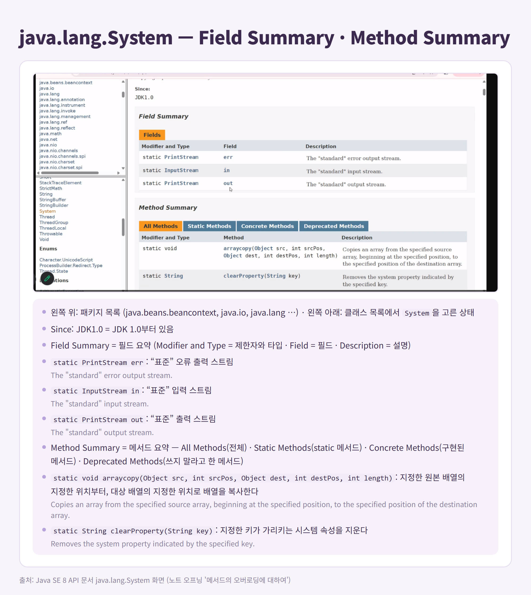
  - PrintStream.out
  - 오버로딩 된 메서드가 무척 많다. 왜 이렇게 많이 선언해두었을까?
  - 아규먼트 메서드를 이렇게 만들어놓아야 하는 이유가 있다.
  - 찍을때마다 메서드를 하나하나 찍어두어야 하면 신경쓸게 많아진다. 
  - 인터페이스를 단순화 하기 위해서이다.
    - 사용자 측면에서 생각해보자.
    - 같은 기능에 같은 메서드를 사용하는 것으로 일관성을 유지한다. 
    - 생성자 뿐 아니라 메서드 또한 오버로딩을 하여 어떤 타입을 출력하든 단순하게 println 원툴로 사용하는것으로 인터페이스를 간편하게 할 수 있다
    - 교재 129페이지~ 오버로딩파트
  - super
    - 수퍼랑 디스는 같이 쓸 수 없다
    - 수퍼랑 디스는 위에 작성해야한다

    | Overriding(재정의) | Overloading(다중정의) |
    |---|---|
    | 메소드를 하위 클래스에서 정의 (필기: `@Override`) | 메소드를 같은 클래스에서 정의 |
    | 메소드 이름 동일 | 메소드 이름 동일 |
    | Parameter(개수 및 데이터 타입) 동일 | Parameter(개수나 데이터 타입) 다름 |
    | Return 타입 동일 | Return 타입 다를 수 있음 |
    | 접근 제한자 : 하위 메소드의 접근 범위가 상위 메소드의 접근 범위 보다 넓거나 같아야 한다. (필기: super `protected` → sub `public`, 아래로 넓어지는 △) | 접근 제한자 : 관계 없음 |
    | 예외 처리 : 예외 발생시 같은 예외 형식이거나, 더 구체적인 예외 형식이어야 한다. (필기: super → sub, 아래로 좁아지는 ▽) | 예외 처리 : 관계없음 |

- 오늘 inheritance 할 예정

### 실습. 컬렉션 예제 이어서 
- ArrayList [공식문서](https://docs.oracle.com/javase/8/docs/api/java/util/ArrayList.html)
  - 멀티스레드 환경에서는 안전하지 않을 수 있음. 그래서 처음에 만들 때 동기화 처리가 필요함. 
  - 각 배열에 필요한 요소를 추가 하기 위해 필요한 메서드 : add (E e)  << 현재 수업에선 엘리먼트, PersonEntity 가 해당함

  - 함수의 인터페이스 설명
    - 자바에서도 애로우 함수를 사용함. 일종의 람다같은 형식으로 가능함. 추후 설명예정
  
  - get 인덱스를 하나 주고 꺼내는것

### 수업 실습3
  - 상속, 다형성에 대한 이해가 필요함.

- 교재 119 페이지

  - 코드의 재 사용 방법
    - copy&paste
    - 함수, 메서드로 만들기 function
    - 상속 - 객체 지향 프로그래밍
    - AOP (Aspect Oriented Programming) 관점지향 프로그래밍
      - OOP 를 대체하거나 하는 것은 아님. 상속같은 경우, 특히 함수나 메서드 방식은 불러다 쓸 경우, 메서드의 파라미터가 바뀌면 호출한 쪽에서 영향을 받는다. 그러한 것 조차 하지 않고 나도모르게 공통적으로 사용하는 로직 앞 뒤로 삽입시켜주는 방법. 공통 프로그램을 직접 호출하지 않고도 적용하는 개념. 

#### 오버로딩 · super와 this (교재 127~135쪽)
- `System.out` : `System` 클래스의 static 필드 `out`. 타입이 `PrintStream`이라 `System.out.println(...)`
- `super` : 부모 객체를 가리킴. `super.멤버변수`, `super.메서드()`, `super(...)`(부모 생성자 호출). 내 다른 생성자는 `this(...)`
- 생성자는 상속 안 됨. 자식은 `super(...)`로 부모 칸을 채움
- 둘 다 안 쓰면 컴파일러가 `super();`를 넣음 → 부모에 기본 생성자가 없으면 오류. 교재 : "클래스 작성시, 항상 default 생성자를 기술하자"

#### ArrayList
- `public class ArrayList<E> extends AbstractList<E> implements List<E>, ...` : `E`는 담을 요소(Element) 타입. `List<PersonEntity>`면 `E` = `PersonEntity`
- 크기를 정하지 않음. 넣는 만큼 늘어남
- 동기화는 밖에서 : `Collections.synchronizedList(new ArrayList(...))`
- `forEach`, `removeIf`의 매개변수 `Consumer`, `Predicate`가 함수형 인터페이스. 여기에 람다(`->`)를 넣음
- 배열 → List로 바꿀 때 바뀐 곳 : import, 만들기, 채우기(`add`), 매개변수 타입. 향상된 for는 그대로

#### 단축키·메서드 정리

| 단축키 / 코드 | 하는 일 |
|---|---|
| `import java.util.ArrayList;` / `import java.util.List;` | ArrayList, List를 쓰려면 import |
| `List<PersonEntity> persons = new ArrayList<>();` | 왼쪽은 `List`(인터페이스), 오른쪽은 실제 `ArrayList`. 칸 수를 안 정함 |
| `persons.add(new PersonEntity(...));` | 목록 끝에 붙임 (배열의 `persons[0] = ...` 대신) |
| `get(int index)` | 그 위치(0부터)의 요소를 꺼냄 |
| `size()` | 요소 개수 |
| `fillPersons(List<PersonEntity> persons)` | 매개변수 타입도 `PersonEntity[]` → `List<PersonEntity>` |
| `for (PersonEntity person : persons)` | 배열이든 List든 한 개씩 꺼냄 |

---

## 10시 수업

- 교재 120페이지
  - 122 페이지 : 무조건 상속관계를 갖는 것은 아님. 예를 들면 매니저도 Employee 에 속해있는 직책이다. 이 경우엔 상속관계를 맺어 줄 수 있다.
    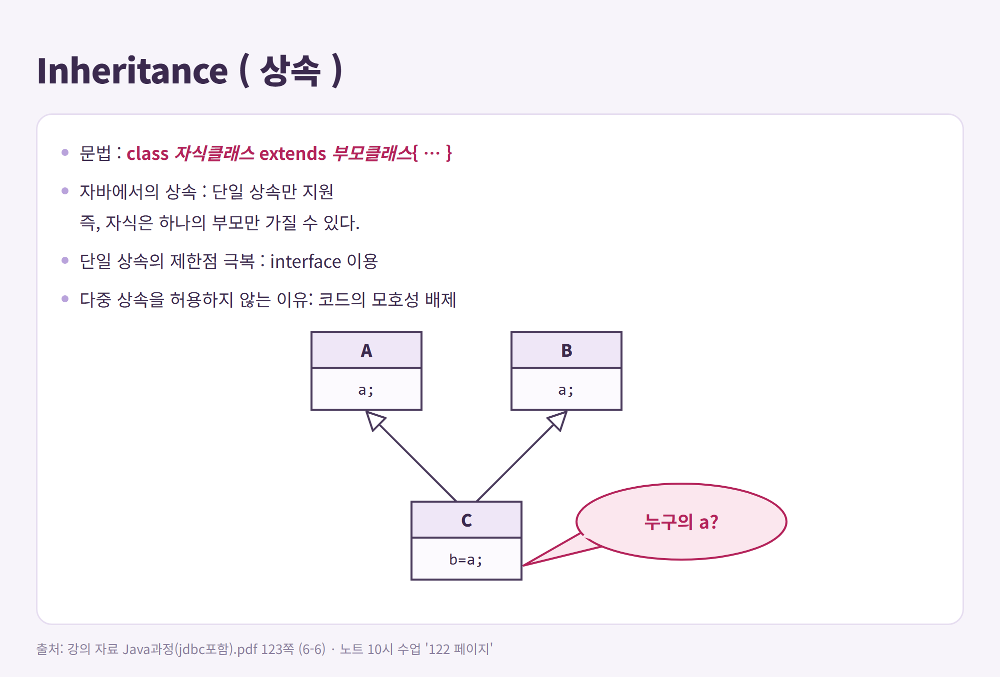
  
- 리팩토링을 해줄 예정.
- 리팩토링이란? 
  - [Erich Gamma](https://en.wikipedia.org/wiki/Erich_Gamma)
    - 이클립스, vs코드 만든 사람
    - [디자인패턴](https://ko.wikipedia.org/wiki/%EB%94%94%EC%9E%90%EC%9D%B8_%ED%8C%A8%ED%84%B4_(%EC%B1%85))
      - 구체적으로는 몰라도 스프링에는 GoF 패턴이 라이브러리에 녹아있다.
      - 코딩 구현 전 설계 원칙에 따라 먼저 설계 후 시작하는 것
  - Martin Fowler
    - 리팩토링을 만든 사람
    - [리팩토링](https://refactoring.com/)
      - 코드를 짜고 나서 재구성하는것
      - https://refactoring.com/catalog/
      - https://refactoring.com/catalog/extractSuperclass.html

  - 두 방법 모두 확장성 높게 객체 지향적으로 만드는 것을 목적으로 함

### 리팩토링 실습
- 리팩토링을 이용해 상속되지 않던 코드를 상속하도록 만들어볼 예정

  

- 위 패키지를 복사하여 새 패키지를 만듦
  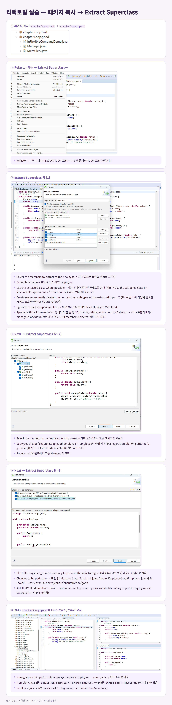

- 리팩토링 끝. 하지만 리팩토링 과정에서 오류가 있었다. 남은 이전의 데이터를 정리한다
  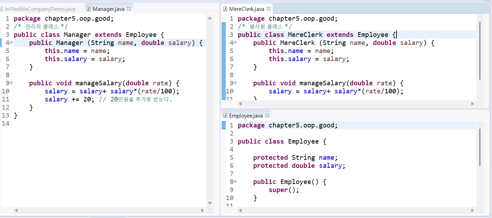

- 부모자식관계 정리해주기


- 한눈 판 사이 매니저에 디파트먼트 추가


#### 추상클래스 추가
- 교재 161 페이지
- 오버라이딩을 강제하고 싶을 때
- 바디 구현 없이 선언만 함
  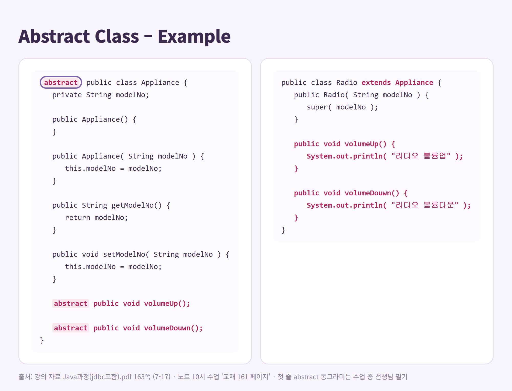

- 예시
``` java
public abstract class Employee {
  // abstract(추상)이 들어가는 순간 스스로 객체 생성. 즉 직원 추가(new Employee) 가 안됨. 대신 하위에서 객체를 생성하여 타입을 주는 것은 가능함
  // 안되는 것 : Employee = new Employee
  // 되는것 : Employee = new Manager
  //         Employee = new MereClerk   
	private String name;
	protected double salary;

	public Employee() {
		super();
	}
```


  - 추상화를 하면 구현의 강제성, 오버라이딩을 필요로 함

- Employee 와 Manager의 차이
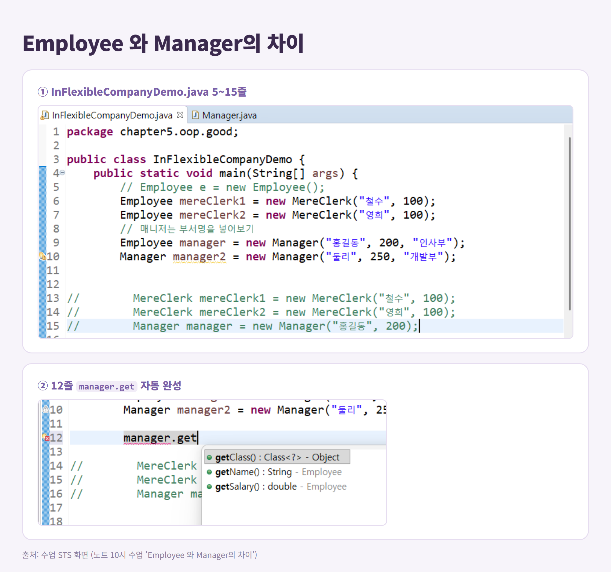
  - 매니저에 추가한 getDepartment가 보이지 않음. 추상화 된 Employee 의 메서드만 나옴

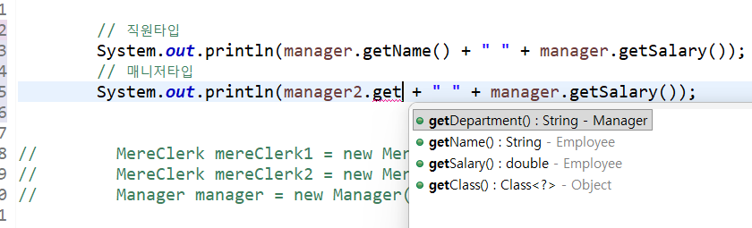
  - 얘는 보임

- 매니저는 고정된 콘크리트 메서드만 나옴.
  - 물론 부서를 사용할 방법이 있긴 하다.
- 매니저2는 상속받은 것 뿐 아니라 자기 자신 타입이 가진 메서드도 접근할 수 있음. 부모쪽은 자식의 메서드를 사용할 수 없음.

#### 상속 (교재 120~126쪽)
- 문법 : `class 자식클래스 extends 부모클래스 { … }`. "A는 B다"가 말이 되면 상속 (매니저는 직원이다)
- 단일 상속만 지원 : 자식은 부모 하나. 극복은 인터페이스 (2시 수업 정리)
- 다중 상속을 막는 이유 : 코드의 모호성 배제. A에도 `a`, B에도 `a`가 있으면 C의 `b=a;`는 누구의 a?
- 접근 제한자 : `private` 클래스 안 / default 같은 패키지 / `protected` default 범위 + 상속 관계면 패키지 상관없이 / `public` 어디서나

#### 리팩토링
- 하는 일(동작)은 그대로 두고 안의 구조만 더 좋게 바꾸는 것
- 디자인 패턴 : 에리히 감마 등 GoF(4인방)의 책에 23개
- Extract Superclass : 비슷한 클래스 둘에서 겹치는 부분을 새 부모 클래스로 뽑아냄
- 오늘 순서
  1. `chapter5.oop.bad` 복사 → `chapter5.oop.good`
  2. Refactor → Extract Superclass (`name`, `salary`, `getName()`, `getSalary()` → `Employee`)
  3. 자식에 남은 `name`, `salary` 지우기
  4. `name`을 `private`으로, `Employee(String name, double salary)` 만들고 자식은 `super(name,salary)`
  5. 매니저만의 `department`와 `this(name,salary)`
  6. `Employee`를 `abstract`로, `manageSalary`를 추상 메서드로, 자식에 `@Override`
- `manageSalary`는 안 뽑음 : 두 클래스의 몸통이 달라서 (매니저만 +20)

#### 추상 클래스 (교재 161~164쪽)
- 미완성 클래스. `abstract` 메서드(몸통 없이 `;`로 끝남)가 하나라도 있으면 반드시 `abstract` 클래스
- 일반 메서드, 멤버 변수도 가질 수 있음
- 장점 : 일관된 인터페이스 제공, 꼭 필요한 기능 강제

#### 변수 타입과 보이는 메서드
- 컴파일러는 변수 타입(왼쪽)만 보고 부를 수 있는 메서드를 정함 → `Employee manager`는 `getDepartment`가 안 보이고 `Manager manager2`는 보임

#### 단축키·메서드 정리

| 단축키 / 코드 | 하는 일 |
|---|---|
| Refactor → Extract Superclass… (Alt + Shift + T로 Refactor 메뉴) | 겹치는 멤버를 새 부모 클래스로 뽑아냄 |
| Source → Generate Constructor using Fields… | 변수를 골라 생성자 만들기 (`Employee(String name, double salary)`) |
| Ctrl + Space 자동 완성 | 오른쪽 회색 글씨가 그 메서드가 있는 클래스 |
| `public class Manager extends Employee` | `Employee`를 물려받음 |
| `super(name,salary);` | 부모 생성자에게 이름·월급을 맡김 (첫 줄) |
| `this(name,salary);` | 내 다른 생성자 부르기 (첫 줄). 다음 줄에서 부서만 직접 넣음 |
| `private String department;` / `getDepartment()` | 매니저만 가진 부서 |
| `protected double salary;` | 상속 관계면 자식이 직접 씀 |
| `public abstract class Employee` | 추상 클래스. `new Employee()` 불가 |
| `public abstract void manageSalary(double rate);` | 몸통 없는 추상 메서드 |
| `@Override` | 부모 메서드를 재정의했다는 표시. 컴파일러가 검사 |
| `salary = salary + salary*(rate/100);` | `rate`가 10이면 10% 인상 |

---

## 1시 수업

### RAG
- 업스테이지 : 국내 기업 
  - 2020년 10월 설립. 네이버 출신 김성훈 대표 등 AI 전문가들이 세움
  - 기업용(B2B) AI 솔루션과 자체 LLM을 만들어 공급함
  - 솔라 LLM : 한국어로 학습함
    - 처음부터(From Scratch) 직접 만든 LLM 패밀리. 기업 실무·에이전틱(Agentic) AI에 특화됨
    - 적은 연산 자원으로 거대 모델급 성능을 냄. 한국어·영어·일본어 등 다국어와 문서 처리에 강함
    - 모델 라인업

      | 모델 | 크기·구조 | 쓰는 곳 |
      |---|---|---|
      | Solar Pro 4 | 플래그십 상용 모델, 512K 컨텍스트 | 다단계 추론, 도구 호출, 긴 문서 분석 같은 어려운 에이전트 업무 |
      | Solar Mini 4 | 전체 35B 중 추론 때 3B만 씀 (MoE) | 빠른 반복 작업, 대규모 트래픽, 비용이 중요한 에이전트 |
      | Solar Open 2 | 전체 250B 중 추론 때 15B만 씀, 오픈 웨이트 | 데이터를 밖으로 못 내보내는 공공·금융기관의 자체 서버(온프레미스) |

    - 강점
      - 에이전트: 대화만 하는 챗봇이 아니라 엑셀 분석, 보고서 작성, 코딩·터미널, API 연속 호출 같은 여러 단계 업무를 끝까지 하도록 훈련함
      - 환각 줄이기(그라운디드니스, 사실 기반 응답): 문서에 없는 내용·숫자를 지어내지 않고, 근거가 없으면 "확인할 수 없다"고 답함 → 법률·의료·금융처럼 정확해야 하는 곳에 맞음
      - 가성비: 전문가 혼합(MoE, Mixture of Experts) 구조로 실제 추론 연산량을 줄임. 한국 모델 최초로 오픈라우터(OpenRouter)에 정식 등재됨
      - 한국어·전문 분야: 한국어(KMMLU-Pro), 법률(KBL), 의학(KorMedMCQA), 사무 업무 평가에서 글로벌 빅테크 모델과 대등하거나 앞섬
    - 써 보기: 브라우저용 Upstage SolarChat, 개발자용 콘솔
  - 다른 제품
    - Document Parse (Document AI): PDF·스캔 문서·이메일 같은 비정형 문서를 AI가 읽을 수 있는 텍스트·구조화 데이터로 바꿈
    - Information Extract: 인보이스·보험 청구서·계약서에서 키-값 데이터를 정확하게 뽑아냄
    - AI Space / Workspace: 수십~수백 쪽 문서에 자연어로 물으면 출처와 함께 답을 찾아 줌 (문서 기반 검색·질의응답)

#### RAG
- [AWS 문서](https://aws.amazon.com/ko/what-is/retrieval-augmented-generation/)
  - RAG(검색 증강 생성, Retrieval Augmented Generation) : LLM이 답하기 전에 훈련 데이터 밖의 믿을 만한 자료(회사 문서 등)를 먼저 찾아서 같이 보고 답하게 하는 방법. 모델을 다시 훈련하지 않아도 됨
  - 왜 필요 : LLM은 훈련 데이터가 멈춰 있어서 최신 정보를 모르고, 답이 없으면 지어내거나 오래된·두루뭉술한 답을 함
  - 좋은 점 : 다시 훈련하는 것보다 쌈, 최신 자료에 연결, 출처를 같이 보여 줘서 사용자가 확인, 권한에 따라 민감한 자료를 막음
  - 작동 방식
    1. 문서를 임베딩(글의 뜻을 숫자 목록으로 바꾼 것)으로 바꿔 벡터 DB(그림의 `Vec`)에 저장
    2. 질문도 숫자 목록으로 바꿔 뜻이 비슷한 문서를 찾음 (시맨틱 검색. 예: "연차 얼마나 남았지?" → 연차 정책 문서 + 그 직원의 휴가 기록)
    3. 찾은 자료를 질문에 붙여서 LLM에 줌
    4. 문서와 임베딩은 실시간 또는 주기적으로 갱신
  - 그림 순서 : ① 질문 → ② 관련 정보 검색(문서·DB) → ③ 찾은 자료가 돌아옴 → ④ 질문 + 자료를 함께 LLM에 → ⑤ 답
- 이 그림이 중요

  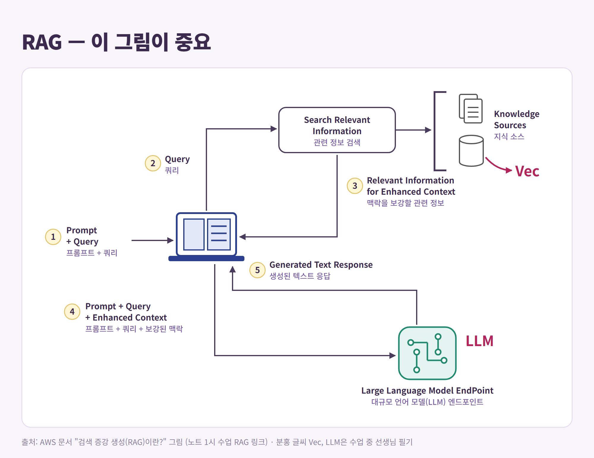

- OCR 
  - [AWS 문서](https://aws.amazon.com/ko/what-is/ocr/)
  - OCR(광학 문자 인식, Optical Character Recognition) : 사진·스캔 문서·PDF 속 글자를 컴퓨터가 읽고 고칠 수 있는 텍스트로 바꾸는 기술
  - 왜 필요 : 스캔한 문서는 그림으로만 저장돼서 검색·편집이 안 됨. 종이 양식·인보이스·계약서를 사람이 옮겨 치면 느림
  - 작동 단계 : 이미지 얻기(스캐너·카메라) → 전처리(기울기·얼룩·밝기 바로잡기) → 글자 인식(저장해 둔 글자 모양과 비교하거나 선·고리 같은 특징으로 판단) → 후처리(기계가 읽을 수 있는 문서로 만듦)
  - 신경망을 쓰는 ICR(지능형 문자 인식)은 손글씨에도 강함
  - RAG와 관계 : 사진·스캔 문서는 OCR로 글자로 바꿔야 벡터 DB에 넣을 수 있음. 업스테이지 Document Parse도 스캔 문서를 글자로 바꾸는 제품

### 실습 이어서

- 상속이 많아지자 하나의 타입으로 핸들링 하고 싶어 나온 것이 
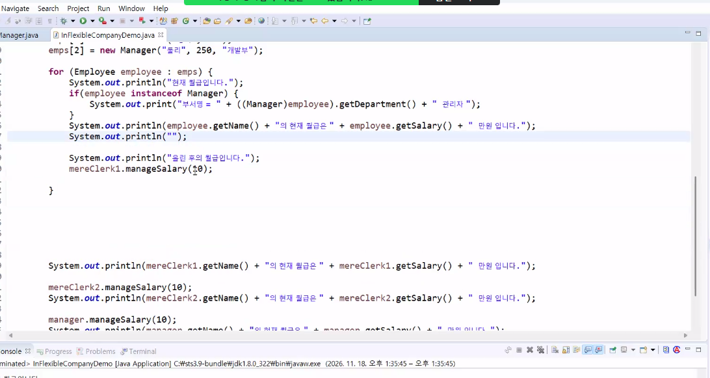

- 상속


- report 에서 경로 복사

- 졸아버림... 한 30분 쯤 부터
  - 헤테로와 다형성에 대한 설명을 떨구게 되어버린듯?


#### 다형성 (교재 139~149쪽)
- Polymorphism = Poly(다양한) + morphism(변형). 같은 이름의 메서드가 실제 객체에 따라 다르게 동작하는 것. 객체지향(OOP)의 핵심 특징
  - 비유 : 리모컨의 전원 버튼 하나로 TV는 켜지고, 에어컨은 바람이 나오고, 스피커는 음악이 나옴
- 교재 뜻 : 한 reference 변수가 다른 형태의 객체를 참조할 수 있음 (부모 reference 변수 → 자식 객체)
  - `Employee e = new Manager();` ○ / `Manager m = new Employee();` ✗
  - "직원"이라고 적힌 만능 리모컨 하나로 평사원도 매니저도 다루는 것
- 부를 수 있는 메서드는 변수 타입이 정하고(10시), 실제로 실행되는 몸통은 `new`로 만든 객체의 것 → `employee.manageSalary(10)` 한 줄이 직원마다 각자의 `manageSalary`로 실행됨
- 오버로딩(컴파일 때 정해짐)도 다형성의 한 형태로 보지만, 교재가 말하는 다형성은 오버라이딩 쪽(실행 때 정해짐). 둘의 차이는 오프닝 표
- 좋은 점 : 종류마다 따로 부르지 않고 반복문 하나로 처리. 새 자식 클래스가 생겨도 기존 반복문은 그대로

#### Heterogeneous Collection (교재 142쪽)
- Hetero(다른) + geneous(종류의). 서로 다른 클래스의 객체를 부모 타입 배열 하나에 담는 것 (`Employee[] emps`에 평사원 둘 + 매니저 하나)
  - 비유 : 사과·바나나·우유·장난감을 한 바구니에. 오늘 코드는 "직원"이라고만 적힌 사물함 한 줄
- 반대는 Homogenous collection : 같은 클래스 객체끼리 (`MyDate[] dates`)
- 자바 배열에는 칸 타입(부모)과 관계없는 객체는 못 넣음. 아무거나 담으려면 최상위 타입 `Object[]`

#### 캐스팅과 instanceof (교재 147~149쪽)
- 업캐스팅 : 자식 → 부모. 괄호 필요 없음
- 다운캐스팅 : 부모 → 자식. `(Manager)`처럼 타입을 써야 함. 만능 리모컨을 내려놓고 TV 전용 리모컨을 드는 것
  - 진짜 객체가 그 타입일 때만 됨. 아니면 컴파일은 되지만 실행 중 `ClassCastException`
  - 수업 중간 단계 : for 안에서 확인 없이 `((Manager)employee)` → 첫 칸 평사원 철수에서 `MereClerk cannot be cast to Manager`로 멈춤
- `instanceof` : 캐스팅 전에 명찰 확인. `A instanceof B`는 A가 B와 같은 타입이거나 B의 자식이면 true, B의 부모면 false, 부모·자식 관계가 아니면 컴파일 에러

#### 단축키·메서드 정리

| 단축키 / 코드 | 하는 일 |
|---|---|
| `Manager m = (Manager)manager;` | `Employee` 타입 변수를 `Manager` 타입으로 캐스팅 → `m.getDepartment()`가 보임 |
| `Employee[] emps = new Employee[3];` | 직원 3칸 배열 (Heterogeneous Collection) |
| `emps[0] = new MereClerk("철수", 100);` ~ `emps[2] = new Manager("둘리", 250, "개발부");` | 평사원·매니저를 한 배열에 |
| `for (Employee employee : emps)` | 한 칸씩 꺼냄 |
| `if(employee instanceof Manager)` | 진짜 객체가 `Manager`일 때만 |
| `((Manager)employee).getDepartment()` | 괄호 두 겹. 점(`.`)이 먼저라 `((Manager)employee)`로 먼저 묶고 점을 붙임 |
| `employee.manageSalary(10);` | 직원마다 월급 올리기 |

--- 

## 2시 수업

### 수업 실습 3 Book

- 예제 실습 끝난 후 2시 30분 : 실습 2, 3번을 금요일까지
- 실습 4는 월요일까지

- 인터페이스 : 교재 165페이지
- 169 페이지
  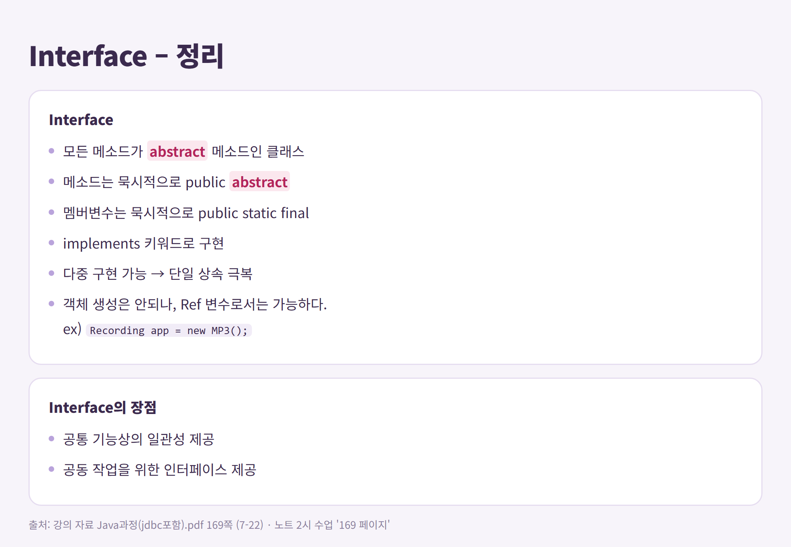

### 수업실습 4 동물

#### 다형적 아규먼트 (교재 144~146쪽)
- 매개변수 타입을 부모로 두면 어떤 자식 객체든 메서드 하나로 받음 : `modifyPrice(Publication pub)`
- Bad : 종류마다 오버로딩 `modifyPrice(Magazine ma)`, `modifyPrice(Novel no)`, `modifyPrice(ReferenceBook rb)` → 종류가 늘면 메서드도 늘어남
- Good : 부모 타입 매개변수 하나 + 안에서 `instanceof`로 구분

#### 인터페이스 (교재 165~169쪽)
- 메서드 형식(할 줄 알아야 하는 것 목록)만 모아 놓은 것. 몸통 `{ }` 없음. 어떻게 할지는 구현하는 클래스가 정함
  - 비유 : `extends`는 핏줄(부모), `implements`는 자격증. 부모는 하나뿐이지만 자격증은 여러 개 딸 수 있음
- 단일 상속 극복 : 고양이·물고기는 동물이면서 반려동물, 거미는 동물만. `Pet`까지 클래스면 `Cat`의 부모가 둘이 되어 안 됨 → `Pet`은 인터페이스 (`Cat extends Animal implements Pet`, `extends`가 먼저)
- 여러 개 붙여도 되는 이유 : 몸통이 없어서. 두 인터페이스에 `play()`가 같이 있어도 몸통은 클래스에 하나 → "누구의 a?" 문제가 안 생김
- 고르는 법 : "A는 B다"면 `extends`(고양이는 동물이다), "A는 B 역할을 할 수 있다"면 `implements`(고양이는 반려동물 역할을 한다)
- 메서드는 묵시적으로 `public abstract`, 변수는 묵시적으로 `public static final`(상수)
- 객체 생성 불가, 변수 타입으로는 가능 : `Recording app = new MP3();`
- 자바 8부터 몸통 있는 `default`, `static` 메서드도 가능. 두 인터페이스에 같은 이름의 `default`가 있으면 클래스에서 직접 재정의해야 함
- 오프닝의 `List`도 인터페이스 : `ArrayList`는 부모 하나(`AbstractList`) + 인터페이스 여러 개(`List` 등). 왼쪽을 `List`로 두면 오른쪽 구현체를 바꿔도 아래 코드는 그대로

| | 추상 클래스 (`Animal`) | 인터페이스 (`Pet`) |
|---|---|---|
| 붙이는 말 | `extends` (하나만) | `implements` (여러 개) |
| 메서드 | 추상 + 일반 (`eat` + `walk`) | 모두 추상 (자바 8부터 `default`·`static`도) |
| 변수 | 보통 변수 (`protected int legs`) | 상수만 (`public static final`) |
| 생성자 | 있음 | 없음 |
| `new` | 안 됨 | 안 됨 |
| 변수 타입으로 | 됨 | 됨 |
| `protected` 메서드 | 됨 | 안 됨 |

#### 단축키·메서드 정리

| 단축키 / 코드 | 하는 일 |
|---|---|
| `public class Publication extends Object` | 안 써도 모든 클래스의 부모는 `Object`. 보이게 씀 |
| `super(title, publishingDate, page, price);` | 자식 생성자 첫 줄. 부모 칸(`private`)은 부모 생성자에게 맡김 |
| `@Override public String toString() { return this.title; }` | `System.out.println(책)`이 제목을 찍음 |
| `Publication pub = new Magazine();` | 부모 타입 변수 → `Publication` 메서드만 보임 |
| `if(pub instanceof Magazine) { ((Magazine)pub).getPublishingPeriod(); }` | 확인하고 캐스팅해서 잡지 메서드를 부름 |
| `Publication[] pubs = new Publication[5];` | 책 5권을 한 배열에 |
| `for (Publication publication : pubs) { System.out.println(publication); }` | 책마다 `toString()` |
| `Publication pub3 = pubs[2];` | 세 번째 책 (0부터) |
| `public static void modifyPrice(Publication pub)` | 다형적 아규먼트 |
| `if(pub instanceof Magazine) { rate = 0.6; }` | 잡지 40% 할인 → 0.6을 곱함. 소설 0.8, 참조서 0.9 |
| `pub.setPrice((int)(pub.getPrice() * rate));` | `int × double` = `double` → `(int)`로 소수점을 버리고 저장 |
| `public abstract class Animal` / `protected int legs;` / `protected Animal(int legs)` | 실습4 추상 부모. 기본 생성자 없음 |
| `public abstract void eat();` / `public void walk()` | 추상 메서드 / 일반(concrete) 메서드 |
| `public interface Pet { String getName(); void setName(String name); public abstract void play(); }` | 세 줄 모두 `public abstract` |

---

## 3시 수업

### 실습4 이어서

- 프로텍티드 쓰면 오류 난다. 그래서 안쓴다.
  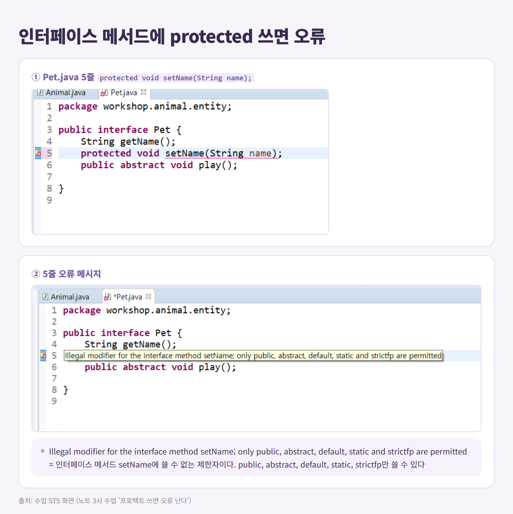

- 고양이 클래스 생성
- 생성자 없음 오류. 부모 생성자를 호출해야 함
  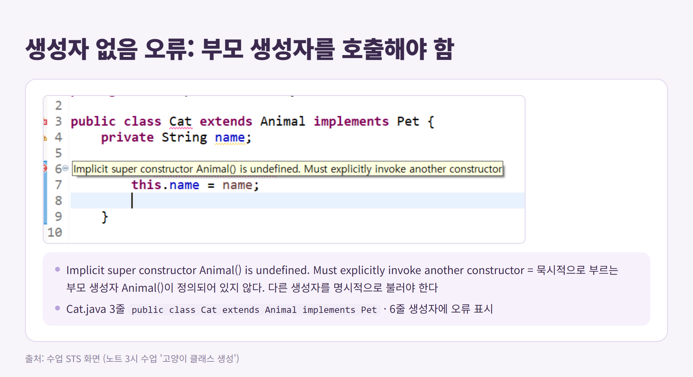 
  - 다리 생성자 삽입
    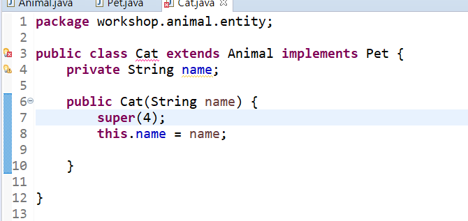

- 기본 생성자가 부모에게 없는 경우 반드시 자녀쪽에서 생성자를 호출해야 함. 일반적으로 기본생성자가 있으면 자동으로 상속됨

- 마우스를 갖다대면 메서드 생성하는 버튼 생김. 누르면 오버라이드가 자동 생성
  

- 클래스 생성 시 브라우즈를 눌러 부모 지정 가능

### 스프링 프레임워크

- [공식문서](https://spring.io/projects/spring-framework)

> Apache Maven은 아파치 소프트웨어 재단(Apache Software Foundation)에서 개발한 자바(Java) 중심의 프로젝트 관리 및 빌드 자동화 도구입니다.
>
> 주요 특징
>  - 표준화된 빌드 라이프사이클: 소스코드 컴파일, 테스트, 패키징(JAR/WAR 등), 배포(Deploy) 등의 빌드 과정을 표준화된 단계로 자동 처리합니다.
>  - 자동 의존성(Dependency) 관리: 프로젝트에 필요한 라이브러리와 그 라이브러리가 의존하는 다른 하위 라이브러리까지 `pom.xml` 파일에 명시만 하면 아파치 메이븐 중앙 저장소를 통해 자동으로 다운로드하고 버전 충돌을 관리합니다.
>  - 프로젝트 객체 모델(POM): `pom.xml` 이라는 XML 기반의 설정 파일을 통해 프로젝트 정보, 의존성, 빌드 옵션, 플러그인 등을 통합 관리합니다.
>  - 확장성: 다양한 플러그인(컴파일, 테스트, 리포팅 등)을 지원하여 빌드 기능을 쉽게 확장할 수 있습니다.


> Gradle(그래들)은 자바(Java), 코틀린(Kotlin), 안드로이드(Android) 등을 포함한 다양한 프로그래밍 언어의 빌드 자동화 오픈소스 도구입니다.
>
> 주요 특징
>  - 유연한 DSL(Domain Specific Language): Groovy 또는 Kotlin 언어 기반의 스크립트를 사용하여 간결하고 가독성 높게 빌드 설정을 작성합니다.
>  - 빠른 빌드 성능: 작업(Task) 기반의 증분 빌드(Incremental Build), 안전한 캐싱, 병렬 실행을 통해 빌드 시간을 대폭 단축합니다.
>  - 안드로이드 공식 빌드 도구: 안드로이드 스튜디오(Android Studio)의 표준 빌드 시스템으로 채택되어 있습니다.
>  - 의존성 관리: Maven 중앙 저장소 등을 활용하여 필요한 외부 라이브러리와 아티팩트를 편리하게 관리합니다.

#### 생성자 부르기 흐름 (실습4)
- `new Cat()` → `this("")` → `Cat(String name)` → `super(4)` → `Animal(int legs)`
- `new Spider()` → `super(8)` / `new Fish()` → `super(0)`
- `this("")`와 `super(4)`는 같이 못 씀 → `Cat()`의 `//super(4);`는 주석

#### UML 기호 (실습 문서)
- `+` public, `-` private, `#` protected
- 실선 △ = 상속(`extends`), 점선 △ = 구현(`implements`), 기울어진 글씨 = abstract

#### Maven · Gradle
- 라이브러리를 받아 오고 빌드하는 도구. 프론트의 npm 같은 것. Maven은 `pom.xml`, Gradle은 `build.gradle`에 적음
- 빌드 = 코드를 실행·배포할 수 있는 모양(`.class`, `.jar`)으로 만드는 일
- 지금 `JavaSE8LabProject`에는 `pom.xml`이 없음. 스프링을 쓰기 시작하면 이 도구로 받음

#### 단축키·메서드 정리

| 단축키 / 코드 | 하는 일 |
|---|---|
| 빨간 줄에 마우스 → Add unimplemented methods (키보드는 Ctrl + 1) | 구현 안 된 추상 메서드를 한 번에 만듦 (`// TODO Auto-generated method stub`) |
| 빨간 줄에 마우스 → Make type 'Cat' abstract | 대신 `Cat`을 추상 클래스로 만듦 (오늘은 안 씀) |
| New → Class 창 Superclass 옆 Browse… | 부모 클래스 고르기 → `extends`가 붙음 |
| New → Class 창 Interfaces 옆 Add… | 인터페이스 고르기 → `implements`가 붙음 |
| `public class Cat extends Animal implements Pet` | 부모 하나 + 인터페이스 |
| `super(4);` | 부모 생성자에 다리 수를 넘김 |
| `public Cat() { this(""); }` | 빈 이름으로 내 다른 생성자를 부름 |
| `@Override public void eat()` | 추상 메서드 구현 (Cat, Spider, Fish 모두) |
| `@Override public void walk()` (Fish) | 일반 메서드도 필요하면 재정의 |
| `Cat cat1 = new Cat();` / `Pet cat2 = new Cat();` / `Animal cat3 = new Cat();` | 변수 타입에 따라 부를 수 있는 메서드가 다름 : `Cat`은 전부 5개 / `Pet`은 `Pet` 것 3개 / `Animal`은 `Animal` 것 2개 |

---

## 4시 수업

### 숙제 
- [실습2, 실습3] 11월 20일(금) 수업까지 작성해 Git 경로를 메일로 보내 주세요.
- [실습4] 11월 23일(월) 수업까지 작성해 Git 경로를 메일로 보내 주세요.
- 스프링 프레임워크 내용 예습하기
  - DI(Dependency Injection) 의존성주입, 
  - IoC(Inversion of Control) 제어의 역전
  - Spring Bean, Spring Bean Configuration XML

- 스프링에 대한 이야기
  - 스프링 재단에 대하여
    - https://en.wikipedia.org/wiki/Rod_Johnson_(programmer)

- [스프링 프레임워크](https://github.com/spring-projects/spring-framework)
  jdbc
  orm 등등..
  웹플럭스 : 노드는 비동기이지만 이건 동기방식. 응답이 올 때 까지 기다림. 함수형 프로그램 기반. 개발자들에게 어필을 못받음. 노드의 비동기가 넘 인기가 좋고 편해서 ..
  우리는 동기라 webmvc를 사용할 예정
  웹소켓

  - 우리가 프레임워크에서 주로 할 것 : 빈즈, 컨텍스트, 코어. 테스트, 웹, 웹mvc

- https://docs.spring.io/spring-framework/docs/5.2.25.RELEASE/spring-framework-reference/
  - 코틀린이나 그루비 같은 언어도 지원함. 무척 오래되어 안정적인 프레임워크

- [오버뷰](https://docs.spring.io/spring-framework/docs/5.2.25.RELEASE/spring-framework-reference/)
  - 포괄적인 프로그래밍과 설정모델 제공
  - xml
  - @ 오버라이딩 어노테이션
  - 이런 설정모델이 필요한 이유. 객체생성을 스프링이함. 스프링이 만들걸 우리가 알려주면 스프링이 자바 프로그래밍을 돕는다.
  - validation : 자바스크립트로 검증하면 노출되기 쉽다. 이 부분을 서버사이드 렌더링으로 하는것이 안전하다. 

- 프레임워크와 라이브러리 비교
- 프레임워크 : 업무적인것 외. 비 기능적 요구사항(성능,보안,확장성,안정성 등)을 만족하는 구조와 구현된 기능을 안정적으로 실행하도록 제어해주는 잘 만들어진 구조의 라이브러리 덩어리
  - 프레임워크는 애플리케이션들의 최소한의 공통점을 찾아 하부구조를 제공함으로써 개발자들로 하여금 시스템의 하부구조를 구현하는 데 들어가는 노력을 절감하게 해줌.
  - 세미 컴플리티드

- 프레임워크를 사용하는 이유
  - 비기능적 요소들을 초기 개발 단계마다 구현해야 하는 불합리함을 극복해준다
  - 기능적인(Functional) 요구사항에 집중할 수 있도록 해준다.
  - 디자인 패턴과 마찬가지로 어쩌구~

- 클래스 라이브러리
  - 프레임워크는 특정 부분의 기술적인 구현을 라이브러리 형태로 제공한다
  class library라는 구성요소는 프레임워크의 정의 중 하나인 반제품이다 라고 해석하게 만들었다.

- 프레임워크와 라이브러리의 차이점

  | 특징 | 프레임워크 | 라이브러리 |
  |---|---|---|
  | 유저코드의 작성 | 프레임워크 클래스를 서브클래싱 해서 작성 | 독립적으로 작성 |
  | 호출흐름 | 프레임워크코드가 유저코드를 호출 | 유저코드가 라이브러리를 호출 |
  | 실행흐름 | 프레임워크가 제어 | 유저코드가 제어 |
  | 객체의 연동 | 구조프레임워크가 정의 | 독자적으로 정의 |

  - 라이브러리는 유저가 직접호출

- 
- 교재 7~15페이지 설명하신듯?

#### 스프링 프레임워크
- 2003년, 초기 J2EE 명세가 너무 복잡해서 나옴. 만든 사람은 로드 존슨
- 모듈 중 webmvc는 블로킹(응답을 기다림, 우리가 쓸 것), webflux는 논블로킹(안 기다림)
- 스프링 5.x는 JDK 8에서 돌아가고, 6부터는 Java 17 이상

#### 프레임워크와 라이브러리 (스프링 교재 7~15쪽)
- 디자인 패턴 + 라이브러리 = 프레임워크. 패턴은 설계 가이드라인만, 프레임워크는 패턴이 적용된 코드까지 줌
- IoC(제어의 역전) : 객체 생성부터 소멸까지를 개발자가 아니라 컨테이너가 맡음. 스프링 컨테이너는 설정(XML·어노테이션)을 보고 Bean(스프링이 만들고 관리하는 객체)을 만들고 DI(필요한 객체를 넣어 줌)로 연결함
- 프론트 때 예 : React는 내가 `useState`를 부름(라이브러리), Next.js는 내가 만든 `app/page.tsx`를 Next가 부름(프레임워크)