# 20일차 TIL : AI 서비스 개발을 위한 백엔드 I 4일차

🔗 [실습 레포지토리](https://github.com/easty00/JavaSE_Project)

## 오프닝

### 복습
1. PersonEntity와 PersonManager에 ArrayList를 적용하여 수정하기

2. 코드의 재사용성 방법
    - : 함수, 상속, AOP(관점지향프로그래밍)

3. 상속과 다형성 이해하기

    - : Martin Fowler 의 리팩토링 소개

    - : Refactoring 원칙 중 Extract Superclass 적용하여 중복되는 클래스들 리팩토링 하기

    - : 리팩토링 된 Employee, Manager, MereClerk 수정하기

    - : Employee 를 추상클래스로 만들고 추상메서드 추가하기

    - : 다형성

    - : 상속과 다형성을 이해하기 위한 Publication 관련 클래스 작성하기

    - : Heterogeneous Collection ( 다른 종류의 컬렉션 )

    - : Polymorphic Argument ( 다형적 아규먼트 )

4. 추상클래스와 인터페이스 이해하기

    - : 추상클래스와 인터페이스 이해하기 위한 Animal 관련 클래스 작성하기

5. 스프링 프레임워크 소개와 Maven 빌드 도구 소개

    - : 라이브러리와 프레임워크의 차이점 이해하기

    - : 라이브러리는 호출 흐름의 주도권을 개발자가 가지고 있고,

    - 프레임워크는 호출 흐름의 주도권을 프레임워크가 가지기 때문에 Configuration 정보 ( XML, 어노테이션 ) 가 필요합니다.

### 스프링 설치
- STS 프로젝트 세 개
  - `MySpringFW` : 오늘 직접 채워 갈 프로젝트. 처음엔 `pom.xml`의 `<dependencies>`가 비어 있음
  - `SpringFWXml` : `myspring` 아래 `di`, `aop`, `student`, `user`가 이미 있는 프로젝트. `src/main/resources/beans.xml`도 있음
  - `SpringFWConfig` : `SpringFWXml`과 비슷하고 `myspring/config` 패키지가 더 있음

### 깃허브 만들기.. 는 나중으로

### 개념설명 먼저
#### Spring Framework 공식 소개
Spring Framework는 현대적인 자바 기반 기업용(엔터프라이즈) 애플리케이션을 위한 폭넓은 프로그래밍 모델과 설정 모델을 제공한다. 어떤 종류의 배포 플랫폼에서든 쓸 수 있다.

Spring의 핵심은 애플리케이션 수준의 기반(인프라) 지원이다. Spring이 기업용 애플리케이션의 "배관(plumbing)" 작업을 맡아 준다. 그래서 개발팀은 특정 배포 환경에 쓸데없이 묶이지 않고, 애플리케이션의 비즈니스 로직에만 집중할 수 있다.

- 지원 정책과 마이그레이션
  - 최소 요구 사항, 이전 버전에서 업그레이드하는 방법, 지원 정책은 공식 Spring Framework 위키 페이지에서 확인할 수 있다.

- 기능
  - 핵심 기술: 의존성 주입, 이벤트, 리소스, 국제화(i18n), 유효성 검사, 데이터 바인딩, 타입 변환, SpEL, AOP
  - 테스트: 목(mock) 객체, TestContext 프레임워크, Spring MVC Test, WebTestClient
  - 데이터 접근: 트랜잭션, DAO 지원, JDBC, ORM, XML 마샬링
  - 웹 프레임워크: Spring MVC, Spring WebFlux
  - 통합: 리모팅, JMS, JCA, JMX, 이메일, 작업(task), 스케줄링, 캐시, 관측성(observability)
  - 언어: Kotlin, Groovy, 동적 언어

- 용어정리

  | 용어 | 뜻 |
  | --- | --- |
  | 엔터프라이즈 애플리케이션 | 회사나 기관에서 쓰는 큰 업무용 프로그램 (은행, 쇼핑몰 등) |
  | 배포 플랫폼	| 만든 프로그램을 올려서 실제로 돌리는 곳 (서버, 톰캣 등) |
  | 배관(plumbing) |	눈에는 안 보이지만 꼭 있어야 하는 바탕 작업. 객체끼리 연결하기, DB 연결하기 등 |
  | 비즈니스 로직 |	프로그램이 하는 진짜 일. 예: 도서 대출 규칙, 계좌 출금 규칙 |
  | 의존성 주입(DI)	| 필요한 객체를 스프링이 만들어서 넣어 주는 것 (앞에서 본 식당 매니저) |
  | i18n |	internationalization(국제화)의 줄임말. i와 n 사이에 글자가 18개라서 이렇게 씀. 화면을 여러 나라 말로 바꾸는 기능 |
  | 데이터 바인딩 |	화면에서 들어온 값을 자바 객체에 자동으로 채워 넣는 것 |
  | SpEL |	Spring Expression Language. 설정 안에서 쓰는 짧은 계산식 |
  | AOP |	로그 찍기처럼 여러 곳에서 반복되는 일을 한곳에 모아 처리하는 방법 |
  | mock 객체 |	테스트할 때 진짜 대신 쓰는 가짜 객체 |
  | 트랜잭션 |	여러 작업을 "전부 성공, 아니면 전부 취소"로 묶는 것 (계좌 이체) |
  | DAO |	Data Access Object. DB에 데이터를 넣고 꺼내는 일만 맡는 객체 |
  | JDBC |	자바가 DB와 대화하는 기본 방법 |
  | ORM |	자바 객체와 DB 표를 자동으로 이어 주는 기술 |
  | Spring MVC | 웹에서 들어온 요청을 받아 처리하는 스프링의 웹 도구 |

  <details>
  <summary>Plumbing</summary>
  스프링(Spring)에서 Plumbing(배관)은 개발자가 핵심 비즈니스 로직에 집중할 수 있도록 애플리케이션 뒤단에서 연결과 기반 인프라를 자동으로 처리해 주는 구조를 뜻합니다.

  Plumbing이 의미하는 것
  - 인프라 연결 자동화: 데이터베이스, 파일 시스템, 메시징, 이메일 등 외부 자원과 연결하는 번거로운 코드를 대신 처리합니다.
  - 결합도 낮춤: 특정 서버나 배포 환경에 코드가 묶이지 않도록 중간에서 연결 규약과 설정을 조율합니다.
  - 비즈니스 로직 집중: 개발자가 매번 연결 설정·리소스 관리 코드를 짜지 않고 도메인 규칙 구현에 집중하게 돕습니다.

  스프링에서 Plumbing을 담당하는 핵심 요소
  - IoC / DI: 객체 생성과 의존성 연결을 컨테이너가 대신 관리합니다.
  - AOP: 트랜잭션 관리, 로깅, 보안 같은 공통 부가 기능을 비즈니스 코드 밖에서 연결합니다.
  - 데이터·웹 추상화: JDBC/JPA 연동, HTTP 요청 응답 처리 등 하위 기술 차이를 감춥니다.

  Spring 이란? 글에서는 DI와 MVC 관점에서 스프링이 애플리케이션의 plumbing을 어떻게 다루는지 확인할 수 있습니다.

  원하시는 방향에 맞춰 더 자세히 설명해 드릴 수 있습니다:
  - IoC·DI·AOP 같은 핵심 메커니즘 동작 방식
  - Spring Boot가 반복 설정을 줄여주는 원리
  - 실제 코드에서 비즈니스 로직과 인프라 코드를 분리하는 구조

  </details>


- 17 페이지
  - 2.1 Spring Framework 개요 : Spring Framework란?
    - Java 엔터프라이즈 개발을 편하게 해주는 오픈소스 경량급 애플리케이션 프레임워크이다.
    - 엔터프라이즈 개발 용이 : 개발자가 복잡하고 실수하기 쉬운 Low Level에 많이 신경 쓰지 않으면서 Business Logic 개발에 전념할 수 있도록 해준다.
    - 오픈소스 : Spring은 OpenSource의 장점을 충분히 취하면서 동시에 OpenSource 제품의 단점과 한계를 잘 극복함

- 경량급 프레임워크
  - 무거운 서버 없이 단순 웹 컨테이너인 톰캣에서도 돌아감
  - 요즘은 WAS 로 편안하게 사용할 수 있게 제공되고 있음

- 18 페이지
  - 오픈소스의 장점을 가지면서도 계속 업데이트되고 있음

- 19페이지
  - 스프링 삼각형.

  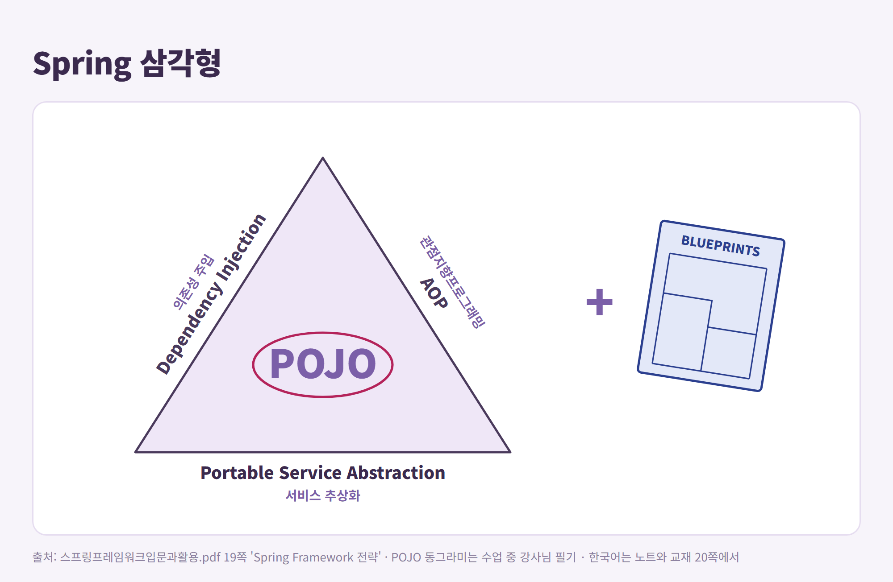

    - 그림 설명 : 삼각형 세 변이 Dependency Injection, AOP, Portable Service Abstraction이고 가운데에 POJO가 있음. 강사님이 가운데 POJO에 동그라미를 치심. 세 기술은 POJO(특정 기술에 묶이지 않은 평범한 자바 객체)로 개발할 수 있게 받쳐 주는 도구이고 중심은 POJO라는 걸 짚으신 것. 바로 아래 'POJO 기반' 설명으로 이어짐.
    - 엔터프라이즈 개발의 복잡함을 상대하는 Spring의 전략 → Portable Service Abstraction, DI, AOP, POJO
  - POJO 기반.
    - POJO : 마틴 파울러가 만든 용어
    - Plain Old Java Object : 특정 프레임워크나 기술에 종속되지 않는 단순하고 일반적인 자바 객체. 기술이 없는 깔끔하고 플레인한 자바
      - 당시 무거운 Entity Beans(EJB) 대신 일반 자바 객체에 비즈니스 로직을 담는 것의 장점을 설명하기 위해 만들어짐.
      - 단순한 객체에도 그럴싸한 이름이 있어야 사람들이 잘 받아들일 거라 생각하여 이름 붙였다고 함
- Portable Service Abstraction(서비스 추상화)
  - 트랜잭션 추상화, OXM 추상화, 데이터 액세스의 Exception 변환기능 등 기술적인 복잡함은 추상화를 통해 Low Level의 기술 구현 부분과 기술을 사용하는 인터페이스로 분리한다.
  - 강사님 필기 : OXM → Object XML Mapping. OXM이 무엇의 줄임말인지 적어 주심(자바 객체와 XML을 서로 바꿔 주는 것).

| 꼭짓점 | 교재 설명 | 🔍 쉽게 |
|---|---|---|
| **POJO** (가운데) | 객체지향 원리에 충실하면서, 특정 환경이나 규약에 종속되지 않고 필요에 따라 재활용될 수 있게 설계된 객체 (23쪽) | 스프링 것을 `import` 하지 않은 평범한 자바 클래스. 오늘 `Hello`, `StringPrinter` |
| **DI** | 유연하게 확장 가능한 객체를 만들어 두고, 그 관계는 외부에서 다이내믹하게 설정 (21쪽) | 누구와 이을지는 클래스 안이 아니라 설정 파일에서 정함 (7·9장) |
| **AOP** | 애플리케이션 로직 코드에 남아 있는 기술 관련 코드를 분리해서 별도 모듈로 관리 (22쪽 📖) | 어제 3장 AOP: 로그·시간 재기를 앞뒤에 끼워 넣기 |
| **PSA** (Portable Service Abstraction, 서비스 추상화) | 트랜잭션 추상화, OXM 추상화, 데이터 액세스 Exception 변환 등 기술적인 복잡함을 Low Level 구현 부분과 기술을 사용하는 인터페이스로 분리 (20쪽) | 기술이 바뀌어도 내가 쓰는 쪽(인터페이스)은 그대로. 어제 `List` ↔ `ArrayList`와 같은 생각 |

- 네 개가 결국 한 방향이다. POJO(평범한 객체)로 짜고, 연결은 DI가, 공통 기술 코드는 AOP가, 기술 차이는 PSA가 맡아서 코드는 평범하게 남게 함.

- [xml과 json의 차이점 및 장단점](https://share.gemini.google/SsTfjftWi1OY)

---

## 10시 수업

- [주요 쓰임새. toml](https://gemini.google.com/share/bd5ccf0fd24d?social_preview=false&skid=12e3c2bc-4e7a-44da-a77d-d9d08bf5dbd9)
  - toml: 데이터 교환보다 설정 파일 역할로 많이 사용

- json과 yaml 장단점. 쓰임새. 예시

- 스프링에서 properties와 yaml 비교

| 형식 | 생김새 | 주로 쓰는 곳 |
|---|---|---|
| XML | `<server><port>8080</port></server>` | 오늘 스프링 설정(`beans.xml`), Maven `pom.xml` |
| JSON | `{"server": {"port": 8080}}` | 데이터 주고받기(API 응답), `package.json` |
| YAML | `server:` 다음 줄에 `  port: 8080` (들여쓰기로 계층) | Spring Boot `application.yml`, GitHub Actions |
| properties | `server.port=8080` (한 줄에 하나) | Spring Boot `application.properties` |
| TOML | `[server]` 다음 줄에 `port = 8080` | Rust `Cargo.toml`, Python `pyproject.toml` |

- 대체로 설정 파일 포맷으로 사용된다.

- 21페이지
  - 객체지향과 DI(Dependency Injection)
    - Spring은 객체지향에 충실한 설계가 가능하도록 단순한 객체 형태로 개발할 수 있고, DI 는 유연하게 확장 가능한 객체를 만들어 두고 그 관계는 외부에서 다이내믹하게 설정해준다.

- 26페이지

  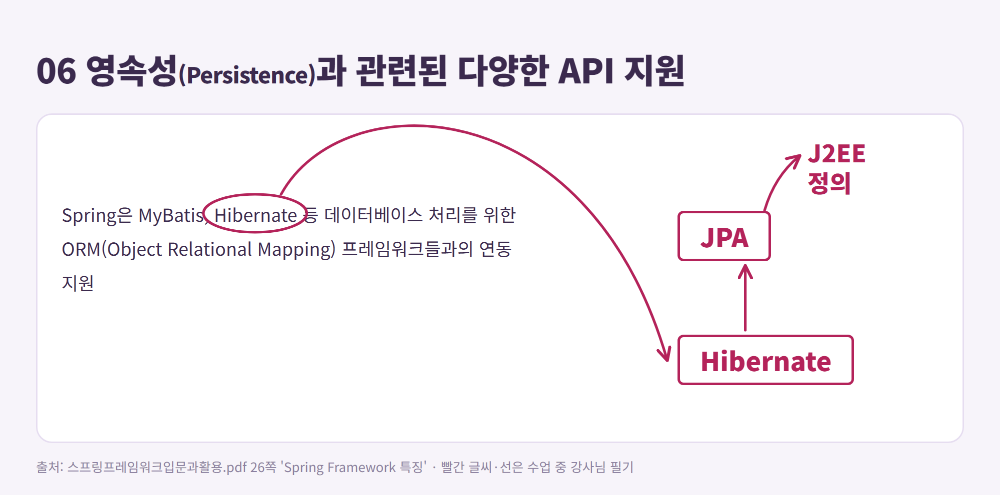

  - 그림 설명 : 슬라이드 06번 줄의 Hibernate에 동그라미를 치고 화살표로 빼서 Hibernate → JPA → 'J2EE 정의' 순서로 그리심. JPA는 J2EE(지금의 자카르타)가 정한 표준 명세이고, Hibernate는 그 명세를 실제로 구현한 프레임워크라서 Hibernate에서 JPA로 화살표가 올라감. 아래 JPA 메모를 그림으로 그리신 것.
  - 2.2 Spring Framework 특징
    - 05 트랜잭션 처리를 위한 일관된 방법을 지원 : JDBC, JTA 등 어떤 트랜잭션을 사용하던 설정을 통해 정보를 관리하므로 트랜잭션 구현에 상관없이 동일한 코드 사용가능
    - 06 영속성(Persistence)과 관련된 다양한 API 지원 : Spring은 MyBatis, Hibernate 등 데이터베이스 처리를 위한 ORM(Object Relational Mapping) 프레임워크들과의 연동 지원
  - JPA(spring data jpa) : 자카르타에서 정의한 표준 명세서. 구현한 것이 하이버네이트. 그런데 좀 복잡함. 그래서 좀 더 쓰기 좋게 추상화를 한 것이 Spring Data JPA

  | 이름 | 무엇인가 | 🔍 비유 |
  |---|---|---|
  | JPA | 자바 객체 ↔ DB 표를 잇는 **표준 명세(규칙 문서)**. 처음엔 J2EE(Java EE)가 정했고 지금은 Jakarta EE가 관리 | 콘센트 규격서 |
  | Hibernate | JPA 규칙대로 실제로 만든 **구현체** | 규격대로 만든 플러그 제품 |
  | Spring Data JPA | JPA를 스프링에서 더 쉽게 쓰게 한 번 더 감싼 것 | 꽂기만 하면 되는 멀티탭 |

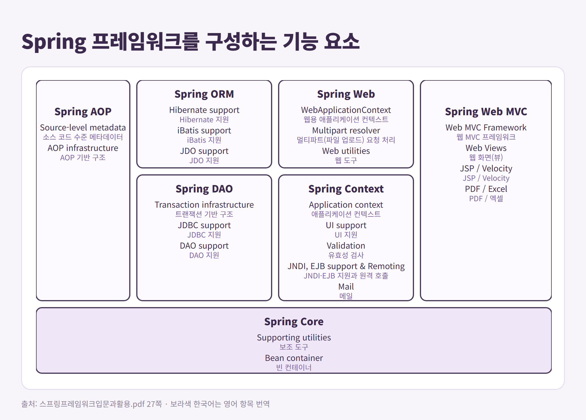

- 그림 설명 : 교재 27쪽 'Spring 프레임워크를 구성하는 기능 요소' 그림. 맨 아래 Spring Core(빈 컨테이너)가 바탕에 깔리고 그 위에 AOP, ORM, DAO, Web, Context, Web MVC 모듈이 올라가 있음. 바로 앞 26쪽 특징 중 트랜잭션은 DAO 칸(Transaction infrastructure)에, Hibernate 연동은 ORM 칸(Hibernate support)에 들어 있음.

| 상자 | 교재 설명 (28~30쪽) |
|---|---|
| Spring Core | 기본 기능. 여기 있는 **BeanFactory**가 스프링의 기본 컨테이너이자 DI의 바탕 (7-4) |
| Spring Context | BeanFactory를 넓힌 것. 국제화(I18N) 메시지, 생명주기 이벤트, 유효성 검증 (7-4 ApplicationContext) |
| Spring DAO | JDBC를 감싸서 JDBC 코딩·예외 처리를 간단하게. AOP로 트랜잭션 관리 |
| Spring ORM | MyBatis, Hibernate, JPA 같은 ORM과 연결 |
| Spring AOP | AOP 지원 |
| Spring Web | 웹 애플리케이션 기본 기능, 다른 웹 프레임워크와 통합 |
| Spring Web MVC | MVC(Model/View/Controller)로 화면과 로직을 나누는 웹 프레임워크 |

### IoC와 DI
- 프레임워크가 우리 대신 객체를 생성해줌
- 제어권의 역전이라고 함. 

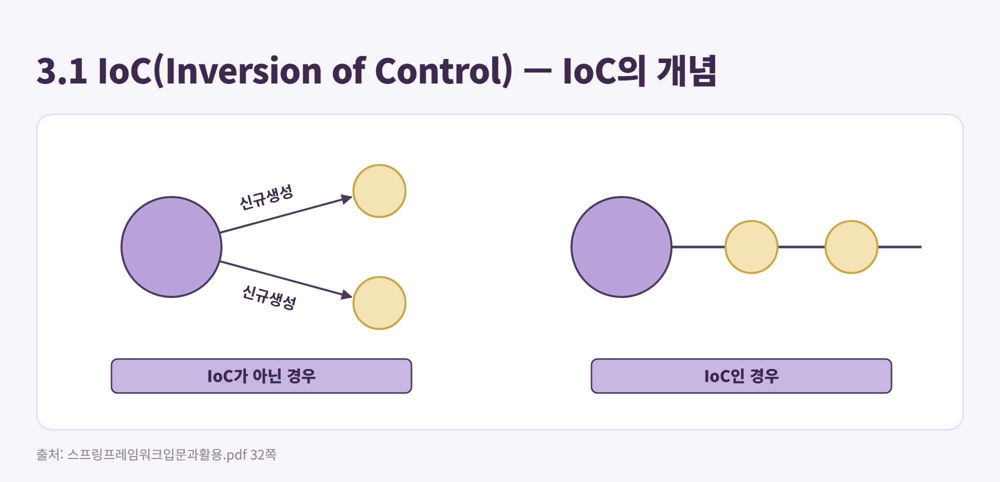

  - 그림 설명 : 왼쪽 'IoC가 아닌 경우'는 큰 원(객체)이 작은 원 두 개를 직접 '신규생성'함(내 코드에서 new로 만드는 것). 오른쪽 'IoC인 경우'는 객체끼리 선으로 이어져 있기만 하고 직접 만드는 화살표가 없음. 객체를 만들고 이어 주는 일을 내 코드가 아니라 프레임워크가 맡는다(제어권이 바뀜)는 걸 보여 주는 그림.
  - 3.1 IoC(Inversion of Control) : IoC의 개념
    - IoC(제어권의 역전)이란, 객체의 생성, 생명주기의 관리까지 모든 객체에 대한 제어권이 바뀌었다는 것을 의미한다.
    - 컴포넌트 의존관계 결정 (component dependency resolution), 설정(configuration) 및 생명주기(lifecycle)를 해결하기 위한 디자인 패턴(Design Pattern)
  ```java
  // IoC가 아닌 경우: Hello가 직접 만든다
  Printer printer = new StringPrinter();

  // IoC인 경우: Hello는 받기만 한다 (선생님 Hello.java 30~32줄)
  public void setPrinter(Printer printer) {
    this.printer = printer;
  }
  ```
  > 🔍 비유: 집에서 요리하려면 내가 장 보고(=`new`) 다 해야 하지만, 식당에서는 주문만 하면 주방(컨테이너)이 만들어 테이블에 놓아 줘요. 무엇을 언제 만들지 정하는 힘(제어권)이 나 → 주방으로 **뒤집혔어요(역전)**.


- 프레임워크가 각 클래스에 세터 메서드가 있는지 확인하고 인자에 해당 레퍼런스를 주입함 (setter injection)

  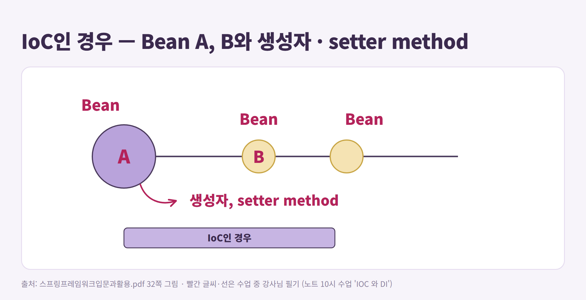

  - 그림 설명 : 'IoC인 경우' 그림 위에 강사님이 큰 원에 A, 첫 번째 작은 원에 B를 쓰고 원마다 Bean이라고 적으심. 그 아래에 '생성자, setter method'를 쓰심. 컨테이너가 만든 Bean A 안에 Bean B를 넣어 줄(주입) 때 생성자나 setter 메서드를 통로로 쓴다는 뜻. 바로 위(setter injection)와 아래(생성자 인젝션) 메모를 한 장에 그리신 것.
  - 생성자의 경우 생성자 인젝션

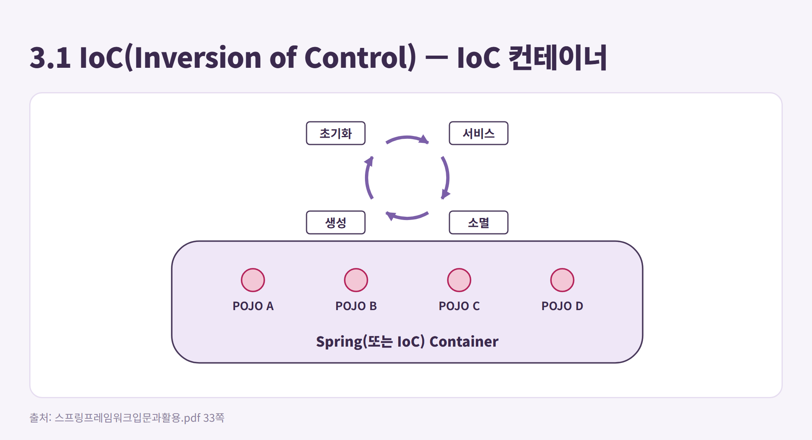

- 그림 설명 : Spring(또는 IoC) Container 안에 POJO A~D가 들어 있고, 위에서 생성 → 초기화 → 서비스 → 소멸 화살표가 돌아감. 객체가 만들어져서 쓰이고 없어질 때까지(생명주기)를 컨테이너가 맡는다는 아래 문장을 그림으로 나타낸 것.
- 3.1 IoC(Inversion of Control) : IoC 컨테이너
  - 스프링 프레임워크도 객체에 대한 생성 및 생명주기를 관리할 수 있는 기능을 제공하고 있음. 즉, IoC 컨테이너 기능을 제공한다.
  - IoC 컨테이너는 객체의 생성을 책임지고, 의존성을 관리한다.
  - POJO의 생성, 초기화, 서비스, 소멸에 대한 권한을 가진다.
  - 개발자들이 직접 POJO를 생성할 수 있지만 컨테이너에게 맡긴다.

- IoC는 크게 DL, DI로 분류됨

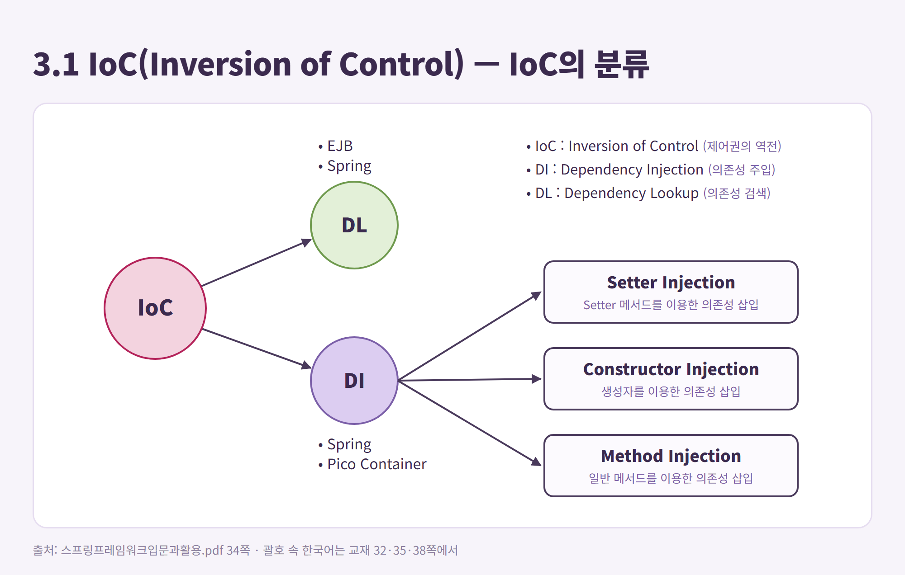

  - 그림 설명 : IoC가 DL(Dependency Lookup, 의존성 검색)과 DI(Dependency Injection, 의존성 주입)로 나뉘고, DI는 다시 Setter / Constructor / Method Injection으로 나뉨. DL 쪽 예는 EJB·Spring, DI 쪽 예는 Spring·Pico Container. 오늘 실습한 건 DI 중 Setter Injection과 Constructor Injection임.

- 3.2 Spring DI(Dependency Injection) 용어

  | 용어 | 뜻 |
  | --- | --- |
  | 빈 (Bean) | 스프링이 IoC 방식으로 관리하는 객체라는 뜻<br>스프링이 직접 생성과 제어를 담당하는 객체를 Bean이라고 부름 |
  | 빈 팩토리 (BeanFactory) | 스프링의 IoC를 담당하는 핵심 컨테이너를 가리킴<br>Bean을 등록, 생성, 조회, 반환하는 기능을 담당함<br>이 BeanFactory를 바로 사용하지 않고 이를 확장한 ApplicationContext를 주로 이용함 |
  | 애플리케이션 컨텍스트 (Application Context) | BeanFactory를 확장한 IoC 컨테이너<br>Bean을 등록하고 관리하는 기능은 BeanFactory와 동일하지만 스프링이 제공하는 각종 부가 서비스를 추가로 제공함<br>스프링에서는 ApplicationContext를 BeanFactory 보다 더 많이 사용함 |
  | 설정 메타정보 (Configuration metadata) | ApplicationContext 또는 BeanFactory가 IoC를 적용하기 위해 사용하는 메타정보를 말함<br>설정 메타정보는 IoC컨테이너에 의해 관리되는 Bean 객체를 생성하고 구성할 때 사용됨 |

  - 빈 팩토리 : 컨테이너 역할을 함 [[공식문서](https://docs.spring.io/spring-framework/docs/current/javadoc-api/org/springframework/beans/factory/BeanFactory.html)]
    - 빈의 생성에 초점을 맞춤
  - 애플리케이션 컨텍스트 : [[공식문서](https://docs.spring.io/spring-framework/docs/current/javadoc-api/org/springframework/context/ApplicationContext.html)]
    - 부가기능. xml 파일을 읽어 파싱하고 처리하는 일도 함.
  - 공통점은 둘 다 컨테이너라는 것
  - 설정 메타정보 : xml로 작성함

- 3.2 DI(Dependency Injection) : DI의 유형
  - Setter Injection (Setter 메서드를 이용한 의존성 삽입) : 의존성을 입력 받는 setter 메서드를 만들고 이를 통해 의존성을 주입한다.
  - Constructor Injection (생성자를 이용한 의존성 삽입) : 필요한 의존성을 포함하는 클래스의 생성자를 만들고 이를 통해 의존성을 주입한다.
  - Method Injection (일반 메서드를 이용한 의존성 삽입) : 의존성을 입력 받는 일반 메서드를 만들고 이를 통해 의존성을 주입한다.

- 3.3 DI(Dependency Injection)구현 클래스 작성 : POJO 클래스 다이어그램

  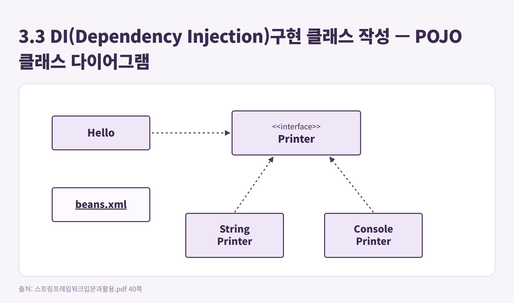

  - 그림 설명 : Hello는 점선 화살표로 Printer 인터페이스만 가리키고, StringPrinter와 ConsolePrinter도 점선 화살표로 Printer를 가리킴(Printer를 구현함). beans.xml은 화살표 없이 따로 있음. Hello는 구현 클래스(StringPrinter, ConsolePrinter)를 모르고 Printer만 알며, 어떤 구현체를 넣을지는 beans.xml에 적는다는 아래 설명을 위한 그림.
  - 다형성이 나옴. 
  - 화살표 나오고 있는 것들 중 StringPrinter·ConsolePrinter가 구현체. xml이 설정 파일
  - 구현체는 언제든 바뀔 수 있음. 그러므로 구현체를 직접적으로 박아 넣지 않음. 상위 인터페이스 파일만 입력해 둠. 바뀌는 콘솔들은 xml에만 작성한다. 갈아 끼우기 쉽도록.
  - 직접 참조 지양. 대신 세터 메서드를 작성하면 해당 객체를 생성하여 안에 넣어 줌. 
  - 헬로우는 구현 클래스를 의존하지 않는다.

#### IoC · DL · DI (교재 32~38쪽)

| 말 | 뜻 | 🔍 비유 |
|---|---|---|
| IoC | 객체 생성·생명주기 관리를 컨테이너가 맡음 (제어권의 역전) | 식당에서 주문만 함 |
| DL | 컨테이너가 주는 API로 저장소의 빈을 직접 찾아옴 (의존성 검색) | 창고에 직접 가서 꺼냄 |
| DI | 컨테이너가 빈 설정 정보를 보고 자동으로 넣어 줌 (의존성 주입) | 택배로 받음 |

- DL은 컨테이너에 더 묶이게 돼서 주로 DI를 씀
- DI 세 가지와 오늘 코드 : Setter Injection → `setPrinter(Printer printer)` / Constructor Injection → `Hello(String name, Printer printer)` / Method Injection → 오늘은 안 씀

---

## 11시 수업

### 실습 전 깃허브 레포지토리 생성 

### DI 이어서

- 45페이지
  - 3.3 DI(Dependency Injection) : Bean 의존관계 - Setter Injection : `<property>` 태그
  ```java
  public class Hello {
      String name;
      Printer printer;

      public Hello() { }

      public void setName(String name) {
          this.name = name;
      }

      public void setPrinter(Printer printer) {
          this.printer = printer;
      }
  ```
  ```xml
  <bean id="hello" class="myspring.di.xml.Hello">
        <property name="name" value="Spring" />
        <property name="printer" ref="printer" />
  </bean>

  <bean id="printer"
      class="myspring.di.xml.StringPrinter" />
  ```
- 오른쪽처럼 쓰면 스프링 애플리케이션 컨텍스트에서 인식하고 객체 생성을 함. 콘솔 프린트 있음 전제

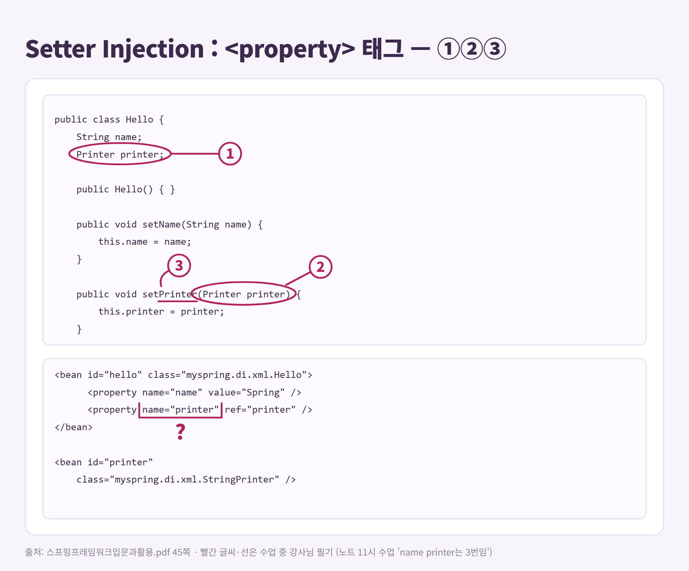

  - 그림 설명 : 45쪽 코드 위에 강사님이 ① 필드 `Printer printer;`, ② setPrinter의 매개변수 `(Printer printer)`, ③ 메서드 이름 `setPrinter`의 Printer 부분에 번호를 붙이시고, XML의 `name="printer"`에 밑줄과 '?'를 그리심. `name="printer"`가 ①②③ 중 무엇을 가리키는지 물어보신 것이고, 답은 아래 메모처럼 3번(세터 메서드 이름 setPrinter)임.
- name printer는 3번임. property는 약속임. 세터 메서드를 찾아 가져옴

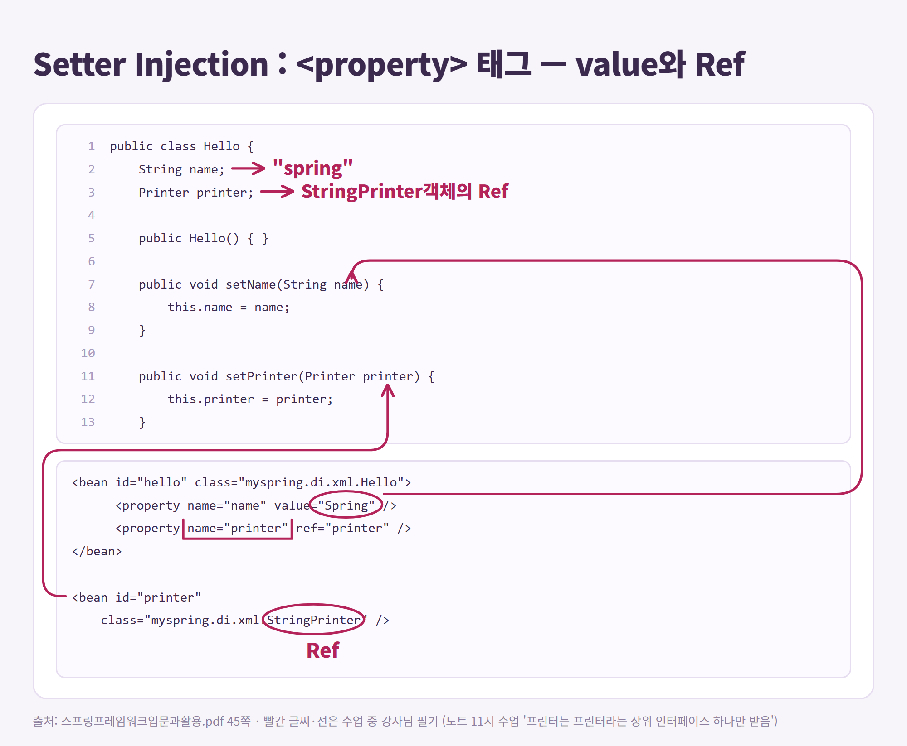

  - 그림 설명 : `value="Spring"`에서 `setName(String name)`의 name으로, `<bean id="printer"`에서 `setPrinter(Printer printer)`의 printer로 화살표를 그으심. 필드 옆에는 "spring", "StringPrinter객체의 Ref"라고 적고, StringPrinter에 동그라미를 치고 Ref라고 쓰심. name에는 문자열 값 "Spring"이 그대로 들어가고(value), printer에는 id가 printer인 빈, 즉 StringPrinter 객체의 참조(Ref)가 들어간다는 뜻.
  - 프린터는 프린터라는 상위 인터페이스 하나만 받음. (arge) 그래서 객체를 생성하여 넣어 줌.
  - 이것이 세터 인젝션

#### Setter Injection : `<property>` 태그 (교재 39·45쪽)

| 태그 / 속성 | 뜻 |
|---|---|
| `<bean id="…" class="…">` | 이 클래스로 객체를 만들고 이름표(`id`)를 붙임 |
| `<property name="x" …>` | `setX(…)` 메서드를 불러서 넣음. `name="printer"`는 필드가 아니라 `setPrinter(…)`를 가리킴 |
| `value="…"` | 글자·숫자 같은 단순 값을 넣음 |
| `ref="…"` | 다른 빈(그 `id`)의 레퍼런스를 넣음 |

- 컨테이너가 하는 일 : `new Hello()` → `setName("Spring")` → `setPrinter(printer 빈)`. 그래서 `Hello`에 기본 생성자와 setter가 있어야 함

#### 단축키·메서드 정리 (오전)

| 단축키 / 코드 | 하는 일 |
|---|---|
| `Printer` | 인터페이스. `print(String message)`를 약속함 |
| `StringPrinter` | `Printer` 구현 클래스. 받은 글을 `StringBuffer`에 모아 둠 |
| `ConsolePrinter` | `Printer` 구현 클래스. 받은 글을 콘솔에 바로 찍음 |
| `Hello` | 이름과 프린터를 받아 "Hello 이름"을 찍게 하는 POJO 클래스 |
| `setName(String)` / `setPrinter(Printer)` / `setNames(List<String>)` | XML `<property>`가 부르는 setter |
| `sayHello()` | `"Hello " + name`을 돌려줌 |
| `print()` | 받은 프린터로 `sayHello()`를 찍음 |
| `StringBuffer` / `append(…)` | 글을 이어 붙이는 그릇 / 끝에 붙이기 |
| `toString()` | `Object` 메서드 재정의. `StringPrinter`에서는 모아 둔 글을 꺼냄 |
| `BeanFactory` / `ApplicationContext` | IoC 컨테이너 인터페이스 / 그 확장판 |

---

## 1시 수업

### 실습
- pom.xml : package.json 역할
  - 의존성을 추가하고, 한 곳을 바꾸면 같이 바뀌도록 함.

    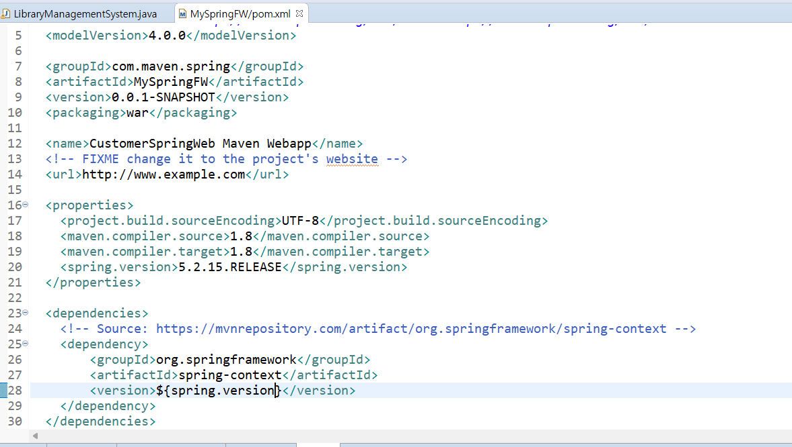

- spring-beans.xml 파일 만들기
  - xml 스키마 규칙에 따라 파일을 만들어야 함. 약속된 스키마를 불러옴

    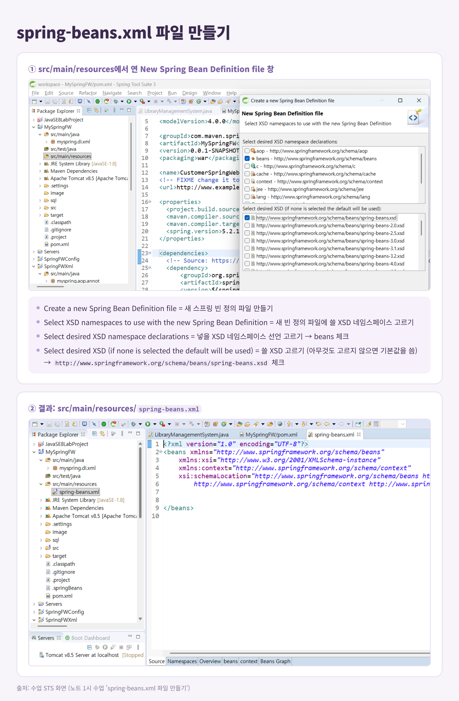

      - 웹 상의 스키마 파일이 들어와 있음. [해당 링크](http://www.springframework.org/schema/beans/spring-beans.xsd)
    - [스프링 XML 설정과 XSD 스키마의 역할](https://gemini.google.com/share/ab4b7feed4c5?social_preview=false&skid=733d323d-c5c3-4c17-881d-02e92ff2bed8)    

- Hello.java
  - 콘솔에 어떤 게 호출되는지 확인용 문구 추가

  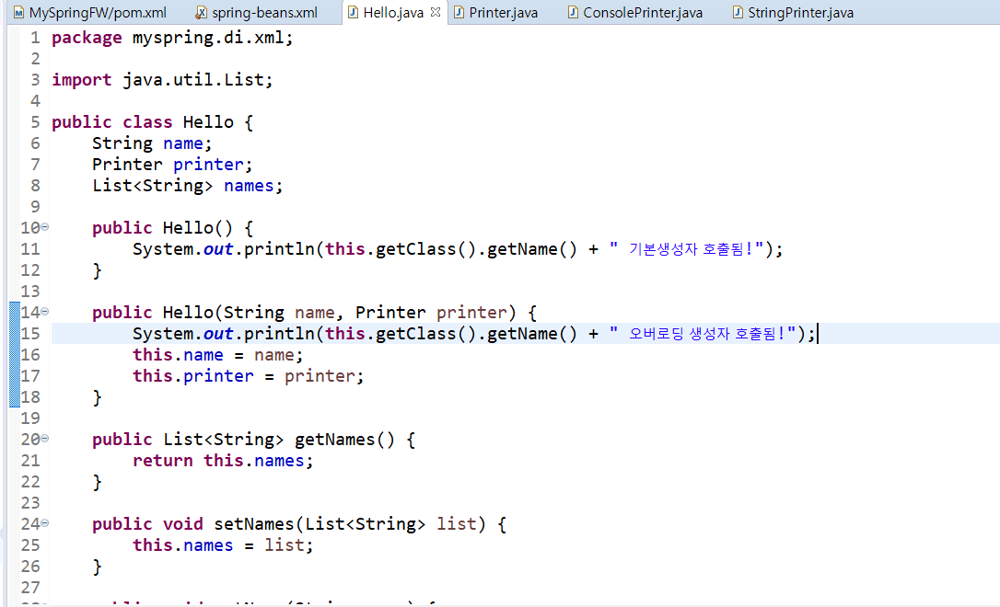

- StringPrinter에서도 호출 확인용 문구 추가

  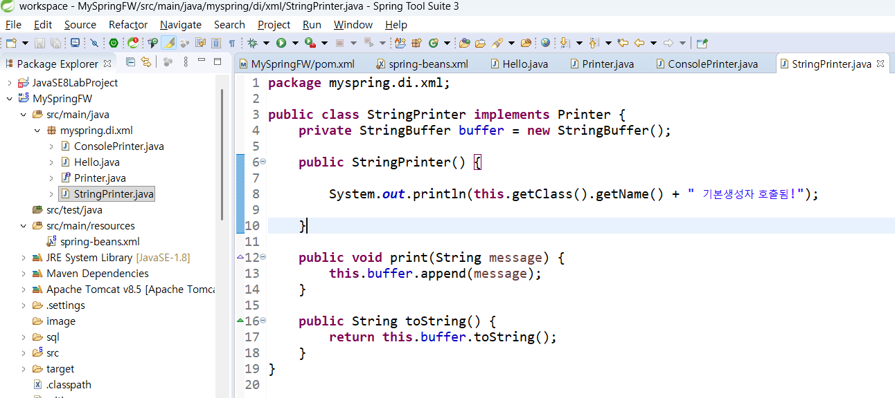

- ConsolePrinter에도 기본 생성자가 언제 생성되는지 확인용 로그 문구 추가

- spring-beans.xml로 돌아감

  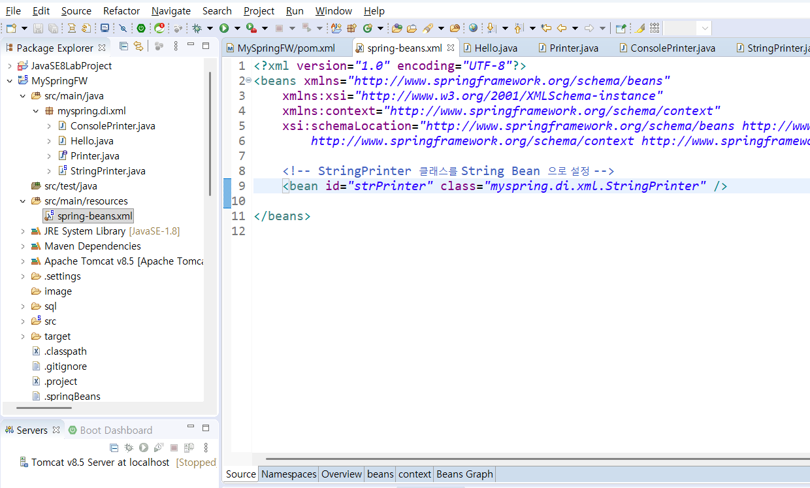

- 아이콘의 작은 디테일

  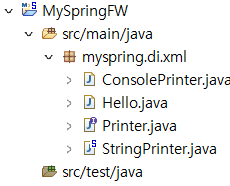

#### 오늘 만든 파일 (`MySpringFW`)

| 파일 | 하는 일 |
|---|---|
| `pom.xml` | 받을 부품 목록 (spring-context, junit-jupiter-api, spring-test) |
| `src/main/resources/spring-beans.xml` | 무엇을 만들고 어떻게 이을지 적는 설정 메타정보 |
| `src/test/java/myspring/di/xml/HelloBeanJunitTest.java` | 내가 컨테이너를 만들어 검사하는 테스트 |
| `src/test/java/myspring/di/xml/HelloBeanSpringTest.java` | 스프링이 컨테이너를 맡는 테스트 (다음 시간) |

- `<version>${spring.version}</version>` : 위 `<properties>`의 `<spring.version>5.2.15.RELEASE</spring.version>` 값을 가져다 씀. 스프링 부품끼리 버전이 같아야 해서 숫자는 한 곳에만 적음
- `spring-beans.xml` 머리의 `xsi:schemaLocation` : 이 파일이 따를 규칙 파일(`spring-beans.xsd`)의 주소. STS 자동 완성과 빨간 오류 표시도 이 규칙을 보고 함
- 확인용 로그 : `Hello`(기본 생성자, 오버로딩 생성자, `setName()`, `setPrinter()`), `StringPrinter`·`ConsolePrinter`(기본 생성자)에 지금 불렸다는 `System.out.println`을 넣음
- 아이콘의 S : XML에 빈으로 등록한 클래스에만 작은 S가 붙음. 처음엔 `StringPrinter`만, `conPrinter`·`hello`를 등록한 뒤엔 `ConsolePrinter`·`Hello`에도 붙음

#### 단축키·메서드 정리

| 단축키 / 코드 | 하는 일 |
|---|---|
| `src/main/resources`에서 New Spring Bean Definition file | 위 칸에서 `beans`, 아래 칸에서 버전 번호 없는 `spring-beans.xsd`를 골라 `spring-beans.xml`을 만듦 |
| `<bean id="strPrinter" class="myspring.di.xml.StringPrinter" />` | `StringPrinter`를 빈으로 등록 |
| `this.getClass().getName()` | 실제 클래스 전체 이름 (`myspring.di.xml.Hello`) |

---

## 2시 수업

- Hello를 bean 설정. 세터 인젝션 방식으로 한다고 함

  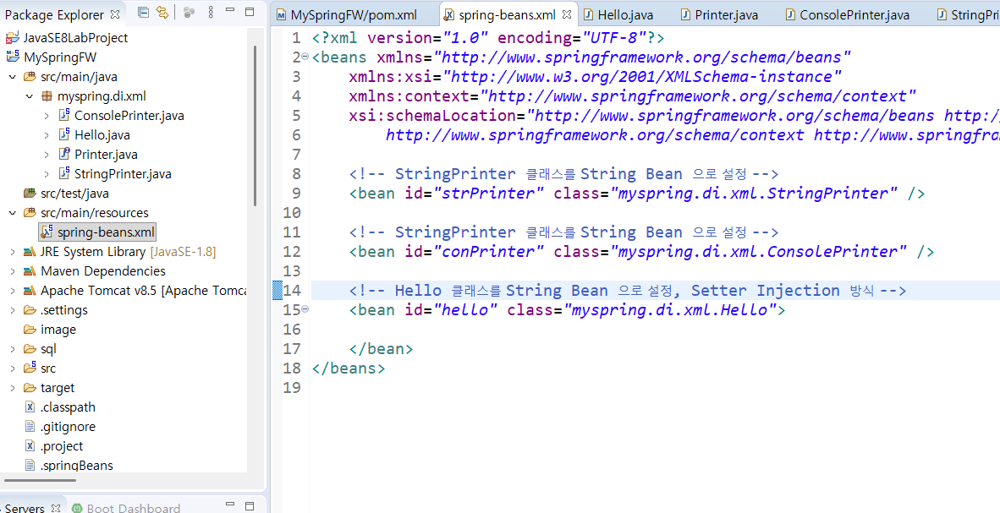

  - 프로퍼티는 메서드를 가리킴

    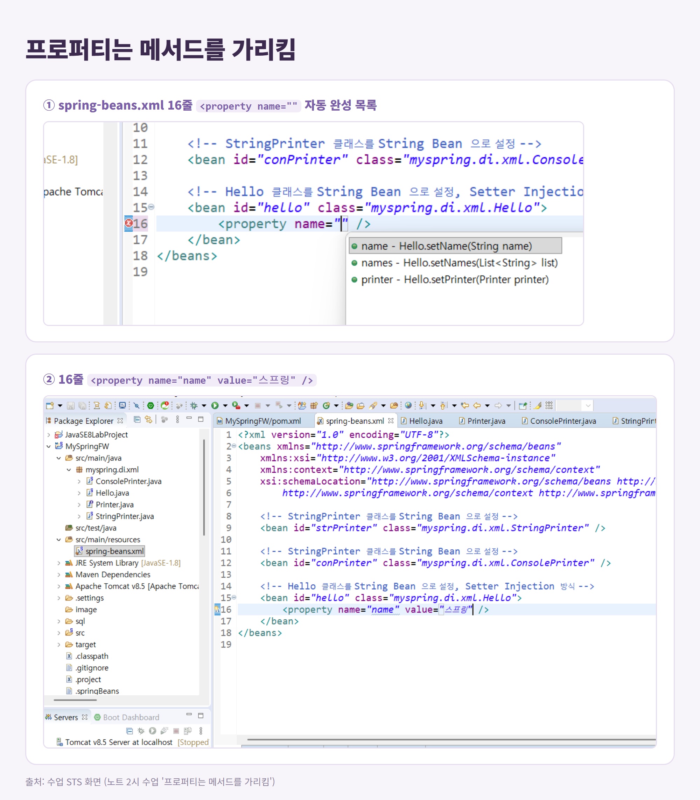

- 세터 메서드를 사용함. 의존하는 변수를 선언하여서 만듦.

  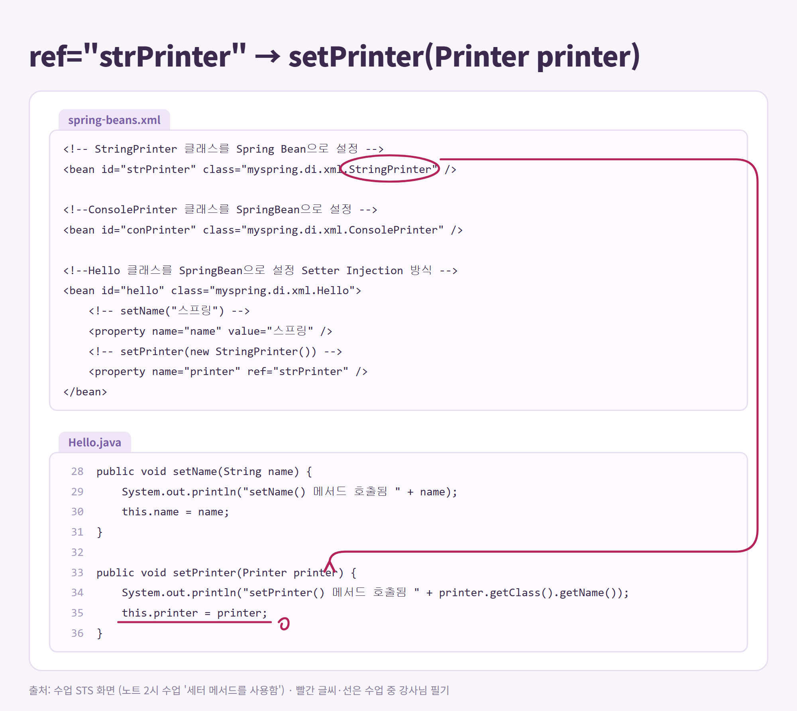

  - 그림 설명 : spring-beans.xml의 strPrinter 빈(StringPrinter)에 동그라미를 치고 Hello.java의 `setPrinter(Printer printer)`까지 화살표를 그으신 뒤 `this.printer = printer;`에 밑줄을 치심. `ref="strPrinter"`로 가리킨 StringPrinter 객체가 setPrinter()의 매개변수로 들어가서 필드 printer에 저장된다는 흐름.

- 3.3 DI(Dependency Injection) : Bean 의존관계 - Setter Injection : `<property>` 태그
  - Setter 메서드를 통해 의존관계가 있는 Bean을 주입하려면 `<property>` 태그의 ref 속성을 사용할 수 있다.
  - Setter 메서드를 통해 Bean의 레퍼런스가 아니라 단순 값을 주입하려고 할 때는 `<property>` 태그의 value 속성을 사용한다.
  - ref 속성은 사용하면 Bean의 id를 이용해 주입할 Bean을 찾는다.
  - value 속성은 단순 값 또는 Bean이 아닌 객체를 주입할 때 사용한다.

### 이제 하려는 것 설명 

- 교재 53페이지

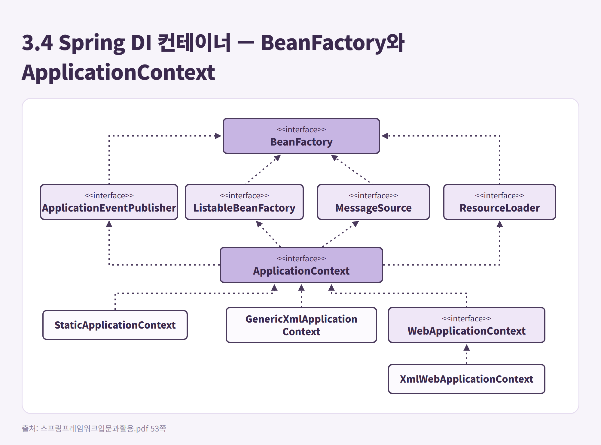

- 그림 설명 : 맨 위가 BeanFactory, 가운데가 ApplicationContext, 맨 아래가 StaticApplicationContext·GenericXmlApplicationContext 같은 구현 클래스임(WebApplicationContext는 인터페이스이고 그 아래가 XmlWebApplicationContext). 아래 코드에서 `new GenericXmlApplicationContext(...)`로 만든 객체를 BeanFactory 타입이나 ApplicationContext 타입 변수에 담을 수 있는 이유가 이 위아래 관계 때문임.

- 컨테이너 역할을 하는 객체를 생성함
```
// Container 객체 생성하는 방법1
BeanFactory factory = new GenericXmlApplicationContext("classpath:spring-beans.xml");
Hello hello = (Hello)factory.getBean("hello");(o)  // Hello hello = new Hello(); (x)
// Container 객체 생성하는 방법2
ApplicationContext context1 = new GenericXmlApplicationContext("classpath:spring-beans.xml");
Hello hello2 = context1.getBean("hello", Hello.class); //hello2 객체는 싱글톤 객체임
Hello hello  = new Hello(); (x)  //hello 객체는 싱글톤 객체가 아님
```

- jUnit : 자바에 특화된 단위 테스트를 지원해 주는 프레임워크
  - 3.5 jUnit을 사용한 DI 테스트 클래스 : jUnit의 개요
    - Java에서 독립된 단위테스트(Unit Test)를 지원해주는 프레임워크이다.
    - 단위테스트(Unit Test)란?
      - 소스 코드의 특정 모듈이 의도된 대로 정확히 작동하는지 검증하는 절차, 즉 모든 함수와 메소드에 대한 테스트 케이스(Test case)를 작성하는 절차를 말한다.
      - jUnit은 보이지 않고 숨겨진 단위 테스트를 끌어내어 정형화시켜 단위테스트를 쉽게 해주는 테스트 지원 프레임워크다.
  - jUnit의 특징
    - TDD의 창시자인 Kent Beck과 디자인 패턴 책의 저자인 Erich Gamma가 작성했다.
    - 단정(assert) 메서드로 테스트 케이스의 수행 결과를 판별한다. 예) assertEquals(예상 값, 실제 값)
    - jUnit4부터는 테스트를 지원하는 어노테이션을 제공한다. @Test @Before @After
    - 각 @Test 메서드가 호출할 때 마다 새로운 인스턴스를 생성하여 독립적인 테스트가 이루어지도록 한다.

- 스코프 : 테스트 밑에만 국한됩니다 라는 말

  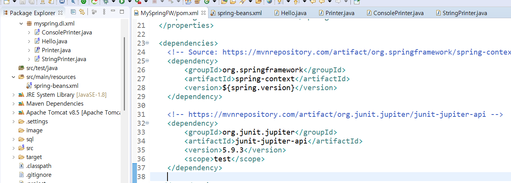

- 3.5 jUnit5 사용한 DI 테스트 클래스 : jUnit에서 테스트를 지원하는 어노테이션(Annotation) (1)
  - @Test
    - @Test가 선언된 메서드는 테스트를 수행하는 메소드가 된다.
    - Junit은 각각의 테스트가 서로 영향을 주지 않고 독립적으로 실행됨을 원칙으로 하므로 @Test 마다 객체를 생성한다.
  - @Disabled
    - @Disabled가 선언된 메서드는 테스트를 실행하지 않게 한다.
  - @BeforeEach
    - @BeforeEach가 선언된 메서드는 @Test 메소드가 실행되기 전에 반드시 실행되어 진다.
    - @Test 메소드에서 공통으로 사용하는 코드를 @BeforeEach 메소드에 선언하여 사용하면 된다.

- @Test 중요! 

  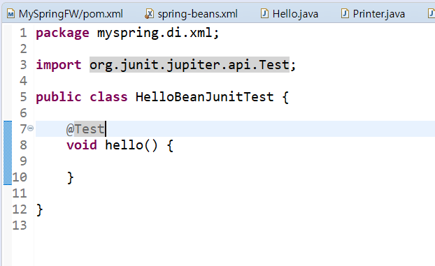

- bean xml에 대해 알려 줘야 함. 현재 상태

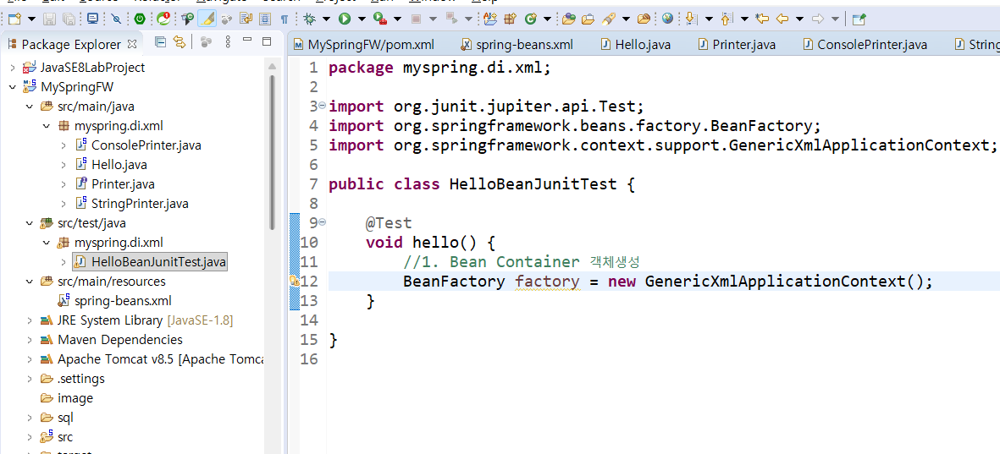

- 실행했더니 뭐가 많이 뜸. 어떤 생성자가 호출되는지 알려 주는 것. 삽입한 로그가 정상 작동함.

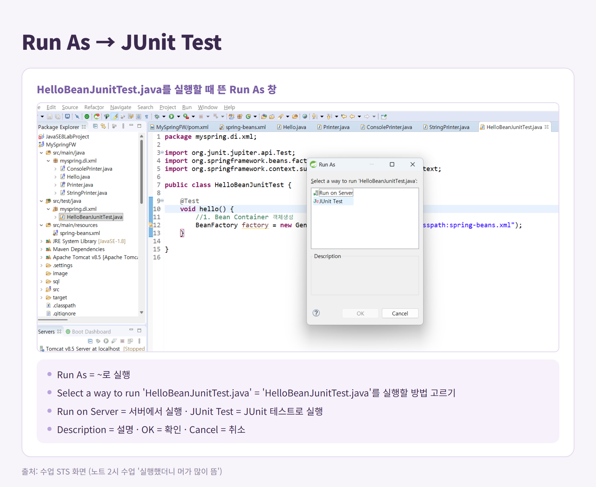

- 순서대로 객체를 생성해주는 것을 확인할 수 있음. 이것이 컨테이너의 역할
- 컨테이너가 xml에서 정보를 받아서 대신 객체를 생성한다

- 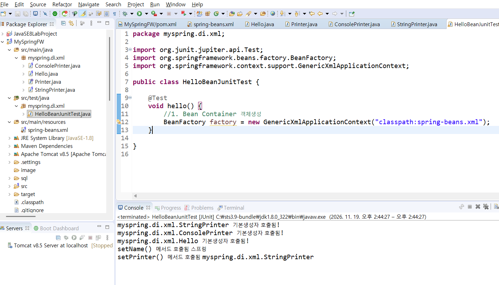

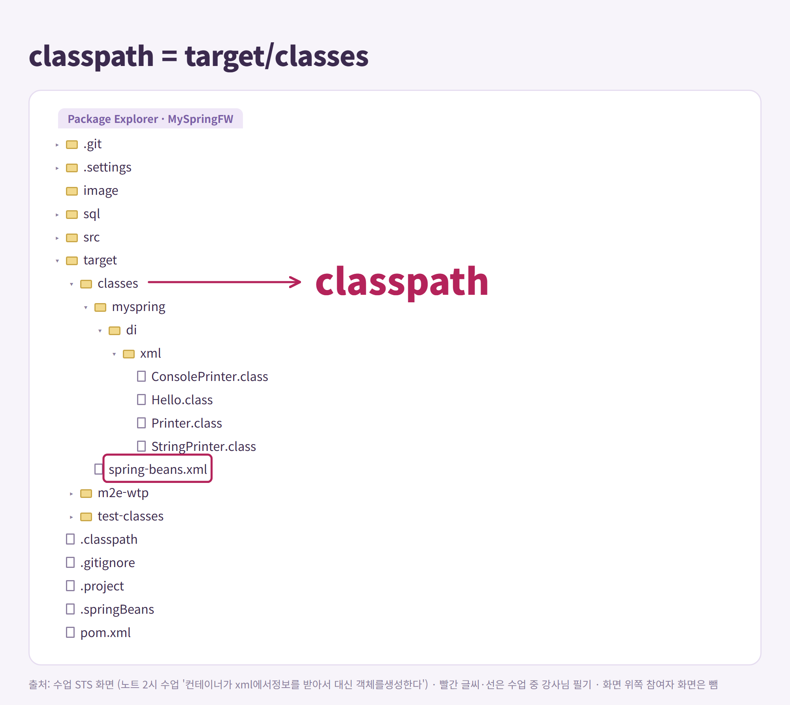

- 그림 설명 : Package Explorer의 target/classes 폴더에 화살표를 긋고 classpath라고 쓰시고, 그 안의 spring-beans.xml에 네모를 치심. 코드의 "classpath:spring-beans.xml"이 찾는 곳이 target/classes이고, src/main/resources에 만든 spring-beans.xml이 빌드되면 이 폴더로 복사되어 .class 파일들과 같은 곳에 놓인다는 걸 보여 주신 것.

#### 컨테이너 만들기 (교재 53쪽)
- `new GenericXmlApplicationContext("classpath:spring-beans.xml")` : XML을 읽는 컨테이너. `GenericXmlApplicationContext`가 `ApplicationContext`를, `ApplicationContext`가 `BeanFactory`를 이어받아서 두 타입 변수 어디에나 담을 수 있음
- `classpath:` = `target/classes`. `src/main/resources`의 `spring-beans.xml`이 빌드될 때 여기로 복사됨
- `Hello hello = new Hello();`처럼 직접 만들지 않고 컨테이너에게 `getBean`으로 받음

#### 컨테이너가 객체를 만드는 순서
- singleton 빈은 컨테이너를 만들 때 XML 위에서부터 차례로 만듦 → 콘솔 : `StringPrinter` 기본생성자 → `ConsolePrinter` 기본생성자 → `Hello` 기본생성자 → `setName()` → `setPrinter()`
- `ref`로 가리킨 빈이 아직 없으면 그 자리에서 먼저 만들어서 넣음
- prototype 빈은 컨테이너를 만들 때는 안 만들고 `getBean` 할 때마다 만듦

#### jUnit 5 (교재 54~56쪽)
- `<scope>test</scope>` : 이 부품은 `src/test/java`(테스트 코드)에서만 씀
- `@Test`가 붙은 메서드만 jUnit이 실행함. `main` 없이 Run As → JUnit Test로 돌림. 맞으면 초록 막대, 틀리면 빨간 막대

#### 단축키·메서드 정리

| 단축키 / 코드 | 하는 일 |
|---|---|
| Run As → JUnit Test | 테스트 클래스 실행 |
| `@Test` | 테스트 메서드 표시 |
| `BeanFactory factory = new GenericXmlApplicationContext("classpath:spring-beans.xml");` | XML을 읽어 컨테이너 만들기 |
| `(Hello)factory.getBean("hello")` | id로 빈 꺼내기. 돌려주는 타입이 `Object`라 형변환 필요 |

---

## 3시 수업

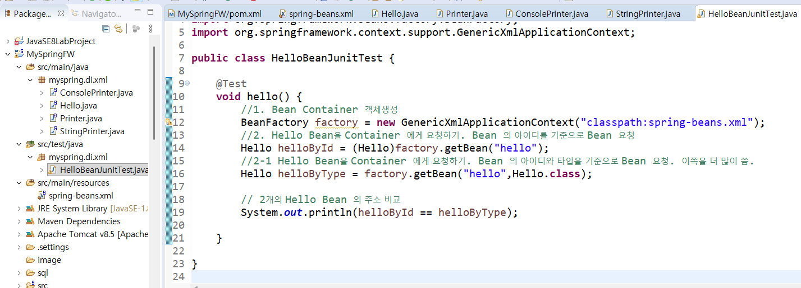

- 다음과 같이 콘솔로 비교하는 문구보다 assert 메서드를 사용하는 일이 많음.
- [공식문서](https://docs.junit.org/5.0.1/api/org/junit/jupiter/api/Assertions.html)


- Assertion 사용

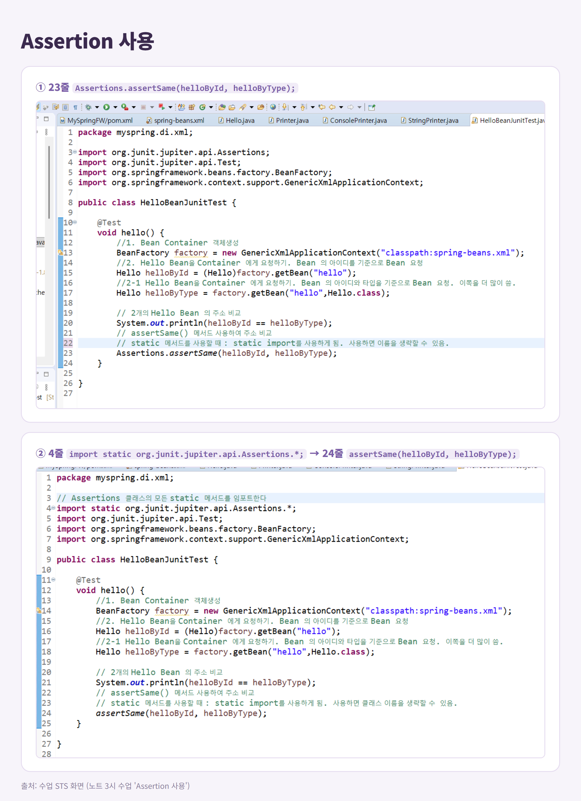

- [스프링과 싱글톤 패턴 이해](https://share.gemini.google/EPl6dLEgk8BN)

  - 주소가 같다 = 싱글톤이 적용되어 있다고 이해할 수 있음.

  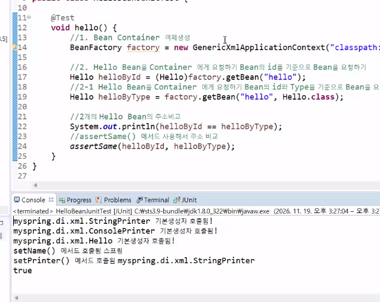

- 공식 문서 번역·정리 (`<bean>` scope · `component-scan` · `@Scope`)
  - 세 가지 모두 빈의 scope와 등록 이야기. 오늘 쓴 건 `<bean>`의 `scope` 속성. `component-scan`과 `@Scope`는 다음 시간 어노테이션 방식(빈 등록 전략 2·3)에서 씀
  - `<bean />` 태그의 `scope` 속성
    - 이 빈의 범위(scope). 보통 둘 중 하나
      - `"singleton"` : 함께 쓰는 객체 하나. 같은 id로 `getBean`을 부르면 언제나 그 하나를 돌려줌
      - `"prototype"` : `getBean`을 부를 때마다 따로 만든 새 객체
    - 아무것도 안 적으면 singleton. 단, 부모 빈 정의(`parent`)가 있으면 부모의 scope를 물려받음
    - 가장 많이 쓰는 건 singleton. 여러 스레드가 동시에 쓰는 서비스 객체에 딱 맞음
    - 웹 환경처럼 기능이 더 있는 빈 팩토리에서는 `"request"`, `"session"` 같은 scope도 쓸 수 있음
    - 안쪽 빈(inner bean, `<bean>` 안에 또 넣은 `<bean>`)은 따로 적지 않으면 바깥 빈의 scope를 따라감. 바깥이 singleton이면 singleton, prototype이면 prototype
  - `<context:component-scan base-package="…">` 태그
    - classpath를 훑어서 어노테이션이 붙은 클래스를 찾아 스프링 빈으로 자동 등록함. `base-package`가 훑을 패키지
    - 기본으로 찾는 어노테이션 : `@Component`, `@Repository`, `@Service`, `@Controller`, `@RestController`, `@ControllerAdvice`, `@Configuration`
    - 이 태그를 쓰면 `annotation-config` 태그를 쓴 효과도 같이 생김 → 찾은 클래스 안의 `@Required`, `@Autowired`, `@PostConstruct`, `@PreDestroy`, `@Resource`, `@PersistenceContext`, `@PersistenceUnit`이 동작함. 자동으로 찾은 클래스에는 보통 이게 필요함
    - 이 기본 동작을 끄려면 `annotation-config` 속성을 끔 (예: 이 어노테이션들을 직접 만든 `BeanPostProcessor`로 처리하고 싶을 때)
    - 패키지 경로에 `${…}` 같은 자리표시자를 쓸 수 있지만, 시스템 속성 값으로만 바뀜
    - component-scan으로 등록된 빈 정의에도 `PropertySourcesPlaceholderConfigurer`가 일반 빈처럼 적용됨. 단, component-scan 설정 자체에는 적용 안 됨
    - XML 대신 자바 코드로 component-scan을 켜는 방법은 `ComponentScan`(`@ComponentScan`) javadoc 참고
    - 안에 넣을 수 있는 태그 : `include-filter`(이것도 넣기), `exclude-filter`(이건 빼기). 예시는 정규식 `(service|dao)\..*`에 맞는 클래스도 넣으라는 뜻
  - `@Scope` 어노테이션 (`org.springframework.context.annotation.Scope`)
    - `@Target(value={METHOD, TYPE})` : 메서드와 클래스에 붙임 / `@Retention(value=RUNTIME)` : 실행 중에도 남음 / `@Documented` : javadoc에 표시됨
    - 클래스에 `@Component`와 같이 붙이면 : 그 클래스로 만든 객체의 scope를 정함
    - 메서드에 `@Bean`과 같이 붙이면 : 그 메서드가 돌려주는 객체의 scope를 정함
    - 주의 : 실제 빈 클래스(또는 `@Bean` 메서드)에 붙은 `@Scope`만 봄. XML 빈 정의와 달리 물려받기(상속)가 없어서 부모 클래스에 붙인 건 상관없음
    - 여기서 scope = 객체의 생명주기(singleton, prototype 등). 기본 scope는 `ConfigurableBeanFactory`, `WebApplicationContext`의 `SCOPE_*` 상수로 부를 수 있음 (예: `ConfigurableBeanFactory.SCOPE_PROTOTYPE`)
    - 직접 만든 scope를 등록하려면 `CustomScopeConfigurer` 참고
    - Since 2.5 : 스프링 2.5부터 있음 / Author : 만든 사람들 / See Also : 같이 볼 것 `@Component`, `@Bean`

- 대부분의 스코프는 프로토타입이 아니라 싱글톤을 사용함. 오늘은 수업이라 사용한 것.

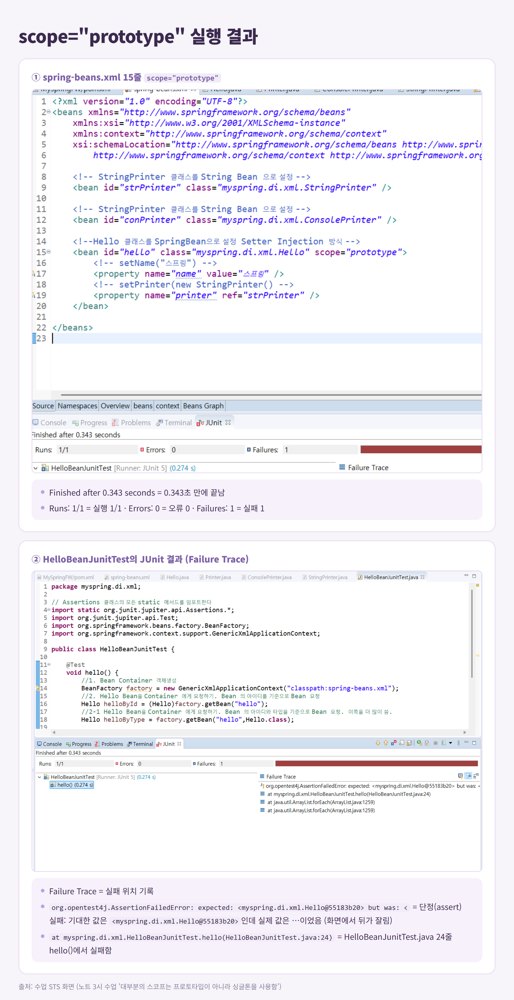

- 프로토타입을 사용해야 하는 경우.
  - Spring Bean의 scope="prototype"을 반드시 설정해야 하는 경우는?

>  - 스프링 빈의 `scope="prototype"`은 컨테이너에 해당 빈을 요청할 때마다 매번 새로운 인스턴스를 생성해 반환하는 스코프입니다.
>  - 앞서 살펴본 것처럼 스프링 빈은 기본적으로 싱글톤(무상태 설계)이 유리하지만, 객체마다 독립적인 상태나 생명주기가 필요하거나, 매번 새로 만들어야 하는 상황이라면 `prototype` 스코프를 설정해야 합니다.

>  1. `scope="prototype"`을 반드시 고려해야 하는 주요 경우
>     1. 요청·작업 단위로 고유한 상태(Stateful)를 유지해야 하는 객체
>        - 싱글톤 빈에 변경 가능한 필드를 두면 멀티스레드 환경에서 값이 덮어씌워지는 동시성 문제가 생깁니다.
>        - 특정 작업의 진행 상태, 중간 계산 결과, 파라미터 컨텍스트 등을 객체 내부 필드로 들고 있어야 하는 작업(Task) 객체나 빌더/파서 등은 호출마다 새 인스턴스를 쓰는 것이 안전합니다.
>     2. 스레드 세이프하지 않은 외부 라이브러리·클라이언트 객체

- 만약 Hello와 스프링 사이를 한 칸 더 띄우면 틀렸다고 로그가 뜬다. 이런 식으로 검증을 해 준다.

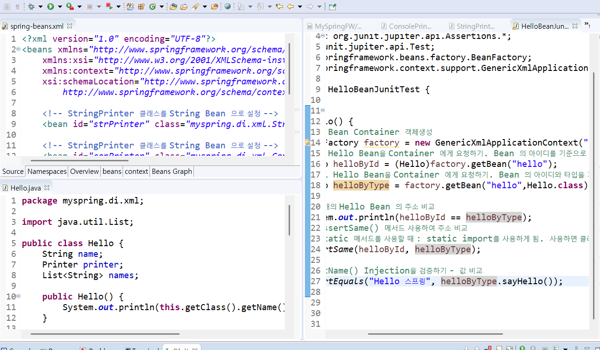

- 프린트

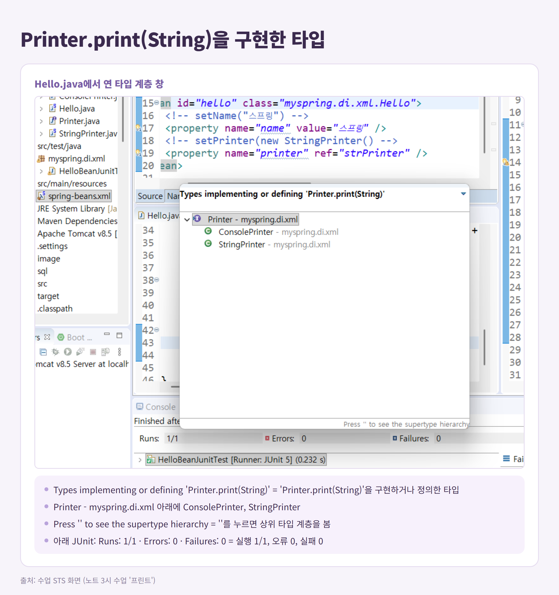

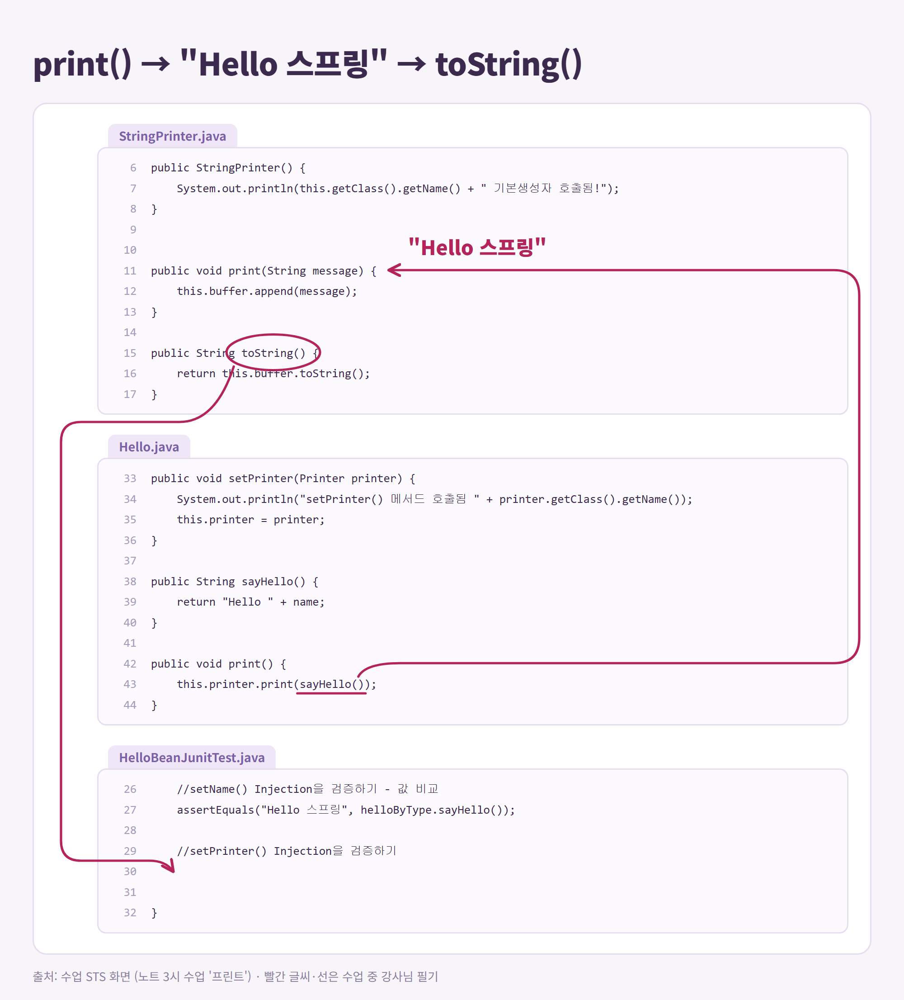

  - 그림 설명 : Hello.print()의 `this.printer.print(sayHello())`에서 sayHello()에 밑줄을 치고 StringPrinter의 `print(String message)`로 화살표를 이어 "Hello 스프링"이라고 쓰심. 그다음 StringPrinter의 toString()에 동그라미를 치고 테스트 코드 `//setPrinter() Injection을 검증하기` 아래 30줄로 화살표를 그으심. sayHello()가 만든 "Hello 스프링"이 StringPrinter 안(buffer)에 쌓이고, 테스트에서는 toString()으로 그 값을 꺼내 assertEquals로 검사하면 된다는 흐름.

#### getBean 두 가지

| 코드 | 돌려주는 타입 | 형변환 |
|---|---|---|
| `getBean("hello")` | `Object` | `(Hello)` 필요 |
| `getBean("hello", Hello.class)` | `Hello` | 필요 없음 |
| `getBean("strPrinter", Printer.class)` | `Printer` | 필요 없음 (업캐스팅) |

#### assert 메서드 (교재 59쪽)
- `assertEquals(a, b)` 값이 같은지 / `assertSame(a, b)` 같은 객체인지(`==`). 콘솔에 찍어 눈으로 보는 대신, 틀리면 jUnit이 빨간 막대로 알려 줌
- `import static org.junit.jupiter.api.Assertions.*;` → `Assertions.` 없이 `assertSame(…)`으로 씀
- `assertEquals("Hello 스프링", helloByType.sayHello())` : 띄어쓰기 하나만 달라도 실패

#### scope : singleton과 prototype

| 값 | 뜻 | `assertSame(helloById, helloByType)` |
|---|---|---|
| `singleton` (기본) | 컨테이너에 하나만. 컨테이너를 만들 때 미리 만듦 | 통과 (같은 주소) |
| `prototype` | `getBean` 할 때마다 새로 만듦 | 실패 (다른 주소) |

- `pom.xml`의 `<scope>test</scope>`와는 이름만 같고 다른 것

#### setPrinter 검증 흐름
- `helloByType.print()` → `printer.print(sayHello())` → `StringPrinter`의 `buffer`에 "Hello 스프링"이 쌓임
- `factory.getBean("strPrinter", Printer.class).toString()`으로 꺼내 `assertEquals`. `hello`에 넣은 것과 같은 싱글톤 객체라 그 안에 글이 남아 있음

#### 단축키·메서드 정리

| 단축키 / 코드 | 하는 일 |
|---|---|
| `factory.getBean("hello", Hello.class)` | id + 타입으로 꺼내기. 형변환 필요 없음 |
| `assertEquals(예상, 실제)` | 값이 같은지 검사 |
| `assertSame(a, b)` | 같은 객체인지 검사 |
| `import static org.junit.jupiter.api.Assertions.*;` | static 메서드를 클래스 이름 없이 씀 |
| `scope="singleton"` / `scope="prototype"` | 하나만 / `getBean`마다 새로 |
| Ctrl + T (빠른 타입 계층) | `Printer.print(String)`을 구현한 타입(`ConsolePrinter`, `StringPrinter`) 보기 |

---

## 4시 수업

### 오늘 한 거 잠깐 정리
- 경고 하나가 있음. 

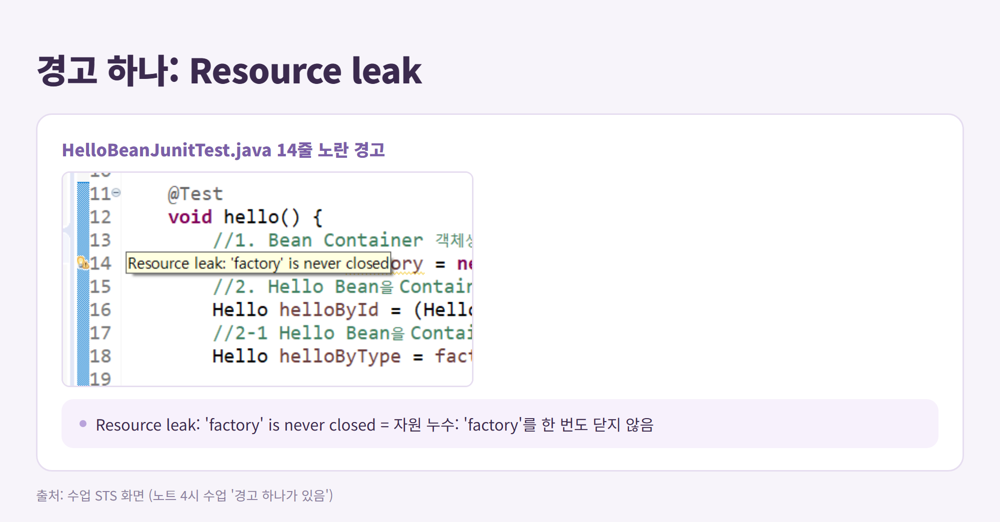

  - 개선 방법

  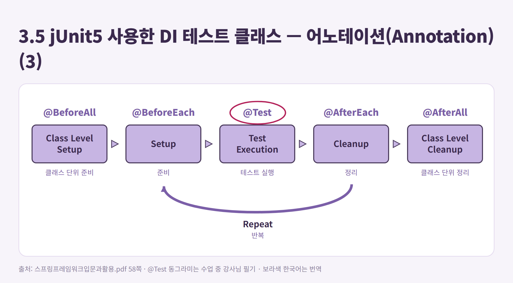

    - 그림 설명 : 교재 58쪽 그림. @BeforeAll(클래스 단위 준비) → @BeforeEach(준비) → @Test(테스트 실행) → @AfterEach(정리) → @AfterAll(클래스 단위 정리) 순서로 돌고, @BeforeEach → @Test → @AfterEach는 테스트 메서드마다 되풀이됨(Repeat). 강사님이 @Test에 동그라미를 치심. 경고를 고치려고 컨테이너 만드는 코드를 @Test보다 먼저 도는 @BeforeEach로 옮기는 설명(아래 비포이치)으로 이어짐.

  - 비포이치: 테스트 전. 사전 작업을 할 게 있음.

    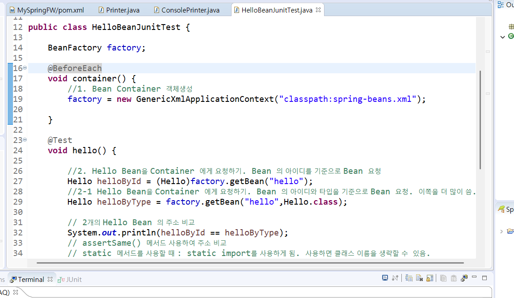

    - 먼저 컨테이너 역할을 만들어 요청을 함
    - 그다음 팩토리에게 생성한 Bean을 달라고 요청함(getBean)
    - 싱글톤이 맞는지 확인하기 위해 두 개의 주소를 비교함. = true : 싱글톤이 적용되어 있음
    - 셋 프린터는 조금 복잡함. 먼저 셋 프린터에 넣어 호출함. str프린터는 string프린터. 스트링 프린터 객체의 레퍼런스가 주입됨. => 프린터는 string 프린터가 들어가고 그것을 호출함


- 기본 생성자를 막으면 오류가 남

    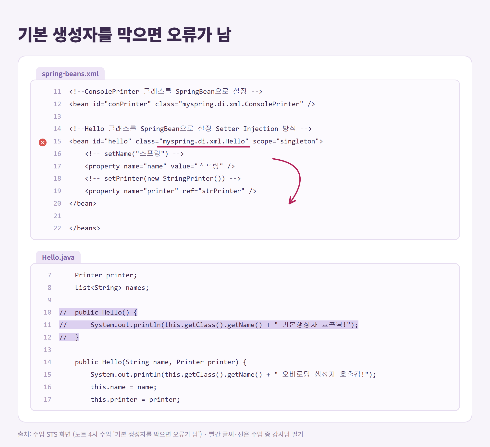
    
    - 그림 설명 : Hello.java의 기본 생성자 `public Hello()`를 주석으로 막자 spring-beans.xml 15줄 hello 빈에 빨간 X가 뜸. 강사님이 `class="myspring.di.xml.Hello"`에 밑줄을 치고 property 줄 옆으로 아래를 향한 화살표를 그으심. property(Setter Injection)는 기본 생성자로 Hello 객체를 먼저 만든 다음 setter를 부르는 방식이라, 기본 생성자가 없으면 hello 빈을 만들 수 없다는 뜻으로 보임.
    - 오버로딩된 생성자를 호출하는 방법이 있음. 그걸 설명해 주신다고 함.

- pdf 교재 48페이지
  - Constructor Injection : `<constructor-arg>` 태그
    - Hello.java
    ```java
    package myspring.di.xml;

    public class Hello {
        String name;
        Printer printer;

        public Hello() {}

        public Hello(String name, Printer printer) {
            this.name = name;
            this.printer = printer;
        }
    ```
    - beans.xml
    ```xml
    <bean id="hello2" class="myspring.di.xml.Hello">
        <constructor-arg index="0" value="Spring" />
        <constructor-arg index="1" ref="printer" />
    </bean>

    <bean id="printer"
            class="myspring.di.xml.StringPrinter" />
    ```
    
    - 캡슐화 생성자와 동일한 방식임
      - 오버로딩된 생성자를 부르면서 한꺼번에 초기화했었음.

        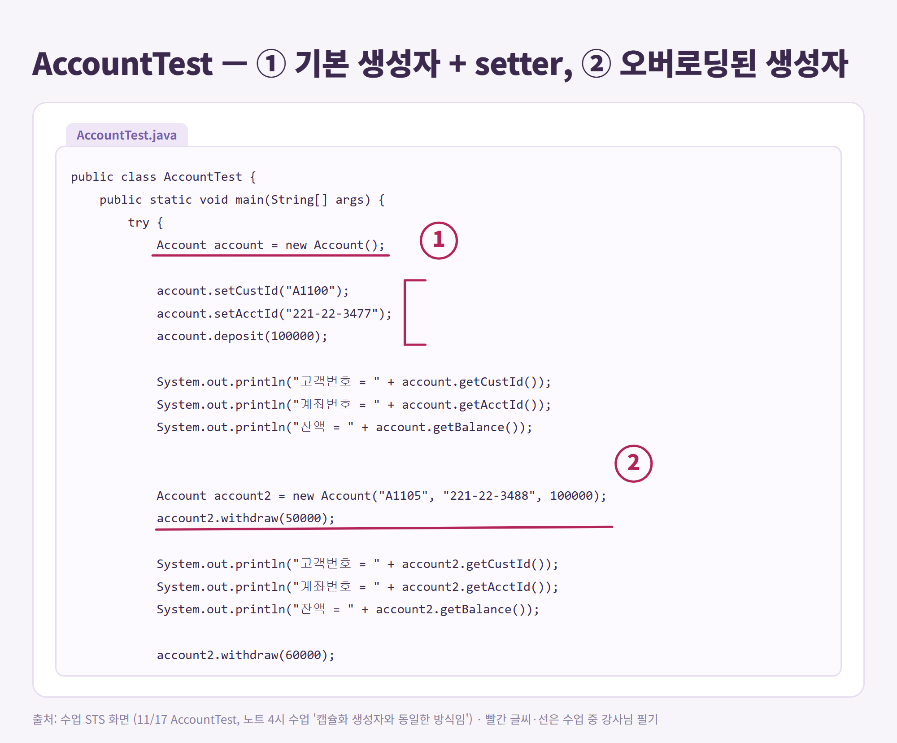

        - 그림 설명 : 11/17 AccountTest 코드에 ① `new Account()`로 기본 생성자를 부른 뒤 setCustId, setAcctId, deposit을 한 줄씩 부르는 부분과 ② `new Account("A1105", "221-22-3488", 100000)`처럼 오버로딩된 생성자로 값을 한 번에 넣는 부분을 표시하심. ①은 `<property>`(Setter Injection), ②는 `<constructor-arg>`(Constructor Injection)와 같은 모양이라는 걸 비교하려고 그리신 것.
      - 여기도 마찬가지. 오버로딩된 생성자를 한꺼번에 불러 초기화하면서 하나를 호출하는 형태?

        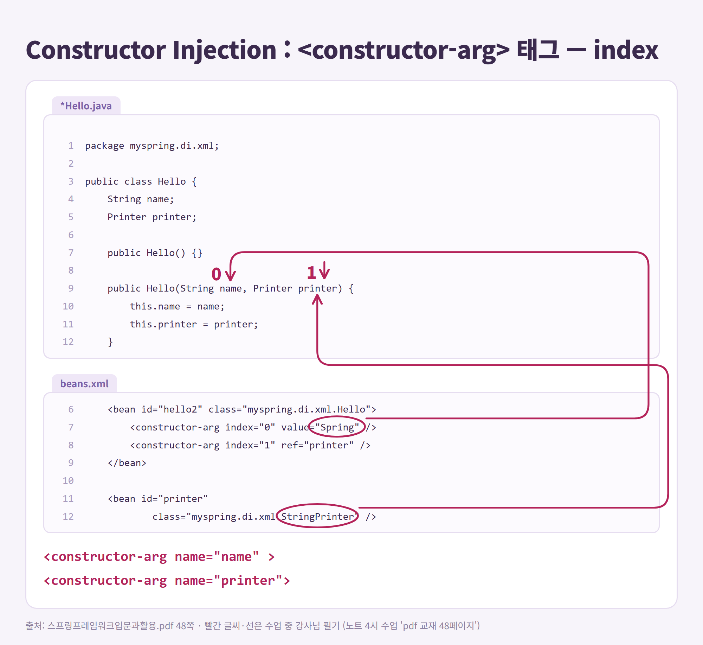

        - 그림 설명 : 48쪽 코드 위에 생성자 `Hello(String name, Printer printer)`의 첫 번째 매개변수 name에 0, 두 번째 printer에 1을 쓰시고, `value="Spring"`은 name으로, StringPrinter(id가 printer인 빈)는 printer로 화살표를 그으심. index는 생성자 매개변수의 순서(0부터 셈)라는 뜻. 아래에 index 대신 매개변수 이름으로 쓰는 `<constructor-arg name="name">`, `<constructor-arg name="printer">`도 적으심(교재 47쪽 '파라미터 이름 지정').
      - 구 프레임워크라 할 게 많음. 실제로 한 건 위의 지난번 자바 예제 파일 정도임.

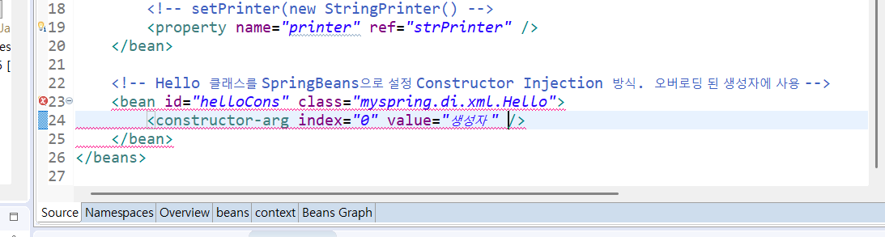

  - 에러가 남. 왜? 값을 하나만 넘겼는데 값 하나를 받는 생성자가 없어서

- 테스트를 더 용이하게 해주는 의존성 설치

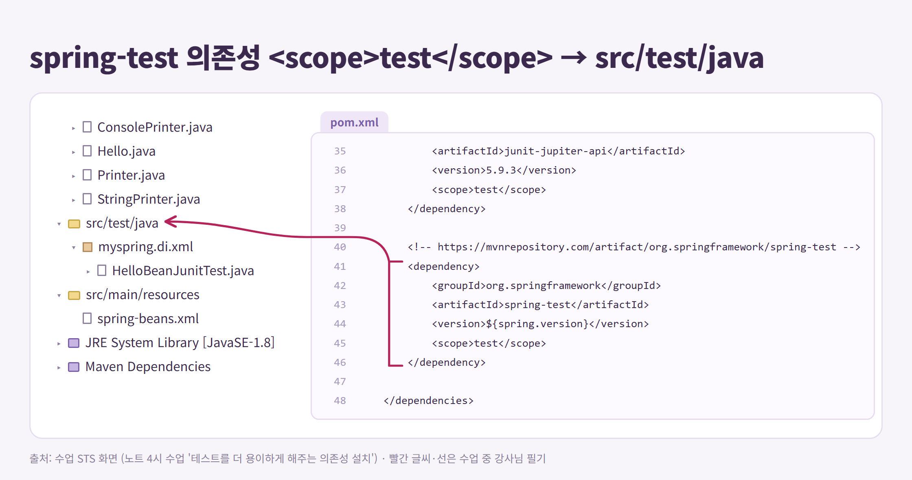

  - 그림 설명 : pom.xml에 추가한 spring-test 의존성(41~46줄)을 괄호로 묶고 왼쪽 Package Explorer의 src/test/java로 화살표를 그으심. `<scope>test</scope>`라서 이 라이브러리는 테스트 코드(src/test/java)에서만 쓴다는 뜻.

- 3.5 Spring-Test 사용한 DI 테스트 클래스 : Spring-Test에서 테스트를 지원하는 어노테이션(Annotation) (1)
  - @ExtendWith(SpringExtension.class)
    - @ExtendWith는 jUnit 프레임워크의 테스트 실행방법을 확장할 때 사용하는 어노테이션이다.
    - SpringExtension 클래스를 지정해 주면 jUnit이 테스트를 진행하는 중에 ApplicationContext를 만들고 관리하는 작업을 진행해 준다.
    - @ExtendWith 어노테이션은 각각의 테스트 별로 객체가 생성되더라도 싱글톤(Singleton)의 ApplicationContext를 보장한다.
- @ExtendWith : 컨테이너를 만들고 관리해 주는 작업 진행.

- 다음 시간에는 xml을 적게 쓰거나 전혀 작성하지 않는 방법을 수업하실 예정. 거기까지만 하면 스프링 부트로 넘어갈 수 있음.

- 방법은 3개가 있음. 전략 1, 2, 3이 있고 오늘 한 건 전략 1. 스프링 초창기에 사용했던 방법. 
  - 어떤 구조인지 원리 등을 더 이해하기 쉽도록 이를 진행한 것. 

#### @BeforeEach와 Resource leak (교재 56~58쪽)
- `Resource leak: 'factory' is never closed` : 컨테이너를 닫는 코드가 없다는 노란 경고. 실행은 됨
- `factory`를 필드로 올리고 `@BeforeEach void container()`에서 만듦 → `@Test`마다 먼저 실행됨
- 경고는 메서드 안 지역 변수만 검사해서 필드로 옮기면 사라짐. 닫는 코드가 생긴 건 아님 (닫으려면 `@AfterEach`)
- 순서 : `@BeforeAll` → (`@BeforeEach` → `@Test` → `@AfterEach`)를 `@Test`마다 반복 → `@AfterAll`

#### Setter Injection과 Constructor Injection (교재 46~48쪽)

| | Setter Injection (`hello`) | Constructor Injection (`helloCons`) |
|---|---|---|
| XML | `<property name="…" value/ref="…" />` | `<constructor-arg index="…" value/ref="…" />` |
| 컨테이너가 하는 일 | `new Hello()` → `setName(…)` → `setPrinter(…)` | `new Hello("생성자", conPrinter 빈)` |
| `Hello`에 꼭 있어야 하는 것 | 기본 생성자 + setter | 넘기는 값 개수만큼 매개변수가 있는 생성자 |
| 찍히는 로그 | 기본생성자 / setName / setPrinter | 오버로딩 생성자 |

- 기본 생성자를 막으면 `hello` 빈(setter 방식)에서 오류 : `No default constructor found`
- `<constructor-arg>`를 하나만 쓰면 오류 : `Hello`에는 값 하나를 받는 생성자가 없음 (`Hello()`와 `Hello(String, Printer)`뿐)
- `index`는 0부터. 매개변수 이름으로도 지정 가능 : `<constructor-arg name="name" value="Spring"/>` (47쪽)
- 지난 자바 실습 `AccountTest`와 같은 모양 : `new Account()` + setter ↔ `<property>`, `new Account("A1105", …)` ↔ `<constructor-arg>`. 다른 점은 `new`를 컨테이너가 함

#### spring-test와 @ExtendWith (교재 60·61쪽)
- spring-test도 `<scope>test</scope>`, 버전은 `${spring.version}`
- `@ExtendWith(SpringExtension.class)` : jUnit 실행을 확장해서 ApplicationContext를 스프링이 만들고 관리함. 테스트마다 객체가 생겨도 ApplicationContext는 싱글톤
- 다음 시간 : `@ContextConfiguration`(빈 설정 파일 위치), `@Autowired`(변수에 빈 자동 연결). `GenericXmlApplicationContext`를 직접 만들 필요가 없어짐

#### 빈 등록 전략 (교재 62·63·70쪽)

| 전략 | 방법 |
|---|---|
| 1. XML 설정 단독 | 모든 빈을 XML `<bean>`으로 적음 (오늘). 다 보이지만 빈이 많으면 XML 관리가 번거롭고 같이 고치다 충돌이 남 |
| 2. 어노테이션 + XML 혼용 | 클래스에 `@Component` 등을 붙이고, XML에는 `<context:component-scan>` 정도만. 빠르지만 빈 관계가 한눈에 안 보임 |
| 3. 어노테이션 설정 단독 | `@Configuration`, `@Bean`으로 자바 코드에서 설정. XML을 안 씀 |

#### 단축키·메서드 정리

| 단축키 / 코드 | 하는 일 |
|---|---|
| `@BeforeEach` | `@Test`마다 먼저 실행 |
| `@AfterEach` / `@BeforeAll` / `@AfterAll` / `@Disabled` | `@Test`마다 뒤에 / 전체에서 처음 한 번 / 끝에 한 번 / 실행 안 함 |
| `<constructor-arg index="0" value="생성자" />` | 생성자 첫 번째 매개변수에 값 |
| `<constructor-arg index="1" ref="conPrinter" />` | 두 번째 매개변수에 `conPrinter` 빈 |
| `@ExtendWith(SpringExtension.class)` | 컨테이너를 스프링이 만들고 관리 |
