# 21일차 TIL : AI 서비스 개발을 위한 백엔드 I 5일차

🔗 [실습 레포지토리](https://github.com/easty00/SpringFramwork5_Project)

## 오프닝

### 복습

1. 스프링 관련된 Lab Project 임포트 하기

2. 스프링 프레임워크의 특징

    - : 컨테이너 역할, DI 지원, AOP 지원, POJO 기반

    - : 트랜잭션을 위한 일관된 방법 지원, 영속성과 관련된 다양한 API 지원

3. DI(Dependency Injection) 개념 이해하기

    - : 각 클래스 간의 의존관계를 Bean Configuration Definition 정보(설정파일)를 바탕으로 컨테이너가 자동으로 연결해줌

    IoC(Inversion of Control) 개념 이해하기

      - : IoC 컨테이너가, 제어권의 역전은 컴포넌트 의존관계 설정 및 라이프 사이클 관리에 대한 디자인 패턴

    3-0. Spring Bean Configuration XML 작성하기

    3-1. Setter Injection

      - Setter Method 호출해서 의존관계인 Bean 객체를 주입해주는 방식

    3-2. JUnit 라이브러리를 이용하여 테스트케이스 작성하기

      - : `@Test`, `@BeforeEach` 어노테이션 사용

    3-3 Spring Bean 컨테이너

      - : BeanFactory, ApplicationContext

      - : GenericXmlApplicationContext

    3-4. Constructor Injection

      - Constructor를 호출해서 의존관계인 Bean 객체를 한꺼번에 주입해주는 방식

- 60페이지 : 3.5 Spring-Test 사용한 DI 테스트 클래스 - Spring-Test에서 테스트를 지원하는 어노테이션(Annotation) (1)
  - @ExtendWith(SpringExtension.class)
    - @ExtendWith는 jUnit 프레임워크의 테스트 실행방법을 확장할 때 사용하는 어노테이션이다.
    - SpringExtension 클래스를 지정해 주면 jUnit이 테스트를 진행하는 중에 ApplicationContext를 만들고 관리하는 작업을 진행해 준다.
    - @ExtendWith 어노테이션은 각각의 테스트 별로 객체가 생성되더라도 싱글톤(Singleton)의 ApplicationContext를 보장한다.
  - 강사님 필기 : ApplicationContext에 동그라미를 치고 화살표로 Container라고 적으심

- 61페이지 : 3.5 Spring-Test 사용한 DI 테스트 클래스 - Spring-Test에서 테스트를 지원하는 어노테이션(Annotation) (2)
  - @ContextConfiguration
    - 스프링 빈(Bean) 설정 파일의 위치를 지정할 때 사용되는 어노테이션이다.
  - @Autowired
    - 스프링DI에서 사용되는 특별한 어노테이션이다.
    - 해당 변수에 자동으로 빈(Bean)을 매핑 해준다.
    - 스프링 빈(Bean) 설정 파일을 읽기 위해 GenericXmlApplicationContext를 사용 할 필요가 없다.

### 실습
  오늘 : xml 덜 쓰고 클래스를 쓸 거임. 컨피규레이션 어쩌구 하시는데 그쪽을 주로 사용하는 듯? 

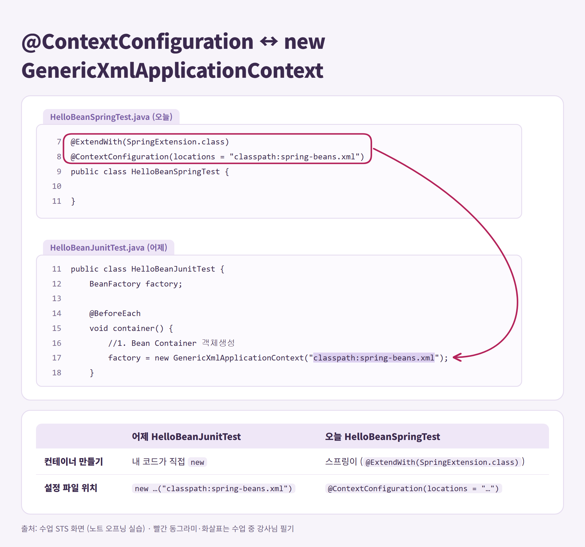
- 그림 설명 : 오늘 테스트 7~8줄 어노테이션(@ExtendWith, @ContextConfiguration)에 동그라미를 치고, 어제 테스트 17줄 `factory = new GenericXmlApplicationContext("classpath:spring-beans.xml");`로 화살표를 그으심. 어제는 컨테이너를 내 코드에서 new로 직접 만들었는데, 오늘은 설정 파일 위치만 @ContextConfiguration에 적으면 스프링이 컨테이너를 만들어 준다는 뜻
- 클래스로 대체생성 후 파일의 위치를 알려줌

- 이전 : 겟빈남발. 복잡함. @ContextConfiguration은 그걸 한결 줄여줌
  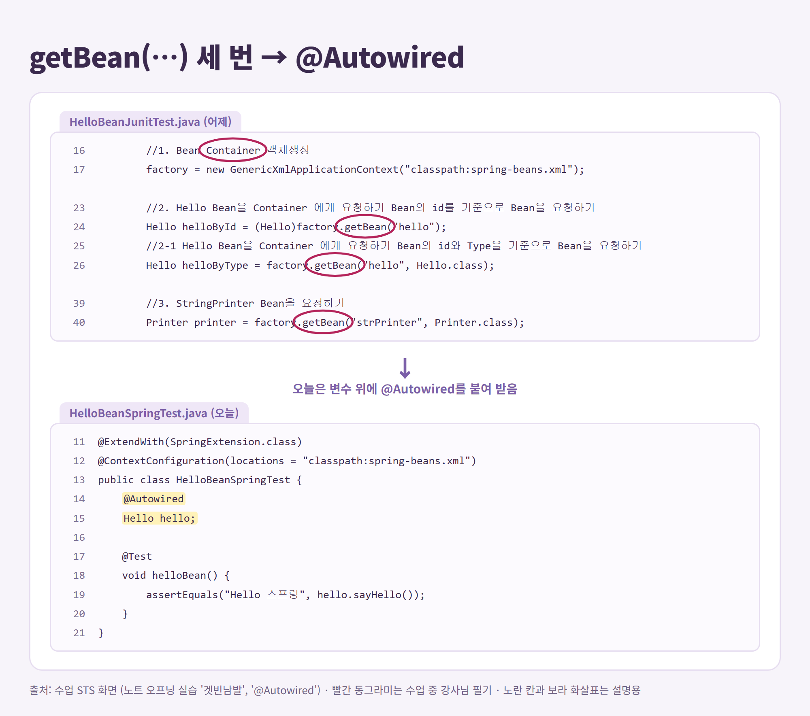
  - 그림 설명 : 어제 테스트에서 컨테이너에 빈을 달라고 할 때마다 쓴 `.getBean(` 세 군데에 동그라미를 치심. 빈 하나 받을 때마다 getBean을 불러야 했던 것(겟빈남발)을 오늘은 변수 위 @Autowired 한 줄로 받는다는 비교. 아래 코드는 같은 시간 내 화면

- @Autowired
  - 아주 중요!
  - 강사님 필기 : 61페이지 @Autowired 앞에 ※※ 표시를 하심

  - 오토와이드는 타입을 근거로 함. 1번 아이디가 헬로우라서 변수명과 똑같은 아이디를 가진 얘를 우선적으로 찾는 것을 원칙으로 함
    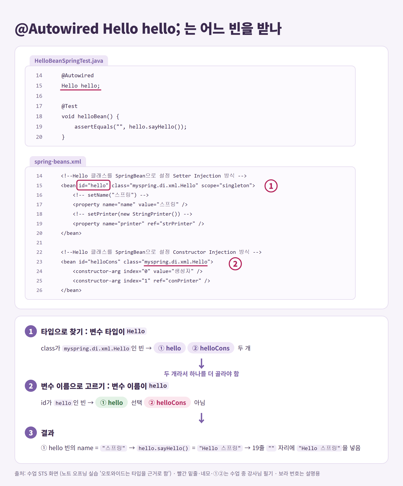
    - 그림 설명 : 테스트 `Hello hello;`에 밑줄, XML의 `id="hello"` 빈에 ①, `helloCons` 빈의 class(myspring.di.xml.Hello)에 밑줄과 ②를 쓰심. 같은 Hello 클래스 빈이 두 개라는 표시. 아래 1~3은 @Autowired가 둘 중 하나를 고르는 순서
    - 그러므로 앞의 비어있는 ""에는 Hello의 name인 "스프링"이 사용됨
    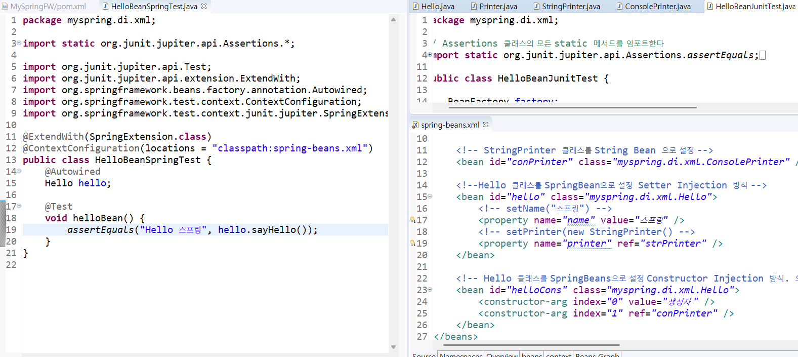
    - 설명 : 19줄 빈칸을 "Hello 스프링"으로 채운 화면. 오른쪽 XML 15~20줄 hello 빈(name = 스프링)이 들어왔는지 검사함

- 만족스럽지 않은 디펜던시를 사용하면 에러가 왕창 남.
  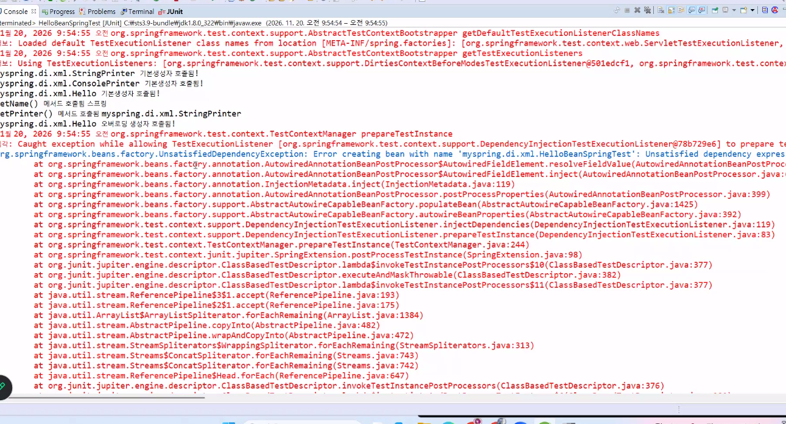
  - 번역 : `UnsatisfiedDependencyException: Error creating bean with name 'myspring.di.xml.HelloBeanSpringTest': Unsatisfied dependency expres…` → 'myspring.di.xml.HelloBeanSpringTest'라는 이름의 빈을 만들다가 오류. 채우지 못한 의존성(Unsatisfied dependency)이 있음 (줄 끝은 화면에서 잘림)
  - 설명 : 위쪽 "호출됨" 6줄은 빈이 만들어지며 찍힌 로그이고, UnsatisfiedDependencyException 줄부터가 오류. Hello 타입 빈이 hello, helloCons 두 개인데 변수 이름이 둘 중 어느 id와도 같지 않으면 이 오류가 남. 어느 빈인지 이름을 정해 주는 게 아래 @Qualifier

- @Qualifier
  - @Autowired와 세트로 사용. 혼자 쓰지 않음.
  - 우선권이 없는 것을 사용하고 싶다면 이걸 이용해서 특정한 걸 사용하게 할 수 있음

#### @ContextConfiguration과 @Autowired (교재 60·61페이지)

| | 어제 HelloBeanJunitTest | 오늘 HelloBeanSpringTest |
| --- | --- | --- |
| 클래스 위 | 없음 | `@ExtendWith(SpringExtension.class)` + `@ContextConfiguration(locations = "classpath:spring-beans.xml")` |
| 컨테이너 | `@BeforeEach`에서 `new GenericXmlApplicationContext(…)`로 내가 만듦 | 스프링이 만들고 관리 |
| 빈 꺼내기 | `factory.getBean("hello", Hello.class)` | 변수 위에 `@Autowired` |

- @Autowired가 빈을 고르는 순서
  1. 타입이 같은 빈을 찾음 → 하나면 끝
  2. 여럿이면 @Qualifier에 적은 id로 고름
  3. @Qualifier가 없으면 변수 이름과 같은 id로 고름 (`Hello hello` → id가 hello인 빈)
  4. 그래도 못 고르면 `NoUniqueBeanDefinitionException`, 하나도 없으면 `NoSuchBeanDefinitionException`
- @Qualifier는 빈을 만드는 게 아니라 넣을 빈을 id로 고르는 표시 (XML의 `ref="id"` 자리). 빈을 만드는 건 XML `<bean>`이나 @Component

#### 단축키·메서드 정리

| 단축키 / 코드 | 하는 일 |
| --- | --- |
| `@ExtendWith(SpringExtension.class)` | 테스트 중 컨테이너를 스프링이 만들고 관리 |
| `@ContextConfiguration(locations = "classpath:spring-beans.xml")` | 컨테이너를 만들 XML 위치 |
| `@Autowired` | 타입으로 빈을 찾아 변수에 넣음 |
| `@Qualifier("helloCons")` | 같은 타입이 여럿일 때 id로 하나를 고름 |

---

## 10시 수업

- 교재 66페이지
  - 3.7 Bean 등록 및 의존관계 설정 Annotation - Bean 의존관계 주입 Annotation (1)
    - @Autowired, @Resource 어노테이션은 의존하는 객체를 자동으로 주입해 주는 어노테이션이다.
    - @Autowired
      - 정밀한 의존관계 주입 (Dependency Injection)이 필요한 경우에 유용하다.
      - @Autowired는 변수, setter 메서드, 생성자, 일반메서드에 적용 가능하다.
      - 의존하는 객체를 주입할 때 주로 Type을 이용하게 된다.
      - @Autowired는 `<property>`, `<constructor-arg>` 태그와 동일한 역할을 한다.
  - 여러 위치에 설정할 수 있음. 의존하는 객체 주입 시 타입을 기반으로 함
  - 오토와이드는 스프링 쪽에서 만든 것. 

- @Resource (자카르타EE. 지금 프레임워크 수업에선 스프링 4버전 사용 중. 자바라서 javax)
  - 67페이지 : 3.7 Bean 등록 및 의존관계 설정 Annotation - Bean 의존관계 주입 Annotation (2)
    - @Autowired, @Resource 어노테이션은 의존하는 객체를 자동으로 주입해 주는 어노테이션이다.
    - @Autowired는 타입으로, @Resource는 이름으로 연결한다는 점이 다르다.
    - @Resource
      - 어플리케이션에서 필요로 하는 자원을 자동 연결할 때 사용된다.
      - @Resource는 변수, setter 메서드에 적용 가능하다.
      - 의존하는 객체를 주입할 때 주로 Name을 이용하게 된다.

- https://share.gemini.google/g1ZVyM6G1okM
  - 제미나이 질문 : Spring 에서 @Autowired 와 @Resource 비교, 장단점, 어떤 경우에 이 어노테이션을 사용해야 하는지 설명하세요
  - 제미나이 답 요약 + 수업 내용

    | 구분 | @Autowired | @Resource |
    | --- | --- | --- |
    | 만든 곳 | 스프링 (`org.springframework.beans.factory.annotation`) | 자바 표준 JSR-250 (수업은 스프링 5.2라 `javax.annotation`, 스프링 6부터는 `jakarta.annotation`) |
    | 찾는 기준 | 타입 먼저 → 여럿이면 @Qualifier(·@Primary) → 변수 이름 | 이름 먼저(`name` 속성 → 없으면 변수·setter 이름) → 없으면 타입 |
    | 붙는 자리 | 생성자, 변수, setter·메서드, 매개변수 | 변수, setter·메서드 (생성자·매개변수는 @Target에 없어서 붙이면 컴파일 오류) |
    | 장점 | 생성자 주입 가능(생성자가 하나면 생략도 됨), `required = false`, List·Map으로 같은 타입 빈 여럿을 한꺼번에 주입 | `name`으로 어떤 빈인지 바로 보임, 자바 표준이라 스프링에 덜 묶임 |
    | 단점 | 스프링에 묶임, 같은 타입이 여럿인데 @Qualifier를 빼먹으면 오류 | 생성자 주입 불가, `name`을 안 적으면 변수 이름을 바꿀 때 다른 빈이 들어갈 수 있음 |
    | 언제 쓰나 | 대부분의 주입(특히 생성자 주입)의 기본 | 같은 타입이 여럿이고 이름으로 딱 집어야 할 때, 팀 규칙이 표준 어노테이션일 때 |

    - @Primary, `required = false`는 수업에서 아직 안 나옴

- 정리 : @Autowired와 @Resource를 이용해 원하는 의존을 주입받을 수 있음

### 콘솔 프린터의 프린트 찾아가기

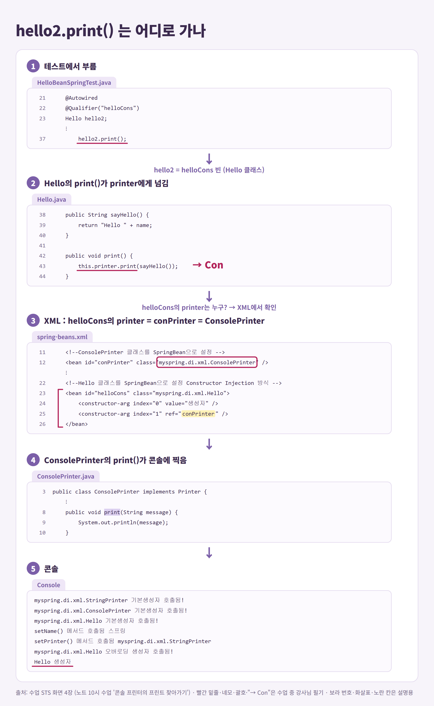
- 그림 설명 : 테스트 37줄 `hello2.print();` 한 줄이 어디까지 가는지 강사님이 코드를 따라가심(사진 5장을 순서대로 합침). Hello.java 43줄 `this.printer.print(sayHello());`에 밑줄을 긋고 "→ Con"이라고 쓰신 건 여기 printer가 ConsolePrinter라는 뜻. XML에서 helloCons 빈을 괄호로 묶고 conPrinter의 class(ConsolePrinter)에 네모를 쳐서 근거를 보여 주심. ConsolePrinter의 print()는 System.out.println으로 바로 찍어서 콘솔 마지막 줄에 "Hello 생성자"가 나옴

- xml 파일을 읽게 하여 찾게 함 -> 스프링에 어떤 거 쓸지 알려준다. 이를 할 때 어떤 걸 중심으로 의존을 찾을지 지목한다. 예를 들면 리소스 쓴 건 아이디로 찾아라. 이런 식으로 지시하는 과정들임

### 컬렉션 처리하기.
- 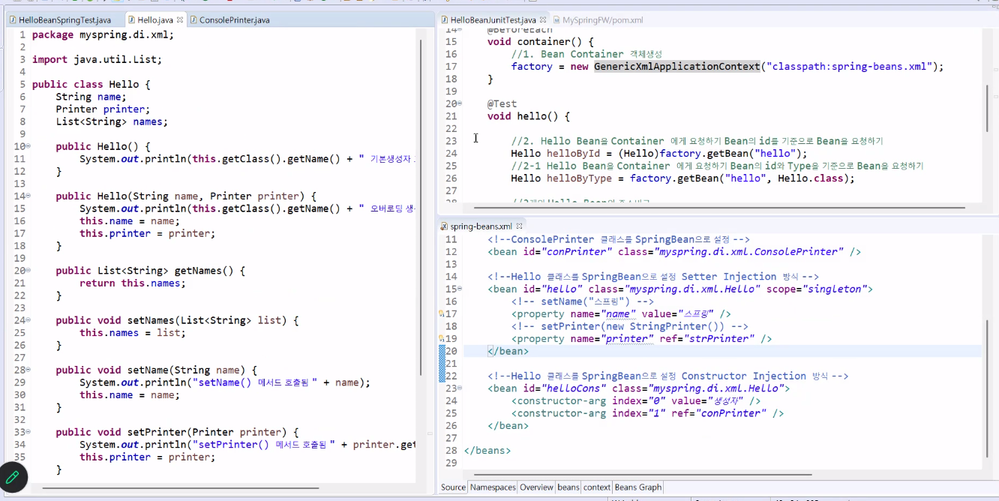
  - 설명 : Hello.java에 어제부터 있던 `List<String> names;` 필드(8줄)와 getNames()·setNames(List<String> list)(20~26줄). 오른쪽 XML에는 아직 names를 넣는 코드가 없음 → 아래 실습에서 추가함
- 49페이지
  - 3.3 DI(Dependency Injection) : Bean 의존관계 - 컬렉션(Collection) 타입의 값 주입(Injection) (1)
    - Spring은 List, Set, Map, Properties와 같은 컬렉션 타입을 XML로 작성해서 프로퍼티에 주입하는 방법을 제공한다.
    - List와 Set 타입 : `<list>`와 `<value>` 태그를 이용
      - 프로퍼티가 Set 타입 이면 `<list>` 대신에 `<set>`을 사용하면 된다.
    ```java
    public class Hello {
        List<String> names;

        public void setNames(List<String> list) {
            this.names = list;
        }
    ```
    ```xml
    <bean id="hello" class="myspring.di.xml.Hello">
        <property name="names">
            <list>
                <value>Spring</value>
                <value>IoC</value>
                <value>DI</value>
            </list>
        </property>
    </bean>
    ```
  - property 사용.
  - set 사용
  - set과 list의 차이점

  - id는 겹쳐선 안 된다. 이곳에 set 사용
  - 1:n의 관계 표시
  - 50페이지 : 3.3 DI(Dependency Injection) : Bean 의존관계 - 컬렉션(Collection) 타입의 값 주입(Injection) (2)
    - Spring은 List, Set, Map, Properties와 같은 컬렉션 타입을 XML로 작성해서 프로퍼티에 주입하는 방법을 제공한다.
    - Map 타입 : `<map>`과 `<entry>` 태그를 이용
    ```java
    public class Hello {
        Map<String,Integer> ages;

        public void setAges(Map<String, Integer> ages) {
            this.ages = ages;
        }
    ```
    ```xml
    <bean id="hello" class="myspring.di.xml.Hello">
        <property name="ages">
            <map>
                <entry key="Kim" value="30" />
                <entry key="Lee" value="35" />
                <entry key="Ahn" value="40" />
            </map>
        </property>
    </bean>
    ```

#### 실습
- property 추가
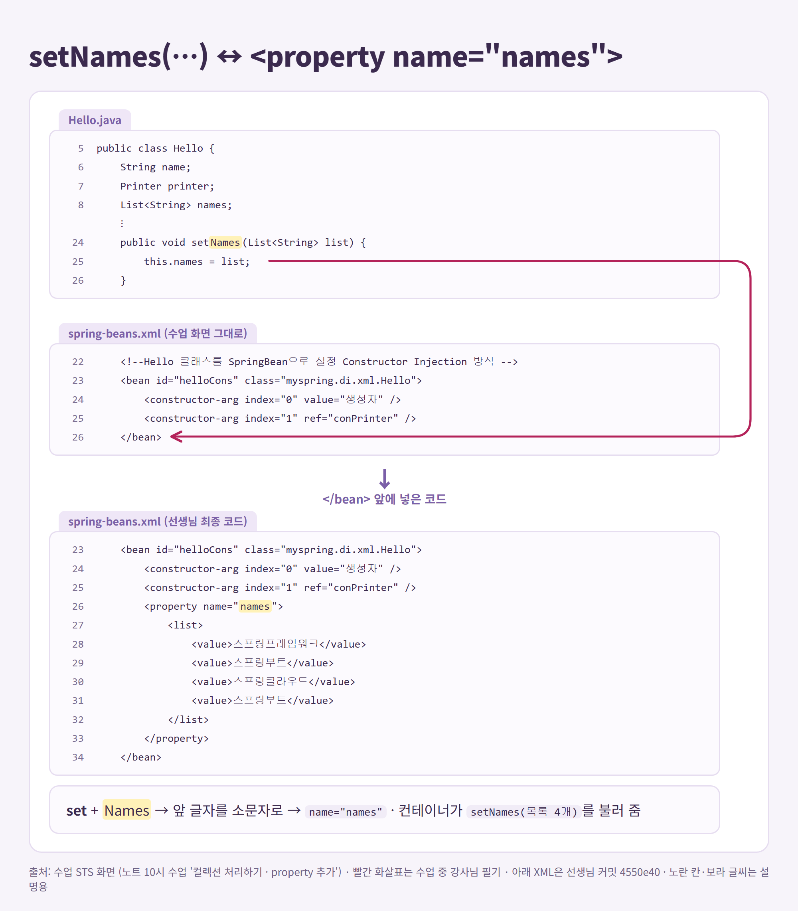
- 그림 설명 : Hello.java setNames(…)에서 XML helloCons 빈의 `</bean>` 앞으로 화살표를 그으심. setNames로 넣을 목록을 그 자리에 `<property name="names">`로 적으라는 뜻. setNames에서 set을 떼고 앞 글자를 소문자로 바꾼 names가 property의 name이 됨. 아래 XML은 선생님이 넣은 최종 코드(스프링부트가 두 번 → List는 같은 값도 그대로 넣음)

- @Disabled
  - 사용하지 않는 생성자 비활성화. 주석화와 같은 효과

- 왜 스프링 프레임워크인지는 들었지만 피로도 누적 때문인지 귀 밖으로 흘러나가버림
  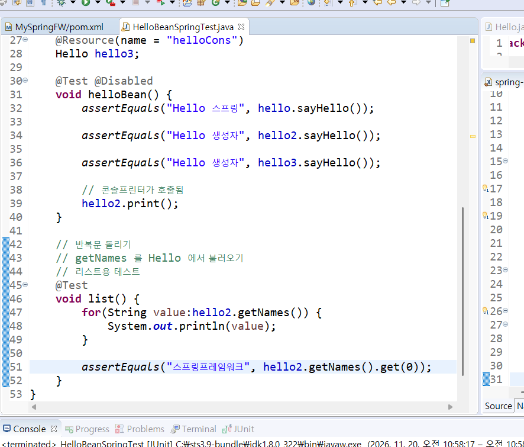
  - 설명 : 30줄 `@Test @Disabled` → helloBean() 테스트는 이번 실행에서 건너뜀. 새로 만든 list()(45~52줄)는 hello2(helloCons 빈)의 names를 for문으로 하나씩 찍고, 첫 번째 값이 "스프링프레임워크"인지 검사함
  - 왜 스프링 프레임워크인가 (수업 끝나고 다시 정리)
    - 한 줄 : 객체를 만들고 서로 이어 주는 일을 내 코드 밖(설정)으로 빼 주는 프레임워크. 그래서 바꾸기·테스트하기·여럿이 개발하기가 쉬워짐
    - 비유 : 가구 조립. 예전엔 부품을 사서 내가 직접 조립(new)함. 스프링은 조립 서비스. 나는 주문서(XML·어노테이션)만 쓰고, 기사님(컨테이너)이 조립해서 내 방(변수)에 놓아 줌
    - 스프링이 없으면 hello2(helloCons 빈)를 내가 직접 만들어야 함 (예시)
      ```java
      Printer printer = new ConsolePrinter();
      Hello hello2 = new Hello("생성자", printer);
      List<String> names = new ArrayList<>();
      names.add("스프링프레임워크");
      names.add("스프링부트");
      hello2.setNames(names);
      hello2.print();
      ```
      - 1줄 콘솔에 찍는 프린터를 만듦 → 2줄 이름·프린터를 넣어 Hello를 만듦(생성자 주입을 손으로) → 3~5줄 목록을 만들고 값을 하나씩 넣음 → 6줄 목록을 Hello에 넣음(setter 주입을 손으로) → 7줄 이제야 사용
      - 만들고 잇는 1~6줄을 전부 내가 써야 함
      - 오늘은 이걸 XML(`<bean id="helloCons">`, `<property name="names">`)에 적고, 테스트에서는 `@Autowired @Qualifier("helloCons") Hello hello2;` 한 줄로 받음
    - 좋은 점 네 가지 (모두 오늘 한 것)

      | 좋은 점 | 오늘 어디서 | 내용 |
      | --- | --- | --- |
      | 갈아 끼우기 쉬움 (DI) | 10시 콘솔 프린터의 프린트 찾아가기 | hello와 helloCons는 같은 Hello 클래스인데 print() 결과가 다름. hello는 StringPrinter라 콘솔에 안 찍고 속에 모아 두고, helloCons는 ConsolePrinter라 바로 찍음. 차이는 XML의 ref 한 단어뿐이고 Hello.java는 한 글자도 안 바꿈 |
      | 자주 바뀌는 값은 코드 밖으로 | 3시 property 실습 | values.properties로 값을 뺌. 교재 75페이지 "변경되는 이유와 시점이 다르다면 분리하는 것이 객체지향 설계의 기본 원칙이다". 예) DB 주소는 내 컴퓨터용과 실제 서비스용이 달라서 자바 코드는 두고 파일만 바꿈 |
      | 테스트가 쉬움 | 지금 이 장면 (@Disabled, list()) | @ExtendWith(SpringExtension.class)와 @ContextConfiguration이 컨테이너를 한 번 만들어 주고, @Autowired로 빈을 받으니 테스트는 assertEquals로 검사만 함. 한 곳을 고쳤을 때 다른 곳이 망가졌는지 Ctrl+F11 한 번으로 확인. @Disabled로 지금 안 볼 테스트는 잠시 끔 |
      | 여럿이 개발할 때 덜 부딪힘 | 11시 전략 1 → 전략 2 | XML 하나를 여럿이 동시에 고치다 충돌(SVN 이야기) → 전략 2(어노테이션 + 스캔) → 전략 3(자바 설정) → 스프링 부트. 클래스가 수백 개면 new로 엮는 건 사람이 감당하기 어려워서 연결을 스프링이 맡음 |

    - 어제 배운 교재 낱말과 연결
      - POJO : XML 방식 Hello.java에는 스프링 import가 하나도 없음(java.util.List뿐). 스프링을 몰라도 되는 평범한 클래스
      - IoC(제어의 역전) : new 하는 주인이 나에서 컨테이너로 바뀜
      - DI(의존성 주입) : 프린터를 XML·@Autowired가 넣어 줌
      - 경량급 : 무거운 서버 없이 JUnit 테스트만으로 컨테이너가 뜸
      - 어노테이션 방식 HelloBean은 @Component 같은 스프링 어노테이션을 import함. 스프링에 조금 기대는 대신 XML을 덜 씀 (편리함과 맞바꿈)

#### 컬렉션 넣기 (교재 49·50페이지)

| 태그 | 필드 타입 | 같은 값 두 번 |
| --- | --- | --- |
| `<list><value>…</value></list>` | `List<String>` | 그대로 들어감 |
| `<set><value>…</value></set>` | `Set<…>` | 하나만 남음 |
| `<map><entry key="…" value="…" /></map>` | `Map<…, …>` | key는 겹치면 안 됨 |

- 오늘 helloCons의 names : "스프링부트"가 두 번 → List라서 4개 그대로. `<set>`으로 바꾸면 겹친 값이 빠져 3개가 됨
- 한 빈에 `<constructor-arg>`와 `<property>`를 같이 써도 됨. 생성자로 먼저 만들고 그다음 setter를 부름
- @Disabled는 테스트 메서드를 이번 실행에서 건너뜀(생성자가 아님). 주석과 달리 코드는 그대로 컴파일되고, JUnit 결과에 건너뜀(skipped)으로 남음

#### 단축키·메서드 정리

| 단축키 / 코드 | 하는 일 |
| --- | --- |
| Ctrl + 클릭 (F3) | 메서드·클래스 정의로 이동 (프린트 찾아가기) |
| Ctrl + T | 인터페이스 메서드의 구현 클래스 고르기 |
| `@Resource(name = "helloCons")` | id로 빈을 찾아 넣음 |
| `<property name="names"><list><value>…</value></list></property>` | setNames(…)로 목록 넣기 |
| `@Test @Disabled` | 이 테스트는 건너뜀 |
| `for (String value : hello2.getNames())` | 목록을 하나씩 꺼내 찍기 |
| `getNames().size()` / `getNames().get(0)` | 목록 개수 / 0번째 값 |

---

## 11시 수업
- 포 루프 쓰는 것보다는 다른 게 나음
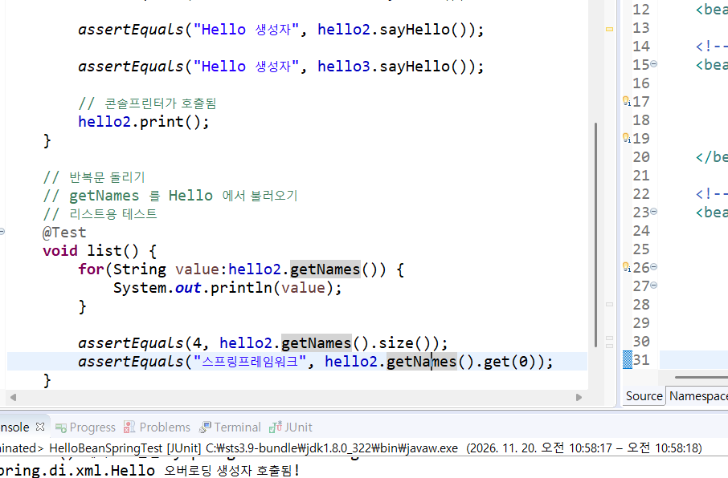
- 설명 : for문은 값을 눈으로 확인하는 용도이고, 검사는 assertEquals로 함. `assertEquals(4, hello2.getNames().size())`로 목록이 4개인지, `get(0)`으로 첫 값이 "스프링프레임워크"인지 확인

- 62페이지 : 전략 1. 우리가 지금까지 쓴 거.
  - 3.6 Bean 등록 메타정보 구성 전략 - 전략(1) XML 설정 단독 사용
    - 모든 Bean을 명시적으로 XML에 등록하는 방법이다.
    - 생성되는 모든 Bean을 XML에서 확인할 수 있다는 장점이 있으나 Bean의 개수가 많아지면 XML 파일을 관리하기 번거로울 수 있다.
    - 여러 개발자가 같은 설정파일을 공유해서 개발하다 보면 설정파일을 동시에 수정하다가 충돌이 일어나는 경우도 적지 않다.
    - DI에 필요한 적절한 setter 메서드 또는 constructor가 코드 내에 반드시 존재해야 한다.
    - 개발 중에는 어노테이션 설정방법을 사용했지만, 운영 중에는 관리의 편의성을 위해 XML설정으로 변경하는 전략을 쓸 수도 있다.
  - xml이 조금이라도 실수하면 에러가 남

  - 깃 이전엔 SVN이 있었음. 그걸 사용할 적엔 그걸 다른 사람이 내려받음. 
    - 내 것만 해야 하는데 남의 것을 고쳤다가 xml에 실수를 한다. 그럼 실수실수실수 대참사가 나는 것. 건드리지 않았는데 무언가 에러가 나는 것... 
  - 서로 공유해서 파일 개발하다가 설정파일 동시수정으로 충돌이 자주 났었음. 

  - 실제 운영하고 유지보수할 땐 좋음. 하지만 개발할 때는 불편함.

- 전략 3이 현재 스프링부트의 방식. 스프링 부트 배울 때 이해하기 쉬우려고 순서대로 알려주시는 것.

### 63페이지 : 전략 2
- 3.6 Bean 등록 메타정보 구성 전략 - 전략(2) 어노테이션과 XML 설정 혼용해서 사용 (ver2.5)
  - Bean으로 사용될 클래스에 특별한 어노테이션(Annotation)을 부여해주면 이런 클래스를 자동으로 찾아서 Bean으로 등록한다.
  - @Component 어노테이션이 선언된 클래스를 자동으로 찾아서 Bean으로 등록 해주는 방식을 빈 스캐닝(Bean Scanning)을 통한 자동인식 Bean 등록 기능이라고 한다.
  - 어노테이션을 부여하고 자동 스캔으로 Bean을 등록하면 XML 문서 생성과 관리에 따른 수고를 덜어주고 개발 속도를 향상시킬 수 있다.
  - 애플리케이션에 등록될 Bean이 어떤 것들이 있고, Bean들 간의 의존관계가 어떻게 되는지를 한눈에 파악할 수 없다는 단점이 있다.

  - 핵심: xml 설정을 줄여보자!

- 65페이지 : 3.7 Bean 등록 및 의존관계 설정 Annotation - @Component와 @Autowired
  ```java
  package myspring.di.annot;

  @Component("hello")
  public class Hello {
      @Value("어노테이션")
      String name;

      @Autowired
      @Qualifier("stringPrinter")
      Printer printer;

      public void setName(String name) {
          this.name = name; }
      public void setPrinter(Printer printer) {
          this.printer = printer;
      }
      public String sayHello() {
          return "Hello " + name;}
      public void print() {
          this.printer.print(sayHello());
      }
  }
  ```
  ```xml
  <!--어노테이션이 선언된 클래스들을 스캔하기 위한 설정 -->
  <context:component-scan
      base-package="myspring.di.annot" />
  ```
  ```java
  package myspring.di.annot;

  @Component("stringPrinter")
  public class StringPrinter implements Printer {
      private StringBuffer buffer = new StringBuffer();

      public void print(String message) {
          this.buffer.append(message);
      }
      public String toString() {
          return this.buffer.toString();
      }
  }
  ```

  - 클래스 위에 컴포넌트를 적어줌. 

  - 이 자체가 클래스. 각 클래스에 컴포넌트라고 적어 각자 선언하는 방식
    - 강사님 필기 : @Component("hello")에 밑줄을 긋고 괄호로 묶어 `<bean id="hello">` ~ `</bean>`이라고 적으심

  - 중간에 졸음. 줄 그은 건 사용하지 않아도 되게 된다고 함. bean은 나중에 알려주신다는 듯 
    - 강사님 필기 : `<bean id="hello">` 아래에 `<property name="name" value=`를 이어 적고(value 뒤는 화면 끝에서 잘림) @Value("어노테이션")에 밑줄과 화살표를 그으심
    - 강사님 필기 : setName, setPrinter 메서드에 줄을 그으심
    - 줄 그은 이유 (수업 끝나고 다시 정리)
      - 어제 XML 방식은 setter가 꼭 있어야 했음
        ```xml
        <property name="name" value="스프링" />
        ```
        - 스프링에게 "setName("스프링")을 불러서 값을 넣어 줘"라는 뜻. name="name" → 앞에 set을 붙이고 첫 글자를 대문자로 → setName을 찾아 부름
        - setName이 없으면 넣을 방법이 없어서 오류가 남. 교재 62페이지 "DI에 필요한 적절한 setter 메서드 또는 constructor가 코드 내에 반드시 존재해야 한다"
      - 오늘은 변수(필드) 바로 위에 붙임
        ```java
        @Value("어노테이션")
        String name;
        ```
        - 1줄은 "이 변수에 "어노테이션"을 넣어 줘"라는 표시, 2줄은 값이 들어갈 변수
        - 스프링이 setter를 거치지 않고 변수에 직접 값을 넣음 → setName이 할 일이 없어져서 줄을 그으심
        - @Value, @Autowired를 변수에 바로 붙이면 setter가 없어도 됨
      - 비유 : 택배. XML 방식은 현관 초인종(setter)을 눌러야만 물건을 줄 수 있는 택배라서 초인종이 없으면 배달 못 함. 필드 방식은 관리실(스프링)이 방(변수) 안에 바로 놓아 주는 방식이라 초인종이 필요 없음
      - 실제로 선생님 HelloBean도 13:14 커밋(@Component @Value add)에서 @Value를 붙이면서 아래 두 메서드를 지우셨고, 테스트도 통과함
        ```java
        public void setName(String name) {
            System.out.println("setName() 메서드 호출됨 " + name);
            this.name = name;
        }

        public void setPrinter(PrinterBean printer) {
            System.out.println("setPrinter() 메서드 호출됨 " + printer.getClass().getName());
            this.printer = printer;
        }
        ```
        - 어제는 이 메서드가 불릴 때 콘솔에 "setName() 메서드 호출됨"이 찍혔는데, 오늘 HelloBean 테스트 콘솔에는 이 줄이 안 나옴 → setter를 안 거쳤다는 증거
      - setter를 쓰면 안 된다는 뜻은 아님. @Autowired는 변수, setter 메서드, 생성자, 일반메서드에 다 붙일 수 있음(교재 66페이지). 오늘 세 자리를 다 써 봄

        | 붙인 자리 | 오늘 어디서 | setter 필요? |
        | --- | --- | --- |
        | 변수 위 | HelloBean의 `@Value("${app.setter.name}") String name;` | 필요 없음 → 그래서 줄 그음 |
        | setter 위 | 4시 반복문, HelloBeanCons의 setNames(…) 위 @Value | 일부러 setter로 받음 |
        | 생성자 위 | HelloBeanCons의 `@Autowired public HelloBeanCons(…)` | 생성자로 받음 |

      - 그래서 줄 그은 뜻은 "변수에 바로 붙였으니까 이 setter들은 이제 필요 없다"임
    - 강사님 필기 정리 : 어노테이션마다 같은 일을 하는 XML

      | 어노테이션 (65페이지) | 같은 일을 하는 XML |
      | --- | --- |
      | `@Component("hello")` (클래스 위) | `<bean id="hello">` … `</bean>` |
      | `@Value("어노테이션")` (변수 위) | `<property name="name" value="어노테이션">` |
      | `@Autowired` + `@Qualifier("stringPrinter")` (변수 위) | `<property name="printer" ref="stringPrinter">` |
      | (XML 한 줄) `<context:component-scan base-package="…" />` | 이 패키지를 훑어서 위 어노테이션을 찾으라는 설정 |

    - bean은 나중에 → @Bean (4시 전략 3)
      - XML `<bean>`과 같은 일을 하는 어노테이션이 두 개

        | 어노테이션 | 어디에 붙이나 | 전략 |
        | --- | --- | --- |
        | @Component | 클래스 위 (그 클래스 자체가 빈이 됨) | 전략 2 (11시~2시) |
        | @Bean | 설정 클래스 안 메서드 위 (메서드가 new로 만든 객체가 빈이 됨) | 전략 3 (4시, 72페이지) |

      - 교재 71페이지 "@Bean 어노테이션은 새로운 빈 객체를 제공할 때 사용되며 @Bean이 적용된 메서드의 이름을 Bean의 식별값으로 사용한다"
      - 4시 "컴포넌트 위치가 조금 다름. 메서드 위에 선언함"이 이 @Bean 이야기. 72페이지 필기에서 @Bean에 동그라미를 치고 `<bean>`~`</bean>`이라고 적으신 것도 65페이지 @Component 필기와 같은 짝
    - 어노테이션 쓴 것과 같음

    - Autowired: 내가 찾는 변수를 의존성 주입해주세요.
    - 특정 변수는 @Qualifier (이게 빈 역할)

    - 하지만 선언한다고 스프링 컨테이너가 찾지는 못함. 
    - 그래서 어노테이션이 붙은 것을 스캔하기 위한 설정이 필요한 것 : xml에 작성 => xml은 클래스 스캔 용도 
      - 강사님 필기 : base-package="myspring.di.annot" 아래에 밑줄을 그으심. 위쪽에 property, bean, ref, value 글씨가 일부만 보임(사진 위쪽이 잘림)
      - 전략 3은 xml 없이 클래스만 사용함
        - 73페이지 : 3.8 DI(Dependency Injection) : Bean 의존관계 - 2. @Configuration과 @ComponentScan
          - 왼쪽 Hello 코드는 65페이지와 같음
          ```java
          @Configuration
          @ComponentScan(basePackages = { "myspring.di.annot" })
          public class HelloConfig {

          }
          ```
        - xml에서 지정하여 스캔하던 것을 어노테이션의 용어를 사용 -> xml을 사용하던 기능들을 전부 어노테이션화 한 것. 그래서 각각의 어노테이션이 어떤 일을 하는지 정확히 알아야 함.

#### 빈 등록 Annotation (교재 64페이지)

| 어노테이션 | 교재 설명 |
| --- | --- |
| @Component | 컴포넌트를 나타내는 일반적인 스테레오 타입으로 `<bean>` 태그와 동일한 역할을 함 |
| @Repository | 퍼시스턴스(persistence) 레이어, 영속성을 가지는 속성(파일, 데이터베이스)을 가진 클래스 |
| @Service | 서비스 레이어, 비즈니스 로직을 가진 클래스 |
| @Controller | 프리젠테이션 레이어, 웹 어플리케이션에서 웹 요청과 응답을 처리하는 클래스 |

- @Repository, @Service, @Controller는 더 특정한 유즈케이스에 대한 @Component의 구체화된 형태이다 (64페이지)
- 셋 다 component-scan이 기본으로 찾는 어노테이션이라 @Component처럼 빈으로 등록됨

#### 스캔이 꼭 필요한 이유 (교재 69페이지)
- @Component를 통해 자동으로 Bean을 등록하고, @Autowired로 의존관계를 주입받는 어노테이션을 클래스에서 선언하여 사용했을 경우에는 해당 클래스가 위치한 특정 패키지를 Scan하기 위한 설정을 XML에 해주어야 한다.
- 비유 : @Component는 각자 가슴에 다는 이름표, component-scan은 "이 반(패키지)에서 이름표 단 사람 다 나와" 하고 부르는 출석 부르기. 이름표를 달아도 출석을 안 부르면 아무도 안 나옴

#### 단축키·메서드 정리

| 단축키 / 코드 | 하는 일 |
| --- | --- |
| `@Component` / `@Component("id")` | 클래스를 빈으로 등록. id를 안 적으면 클래스 이름 첫 글자를 소문자로 바꾼 것 (HelloBean → helloBean) |
| `<context:component-scan base-package="패키지" />` | 그 패키지를 훑어 @Component 등이 붙은 클래스를 빈으로 등록 |
| `@Value("값")` | 글자·숫자 같은 단순 값 넣기 (`<property value>` 자리) |

---

## 1시 수업

### 실습 : 전략 2

- 전략2에서는 어노테이션을 주르륵 쓰고 xml에 패키지 명을 한 줄 작성한다. 
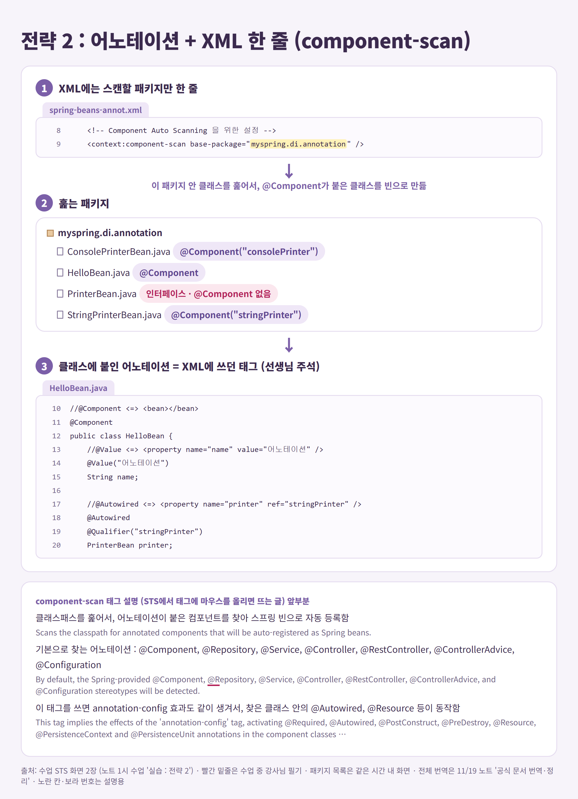
- 그림 설명 : XML에는 `<context:component-scan base-package="myspring.di.annotation" />` 한 줄만 쓰고, 그 패키지 안 클래스에 붙인 @Component를 찾아 빈으로 만듦. HelloBean 위 주석(`@Component <=> <bean></bean>` 등)은 어노테이션마다 같은 일을 하는 XML을 적어 둔 것. 강사님이 component-scan 설명(태그에 마우스를 올리면 뜨는 글)에서 @Repository에 밑줄을 그으심. 기본으로 찾는 어노테이션에 @Component 말고도 @Repository·@Service·@Controller 등이 있다는 부분 (사진 2장 합침)

- 테스트까지 완성 후 Ctrl+F11
- 했더니 오류랑 호출이 뜸. 호출이 abc 순으로 정렬된 것으로 보임
  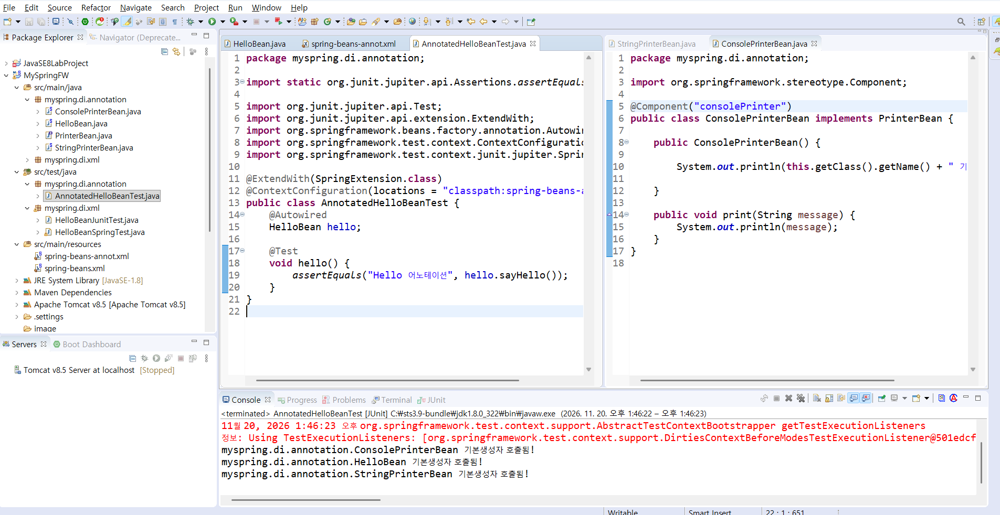
  - 설명 : 빨간 글씨 2줄은 오류가 아니라 `정보:`(INFO) 안내 로그. 검은 글씨 3줄은 스캔으로 찾은 빈을 만들며 생성자가 찍은 글로, ConsolePrinterBean → HelloBean → StringPrinterBean 순서(이번에는 클래스 이름 순서와 같음)

- 컴포넌트 스캔이 없으면 스프링 빈으로 인식되지 않게 됨 꼭 스캔을 잊지 말고 할 것. (일부러 주석 처리하여 보여주심)
  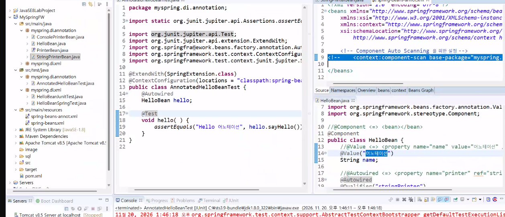
  - 설명 : spring-beans-annot.xml 9줄 `<context:component-scan …>`을 `<!-- -->`로 주석 처리한 화면. 이대로 실행하면 @Component를 찾지 않아서 `NoSuchBeanDefinitionException: No qualifying bean of type 'myspring.di.annotation.HelloBean' available` 오류가 남 (HelloBean 타입 빈이 하나도 없음)
  - 컴포넌트 스캔 아주 중요!

#### 전략 2 실습 순서 (myspring.di.annotation 패키지)
1. 어제 Printer 가족과 같은 모양으로 PrinterBean(인터페이스), StringPrinterBean·ConsolePrinterBean, HelloBean을 만듦
2. 클래스 위에 @Component, 변수 위에 @Value·@Autowired·@Qualifier
3. src/main/resources/spring-beans-annot.xml : 맨 위에 `xmlns:context` 추가, 본문은 component-scan 한 줄
4. 테스트 AnnotatedHelloBeanTest : `@ContextConfiguration(locations = "classpath:spring-beans-annot.xml")`

- 빈을 만드는 순서 : 스캔은 클래스 파일 이름 순서(Console → Hello → String)로 만들지만, 주입에 필요한 빈은 그 자리에서 먼저 만듦

#### 단축키·메서드 정리

| 단축키 / 코드 | 하는 일 |
| --- | --- |
| Ctrl + F11 | 실행 |
| `xmlns:context="http://www.springframework.org/schema/context"` | XML에서 `context:` 태그를 쓰려면 맨 위에 필요 |
| `@Component("stringPrinter")` | id를 stringPrinter로 정해 빈 등록 |

---

## 2시 수업


- 헬로 테스트 작성
- 에러가 났다. 이유가 뭘까?
  - 프린트 둘 중 하나를 지정 안 해줘서.

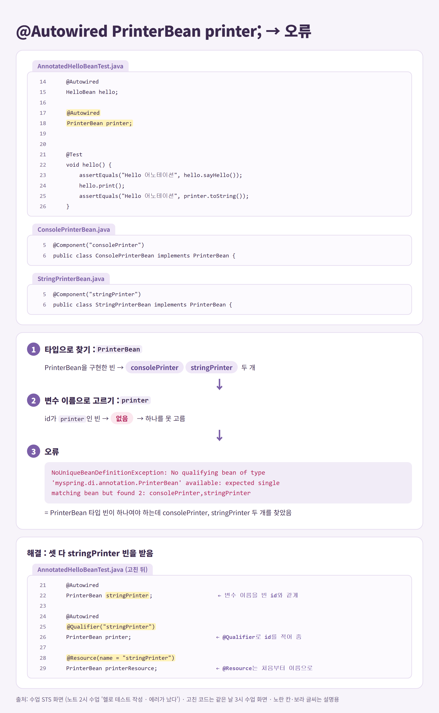
- 그림 설명 : 테스트에 `@Autowired PrinterBean printer;`(17~18줄)를 추가하고 실행한 화면. PrinterBean 타입 빈이 consolePrinter, stringPrinter 두 개이고 변수 이름 printer와 같은 id가 없어서 하나를 못 골라 아래 오류가 남. 맨 아래 '해결'은 3시 수업 화면의 고친 코드(해결방안 세 가지)

```
Caused by: org.springframework.beans.factory.NoUniqueBeanDefinitionException: No qualifying bean of type 'myspring.di.annotation.PrinterBean' available: expected single matching bean but found 2: consolePrinter,stringPrinter
	at org.springframework.beans.factory.config.DependencyDescriptor.resolveNotUnique(DependencyDescriptor.java:220)
	at org.springframework.beans.factory.support.DefaultListableBeanFactory.doResolveDependency(DefaultListableBeanFactory.java:1285)
	at org.springframework.beans.factory.support.DefaultListableBeanFactory.resolveDependency(DefaultListableBeanFactory.java:1227)
	at org.springframework.beans.factory.annotation.AutowiredAnnotationBeanPostProcessor$AutowiredFieldElement.resolveFieldValue(AutowiredAnnotationBeanPostProcessor.java:657)
	... 76 more
```
  - 해결방안 : Qualifier, Resource, id 변경


- @Autowired는 다른 것들과 달리 생성자 위에 쓸 수 있음
  - 66페이지(10시 수업과 같은 쪽) : @Autowired는 변수, setter 메서드, 생성자, 일반메서드에 적용 가능하다.
    - 강사님 필기 : 변수, setter, 생성자에 동그라미를 치심

  - 변수가 붙을 수 있는 곳

    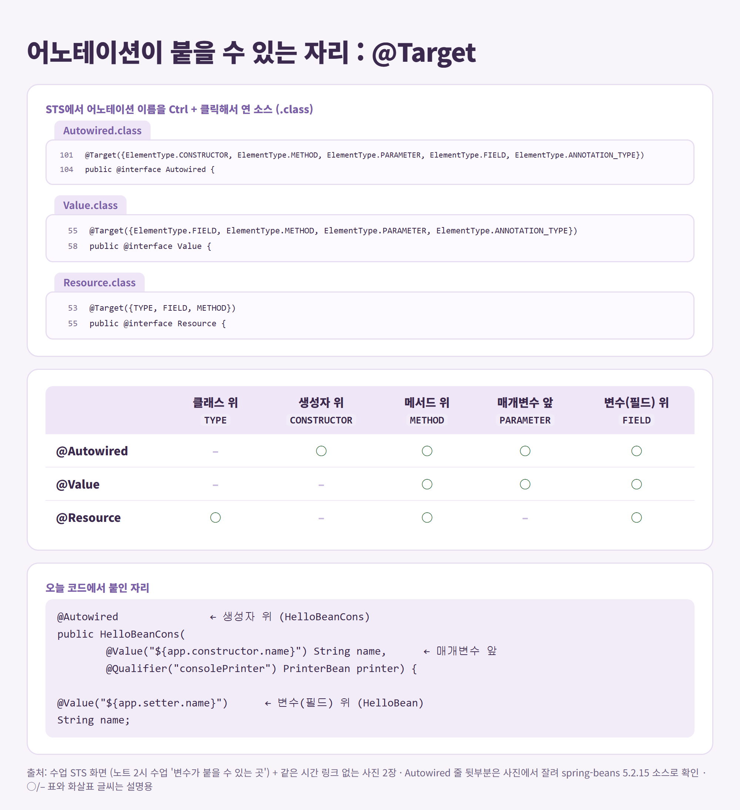
    - 그림 설명 : 강사님이 STS에서 @Value, @Autowired, @Resource 소스를 열어 @Target(붙일 수 있는 자리)을 보여 주심(사진 3장 합침). CONSTRUCTOR(생성자 위)가 있는 건 @Autowired뿐이고, @Resource에는 PARAMETER(매개변수 앞)가 없음. 그래서 생성자 위에는 @Autowired, 생성자 매개변수 앞에는 @Value·@Qualifier를 붙임
  
  - 이번에는 파라미터에 붙일 예정

  - @Override가 하는 역할 : 재정의
    - 오버라이딩의 규칙 : 메서드 선언부가 똑같고 바디(구현)가 다른 것 
  
- @Autowired : 리소스에는 못씀
- 각 코드는 이유가 있다. 

- 졸았음
  - 졸았던 부분 다시 정리 (수업 끝나고, 선생님 커밋 시각으로 확인)
    - 놓친 구간 : 14:35~14:50 설명. 14:50에 깨어나서 화면 코드를 급하게 따라 침(14:54 커밋, 14:57에 `hello_constructor` 뒤 빠진 `()` 오타 수정). 지금 코드는 선생님 최종 코드와 같음(주석·빈 줄만 다름)
    - 그 사이 선생님이 하신 것

      | 시각 | 한 것 |
      | --- | --- |
      | 14:24 | HelloBean의 오버로딩 생성자를 지우고 새 클래스 HelloBeanCons를 만듦(생성자에 어노테이션 없음). HelloBean = 변수에 넣기, HelloBeanCons = 생성자로 넣기로 나눠 보려는 것으로 보임 |
      | 14:35 | 생성자 위에 @Autowired, 매개변수 앞에 @Value·@Qualifier를 붙임 |
      | 14:48 | 테스트에 hello_constructor()를 추가하고, 앞 테스트 hello()에는 @Disabled |
      | 15:11 | (3시 수업 첫머리) @Qualifier("stringPrinter")를 "consolePrinter"로 바꿈 |

    - 14:35 생성자에 어노테이션 넣기
      - 14:24에는 `public HelloBeanCons(String name, PrinterBean printer) {`처럼 무엇을 넣을지 표시가 없었음. 스프링은 글자는 뭘 넣을지, 프린터는 둘 중 뭘 넣을지 모름
        ```java
        @Autowired
        public HelloBeanCons(
                @Value("어노테이션생성자") String name,
                @Qualifier("stringPrinter") PrinterBean printer) {
            System.out.println(this.getClass().getName() + " 인자가 있는 생성자 호출됨!");
            this.name = name;
            this.printer = printer;
        }
        ```
        - 1줄 @Autowired : 이 생성자로 객체를 만들고 매개변수는 스프링이 채워 줘
        - 2줄 : 생성자 이름(줄만 나눈 것)
        - 3줄 @Value("어노테이션생성자") : 첫 번째 칸(name)에 이 글자를 넣어 줘
        - 4줄 @Qualifier("stringPrinter") : 두 번째 칸(printer)에 PrinterBean 빈 둘 중 stringPrinter를 넣어 줘
        - 5줄 : 생성자가 불렸는지 확인하는 로그
      - 왜 이렇게 나눠 붙였나 : 졸기 직전 메모와 이어짐. 전부 @Target(붙일 수 있는 자리) 때문

        | 졸기 직전 메모 | 이어지는 뜻 |
        | --- | --- |
        | @Autowired는 다른것들과 달리 생성자 위에 쓸 수 있음 | 그래서 생성자 위에는 @Autowired만 있음. @Target에 CONSTRUCTOR가 있는 건 @Autowired뿐 |
        | 이번에는 파라미터에 붙일 예정 | @Value는 생성자 위에 못 붙음 → 매개변수 앞에 붙임 |
        | @Autowired : 리소스에는 못씀 | @Resource는 매개변수에 못 붙음(@Target에 PARAMETER 없음) → 그래서 @Resource가 아니라 @Qualifier를 씀 |

      - 어제 XML과 짝 맞추기

        | 어제 XML (helloCons) | 14:35 어노테이션 (HelloBeanCons) |
        | --- | --- |
        | `<bean id="helloCons" class="myspring.di.xml.Hello">` | @Component |
        | `<constructor-arg index="0" value="생성자" />` | `@Value("어노테이션생성자") String name` |
        | `<constructor-arg index="1" ref="conPrinter" />` | `@Qualifier("stringPrinter") PrinterBean printer` |
        | (생성자로 넣는다는 표시) | 생성자 위 @Autowired |

        - 어제는 index="0", "1"처럼 번호로 몇 번째 칸인지 정함. 오늘은 어노테이션을 그 칸 바로 앞에 붙이니까 번호가 필요 없음
      - 비유 : 변수 주입이 "이사 온 뒤 택배로 가구 받기"라면 생성자 주입은 "이사 오는 날 가구를 들고 들어오기". 처음 만들어질 때부터 값이 다 들어 있음
      - 생성자가 하나뿐이면 생성자 위 @Autowired를 빼도 결과가 같음(스프링 4.3부터). 수업에서는 어디서 주입하는지 보이게 붙임
    - 14:48 테스트
      ```java
      @Autowired
      HelloBeanCons helloCons;

      @Test @Disabled
      void hello( ) {
          // 2시에 만든 검사들 (생략)
      }

      @Test
      void hello_constructor() {
          assertEquals("Hello 어노테이션생성자", helloCons.sayHello());
      }
      ```
      - 1~2줄 : HelloBeanCons 빈을 받음. 이 타입 빈은 하나뿐이라 @Qualifier가 필요 없음
      - 4줄 @Disabled : 2시에 만든 앞 테스트 hello()는 잠시 끔 (10시 수업과 같은 방식)
      - 9~12줄 : 생성자로 "어노테이션생성자"가 들어갔으면 sayHello()가 "Hello 어노테이션생성자"가 됨
      - 테스트를 돌리면 스프링 안에서 일어나는 순서
        1. spring-beans-annot.xml의 component-scan이 패키지를 훑어서 @Component 4개를 찾음
        2. HelloBeanCons를 만들려고 보니 생성자에 @Autowired → 이 생성자로 만들기로 함
        3. 첫 칸 → @Value의 글자 "어노테이션생성자"를 준비
        4. 둘째 칸 → @Qualifier대로 stringPrinter 빈을 준비
        5. `new HelloBeanCons("어노테이션생성자", stringPrinter빈)`과 같은 일을 스프링이 함 → 콘솔에 "인자가 있는 생성자 호출됨!"
        6. 테스트 변수 helloCons에 이 빈을 넣음
        7. assertEquals로 검사 → 통과
      - 실행 결과 : 콘솔에 ConsolePrinterBean → HelloBean → StringPrinterBean → HelloBeanCons 인자가 있는 생성자 호출됨! 순서로 찍히고, 테스트는 1개 통과·1개 건너뜀
    - "각 코드는 이유가 있다" : 생성자 위에는 왜 @Autowired만 있는지, @Value는 왜 매개변수 앞에 있는지, 왜 @Resource가 아니라 @Qualifier인지 → 모두 @Target 때문. 아무 데나 붙인 게 아니고, 어노테이션 하나하나가 XML 한 줄씩을 대신함
    - 덧붙임 : 생성자로 받으면 좋은 점 (그때 강사님 말씀인지는 모름. 보통 하는 설명)
      - 처음부터 완성된 객체 : 변수 주입은 객체를 만든 뒤에 값을 넣지만, 생성자 주입은 만들어지는 순간 값이 다 들어 있음
      - 스프링 없이도 테스트하기 쉬움 : `new HelloBeanCons("테스트", 가짜프린터)`처럼 직접 넣어 볼 수 있음
      - 그래서 스프링 부트에서는 생성자 주입을 많이 씀

#### 같은 타입 빈이 둘일 때 고르는 방법 세 가지

| 방법 | 코드 | 찾는 방식 |
| --- | --- | --- |
| 변수 이름을 빈 id와 같게 | `@Autowired PrinterBean stringPrinter;` | 타입으로 둘 → 변수 이름으로 하나 |
| @Qualifier | `@Autowired @Qualifier("stringPrinter") PrinterBean printer;` | 타입 + 적어 준 id |
| @Resource | `@Resource(name = "stringPrinter") PrinterBean printerResource;` | 처음부터 이름(id)으로 |

- 세 번째 "id 변경"은 빈 id를 바꾸는 게 아니라 변수 이름을 빈 id(stringPrinter)에 맞추는 것

#### 오늘 나온 오류

| 오류 | 뜻 | 고치기 |
| --- | --- | --- |
| `NoUniqueBeanDefinitionException … found 2` | 같은 타입 빈이 둘이라 못 고름 | 변수 이름 / @Qualifier / @Resource |
| `NoSuchBeanDefinitionException … expected at least 1 bean` | 그 타입 빈이 하나도 없음 | component-scan 확인 |
| `UnsatisfiedDependencyException` | 위 둘 때문에 변수를 못 채움 (겉에 보이는 이름) | `Caused by:` 줄을 봄 |
| `annotation type not applicable to this kind of declaration` | 이 자리에 못 붙이는 어노테이션 (컴파일 오류) | @Target 확인 |

#### 붙일 수 있는 자리 (@Target)

| | 변수 | 생성자 위 | 매개변수 앞 | setter·메서드 |
| --- | --- | --- | --- | --- |
| @Autowired | ○ | ○ | ○ | ○ |
| @Value | ○ | – | ○ | ○ |
| @Qualifier | ○ | – | ○ | ○ |
| @Resource | ○ | – | – | ○ |

#### 단축키·메서드 정리

| 단축키 / 코드 | 하는 일 |
| --- | --- |
| Ctrl + 클릭 (어노테이션 이름) | 어노테이션 소스(.class)를 열어 @Target 확인 |
| `@Autowired` (생성자 위) | 이 생성자로 만들고 매개변수는 스프링이 채움 |
| `@Value("…")` / `@Qualifier("…")` (매개변수 앞) | 생성자 칸마다 값·빈 지정 |
| `@Override` | 부모·인터페이스 메서드를 재정의한다는 표시 |

---

## 3시 수업

- 3:22 

### property
- 페이지 75, 76 페이지 : .properties
  - 자주 바뀌는 것들은 configuration 용 파일을 따로 만듦
  - 부트에선 YAML(야믈) 할 거임

- 75페이지 : 3.9 프로퍼티(Property) 파일을 이용한 설정 방법 - 환경에 따라 자주 변경되는 내용의 분리
  - XML의 Bean 설정 메타정보는 애플리케이션 구조가 바뀌지 않으면 자주 변경되지 않는다.
  - 반면에 프로퍼티 값으로 제공되는 일부 설정정보 (예-DataSource Bean이 사용하는 DB 연결정보)는 애플리케이션이 동작하는 환경(개발, 테스트, 스테이징, 운영)에 따라서 자주 바뀔 수 있다.
  - 변경되는 이유와 시점이 다르다면 분리하는 것이 객체지향 설계의 기본 원칙이다. 설정에도 동일한 원칙을 적용할 수 있다.
  - 환경에 따라 자주 변경될 수 있는 내용은 properties 파일로 분리하는 것이 가장 깔끔하다 XML 처럼 복잡한 구성이 필요 없고 키와 값의 쌍(key=value)으로 구성하면 된다.
  - 강사님 필기 : 환경에 동그라미를 치고 오른쪽에 Environment, 운영 아래에 → production이라고 적으심

- 76페이지 : 3.9 프로퍼티(Property) 파일을 이용한 설정 방법 - 환경에 따라 자주 변경되는 내용의 분리의 예시(2)
  - 프로퍼티 파일로 분리한 정보는 `${ }` (프로퍼티 치환자)을 이용하여 설정한다.
  - `${ }` 값을 치환해주는 기능은 `<context:property-placeholder>` 태그에 의해 자동으로 등록되는 PropertyPlaceHolderConfigurer Bean이 담당한다.
  - database.properties
    ```properties
    db.driverClass=com.sql.jdbc.Driver
    db.url=jdbc:mysql://localhost/testdb
    db.username=spring
    db.password=book
    ```
  - beans.xml
    ```xml
    <context:property-placeholder
            location="classpath:config/database.properties" />

    <bean id="dataSource"
        class="org.springframework.jdbc.datasource.SimpleDriverDataSource">
        <property name="driverClass" value="${db.driverClass}" />
        <property name="url" value="${db.url}" />
        <property name="username" value="${db.username}" />
        <property name="password" value="${db.password}" />
    </bean>
    ```
  - 강사님 필기 : 오른쪽 위에 K | V 표를 그리고 화살표로 beans.xml을 가리키심. location 줄에 밑줄. db.username=spring의 spring에 동그라미를 치고 `${db.username}` 옆에 spring이라고 적으심. 왼쪽 아래에 XML 상자 하나를 그리고 properties 상자 두 개(Dev, prod)로 선을 이으심

- 환경에 따라 바뀔 수 있는 것들은 property로 분류하는 게 낫다.

### [유니코드와 utf-8](https://share.gemini.google/VRBqXv4udYma)

- 제미나이 질문 : UniCode 가 뭐예요? UTF-8 과는 어떤 관계가 있나요?
- 제미나이 답 요약

  | | 유니코드 (Unicode) | UTF-8 |
  | --- | --- | --- |
  | 무엇 | 전 세계 문자마다 붙인 고유 번호(코드 포인트) 목록 | 그 번호를 실제 바이트로 바꿔 저장·전송하는 규칙(인코딩) 중 하나 |
  | 비유 | 사물함 번호표 | 택배 상자 포장 규칙 |
  | 예 | `가` = `U+AC00`, `A` = `U+0041` | `U+AC00` → `EA B0 80` (3바이트) |
  | 크기 | 번호만 정하고, 몇 바이트로 적을지는 안 정함 | 글자에 따라 1~4바이트. 영문·숫자는 1바이트(ASCII와 같음), 한글은 대부분 3바이트 |

  - 생긴 이유 : 예전엔 나라마다 문자 번호 방식이 달라서(EUC-KR, CP949 등) 파일이 자주 깨짐
  - 주의 : 한쪽은 UTF-8, 다른 쪽은 CP949 같은 다른 방식으로 읽으면 한글이 깨짐 (인코딩 불일치)
- 수업 코드와 연결 : 한글을 \u 번호로 적는 이유
  - values.properties의 `\uC5B4`는 유니코드 번호 `U+C5B4`(어)를 자바식으로 적은 것. `U+` 대신 `\u`를 씀
  - properties 파일은 기본으로 ISO-8859-1(영어·서유럽 글자를 1바이트로 적는 방식)로 읽어서 한글이 들어갈 자리가 없음 → 한글은 `\u` 번호로 적음. 한글을 UTF-8로 그냥 적으면 한 글자(3바이트)를 서유럽 글자 3개로 잘못 읽어서 깨지고 테스트가 실패함 (인코딩 불일치)
  - 자바가 읽을 때 번호를 다시 글자로 바꿔 줌 (`\uC5B4\uB178` → 어노, 확인함)
  - `<context:property-placeholder … file-encoding="UTF-8" />`처럼 읽는 방식을 정해 주면 한글 그대로도 됨. 수업 코드는 `\u` 번호 방식

### 실습
- 프로퍼티를 쓰는 이유 : 자주 바뀌기 때문
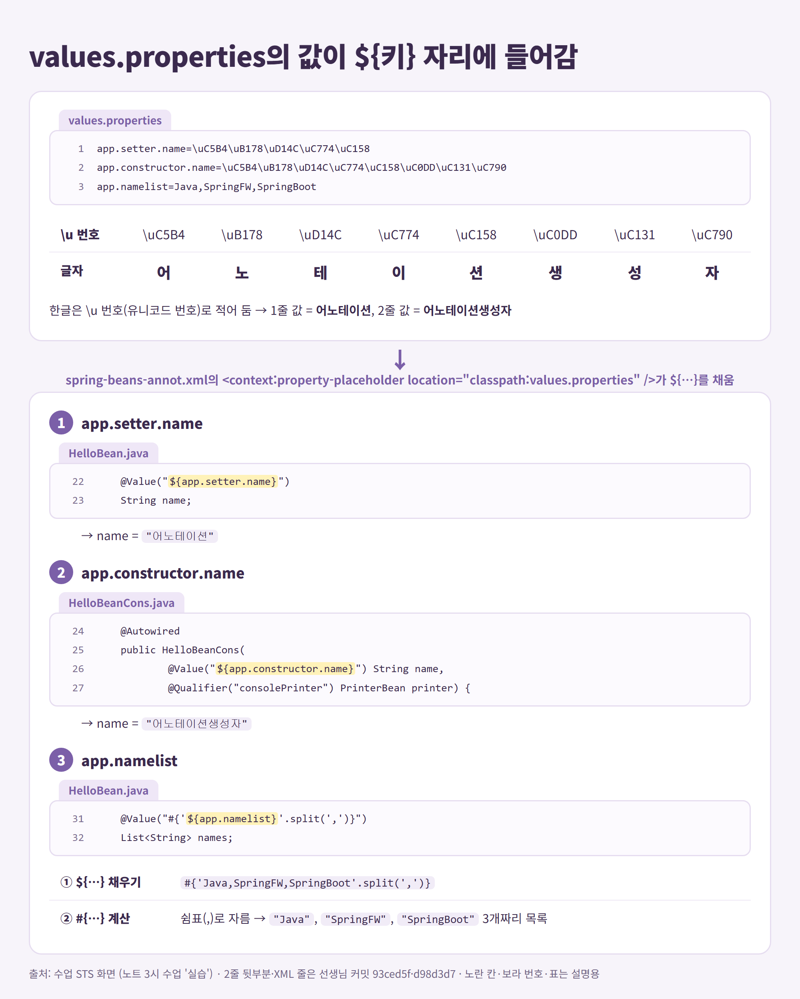
- 그림 설명 : values.properties에 적은 키=값이 `@Value("${키}")` 자리에 들어가는 흐름. 한글은 \u 번호(유니코드 번호)로 저장돼 있음. 목록(app.namelist)은 `#{…split(',')}`로 쉼표마다 잘라 List로 받음

https://share.gemini.google/Y0TUoJTAbjfC

- 제미나이 질문 : `"#{'${app.namelist}'.split(',')}"` 이 부분을 해석해 주세요? spEL 이 무엇인가요? (values.properties `app.namelist=Java,SpringFW,SpringBoot`)
- 제미나이 답 요약 : SpEL(Spring Expression Language) = 실행 중에 값을 계산하거나 꺼내 오는 스프링 표현식 언어. @Value, XML 설정 등에서 씀 (예 : 프로퍼티 값 가공, 다른 빈의 메서드 호출 `#{myService.getDefaultTimeout()}`, 계산 `#{count > 10 ? '많음' : '적음'}`)

  | 부분 (안쪽부터) | 뜻 | 결과 |
  | --- | --- | --- |
  | `${app.namelist}` | 프로퍼티 치환자. values.properties에서 값을 꺼내 옴 | `Java,SpringFW,SpringBoot` |
  | `'…'` | SpEL 안에서 글자(String)라는 표시 | `'Java,SpringFW,SpringBoot'` |
  | `.split(',')` | 자바 String의 split 메서드. 쉼표에서 잘라 배열로 | `String[]` {"Java", "SpringFW", "SpringBoot"} |
  | `#{ … }` | 이 안을 SpEL 식으로 계산하라는 표시 (`${ }`는 값 채우기만, `#{ }`는 계산) | |
  | `List<String> names` | 스프링이 배열을 List로 바꿔 넣음 | 3개짜리 List |

  - 주의 : 값에 공백이 있으면(`Java, SpringFW`) " SpringFW"처럼 앞 공백까지 들어감. 키가 없으면 시작할 때 오류 → 기본값을 줄 수 있음(`${app.namelist:}`)
- 수업 코드와 연결 : 처리 순서, 작은따옴표를 빼면 생기는 오류, 파이썬 split과 비교는 4시 '반복문' 아래 원리 정리에 있음

- 03:59 작성한 것 실행.
- 성공한 듯!
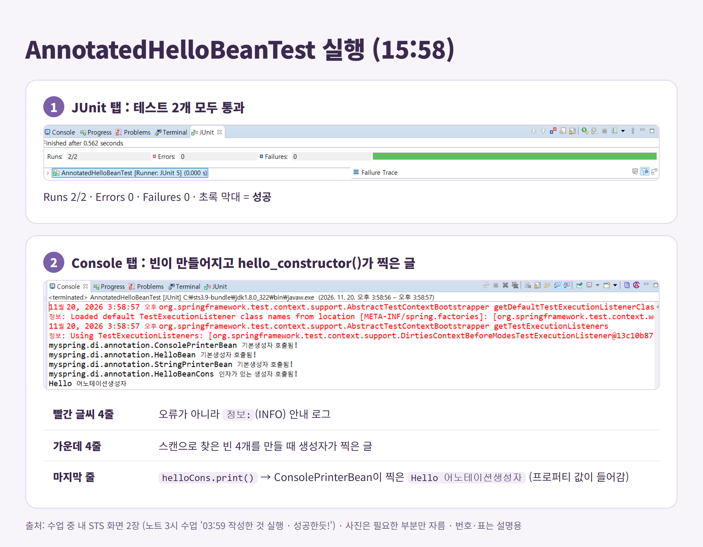
- 그림 설명 : 15:58 실행 결과 2장을 합침. JUnit Runs 2/2, Errors 0, Failures 0(초록 막대)이라 성공. 콘솔 마지막 줄 "Hello 어노테이션생성자"는 values.properties의 app.constructor.name 값이 생성자로 들어갔다는 표시

#### 3시 첫머리 프린터 바꾸기 (15:11~15:20)
- HelloBeanCons 생성자의 `@Qualifier("stringPrinter")`를 `@Qualifier("consolePrinter")`로 바꾸고, 테스트 hello_constructor()에 `helloCons.print();`를 넣음
- 두 빈(HelloBean, HelloBeanCons)이 stringPrinter 하나를 같이 쓰면 StringPrinterBean 안에 글이 이어 붙어서 hello()의 toString() 검사가 실패함 → 그래서 helloCons는 콘솔에 바로 찍는 consolePrinter로 바꾼 것으로 보임

#### 프로퍼티 파일 쓰는 세 단계 (교재 75·76페이지)

| 단계 | 어디 | 코드 |
| --- | --- | --- |
| 1 | src/main/resources/values.properties | `키=값` (한글은 \u 번호) |
| 2 | XML (spring-beans-annot.xml) | `<context:property-placeholder location="classpath:values.properties" />` |
| 3 | 클래스 | `@Value("${키}")` |

#### 단축키·메서드 정리

| 단축키 / 코드 | 하는 일 |
| --- | --- |
| `<context:property-placeholder location="classpath:values.properties" />` | `${…}`를 채울 파일 위치 (PropertySourcesPlaceholderConfigurer 빈을 등록) |
| `@Value("${app.setter.name}")` | 파일 값 넣기 |
| `@Value("#{'${app.namelist}'.split(',')}")` | 쉼표로 잘라 목록으로 넣기 |
| `"Java,SpringFW,SpringBoot".split(",")` | 문자열을 쉼표에서 잘라 배열로 |

---

## 4시 수업

- `<context:property-placeholder>` 태그 설명 (STS에서 태그에 띄운 영어 원문 "Element : property-placeholder"를 붙여 넣었던 것. spring-context.xsd에 같은 글이 있음) : 원문과 번역

  | 원문 | 우리말 |
  | --- | --- |
  | Activates replacement of ${...} placeholders by registering a PropertySourcesPlaceholderConfigurer within the application context. | 애플리케이션 컨텍스트(컨테이너) 안에 PropertySourcesPlaceholderConfigurer를 등록해서, `${...}` 자리표시자를 실제 값으로 바꾸는 기능을 켠다. |
  | Properties will be resolved against the specified properties file or Properties object -- so called "local properties", if any, and against the Spring Environment's current set of PropertySources. | 값은 지정한 properties 파일이나 Properties 객체(이른바 "로컬 프로퍼티")가 있으면 거기서 찾고, 스프링 Environment가 지금 가진 PropertySource들에서도 찾는다. |
  | Note that as of Spring 3.1 the system-properties-mode attribute has been removed in favor of the more flexible PropertySources mechanism. | 스프링 3.1부터 system-properties-mode 속성은 없어지고, 더 유연한 PropertySources 방식으로 바뀌었다. |
  | However, applications may continue to use the 3.0 (and older) versions of the spring-context schema in order to preserve system-properties-mode behavior. | 그래도 예전 system-properties-mode 동작이 필요하면 spring-context 스키마 3.0(이하) 버전을 계속 써도 된다. |
  | In this case, the traditional PropertyPlaceholderConfigurer component will be registered instead of the newer PropertySourcesPlaceholderConfigurer. | 그 경우에는 새 PropertySourcesPlaceholderConfigurer 대신 예전 PropertyPlaceholderConfigurer가 등록된다. |
  | See ConfigurableEnvironment javadoc for more information on usage. | 사용법은 ConfigurableEnvironment javadoc을 보라. |

  - 한 줄로 : 이 태그 = `${…}` 빈칸 채우기 담당 빈(PropertySourcesPlaceholderConfigurer)을 등록하는 태그
  - 원리 : 컨테이너가 빈을 만들다가 `@Value("${app.setter.name}")`를 만나면, 이 담당 빈이 values.properties에서 app.setter.name 값을 찾아 그 자리를 바꿔 넣음. 이 태그가 없으면 바꿔 줄 담당이 없어서 오류 없이 `${app.setter.name}` 글자가 그대로 들어감 (확인함)
  - 값을 찾는 곳 : 내가 적은 파일(location) + 스프링 Environment(자바 시스템 프로퍼티, 운영체제 환경 변수 같은 값 목록). 3시 75페이지 필기 "Environment"와 같은 낱말
  - 교재 76페이지의 PropertyPlaceHolderConfigurer는 4·5번 줄의 "예전" 것. 수업 XML은 버전 없는 spring-context.xsd를 써서 새 PropertySourcesPlaceholderConfigurer가 등록됨 (확인함)

- 반복문
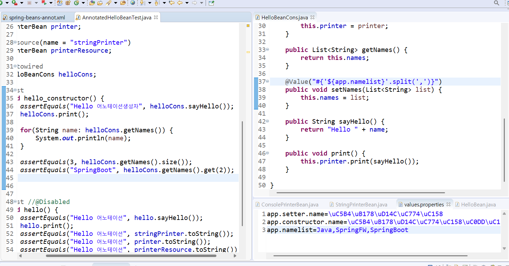
- 설명 : HelloBeanCons 38줄 setNames(…) 위(37줄)에 `@Value("#{'${app.namelist}'.split(',')}")`를 붙여 프로퍼티의 Java,SpringFW,SpringBoot를 목록으로 넣음. 테스트 39~41줄 for문으로 하나씩 찍고, 43~44줄에서 개수 3개와 세 번째 값 get(2) = "SpringBoot"를 검사함
- 원리 (수업 끝나고 정리)
  - @Value를 setter 메서드 위에 붙이면 : 스프링이 생성자로 객체를 먼저 만들고, 그다음 setNames(목록)를 불러서 넣어 줌. 콘솔에도 "인자가 있는 생성자 호출됨!"이 먼저 찍힘 (붙이는 자리 세 가지 표는 11시 '줄 그은 이유' 아래)
  - app.namelist 한 줄이 목록 3개가 되는 과정 : `${ }`로 값 채우기 → `'…'.split(',')`로 배열 → 스프링이 List로 바꿈 → setNames(그 List) 호출 → size() 3, get(2) = "SpringBoot". 부분별 뜻은 3시 실습 아래 제미나이 표
  - 순서가 중요 : `${ }`가 먼저, `#{ }`가 나중. 그래서 `${ }`를 `#{ }` 안에 넣을 수 있음
  - 작은따옴표를 빼면 (`#{${app.namelist}.split(',')}`) : 채운 뒤 모양이 `#{Java,SpringFW,SpringBoot.split(',')}`가 되어 SpEL이 Java까지 읽고 쉼표에서 막힘 → `SpelParseException: EL1041E: After parsing a valid expression, there is still more data in the expression: 'comma(,)'` (확인함)
  - 파이썬 split과 똑같이 되는 이유 : SpEL 안에서는 자바 객체의 메서드를 그대로 부를 수 있고, 자바 String에도 split 메서드가 있어서. 이름과 하는 일(구분 글자에서 자르기)이 파이썬과 같음

    | | 자바 `"Java,SpringFW,SpringBoot".split(",")` | 파이썬 `"Java,SpringFW,SpringBoot".split(",")` |
    | --- | --- | --- |
    | 돌려주는 것 | 배열 `String[]` (3칸) | 리스트 `list` |
    | 자르는 기준 | 정규식(패턴) | 그냥 글자 |
    | 주의 | `"a.b".split(".")`은 0개 (점은 정규식에서 "아무 글자"라서). `"a.b".split("\\.")`로 써야 2개 | `"a.b".split(".")` → ['a', 'b'] |

  - 프로퍼티 키 이름(`app.setter.name`, `app.constructor.name`, `app.namelist`) : 정해진 규칙이 있는 이름이 아니라 강사님이 지은 이름. 점(.)은 묶음을 나누는 관례(app 아래 setter, constructor, namelist). `${ }` 안에는 이 키를 한 글자도 다르지 않게 적어야 함
  - 값이 외계 문구처럼 보이는 이유(`\uC5B4\uB178…`) : 한글을 유니코드 번호로 적은 것(`\uC5B4` = U+C5B4 = 어). 왜 번호로 적는지는 3시 '유니코드와 utf-8' 아래 '수업 코드와 연결'


- 페이지 63
  - 3.6 Bean 등록 메타정보 구성 전략 - 전략(2) 어노테이션과 XML 설정 혼용해서 사용 (ver2.5) : 11시 수업 63페이지와 같은 쪽
  - 강사님 필기 : 오른쪽에 XML설정 줄여보자라고 적으심
  - 오늘 전략 2에서 XML에 끝까지 남은 줄은 두 줄 : `<context:property-placeholder …/>`(값 파일 위치)와 `<context:component-scan …/>`(훑을 패키지). 전략 3은 이것마저 자바 클래스로 옮김


- 오늘 배운 것 정리

- 프로퍼티 수정해봄
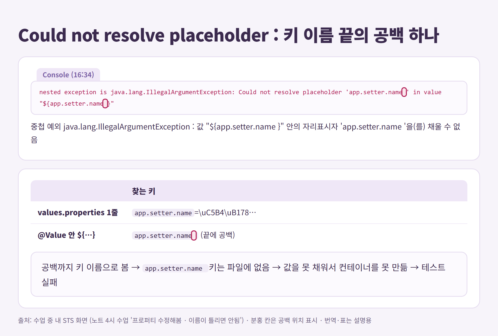
- 그림 설명 : `${app.setter.name }`처럼 닫는 } 앞에 공백이 들어가 찾는 키가 'app.setter.name '(공백 포함)이 됨. 그런 키는 values.properties에 없어서 값을 못 채우고 테스트가 실패함
- 이름이 틀리면 안 됨.
  - 원리 : `${ }` 안의 글자를 values.properties의 키와 한 글자씩 똑같이 비교함. 공백도 글자라서 `app.setter.name `(끝에 공백)은 다른 키 → 못 찾아서 IllegalArgumentException
  - 테스트가 전부 실패하는 이유 : singleton 빈은 컨테이너가 시작할 때 전부 만듦 → helloBean 하나를 못 만들어도 컨테이너 시작이 실패함(`Failed to load ApplicationContext`) → 그 컨테이너를 쓰는 테스트 2개가 모두 실패 (확인함)
  - 비슷한 실수 : 11/19 spring-beans.xml의 `value="생성자 "`(따옴표 안 끝 공백). 따옴표·괄호 안 공백은 눈에 잘 안 보임

- 전략 3에 대한 간단 설명
  - 70페이지 : 3.8 Bean 등록 메타정보 구성 전략 - 전략(3) 어노테이션 설정 단독 사용 (ver3.0)
    - Spring JavaConfig 프로젝트는 XML이 아닌 자바 코드를 이용해서 컨테이너를 설정할 수 있는 기능을 제공하는 프로젝트이다.
    - @Configuration 어노테이션과 @Bean 어노테이션을 이용해서 스프링 컨테이너에 새로운 빈 객체를 제공할 수 있다.
    - Spring 3.0 부터는 어노테이션을 이용한 Bean의 등록 및 Bean들 간의 연결 설정을 자바 코드 내부에 하므로 XML을 전혀 사용하지 않는다 .
    - 강사님 필기 : ① no XML
  - 71페이지 : 3.8 Bean 등록 및 의존관계 설정 Annotation - Bean 등록과 설정 Annotation

    | 어노테이션 | 설명 |
    | --- | --- |
    | @Bean | @Bean 어노테이션은 새로운 빈 객체를 제공할 때 사용되며 @Bean이 적용된 메서드의 이름을 Bean의 식별값으로 사용한다. |
    | @Configuration | 클래스에 @Configuration 어노테이션을 선언하는 것은 스프링 IoC 컨테이너가 해당 클래스를 Bean 정의의 설정으로 사용한다는 것을 나타낸다. |

    - Spring의 새로운 자바 설정 지원의 핵심 부분은 @Configuration 어노테이션이 붙은 클래스이다. 이러한 클래스들은 스프링 IoC 컨테이너가 관리하는 객체의 인스턴스화, 설정, 초기화 로직을 정의하는 @Bean 어노테이션이 붙은 메서드들로 이루어져 있다.
    - 강사님 필기 : @Bean 옆에 @Component, @Configuration에 밑줄을 긋고 XML 역할 대신이라고 적으심
- 컴포넌트 위치가 조금 다름. 메서드 위에 선언함.
  - 72페이지 : 3.8 DI(Dependency Injection) : Bean 의존관계 - 1. @Configuration과 @Bean
    - 왼쪽 코드 : 11/19의 myspring.di.xml.Hello와 같은 모양 (어노테이션 없음. 필드 name·printer, 기본 생성자, setName, setPrinter, sayHello, print)
    ```java
    @Configuration
    public class HelloConfig {
        @Bean
        public Hello hello() {
            Hello hello = new Hello();
            hello.setName("자바컨피그");
            hello.setPrinter(printer());
            return hello;
        }
        @Bean
        @Qualifier("stringPrinter")
        public Printer printer() {
            Printer printer = new StringPrinter();
            return printer;
        }
        @Bean
        @Qualifier("consolePrinter")
        public Printer cPrinter() {
            Printer printer = new ConsolePrinter();
            return printer;
        }
    }
    ```
    - 강사님 필기 : @Bean에 동그라미를 치고 `<bean>`, hello() 메서드 몸통을 괄호로 묶고 `</bean>`이라고 적으심. printer(), cPrinter() 몸통도 괄호로 묶고 @Qualifier("stringPrinter"), @Qualifier("consolePrinter")에 줄을 그으심
  - 73페이지 : 3.8 DI(Dependency Injection) : Bean 의존관계 - 2. @Configuration과 @ComponentScan (11시 수업 73페이지와 같은 쪽)
    - 강사님 필기 : 왼쪽 Hello 코드 아래에 전략2. 오른쪽 @ComponentScan에 동그라미를 치고 화살표로 동일한 역할 `<component-scan base-packages>`라고 적으심
- 원리 (수업 끝나고 정리)
  - 컨테이너가 HelloConfig로 빈을 만드는 순서 : HelloConfig 클래스를 읽음 → @Bean이 붙은 메서드를 하나씩 불러 돌려받은 객체를 빈으로 보관 → 빈 id는 메서드 이름(hello, printer, cPrinter). 설정 클래스 자신도 helloConfig 빈이 됨 (확인함)
  - hello() 안에서 printer()를 또 불러도 StringPrinter가 두 개 생기지 않음 : 실행해 보니 StringPrinter 생성자 로그가 한 번만 찍히고, hello 빈 안의 printer와 printer 빈이 같은 객체였음. 스프링이 @Configuration 클래스를 감싼 클래스(`HelloConfig$$EnhancerBySpringCGLIB$$…`)로 바꿔서, printer()를 부르면 새로 만들지 않고 이미 만든 빈을 돌려주기 때문 (확인함)
  - 강사님이 @Qualifier에 줄을 그으신 이유 : 메서드 이름이 곧 빈 id라서 이름표를 따로 달 필요가 없음 (빼고 실행해도 그대로 동작, 확인함)
  - 비유 : HelloConfig는 공장 설계도, @Bean 메서드 하나하나는 "이 부품은 이렇게 만들어라"라는 작업 지시서. XML에 적던 것을 자바 코드로 적음

#### 프로퍼티를 쓸 때 실수와 결과

| 실수 | 보이는 것 |
| --- | --- |
| `<context:property-placeholder>` 빠짐 | 오류 없이 `${app.setter.name}` 글자가 그대로 들어감 |
| 키 이름 틀림 (공백 하나도) | `Could not resolve placeholder`, 컨테이너를 못 만들어 테스트가 전부 실패 |
| 한글을 \u 번호 없이 저장 | 글자 깨짐 |
| split 없이 목록 | 1개짜리 목록 |

#### 오늘 만든 빈 넷 (spring-beans-annot.xml로 만든 컨테이너)

| 빈 id | 클래스 | 받는 것 | 받는 방법 |
| --- | --- | --- | --- |
| stringPrinter | StringPrinterBean | – | – |
| consolePrinter | ConsolePrinterBean | – | – |
| helloBean | HelloBean | name ← `${app.setter.name}`, printer ← stringPrinter, names ← app.namelist 자른 것 | 변수에 바로 |
| helloBeanCons | HelloBeanCons | name ← `${app.constructor.name}`, printer ← consolePrinter, names ← app.namelist 자른 것 | 생성자 매개변수 + setter |

#### 숙제 패키지 mylab.order.di.xml (16:40~)
- Product(상품 : id, name, price), ShoppingCart(상품 목록 `List<Product>`, getTotalPrice), OrderService(ShoppingCart를 받아 calculateOrderTotal) 세 클래스. 문제 글은 따로 확인 필요

#### 4시에 나온 어노테이션 (단축키·메서드 정리)

| 어노테이션 | 붙는 자리 | 하는 일 | XML 짝 |
| --- | --- | --- | --- |
| `@Value("${키}")` | 변수 / 생성자 매개변수 / setter 메서드 | properties 값을 넣음 | `<property name="…" value="${키}" />` |
| `@Value("#{식}")` | 위와 같음 | SpEL 식을 계산한 결과를 넣음 (`'…'.split(',')`) | `value="#{…}"` |
| `@Configuration` | 설정 클래스 위 | 이 클래스가 XML 파일 대신 설정 | `<beans>` 파일 전체 |
| `@Bean` | 설정 클래스 안 메서드 위 | 메서드가 돌려준 객체를 빈으로, id는 메서드 이름 | `<bean id="메서드이름" class="…">` |
| `@ComponentScan(basePackages = {…})` | 설정 클래스 위 | 이 패키지에서 @Component를 찾아 빈으로 | `<context:component-scan base-package="…" />` |
| `@ContextConfiguration(classes=…, loader=AnnotationConfigContextLoader.class)` | 테스트 클래스 위 | XML 대신 설정 클래스로 테스트 컨테이너를 만듦. loader = 설정 클래스를 읽는 방법 | `locations = "classpath:…xml"` |

---

## 📚 빈 등록 전략 1 · 2 · 3 정리

### 한눈에 보기

| | 전략 1 : XML 단독 | 전략 2 : 어노테이션 + XML | 전략 3 : 어노테이션 단독 |
| --- | --- | --- | --- |
| 교재 | 62페이지 | 63~69페이지 | 70~74페이지 |
| 배운 때 | 11/19 | 11/20 11시~4시 실습 | 11/20 4시 설명 (실습은 다음) |
| 빈 등록 | XML `<bean id="…" class="…">` | 클래스 위 @Component | 설정 클래스 안 메서드 위 @Bean, 또는 클래스 위 @Component |
| 값·빈 넣기 | `<property>`, `<constructor-arg>` | @Value, @Autowired(+@Qualifier), @Resource | @Bean 메서드 안에서 setter·생성자를 직접 부름, 또는 전략 2와 같은 어노테이션 |
| 스캔 | 없음 (전부 XML에 적음) | XML `<context:component-scan>` 한 줄 | 설정 클래스 위 @ComponentScan |
| XML 파일 | 빈 전부 | 스캔(+property-placeholder) 몇 줄 | 없음 |
| 테스트 설정 | `@ContextConfiguration(locations = "classpath:spring-beans.xml")` | `@ContextConfiguration(locations = "classpath:spring-beans-annot.xml")` | `@ContextConfiguration(classes=HelloConfig.class, loader=AnnotationConfigContextLoader.class)` |
| 좋은 점 | 만드는 빈과 관계가 XML 한 곳에 다 보임 | XML 수고가 줄고 개발 속도가 빨라짐 | XML을 전혀 쓰지 않음. 지금 스프링 부트의 방식 |
| 아쉬운 점 | 빈이 많아지면 XML 관리가 번거롭고, 여럿이 같이 고치다 충돌이 남 | 등록된 빈과 의존관계가 한눈에 안 보임 | XML 기능을 전부 어노테이션으로 옮겨서, 어노테이션마다 무슨 일을 하는지 정확히 알아야 함 |

### 전략 1 : XML 설정 단독 (11/19)
- 중요했던 것
  - 모든 빈을 XML에 `<bean>`으로 적고, 값은 `<property>`(setter) 또는 `<constructor-arg>`(생성자)로 넣음
  - setter 방식이면 기본 생성자 + setter, 생성자 방식이면 그 매개변수를 받는 생성자가 클래스에 꼭 있어야 함 (교재 62페이지 "DI에 필요한 적절한 setter 메서드 또는 constructor가 코드 내에 반드시 존재해야 한다")
  - XML이 조금이라도 틀리면 에러가 남. 여럿이 같은 XML을 고치다 충돌이 잦았음 (SVN 이야기)
  - 운영·유지보수할 때는 좋지만 개발할 때는 불편함. 개발 중엔 어노테이션, 운영 중엔 XML로 바꾸는 전략도 씀 (62페이지)
- 작업 순서
  1. 평범한 자바 클래스(POJO) 작성 : Hello, Printer 인터페이스, StringPrinter·ConsolePrinter
  2. spring-beans.xml에 클래스마다 `<bean>`, 연결은 `<property ref>` / `<constructor-arg ref>`
  3. 컨테이너가 XML을 읽어 빈을 만듦 : 11/19는 `new GenericXmlApplicationContext("classpath:spring-beans.xml")` + getBean, 11/20은 @ContextConfiguration + @Autowired
  4. 테스트로 확인

### 전략 2 : 어노테이션 + XML 혼용 (11/20)
- 중요했던 것
  - 클래스 위 @Component = `<bean>`, 변수 위 @Value = `<property value>`, @Autowired + @Qualifier = `<property ref>` → 각 어노테이션이 XML 어느 줄을 대신하는지
  - 컴포넌트 스캔 아주 중요 : XML에 남는 한 줄(`<context:component-scan>`)이 없으면 @Component를 아무도 안 찾아서 빈이 하나도 없음
  - @Autowired는 타입으로 찾음 → 같은 타입이 둘이면 변수 이름 / @Qualifier / @Resource로 하나를 골라야 함
  - 어노테이션마다 붙일 수 있는 자리(@Target)가 다름 → 생성자 위엔 @Autowired, 매개변수 앞엔 @Value·@Qualifier
  - 자주 바뀌는 값은 values.properties로 빼고 `@Value("${키}")`로 넣음 (XML에 property-placeholder 한 줄 추가)
- 작업 순서
  1. 클래스에 @Component, 넣을 곳(변수·생성자 매개변수·setter)에 @Value·@Autowired·@Qualifier
  2. XML에는 component-scan 한 줄 (+ property-placeholder)
  3. 테스트 `@ContextConfiguration(locations = "classpath:spring-beans-annot.xml")`
- 전략 1에서 바뀐 점
  - 빈 정보가 XML에서 각 클래스 안으로 옮겨 감 → XML이 짧아지고, 같은 XML을 여럿이 고칠 일이 줄어듦
  - 변수에 바로 붙이면 setter가 없어도 됨 (선생님 HelloBean에서 setName, setPrinter를 지움)
  - 대신 어떤 빈이 있고 어떻게 이어지는지는 XML 한 곳에서 안 보이고 클래스마다 열어 봐야 함
  - 새로 생긴 실수 : 스캔을 빼먹으면 `NoSuchBeanDefinitionException`

### 전략 3 : 어노테이션 설정 단독 (11/20 4시 설명)
- 중요했던 것
  - XML 파일을 전혀 안 씀. @Configuration 클래스가 XML 파일 역할 (교재 70·71페이지)
  - 메서드 위 @Bean = `<bean>` 하나, 빈 id는 메서드 이름 ("컴포넌트 위치가 조금 다름. 메서드 위에 선언함")
  - 전략 3이 지금 스프링 부트의 방식. 스프링 부트를 이해하기 쉽게 전략 1 → 2 → 3 순서로 배움
  - XML에서 하던 일을 전부 어노테이션으로 바꾼 것이라 각 어노테이션이 무슨 일을 하는지 정확히 알아야 함
- 작업 방식 두 가지
  1. @Configuration + @Bean : 클래스(Hello 등)에는 어노테이션 없이, 설정 클래스의 메서드에서 직접 new로 만들고 setter로 이어서 돌려줌 (72페이지)
  2. @Configuration + @ComponentScan : 클래스는 전략 2와 똑같이 @Component·@Autowired, XML의 스캔 한 줄만 설정 클래스 위 @ComponentScan으로 (73페이지)
  - 테스트는 XML 위치 대신 설정 클래스를 알려 줌 (74페이지)
- 전략 2에서 바뀐 점
  - 남아 있던 XML 한 줄(component-scan)마저 자바 클래스 위 @ComponentScan으로 옮겨 감 → XML 파일이 없어짐
  - 속성 이름 주의 : XML `base-package` → 어노테이션 `basePackages`
  - 테스트 : `locations = "classpath:…xml"` → `classes = HelloConfig.class`
  - @Bean 방식이면 클래스에 어노테이션을 안 붙여도 됨 (11/19의 myspring.di.xml.Hello를 그대로 씀)

### 작성법 비교 : 같은 hello 빈 (name에 값, printer에 StringPrinter)

#### 전략 1 : 클래스는 평범하게, 연결은 XML에
- Hello.java (필요한 부분)
  ```java
  public class Hello {
      String name;
      Printer printer;

      public void setName(String name) {
          System.out.println("setName() 메서드 호출됨 " + name);
          this.name = name;
      }

      public void setPrinter(Printer printer) {
          System.out.println("setPrinter() 메서드 호출됨 " + printer.getClass().getName());
          this.printer = printer;
      }
      // 생성자, sayHello(), print() 생략
  }
  ```
- spring-beans.xml
  ```xml
  <!-- StringPrinter 클래스를 Spring Bean으로 설정 -->
  <bean id="strPrinter" class="myspring.di.xml.StringPrinter" />

  <!--Hello 클래스를 SpringBean으로 설정  Setter Injection 방식 -->
  <bean id="hello" class="myspring.di.xml.Hello" scope="singleton">
      <!-- setName("스프링") -->
      <property name="name" value="스프링" />
      <!-- setPrinter(new StringPrinter()) -->
      <property name="printer" ref="strPrinter" />
  </bean>
  ```
- 테스트
  ```java
  @ExtendWith(SpringExtension.class)
  @ContextConfiguration(locations = "classpath:spring-beans.xml")
  public class HelloBeanSpringTest {
      @Autowired
      Hello hello;
  ```
- 클래스에는 스프링 흔적이 없고, 누구를 만들고 무엇을 넣을지는 전부 XML에 있음

#### 전략 2 : 클래스에 어노테이션, XML엔 스캔 한 줄
- HelloBean.java (필요한 부분)
  ```java
  //@Component <=> <bean></bean>
  @Component
  public class HelloBean {
      //@Value <=> <property name="name" value="어노테이션" />
      @Value("어노테이션")
      String name;

      //@Autowired <=> <property name="printer" ref="stringPrinter" />
      @Autowired
      @Qualifier("stringPrinter")
      PrinterBean printer;
      // 생성자, sayHello(), print() 생략. setName·setPrinter는 지움
  }
  ```
- StringPrinterBean.java (위쪽)
  ```java
  @Component("stringPrinter")
  public class StringPrinterBean implements PrinterBean {
  ```
- spring-beans-annot.xml
  ```xml
  <!-- Component Auto Scanning 을 위한 설정 -->
  <context:component-scan base-package="myspring.di.annotation" />
  ```
- 테스트
  ```java
  @ExtendWith(SpringExtension.class)
  @ContextConfiguration(locations = "classpath:spring-beans-annot.xml")
  public class AnnotatedHelloBeanTest {
      @Autowired
      HelloBean hello;
  ```
- XML의 `<bean>` 두 개와 `<property>` 두 줄이 클래스 안 어노테이션으로 옮겨 감. XML엔 스캔 한 줄만 남음

#### 전략 3-1 : @Configuration + @Bean (교재 72페이지)
- HelloConfig.java
  ```java
  @Configuration
  public class HelloConfig {
      @Bean
      public Hello hello() {
          Hello hello = new Hello();
          hello.setName("자바컨피그");
          hello.setPrinter(printer());
          return hello;
      }
      @Bean
      public Printer printer() {
          Printer printer = new StringPrinter();
          return printer;
      }
  }
  ```
- 교재 코드에서 ConsolePrinter를 만드는 cPrinter()와 강사님이 줄 그은 @Qualifier 두 줄은 뺌
- Hello 클래스는 11/19 것(어노테이션 없음) 그대로. `<bean>` 하나가 @Bean 메서드 하나로, `<property value>`는 `hello.setName(…)`, `<property ref>`는 `hello.setPrinter(printer())`로 바뀜. 빈 id는 메서드 이름(hello, printer)

#### 전략 3-2 : @Configuration + @ComponentScan (교재 73페이지)
- HelloConfig.java
  ```java
  @Configuration
  @ComponentScan(basePackages = { "myspring.di.annot" })
  public class HelloConfig {

  }
  ```
- 클래스(Hello, StringPrinter)는 전략 2처럼 @Component·@Value·@Autowired를 붙인 그대로. XML의 스캔 한 줄만 이 클래스로 옮겨 옴
- 테스트 (교재 74페이지)
  ```java
  @ContextConfiguration(classes=HelloConfig.class, loader=AnnotationConfigContextLoader.class)
  ```

#### 한 줄씩 바뀌는 모양

| 하는 일 | 전략 1 (XML) | 전략 2 (어노테이션 + XML) | 전략 3 (@Configuration) |
| --- | --- | --- | --- |
| 빈 등록 | `<bean id="hello" class="myspring.di.xml.Hello">` | 클래스 위 `@Component` | `@Bean public Hello hello() { … return hello; }` |
| 값 넣기 | `<property name="name" value="스프링" />` | `@Value("어노테이션") String name;` | `hello.setName("자바컨피그");` |
| 빈 연결 | `<property name="printer" ref="strPrinter" />` | `@Autowired @Qualifier("stringPrinter") PrinterBean printer;` | `hello.setPrinter(printer());` |
| 스캔 | 없음 | `<context:component-scan base-package="myspring.di.annotation" />` | `@ComponentScan(basePackages = { "myspring.di.annot" })` (3-2 방식) |
| 설정이 있는 곳 | spring-beans.xml | 클래스 + spring-beans-annot.xml | HelloConfig.java (XML 없음) |
| 테스트 | `locations = "classpath:spring-beans.xml"` | `locations = "classpath:spring-beans-annot.xml"` | `classes=HelloConfig.class, loader=AnnotationConfigContextLoader.class` |