# 22일차 TIL : AI 서비스 개발을 위한 백엔드 I 6일차

🔗 [실습 레포지토리](https://github.com/easty00/SpringFramwork5_Project)

## 오프닝
- DI의 개념
  - 각 클래스간의 의존관계를 빈 설정 (Bean Definition) 정보를 바탕으로 컨테이너가 자동으로 연결해주는 것을 말함
  - 개발자들은 단지 빈 설정파일에서 의존관계가 필요하다는 정보를 추가하면 된다.
  - 객체 레퍼런스를 컨테이너로부터 주입 받아서, 실행 시에 동적으로 의존관계가 생성된다.
  - 컨테이너가 흐름의 주체가 되어 애플리케이션 코드에 의존관계를 주입해 주는 것이다.
  - DI 장점: 
    - 코드가 단순해진다.
    - 컴포넌트 간의 결합도가 제거된다.
  - 쉽게 풀면

    | 교재 말 | 쉽게 말하면 | 우리 코드에서 |
    | --- | --- | --- |
    | 의존관계 | A가 일하려면 B가 꼭 있어야 하는 관계 | Hello는 인사말을 찍으려면 Printer가 필요함 → Hello가 Printer에 의존함 |
    | 빈 설정 정보 | 어떤 객체를 만들고 누구를 누구에게 넣을지 적어 둔 것 | 전략 1은 XML(spring-beans.xml), 전략 2는 클래스에 붙인 어노테이션, 오늘 전략 3은 @Configuration 설정 클래스 |
    | 의존관계가 필요하다는 정보만 추가 | 연결 정보만 적으면 만들고 넣는 일은 컨테이너가 함 | `<property name="printer" ref="stringPrinter"/>` 한 줄이나 `@Autowired` 하나 |
    | 객체 레퍼런스 | 객체가 있는 자리를 가리키는 값 (보관함 번호표) | Hello 코드에는 `new StringPrinter()`가 없음. 실행할 때 컨테이너가 만들어 둔 객체의 번호표를 넣어 줌 |
    | 실행 시에 동적으로 | 코드를 안 고치고 설정만 바꿔도 실행할 때 다른 객체가 들어감 | hello에는 StringPrinter, helloCons에는 ConsolePrinter |
    | 컨테이너가 흐름의 주체 | 내가 new로 만들고 넣던 일을 컨테이너가 맡음 = IoC(제어의 역전). DI는 IoC를 하는 방법 | Hello는 받기만 함. 만들고 넣는 건 컨테이너(GenericXmlApplicationContext, AnnotationConfigApplicationContext) |
    | 장점 : 코드가 단순해짐 | 객체를 만들고 잇는 코드가 내 클래스에서 빠짐 | `new`, `setPrinter(…)` 부르기가 없음 |
    | 장점 : 결합도가 제거됨 | 한쪽을 바꿔도 다른 쪽을 안 고침. 정확히는 0이 되는 게 아니라 낮아짐 | Hello는 Printer라는 약속(인터페이스)만 알고 StringPrinter인지 ConsolePrinter인지 모름 |

    - 비유 : 식당 주방(컨테이너)이 주문서(빈 설정 정보)를 보고 요리(객체)를 만들어 테이블(변수)에 놓아 줌. 손님(Hello)은 장을 안 봐도 됨
    - 지난 정리 : [11/19 TIL IoC와 DI](./2026-11-19.md#ioc와-di) (식당 비유, IoC·DL·DI 표)

- [SOLID 5가지 원칙](https://share.gemini.google/5oLqyyYb5cYL)

  - 강사님 제미나이 질문 ① : 디자인 원칙 중에서 상위 인터페이스에 의존하라는 원칙의 이름은 무엇인가요? 그리고 왜 상위 인터페이스에 의존해야 하나요?
  - 제미나이 답 요약 : 의존 역전 원칙(DIP, Dependency Inversion Principle). 구체적인 구현 클래스가 아니라 추상화(인터페이스, 추상 클래스)에 의존해야 함
    - 고수준 모듈 = 핵심 비즈니스 로직 / 저수준 모듈 = DB 접근, 결제, 외부 API 호출 같은 구체적인 구현
    - 고수준이 저수준을 직접 부르지 않고 둘 다 인터페이스에 의존하게 방향을 뒤집음(역전)

    | 왜 인터페이스에 의존하나 | 뜻 | 제미나이 예 |
    | --- | --- | --- |
    | 변경에 유연 | 구체 클래스는 자주 바뀌어도 인터페이스는 잘 안 바뀜 | 주문 서비스가 `OrderRepository` 인터페이스에 의존하면 MySQL → PostgreSQL, Mock으로 바꿔도 서비스 코드는 거의 그대로 |
    | 결합도 감소 | 상위 로직이 하위 구현의 속사정을 몰라도 됨 | 한쪽을 고쳐도 다른 쪽으로 번지지 않음 |
    | 테스트 쉬움 | 진짜 DB·결제 서버 없이 가짜 객체(Mock/Stub)를 넣어 테스트 | |
    | 나눠서 개발 | 인터페이스(약속)만 먼저 정하면 양쪽이 따로 개발 | |

    - 객체를 실제로 조립해 넣는 일은 DI나 팩토리 같은 별도 구성 계층이 맡음
  - 강사님 제미나이 질문 ② : 객체지향 설계 원칙(SOLID)는 무엇인가요?
  - 제미나이 답 요약 : 로버트 C. 마틴이 정리한 5가지 원칙. 유지보수·확장이 쉽고 변경에 유연한 소프트웨어를 위한 가이드라인

    | 글자 | 원칙 | 핵심 | 제미나이 예 |
    | --- | --- | --- | --- |
    | S | 단일 책임 (SRP) | 클래스는 바뀔 이유(책임)가 하나만 | `Invoice`가 계산·DB 저장·PDF 출력을 다 하면 `InvoiceCalculator`, `InvoiceRepository`, `InvoicePrinter`로 나눔 |
    | O | 개방-폐쇄 (OCP) | 확장에는 열림, 기존 코드 수정에는 닫힘 | 결제 인터페이스에 `CardPayment`, `KakaoPayPayment` → `NaverPayPayment`를 더해도 결제 처리 코드는 그대로 |
    | L | 리스코프 치환 (LSP) | 부모 자리에 자식을 넣어도 기대 동작이 안 깨짐 | 정사각형이 직사각형을 물려받으면 가로·세로를 따로 못 바꿔서 위반 |
    | I | 인터페이스 분리 (ISP) | 안 쓰는 메서드에 의존하게 하지 않음 | 복합기 인터페이스 하나 대신 `Printer`, `Scanner`, `Fax`로 나눔 |
    | D | 의존 역전 (DIP) | 구현체 말고 추상화(인터페이스)에 의존 | 질문 ① |

    - 절대 규칙이라기보다 판단 기준. 너무 잘게 쪼개면 오히려 복잡해지니 자주 바뀌는 곳과 핵심 로직 중심으로 적용
  - 수업 코드와 연결 (내 MySpringFW `myspring.di.xml` 패키지)
    - D(의존 역전) : Hello는 진짜 프린터가 아니라 Printer 약속에만 기댐

    ```java
    // Hello.java (일부 : 기본 생성자, names, setName, sayHello 생략)
    public class Hello {
    	String name;
    	Printer printer;   // D : 변수 타입이 StringPrinter가 아니라 Printer 인터페이스 → 어떤 프린터가 올지 Hello는 모름

    	public Hello(String name, Printer printer) {   // 생성자로 받는 통로 (helloCons가 씀)
    		System.out.println(this.getClass().getName() + " 오버로딩 생성자 호출됨!");
    		this.name = name;
    		this.printer = printer;   // Hello가 new ConsolePrinter()를 안 함. 받은 걸 넣기만
    	}

    	public void setPrinter(Printer printer) {   // setter로 받는 통로 (hello가 씀)
    		System.out.println("setPrinter() 메서드 호출됨 " + printer.getClass().getName());
    		this.printer = printer;   // Hello가 new StringPrinter()도 안 함
    	}

    	public void print() {
    		this.printer.print(sayHello());   // 안에 뭐가 들었든 "print 해 줘"만 부름
    	}
    }
    ```

    - 누구를 넣을지는 설정이 정함 → DI가 DIP를 지키게 도와줌

    ```xml
    <!-- spring-beans.xml (일부) -->
    <bean id="strPrinter" class="myspring.di.xml.StringPrinter" />   <!-- 프린터 1 -->
    <bean id="conPrinter" class="myspring.di.xml.ConsolePrinter" />   <!-- 프린터 2 -->

    <bean id="hello" class="myspring.di.xml.Hello">
    	<property name="name" value="${app.xmlsetter.name}" />
    	<property name="printer" ref="strPrinter" />   <!-- hello에는 StringPrinter를 넣음 -->
    </bean>

    <bean id="helloCons" class="myspring.di.xml.Hello">
    	<constructor-arg index="0" value="${app.xmlcons.name}" />
    	<constructor-arg index="1" ref="conPrinter" />   <!-- helloCons에는 ConsolePrinter를 넣음 -->
    	<!-- names 목록 생략 -->
    </bean>
    ```

    - L(리스코프 치환)·O(개방-폐쇄) : 두 프린터가 같은 약속을 지켜서 어느 쪽을 넣어도 됨

    ```java
    // Printer.java : 약속(인터페이스). 무엇을 할 수 있는지만 적고, 어떻게 할지는 안 적음
    public interface Printer {
    	public void print(String message);
    }

    // StringPrinter.java (일부 : 생성자, toString 생략)
    public class StringPrinter implements Printer {   // implements Printer = 이 약속을 지키겠다
    	private StringBuffer buffer = new StringBuffer();

    	public void print(String message) {   // L : 약속한 print가 있음 → 글자를 모아 둠
    		this.buffer.append(message);
    	}
    }

    // ConsolePrinter.java (일부 : 생성자 생략)
    public class ConsolePrinter implements Printer {
    	public void print(String message) {   // L : 똑같이 print가 있음 → 콘솔에 바로 찍음
    		System.out.println(message);
    	}
    }

    // O : 프린터가 하나 더 필요하면 Printer를 지키는 클래스를 새로 만들고
    //     spring-beans.xml의 ref만 그 빈으로 바꿈. Hello.java는 한 줄도 안 고침
    ```

    - 쉽게 기억 : DIP는 "콘센트 규격(인터페이스)에 맞춰 만들기", DI는 "플러그를 꽂아 주는 건 컨테이너"
  - 프론트 강사님 설명 : [11/09 TIL 10시 수업](./2026-11-09.md#10시-수업) (로버트 마틴, SOLID 다섯 원칙). 프론트는 클래스를 거의 안 써서 L은 잘 안 나오고 S·O·I 정도만 지키면 된다고 하심. 팀플 조언에서도 "솔리드의 SOI"를 말하심 ([11/09 TIL 5시 수업](./2026-11-09.md#5시-수업))

- 어노테이션
  - 63페이지 : 3.6 Bean 등록 메타정보 구성 전략 - 전략(2) 어노테이션과 XML 설정 혼용해서 사용 (ver2.5)
    - Bean으로 사용될 클래스에 특별한 어노테이션(Annotation)을 부여해주면 이런 클래스를 자동으로 찾아서 Bean으로 등록한다.
    - @Component 어노테이션이 선언된 클래스를 자동으로 찾아서 Bean으로 등록 해주는 방식을 빈 스캐닝(Bean Scanning)을 통한 자동인식 Bean 등록 기능이라고 한다.
    - 어노테이션을 부여하고 자동 스캔으로 Bean을 등록하면 XML 문서 생성과 관리에 따른 수고를 덜어주고 개발 속도를 향상시킬 수 있다.
    - 애플리케이션에 등록될 Bean이 어떤 것들이 있고, Bean들 간의 의존관계가 어떻게 되는지를 한눈에 파악할 수 없다는 단점이 있다.
  - 전략 2에서 중요한 어노테이션 (내 myspring.di.annotation 코드 기준)

    | 어노테이션 | 붙는 자리 | 하는 일 | 대신하는 XML (전략 1) | 내 코드 예 |
    | --- | --- | --- | --- | --- |
    | `@Component` | 클래스 위 | 이 클래스를 빈으로 등록. 이름을 안 적으면 클래스 이름 첫 글자를 소문자로 바꾼 게 id | `<bean id="…" class="…">` | `@Component("stringPrinter")` StringPrinterBean, `@Component` HelloBean |
    | `@Value("${키}")` | 변수, 생성자 매개변수, setter | values.properties 값을 넣음 | `<property name="name" value="…"/>` | `@Value("${app.setter.name}")` |
    | `@Value("#{식}")` | 위와 같음 | 식을 계산한 결과를 넣음 | `value="#{…}"` | `#{'${app.namelist}'.split(',')}` → List |
    | `@Autowired` | 변수, 생성자, setter | 타입이 맞는 빈을 찾아 넣음 | `<property name="printer" ref="…"/>` | HelloBean의 printer, HelloBeanCons 생성자 |
    | `@Qualifier("이름")` | @Autowired와 같이 | 같은 타입 빈이 둘 이상일 때 이름으로 하나 고름 | ref에 적는 빈 이름 | `@Qualifier("stringPrinter")` |
    | `@Resource(name = "이름")` | 변수, setter | 이름으로 찾아 넣음 (자바 표준) | `ref="…"` | 테스트 `@Resource(name = "stringPrinter")` |

    - XML에 남는 두 줄 (spring-beans-annot.xml)
      - `<context:component-scan base-package="myspring.di.annotation" />` : 이 패키지에서 @Component 붙은 클래스를 찾음. 빼먹으면 빈이 하나도 안 생김
      - `<context:property-placeholder location="classpath:values.properties"/>` : `${키}` 자리를 values.properties 값으로 채움
    - 테스트 : `@ExtendWith(SpringExtension.class)` + `@ContextConfiguration(locations = "classpath:spring-beans-annot.xml")`로 컨테이너를 만들고 `@Autowired`로 빈을 받음
    - 비유 : @Component는 가슴에 다는 이름표, component-scan은 "이 반(패키지)에서 이름표 단 사람 다 나와" 하는 출석 부르기, @Autowired는 "프린터 담당 한 명 보내 줘", @Qualifier는 "그중에 stringPrinter로"
    - 오늘(전략 3)과 연결 : XML에 남았던 두 줄도 자바로 옮김. component-scan → `@ComponentScan`, property-placeholder → `@PropertySource` (HelloBeanConfig, 10시 수업)
    - 지난 정리 : [11/20 TIL 전략 2 정리](./2026-11-20.md#전략-2--어노테이션--xml-혼용-1120)

## 수업
- 레이어 아키텍처

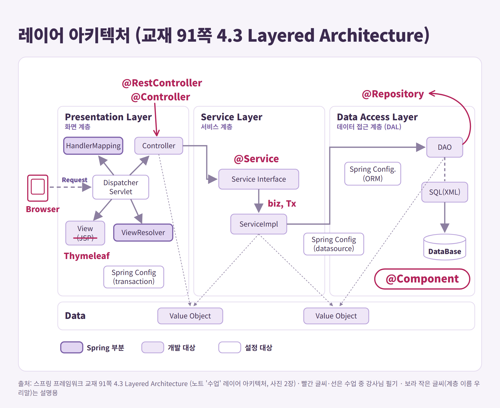

  - 그림 설명 : 교재 91쪽 4.3 Layered Architecture. 브라우저의 요청(Request)이 Presentation(화면) → Service(비즈니스 로직) → Data Access(DB) 계층 순서로 내려감. 강사님이 계층마다 붙이는 어노테이션을 적으심 : Controller 위에 @Controller·@RestController, Service Interface 위에 @Service(biz, Tx = 비즈니스 로직, 트랜잭션), DAO 옆에 @Repository, 오른쪽에 @Component. View의 JSP는 줄을 긋고 Thymeleaf로 바꿔 적으심
  - DAL : @Repository
  - 웹 화면 html을 그리는 경우 컨트롤로
  - 뒤의 DB를 다루는 경우 레스트 컨트롤러로 정의

- Layer 각 층 마다 하는 일
  - Presentation Layer (화면) : 브라우저 요청을 받아 알맞은 처리로 보내고 결과를 돌려줌
  - Service Layer (업무) : 업무 규칙(비즈니스 로직)과 트랜잭션(Tx)
  - Data Access Layer (데이터) : DB에 저장·조회
  - 전체 : 층마다 붙이는 어노테이션이 모두 @Component의 한 종류

- 특정 컴포넌트에 구체화 된 형태
  - 64페이지 : 3.7 Bean 등록 및 의존관계 설정 Annotation - Bean 등록 Annotation

    | 어노테이션 | 교재 설명 | 강사님 필기 |
    | --- | --- | --- |
    | @Component | 컴포넌트를 나타내는 일반적인 스테레오 타입으로 `<bean>` 태그와 동일한 역할을 함 | General (일반) |
    | @Repository | 퍼시스턴스(persistence) 레이어, 영속성을 가지는 속성(파일, 데이터베이스)을 가진 클래스 | DB와 연동 (RDB, NoSQL DB) |
    | @Service | 서비스 레이어, 비즈니스 로직을 가진 클래스 | Biz 로직, Tx(트랜잭션) 처리 |
    | @Controller | 프리젠테이션 레이어, 웹 어플리케이션에서 웹 요청과 응답을 처리하는 클래스 | |

    - @Repository, @Service, @Controller는 더 특정한 유즈케이스에 대한 @Component의 구체화된 형태이다.
    - 강사님 필기 : @Repository·@Service·@Controller를 괄호로 묶으심 (셋 다 @Component의 한 종류)
+ restcontroller : 추후 같이 만들어볼 예정

- 베이스 패키지만 적어주면 컨테이너가 스프링 빈으로 만들어주고 의존관계인 객체를 찾아 미리 생성하고 변수에 넣어줌. 이런 값을 주입해줌, 

- 왜 컨피그 클레스일때 먼저 로딩이 필요할까? 
  ```
  설정 클래스가 빈 목록이 적힌 설명서이기 때문. 컨테이너는 이 클래스를 먼저 읽어야 그 안의 @Bean 메서드, @ComponentScan, @PropertySource를 보고 "무엇을 어떻게 만들지" 알 수 있음
  ```

  - 71페이지 : Bean 등록과 설정 Annotation
    - @Bean : @Bean 어노테이션은 새로운 빈 객체를 제공할 때 사용되며 @Bean이 적용된 메서드의 이름을 Bean의 식별값으로 사용한다.
    - @Configuration : 클래스에 @Configuration 어노테이션을 선언하는 것은 스프링 IoC 컨테이너가 해당 클래스를 Bean 정의의 설정으로 사용한다는 것을 나타낸다.
      - 강사님 필기 : → I am Config class (나는 설정 클래스)

    - Spring의 새로운 자바 설정 지원의 핵심 부분은 @Configuration 어노테이션이 붙은 클래스이다. 이러한 클래스들은 스프링 IoC 컨테이너가 관리하는 객체의 인스턴스화, 설정, 초기화 로직을 정의하는 @Bean 어노테이션이 붙은 메서드들로 이루어져 있다.

- 메서드명이 빈의 id 임. 굳이 안적어도 메서드 명이 달라도 괜찮음
  - 72페이지 : Bean 의존관계 - 1. @Configuration과 @Bean
    - 왼쪽 Hello : 어노테이션 없는 평범한 클래스 (name, printer, setName, setPrinter, sayHello, print)
    - 오른쪽 HelloConfig (핵심만, 주석은 내가 붙임)
    ```java
    @Configuration                          // 이 클래스 = XML 설정 파일 역할
    public class HelloConfig {
        @Bean                               // 돌려주는 객체를 빈으로. 빈 id = 메서드 이름 hello
        public Hello hello() {
            Hello hello = new Hello();      // 객체를 직접 new
            hello.setName("자바컨피그");       // = <property name="name" value="자바컨피그" />
            hello.setPrinter(printer());    // = <property name="printer" ref="printer" />
            return hello;
        }
        @Bean
        @Qualifier("stringPrinter")         // 강사님이 줄 그으심 : 메서드 이름이 곧 빈 id라 없어도 됨
        public Printer printer() {
            Printer printer = new StringPrinter();
            return printer;
        }
        // cPrinter()도 같은 모양 (new ConsolePrinter(), @Qualifier("consolePrinter"))
    }
    ```
    - 강사님 필기 : hello() 몸통을 괄호로 묶고, @Qualifier("stringPrinter")에 줄을 긋고 "메서드명이 Bean ID"라고 적으심

  - @bean = @component
  - 역할이 동일하나 일부 다른 부분이 있음
    - "빈으로 등록한다"는 역할이 같고, 붙는 자리(클래스 / 메서드)와 객체를 누가 만드는지가 다름

    - 워드 문서 12페이지
      - 무엇을 설명하나 : @Bean이 무슨 일을 하는지, 그리고 @Component와 언제 나눠 쓰는지 (원문은 지우고 해석만 정리)
      - @Bean 설명 (공식 문서 해석)
        - 메서드 위에만 붙일 수 있음 (@Target에 METHOD)
        - 프로그램이 실행되는 동안에도 표시가 남아서 스프링이 읽을 수 있음 (@Retention RUNTIME)
        - 이 메서드가 스프링 컨테이너가 관리할 빈을 만들어 낸다는 표시
        - 속성 이름과 뜻은 XML의 `<bean/>` 태그와 일부러 비슷하게 만듦
        - 쓰는 법 : 메서드 안에서 객체를 만들고 설정한 뒤 return → 돌려준 객체가 빈이 됨
      - @Component와 @Bean
        - 같은 점 : 둘 다 스프링 빈을 만든다는 표시
        - 다른 점 : @Component는 클래스 위, @Bean은 메서드 위에 붙임
        - 외부 라이브러리 클래스를 빈으로 쓰고 싶을 때는 @Bean을 씀
      - 예 : Swagger의 Docket (외부 라이브러리 클래스)
        ```java
        @Bean                     // 이 메서드가 돌려주는 객체를 빈으로 등록
        public Docket api() {     // 메서드 이름 api = 빈 id
            return new Docket(DocumentationType.SWAGGER_2) … .build();   // Docket은 남의 클래스라 @Component를 못 붙여서 여기서 직접 new
        }
        ```

- 컴포넌트를 선언하지 못하는 경우가 있음
  - 스웨거의 도캣은 가져다 쓰되 우리게아닌 외부 라이브러리임. 꼭 우리가 만든것만 스프링 빈으로 설정할 수 있는 건아님. 외부도 씀. 도캣은 스웨거의 것이라 수정할 수 없음. 즉 컴포넌트를 붙일 수 없음. 다만 이걸 가져다 쓸 때 스프링 빈으로 설정하고 싶다면 @빈이 가장 적합함 : 쓰는것만으로도 스프링 빈으로 사용할 수 있음. 

    > Docket: Swagger(스웨거, API 문서를 자동으로 만들어 화면으로 보여 주는 도구 — 노트 246줄 swagger ui) 설정 객체
    > - Docket 클래스는 Swagger 라이브러리 안에 있어서 우리가 @Component를 써 넣을 수 없음. 대신 설정 클래스에 @Bean 메서드를 만들고 그 안에서 new Docket(…)을 돌려주면 빈이 됨
    > - 🔍 비유: 회사 직원(내 클래스)에게는 명찰(@Component)을 달아 주면 되지만, 외부 업체 장비(Docket)에는 명찰을 못 달아요. 그래서 관리 대장(설정 클래스)에 "이 장비도 우리가 관리함"이라고 적어 두는 게 @Bean이에요.


- @ComponentScan

  - 73페이지 : Bean 의존관계 - 2. @Configuration과 @ComponentScan
    ```java
    // 왼쪽 : 빈 정보를 클래스에 직접 어노테이션으로 (전략 2와 같음)
    @Component("hello")                 // 빈 등록 (id = hello)
    public class Hello {
        @Value("어노테이션")              // name에 값 넣기
        String name;

        @Autowired
        @Qualifier("stringPrinter")     // stringPrinter 빈 넣기
        Printer printer;
        // ⋮ setName, setPrinter, sayHello, print
    }

    // 오른쪽 : 설정 클래스는 어디를 훑을지만 알려 줌
    @Configuration
    @ComponentScan(basePackages = { "myspring.di.annot" })   // 이 패키지에서 @Component 찾기
    public class HelloConfig {
    }                                   // 몸통이 비어 있음 : @Bean 메서드가 필요 없음
    ```
    - 강사님 필기 : 왼쪽 Hello 코드에서 오른쪽 HelloConfig의 빈 몸통으로 화살표를 그으심

--- 

## 10시 수업

- 컴포넌트스캔
  - 공식 문서(javadoc) 해석 정리 (원문은 지움)

    | 이름 | 무엇 | 핵심 |
    | --- | --- | --- |
    | @Component | 이 클래스는 "컴포넌트"라는 표시 | 클래스패스 스캔을 하면 자동으로 찾아지는 후보가 됨 / @Repository 같은 다른 어노테이션도 컴포넌트의 특별한 종류 |
    | @ComponentScan | @Configuration 클래스에서 쓰는 스캔 설정 | XML `<context:component-scan>`과 같은 일 / 훑을 패키지는 basePackages(= value)나 basePackageClasses로 지정 / 안 적으면 이 어노테이션을 붙인 클래스의 패키지부터 훑음 |
    | @PropertySource | 스프링 Environment(값 목록)에 properties 파일을 더하는 표시 | @Configuration 클래스와 같이 씀 |

    - @ComponentScan 참고 : XML 태그의 annotation-config 속성이 없음 → @Autowired 같은 어노테이션 처리는 늘 켜져 있다고 보기 때문 (AnnotationConfigApplicationContext에선 끌 수도 없음)
  - 두 컨테이너 (강사님 설명)

    | 설정을 적은 곳 | 컨테이너 클래스 |
    | --- | --- |
    | XML 파일 | GenericXmlApplicationContext |
    | @Configuration 설정 클래스 | AnnotationConfigApplicationContext |

- https://docs.spring.io/spring-framework/docs/current/javadoc-api/org/springframework/beans/factory/BeanFactory.html
  - 스프링 컨테이너의 가장 기본(뿌리) 인터페이스. getBean으로 빈을 꺼냄
- https://docs.spring.io/spring-framework/docs/current/javadoc-api/org/springframework/context/annotation/AnnotationConfigApplicationContext.html
  - @Configuration 클래스(또는 @Component 클래스)를 받아 빈을 만드는 컨테이너


### 어노테이션이 XML을 대신하게 하기

- 어노테이션들을 통해 자바 파일이 xml 역할을 할 수 있게 만듦.

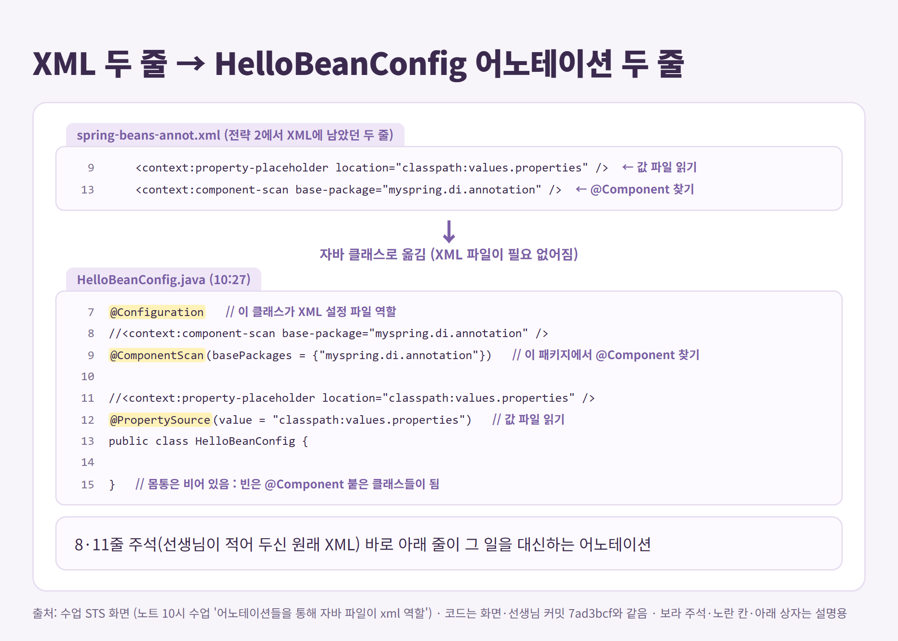

  - 그림 설명 : 전략 2에서 XML에 남아 있던 두 줄(component-scan, property-placeholder)을 HelloBeanConfig 클래스 위 어노테이션(@ComponentScan, @PropertySource)으로 옮김. @Configuration이 붙은 이 클래스가 XML 파일 역할을 해서 XML이 필요 없어짐

### 테스트 파일 만들기
- 74페이지 : 3.8 Spring-Test를 사용한 DI 테스트 클래스 - Spring-Test에서 테스트를 지원하는 어노테이션(Annotation)
  - @ContextConfiguration
    - @ContextConfiguration(classes=HelloConfig.class, loader=AnnotationConfigContextLoader.class)
    - Spring 3.1 M2는 @Configuration 클래스를 지원하기 위해 새로운 AnnotationConfigContextLoader를 소개하고 @ContextConfiguration 주석은 loader 속성을 통해 @Configuration 클래스의 선언을 지원하도록 업데이트 되었습니다.

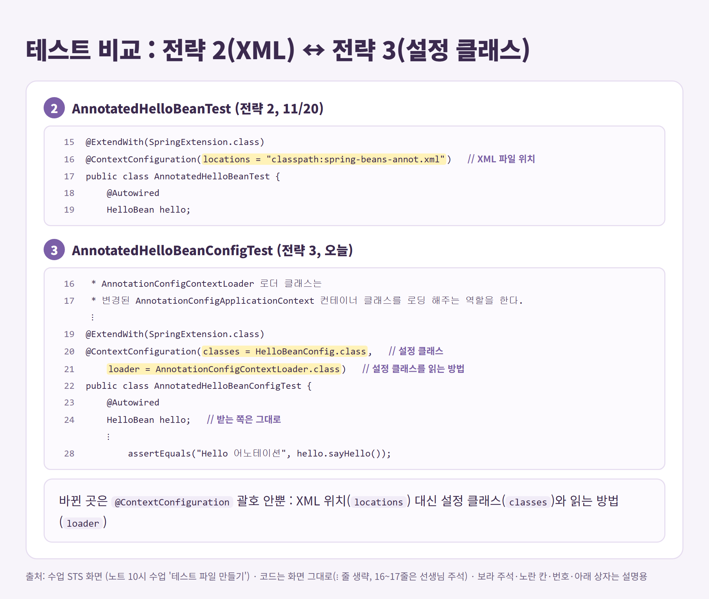

  - 그림 설명 : 전략 2 테스트(AnnotatedHelloBeanTest)와 오늘 만든 전략 3 테스트(AnnotatedHelloBeanConfigTest)를 비교. 바뀐 곳은 @ContextConfiguration 괄호 안뿐 : XML 위치(locations) 대신 설정 클래스(classes)와 읽는 방법(loader)

- 이전 두가지 방법의 또다른 방법이다. 작성법은 다르지만 작동 결과는 동일하다.

### properties 추가
- properties 파일 : 자주 바뀌는 값을 코드 밖에 `키=값` 모양으로 모아 둔 설정 파일 (src/main/resources/values.properties)
  - 왜 쓰나 : 값이 바뀌어도 자바 코드·XML은 그대로 두고 이 파일만 고치면 됨
  - 한글은 \u 번호(유니코드)로 적음 : 기본 읽기 방식(ISO-8859-1)으로는 한글이 깨져서. 아래 값을 풀면 어노테이션 / 어노테이션생성자 / Java,SpringFW,SpringBoot / 스프링 / 생성자
  - 꺼내 쓰는 법 : XML은 `${키}`(property-placeholder 필요), 어노테이션은 `@Value("${키}")`, 설정 클래스는 `env.getProperty("키")`(@PropertySource 필요)

```
app.setter.name=\uC5B4\uB178\uD14C\uC774\uC158
app.constructor.name=\uC5B4\uB178\uD14C\uC774\uC158\uC0DD\uC131\uC790
app.namelist=Java,SpringFW,SpringBoot
app.xmlsetter.name=\uC2A4\uD504\uB9C1
app.xmlcons.name=\uC0DD\uC131\uC790
```

---

## 11시 수업

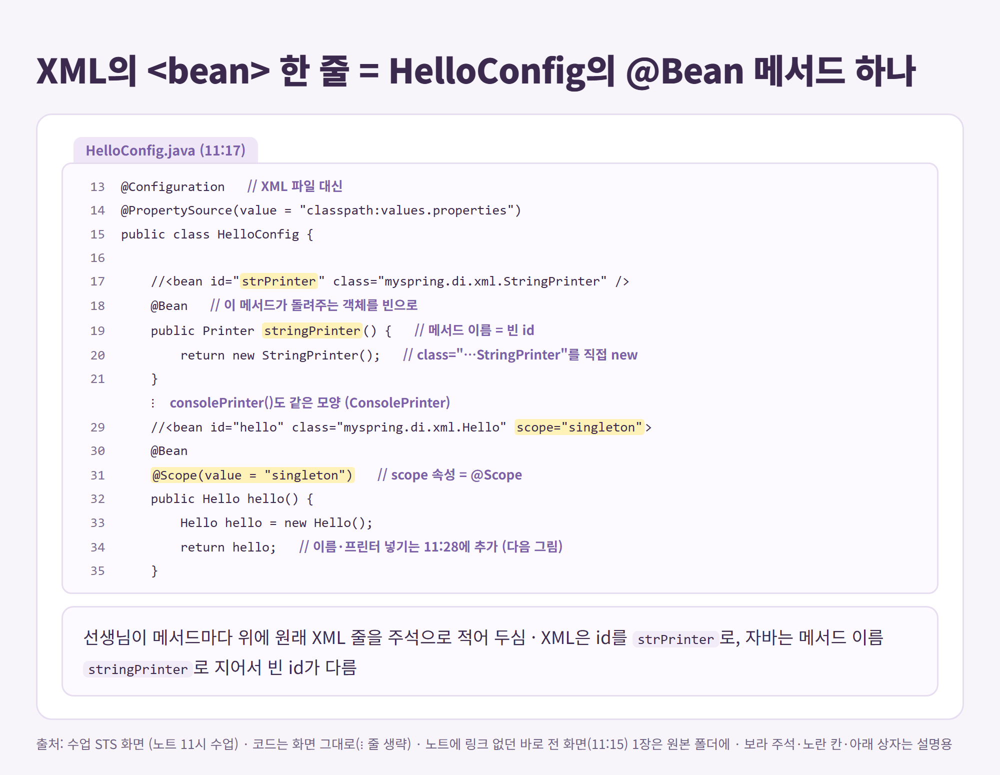

- 그림 설명 : 전략 1 XML(spring-beans.xml)을 자바 설정 클래스 HelloConfig로 옮기는 중. XML의 `<bean>` 한 줄이 @Bean 메서드 하나가 되고, 메서드 이름(stringPrinter)이 빈 id, XML의 scope="singleton"은 @Scope가 됨

- hellobean 에서 세터네임을 밸류로 붙임
- 우리는 메서드 내부에 붙이기 쓸거라 다른 방법으로 해볼 예정 
- properties(yml)에 적은 값을 읽어 오는 방법 3가지 (강사님 자료 정리)

  | 방법 | 어디에 쓰나 | 모양 |
  | --- | --- | --- |
  | @Value | 변수·생성자 매개변수·setter 위 | `@Value("${server.port}")` |
  | Environment의 getProperty() | 설정 클래스 메서드 안 | `env.getProperty("local.server.port")` |
  | 사용자 정의 Properties 클래스 | 값이 많을 때 한 클래스로 묶음 | 자료엔 제목만 있음 |

  ```java
  @Value("${server.port}")      // 키(server.port)로 값을 찾아 바로 변수에 넣음
  String portNumber;

  @Autowired
  Environment env;              // 읽어 둔 값을 꺼내는 창구
  String portNumber = env.getProperty("local.server.port");   // 키를 주면 값(글자)을 돌려줌
  ```
  - 공식 문서 [Environment](https://docs.spring.io/spring-framework/docs/current/javadoc-api/org/springframework/core/env/Environment.html) : 앱이 돌아가는 환경을 나타내는 인터페이스. 프로필(profile)과 프로퍼티(properties) 두 가지를 다룸. 프로퍼티는 properties 파일, 시스템 환경 변수 등 여러 곳에서 오고, getProperty("키")로 한곳에서 꺼냄

  - 수업 코드는 두 번째 방법 : HelloConfig에서 `env.getProperty("app.xmlsetter.name")` (아래 그림)
  - getProperties

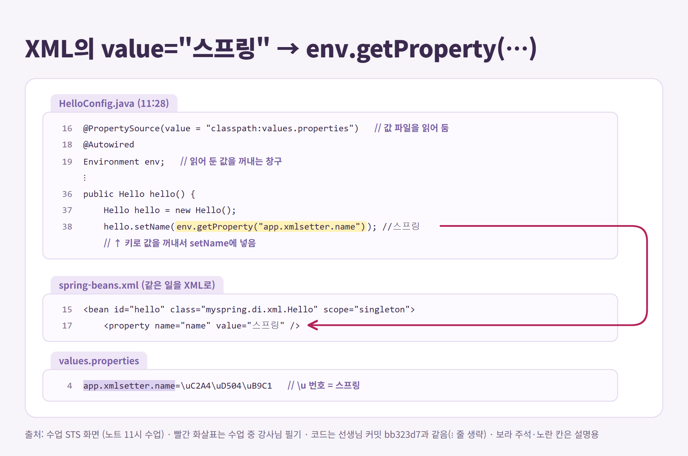

- 그림 설명 : XML에서 value="스프링"으로 직접 넣던 값을, 설정 클래스에서는 values.properties에서 꺼내 넣음. @PropertySource로 파일을 읽어 두고, Environment env의 getProperty("키")로 값을 꺼냄. 강사님이 38줄에서 XML 17줄로 화살표를 그으심 (같은 일)

---


## 1시 수업

- 핵심 (졸아서 커밋·화면으로 정리) : 11시에 XML 설정을 자바 설정 클래스 HelloConfig로 옮겼고, 1시에는 그걸 테스트로 확인한 뒤 생성자 방식 빈(helloCons)까지 자바로 옮김
  - hello 빈 : `new Hello()`로 빈 객체를 만들고 setName·setPrinter로 하나씩 채움 (setter 방식)
  - helloCons 빈 : `new Hello(이름, 프린터)`로 처음부터 다 채워서 만듦 (생성자 방식)
  - 비유 : setter 방식은 빈 상자를 받아 하나씩 채우기, 생성자 방식은 다 채워진 상자로 받기
  - 둘 다 XML에 있던 걸 자바 메서드로 바꾼 것뿐이라 결과는 XML 때와 같음
- 수업 흐름
  1. 13:12~13:20 HelloConfigTest : XML 대신 HelloConfig로 테스트 컨테이너를 만들고 "Hello 스프링"인지 확인 (아래 첫 그림)
  2. 13:23~13:25 HelloConfig에 helloCons() 추가 : values.properties에서 "생성자"를 꺼내 생성자에 넣음 (아래 코드)
  3. 13:27~13:35 테스트에서 helloCons 빈을 이름으로 받아(@Resource) "Hello 생성자"인지 확인
  4. 13:36 실행 : 콘솔에 "오버로딩 생성자 호출됨!" (아래 둘째 그림)
  5. 13:52 제출 과제 안내 (실습1은 11/24, 실습2·3은 11/26까지)
- 2번 코드
  ```java
  @Bean
  public Hello helloCons() {                                   // 빈 id = helloCons
      String consName = env.getProperty("app.xmlcons.name");   // properties에서 "생성자"를 꺼냄
      Hello hello = new Hello(consName, consolePrinter());     // 생성자에 이름·프린터를 한 번에 넣음
      return hello;                                            // 돌려준 객체가 helloCons 빈
  }
  ```

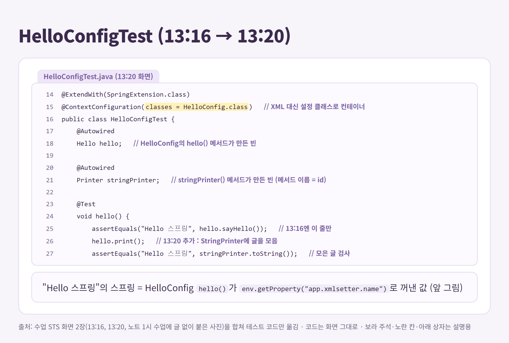

- 그림 설명 : 설정 클래스 HelloConfig로 만든 컨테이너를 테스트함. @ContextConfiguration(classes = HelloConfig.class)로 XML 대신 설정 클래스를 알려 주고, hello 빈과 stringPrinter 빈을 받아 "Hello 스프링"인지 검사 (13:16, 13:20 화면 2장 합침)


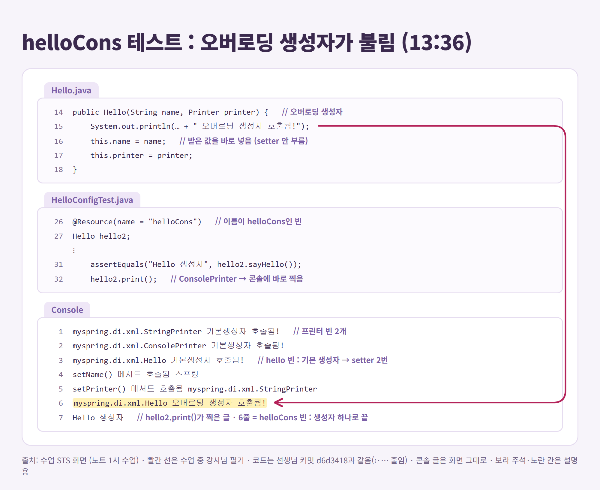

- 그림 설명 : helloCons 빈은 오버로딩 생성자 Hello(String, Printer) 하나로 만들어짐. 강사님이 생성자에서 콘솔 6줄 "오버로딩 생성자 호출됨!"으로 선을 그으심. 3~5줄 hello 빈(기본 생성자 → setName → setPrinter)과 비교

### setter 방식(setter 주입)이란
  - setter : 객체 안에 값을 넣어 주는 메서드. 이름이 보통 set + 변수이름 (setName, setPrinter)
  - setter 방식 : 객체를 먼저 빈 상태로 만들고, setter를 불러 값을 하나씩 채움
  - 비유 : 빈 도시락통을 먼저 받고(객체 만들기) 밥 칸(setName), 반찬 칸(setPrinter)을 하나씩 채우기
  ```java
  public void setName(String name) {   // name 칸에 값을 넣는 setter. 바깥에서 글자를 하나 받음
      this.name = name;                // 받은 값을 "이 객체의 name"에 넣음
  }

  Hello hello = new Hello();           // ① 빈 도시락통 : 값 없는 객체를 기본 생성자로 먼저 만듦
  hello.setName("스프링");              // ② 이름 칸 채우기
  hello.setPrinter(stringPrinter());   // ③ 프린터 칸 채우기
  ```
  - XML도 같음 : `<property name="name" value="스프링" />`을 적으면 스프링이 setName("스프링")을 대신 불러 줌. name="name"은 set을 뗀 메서드 이름

  | | setter 방식 (hello) | 생성자 방식 (helloCons) |
  | --- | --- | --- |
  | 만드는 법 | `new Hello()` 후 setter 여러 번 | `new Hello("생성자", 프린터)` 한 번 |
  | 비유 | 빈 통 받고 하나씩 채우기 | 다 채운 통으로 받기 |
  | XML | `<property>` | `<constructor-arg>` |
  | 꼭 있어야 하는 것 | 기본 생성자 Hello() + setter | 그 매개변수를 받는 생성자 |

  - 그래서 2시에 "기본 생성자를 지우면 생성자 방식이 필수" : 빈 통을 만들 방법(Hello())이 없으면 setter 방식은 ①부터 못 함

- 실무 스트링부트 코드는 거의 생성자 방식.

--- 

## 2시 수업

- 핵심 : 과제 문서와 시험문제 A를 같이 보며 setter 방식·생성자 방식, properties 값 넣기를 복습함
- 수업 흐름
  1. 14:05~14:20 과제 2·3 클래스 받음 (아래 그림)
  2. 14:26~14:46 시험문제 A1~A9를 같이 풂 (A1~A4는 아래 각 자리, A5~A9는 2시 끝)
  3. 14:47 spring-beans.xml에 values.properties 연결 : property-placeholder 한 줄 + `${키}` (2시 맨 아래 그림)

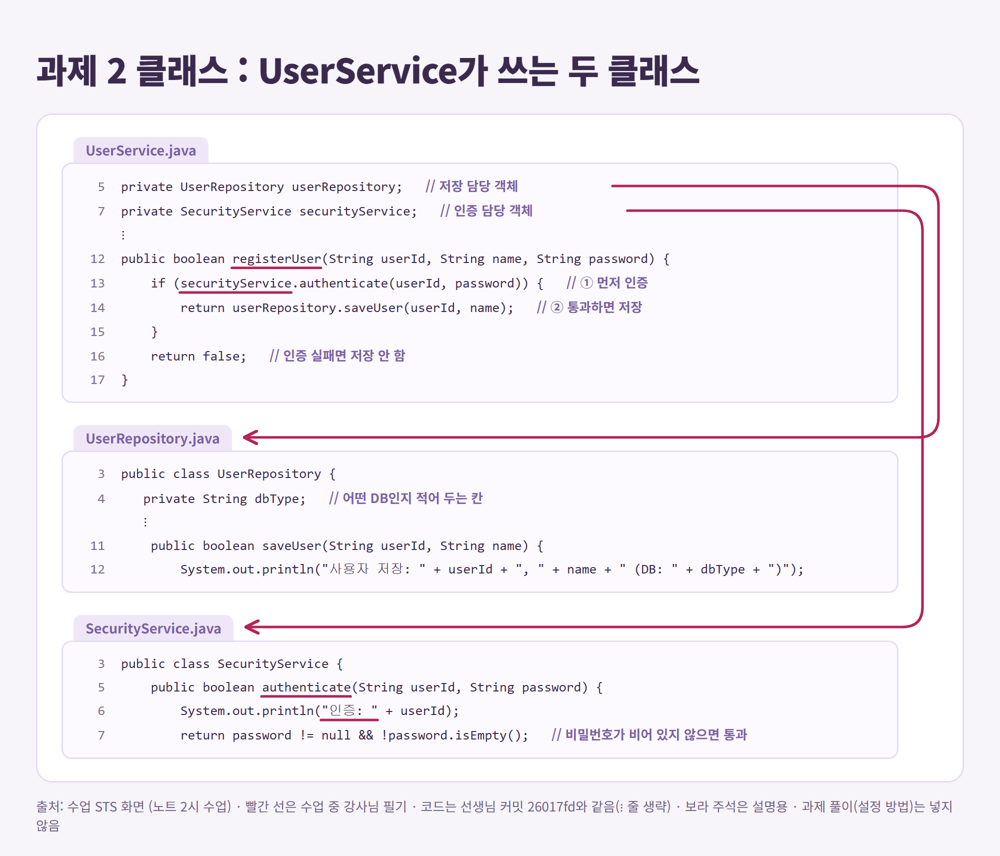

- 그림 설명 : 과제 2의 UserService는 SecurityService(인증)와 UserRepository(저장)를 필드로 가지고, registerUser에서 먼저 인증하고 통과하면 저장함. 강사님이 두 필드에서 각 클래스로 화살표, registerUser·authenticate에 밑줄을 그으심

- 시험문제 A1 싱글톤 스코프
  - 상황 : getBean("hello")를 두 번 해서 hello1, hello2를 받고 `hello1 == hello2`(같은 객체인지)를 찍음
  - 답 : true. 빈은 기본이 singleton이라 컨테이너가 처음에 1개만 만들어 두고, 달라고 할 때마다 그 1개를 줌
  - 누가·언제 만드나 : 내가 new 한 적 없음. 컨테이너(new GenericXmlApplicationContext)를 만드는 순간 컨테이너가 미리 만듦
  - prototype이면 : 달라고 할 때마다 새로 만들어서 false → "같은 객체냐" 검사(assertSame) 실패
  - 싱글톤 스코프 (A1) : 빈을 몇 개 만들지 정하는 설정 ([11/19 TIL scope](./2026-11-19.md#scope--singleton과-prototype))

    | scope | 빈 개수 | getBean 두 번 → 같은 객체? | 비유 |
    | --- | --- | --- | --- |
    | singleton (기본값) | 컨테이너에 딱 1개 | 같음 (hello1 == hello2 → true) | 사무실 정수기 하나를 다 같이 씀 |
    | prototype | getBean 할 때마다 새로 | 다름 (false) | 일회용 컵을 매번 새로 꺼냄 |


- 뭐가 필수인경우

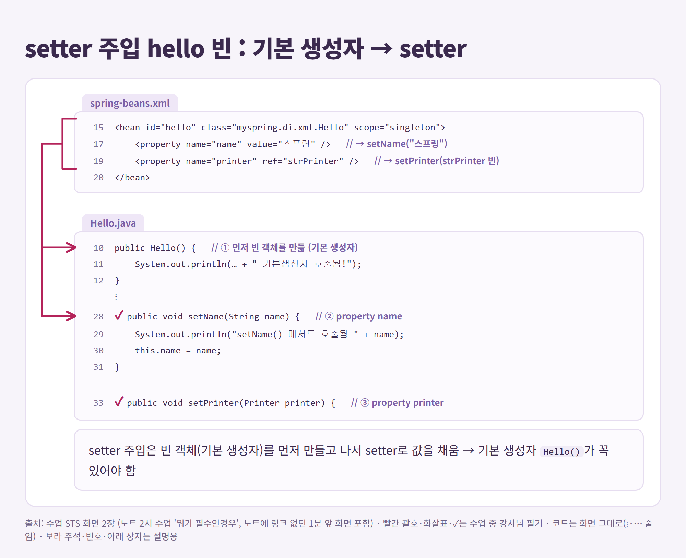

  - 그림 설명 : setter 주입(`<property>`)인 hello 빈은 ① 기본 생성자 Hello()로 빈 객체를 먼저 만들고 ② setName ③ setPrinter 순서로 값을 채움. 강사님이 XML hello 빈을 괄호로 묶어 Hello()와 setName으로 화살표를 긋고, setName·setPrinter에 ✓ (노트에 없던 1분 앞 화면 포함)

- 시험문제 A2 컨테이너 시작 때 콘솔 순서
  - 상황 : XML에 빈 4개(strPrinter, conPrinter, hello, helloC)가 이 순서로 있음. 컨테이너만 만들면 뭐가 찍히나
  - 답 : XML 순서대로 만듦 → StringPrinter 생성 → ConsolePrinter 생성 → hello(빈 통 Hello() → setName → setPrinter) → helloC(오버로딩 생성자 한 번)
  - 왜 : singleton 빈은 컨테이너가 시작할 때 전부 미리 만들어 둠. 각 생성자·setter 안의 println이 찍힌 것
  - 주의 : 정답지엔 8줄(생성자가 setter를 부른다고 가정)이지만, 우리 Hello 생성자는 setter를 안 불러서 실제는 6줄 (실행해서 확인함, 강사님 수업 답도 6줄)
  - 생성자 주입을 권하는 이유 : 다 채운 통만 받으니 빠진 값이 없음 / 값을 final(못 바꾸게)로 둘 수 있음 / 테스트에서 new로 바로 만들기 쉬움

- 기본생성자는 오버로딩된 생성자만 있는 경우 : 이때는 뭐가 필수가 된다고 함

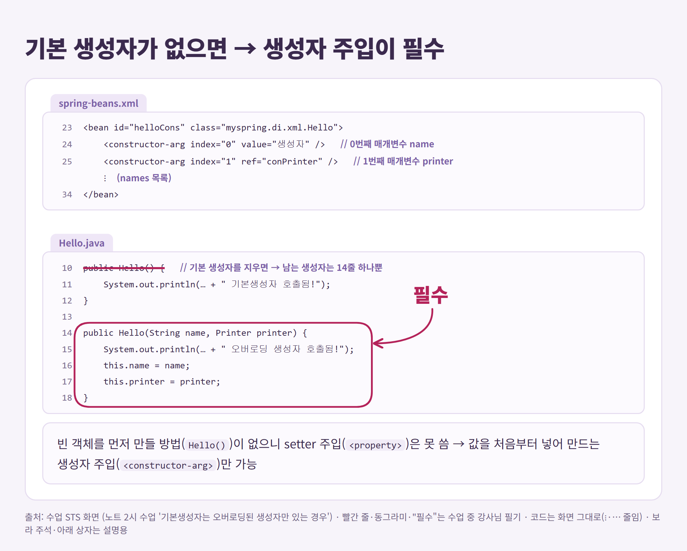

  - 그림 설명 : 기본 생성자 Hello()를 지워서 오버로딩 생성자 Hello(String name, Printer printer)만 남으면, 빈 객체를 먼저 만들 수 없어서 setter 주입(`<property>`)은 못 쓰고 생성자 주입(`<constructor-arg>`)이 필수가 됨. 강사님이 Hello()에 줄을 긋고, 오버로딩 생성자에 동그라미와 "필수"를 쓰심


- 시험문제 A3 @Autowired vs @Resource : Hello 빈이 hello, helloC 두 개일 때 변수에 어느 걸 넣나
  - 비유 : @Autowired는 "프린터 담당 와!"(종류로 부름), @Resource는 "김철수 와!"(이름으로 부름)
  - @Autowired 순서 : 종류(타입) → 여럿이면 @Qualifier로 고른 이름 → 없으면 변수 이름과 같은 빈
    - @Qualifier("helloC")를 지우면 : 변수 이름 hello와 같은 hello 빈이 들어감 → "Hello 생성자"를 기대한 테스트는 실패 (실제는 "Hello 스프링")
  - @Resource 순서 : name 속성 → 없으면 변수 이름 → 그래도 없으면 종류(타입)
    - name을 지우면 : 변수 이름 helloSetter인 빈을 찾는데 없음 → 종류로 찾으니 Hello가 둘 → 하나를 못 골라 오류(NoUniqueBeanDefinitionException)

- 시험문제 A4 `${}` vs `#{}`

  Value.properties
  myName=스프링
  myNameList=JavaFW,SpringBoot
  - 위 3줄이 있다는 전제로 있는 문제
  - `${키}` : properties 파일에서 값을 그대로 가져와 빈칸 채우기 (`${myName}` → 스프링)
  - `#{식}` : 계산까지 하는 식(SpEL). `#{'${myNameList}'.split(',')}` = 값 "JavaFW,SpringBoot"를 쉼표로 잘라 목록 [JavaFW, SpringBoot]
  - properties를 읽는 곳 : XML은 `<context:property-placeholder>`, 자바 설정은 `@PropertySource`

- 이게 왜 프로퍼티스에 있는게 생성자에 xmlconsename이 들어갈 수 있는건지
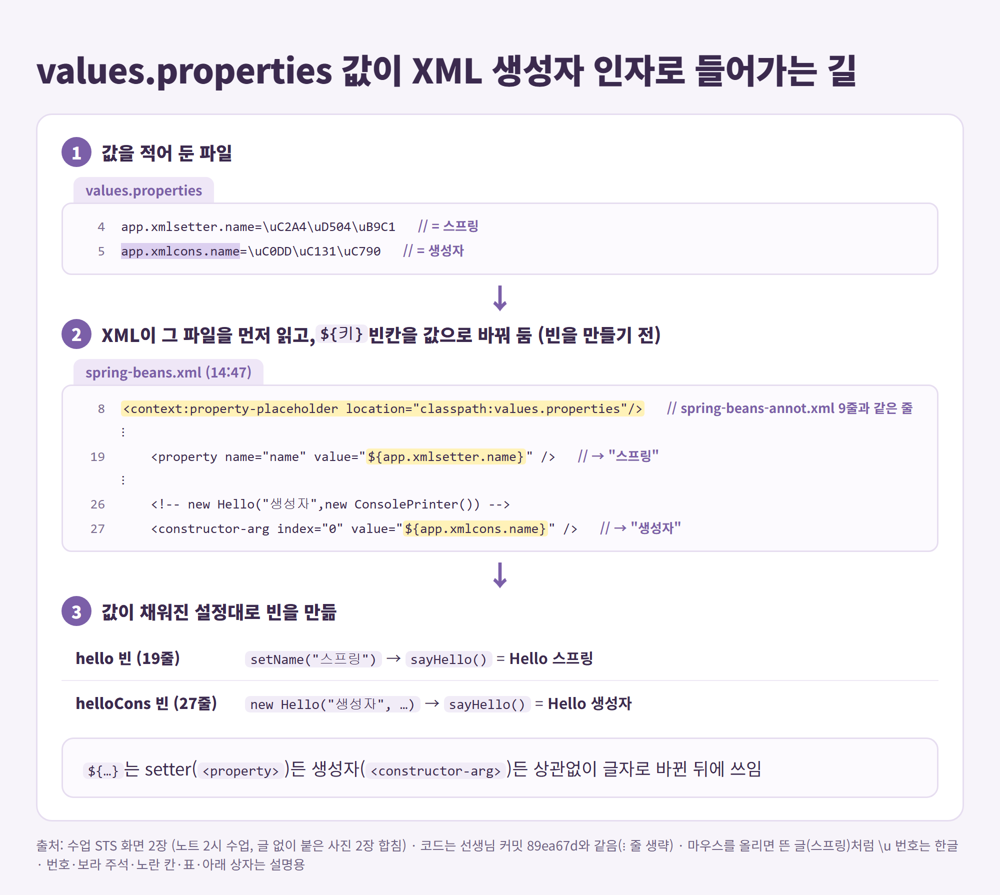
  - 그림 설명 : spring-beans.xml 8줄 `<context:property-placeholder>`가 빈을 만들기 전에 values.properties를 읽고, `${app.xmlcons.name}` 같은 빈칸을 값(생성자)으로 바꿔 둠. 그래서 `<property>`(setter)든 `<constructor-arg>`(생성자)든 똑같이 값이 들어감 (14:45, 14:46 화면 2장 합침)

- 시험문제 A5~A9 (강사님 정답지 기준)
  - A5 @Bean 메서드 안에서 다른 @Bean 메서드 부르기
    - 상황 : hello() 안에서 stringPrinter()를 직접 부름. 그럼 StringPrinter가 2개 생기나
    - 답 : 아니, 같은 1개. @Configuration 클래스는 스프링이 겉을 감싸서, stringPrinter()를 불러도 이미 만든 빈을 돌려줌. 빈 이름은 메서드 이름 stringPrinter
    - @Component로 바꾸면 : 감싸지 않아서 부를 때마다 진짜 new → StringPrinter 2개(생성자 로그 2번), 서로 다른 객체
  - A6 생성자 주입 테스트 (HelloBeanCons)
    - @Disabled를 지워 테스트를 켜면 : 통과, 콘솔에 "Hello 어노테이션생성자". 생성자가 둘인데 @Autowired가 붙은 생성자를 씀
    - @Qualifier("consolePrinter")를 지우면 : PrinterBean 종류 빈이 stringPrinter·consolePrinter 둘 → 어느 걸 넣을지 몰라 오류(NoUniqueBeanDefinitionException)
  - A7 XML 빈을 @Bean 메서드로 옮기기
    - 답 : `@Bean public Hello helloC() { return new Hello("생성자", consolePrinter()); }` (메서드 이름 helloC = 빈 id, 생성자에 넣는 값 두 개 = constructor-arg 두 줄)
    - 테스트 `@Autowired Hello hello;`는 계속 됨 : Hello가 둘이 돼도 변수 이름 hello와 같은 빈이 있어서
  - A8 상품 추가 (실습1 XML)
    - 답 : product3 빈을 setter 방식으로 추가 (`<property>` id P003, name 태블릿, price 600000) + 장바구니 목록(list)에 `<ref bean="product3" />` 추가
    - 테스트 기대값 : 상품 개수 3, 합계 2900000.0 (태블릿 600000이 더해진 값)
  - A9 같은 종류 빈이 둘일 때
    - 상황 : NotificationService 종류 빈이 email·sms 둘인데 `@Autowired NotificationService service;`
    - 답 : 어느 걸 넣을지 몰라 오류(NoUniqueBeanDefinitionException). 변수 이름 service와 같은 빈도 없어서
    - sms를 넣는 법 5가지 : @Qualifier("smsNotificationService") / @Resource(name = "smsNotificationService") / 변수 이름을 smsNotificationService로 / 변수 종류를 SmsNotificationService로 / 설정 클래스의 sms 메서드에 @Primary(기본으로 뽑힐 빈 지정)

---

## 3시 수업

- 핵심 : 스프링 프레임워크(STS)에서 스프링 부트(인텔리제이)로 넘어감. 부트 = 필요한 설정·의존성을 미리 만들어 둔 스프링
- 수업 흐름
  1. 인텔리제이로 바꾸고 자바를 17로 올림 (스프링 이니셜라이저가 17 이상 요구)
  2. 버전 이름 GA(정식 출시판)·SNAPSHOT(개발 중인 판) (아래 제미나이 링크)
  3. 스프링 부트 소개 페이지 Features : starter 의존성, 자동 설정에 체크 (아래 표)
  4. API 문서 : 이름 끝이 autoconfigure인 패키지가 아주 많음 = 부트가 미리 만들어 둔 설정

- 이제 sts 아니고 인텔리j 쓸것임
- 자바를 17로 올림(최소값) : 스프링 이니셜라이저를 사용해야하는데 그게 최소 자바17 요구

- https://share.gemini.google/9A2ufYaNxbex

https://docs.spring.io/spring-boot/4.0/api/java/index.html
https://docs.spring.io/spring-boot/4.0/api/java/org/springframework/boot/neo4j/autoconfigure/Neo4jAutoConfiguration.html
- Spring Boot 소개 페이지 Features (강사님이 체크·밑줄 그으심)

  | 영어 | 우리말 |
  | --- | --- |
  | Create stand-alone Spring applications | 혼자서 실행되는 스프링 앱을 만듦 |
  | Embed Tomcat, Jetty or Undertow directly (no need to deploy WAR files) | 톰캣 같은 서버가 앱 안에 들어 있음 (WAR 파일을 따로 배포할 필요 없음) |
  | ✓ Provide opinionated 'starter' dependencies to simplify your build configuration | 미리 골라 둔 '스타터' 의존성으로 빌드 설정을 간단하게 |
  | ✓ Automatically configure Spring and 3rd party libraries whenever possible | 스프링과 외부(3rd party) 라이브러리를 가능한 한 자동으로 설정 |
  | Provide production-ready features such as metrics, health checks, and externalized configuration | 운영에 바로 쓸 기능 : 지표(metrics), 상태 확인(health check), 바깥 설정 파일 |
  | Absolutely no code generation and no requirement for XML configuration | 코드를 만들어 내지 않고, XML 설정도 필요 없음 |

  - 강사님 필기 : starter·Automatically configure 줄에 ✓, Automatically configure에 동그라미, 3rd party libraries·production-ready·metrics, health에 밑줄

- 대충 님들이 필요한거 내가 다 만들어놔서 스프링 부트를 쓰면 편할것이다 같은 내용
- 스프링 액큐레이터 : 내가 만든 스프링 앱이 정상동작하는지 확인함. 모니터링 기능
- noXML : 개발자들이 가져다 쓰기 좋게 의존성도 잘 만들어둠

- 어쨌든 그래서 스프링은 자체 api 가 아주 많음
  - Spring Boot 4.0 API 문서 패키지 목록 일부 (이름 끝이 autoconfigure인 패키지가 아주 많음 = 부트가 미리 만들어 둔 설정)
    - org.springframework.boot.kafka.autoconfigure : Auto-configuration for Apache Kafka. (카프카 자동 설정)
    - org.springframework.boot.ldap.autoconfigure : Auto-configuration for LDAP. (LDAP 자동 설정)
    - org.springframework.boot.liquibase.actuate.endpoint : Actuator endpoint for Liquibase. (Liquibase용 액추에이터 엔드포인트)
    - 화면 한 장에 jsonb, kafka, kotlinx, ldap, liquibase 등의 autoconfigure 패키지가 이어짐

---

## 4시 

- 핵심 : 스프링 이니셜라이저(start.spring.io)에서 새 부트 프로젝트에 넣을 의존성을 하나씩 고르며 설명 들음 → 받은 zip을 인텔리제이로 열고 끝
  - 고른 의존성 : webmvc, Data JPA, H2, MariaDB, Thymeleaf, Validation, DevTools, Lombok, Actuator, Spring Boot Admin Client
- 수업 흐름
  1. Thymeleaf : JSP 대신 쓰는 화면 엔진
  2. Validation : 입력값 검사
  3. DevTools : 코드를 바꾸면 자동 재시작 (vite처럼)
  4. Lombok : getter·setter 같은 반복 코드(보일러플레이트)를 어노테이션으로 줄임
  5. Spring Boot Admin : 관리자(모니터링) 서버
  6. 인텔리제이로 열 때 release version 5 오류 → 강사님이 Maven 래퍼를 3.9.11로 바꿔 해결

- jsp 는 너무 오래되었고 대체하여 사용하고 있는 엔진
  - 구글 검색 AI 개요 요약 : Thymeleaf
    - Java 기반의 서버 사이드 템플릿 엔진. Spring·Spring Boot 웹 앱의 뷰(View)를 그림
    - 내추럴 템플릿 : 순수 HTML 문법이라 서버 없이 브라우저에서 바로 열어 볼 수 있음
    - 스프링 통합 : spring-boot-starter-thymeleaf로 연동, 기본 템플릿 경로는 src/main/resources/templates/
    - JSP 대비 장점 : .html 확장자를 쓰고 th: 속성으로 데이터를 채움. 부트 JAR 환경에서도 따로 설정 없이 동작

- 구글 검색 AI 개요 요약 : Java Validation
  - 객체나 입력값이 올바른지(유효성)를 어노테이션으로 선언하고 검사하는 Bean Validation(현재 Jakarta Validation) 표준
  - 표준 명세 : JSR 303 / JSR 380 → 지금은 Jakarta Validation (jakarta.validation)
  - 구현체 : 명세는 인터페이스·어노테이션뿐이고, 실제 검사는 Hibernate Validator가 함
  - 목적 : DTO 필드에 조건을 선언해서 검사 코드가 여기저기 흩어지는 걸 줄임

- fastAPI 와 비교
  - 강사님이 FastAPI 역할을 하는 의존성으로 설명하심 → Spring Web(webmvc)

    | | FastAPI (파이썬) | Spring Web (자바, 스프링 부트) |
    | --- | --- | --- |
    | 하는 일 | URL로 요청을 받아 응답(JSON 등)을 돌려주는 웹 API 서버 | 같음 |
    | 주소 연결 | `@app.get("/hello")` | `@GetMapping("/hello")` |
    | 서버 실행 | uvicorn으로 띄움 | 톰캣이 앱 안에 들어 있어서 그냥 실행 |
    | 입력값 검사 | Pydantic | 바로 위 Validation |

- vite 베이스로 리액트 코드 만들었을때 소스변경하면 곧장 반영이 되는데 그걸 스프링부트에서도 필요로 함 그 용도로 사용함
  - 구글 검색 AI 개요 요약 : Spring Boot DevTools (spring-boot-devtools)
    - 개발할 때 코드 변경 반영, 자동 재시작, 캐시 끄기 등을 도와주는 모듈
    - 자동 재시작 : 클래스패스 파일이 바뀌면 앱을 빠르게 다시 시작. 안 바뀌는 외부 라이브러리는 따로 둬서 빠름
    - 개발용 기본값 : 템플릿 엔진(Thymeleaf 등) 캐시를 끄고, H2 콘솔·자세한 에러 표시를 켬
    - LiveReload : 리소스가 바뀌면 브라우저를 자동 새로고침 (Spring Boot 4.1.0부터 deprecated)

- 보일러 플레이트 
  - 구글 검색 AI 개요 요약 : 보일러플레이트 코드(Boilerplate Code)
    - 여러 곳에서 거의 그대로 반복해 쓰는 기본 골격·상용구 코드. 개발 속도·일관성엔 좋지만 많아지면 유지보수 부담
    - 예 : HTML 기본 구조(`<!DOCTYPE html>`, `<html>`, `<head>`, `<body>`), 백엔드 회원가입·로그인·CRUD API, getter/setter 메서드
- 관리자서버만들거라 필요
  - 구글 검색 AI 개요 요약 : Spring Boot Admin
    - codecentric에서 만든 오픈소스 웹 모니터링 도구. Spring Boot Actuator가 내놓는 정보를 대시보드로 보여 줌
    - Admin Server : Actuator 정보를 모아 웹 화면으로 보여 주고 상태가 바뀌면 알림
    - Admin Client : 모니터링 대상 앱. 서버에 자기를 등록하고 Actuator 엔드포인트 접근을 허용
    - 주요 기능 : 인스턴스 up/down, 헬스 체크, JVM 지표, 스레드, 환경 변수, 빈(Bean) 조회 / 재배포 없이 로그 레벨 바꾸기, 힙·스레드 덤프

- 오늘 Initializr에서 고른 의존성 10개 (MySpringBootProject4 pom.xml)

  | 고른 것 | pom.xml 이름 | 하는 일 (쉽게) |
  | --- | --- | --- |
  | Spring Web | spring-boot-starter-webmvc | 웹 API 서버. URL 요청을 받아 응답함, 톰캣 내장 (FastAPI 역할) |
  | Spring Data JPA | spring-boot-starter-data-jpa | 자바 객체 ↔ DB 표를 이어 줘서 SQL을 덜 쓰게 함 |
  | H2 Database | h2 + spring-boot-h2console | 설치 없이 바로 쓰는 연습용 DB + 웹 화면에서 DB를 보는 콘솔 |
  | MariaDB Driver | mariadb-java-client | 진짜 DB(MariaDB)에 접속하는 연결 부품 |
  | Thymeleaf | spring-boot-starter-thymeleaf | HTML 화면 만들기 (JSP 대신) |
  | Validation | spring-boot-starter-validation | 입력값 검사 (@NotBlank 같은 어노테이션) |
  | Spring Boot DevTools | spring-boot-devtools | 코드를 바꾸면 자동 재시작 (개발할 때만) |
  | Lombok | lombok | getter·setter 같은 반복 코드를 어노테이션으로 대신 |
  | Spring Boot Actuator | spring-boot-starter-actuator | 앱이 잘 돌아가는지 상태·지표 확인 |
  | Spring Boot Admin (Client) | spring-boot-admin-starter-client | 액추에이터 정보를 관리자 서버로 보냄 |

  - 이름 끝이 -test인 5개(webmvc-test 등)는 테스트용으로 자동으로 따라온 것