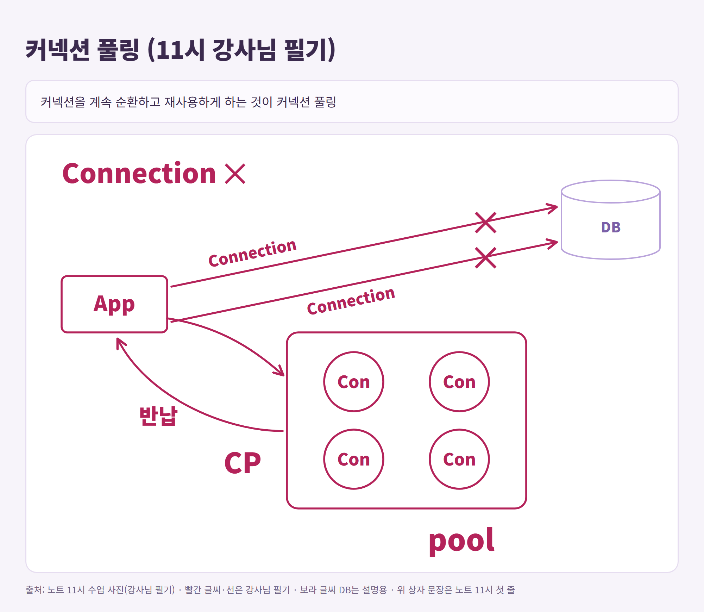
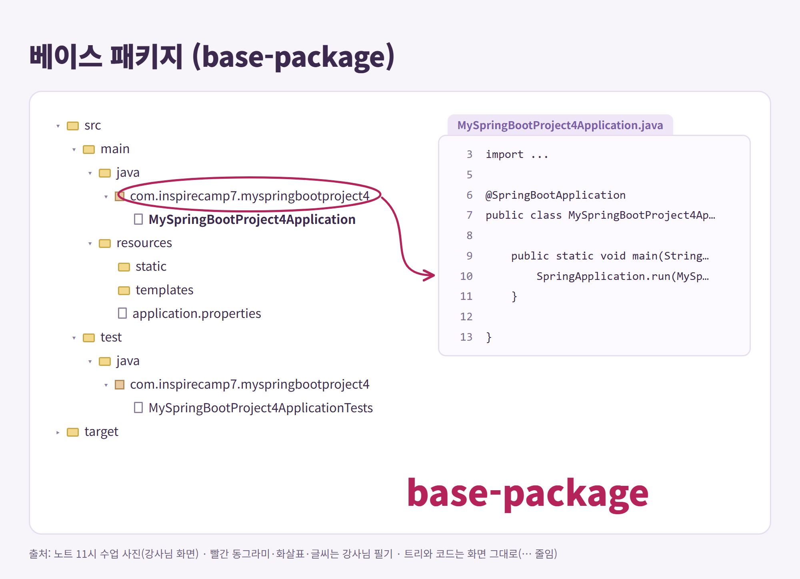
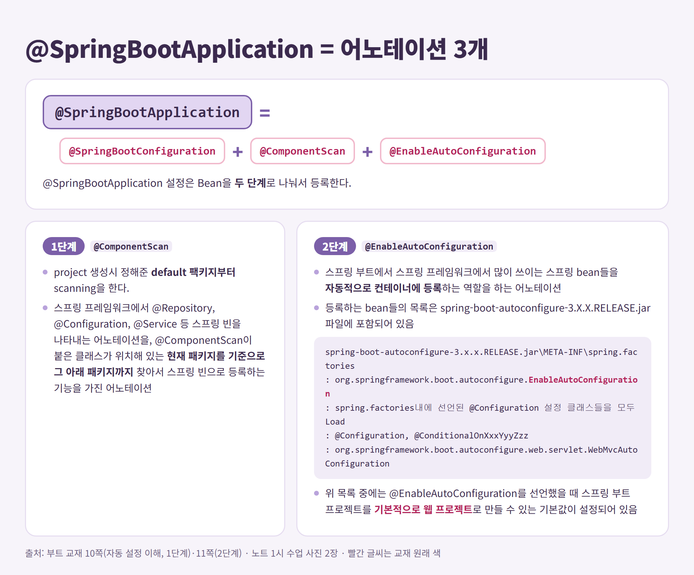
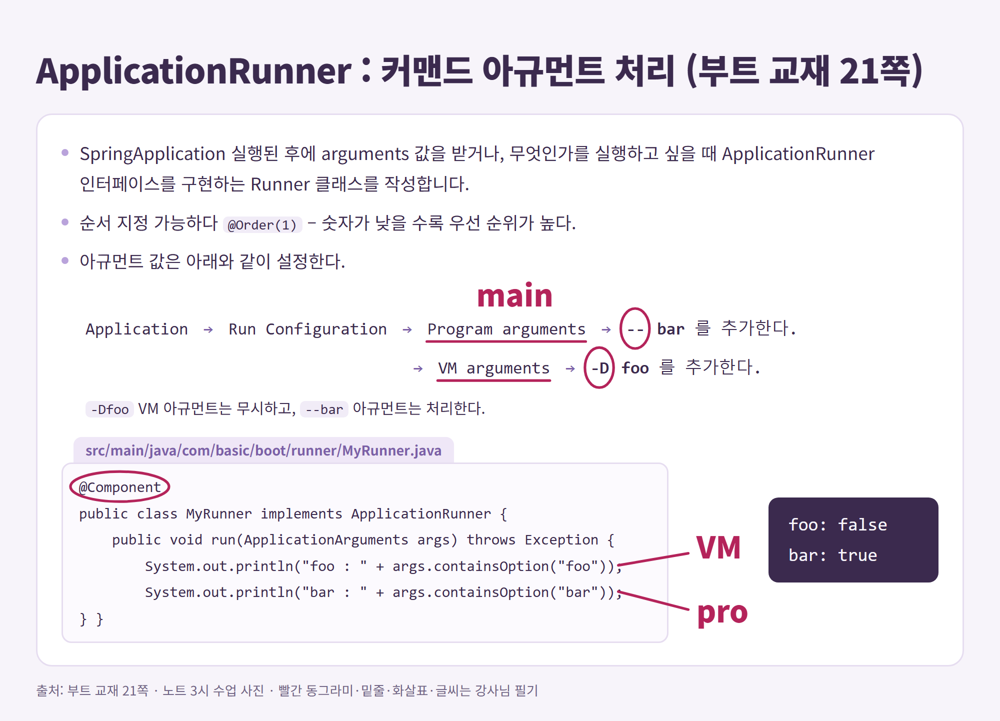
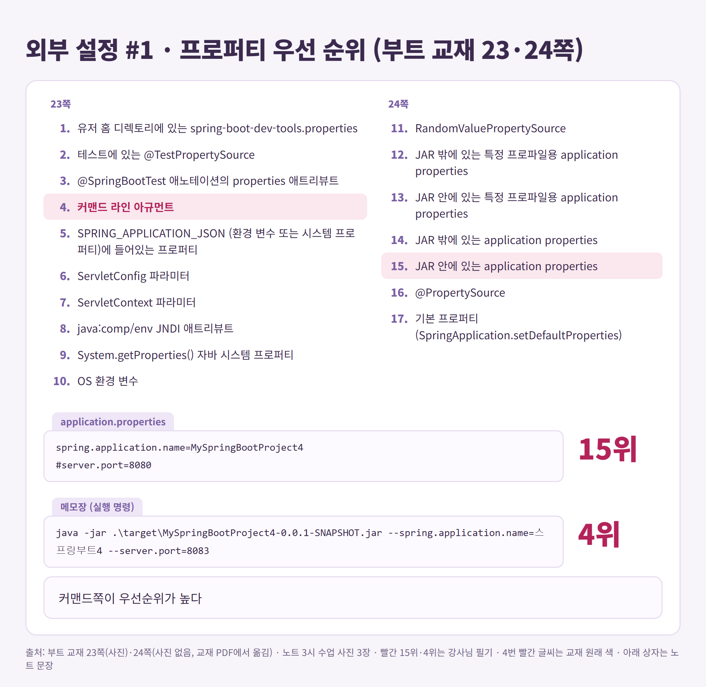
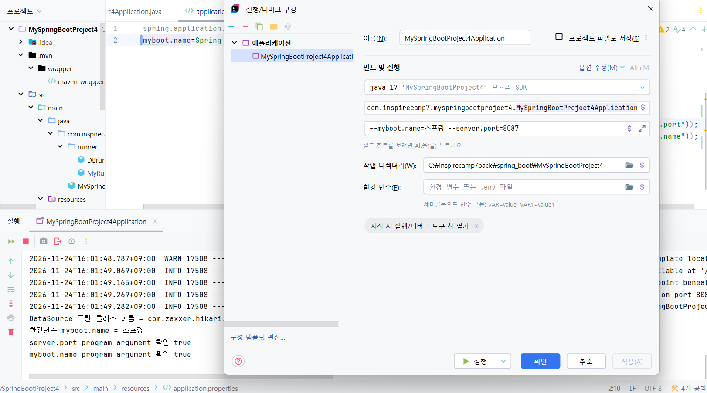
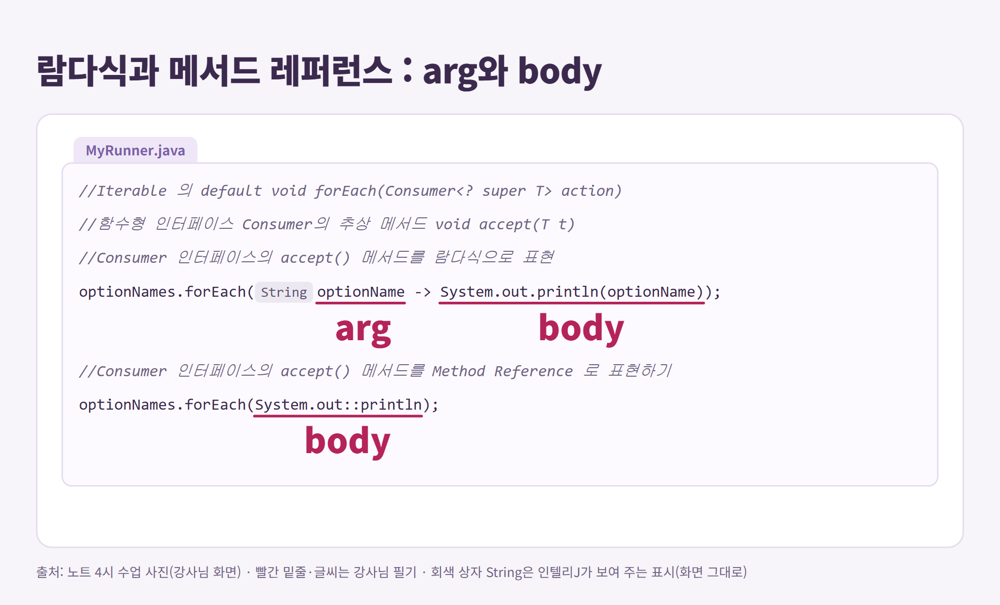

# 23일차 TIL : AI 서비스 개발을 위한 백엔드 I 7일차

🔗 [실습 레포지토리](https://github.com/easty00/SpringBoot4_Project)

## 오프닝

1. DI(Dependency Injection) 전략3 - XML 대신 Configuration 클래스 작성하는 방식

   | 어노테이션 | 붙이는 곳 | 하는 일 | XML로 치면 |
   | --- | --- | --- | --- |
   | @Configuration | 클래스 위 | 이 클래스가 XML 설정 파일 역할을 함 | `<beans>` 파일 전체 |
   | @ComponentScan | 클래스 위 | 적어 준 패키지에서 @Component 붙은 클래스를 찾아 빈으로 등록 | `<context:component-scan base-package="…" />` |
   | @PropertySource | 클래스 위 | properties 파일을 읽어 둠. 값은 `env.getProperty("키")`나 `@Value("${키}")`로 꺼냄 | `<context:property-placeholder location="…" />` |
   | @Bean | 설정 클래스 안 메서드 위 | 메서드가 돌려준 객체를 빈으로 등록. 빈 id = 메서드 이름 | `<bean id="메서드이름" class="…">` |

   - 쓰는 법 ① 스캔으로 찾게 하기 (HelloBeanConfig) : 빈은 각 클래스에 붙인 @Component를 스캔이 찾아 줌
     ```java
     @Configuration                                            // 이 클래스 = XML 설정 파일
     @ComponentScan(basePackages = {"myspring.di.annotation"})  // 이 패키지에서 @Component 붙은 클래스를 찾아 빈으로
     @PropertySource(value = "classpath:values.properties")    // values.properties 값을 읽어 둠
     public class HelloBeanConfig {
     }                                                         // 몸통이 비어 있음 : 빈은 스캔이 찾아 줌
     ```
   - 쓰는 법 ② @Bean 메서드로 직접 만들기 (HelloConfig) : 메서드 안에서 new로 만들고 값을 채워 돌려줌
     ```java
     @Configuration
     @PropertySource(value = "classpath:values.properties")
     public class HelloConfig {
         @Autowired
         Environment env;                                      // 읽어 둔 properties 값을 꺼내는 창구

         @Bean                                                 // 돌려준 객체가 빈. 빈 id = 메서드 이름 hello
         public Hello hello() {
             Hello hello = new Hello();
             hello.setName(env.getProperty("app.xmlsetter.name"));  // properties에서 "스프링"을 꺼내 넣음
             hello.setPrinter(stringPrinter());                // 다른 @Bean 메서드가 만든 stringPrinter 빈을 넣음
             return hello;
         }
         ⋮
     }
     ```
   - 지난 정리 : [11/23 TIL 어노테이션이 XML을 대신하게 하기](./2026-11-23.md#어노테이션이-xml을-대신하게-하기)

2. Spring Boot 소개 및 특징

   - 한 줄 정리 : 설정을 거의 안 해도 바로 실행되는 스프링 앱을, 실제 운영에 쓸 수 있는 수준으로 빨리 만들게 해 주는 프레임워크
   - 스프링과 서드파티(남이 만든) 라이브러리를 "보통 이렇게 쓴다"는 기본 방식(opinionated view)으로 미리 정해 둠 → 최소한의 설정만으로 개발 시작
   - 내장 서버, 자동 설정, 스타터 의존성 덕분에 설정 부담이 크게 줄어듦

   | 주요 특징 | 한 줄 정리 |
   | --- | --- |
   | 1) 독립 실행형 애플리케이션 | 외부 환경 없이 단독으로 실행됨 |
   | 2) 내장 웹 서버 지원 | Tomcat·Jetty·Undertow를 앱 안에 포함 → WAR 파일을 따로 배포 안 해도 됨 |
   | 3) 스타터(Starter) 의존성 제공 | 용도별로 묶인 starter 의존성 → 빌드 설정이 단순해짐 |
   | 4) 자동 설정(Auto Configuration) | 스프링과 서드파티 라이브러리를 가능한 경우 자동으로 설정 |
   | 5) 운영 환경용 기능 내장 | 메트릭, 헬스 체크, 외부 설정(externalized configuration)을 기본 제공 |
   | 6) 코드 생성 및 XML 설정 불필요 | XML 설정 파일이 필요 없음 |

3. Spring Initializr 웹사이트에서 Spring Boot 프로젝트 생성하기

4. 생성된 스프링 부트 프로젝트를 IntelliJ IDEA 에서 열기

--- 

### 커리큘럼
- 부트 교재 2쪽 : Learning Object(학습모듈) 및 커리큘럼

  | LO | 커리큘럼 |
  | --- | --- |
  | Spring Boot 소개 | Spring Boot 소개, 개발환경 구축 |
  | Spring Boot 원리 | 의존성 관리, Spring Boot Auto Configuration |
  | Spring Boot 활용 Ⅰ | Spring Application, 외부 설정 (application.properties), Profile, Logging, Spring-Boot-DevTools, Spring Boot Data Access (JPA, Java Persistence API) |
  | Spring Boot 활용 Ⅱ | Spring Boot Web MVC (Thymeleaf, Restful Web Service), Spring Boot Actuator (모니터링), Spring Boot Security (Form 인증) |

  - 강사님 필기 : "원리"에 동그라미, "개발환경 구축"에 밑줄, 오른쪽에 JPA 동그라미, 그 아래 추가교재


--- 

## 10시 수업

- 부트 교재 4쪽 : Spring Boot 시작하기
  - 스프링 부트는 2014년부터 개발된 스프링의 하위 프로젝트 중 하나 (강사님이 2014년에 동그라미)
  - 단독으로 실행이 가능하고(stand-alone), 제품 수준의(production-grade) 스프링 기반 어플리케이션을 제작하는 것을 목표로 진행된 프로젝트
  - 스프링 부트의 주요 기능
    - 단독 실행이 가능한 수준의 스프링 어플리케이션 제작이 가능함
    - 내장된 Tomcat, Jetty, UnderTow 등의 서버를 이용해서 별도의 서버를 설치하지 않고 실행 가능함
    - 최대한 내부적으로 자동화된 설정을 제공함
    - XML 설정 없이 단순한 설정 방식을 제공함

- 부트 교재 6쪽 : 스프링 부트 프로젝트 구조

  | 위치 | 내용 |
  | --- | --- |
  | src/main/java | 자바 Source 파일들 |
  | src/main/resources/application.properties | 스프링 부트 프로퍼티 값들을 모아 놓은 파일 |
  | src/main/resources/static | html, css 같은 정적 파일들 |
  | src/main/resources/templates | thymeleaf 같은 동적 파일들 (강사님이 jsp에 줄 긋고 .html이라 적으심) |
  | src/test/java | 자바 테스트 파일들 |

  - @SpringBootApplication 클래스의 적정 위치는 디폴트 패키지. @SpringBootApplication 안에 선언된 @ComponentScan이 해당 클래스 기준으로 현 위치와 그 아래 위치까지 스프링 Bean을 나타내는 어노테이션이 선언된 클래스를 찾기 때문 (강사님이 @SpringBootApplication에 밑줄)
    - 자세한 설명은 1시에 해주심

### 내 프로젝트 구조 (인텔리J)
  ```
  MySpringBootProject4
  ├─ .idea
  ├─ .mvn
  ├─ src
  │  ├─ main
  │  │  ├─ java
  │  │  │  └─ com.inspirecamp7.myspringbootproject4
  │  │  │     └─ MySpringBootProject4Application
  │  │  └─ resources
  │  │     ├─ static
  │  │     ├─ templates
  │  │     └─ application.properties
  │  └─ test
  │     └─ java
  │        └─ com.inspirecamp7.myspringbootproject4
  │           └─ MySpringBootProject4ApplicationTests
  ├─ target
  ├─ .gitattributes
  ├─ .gitignore
  ├─ HELP.md
  └─ mvnw
  ```

### 메이븐(Maven) (공식 문서 기준)
  - 자바 프로젝트를 빌드하고 관리하는 도구. POM(pom.xml)과 플러그인으로 빌드함. 빌드 방식이 같아서 메이븐 프로젝트 하나를 알면 다른 메이븐 프로젝트도 어떻게 빌드하는지 알게 됨
  - 목표 4가지 : 빌드 과정을 쉽게, 빌드 방식을 똑같이, 좋은 프로젝트 정보, 더 좋은 개발 습관
  - 자주 나오는 말

    | 말 | 뜻 | 내 프로젝트에서 |
    | --- | --- | --- |
    | POM | 프로젝트 정보와 빌드 설정을 적은 XML 파일. 메이븐은 지금 폴더에서 이 파일을 찾아 읽음 | pom.xml |
    | groupId:artifactId:version | 셋을 이으면 프로젝트의 정식 이름 | com.inspirecamp7:MySpringBootProject4:0.0.1-SNAPSHOT |
    | parent | 부모 POM. 적어 두면 부모의 설정을 물려받음 | spring-boot-starter-parent 4.0.10 |
    | 의존성(dependency) | 내 프로젝트가 쓰는 라이브러리. 그 라이브러리가 쓰는 라이브러리도 자동으로 따라옴 | spring-boot-starter-webmvc를 적으면 spring-boot-starter-tomcat도 따라옴 |
    | scope | 의존성을 언제 쓸지. 안 적으면 compile(언제나 씀) | mariadb-java-client는 runtime(컴파일 말고 실행·테스트 때), …-test는 test(테스트 때만) |
    | 저장소(repository) | 로컬 = 내 컴퓨터 폴더, 원격 = 그 밖의 곳. 로컬에 없으면 central에서 내려받음 | 로컬은 `.m2/repository`, 로그의 Downloaded from central |
    | 플러그인, goal | goal = 작업 하나, 플러그인 = goal 묶음 | spring-boot-maven-plugin의 `spring-boot:run` |

  - 표준 폴더 구조 : src(빌드할 원본)와 target(빌드 결과물이 모두 들어가는 곳). src 안에서 main은 앱, test는 테스트이고 그 안에 java(소스)와 resources(설정 파일 같은 자료)가 있음

  - 메이븐 래퍼(Maven Wrapper) : 메이븐을 따로 설치하지 않아도 정해진 버전으로 빌드하게 해 주는 스크립트. 맥·리눅스는 `./mvnw`, 윈도우는 `mvnw.cmd`
    - 설정 파일에 적힌 버전이 내 컴퓨터에 없으면 먼저 내려받아 설치하고 씀. 다음부터는 받아 둔 것을 씀
      ```properties
      # .mvn/wrapper/maven-wrapper.properties
      # 래퍼 종류 : 스크립트만 둠 (기본값)
      distributionType=only-script
      # 쓸 메이븐을 내려받을 주소. 버전을 바꾸려면 이 줄을 고침
      distributionUrl=https://repo.maven.apache.org/maven2/…/apache-maven-3.10.1-bin.zip
      ```
  - 공식 문서 해석
    - [What is Maven](https://maven.apache.org/what-is-maven.html) : 메이븐이 왜 생겼고 무엇을 해 주나
      - 프로젝트마다 빌드 파일이 조금씩 다르고 JAR도 따로 올려 두고 쓰던 게 불편해서 만듦. 빌드하는 방법을 하나로 정하고, JAR를 여러 프로젝트가 같이 쓰게 하려는 것
      - 속에서 어떻게 돌아가는지 전혀 몰라도 되는 건 아니지만, 자잘한 부분은 메이븐이 가려 줌
    - [POM](https://maven.apache.org/guides/introduction/introduction-to-the-pom.html) : pom.xml에 무엇을 적나
      - 꼭 있어야 하는 것 : project, modelVersion(4.0.0), groupId, artifactId, version. packaging을 안 적으면 jar가 됨
      - 안 적은 것은 기본값을 씀. 모든 POM이 메이븐의 기본 POM(Super POM)을 물려받기 때문. 그래서 소스는 src/main/java, 결과물은 target, 내려받는 곳은 central
    - [의존성](https://maven.apache.org/guides/introduction/introduction-to-dependency-mechanism.html) : 라이브러리를 어떻게 가져오나
      - 같은 라이브러리가 버전만 다르게 여러 개 걸리면 내 프로젝트에서 가장 가까운 것을 씀. 거리가 같으면 먼저 적은 것
      - dependencyManagement는 버전을 미리 정해 두는 곳. 여기에 버전이 있으면 의존성에 버전을 안 적어도 됨
    - [저장소](https://maven.apache.org/guides/introduction/introduction-to-repositories.html) : 라이브러리를 어디에 두고 어디서 받나
      - 로컬 저장소는 평소에 손댈 일이 없음. 다 지워도 다시 내려받으면 됨
    - [빌드 생명주기](https://maven.apache.org/guides/introduction/introduction-to-the-lifecycle.html) : 어떤 순서로 빌드하나
      - 명령 몇 개만 알면 어떤 메이븐 프로젝트든 빌드할 수 있음. 원하는 결과에 맞는 단계를 부르면 됨 (jar가 필요하면 package, 테스트만 하려면 test)
      - 앞 단계는 알아서 실행되니 마지막 단계 하나만 부르면 됨. 뭘 부를지 모르겠으면 verify를 권함
    - [메이븐 래퍼](https://maven.apache.org/tools/wrapper/) : mvnw를 왜 쓰나
      - 예전에는 정해진 버전의 메이븐을 각자 설치하고 PATH에 넣은 다음 `mvn clean install`을 쳤음
      - 래퍼가 있으면 설치 없이 `./mvnw clean install`(윈도우는 `mvnw.cmd clean install`). 나머지는 보통 메이븐 빌드와 같음

### pom.xml
  ```xml
  <parent>
      <groupId>org.springframework.boot</groupId>
      <artifactId>spring-boot-starter-parent</artifactId>
      <version>4.0.10</version>                    <!-- 스프링 부트 버전 -->
      <relativePath/> <!-- lookup parent from repository -->
  </parent>
  <groupId>com.inspirecamp7</groupId>
  <artifactId>MySpringBootProject4</artifactId>    <!-- 프로젝트 이름 -->
  <version>0.0.1-SNAPSHOT</version>                <!-- 프로젝트 버전 -->
  ⋮
  ```

- <spring-framework.version>7.0.11</spring-framework.version> 
  - 이런 버전을 임의로 수정 가능 pom.xml 한정

### 라이브러리
  -  Initializr에서 고른 스타터를 따라 저절로 딸려 들어온 라이브러리들

| 이름 | 한 줄 | 비유 | pom.xml에 내가 적었나 |
| --- | --- | --- | --- |
| Jackson | 자바 객체 ↔ JSON 글자 번역 | 통역사 | 안 적음. webmvc 스타터 안에 있음 |
| Tomcat | 요청을 받아 자바 코드를 실행하고 응답을 돌려주는 웹 컨테이너 | 가게 문을 열고 손님을 받는 점원 | 안 적음. webmvc 스타터 안에 있음 |
| Web MVC | 컨트롤러로 웹 요청을 처리하는 스프링 모듈 | 주문 받는 창구 규칙 | 적음 `spring-boot-starter-webmvc` |
| DB 벤더 | DB를 만들어 파는 회사(MariaDB, Oracle 등). 각자 드라이버를 줌 | 콘센트에 꽂는 회사별 충전기 | 적음 `mariadb-java-client`, `h2` |
| JDBC | 자바가 DB에 접속해 SQL을 실행하는 표준 규칙 | 전 세계 공통 콘센트 규격 | 안 적음. 자바에 들어 있음 (java.sql, javax.sql) |
| JPA | 자바 객체 ↔ DB 테이블을 이어 SQL을 대신 만들어 주는 표준 규칙 | 운전면허 시험 기준 | 적음 `spring-boot-starter-data-jpa` |
| Hibernate | JPA 규칙을 실제로 구현한 라이브러리 | 기준에 맞춰 만든 실제 자동차 | 안 적음. data-jpa 스타터 안에 있음 |
| HikariCP | 커넥션(DB 연결)을 미리 만들어 두고 빌려주는 커넥션 풀 | 미리 개통해 두고 빌려 쓰는 전화기 | 안 적음. data-jpa 스타터 안에 있음 |

- Jackson
  - 강사님 화면 : 의존성 목록 중 Jackson에 빨간 괄호
    ```xml
    <dependency>                                    <!-- 여기부터 빨간 괄호 -->
        <groupId>tools.jackson.core</groupId>
        <artifactId>jackson-databind</artifactId>   <!-- Jackson : 자바 객체 ↔ JSON 변환 -->
        <version>3.1.8</version>
        <scope>compile</scope>
    </dependency>
    ```
  - 제미나이 질문 : Jackson 라이브러리의 역할은? 스프링부트 프로젝트에서 개발자가 따로 Jackson 라이브러리 의존성을 추가해야 하나요?
    > - Jackson은 Java 객체와 JSON(그 외 YAML, XML 등) 데이터 간의 직렬화 및 역직렬화를 담당하는 대표적인 데이터 바인딩 라이브러리입니다.
    >   - 직렬화 : Java 객체(DTO, Entity 등)를 JSON 문자열로 변환합니다. REST API 서버가 클라이언트에게 응답 데이터를 JSON 형태로 내려줄 때 핵심적으로 사용됩니다.
    >   - 역직렬화 : 클라이언트로부터 들어온 JSON 문자열을 Java 객체로 변환합니다. Spring MVC에서 `@RequestBody`로 요청 본문을 받을 때 내부적으로 동작합니다.

- 톰캣 (Tomcat)
  - 제미나이 질문 : tomcat 의 역할은 무엇인가요? web server 와 web container 는 다른가요? tomcat 의존성도 스프링부트 프로젝트에서 추가해야 하나요?
    > - Tomcat은 Java 기반의 웹 컨테이너(서블릿 컨테이너)이자 경량 WAS(Web Application Server)로, HTTP 요청을 받아 Java 웹 애플리케이션(서블릿, Spring MVC 등)을 실행하고 응답을 돌려주는 역할을 합니다.
    > - Web Server(웹 서버)와 Web Container(웹 컨테이너)는 역할이 다릅니다.
    >   - 핵심 역할 : 웹 서버는 HTML, CSS, JS, 이미지 등 정적 파일 제공 및 리버스 프록시·로드 밸런싱 / 웹 컨테이너는 서블릿·JSP 등 동적 Java 코드 실행 및 생명주기 관리
    >   - 대표 예시 : 웹 서버는 Nginx, Apache HTTP Server / 웹 컨테이너는 Apache Tomcat, Jetty, Undertow

- 웹MVC (Spring Web MVC)
  - 톰캣과의 관계 (제미나이 톰캣 답에서)
    > - 요청을 분석해 서블릿(예: Spring MVC의 `DispatcherServlet`)으로 전달하고, 생성된 응답을 HTTP 형태로 반환합니다.

- DB 벤더. (마리아, 몽고같은거 제공하는사람)
  - 제미나이 JDBC 답에서
    > - 각 데이터베이스 회사가 JDBC 인터페이스를 구현한 드라이버를 제공하며, 애플리케이션은 해당 드라이버를 통해 실제 DB와 통신합니다.

- JDBC
  - 자바로 DB에 접속해 SQL을 실행하는 표준 API (제미나이 답 요약)
  - 흐름 : 연결(`Connection`) 얻기 → SQL 실행(`PreparedStatement`) → 결과 읽기(`ResultSet`), commit/rollback → 닫거나 풀에 반납
  - 실무에서는 매번 직접 쓰기보다 JdbcTemplate, JPA/Hibernate, MyBatis 같은 것을 위에 얹어 씀

- JPA
  - 표준 스펙은 jpa (요즘의 주류)
  - JPA는 인터페이스로만 구성된 표준 스펙으로 만들어진 것. 하이버네이트는 그 규칙을 implements해서 실제로 동작하게 만든 것(구현체). 이것도 복잡해서 스프링부트쪽 애들이 하이버네이트를 추상화하여 만든 게 Spring Data JPA
  - crud 반복조회를 줄임
  - JDBC와 JPA 차이 (제미나이 답 요약)

    | | JDBC | JPA (Hibernate 등) |
    | --- | --- | --- |
    | SQL | 직접 씀 | 객체를 다루면 프레임워크가 만들어 줌 |
    | 반복 코드 | 많음 | CRUD와 기본 조회를 크게 줄여 줌 |
    | 복잡한 쿼리 | 세밀하게 튜닝하기 좋음 | 튜닝, 보완이 필요함 |
    | 무게 | 가볍고 예측하기 쉬움 | 영속성 컨텍스트, 변경 감지 같은 기능이 더 붙음 |

  - 최근 트렌드 : Spring Data JPA를 기본으로 쓰고, 복잡한 조회·통계·대용량 작업은 JdbcTemplate, MyBatis, Querydsl을 같이 씀. 더 가벼운 것을 원하면 Spring Data JDBC
  - JPA를 많이 쓰는 이유
    1. 생산성과 유지보수 : 테이블이 바뀔 때 SQL과 매핑 코드를 일일이 고치는 부담이 줄어듦
    2. 객체 중심 설계 : 자바 객체(Entity) 중심으로 설계할 수 있음
    3. 영속성 컨텍스트 : 같은 트랜잭션 안에서 1차 캐시, 변경 감지, 쓰기 지연을 해 줌
    4. DB 회사에 덜 묶임 : 표준(jakarta.persistence)이라 특정 DB에만 맞는 쿼리를 덜 쓰게 됨

--- 

## 11시 수업


### HikariCP

- 커넥션을 계속 순환하고 재사용하게 하는것이 커넥션 풀링


  - 그림 설명 : 강사님 필기. 앱(App)이 요청마다 DB 커넥션을 새로 만들지 않음(Connection ✕). 풀(pool, CP)에 커넥션(Con)을 미리 만들어 두고 앱이 빌려 쓴 뒤 반납함
  - 커넥션 풀링 (제미나이 답 요약) : DB 연결을 요청마다 새로 만들지 않고, 미리 몇 개 만들어 풀에 두었다가 빌려 쓰고 반납하는 방법. 연결을 맺으려면 네트워크 왕복과 DB 서버 준비가 필요해서 오래 걸림
  - 비유 : DB 연결은 전화 개통과 같음. 요청이 올 때마다 개통하고 해지하면 느림. 전화기 몇 대를 미리 개통해 두고(풀) 필요한 사람이 빌려 쓰고 제자리에 둠(반납)
  - 커넥션 풀이 왜 필요한가

    | 왜 필요한가 | 쉬운 말 |
    | --- | --- |
    | 응답 지연 감소 | 매번 연결을 새로 맺는 시간이 사라짐 |
    | DB 서버 부하 및 고갈 방지 | 풀 크기만큼만 동시에 연결해서 DB가 안 터짐 |
    | 자원 재활용 및 안정성 | 연결을 닫지 않고 돌려써서 낭비가 없음 |

- 아파치나 다른 커넥션풀링들도 있는데 왜 히카리cp를 썼을까?
  - 안정성 높고 빨라서 
  - 스프링 부트 2.0부터 기본 풀이 Tomcat JDBC Pool에서 HikariCP로 바뀜. 빠르고, 가볍고, 안정적이고, 풀이 할 일에만 집중해서 (제미나이 답 요약)
  - 다른 풀 : Apache Commons DBCP2(오래된 아파치 풀), Tomcat JDBC Pool(부트 1.x 때 기본), c3p0(오래된 풀), Alibaba Druid(SQL 감시 기능이 많음), Oracle UCP(오라클 전용), Agroal(Quarkus 등)

- HikariCP가 하는 일과 설정 (기본값은 공식 README 기준)

  | 하는 일 | 설정 | 기본값 |
  | --- | --- | --- |
  | 커넥션을 최대 몇 개 둘지 (쓰는 것 + 쉬는 것) | `maximumPoolSize` | 10 |
  | 쉬는 커넥션을 최소 몇 개 둘지. 안 적고 고정 크기로 쓰기를 권함 | `minimumIdle` | maximumPoolSize와 같음 |
  | 남은 커넥션이 없을 때 얼마나 기다릴지. 넘으면 SQLException | `connectionTimeout` | 30초 |
  | 쉬는 커넥션을 언제 치울지. minimumIdle이 maximumPoolSize보다 작을 때만 쓰임 | `idleTimeout` | 10분 |
  | 커넥션 하나의 최대 수명. DB가 정한 제한 시간보다 몇 초 짧게 적기를 권함 | `maxLifetime` | 30분 |
  | 쉬는 커넥션이 끊기지 않게 확인하는 간격 | `keepaliveTime` | 2분 |
  | 오래 반납 안 된 커넥션(누수)을 로그로 알림 | `leakDetectionThreshold` | 0 (끔) |

  - 커넥션을 빌려주고 돌려받는 일은 `DataSource`를 구현해서 함. 빌리고 반납할 때 서로 기다리는 일을 줄여서 빠름

- 공식 문서 해석
  - [HikariCP README](https://github.com/brettwooldridge/HikariCP) : 어떤 라이브러리이고 무엇을 설정하나
    - 빠르고, 단순하고, 믿을 수 있다(Fast, simple, reliable)고 소개하는 JDBC 커넥션 풀. 크기가 약 165KB로 가벼움. Hikari는 일본어로 빛
    - 기본값이 좋아서 대부분은 더 손대지 않아도 잘 동작함. 설정 개수도 일부러 적게 둠. 시간은 모두 밀리초로 적음 (30초 = 30000)
  - [풀 크기 정하기 (HikariCP 위키)](https://github.com/brettwooldridge/HikariCP/wiki/About-Pool-Sizing) : 커넥션을 몇 개 두나
    - 많다고 빠른 게 아님. 오라클 실험에서 풀 크기만 줄였더니 응답 시간이 약 100ms에서 약 2ms로 줄어듦
    - 시작값 공식 : 커넥션 수 = (코어 수 × 2) + 디스크 수. 4코어에 하드디스크 1개면 9, 대략 10개. 여기서 시작해 부하를 걸어 보며 맞춤
    - 작은 풀을 두고, 나머지 스레드는 커넥션을 기다리게 하는 게 좋음
  - [스프링 부트 SQL 문서](https://docs.spring.io/spring-boot/reference/data/sql.html) : 스프링 부트는 커넥션 풀을 어떻게 고르나
    - 성능과 동시성 때문에 HikariCP를 선호함. HikariCP가 있으면 항상 그것을 씀. 없으면 Tomcat 풀, Commons DBCP2, Oracle UCP 순서
    - spring-boot-starter-jdbc나 spring-boot-starter-data-jpa를 쓰면 HikariCP가 자동으로 따라옴
    - DB 접속 정보는 `spring.datasource.*`, HikariCP만의 설정은 `spring.datasource.hikari.*`로 적음. `spring.datasource.url`을 안 적으면 내장 DB를 자동 설정하려고 함
    - DataSource 빈을 직접 만들면 자동 설정은 일어나지 않음
  - 수업 코드와 연결 : 내 프로젝트의 HikariCP는 7.0.2. application.properties에 `spring.datasource.url`이 없어서 내장 DB인 H2(`jdbc:h2:mem:…`)에 연결됨. DBrunner가 찍은 `com.zaxxer.hikari.HikariDataSource`와 로그의 `HikariPool-1 - Start completed.`가 이것

### 베이스 패키지와 의존성
- 채팅에 올라온 GitHub 링크
  - https://github.com/fasterxml/jackson

- 각 의존성들이 연결되어있음

- 실행 로그 (강사님 화면)
  ```
  HHH000489: No JTA platform available (set 'hibernate.transaction.jta.platform' …)   // 하이버네이트(JPA)
  Initialized JPA EntityManagerFactory for persistence unit 'default'                 // JPA 준비 끝. 강사님 필기 : EntityManagerFactory → EntityManager → Entity
  spring.jpa.open-in-view is enabled by default. Therefore, database queries may …    // JPA 경고
  Cannot find template location: classpath:/templates/ (please add some templates …   // Thymeleaf : templates 폴더가 비어 있음
  H2 console available at '/h2-console'. Database available at 'jdbc:h2:mem:43fd4…'   // H2 콘솔 (강사님이 /h2-console에 밑줄)
  Exposing 1 endpoint beneath base path '/actuator'                                   // Actuator
  Tomcat started on port 8080 (http) with context path '/'                            // 내장 톰캣
  Started MySpringBootProject4Application in 10.666 seconds (process running for …    // 실행 완료
  ```

- 베이스 패키지 밑에 꼭 파일을 만들어야 함
  - 베이스 패키지 내 포함된 스캐너는 자신이 포함된 패키지와 하위 패키지만 스캔함



  - 그림 설명 : @SpringBootApplication 클래스(MySpringBootProject4Application)가 들어 있는 패키지 com.inspirecamp7.myspringbootproject4가 베이스 패키지.

---

## 1시 수업

- 베이스 패키지와 히카리에 대해 이어서 
- 스캐너가 있는 베이스 폴더에 파일을 만들어야 함
https://github.com/brettwooldridge/HikariCP/blob/dev/src/main/java/com/zaxxer/hikari/HikariDataSource.java

- 강사님 화면 : 메인 클래스에 `@Autowired`와 `DataSource`까지 치신 화면. 아직 변수 이름이 없어서 빨간 줄 (완성된 코드는 아래 DBrunner)
  - 왼쪽 트리 : com 아래에 inspirecamp7.myspringbootproject4와 my 폴더가 나란히 있음

- 스프링부트는 설정클래스를 다 만들어서 제공함. 그런데 이거 쓰려면 어떤식으로 로드되는지 알고있어야 함
- //@Configuration + @ComponentScan + @EnableAutoConfiguration
  - 이 3가지를 오토어플리케이션 클래스가 함
  
  

    - 그림 설명 : 부트 교재 10·11쪽. @SpringBootApplication은 어노테이션 3개를 합친 것이고, 빈을 두 단계로 등록함 (아래 표). 자동 설정 목록의 기본값 덕분에 기본으로 웹 프로젝트가 됨

- 히카리 데이터 소스 클래스를 사용하고 상위 데이터 소스를 사용해보았음
- 컴포넌트 스캐너를 만들었지만 실 사용처는 안만들었음. 하지만 마이 스프링부트 프로젝트4어플이 그 역할을 함 
- 스프링 프레임워크에서는 선언하는 것 뿐 아니라 컴포넌트 스캐닝이 가능한 컨피그레이션을 만들어야 함. 

### @SpringBootApplication

- 들어 있는 어노테이션 3개

  | 들어 있는 것 | 하는 일 | 등록되는 빈 | 11/23 수업과 비교 |
  | --- | --- | --- | --- |
  | `@SpringBootConfiguration` (안에 `@Configuration`) | 이 클래스가 설정 클래스가 됨. 안에 @Bean을 쓸 수 있음 | @Bean 메서드가 돌려준 것 (`helloBean`) | `HelloConfig`의 `@Configuration` |
  | `@ComponentScan` | 1단계 : 베이스 패키지부터 아래로 @Component 등을 찾아 빈으로 등록 | 내가 만든 @Component (`DBrunner`) | `HelloBeanConfig`의 `@ComponentScan` |
  | `@EnableAutoConfiguration` | 2단계 : 부트가 미리 만들어 둔 설정 클래스를 조건이 맞으면 불러와 빈으로 등록 | 부트가 준비한 것 (`HikariDataSource`, Tomcat, Jackson …) | 새로 배움 |

- 강사님 주석은 @Configuration, 교재는 @SpringBootConfiguration인데 둘 다 맞음. @SpringBootConfiguration 안에 @Configuration이 들어 있음
- 비유 : 1단계는 내가 만든 반찬(내 @Component)을 꺼내는 것, 2단계는 밀키트에 들어 있던 기본 반찬(DataSource, Tomcat, Jackson …)을 상에 올리는 것. 2단계는 조건부라서 재료(라이브러리)가 있을 때만 올리고, 내가 같은 반찬을 직접 만들었으면 안 올림
- 스프링 프레임워크와 비교

  | | 스프링 프레임워크 (11/23) | 스프링 부트 (오늘) |
  | --- | --- | --- |
  | 설정 클래스 | `@Configuration` + `@ComponentScan` 클래스를 직접 만듦 | `@SpringBootApplication` 하나 |
  | 컨테이너 | `new AnnotationConfigApplicationContext(…)` | `SpringApplication`이 만들어 줌 |
  | DataSource 빈 | 직접 등록 | 자동 설정 |
  | 웹 서버 | 따로 설치 | 내장 Tomcat |

- 공식 문서 해석
  - [@SpringBootApplication 쓰기](https://docs.spring.io/spring-boot/reference/using/using-the-springbootapplication-annotation.html) : 이 어노테이션이 하는 일
    - 자동 설정, 컴포넌트 스캔, 설정 클래스 세 가지를 한 번에 켜는 어노테이션. 세 가지가 꼭 다 필요한 건 아니라서 필요한 것만 따로 붙여도 됨
    - @SpringBootConfiguration은 @Configuration 대신 쓰는 것. 통합 테스트 때 설정 클래스를 찾기 쉬워짐
  - [코드 구조 잡기](https://docs.spring.io/spring-boot/reference/using/structuring-your-code.html) : 메인 클래스를 어디에 두나
    - 다른 클래스들보다 위에 있는 루트 패키지에 두기를 권함. 이 클래스의 패키지가 찾기 시작하는 곳이 되어서, 스캔이 내 프로젝트에만 적용됨
    - package 줄이 없는 클래스가 속하는 "default package"는 쓰지 말라고 함. 모든 jar의 클래스를 다 읽게 되어 문제가 생김. 교재의 "디폴트 패키지"(프로젝트 만들 때 정한 패키지)와는 다른 말

### 자동 설정 (Auto-configuration)

- 공식 문서 해석
  - [자동 설정](https://docs.spring.io/spring-boot/reference/using/auto-configuration.html) : 무엇을 해 주고, 어떻게 바꾸고 끄나
    - 내가 추가한 jar(라이브러리)를 보고 필요한 설정을 자동으로 해 줌. 예를 들어 메모리 DB 라이브러리가 있고 DB 연결 빈을 직접 안 만들었으면 메모리 DB를 설정해 줌
    - 언제든 내 설정으로 바꿀 수 있음. DataSource 빈을 직접 만들면 기본으로 해 주던 내장 DB 설정은 물러남
    - @SpringBootApplication이나 @EnableAutoConfiguration은 둘 중 하나를 한 번만 붙임. 보통 대표 설정 클래스에 붙임
    - 무엇이 왜 설정됐는지 보려면 `--debug`를 붙여 실행. 콘솔에 조건 보고서가 나옴
    - 필요 없는 자동 설정은 exclude로 끔
      ```java
      @SpringBootApplication(exclude = { DataSourceAutoConfiguration.class })   // DataSource 자동 설정은 하지 않음
      public class MyApplication {
      }
      ```
  - [자동 설정 만들기](https://docs.spring.io/spring-boot/reference/features/developing-auto-configuration.html) : 부트는 어떤 규칙으로 고르나
    - 자동 설정 클래스도 @Configuration 클래스임 (@AutoConfiguration 안에 @Configuration이 들어 있음). 보통 아래 두 조건을 붙임

      | 조건 | 뜻 |
      | --- | --- |
      | `@ConditionalOnClass` | 그 클래스(라이브러리)가 있을 때만 |
      | `@ConditionalOnMissingBean` | 내가 같은 빈을 직접 안 만들었을 때만 |

    - 후보 목록은 jar 안 `META-INF/spring/org.springframework.boot.autoconfigure.AutoConfiguration.imports` 파일에 한 줄에 하나씩 적혀 있음. 교재 11쪽에는 spring.factories라고 되어 있지만 부트 4.0.10은 이 파일을 씀

### HikariDataSource

- 누가 빈으로 만들었나
  - 제미나이 질문 : SpringBoot에서 com.zaxxer.hikari.HikariDataSource 클래스를 스프링빈으로 자동으로 등록해주는 AutoConfiguration 클래스는 무엇인가요?
    > - Spring Boot에서 `com.zaxxer.hikari.HikariDataSource`를 스프링 빈으로 자동 등록하는 최상위 자동 구성 클래스는 `DataSourceAutoConfiguration`(`org.springframework.boot.autoconfigure.jdbc.DataSourceAutoConfiguration`)입니다.
    > - 실제로 `HikariDataSource` 빈을 생성하는 내부 설정 클래스는 `DataSourceConfiguration.Hikari`(`org.springframework.boot.autoconfigure.jdbc.DataSourceConfiguration$Hikari`)입니다.
    > - 내부 동작 구조
    >   1. `DataSourceAutoConfiguration` 실행 : `@EnableAutoConfiguration`을 통해 로드되며, `PooledDataSourceConfiguration` 및 `DataSourceConfiguration` 계열 설정을 가져옵니다.
    >   2. 클래스패스에 `HikariDataSource` 클래스가 존재하는지(`@ConditionalOnClass(HikariDataSource.class)`) 확인합니다.
    >   3. 개발자가 직접 등록한 `DataSource` 빈이 없는지(`@ConditionalOnMissingBean(DataSource.class)`) 확인합니다.
    >   4. `spring.datasource.*` 설정(URL, 드라이버, 자격 증명, `spring.datasource.hikari.*` 옵션 등)을 바인딩해 `HikariDataSource` 인스턴스를 생성하고 빈으로 등록합니다.
    > - 실행 로그에 `--debug` 옵션을 주면 Condition evaluation report가 출력되어, `DataSourceConfiguration.Hikari`가 어떤 조건으로 매칭(`matched`)되었거나 제외되었는지 바로 확인할 수 있습니다.
  - 부트 4에서 다른 점 : 패키지 이름이 `org.springframework.boot.jdbc.autoconfigure`로 바뀜. 제미나이가 쓴 `…autoconfigure.jdbc`는 부트 3까지의 이름
- 소스 해석 (위 HikariCP GitHub 링크)
  ```java
  public class HikariDataSource extends HikariConfig implements DataSource, Closeable   // DataSource를 구현한 클래스
  ```
  - extends HikariConfig : 풀 크기 같은 설정값을 이 클래스가 물려받아 가지고 있음
  - implements DataSource : 커넥션을 달라고 하는 `getConnection()`을 실제로 구현함. 부르면 풀에서 커넥션을 빌려줌
  - 빈 생성자로 만들면 처음 getConnection()을 부를 때 풀이 시작되고, HikariConfig를 넣어 만들면 만들 때 바로 시작됨
  - 풀이 시작되면 설정이 잠겨서(sealed) 바꿀 수 없음
- 수업 코드 (DBrunner)
  ```java
  @Component                                   // 베이스 패키지 아래라 스캔돼서 빈으로 등록됨
  @Order(1)                                    // 러너 중 1번째
  public class DBrunner implements ApplicationRunner {   // 앱이 다 켜지면 run()을 한 번 실행
      @Autowired
      DataSource dataSource;                   // "DataSource(인터페이스) 하나 줘"라고만 함

      @Override
      public void run (ApplicationArguments args) throws Exception {
          System.out.println("DataSource 구현 클래스 이름 = " + dataSource.getClass().getName());   // 실제로 들어온 객체의 클래스 이름
      }
  }
  ```
  - 결과 : `DataSource 구현 클래스 이름 = com.zaxxer.hikari.HikariDataSource`. 받을 때는 상위 타입 DataSource, 실제 객체는 HikariDataSource
  - 11/23 DIP와 같은 모양 : `Hello`는 `Printer`(인터페이스)만 알고 실제로는 `StringPrinter`가 들어옴. `DBrunner`는 `DataSource`만 알고 실제로는 `HikariDataSource`가 들어옴. 다른 풀로 바꿔도 DBrunner 코드는 그대로임

--- 

## 2시 수업

### 웹 어플리케이션 타입
  - none
  - servlet
  - reactive
  
- 세팅 안하면 기본적으로 서블릿으로 지정. 

- 서블릿으로 하는 경우 서버가 죽지 않고 계속 떠서 유지되는게 기본. 내부에 톰캣 서버가 내장되어있기 때문. 톰캣은 멈추지 않아야함

    ```
    o.s.b.h.a.H2ConsoleAutoConfiguration   : H2 console availab…
    o.s.b.a.e.web.EndpointLinksResolver     : Exposing 1 endpoint…
    o.s.boot.tomcat.TomcatWebServer         : Tomcat started on p…    // 서블릿 : 톰캣이 뜸
    c.i.m.MySpringBootProject4Application   : Started MySpringBoo…
    DataSource 구현 클래스 이름 = com.zaxxer.hikari.HikariDataSource    // DBrunner가 찍은 줄
    ```

- NONE으로 하는 경우 : 이제 웹앱이 아니기 때문에 톰캣 서버가 뜨지 않음. 프로세스가 끝나면 죽음. DB 관련된 작업만 함

    ```
    com.zaxxer.hikari.HikariDataSource      : HikariPool-1 - Starting...      // 히카리 커넥션 풀 시작
    com.zaxxer.hikari.pool.HikariPool       : HikariPool-1 - Added connection conn0: url=jdbc:h2:mem:4d2d4932-…
    com.zaxxer.hikari.HikariDataSource      : HikariPool-1 - Start completed.
    org.hibernate.orm.core                  : HHH000001: Hibernate ORM core version 7.2.25.Final
    org.hibernate.orm.connections.pooling   : HHH10001005: Database info:     // 이 화면엔 Tomcat 줄이 없음
    ```

- 수업 코드 : 실행하기 전에 타입을 정함
  ```java
  SpringApplication application = new SpringApplication(MySpringBootProject4Application.class);   // 실행기를 객체로 만들고
  application.setWebApplicationType(WebApplicationType.SERVLET);   // 실행 전에 웹 타입을 정한 뒤
  application.run(args);                                           // 실행
  ```
  - 원래 한 줄(`SpringApplication.run(…)`)을 세 줄로 나눈 이유 : 실행하기 전에 웹 타입, 배너 같은 설정을 바꾸려고
- 타입 비교

  | 타입 | 톰캣 | 일이 끝나면 | 만들어지는 컨테이너 |
  | --- | --- | --- | --- |
  | SERVLET | 켜짐 | 안 꺼지고 요청을 계속 기다림 | AnnotationConfigServletWebServerApplicationContext |
  | REACTIVE | 리액티브용 내장 서버가 켜짐 (수업에선 안 함) | 계속 기다림 | AnnotationConfigReactiveWebServerApplicationContext |
  | NONE | 안 켜짐 | run이 끝나면 프로세스가 종료됨 | AnnotationConfigApplicationContext (11/23에 쓴 그 컨테이너) |

- 비유 : SERVLET은 문을 열어 두고 손님을 기다리는 가게, NONE은 배달 한 건 하고 퇴근
- 공식 문서 해석
  - [SpringApplication의 웹 환경](https://docs.spring.io/spring-boot/reference/features/spring-application.html#features.spring-application.web-environment) : 타입을 안 정하면 어떻게 고르나
    - 들어 있는 라이브러리를 보고 고름. Spring MVC가 있으면 서블릿, MVC가 없고 WebFlux가 있으면 리액티브, 둘 다 없으면 NONE
    - MVC와 WebFlux가 둘 다 있으면 MVC가 기본. setWebApplicationType(…)으로 바꿀 수 있음
    - 내 프로젝트는 spring-boot-starter-webmvc가 있어서 세팅을 안 해도 서블릿이 됨
  - [WebApplicationType](https://docs.spring.io/spring-boot/api/java/org/springframework/boot/WebApplicationType.html) : 세 타입의 뜻
    - SERVLET은 서블릿 웹 앱으로 실행하고 내장 서블릿 서버를 켬. REACTIVE는 리액티브 웹 앱으로 실행하고 내장 리액티브 서버를 켬. NONE은 웹 앱으로 실행하지 않고 내장 서버도 안 켬

### 배너 만들기
- 이거 만들수있다. (배너 만들기)
  - 기본 배너 : Spring 글자 그림과 `:: Spring Boot :: (v4.0.10)`. 실행하면 콘솔 맨 위에 찍힘
  - pom.xml (전체는 10시 pom.xml)
    ```xml
    <version>4.0.10</version>             <!-- parent의 버전. 강사님 필기 : SpringBoot version -->
    <version>0.0.1-SNAPSHOT</version>     <!-- 내 앱의 버전. 강사님 필기 : A SpringBoot Web App 버전 -->
    ```

  - https://devops.datenkollektiv.de/banner.txt/index.html

  - 대충 장미 침
    - src/main/resources/banner.txt
      ```
      ooooooooo.
      `888   `Y88.
       888   .d88'  .ooooo.   .oooo.o  .ooooo.
       888ooo88P'  d88' `88b d88(  "8 d88' `88b
       888`88b.    888   888 `"Y88b.  888ooo888
       888  `88b.  888   888 o.  )88b 888    .o
      o888o  o888o `Y8bod8P' 8""888P' `Y8bod8P'

      ${application.title} ${application.version}
      Powered by Spring Boot ${spring-boot.version}
      ```
  - 어플리케이션 버전이 안나옴. 자르파일 필요함
    - banner.txt를 `${spring.application.name} ${application.version}`으로 바꾸고 실행해도 `MySpringBootProject4` 다음 버전 자리가 비어 있음

- 배너 변수는 어디서 오나

  | 변수 | 어디서 오나 | 우리 값 |
  | --- | --- | --- |
  | `${spring.application.name}` | application.properties | MySpringBootProject4 |
  | `${spring-boot.version}` | 쓰고 있는 스프링 부트 버전 (pom.xml의 parent) | 4.0.10 |
  | `${application.version}` | jar 안 MANIFEST.MF의 Implementation-Version (pom.xml의 version) | 0.0.1-SNAPSHOT. jar로 실행할 때만 나옴 |
  | `${application.title}` | jar 안 MANIFEST.MF의 Implementation-Title (pom.xml의 name) | 비어 있음. pom.xml의 `<name/>`이 비어 있어서 |

- 어플리케이션 버전이 안 나온 이유 : 인텔리J 실행은 jar가 아니라 target/classes 폴더에서 돌아서 MANIFEST.MF 파일이 없음
- 공식 문서 해석
  - [배너 바꾸기](https://docs.spring.io/spring-boot/reference/features/spring-application.html#features.spring-application.banner) : 배너를 어떻게 바꾸나
    - application.title, application.version은 `java -jar`처럼 스프링 부트 실행기로 실행할 때만 값이 나옴
    - 배너를 어디에 찍을지는 spring.main.banner-mode로 정함. console은 콘솔, log는 로그, off는 안 찍음. 코드로는 `application.setBannerMode(Banner.Mode.OFF)`

### .jar 파일 만들기 실습.

- 하기 전에 간단히 설명 
  - 배너파일을 디폴트 이름 말고 다른 이름을 사용하도록 만들 수 있음
  - 부트 교재 13쪽 : Spring Boot Banner 변경하기
    - resources/banner.txt | gif | jpg | png (강사님이 resources/banner.txt에 동그라미)
    - ${spring-boot.version}, ${application.version} 등의 변수를 사용할 수 있음
      ```
      My Spring Boot ${spring-boot.version} / ${application.version}
      ```
  - 부트 교재 14쪽 : Banner 파일의 위치 변경 = spring.banner.location 속성 변경
    ```properties
    # src/main/resources/application.properties
    spring.banner.location=classpath:mybanner.txt
    ```

- 부트 교재 15쪽 : Spring Boot 프로젝트를 jar 파일로 생성하기
  - terminal을 열고 (Only Cmd에서만 가능)
  - 환경변수 설정 (windows)
    ```
    set JAVA_HOME=C:\java\jdk-17
    set PATH=%JAVA_HOME%\bin;%PATH%
    ```
  - BootApp 실행 : `mvnw spring-boot:run`
  - Maven Command로 jar 생성하기 : `mvnw package`
  - 생성된 jar 실행 (jar 파일명이 다를 수 있음) : `java -jar .\target\MySpringBoot3-0.0.1-SNAPSHOT.jar`

- mvnw.cmd
  - 인텔리J 오른쪽 Maven 창 › Lifecycle : clean, validate, compile, test, package, verify, install, site, deploy
    - 강사님 필기 : clean부터 package까지 괄호, 옆에 "mvnw package"
  - 터미널(Git Bash) ls -l (읽는 법은 맨 아래 질문 표)
    ```
    -rwxr-xr-x 1 user 197121 11790 Nov 23 16:35 mvnw         // 맨 앞 - = 파일, x = 실행할 수 있음
    drwxr-xr-x 1 user 197121     0 Nov 23 16:35 src          // 맨 앞 d = 폴더
    ```

#### 메이븐의 생명주기
- 빌드 생명주기(Build Lifecycle) : clean(치우기), default(빌드·배포), site(프로젝트 사이트 만들기) 3개. 생명주기마다 단계(phase)가 있음

    | 생명주기 | 단계 | 하는 일 |
    | --- | --- | --- |
    | clean | clean | 전에 빌드해서 만든 파일을 모두 지움 |
    | default | validate | 프로젝트가 올바른지, 필요한 정보가 다 있는지 확인 |
    | default | compile | 소스 코드를 컴파일 |
    | default | test | 컴파일한 코드를 테스트 |
    | default | package | 컴파일한 코드를 JAR 같은 배포 모양으로 묶음 |
    | default | verify | 통합 테스트 결과를 검사해 품질 기준에 맞는지 확인 |
    | default | install | 묶은 것을 로컬 저장소에 넣음. 내 컴퓨터의 다른 프로젝트가 의존성으로 쓸 수 있음 |
    | default | deploy | 최종 묶음을 원격 저장소에 복사해 다른 개발자와 나눔 |
    | site | site | 프로젝트 사이트 문서를 만듦 |

  - 단계 하나를 부르면 같은 생명주기의 앞 단계부터 차례로 실행됨. `mvnw package` = validate → compile → test → package (사이의 작은 단계는 뺌)
  - clean은 다른 생명주기라 package에 안 들어 있음. 지우고 새로 만들려면 `mvnw clean package` (클린부터 시작함)
  - 단계가 실제로 할 일은 그 단계에 묶인 goal이 함. jar 프로젝트는 compile → `compiler:compile`, test → `surefire:test`, package → `jar:jar`
  - `mvnw spring-boot:run`은 단계가 아니라 goal을 바로 부른 것 (플러그인:goal 모양)


#### .jar 와 .jar.original 

  ```
  C:\inspirecamp7back\spring_boot\MySpringBootProject4>mvnw package
  Expand-Archive
      보관 파일 'C:\Users\user\AppData\Local\Temp\tmpEEE9.tmp.dir\apache-maven-3.10.1-bin.zip' 확장을 진행하는 중...   // 처음 한 번 메이븐을 내려받아 풂
  ⋮
  Downloaded from central: https://repo.maven.apache.org/maven2/…              // 필요한 라이브러리 내려받기
  [INFO] Replacing main artifact C:\…\target\MySpringBootProject4… with repackaged archive, adding nested dependencies in BOOT-INF/.
  [INFO] The original artifact has been renamed to C:\…\target\My….jar.original
  [INFO] BUILD SUCCESS                                                         // jar 만들기 성공
  [INFO] Total time:  26.654 s
  [INFO] Finished at: 2026-11-24T14:36:09+09:00
  ```

  - 생성 성공
  - java -jar 후 경로를 루트가 아니면 있는 곳까지 경로를 써야 자동완성이 활성화됨 
  - target 폴더에 jar 두 개가 생김 (아래 표). jar로 실행한 로그
    ```
    … INFO 3952 --- [MySpringBootProject4] [main] o.s.boot.tomcat.TomcatWebServer : Tomcat started on p…
    … INFO 3952 --- [MySpringBootProject4] [main] c.i.m.MySpringBootProject4Application : Started MySpringBootProject4Application in 5.903 seconds (process running for 6.651)
    DataSource 구현 클래스 이름 = com.zaxxer.hikari.HikariDataSource
    ```
  - jar은 압축파일. 압축파일용 앱 있으면 그걸로 내부 디렉토리를 볼 수 있음

- .jar와 .jar.original 비교

  | 파일 | 크기 | 들어 있는 것 | java -jar |
  | --- | --- | --- | --- |
  | MySpringBootProject4-0.0.1-SNAPSHOT.jar | 약 62MB | 내 코드 + 라이브러리 전부 | 실행됨 |
  | MySpringBootProject4-0.0.1-SNAPSHOT.jar.original | 약 5KB | 내 코드만 | 실행 안 됨 |

- jar 안을 열어 본 구조 : 내 코드, 라이브러리, 톰캣까지 다 들어 있는 실행 가능한 도시락

  | 안의 폴더 | 들어 있는 것 |
  | --- | --- |
  | `BOOT-INF/classes/` | 내 .class 파일, application.properties, banner.txt |
  | `BOOT-INF/lib/` | 라이브러리 jar 90개 (HikariCP-7.0.2.jar 등) |
  | `org/springframework/boot/loader/` | jar 안의 jar를 읽어 주는 스프링 부트 실행기 |
  | `META-INF/MANIFEST.MF` | Main-Class(JarLauncher), Start-Class(내 메인 클래스), Implementation-Version(0.0.1-SNAPSHOT) |

- 실습할 때 알아 둘 것
  - JAVA_HOME은 교재는 jdk-17, 내 컴퓨터는 jdk-17.0.2. `set`으로 정한 값은 그 cmd 창에서만 유효하고 창을 닫으면 사라짐
- 공식 문서 해석
  - [jar 안의 jar (Nested JARs)](https://docs.spring.io/spring-boot/specification/executable-jar/nested-jars.html) : 왜 이런 구조인가
    - 자바에는 jar 안에 든 jar를 읽는 표준 방법이 없음. 모든 클래스를 jar 하나에 섞어 넣으면(shaded jar) 어떤 라이브러리가 들었는지 알기 어렵고 이름이 같은 파일끼리 문제가 생길 수 있음
    - 그래서 스프링 부트는 라이브러리 jar를 그대로 넣음. 내 클래스는 BOOT-INF/classes, 라이브러리는 BOOT-INF/lib에 둠
  - [실행하기 (Launching)](https://docs.spring.io/spring-boot/specification/executable-jar/launching.html) : `java -jar`를 치면 무슨 일이 생기나
    - 실제로 처음 실행되는 클래스(Main-Class)는 JarLauncher. BOOT-INF/lib의 jar들을 읽을 준비를 한 뒤 Start-Class에 적힌 내 메인 클래스의 main()을 부름
  - [실행용 jar로 묶기 (메이븐 플러그인)](https://docs.spring.io/spring-boot/maven-plugin/packaging.html) : .jar.original은 왜 생기나
    - package 단계에서 만든 보통 jar를 spring-boot-maven-plugin의 repackage goal이 라이브러리까지 넣어 다시 묶음. 처음 만든 jar는 이름 뒤에 .original을 붙여 남김
    - spring-boot-starter-parent를 쓰면 repackage가 미리 설정돼 있어서 pom.xml에 플러그인만 적으면 됨
  - [DevTools](https://docs.spring.io/spring-boot/reference/using/devtools.html) : jar로 실행하면 무엇이 다른가
    - `java -jar`로 실행하면 운영용 앱으로 보고 개발 도구(DevTools)를 자동으로 끔. 그래서 로그의 스레드 이름이 인텔리J에서는 restartedMain, jar에서는 main

---

## 3시 수업

### 부트 교재 20쪽 : Spring Application #2 · 웹 어플리케이션 타입 지정
  - SpringApplication 객체가 ApplicationContext(스프링 컨테이너의 인터페이스)를 개발자 대신 만들어 줌. 어떤 구현체를 만들지는 타입으로 지정함 (표와 코드는 2시 웹 어플리케이션 타입과 같음)
  - 강사님 필기 : SERVLET 옆에 동기, REACTIVE 옆에 비동기. 위에 AnnotationConfigApplicationContext라고 적고, 오른쪽에 "컨테이너 역할"

### 러너 만들기
- 러너가 두개 됨. 러너에도 우선순위가 있음.
  - 1이 우선순위임.
  - 코어 어노테이션
    ```java
    import org.springframework.core.annotation.Order;   // @Order는 core 패키지에 있음

    @Component
    @Order(1)                                           // 러너 중 1번째로 실행
    public class DBrunner implements ApplicationRunner { … }

    @Component
    @Order(2)                                           // 러너 중 2번째로 실행
    public class MyRunner implements ApplicationRunner { … }
    ```

https://docs.spring.io/spring-boot/4.0/api/java/org/springframework/boot/ApplicationArguments.html



  - 그림 설명 : 부트 교재 21쪽. 앱이 실행된 뒤 아규먼트를 받거나 무언가를 실행하려면 ApplicationRunner를 구현한 Runner 클래스를 만듦. 순서는 @Order(1)처럼 숫자가 낮을수록 먼저. Run Configuration의 Program arguments에 --bar, VM arguments에 -Dfoo를 넣으면 containsOption("bar")는 true, containsOption("foo")는 false. 강사님이 Program arguments 위에 main, -- 와 -D에 동그라미, foo 줄에 VM, bar 줄에 pro(program)라고 적으심

- 인텔리J 실행/디버그 구성 창
  - 이름 : MySpringBootProject4Application
  - 빌드 및 실행 : java 17 / 메인 클래스 com.inspirecamp7.myspringbootproject4.MySpringBootProject4Application / 프로그램 인수 칸
  - 작업 디렉터리 : C:\inspirecamp7back\spring_boot\MySpringBootProject4
  - 환경 변수 칸

#### 러너 정리
  - *ApplicationRunner* : 앱이 다 켜진 직후 한 번 실행할 일을 적는 인터페이스. `run(ApplicationArguments args)` 하나만 구현함
  - 비유 : 가게 문을 열자마자 하는 체크리스트. 1번 DB 연결 확인, 2번 설정값 확인

    | 러너 | @Order | 하는 일 |
    | --- | --- | --- |
    | DBrunner | 1 | DataSource 구현 클래스 이름 출력 (1시) |
    | MyRunner | 2 | 설정값과 아규먼트 출력 |

  - Program arguments는 main으로 들어가는 값, VM arguments는 자바(JVM) 설정. VM 옵션 칸은 처음엔 안 보여서 "옵션 수정(M)"의 "VM 옵션 추가"(Alt+V)로 꺼냄
- 공식 문서 해석
  - [ApplicationRunner 쓰기](https://docs.spring.io/spring-boot/reference/features/spring-application.html#features.spring-application.command-line-runner) : 러너는 언제 실행되나
    - `SpringApplication.run(…)`이 끝나기 직전에 run()이 불림
    - CommandLineRunner도 쓰임새가 같음. 아규먼트를 글자 배열(`String... args`)로 받는 것이 다름
  - [@Order](https://docs.spring.io/spring-framework/docs/current/javadoc-api/org/springframework/core/annotation/Order.html) : 순서 숫자의 뜻
    - 숫자를 안 적으면 가장 낮은 순서. @Order 대신 Ordered 인터페이스를 구현해도 됨
  - ApplicationArguments (위 링크) : `--`로 준 아규먼트를 꺼내는 메서드

    | 메서드 | 하는 일 |
    | --- | --- |
    | `containsOption("이름")` | `--이름`으로 받은 게 있으면 true |
    | `getOptionNames()` | `--`로 받은 이름 목록 (`Set<String>`). `--foo=bar --debug`면 foo, debug |
    | `getOptionValues("이름")` | 그 이름의 값 목록. `--foo`처럼 값이 없으면 빈 목록, 그 이름이 없으면 null |
    | `getNonOptionArgs()` | `--`가 아닌 아규먼트 목록 |
    | `getSourceArgs()` | 받은 그대로의 배열 |

### 우선순위

- 환경변수 재설정이 가능함
  - 메모장의 실행 명령 (spring.applicaton.name 철자 틀림 → 다음 명령에서 고치심)
    ```
    java -jar .\target\MySpringBootProject4-0.0.1-SNAPSHOT.jar --spring.applicaton.name=스프링부트4
    ```

  ```
  # 왜 우선순위가 중요할까? 
  - 같은 설정이 여러 곳에 있으면 순위가 높은 쪽 값이 쓰임 (실행 명령의 --는 4위, application.properties는 15위)
  - 그래서 소스와 jar를 그대로 두고, 실행할 때 값만 바꿔 넣을 수 있음
  - 환경(내 PC, 운영 서버)마다 포트, DB 주소, 비밀 키가 다름. 소스에 박으면 환경이 바뀔 때마다 고치고 jar를 다시 만들어야 함
  - 결론 : 소스에는 기본값만 두고, 환경마다 다른 값은 실행할 때 아규먼트로 넣는 게 효율적
  ```
  - application.properties (강사님이 #server.port=8080에 밑줄. #은 주석)
    ```properties
    spring.application.name=MySpringBootProject4
    #server.port=8080
    ```
  - 메모장의 실행 명령
    ```
    java -jar .\target\MySpringBootProject4-0.0.1-SNAPSHOT.jar --spring.application.name=스프링부트4 --server.port=8083
    ```

- 작성해보면 메모장에 있는 게 적용된다
- 환경변수 우선순위 (23~24)
  

    - 그림 설명 : 부트 교재 23·24쪽 프로퍼티 우선 순위 1~17 (24쪽은 사진이 없어서 교재 PDF에서 옮김). 4번 커맨드 라인 아규먼트, 15번 JAR 안에 있는 application properties. 강사님이 application.properties 옆에 15위, 메모장 실행 명령 옆에 4위라고 적으심
  - 커맨드쪽이 우선순위가 높다
  - 이렇게도 가능함. (VM아규먼트)
    ```
    java -jar -Dserver.port=8083 .\target\MySpringBootProject4-0.0.1-SNAPSHOT.jar --spring.application.name=스프링부트4
    ```
    - `-Dserver.port=8083`이 VM 아규먼트 (jar 파일 이름 앞에 적음)

- application.properties
  ```properties
  spring.application.name=MySpringBootProject4
  # OPENAI_API_KEY=${OPENAI_API_KEY}
  #server.port=8080
  myboot.name=Spring
  ```
- MyRunner.java와 실행 결과
  ```java
  @Value("${myboot.name}")           // properties의 myboot.name 값을 넣어 줌
  String myBootName;

  @Override
  public void run(ApplicationArguments args) throws Exception {
      System.out.println("환경변수 myboot.name = " + myBootName);
      System.out.println("server.port VM argument 확인 " + args.containsOption("server.port"));   // --server.port로 받았나
      System.out.println("myboot.name 환경변수 확인 " + args.containsOption("myboot.name"));      // --myboot.name으로 받았나
  }
  ```
  ```
  … TomcatWebServer : Tomcat started on port 8087
  DataSource 구현 클래스 이름 = com.zaxxer.hikari.HikariDataSource
  환경변수 myboot.name = 스프링
  server.port VM argument 확인 false
  myboot.name 환경변수 확인 true
  ```

- `-D` 에서 프로그램 아규먼트로 세팅


  - 그림 설명 : 인텔리J 실행/디버그 구성 창의 프로그램 인수 칸에 --myboot.name=스프링 --server.port=8087. 실행 결과 server.port, myboot.name 둘 다 program argument 확인 true

- 아규먼트 전달이 어디로 되는지 확인할 수 있다.

- 프로퍼티스보다 args 가 우선순위가 높다. 전달되는 아규먼트가 환경마다 달라진다. 이걸 소스에 박지 않고 실행 시 아규먼트로 운영환경과 필요한 정보를 세팅하는 것이 효율적이다.

### 외부 설정 정리

- 실행할 때 값을 바꾸는 세 곳

  | 적는 곳 | 모양 | 예 | 값이 바뀌나 | containsOption |
  | --- | --- | --- | --- | --- |
  | application.properties (jar 안) | `이름=값` | `myboot.name=Spring` | 바뀜 (셋 중 가장 약함) | false |
  | VM 옵션 (자바 시스템 프로퍼티) | `-D이름=값` | `-Dserver.port=8087` | 바뀜 | false |
  | 프로그램 인수 (커맨드 라인 아규먼트) | `--이름=값` | `--myboot.name=스프링` | 바뀜 (셋 중 가장 셈) | true |

  - 위 MyRunner 실행 결과에서 포트는 8087로 바뀌었는데 server.port가 false인 이유 : 포트를 `-D`로 줘서. 이름은 `--`로 줘서 true
  - `-D`로 주던 포트를 프로그램 인수 `--server.port=8087`로 옮기면 둘 다 true가 됨 (실행/디버그 구성 화면)
  - 그래서 containsOption의 true/false를 보면 값이 `--`(프로그램 인수)로 왔는지 알 수 있음
  - 메모장 명령 두 개의 차이 : 앞 명령은 이름과 포트를 둘 다 `--`로 덮어씀. 뒤 명령은 포트만 `-D`로 줌
- 우선순위 : 번호가 작을수록 셈. 17개 중 오늘 나온 것

  | 순위 | 곳 | 오늘 |
  | --- | --- | --- |
  | 4 | 커맨드 라인 아규먼트 (`--`) | 메모장의 실행 명령, 인텔리J 프로그램 인수 |
  | 9 | 자바 시스템 프로퍼티 (`-D`) | VM 옵션 |
  | 10 | OS 환경 변수 | `OPENAI_API_KEY` |
  | 15 | JAR 안에 있는 application properties | application.properties |

- 비유 : 같은 요리(jar)를 지점마다 간만 다르게 내는 것. 본사 레시피(properties)보다 그날 지점장 메모(실행 명령)가 우선
- 헷갈리기 쉬운 것
  - "환경변수" : 수업에서는 설정값을 넓게 환경변수라고 부름. OS 환경 변수(10위)와 커맨드 라인 아규먼트(4위)는 다른 것
  - `-D` 위치 : `java -jar -Dfoo=bar p.jar`, `java -Dfoo=bar -jar p.jar`는 적용됨. jar 이름 뒤에 적으면(`java -jar p.jar -Dfoo=bar`) 프로그램 인수로 취급돼 무시됨 (JDK 17에서 확인)
  - 이름 철자를 틀리면(`spring.applicaton.name`) 오류 없이 아무도 안 읽는 새 이름이 될 뿐이라 바뀌는 게 없음
  - `#server.port=8080` : 기본 포트가 8080이라 안 적어도 같음. 포트가 겹치면 이 값을 바꿈
  - `# OPENAI_API_KEY=${OPENAI_API_KEY}` : OS 환경 변수 값을 가져다 쓰는 모양. 비밀 키를 파일(GitHub)에 직접 안 적는 방법. 지금은 주석이라 안 쓰임
- 공식 문서 해석
  - [외부 설정](https://docs.spring.io/spring-boot/reference/features/external-config.html) : 같은 코드를 환경마다 다르게 쓰는 법
    - 설정을 코드 밖에 두면 같은 앱을 여러 환경에서 쓸 수 있음. properties 파일, YAML 파일, 환경 변수, 커맨드 라인 아규먼트에 적을 수 있음
    - 값은 @Value로 바로 넣거나, Environment로 꺼내거나, @ConfigurationProperties 클래스에 묶어서 씀
    - 나중 순서의 값이 앞의 값을 덮어씀. 오늘 나온 것의 순서는 위 표와 같음
    - 교재와 다른 곳 : 교재는 13번이 JAR 안 프로파일용, 14번이 JAR 밖 application properties. 부트 4 공식 문서는 반대로 JAR 밖 application.properties가 JAR 안 프로파일용보다 셈
  - [커맨드 라인 프로퍼티](https://docs.spring.io/spring-boot/reference/features/external-config.html#features.external-config.command-line-args) : `--`는 왜 설정값이 되나
    - `--server.port=9000`처럼 `--`로 시작하는 아규먼트를 프로퍼티로 바꿔서 Environment에 넣어 줌. 파일에 적은 값보다 항상 우선

---

## 4시 수업

https://docs.oracle.com/javase/8/docs/api/
- api 만들 수 있음

  ```java
  //환경변수 목록을 확인하기
  Set<string> optionalized = args.getOptionNames();   // 빨간 줄 : string이 소문자, 변수 이름이 아래 for 문의 optionNames와 다름
  for (String name: optionNames) {
      System.out.println("name = " + name);
  }
  ```

### 함수형 인터페이스

- 간단히 자바스크립트 만들기 
https://jsbin.com/
```
// 함수 선언
function add(n1,n2){
  return n1 + n2;
}
console.log(add(10,20));

//Arrow function (Lamda function 람다함수)
const add2 = (n1,n2) => n1 + n2;
console.log(add2(20,20));
```
- 자바스크립트는 쉽다

- Iterable
  - 자바 8 API 문서 java.lang에 있는 인터페이스. 뜻과 하위 인터페이스는 아래 정리 표에 있음

  - forEach : Iterable이 가진 메서드. 괄호 안에 할 일(함수형 인터페이스 Consumer)을 넣으면 요소마다 그 일을 해 줌
    - https://docs.oracle.com/javase/8/docs/api/java/util/function/Consumer.html
    - `Consumer<T>` : 입력 하나를 받고 결과는 안 돌려주는 함수형 인터페이스. 추상 메서드는 `accept(T t)` 하나, `andThen`은 default 메서드
    - 강사님 필기 : Abstract Methods 탭에 abstract라고 적고 accept로 화살표, andThen에 ✕, default에 동그라미

### 람다
- 람다는 함수명을 생략한다.
    - 자바에서 추상 메서드가 1개인 인터페이스를 함수형 인터페이스라고 함
    - 추상형이 하나있는 함수형 인터페이스?
    - accept 함수 오버라이드 하면 T t 가 나옴. 이걸 람다식으로 만들 수 있다고 함
    - Iterable의 forEach가 속에서 하는 일
      ```java
      for (T t : this)          // 요소를 하나씩 꺼내서
          action.accept(t);     // Consumer의 accept에 넘김
      ```
  
- Java8 : 함수형 프로그래밍 지원 (강사님 문서)
  - 함수형 인터페이스(functional interface) = 추상메서드를 1개만 가지고 있는 인터페이스
  - 함수형 인터페이스가 가진 추상메서드를 재정의하는 구문을 람다식 또는 메서드 레퍼런스로 표현할 수 있음
  - 추상 메서드가 1개뿐이라 어떤 메서드를 구현하는지 안 적어도 알 수 있음. 그래서 짧게 쓸 수 있음
  - java.util.function 패키지의 함수형 인터페이스

    | 인터페이스 | 추상메서드 | 쓰이는 곳 | 역할 | 쉬운 말 |
    | --- | --- | --- | --- | --- |
    | Predicate | `boolean test(T t)` | `Stream.filter(Predicate)` | 조건식 | 받아서 참/거짓 (조건) |
    | Consumer | `void accept(T t)` | `Stream.forEach(Consumer)` | 입력 | 받아서 쓰기만 함. 오늘 forEach에 쓴 것 |
    | Supplier | `T get()` | `Optional.orElseThrow(Supplier)` | 출력 | 안 받고 하나 줌 |
    | Function | `R apply(T t)` | `Stream.map(Function)` | 입출력 | 받아서 다른 걸 줌 |
    | UnaryOperator | `Function<T,T>` | | | 받은 것과 같은 타입을 줌 |
    | BinaryOperator | `Function<T,T,T>` | | | 둘을 받아 같은 타입 하나를 줌. 공식 문서로는 `BiFunction<T,T,T>`를 물려받음 |

  - Java8 Lambda와 Stream에 대한 문서 : Java In Action 8 (Source Code와 PDF 링크는 화면 아래가 가려져 주소 끝이 안 보임 : `https://github.com/java8/J…`, `…files.wordpress.com/…/java8inaction.pdf`)

- 람다 말고 다른 메서드 레퍼런스
  ```java
  Set<String> optionNames = args.getOptionNames();     // --로 받은 이름 목록
  for (String name: optionNames) {                      // ① for 문
      System.out.println("name = " + name);
  }

  //Iterable 의 default void forEach(consumer<? super T> action)
  //함수형 인터페이스Consumer의 추상메서드 void accept(T t)
  //Consumer 인터페이스의 accept() 메서드를 람다식으로 표현한 것
  optionNames.forEach(optionName -> System.out.println(optionName));   // ② 람다

  //Consumer 인터페이스의 accept() 메서드를 Method Reference 로 표현
  optionNames.forEach(System.out::println);                            // ③ 메서드 레퍼런스
  ```
  - 화면에서 optionName 앞 회색 상자 String은 인텔리J가 보여 주는 타입 표시 (코드에 치는 글자가 아님)
  - 실행 결과
    ```
    server.port program argument 확인 true
    myboot.name program argument 확인 true
    name = myboot.name      ← ① for 문
    name = server.port
    myboot.name             ← ② 람다
    server.port
    myboot.name             ← ③ 메서드 레퍼런스
    server.port
    ```

  - 바디만 있지만 아규먼트가 있는지 알아서 추론함
  

    - 그림 설명 : 강사님 필기. 람다식 optionName -> System.out.println(optionName)에서 화살표 왼쪽 optionName이 arg(받는 값), 오른쪽 System.out.println(optionName)이 body(할 일). 메서드 레퍼런스 System.out::println은 body만 있음

### 함수형 인터페이스 · 람다 정리

- 자바스크립트 화살표 함수와 같은 생각 : 이름은 빼고 `(받을 것) -> 할 일`만 남김
- forEach에 나오는 세 가지

  | 이름 | 무엇 | 쉬운 말 |
  | --- | --- | --- |
  | `Iterable<T>` | 인터페이스 | for 문으로 하나씩 꺼낼 수 있는 것. 하위 인터페이스가 `Collection`, `List`, `Set`, `Queue` 등이라 `Set`에도 forEach가 있음 |
  | `forEach(Consumer<? super T> action)` | Iterable의 default 메서드 | 요소를 하나씩 꺼내서 action에게 넘김 |
  | `Consumer<T>` | 함수형 인터페이스 | 추상 메서드 `accept(T t)` 하나. 받기만 하고 돌려주는 건 없음. |

- 람다 전에는 이렇게 씀 (익명 클래스). 이름, 타입, 괄호를 빼면 위 ② 람다, 받을 것까지 빼면 ③ 메서드 레퍼런스
  ```java
  optionNames.forEach(new Consumer<String>() {     // Consumer를 그 자리에서 구현
      @Override
      public void accept(String optionName) {      // 추상 메서드 딱 1개
          System.out.println(optionName);
      }
  });
  ```
  - 람다에 타입까지 쓰려면 `(String name) -> …`처럼 괄호로 감쌈. `String name -> …`는 컴파일 오류
- 공식 문서 해석
  - [@FunctionalInterface](https://docs.oracle.com/javase/8/docs/api/java/lang/FunctionalInterface.html) : 함수형 인터페이스가 되는 조건
    - 추상 메서드가 정확히 하나여야 함. default 메서드는 몸통이 있어서 개수에 안 들어감
    - 람다식, 메서드 레퍼런스, 생성자 레퍼런스로 만들 수 있음
    - 이 어노테이션은 표시용. 안 붙여도 조건에 맞으면 함수형 인터페이스로 봄. 붙였는데 조건에 안 맞으면 컴파일 오류가 남
  - [java.util.function](https://docs.oracle.com/javase/8/docs/api/java/util/function/package-summary.html) : 미리 만들어 둔 함수형 인터페이스 모음
    - 람다와 메서드 레퍼런스가 들어갈 자리(타입)를 정해 줌. 람다가 받을 것과 돌려줄 것을 그 추상 메서드 하나에 맞춤
  - [람다식 (자바 튜토리얼)](https://docs.oracle.com/javase/tutorial/java/javaOO/lambdaexpressions.html) : 람다를 쓰는 법
    - 받을 것(매개변수), 화살표 `->`, 할 일(몸통) 세 부분으로 됨. 이름 없는 메서드라고 볼 수 있음
    - 매개변수 타입은 안 써도 되고, 하나뿐이면 괄호도 안 써도 됨
    - 몸통은 식 하나거나 `{ }` 블록. return 문을 쓰면 `{ }`로 감싸야 함
  - [메서드 레퍼런스 (자바 튜토리얼)](https://docs.oracle.com/javase/tutorial/java/javaOO/methodreferences.html) : 언제 쓰나
    - 람다가 이미 있는 메서드를 부르기만 할 때, 그 메서드 이름으로 바꿔 쓰는 것. 네 종류가 있음

      | 종류 | 모양 | 예 |
      | --- | --- | --- |
      | static 메서드 | `클래스::메서드` | `Person::compareByAge` |
      | 특정 객체의 메서드 | `객체::메서드` | `System.out::println` (오늘) |
      | 어떤 타입의 아무 객체의 메서드 | `타입::메서드` | `String::compareToIgnoreCase` |
      | 생성자 | `클래스::new` | `HashSet::new` |

---

## 오늘 AI에게 질문한 것 (트러블슈팅)

| 시간 | 증상 · 질문 | 원인 | 해결 |
| --- | --- | --- | --- |
| 1시 (13:38) | 파일과 폴더 이름이 줄줄이 빨갛게 뜸 | 오류 두 곳. 메인 클래스의 `new Strin(…)` 오타, DBrunner에서 만든 적 없는 `dataSource`를 씀. 파일에 오류가 있으면 그 파일을 담은 폴더까지 빨갛게 표시됨 | `String`으로 고침. DBrunner에 `@Autowired DataSource dataSource;`와 `import javax.sql.DataSource;`, 클래스 위에 `@Component`를 넣음 |
| 2시 (14:33) | `ls -l`로 나온 목록을 어떻게 읽나 | 오류는 아님. 파일 목록을 자세히 보는 명령 | 앞에서부터 종류(`d` 폴더, `-` 파일)와 권한(`rwx`), 링크 수, 주인, 그룹, 크기, 수정 시각, 이름 |
| 2시 (14:47) | jar 이름이 Tab으로 자동완성되지 않음. `Unrecognized option: -jar.\` 오류 | jar가 지금 폴더가 아니라 target 안에 있음. `-jar`와 `.\` 사이에 띄어쓰기가 없어서 자바가 옵션 하나로 읽음 | `java -jar target\My`까지 치고 Tab. `-jar` 뒤는 한 칸 띄움. `.jar.original` 말고 `.jar`를 실행 |
| 3시 (15:53) | 인텔리J 실행이 오류로 꺼짐 | ① 2시에 터미널에서 켠 `java -jar`가 아직 돌면서 8080 포트를 쓰고 있었음 ② MyRunner의 `@Value("${myboot.name")`에 닫는 `}`가 없음 | ① 그 터미널에서 Ctrl + C ② `${myboot.name}`으로 고침 |

- 8080 포트가 또 막히면 : cmd에서 `netstat -ano | findstr :8080`으로 맨 끝 번호(PID)를 찾고 `taskkill /PID 번호 /F`. 또는 server.port를 다른 번호로 바꿈