# 24일차 TIL : AI 서비스 개발을 위한 백엔드 I 8일차

🔗 [실습 레포지토리](https://github.com/easty00/SpringBoot4_Project)

## 오프닝
1. 스프링 부트의 Dependency(의존성) 관리
    - spring boot starter 의존성에 대한 이해
    - 서브파티 라이브러리의 역할

2. Spring Boot Application 의 역할 이해하기
- @SpringBootApplication 어노테이션의 3개의 어노테이션을 합친 것임
  ```
  @SpringBootConfiguration + @ComponentScan + @EnableAutoConfiguration
  ```
3. ApplicationRunner 역할 이해 및 구현하기
    - 스프링 컨테이너(ApplicationContext)가 초기화되고 모든 Bean이 준비된 뒤,
    SpringApplication.run()이 끝나기 직전에 run() 메서드가 호출됩니다.
    애플리케이션 시작 시점에 필요한 초기화 작업을 넣는 용도로 씁니다.
        1. 초기 데이터 넣기(DB 기본 데이터, 테스트 데이터)
        2. 실행할 때 넘긴 인자(arguments)에 따라 작업 실행하기
    : @Compoent 선언하고 run(ApplicationArguments args) 재정의하기

4. 환경변수의 우선 순위 이해하기

5. Java의 함수형 인터페이스(Functional Interfact)
    : 함수형 인터페이스의 추상 메서드를 람다식으로 표현할 수 있음


### 실습
- 영상 :자바 랭 이터러블. 추상메서드에 대한 이야기. 아규먼트와 리턴타입 맞춰주면 됨. 없으면 보이드
  - `Iterable`의 `default void forEach(Consumer<? super T> action)` : List, Set 같은 컬렉션이 가지고 있는 메서드. 요소를 하나씩 꺼내 `action.accept(요소)`를 부름
  - `Consumer<T>` : 추상 메서드가 `void accept(T t)` 하나뿐인 함수형 인터페이스. 값을 하나 받고(아규먼트), 돌려주는 값은 없음(void)
  - 그래서 forEach에 넣을 것은 accept 모양만 맞추면 됨 : 아규먼트 1개, 리턴 타입 void

- 실습 코드 : 설정값을 꺼내는 방법 두 가지 (세 번째 방법은 10시 @ConfigurationProperties)
  - application.properties에 추가한 두 줄
    ```properties
    # 1 이상 100 미만 숫자를 무작위로 (뒤 숫자 100은 안 나옴)
    myboot.age=${random.int(1,100)}
    # 위에 적은 myboot.name 값을 가져다 씀
    myboot.fullName=${myboot.name} Boot
    ```
  - MyRunner에서 꺼내기
    ```java
    @Value("${myboot.age}")      // ① 설정값 하나를 이 칸에 넣음. 글자 "58"을 숫자 58로 바꿔 줌
    int mybootAge;

    @Autowired
    Environment environment;     // ② 설정값을 모두 들고 있는 창구를 통째로 받음

    environment.getProperty("myboot.fullName");   // 이름을 말하면 값을 글자로 꺼내 줌
    ```

    | | ① @Value | ② Environment | ③ @ConfigurationProperties (10시) |
    | --- | --- | --- | --- |
    | 꺼내는 법 | 칸마다 `@Value("${이름}")` | `getProperty("이름")` | `properties.getFullName()` |
    | 없는 이름이면 | 앱이 안 켜짐 | null | 조용히 빈 값 (null, 0) |
    | 좋은 점 | 짧고 간단함 | 어디서든 꺼냄 | 묶음, 자동완성, 타입 확인 |
    | 비유 | 자판기 버튼을 눌러 하나씩 | 창고 열쇠를 받아 직접 찾기 | 신청서 한 장에 채워 받기 |

#### 이너클래스
- 이너클래스로 시작해 람다식 정리로 줄여나갈 수 있음. 
ppt 참고 
  - 제미나이 질문 : java에서 interface의 메서드를 오버라이딩할 때 Inner Class로 구현하는 경우를 설명하세요. Iterable의 forEach에서 Consumer를 inner class, 람다표현식, Method Reference로 표현하는 단계별 설명이 필요함 (아래는 답을 정리한 것)

- 이너클래스란? 
  - 클래스 안에 만든 클래스. 그 안에서만 쓸 구현을 새 파일로 따로 만들지 않고 한곳에 묶어 둠. 바깥 클래스의 필드와 메서드를 바로 쓸 수 있음
  - 비유 : 가게 안에 있는 주방. 손님이 따로 찾아올 일이 없고, 가게 재료를 바로 씀

    | 종류 | 모양 | 특징 |
    | --- | --- | --- |
    | 이름 있는 이너클래스 | `class PrintConsumer implements Consumer<String> { … }` | 이름이 있어서 여러 번 쓸 수 있음. 한 번만 쓸 거면 코드가 긺 |
    | 익명 이너클래스 | `new Consumer<String>() { … }` | 이름 없이 그 자리에서 만들어 바로 넘김. 그래도 accept 선언부는 다 적어야 함 |

- 이너클래스가 필요한 경우
  - 구현할 추상 메서드가 2개 이상일 때 (람다는 추상 메서드가 하나일 때만 됨)
  - 값을 기억하는 필드나 도와주는 메서드까지 묶어 작은 객체로 만들 때
  - 할 일이 길거나 여러 곳에서 다시 쓸 때 (이름 있는 이너클래스)
  - 오류 로그에 클래스 이름이 보이는 게 도움이 될 때

- 간단히 람다 형식으로 표현하는경우 : 하나만 간단히 할 때 
  - 구현할 추상 메서드가 하나뿐인 인터페이스(함수형 인터페이스)일 때 씀. Consumer는 accept 하나뿐이라 인터페이스 이름, 메서드 이름, 타입을 안 적어도 자바가 알아냄
  - 할 일이 여러 줄이어도 `{ }`로 묶으면 람다로 쓸 수 있음
  - 주의 : 람다 안에서 쓰는 바깥 지역 변수는 값을 바꾸면 안 됨 (final처럼 써야 함)

- 이너클래스 → 람다 → 메서드 레퍼런스로 줄이기

  ① 이름 있는 이너클래스 (제미나이 예)
  ```java
  class PrintConsumer implements Consumer<String> {   // 클래스를 따로 만들고
      @Override
      public void accept(String name) { System.out.println(name); }
  }
  names.forEach(new PrintConsumer());                 // 객체를 만들어 넘김
  ```
  ② 익명 이너클래스 (여기부터 수업 코드 MyRunner의 1, 2, 3단계)
  ```java
  optionNames.forEach(new Consumer<String>() {        // 클래스 이름이 사라짐
      @Override
      public void accept(String name) {               // 아규먼트 String, 리턴 void
          System.out.println("Inner Class인 경우 name = " + name);
      }
  });
  ```
  ③ 람다식
  ```java
  optionNames.forEach(optionName -> System.out.println(optionName));   // 받을 것 -> 할 일만 남음
  ```
  ④ 메서드 레퍼런스
  ```java
  optionNames.forEach(System.out::println);           // 받을 것도 사라지고 할 일(println)만 남음
  ```

  | 표현 | 언제 쓰나 |
  | --- | --- |
  | 이름 있는 이너클래스 | 할 일이 길거나, 값을 기억해야 하거나, 여러 곳에서 다시 쓸 때 |
  | 익명 이너클래스 | 추상 메서드가 여러 개이거나 람다로 쓰기 어려울 때 |
  | 람다식 | 한 번만 쓰고, 조건문이나 계산처럼 내가 정한 일이 있을 때 |
  | 메서드 레퍼런스 | 이미 있는 메서드를 부르기만 할 때 |

---

## 10시 수업
  - 백엔드 문서

    ```
    # Windows cmd
    set JAVA_HOME=C:\java\jdk-17.0.2
    set PATH=%JAVA_HOME%\bin;%PATH%
    mvnw package

    # Git Bash, Mac Terminal (화면에는 $ 기호가 안 보임)
    export JAVA_HOME=/c/java/jdk-17.0.2
    export PATH=$JAVA_HOME/bin:$PATH
    ./mvnw package

    # 테스트를 건너뛰고 jar 만들기 (test case skip)
    mvnw package -Dmaven.test.skip=true

    # 만든 jar 실행하면서 값 바꾸기
    java -jar -Dserver.port=8082 .\target\MySpringBootProject4-0.0.1-SNAPSHOT.jar --myboot.name=My스프링
    java -jar -Dserver.port=8083 .\target\myspringboot-0.0.1-SNAPSHOT.jar --DB_USERNAME=realuser
    ```

- jar를 다시 만듦. 한국어로 스프링이 나오는거 보여주시려는듯
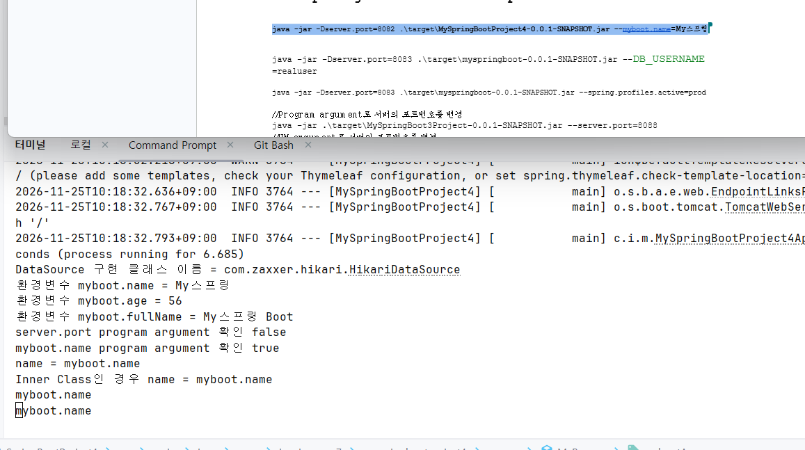

  - 사진 설명 : 위는 강사님 문서의 실행 명령, 아래는 내 실행 결과. properties에는 Spring이라고 적었는데 명령의 --myboot.name=My스프링이 찍힘. server.port는 -D로 줘서 program argument 확인이 false
  - 실행 결과 읽는 법

    | 결과 | 왜 |
    | --- | --- |
    | myboot.name = My스프링 | `--`로 준 값이 properties를 이김 |
    | myboot.age = 56 | 실행할 때마다 다른 무작위 값 |
    | myboot.fullName = My스프링 Boot | `${myboot.name}`이 바뀐 값을 가져다 씀 |
    | server.port program argument 확인 false | 포트는 `-D`(VM 옵션)로 줘서 |
    | myboot.name program argument 확인 true | 이름은 `--`로 줘서 |
    | name = myboot.name 한 개만 | `--`로 준 것이 하나뿐이라 |

- 커맨드 안에서 실행 어쩌구 에디터에서 한거랑 같은걸 프롬프트로 하는걸 보여주신듯. 프롬프트가 에디터, 프로퍼티보다 우선순위라 프롬프트에서 입력한 게 뜸

- 이게 나중에 어떻게 발전하느냐 : 도커
  - 도커에서 이미지 만들어야 함. 그러려면 도커 파일이 필요함
    ```
    #FROM openjdk:17
    FROM eclipse-temurin:17
    VOLUME /tmp
    COPY target/springboot-nextjs-backend.jar springboot-nextjs-backend.jar
    ENTRYPOINT ["java","-jar","/springboot-nextjs-backend.jar","--spring.profiles.active=prod"]
    ```

    - 현재 나는 프로덕션이다. 같은 식으로 액션을 정해 자르파일을 만들면 내가 만든 스프링 앱이 컨테이너로 만들어주고 도커 컨테이너가 만들어짐
    - 일종의 프로세스 실행용도. 
    - 보여주신 코드는 자르파일을 고정해두었음. 
      - 빌드 밑에 파이널 네임이 있음. 내부에 보면 아티팩트 네임과 버전이 조합되어있음, 파이널네임이 있으면 고정해서 자르파일을 만들수있음, 

        ```xml
        <build>
            <plugins> … </plugins>                             <!-- spring-boot-maven-plugin (lombok은 exclude) -->
            <finalName>springboot-nextjs-backend</finalName>   <!-- 빌드된 jar의 이름을 고정 -->
        </build>
        ```
    - 배포를 위해 도커 이미지를 만들 때 필요한 세팅 고정법


- 자르 밖에도 프로퍼티 파일을 넣을수있음
  - 이 상황의 단점 : 프로퍼티 안에 가변적 정보를 집어넣어둔 상태고 그게 자르에 들어감. 몇가지 내용을 수정하면 자르파일을 또 수정하고 재배포 해야하고 .. 무척 번거로움. 개발자가 아닌 운영자가 그 일을 하게될텐데 운영작 하기에 너무 번거로움

  - spring config
    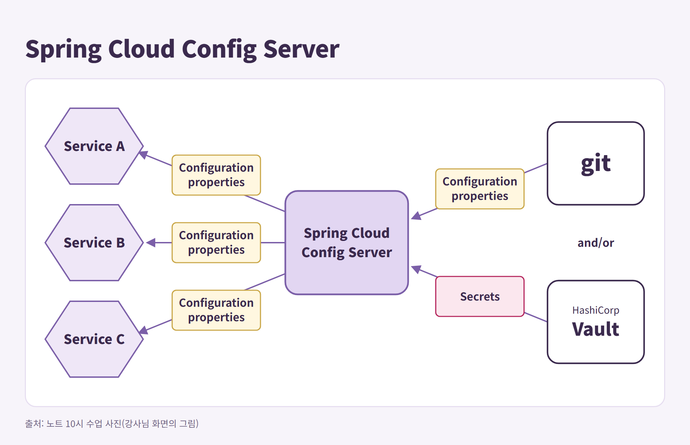

    - 그림 설명 : git에 둔 설정값(Configuration properties)과 Vault에 둔 비밀 값(Secrets)을 Spring Cloud Config Server가 모아서 Service A, B, C에 나눠 줌. and/or는 둘 다 또는 하나

    - 환경변수를 다른걸로 wlf,vld;ff]
  
- 자르파일 고정하기
- 아마 된듯. 그런데 설명이 필요함(필요한 설명 : 만드는 이유 어디에 필요한건지)
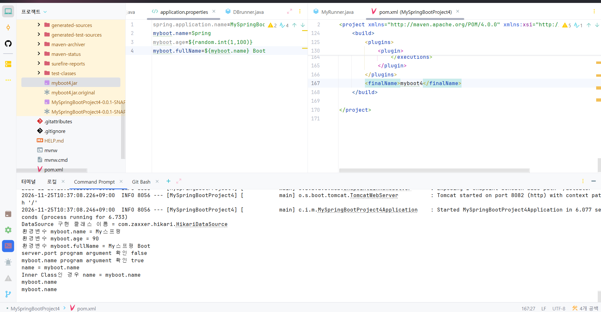

  - 사진 설명 : pom.xml에 `<finalName>myboot4</finalName>`을 적고 다시 만들어서 target에 myboot4.jar, myboot4.jar.original이 생김. 전에 만든 MySpringBootProject4-0.0.1-SNAPSHOT.jar도 남아 있음
  - 만드는 이유
    - jar 이름은 원래 `artifactId-version.jar`로 자동으로 정해짐 → MySpringBootProject4-0.0.1-SNAPSHOT.jar. 버전을 0.0.2로 올리면 jar 이름도 같이 바뀜
    - 그런데 Dockerfile의 COPY 줄에는 jar 이름이 글자 그대로 적혀 있음. 이름이 바뀌면 그 파일을 못 찾아서 이미지 만들기가 실패함
    - 그래서 `<finalName>`으로 이름을 고정함. 버전을 올려도 이름이 그대로라 Dockerfile을 안 고쳐도 됨
    - 비유 : 택배 기사에게 "문 앞의 빨간 상자를 가져가세요"라고 적어 뒀는데 매번 상자 색이 바뀌면 못 찾음. 상자 색을 빨강으로 정해 두는 것이 finalName

      | | finalName 없음 | finalName 있음 |
      | --- | --- | --- |
      | jar 이름 | MySpringBootProject4-0.0.1-SNAPSHOT.jar | myboot4.jar |
      | 버전을 0.0.2로 올리면 | MySpringBootProject4-0.0.2-SNAPSHOT.jar로 바뀜 | myboot4.jar 그대로 |
      | Dockerfile | 버전을 올릴 때마다 고쳐야 함 | 안 고쳐도 됨 |

  - 어디에 필요한지 : jar 이름을 적어 두고 쓰는 곳

    | 쓰는 곳 | 적는 것 |
    | --- | --- |
    | Dockerfile (도커 이미지 만들 때) | `COPY target/myboot4.jar myboot4.jar` |
    | 서버에서 실행하는 명령 | `java -jar target/myboot4.jar` |
    | 배포 스크립트, 자동 배포 | jar를 서버로 옮기는 줄의 파일 이름 |

    - 내 컴퓨터에서 인텔리J로 실행만 할 때는 없어도 됨. jar로 묶어 다른 곳(서버, 도커)에 옮길 때 필요함

### jar 이름 고정과 외부 설정 정리
- 개념
  - *finalName* : 빌드된 파일의 이름(확장자 빼고). 안 적으면 `artifactId-version`이라 버전을 올릴 때마다 jar 이름이 바뀜. Dockerfile의 COPY 줄에 jar 이름이 적혀 있으니, 이름을 고정해 두면 버전이 바뀌어도 Dockerfile을 안 고쳐도 됨
  - *외부 설정* : 값을 코드 밖에 둠. 같은 jar를 내 PC와 운영 서버에서 값만 바꿔 실행함
  - *Spring Cloud Config* : 여러 앱의 설정을 한곳에 모아 두고 나눠 주는 서버
  - 비유 : jar는 완성된 밥, 밖에 둔 properties는 따로 주는 소스. 밥을 다시 짓지 않고 소스만 바꿈
- 사용법
  ```
  <finalName>myboot4</finalName>                               // pom.xml의 <build> 안 → target/myboot4.jar
  java -jar target/myboot4.jar --myboot.name=My스프링          // 한 번만 바꿀 때
  실행하는 폴더 또는 그 안의 config 폴더에 application.properties  // jar 밖에 두면 jar 안의 값을 덮음
  ```
  - 뒤로 갈수록 이김 : jar 안 → jar 안 프로파일용 → jar 밖 → jar 밖 프로파일용 (공식 문서 순서. 교재 24쪽은 가운데 둘(13·14번)이 서로 바뀌어 있음)
- 공식 문서 해석
  - [외부 설정 (Externalized Configuration)](https://docs.spring.io/spring-boot/reference/features/external-config.html)
    - 같은 코드를 여러 환경에서 쓰려고 설정을 밖에 둠. properties, YAML, 환경변수, 실행 명령의 값을 쓸 수 있음
    - 여러 곳에 같은 이름이 있으면 나중 순서가 앞의 것을 덮음. 실행 명령의 값이 파일보다 뒤라서 이김
    - jar 안에 기본값을 두고, 새 환경에서는 jar 밖의 application.properties로 덮음. 한 번 시험할 때는 `--name="Spring"`처럼 명령에 적음
  - [메이븐 POM의 finalName](https://maven.apache.org/pom.html#The_BaseBuild_Element_Set) : 빌드된 결과물의 이름. 기본값은 `${artifactId}-${version}`
  - [Spring Cloud Config](https://spring.io/projects/spring-cloud-config) : 모든 환경의 설정을 관리하는 중앙 저장소를 둠. 서버의 기본 저장소는 git이라 설정에도 버전이 남음. dev, test, 운영으로 옮겨 갈 때 필요한 설정이 다 있는지 확인할 수 있음
  - [Dockerfile](https://docs.spring.io/spring-boot/reference/packaging/container-images/dockerfiles.html) : 실행 가능한 jar는 몇 줄짜리 Dockerfile로 이미지가 됨. jar를 층(layer)으로 나눠 넣으면 바뀐 층만 새로 받아서 더 빠름

### 13번 설명하신다고 함 : ppt 27 페이지
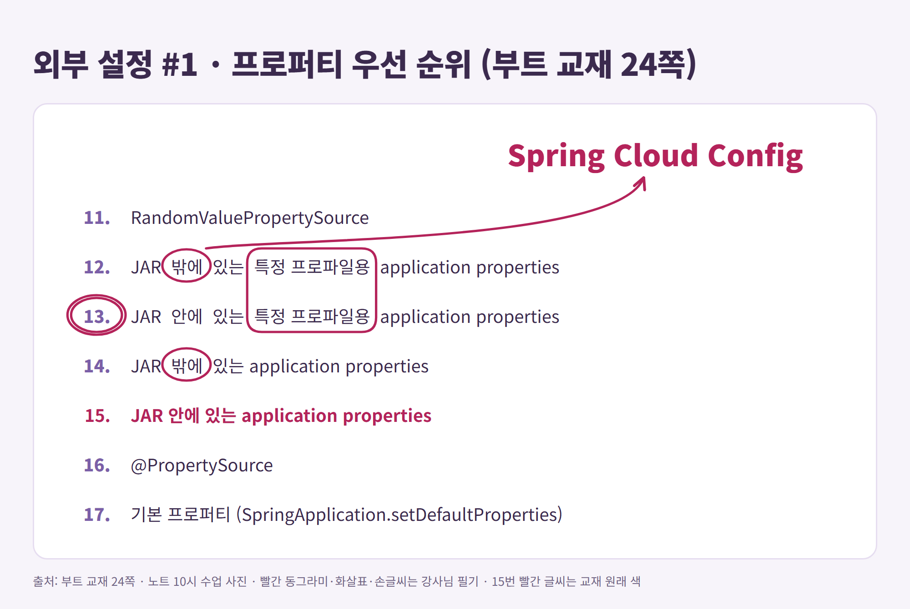

- 그림 설명 : 부트 교재 24쪽. 강사님이 13번에 동그라미, 12·13번의 "특정 프로파일용"을 한 묶음으로, 12·14번의 "밖에"에 동그라미. 12번에서 화살표를 그어 Spring Cloud Config라고 적으심

- 부트 교재 27쪽 : @ConfigurationProperties 어노테이션을 통한 외부 설정값 주입
  - 프로퍼티 파일의 값을 받는 클래스를 하나 만들고, 그 클래스를 @Autowired 같은 어노테이션으로 자동 주입하는 방법이 type-safe, 유지보수 측면에서 더 좋음
  - 프로퍼티 클래스를 작성하면 여러 프로퍼티를 묶어서 읽어올 수 있음
  - 프로퍼티 클래스를 Bean으로 등록해서 다른 Bean에 주입할 수 있음
  - application.properties에 똑같은 key값을 가진 property가 많은 경우에 프로퍼티 클래스를 작성할 수 있음

- 이름에 공백 주거나 틀리면 안됨 
- 개발자는 실수할 수 있음

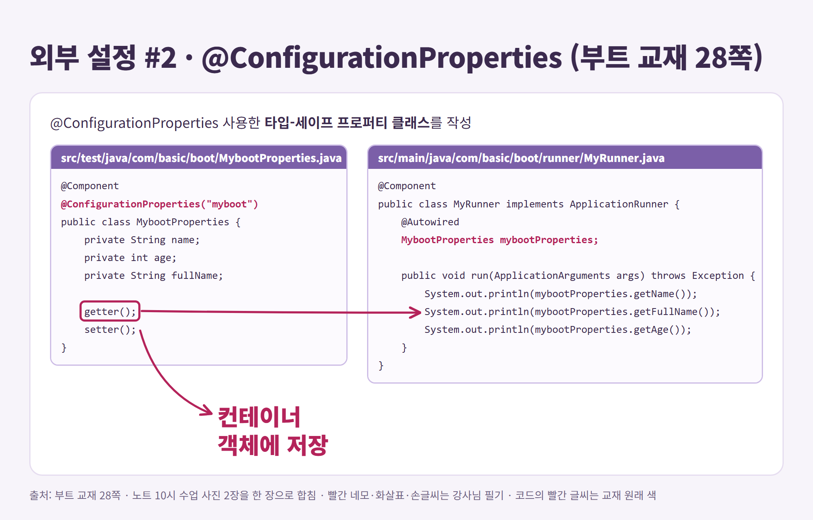

- 그림 설명 : 부트 교재 28쪽. 강사님이 getter()에 네모를 치고 오른쪽 MyRunner의 출력 줄로 화살표, setter()에서 화살표를 그어 컨테이너 객체에 저장이라고 적으심
- 왼쪽같은거 만드는 이유: 환경변수가 여러개 있음 . 변수를 이름으로 찾으면 틀릴 수 있으니 오브젝트에 환경변수를 저장하고자 했음. 그게 왼쪽 환경변수의 역할


### [HibernateProperties](https://docs.spring.io/spring-boot/3.5/api/java/org/springframework/boot/autoconfigure/orm/jpa/HibernateProperties.html) 
  (공식 문서 우리말) : Hibernate의 설정값을 담는 클래스. 스프링 부트가 미리 만들어 둔 프로퍼티 클래스
- 클래스 위에 `@ConfigurationProperties("spring.jpa.hibernate")`가 붙어 있음 → `spring.jpa.hibernate.`으로 시작하는 설정값이 이 객체에 담김

    | 메서드 | 하는 일 | 담기는 설정 |
    | --- | --- | --- |
    | `getDdlAuto()`, `setDdlAuto(String ddlAuto)` | DDL 방식을 꺼내고 넣음 | `spring.jpa.hibernate.ddl-auto` |
    | `getNaming()` | 이름 짓는 규칙(Naming)을 꺼냄. 엔티티 이름을 테이블·컬럼 이름으로 바꾸는 규칙 | `spring.jpa.hibernate.naming.*` |
    | `determineHibernateProperties(jpaProperties, settings)` | 표준 JPA 설정과 HibernateSettings를 바탕으로, EntityManagerFactory를 준비할 때 쓸 Hibernate 설정을 정해서 돌려줌 | |

- 내가 만든 MyBootProperties와 같은 모양임

    | | 내가 만든 것 | 부트가 만든 것 |
    | --- | --- | --- |
    | 클래스 | MyBootProperties | HibernateProperties |
    | 어노테이션 | `@ConfigurationProperties("myboot")` | `@ConfigurationProperties("spring.jpa.hibernate")` |
    | 설정 | `myboot.name=…` | `spring.jpa.hibernate.ddl-auto=…` |
    | 담기는 곳 | `setName(…)` | `setDdlAuto(…)` |

  - 링크는 부트 3.5 문서. 우리 프로젝트(4.0.10)에서는 패키지가 `org.springframework.boot.hibernate.autoconfigure`로 바뀜. 하는 일은 같음

### DDL Auto
  - *DDL* (Data Definition Language) : 테이블을 만들고(CREATE), 고치고(ALTER), 지우는(DROP) SQL
  - *ddl-auto* : 앱을 켤 때 Hibernate가 엔티티 클래스를 보고 DB 테이블을 자동으로 어떻게 할지 정하는 값
  - 비유 : 엔티티는 설계도, 테이블은 집. ddl-auto는 설계도를 받은 시공팀에게 "새로 지어라, 다른 곳만 고쳐라, 맞는지 보기만 해라"라고 시키는 말

    | 값 | 하는 일 | 데이터 | 주로 쓰는 때 |
    | --- | --- | --- | --- |
    | none | 아무것도 안 함 | 그대로 | 운영. 내장 DB가 아니면 기본값 |
    | validate | 엔티티와 테이블이 맞는지 검사만 함 | 그대로 | 운영 |
    | update | 다른 곳만 고침 | 그대로 | 개발 |
    | create | 켤 때 테이블을 지우고 다시 만듦 | 사라짐 | 개발, 연습 |
    | create-drop | 켤 때 지우고 다시 만들고, 끌 때 또 지움 | 사라짐 | 연습, 테스트. H2 같은 내장 DB면 기본값 |

  - 적는 법 (수업에서는 아직 안 적음)
    ```properties
    # 엔티티와 다른 곳만 고치기
    spring.jpa.hibernate.ddl-auto=update
    ```
  - 우리 프로젝트 : H2(내장 DB)라서 안 적어도 create-drop. 아직 엔티티 클래스가 없어서 만들어질 테이블이 없음
  - 주의 : 운영 DB에 create나 create-drop을 적으면 데이터가 지워짐. H2에서 MariaDB 같은 DB로 바꾸면 기본값이 none이 되어 테이블이 자동으로 안 생김
  - 공식 문서 해석
    - [Hibernate로 DB 초기화하기 (스프링 부트)](https://docs.spring.io/spring-boot/how-to/data-initialization.html#howto.data-initialization.using-hibernate) : 쓸 수 있는 값은 none, validate, update, create, create-drop. 내장 DB(hsqldb, h2, derby)이고 Flyway, Liquibase가 없으면 create-drop, 나머지는 none이 기본값. 메모리 DB에서 진짜 DB로 바꿀 때는 테이블과 데이터가 이미 있다고 생각하면 안 됨
    - [Action (Hibernate 7.2)](https://docs.hibernate.org/orm/7.2/javadocs/org/hibernate/tool/schema/Action.html) : CREATE는 지우고 다시 만들기, CREATE_DROP은 시작할 때 지우고 다시 만들고 끝날 때 또 지우기, VALIDATE는 검사, UPDATE는 고치기(alter)
- 스프링~하이버네이트로 되는 환경변수를 객체에 넣어줌 
  - `spring.jpa.hibernate.ddl-auto=update`라고 적으면 스프링 부트가 `setDdlAuto("update")`를 불러 객체에 담음
  - `ddl-auto`(줄표)와 `ddlAuto`(대문자)를 같은 이름으로 알아봄. 공식 문서는 설정 파일에 소문자와 줄표로 적기를 권함

- 타입세이프하게 사용하자 가 28페이지의 취지
  - *type-safe* : 값의 종류(타입)와 이름이 맞는지 컴퓨터(컴파일러, 스프링)가 먼저 확인해 줘서 안전하다는 뜻
  - 비유 : 모양 맞추기 장난감. 네모 구멍(int)에는 네모만 들어감. 별 모양(글자 abc)을 넣으려 하면 그 자리에서 막힘

    | 실수 | 이름을 글자로 적어 꺼낼 때 | 객체로 꺼낼 때 (type-safe) |
    | --- | --- | --- |
    | 이름 오타 | `getProperty("myboot.fulName")`은 오류 없이 null. `@Value`는 앱을 켤 때 오류 | `properties.getFulName()`은 바로 빨간 줄. 컴파일이 안 됨 |
    | 이름에 공백 | `"myboot. name"`도 글자라서 컴파일 때 안 잡힘 | 메서드 이름에는 공백을 넣을 수 없음 |
    | 숫자가 필요할 때 | `getProperty("myboot.age")`는 글자(String)로 나와서 직접 숫자로 바꿔야 함 | `int age`에 숫자로 담겨 있음 |
    | 숫자 칸에 글자를 적음 | 글자로 꺼내면 그냥 넘어감 | 앱이 켜질 때 막힘 (아래) |

  - `--myboot.age=abc`로 켜 본 결과
    ```
    APPLICATION FAILED TO START
    Failed to bind properties under 'myboot.age' to int:    // myboot.age를 int 칸에 담지 못함
        Value: "abc"
        Reason: failed to convert java.lang.String to int   // 글자를 숫자로 못 바꿈
    ```
  - 다 막아 주는 것은 아님 : `("myboot")`처럼 앞부분을 잘못 적으면 오류 없이 null, 0이 됨

- 이 의존성 받음 (configuration-processor)
```
<dependency>
<groupId>org.springframework.boot</groupId>
<artifactId>spring-boot-configuration-processor</artifactId>
<optional>true</optional>
</dependency>

```

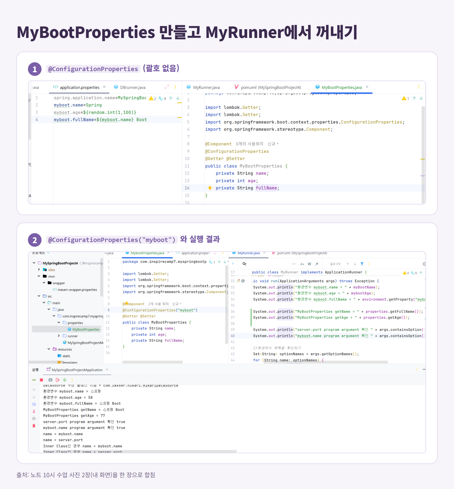

- 사진 설명 : ①은 괄호 없이 @ConfigurationProperties만 적은 처음 코드, ②는 ("myboot")를 적은 코드와 실행 결과
- 실행 결과 읽는 법
  - 환경변수 myboot.age = 58, MyBootProperties getAge = 77로 다른 이유 : `${random.int(1,100)}`은 값을 꺼낼 때마다 새로 뽑음. @Value와 @ConfigurationProperties가 따로 꺼내서 다름. 고장이 아님
  - getName이라고 찍었는데 "스프링 Boot"가 나온 이유 : 코드가 getName()이 아니라 getFullName()을 부름. 강사님 코드도 같음
- 자주 나는 오류 : `("myboot")`를 빼면 앞부분 없이 name, age를 찾다가 못 찾아서 null, 0이 나옴. 오류 없이 조용히 비어 있으니, null이나 0이 나오면 설정값을 못 찾은 것인지 의심하기

### @ConfigurationProperties 정리
- 개념
  - `myboot.`처럼 앞이 같은 설정값을 객체 하나에 묶어 담는 어노테이션. 컨테이너가 setter로 값을 넣고, 쓰는 쪽은 getter로 꺼냄
  - *type-safe* : 이름을 글자로 적지 않고 메서드로 꺼내니 오타가 컴파일 때 잡히고, 숫자는 숫자 타입으로 들어옴
  - 비유 : @Value는 값을 하나씩 따로 받는 것, @ConfigurationProperties는 신청서 한 장에 채워서 받는 것
- 사용법
  ```java
  @Component                            // 빈으로 등록
  @ConfigurationProperties("myboot")    // myboot.으로 시작하는 값을 담음
  @Getter @Setter                       // setter로 들어오고 getter로 꺼냄 (롬복)
  public class MyBootProperties {
      private String name;              // myboot.name
      private int age;                  // myboot.age
      private String fullName;          // myboot.fullName
  }
  ```
  ```java
  @Autowired
  MyBootProperties properties;          // 다른 빈에서 주입받아
  properties.getFullName();             // 메서드로 꺼냄
  ```

  | 기능 | @ConfigurationProperties | @Value |
  | --- | --- | --- |
  | 이름을 느슨하게 맞춤 | 됨 | 제한적 |
  | 메타데이터(IDE 자동완성) | 됨 | 안 됨 |
  | SpEL 식 `#{…}` | 안 됨 | 됨 |

- 공식 문서 해석
  - [타입 세이프 설정 (Type-safe Configuration Properties)](https://docs.spring.io/spring-boot/reference/features/external-config.html#features.external-config.typesafe-configuration-properties)
    - @Value는 값이 여러 개이거나 단계가 있으면 번거로움. 그래서 빈 하나에 담는 방법을 줌. 내 설정이 여러 개면 이 방법을 권함
    - 인자 없는 생성자와 getter, setter가 보통 필요함. 롬복으로 만들어도 됨
    - 이름을 느슨하게 맞춤 : `myboot.fullName`, `myboot.full-name`, `myboot.full_name`, 환경변수 `MYBOOT_FULLNAME`을 같은 값으로 봄
  - [메타데이터 만들기 (configuration-processor)](https://docs.spring.io/spring-boot/specification/configuration-metadata/annotation-processor.html) : 컴파일할 때 @ConfigurationProperties 클래스를 읽어 설정 이름 목록 파일을 만듦. 롬복의 @Getter, @Setter도 알아봄

---

## 11시 수업

### 스프링부트 프로파일
  - 중요한 개념이라고 함
  
  - 부트 교재 30쪽 : 스프링 부트 프로파일
    - 프로파일(Profile)을 통해 스프링 부트 애플리케이션의 런타임 환경을 관리할 수 있음. 어플리케이션 작동 시 테스트 환경에서 실행할지, 프로덕션 환경에서 실행할지를 프로파일로 관리함
    - 프로덕션과 테스트 환경을 각각 외부 설정 파일로 관리함. spring.profiles.active 키값으로 어떤 프로파일을 활성화할지 정함
    - @Profile 어노테이션으로 프로파일 기능을 구현할 수 있음. @Profile의 인자는 프로파일이 그 값과 같을 때 이 빈을 등록하라는 뜻

  - https://share.gemini.google/dkWHgCLZSmGg

    > **질문** : 스프링부트에서의 프로파일(Profile) 개념이 무엇인가요? 프로파일(Profile)의 역할이 무엇이고 왜 필요한가요? 저는 백엔드를 처음 시작하는 개발자입니다.
    >
    > 프로파일은 `local`, `dev`, `prod`처럼 **환경 이름을 붙여 두고, 현재 어떤 프로파일이 활성화되었는지에 따라 알맞은 설정 파일이나 빈(Bean)을 선택**하게 하는 스프링/스프링부트의 기능입니다.

  - 운영서버
  - 스테이징 서버(운영에 테스트 할 수 없으니 붙이기 전 비슷한 환경 세팅 후 돌려보는 서버)
  - 로컬서버
  - 개발서버

  - 설정파일 야물로 해도 된다고 함
    - 설정파일에도 태그를 붙여서 각자 다르게 쓸 수 있음. 
      - 일반 프로퍼티즈 파일보다 특정한 용도로 설정하여 정해둔 프로퍼티즈 파일이 더 우위

        > **① 환경별 설정 분리** (`application-{profile}.yml` 또는 `.properties`)
        >
        > 보통 기본 설정은 `application.yml`에 두고, 환경별로 달라지는 값만 아래처럼 나눕니다.
        > - `application-local.yml` : 내 PC의 로컬 DB 주소, 상세 디버그 로그
        > - `application-dev.yml` : 개발 서버 DB 주소, 테스트용 외부 API 키
        > - `application-prod.yml` : 운영 서버 DB 주소, 실제 서비스용 설정, 민감 정보는 환경변수 주입
        >
        > 이렇게 분리하면 설정을 섞어 쓰다가 생기는 실수를 줄이고, 코드와 환경을 깔끔하게 떼어낼 수 있습니다.

    - 약속된 태그명을 정하여 사용
      - 부트 교재 31쪽 : @Profile 어노테이션을 사용하여 어떤 프로파일을 활성화할 것인가 (아래 그림)
      - 제미나이 예제 코드
        ```java
        // local 또는 dev 프로파일일 때만 이 빈이 등록됨
        @Component
        @Profile({"local", "dev"})
        public class DummyNotificationSender implements NotificationSender {
            @Override
            public void send(String to, String message) {
                System.out.println("[테스트 발송 - 실제 전송 안 됨] 수신자: " + to + ", 내용: " + message);
            }
        }
        ```
      - 부트 교재 32쪽
        - jar 실행시 아규먼트 설정 (properties file보다 우선 순위가 더 높음)
          ```
          java -jar .\target\MySpringBoot3-0.0.1-SNAPSHOT.jar --spring.profiles.active=prod
          ```
        - 프로파일용 properties file : application-{profile}.properties

          | 강사님 필기 | src/main/resources | 내용 |
          | --- | --- | --- |
          | ① | application-prod.properties | myboot.name=SpringBoot prod |
          | ② | application-test.properties | myboot.name=SpringBoot test |

        - MyRunner에서 `mybootProperties.getName()`으로 출력함
        - 강사님 필기 : local, test(dev), prod(production) / spring.profiles.active = test
      - 태그명에 따라 프로퍼티스도 동적으로 지정할 수 있음

      - 빈의 내부 구현을 다르게 하는 경우

        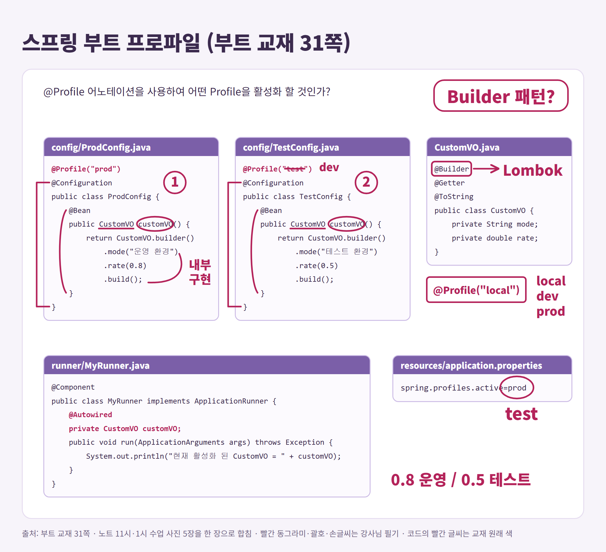

        - 그림 설명 : 부트 교재 31쪽. ① prod면 ProdConfig, ② test면 TestConfig의 customVO 빈이 등록됨. 두 빈은 이름(customVO)과 타입(CustomVO)이 같고 내부 구현(mode, rate)만 다름. 강사님이 active의 prod 아래에 test, 아래쪽에 0.8 운영 / 0.5 테스트라고 적으심
      - 졸음 
        - 스프링이 정해줌. 약속이 되어있음. 그기에 따라 빈을 다르게 구현하거나 설정파일을 다르게 구현할 수 있음.

    > **초보자가 자주 겪는 주의점**
    > - **활성 프로파일을 안 주면 `@Profile` 붙은 빈이 아예 없을 수도 있어요** : 기본(default) 프로파일만 켜진 상태에서 `@Profile("prod")`만 있는 빈을 주입받으려 하면 `NoSuchBeanDefinitionException` 같은 주입 오류가 날 수 있습니다. 그래서 `local`이나 기본값(`default`) 대응을 함께 두는 습관이 안전합니다.
    > - **부정 연산자(`!`) 활용** : `@Profile("!prod")`처럼 느낌표를 붙이면 "운영 환경이 아닐 때"라는 뜻으로 유용하게 쓸 수 있습니다.

    - 환경 별 빈 만들 수 있음.

      > **② 환경별 빈(Bean) 등록 제어 (`@Profile`)**
      >
      > 코드 레벨에서도 특정 환경에서만 동작하는 객체(Bean)를 등록할 수 있습니다.
      > - 예를 들어 `local`이나 `dev` 환경에서는 실제 메일이나 결제를 보내지 않고 **가짜(Mock) 구현체**를 쓰고, `prod` 환경에서만 **실제 발송/결제 구현체**를 쓰도록 `@Profile`로 지정할 수 있습니다.

### 프로파일 정리
- 개념
  - *프로파일* : 환경에 붙이는 이름표(local, dev, test, prod). 지금 켜진 이름표에 맞는 설정 파일과 빈만 씀
  - 비유 : 같은 식당의 점심 메뉴판과 저녁 메뉴판. 가게(코드)는 그대로 두고 시간(환경)에 맞는 메뉴판만 폄
- 사용법

  | 하고 싶은 일 | 적는 것 |
  | --- | --- |
  | 파일에서 켜기 | application.properties에 `spring.profiles.active=test` |
  | 실행할 때 켜기 (파일보다 우선) | `--spring.profiles.active=prod` |
  | 설정 나누기 | `application-test.properties`, `application-prod.properties` |
  | 빈 나누기 | 클래스나 @Bean 메서드 위에 `@Profile("test")` |
  | 둘 중 하나라도 켜지면 | `@Profile({"local", "dev"})` |
  | 켜져 있지 않을 때 | `@Profile("!prod")` |

  ```java
  @Profile("prod")                        // prod가 켜졌을 때만 이 클래스를 씀
  @Configuration
  public class ProdConfig {
      @Bean
      public CustomVO customVOa() {       // 그래서 이 빈도 prod일 때만 등록됨
          return CustomVO.builder().mode("운영 Mode").rate(1.9).build();
      }
  }
  ```
- 자주 나는 오류
  - 프로파일을 안 켜면 @Profile("prod"), @Profile("test") 빈이 하나도 안 만들어짐. 그 빈을 @Autowired로 받는 곳에서 NoSuchBeanDefinitionException이 나고 앱이 안 켜짐 → `spring.profiles.active`가 있는지 먼저 봄
  - 글자를 틀려도(Prod, pord) 안 켜진 것과 같음. @Profile의 글자와 spring.profiles.active의 글자가 똑같아야 함
  - 우리 프로젝트를 없는 이름 live로 켜면 `Could not resolve placeholder 'myboot.age'`가 남. 설정값 myboot.age가 application-prod, application-test 파일에만 있어서
- 공식 문서 해석
  - [프로파일 (Profiles)](https://docs.spring.io/spring-boot/reference/features/profiles.html)
    - 설정의 일부를 떼어 특정 환경에서만 쓰게 하는 방법. @Component, @Configuration, @ConfigurationProperties에 @Profile을 붙일 수 있음
    - 아무것도 안 켜면 default라는 프로파일이 켜짐
    - application.properties에 적어 두고, 실행 명령의 `--spring.profiles.active`로 바꿔치기할 수 있음. 프로파일용 파일(application-prod.properties) 안에는 spring.profiles.active를 적을 수 없음
  - [프로파일용 파일 (Profile Specific Files)](https://docs.spring.io/spring-boot/reference/features/external-config.html#features.external-config.files.profile-specific) : application.properties와 application-prod.properties를 둘 다 읽고, 같은 이름은 프로파일용이 항상 덮음. `prod,live`처럼 여러 개 켜면 뒤에 적은 것이 이김
  - [@Profile (스프링 프레임워크)](https://docs.spring.io/spring-framework/reference/core/beans/environment.html#beans-definition-profiles-java) : @Configuration 클래스에 붙이면 프로파일이 안 켜졌을 때 그 안의 @Bean이 모두 무시됨. @Bean 메서드 하나에만 붙일 수도 있음

---

## 1시 수업

- 빌더패턴

```java
new Car(“aa”,”bb”, null, null, “dd”, null, null,null…. )
new Car(“aa”,”bb”, null, null, “dd”, “ee”, null,null…. )
Builder 패턴 예제코드

public class Computer {
    private String cpu; //필수속성
    private String gpu; //선택속성
    private String ram; //선택속성 

    private Computer(Builder builder) {
        this.cpu = builder.cpu;
        this.gpu = builder.gpu;
        this.ram = builder.ram;
    }

    //static inner class 시작
    public static class Builder {
        private String cpu;
        private String gpu;
        private String ram;


```

- 클래스안의 클래스 : 이너타입
- 메서드로 정의

```
    //필수 속성만을 생성자의 인자로 받아서 초기화 함
        public Builder(String cpu) { // 필수 필드 (CPU)
            this.cpu = cpu;
    }
    //gpu 선택 속성은 필드명과 동일한 메서드를 통해서 초기화 함
        public Builder gpu(String gpu) { // 선택적 필드 (GPU)
            this.gpu = gpu;
            return this;
        }
    //ram 선택 속성은 필드명과 동일한 메서드를 통해서 초기화 함
        public Builder ram(String ram) { // 선택적 필드 (RAM)
            this.ram = ram;
            return this;
        }

        public Computer build() {
            return new Computer(this);
        }
    }// static inner class 종료

    @Override
    public String toString() {
        return "Computer [cpu=" + cpu + ", gpu=" + gpu + ", ram=" + ram + "]";
    }
}//Computer

```

```java
// 사용 예시
public class Main {
    public static void main(String[] args) {
        Computer computer1 = new Computer.Builder("Intel i7")
                                      .gpu("Nvidia RTX 3080")
                                      .ram("16GB")
                                      .build();

        Computer computer2 = new Computer.Builder("AMD Ryzen 5")
                                      .build();

        Computer computer3 = new Computer.Builder("AMD Ryzen 6")
                                      .ram("16GB")
                                      .build();
        System.out.println(computer1);
        System.out.println(computer2);
    }
}
```

- 있는건 넣고 없는건 널널널

https://share.gemini.google/wOgDGmMTZW3o

- 강사님 필기 (부트 교재 31쪽, 11시 그림) : 오른쪽 위에 Builder 패턴?, CustomVO의 @Builder에 네모를 치고 화살표로 Lombok

### 빌더 패턴 정리
- 개념
  - 값을 순서대로 생성자에 나열하지 않고, 이름을 부르며 하나씩 넣은 뒤 build()로 객체를 완성하는 방법
  - 위의 Computer는 필수값(cpu)을 빌더 생성자로, 선택값(gpu, ram)을 메서드로 넣음. 안 넣은 값은 null. null을 몇 개 적을지 세지 않아도 됨
  - 비유 : 샌드위치 주문. 빵(필수)을 고르고 원하는 재료(선택)만 말한 뒤 마지막에 완성
  - 빌더와 프로파일 : 어느 빈을 쓸지 고르는 건 프로파일, 빈으로 쓸 객체를 만드는 건 빌더
- 사용법 (롬복)
  ```java
  @Builder @Getter @ToString            // 롬복이 CustomVOBuilder 클래스를 만들어 줌
  public class CustomVO {
      private String mode;
      private double rate;
  }
  ```
  ```java
  CustomVO vo = CustomVO.builder()      // 빌더 꺼내기
          .mode("테스트 Mode")           // 이름을 부르며 값 넣기. 빌더 자신을 돌려줘서(return this) 점이 이어짐
          .rate(0.5)
          .build();                     // CustomVO 완성
  ```
- 공식 문서 해석
  - [롬복 @Builder](https://projectlombok.org/features/Builder)
    - 자동으로 만들어지는 것 : 안쪽 static 클래스 `CustomVOBuilder`, 값마다 이름이 같은 메서드(빌더 자신을 돌려줌), `build()`, 빌더를 꺼내는 `builder()`, 빌더의 `toString()`
    - 클래스에 붙이면 모든 값을 받는 생성자를 만들고 거기에 @Builder를 붙인 것과 같음. 직접 만든 생성자나 @NoArgsConstructor가 있으면 클래스 말고 생성자에 @Builder를 붙임

### 실습

#### 빌더, 프로파일

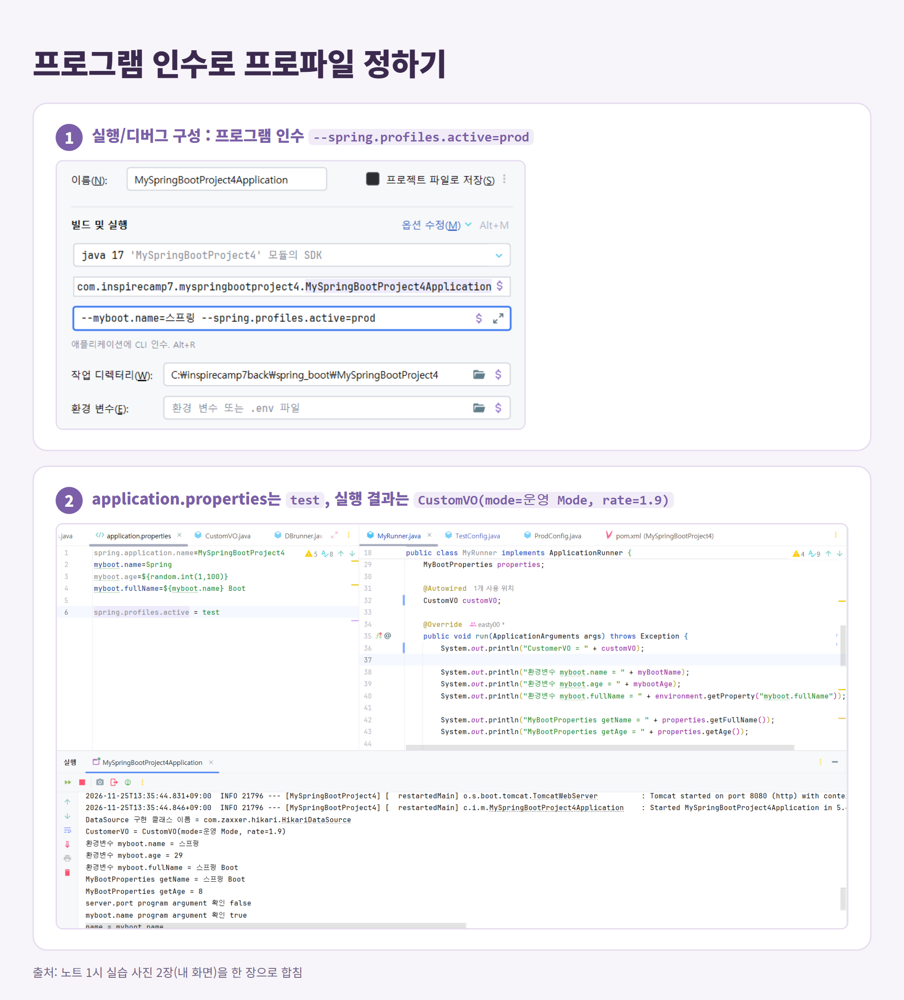

- 사진 설명 : application.properties는 test인데 프로그램 인수로 --spring.profiles.active=prod를 줌 → 결과는 운영 Mode. 프로그램 인수가 이김

- 이 실습을 하는 이유 : 개발과 운영시의 환경과 내부 구현이 다른 경우가 있음. 그때 각각의 조건에 따라 사용할 빈을 선택하게 할 수 있음. 그걸 하는게 빌더, 프로파일?

- 부트 교재 32쪽 다시 보여 주심 (11시에 옮김)

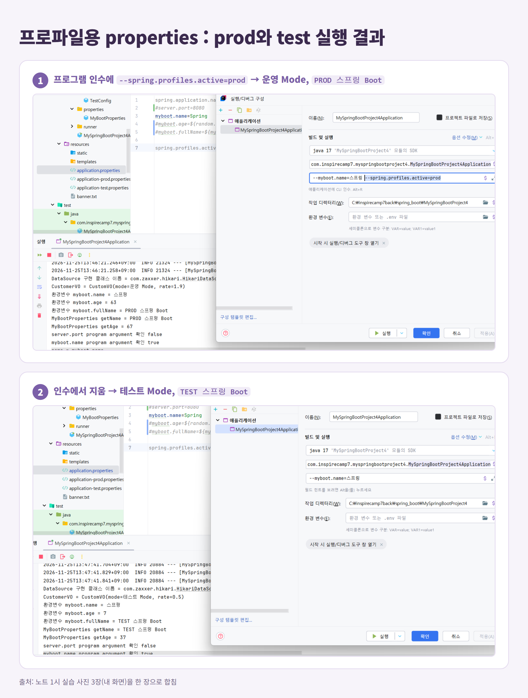

- 사진 설명 : application.properties는 test로 두고, 프로그램 인수만 바꿔서 두 번 실행함

  | 프로그램 인수 | CustomVO | myboot.fullName |
  | --- | --- | --- |
  | --myboot.name=스프링 --spring.profiles.active=prod | 운영 Mode, 1.9 | PROD 스프링 Boot |
  | --myboot.name=스프링 | 테스트 Mode, 0.5 | TEST 스프링 Boot |

- 제미나이 답을 다시 보여 주심 (11시에 옮김)

---

## 2시 수업

### 로깅(Logging)
- 왜 프린트 함수가 있는데 추가적인 별도의 로그를 남기는 라이브러리가 필요할까?
  - println은 글자만 찍고, 끄려면 코드를 지워야 함. 로그 라이브러리는 설정 한 줄로 레벨별로 켜고 끌 수 있음
  - 시각, 레벨, 클래스 이름이 같이 남고 파일로도 저장할 수 있음
- "로그레벨"이 가장 중요한 키워드임
- 로그마다 찍혀도 되는 로그가 있고 찍히면 안되는 로그가 있음. 개발에 필요한 로그인지 운영에 필요한 로그인지 분리가 필요함

- 스프링부트는 기본적으로 로그레벨이 인포, 워닝 등이 있음. 이게 로그
  ```
  2026-11-25T13:46:14.196+09:00  INFO 7512 --- [MySpringBootProject4] [  restartedMain] c.i.m.MySpringBootProject4Application : The following 1 profile is act…   // INFO가 로그 레벨
  2026-11-25T13:46:17.453+09:00  INFO 7512 --- [MySpringBootProject4] [  restartedMain] o.s.boot.tomcat.TomcatWebServer       : Tomcat initialized with port 8…
  2026-11-25T13:46:18.243+09:00  INFO 7512 --- [MySpringBootProject4] [  restartedMain] com.zaxxer.hikari.HikariDataSource    : HikariPool-1 - Starting...
  ```

  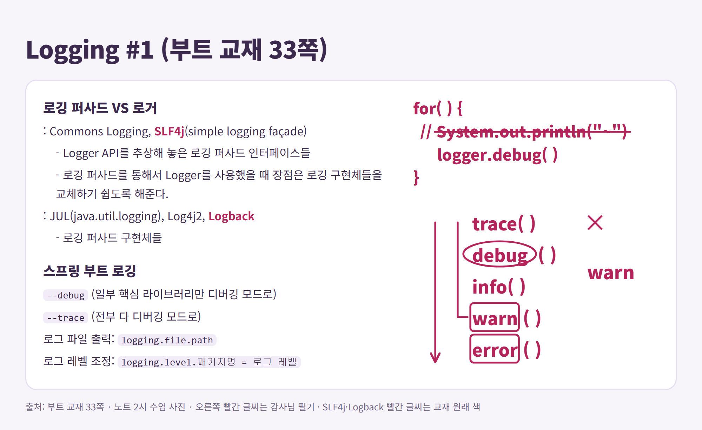

  그림 설명 : 부트 교재 33쪽. 강사님이 for 문 안의 System.out.println을 줄 긋고 logger.debug로 바꾸심. trace에서 error까지 아래로 화살표, warn과 error에 네모, 오른쪽에 ✕와 warn

    - trace : 코드 흐름을 한 단계씩 따라갈 때 씀. 가장 자세함
      - TRACE로 정했을 때만 나옴
    - debug : 개발하면서 변수 값을 확인할 때 씀 (수업의 myboot.name 출력)
      - DEBUG나 TRACE로 정하면 나옴. 기본 설정에서는 안 나옴
    - info : 정상적으로 일어난 일을 알릴 때 씀 (톰캣 시작, 앱 시작 완료)
      - 기본 설정(INFO)부터 나옴
    - warn : 돌아가기는 하지만 문제가 될 수 있을 때 씀 (templates 폴더가 비었다는 로그)
      - 기본 설정에서 나옴. ERROR로 정하면 안 나옴
    - error : 실제로 문제가 생겼을 때 씀 (앱이 안 켜질 때의 APPLICATION FAILED TO START)
      - OFF로 끄지 않으면 늘 나옴
  
-  퍼사드 패턴
  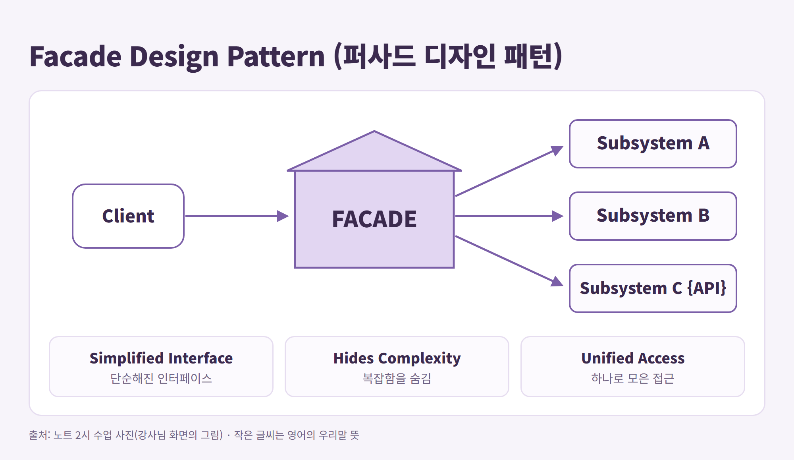

     - 그림 설명 : Client는 FACADE 하나만 부르고, 뒤에 있는 Subsystem A, B, C는 FACADE가 부름. 단순해진 인터페이스, 복잡함을 숨김, 하나로 모은 접근
     - 제미나이 질문 : slf4j와 logback은 어떤 차이가 있나요? (아래는 답을 정리한 것)
     - 로깅에서는 SLF4J가 FACADE, Logback·Log4j2가 뒤에 있는 Subsystem. 내 코드(Client)는 SLF4J만 부름

       | 구분 | SLF4J | Logback |
       | --- | --- | --- |
       | 무엇 | 로깅 퍼사드(인터페이스) | 실제 로깅 구현체. 스프링 부트 기본 |
       | 로그를 찍는 일 | 직접 안 하고 구현체에 맡김 | 직접 함 (레벨 확인, 모양 잡기, 화면·파일에 출력) |
       | 좋은 점 | 코드를 안 고치고 구현체를 바꿀 수 있음. `{}`로 값 넣기 | 빠르고, 로그 파일 나누기 같은 설정이 많음 |

     - 같이 움직이는 순서 : ① 내 코드가 `LoggerFactory.getLogger(…)`, `logger.info(…)`처럼 SLF4J만 부름 → ② 실행할 때 SLF4J가 구현체(Logback)를 찾아 연결 → ③ Logback이 레벨을 확인하고 모양을 잡아 출력함

#### 실습

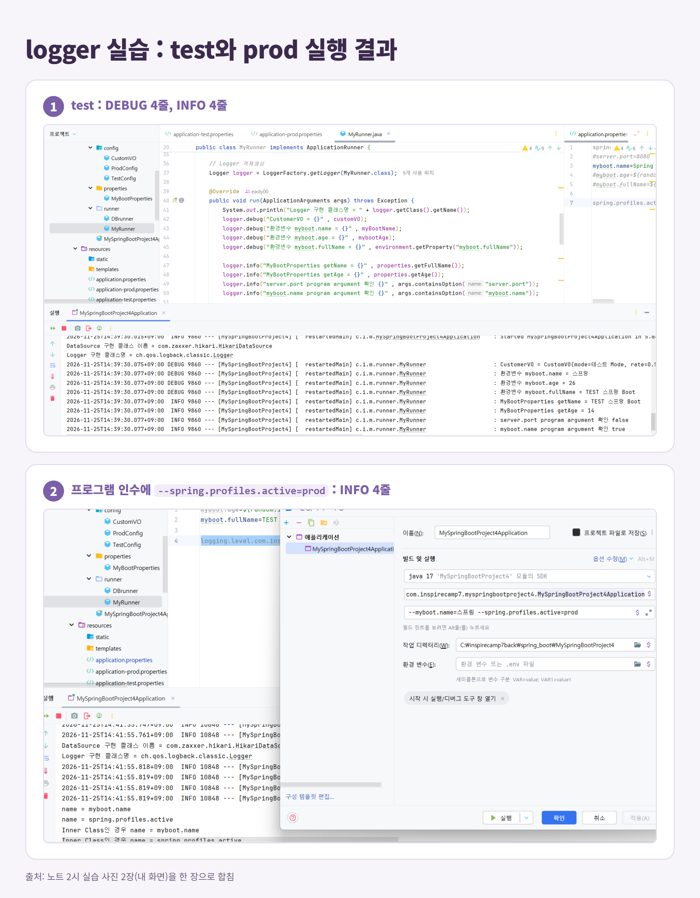

- 사진 설명 : ① test로 실행하면 DEBUG 4줄과 INFO 4줄이 다 찍힘. ② 프로그램 인수로 prod를 주면 INFO 4줄만 찍힘. Logger 구현 클래스는 ch.qos.logback.classic.Logger

- 레벨을 높게 설정하는 것으로 낮은 레벨의 로그와 높은 로그의 레벨을 분리할 수 있음. 레벨을 높게 설정할수록 덜 중요한 건 숨겨지고 중요한 상위 레벨의 로그만 남는다. 
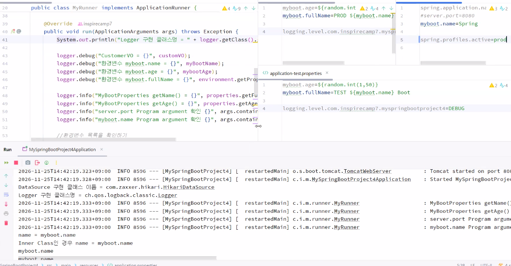

  - 사진 설명 : 강사님 화면. application.properties는 prod, application-test.properties에 logging.level.com.inspirecamp7.myspringbootproject4=DEBUG. prod로 실행해서 INFO만 찍힘

- 3시 이후에 DB 연동 관련 설정 한다고 함

### 로깅 정리
- 개념
  - *로그* : 프로그램이 남기는 기록. 시각, 레벨, 클래스 이름이 같이 남고 설정으로 켜고 끔. println은 지우거나 주석 처리해야 안 찍힘
  - *SLF4J* : 로깅 창구(퍼사드, 인터페이스). *Logback*, *Log4j2* : 실제로 찍는 구현체. 내 코드는 SLF4J만 부름
  - 비유 : SLF4J는 식당 홀 직원, Logback과 Log4j2는 주방. 주방이 바뀌어도 주문하는 말은 같음
  - *로그 레벨* : trace < debug < info < warn < error. 정한 레벨과 그보다 중요한 것만 찍힘

    | 정한 레벨 | trace | debug | info | warn | error |
    | --- | --- | --- | --- | --- | --- |
    | DEBUG | ✕ | ○ | ○ | ○ | ○ |
    | INFO (기본) | ✕ | ✕ | ○ | ○ | ○ |
    | WARN | ✕ | ✕ | ✕ | ○ | ○ |

  - 로그 한 줄 읽는 법 : `2026-11-25T14:39:30.075+09:00 DEBUG 9860 --- [MySpringBootProject4] [restartedMain] c.i.m.runner.MyRunner : 환경변수 myboot.name = 스프링`

    | 조각 | 뜻 |
    | --- | --- |
    | 2026-11-25T14:39:30.075+09:00 | 찍힌 시각 (한국 시각) |
    | DEBUG | 로그 레벨 |
    | 9860 | 프로그램 번호(PID) |
    | [MySpringBootProject4] | spring.application.name 값 |
    | [restartedMain] | 스레드 이름. devtools가 켜져 있으면 restartedMain, jar로 켜면 main |
    | c.i.m.runner.MyRunner | 찍은 클래스 (패키지는 줄여서 나옴) |
    | `:` 뒤 | 내가 적은 글 |

- 사용법
  ```java
  import org.slf4j.Logger;              // java.util.logging 말고 org.slf4j 것
  import org.slf4j.LoggerFactory;

  Logger logger = LoggerFactory.getLogger(MyRunner.class);   // MyRunner 이름으로 찍는 로거
  logger.debug("환경변수 myboot.name = {}", myBootName);      // {} 자리에 쉼표 뒤의 값이 들어감
  logger.info("MyBootProperties getAge = {}", properties.getAge());
  ```
  ```properties
  # 내 패키지만 DEBUG부터 (application-test.properties)
  logging.level.com.inspirecamp7.myspringbootproject4=DEBUG
  # logs 폴더에 spring.log 파일로도 남김 (application.properties)
  logging.file.path=logs/
  ```
  - `+` 말고 `{}`와 쉼표를 쓰는 이유

    | | `"이름 = " + name` | `"이름 = {}", name` |
    | --- | --- | --- |
    | 글자를 합치는 때 | 찍든 안 찍든 무조건 먼저 | 찍을 때만 |
    | DEBUG가 꺼져 있으면 | 합친 글자를 그냥 버림 (헛수고) | 합치지도 않음 |

- 공식 문서 해석
  - [로깅 (스프링 부트)](https://docs.spring.io/spring-boot/reference/features/logging.html)
    - 스타터를 쓰면 기본 구현체는 Logback. 기본으로 ERROR, WARN, INFO만 찍힘
    - `logging.level.이름=레벨`로 정함. 레벨은 TRACE, DEBUG, INFO, WARN, ERROR, FATAL, OFF. 전체는 `logging.level.root`
    - `--debug`는 내장 톰캣, 하이버네이트, 스프링 부트의 일부 로그를 더 보여 주는 것. 모든 로그가 DEBUG가 되는 건 아님
    - 파일은 `logging.file.path`(폴더) 또는 `logging.file.name`(파일 이름). 둘 다 적으면 name만 씀. 10MB가 되면 새 파일로 넘어감
  - [SLF4J 설명서](https://www.slf4j.org/manual.html) : 여러 로깅 도구 앞에 서는 단순한 창구. 어떤 도구를 쓸지는 배포할 때 끼움
  - [SLF4J FAQ](https://www.slf4j.org/faq.html#logging_performance) : 로그가 꺼져 있을 때 `{}` 방식이 `+`로 글자를 잇는 것보다 30배 이상 빠름. 글자를 미리 합치지 않기 때문

---

## 3시 수업

### 공부 할거
- SQL
- Spring FW B 문제 풀이
- 스프링부트 숙제하기

### 수업 재개 
- 뭘 바꿔도 영향이 없다고 함
  - 부트 교재 36쪽 : 로거를 Log4j2로 변경하기
    - Logback을 사용하지 않고 다른 로깅 모듈(log4j2)로 바꾸고 싶을 때는 pom.xml에서 Logback 모듈에 대한 의존성을 제거해야 함 (코드는 아래와 같음)
    - 강사님 필기 : exclusion 부분에 괄호를 치고 화살표로 Logback
- 의존성 추가(log4j2)
  ```xml
  <dependency>
      <groupId>org.springframework.boot</groupId>
      <artifactId>spring-boot-starter</artifactId>
      <exclusions>                                                   <!-- 딸려 오는 것 중에서 뺄 것 -->
          <exclusion>
              <groupId>org.springframework.boot</groupId>
              <artifactId>spring-boot-starter-logging</artifactId>   <!-- Logback -->
          </exclusion>
      </exclusions>
  </dependency>
  <!-- log4j2 -->
  <dependency>
      <groupId>org.springframework.boot</groupId>
      <artifactId>spring-boot-starter-log4j2</artifactId>            <!-- 대신 넣을 것 -->
  </dependency>
  ```

- 실행시 찍히는 로그가 바뀜
  ```
  DataSource 구현 클래스 이름 = com.zaxxer.hikari.HikariDataSource
  Logger 구현 클래스명 = org.apache.logging.slf4j.Log4jLogger                         // 전에는 ch.qos.logback.classic.Logger
  2026-11-25T15:20:30.004+09:00  INFO 11556 --- [MySpringBootProject4] [  restar…
  ```

- 구현 클래스가 바뀐 것 이외에 영향은 없음

```
LogBack 과 Log4j2의 차이점
LogBack의 Logger 구현 클래스
Logger Class Name = ch.qos.logback.classic.Logger

Log4j2의 Logger 구현 클래스
Logger Class Name = org.apache.logging.slf4j.Log4jLogger
```

- DBRunner
  ```java
  @Component
  @Order(1)
  @Slf4j                                       // 롬복이 log라는 이름의 로거를 만들어 줌
  public class DBrunner implements ApplicationRunner {
      @Autowired
      DataSource dataSource;                   // 스프링이 만들어 둔 DB 연결 빈을 받아 오는 칸

      @Override
      public void run (ApplicationArguments args) throws Exception {
          log.info("DataSource 구현 클래스 이름 = {}" , dataSource.getClass().getName());
      }
  }
  ```


- jar 만들기

https://docs.spring.io/spring-boot/3.5/index.html

### Log4j2로 바꾸기와 @Slf4j 정리
- 개념 : 내 코드는 SLF4J만 부르니까 구현체를 Logback에서 Log4j2로 바꿔도 자바 코드는 한 줄도 안 바뀜. 그래서 "뭘 바꿔도 영향이 없다"
- 사용법

  | 직접 만들기 (MyRunner) | 롬복 (DBrunner) |
  | --- | --- |
  | `Logger logger = LoggerFactory.getLogger(MyRunner.class);` | 클래스 위에 `@Slf4j` |
  | `logger.info("…{}", 값);` | `log.info("…{}", 값);` (이름이 log로 정해져 있음) |

- 한 군데에서만 빼도 되는 이유 : webmvc, data-jpa 같은 다른 스타터도 spring-boot-starter를 끌어옴. 메이븐은 내 프로젝트에서 가장 가까운 것을 씀. pom.xml에 직접 적은 것이 가장 가까워서, 거기서 뺀 것이 전체에 적용됨
- 공식 문서 해석
  - [Log4j2로 바꾸기 (How-to)](https://docs.spring.io/spring-boot/how-to/logging.html#howto.logging.log4j) : 스타터를 쓰면 Logback을 빼고(exclude) Log4j2를 넣어야 함. 조금 손이 가지만 스타터로 바꾸는 방법을 권함
  - [롬복 @Slf4j](https://projectlombok.org/features/log) : 클래스에 붙이면 `private static final org.slf4j.Logger log = LoggerFactory.getLogger(클래스.class);`를 만들어 줌. @Log4j2, @CommonsLog처럼 도구마다 다른 어노테이션이 있음

### 노트북 lm

### 안티그래비티
https://antigravity.google/product/antigravity-cli/

### 바이브인덱스
https://www.vibeindex.ai/

### 컨텍스트7 서비스
https://context7.com/

- 내가 만들때 쓰는 코딩 에이전트에게 mcp 세팅을 해주면 프롬프트에 use 컨텍스트 7 치면 최신 정보 기준으로 요청한다고 인식하고 샘플 문서 최신것들을 확인하고 이를 기반으로 코드를 짜게 됨

### 스프링부터 데이터
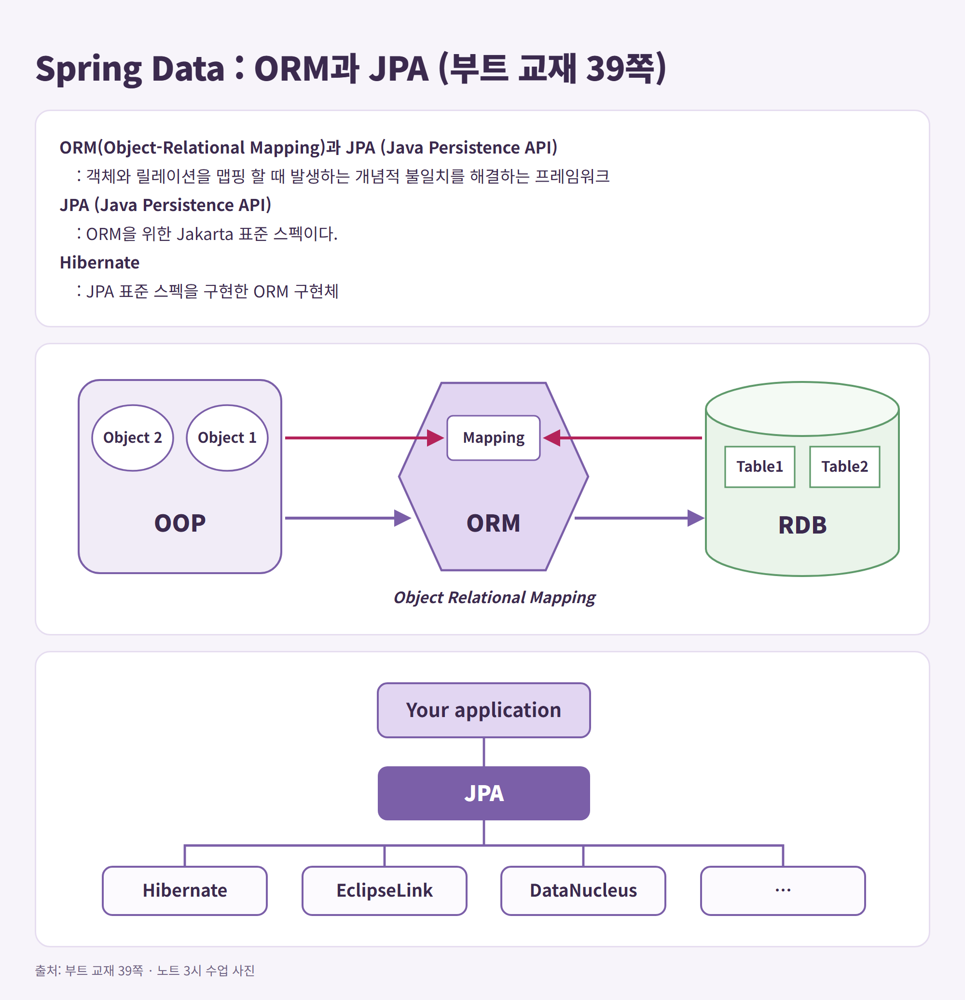

- 그림 설명 : 부트 교재 39쪽. 객체(OOP)와 테이블(RDB)을 ORM이 이어 줌(Mapping). 앱은 JPA만 보고, 그 아래에 Hibernate, EclipseLink, DataNucleus 같은 구현체가 있음

- 이를 위해 이해해야 할것 : JPA, Hibernate, SpringDataJPA

- 이게 JPA
  ```
  jakarta.persistence              // 주황색으로 표시된 줄 = JPA
  jakarta.persistence.criteria
  jakarta.persistence.metamodel
  jakarta.persistence.spi
  ```

- 어느부분이 하이버네이트가 독보적이라는데 못들었음 
https://github.com/hibernate/hibernate-orm

- 강사님이 보여 주신 Hibernate GitHub 소개 (우리말로 옮김)
  - Hibernate ORM은 자바를 위한 강력한 객체/관계 매핑 도구. Java Persistence API(지금 이름은 Jakarta Persistence), Jakarta Query, Jakarta Data의 **사실상의 표준 구현체(de facto standard implementation)**
  - 관계형 데이터를 자연스럽고 타입에 안전한 모양으로 보여 줌
    - 복잡한 쿼리(complex queries)를 쉽게 쓰고 그 결과를 다룸 (강사님 밑줄)
    - 메모리에서 바꾼 것을 DB와 쉽게 맞춤(synchronize changes)
    - 트랜잭션의 ACID 성질을 지킴
    - 시간에 따라 바뀌는 데이터(temporal data)와 변경 기록(audit logging)을 자동으로 처리함
    - 여러 고객을 나눠 담기(multi-tenancy)와 행 단위 보안(row-level security)을 맡음
    - 기본 저장 코드를 다 쓴 뒤에도 성능을 손볼 수 있음
  - 성능이나 코드 재사용을 포기하지 않고 관계형 모델과 SQL의 힘을 쓰는 가장 좋은 방법이라고 소개함
  - 강사님 필기 : JDBC(Java), MyBatis(XML file)는 SQL문을 개발자가 작성함

--- 

## 4시 수업

### [하이버네이트](https://hibernate.org/)
  - 현재 우리 레포는 7.2 사용중
  - [유저가이드 스타팅 가이드](https://docs.hibernate.org/orm/7.2/quickstart/html_single/)

  - 현재에는 스프링 JPA가 가져와주는중이지만 독자적으로 하이버네이트를 쓴다면 직접 불러와야함

    ```xml
    <dependency>
        <groupId>org.springframework.boot</groupId>
        <artifactId>spring-boot-starter-data-jpa</artifactId>   <!-- 강사님 동그라미 -->
    </dependency>
    ```

- 엔티티클래스
  - Hibernate 7.2 시작 가이드 2.2 (우리말로 옮김)
    - 인자 없는 생성자는 꼭 있어야 함. Hibernate가 리플렉션으로 객체를 만들기 때문. 생성자는 public이나 package-private
    - 어노테이션으로 이 클래스가 엔티티임을 알리고 테이블과 이어 줌
      ```java
      @Entity                      // ① Event 클래스를 엔티티로 표시
      @Table(name = "Events")      // ② 이어질 테이블 이름. 안 적으면 클래스 이름인 Event
      public class Event {
          ...
      }
      ```

### 공부할거 추가
- Transaction 의 개념 및 특징
- Transaction 이 왜 필요한지
- 스프링부트에서의 트랜잭션 설정을 어떻게 하는지

- 준비물 :구글계정. 현재 가지고 있는 계정 2개 / 안티그래비티cli로 바이브코딩하기 내일 배울예정

### ORM
```
ORM(Object Relational Mapping) 
Mapping Rule
 Entity Class ⇔ Table
 Entity Object ⇔ Row(Record)
 Entity Variables ⇔ Columns

JPA(Java Persistence API)
: ORM 기능을 위한 Jakarta EE 표준 스펙
https://jakarta.ee/specifications/platform/9/apidocs/

Hibernate
: JPA 표준스펙을 구현한 ORM 구현체 https://github.com/hibernate/hibernate-orm
https://docs.jboss.org/hibernate/orm/6.5/quickstart/html_single/
 
Spring Data JPA
: Spring Boot 개발자가 Hibernate를 좀 더 쉽게 사용할 수 있도록 
  Hibernate 구현체를 더 추상화 한 라이브러리
https://spring.io/projects/spring-data-jpa

Spring Data JPA는 Spring Framework 위한 라이브러리
Spring Boot Starter Data JPA는 Spring Boot 위한 라이브러리

h2 Console 접근 URL
http://localhost:8080/h2-console

Jakarta EE 9 API Docs
https://jakarta.ee/specifications/platform/9/apidocs/

Spring Data Core Api doc
https://docs.spring.io/spring-data/commons/docs/current/api/index.html

Spring Data JPA Api doc
https://docs.spring.io/spring-data/jpa/docs/current/api/index.html

Hibernate JavaDoc (6.2.3.Final)
https://docs.jboss.org/hibernate/stable/orm/javadocs/


```

- 엔티티 클래스를 먼저 만들어줘야함
  - Hibernate 7.2 시작 가이드 2.2 이어서 (우리말로 옮김). 엔티티 클래스는 꼭 식별자가 있어야 함
    ```java
    @Id                            // ① 기본키(primary key)를 담는 필드
    @GeneratedValue                // ② 값을 시스템이 만들어 줌 (대리 키)
    private Long id;

    private String title;          // 나머지 필드는 기본으로 저장됨

    @Column(name = "eventDate")    // ① 이어질 컬럼 이름. 안 적으면 필드 이름인 date
    private LocalDateTime date;
    ```

- 하이버네이트는 엔티티 클래스 뿐 아니라 DB연결을 담당할 세션 팩토리를 만들어야 함
  - Hibernate 7.2 시작 가이드 2.3 (우리말로 옮김). 주로 쓰는 것은 Session과 SessionFactory. 설정하고 시작하는 방법은 여러 가지이고 이게 가장 흔한 방법은 아님. 예제는 JUnit 테스트라서 setUp()은 프로그램이 시작할 때, tearDown()은 끝날 때를 보여 줌
    ```java
    protected void setUp() {
        // SessionFactory는 앱에 한 번만 만듦
        final StandardServiceRegistry registry =
                new StandardServiceRegistryBuilder().build();   // ①② 설정을 읽어 서비스 준비 (설정은 hibernate.properties)
        sessionFactory = new MetadataSources(registry)          // ③ 엔티티 정보를 모을 곳
                .addAnnotatedClass(Event.class)                 // ④ 엔티티 클래스 등록
                .buildMetadata()                                // ⑤ 엔티티와 테이블의 짝 정보 만들기
                .buildSessionFactory();                         // ⑥ 세션 팩토리 완성
    }
    ```

- 스프링 데이터 jpa
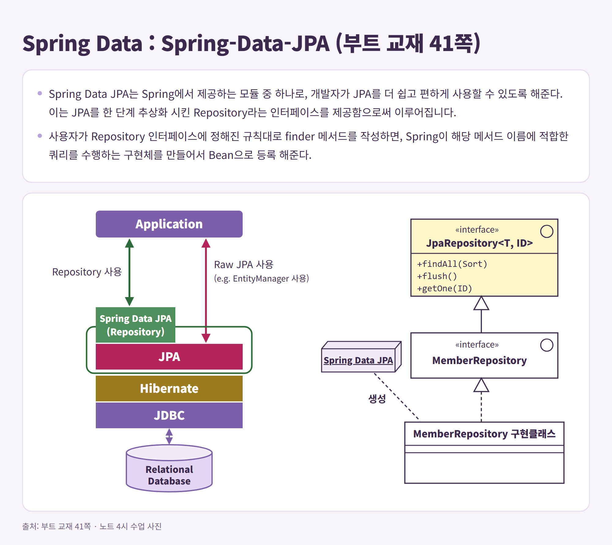

  - 그림 설명 : 부트 교재 41쪽. 앱은 Spring Data JPA의 Repository를 쓰거나 JPA(EntityManager)를 바로 쓸 수 있음. 그 아래로 Hibernate, JDBC, DB 순서. JpaRepository를 상속한 MemberRepository 인터페이스만 만들면 구현 클래스는 Spring Data JPA가 생성함
  - 개발자들이 심플하고 간단하게 데이터를 연결할 수 있도록 추상화를 많이 해둠

  - https://spring.io/projects/spring-data-jpa
    - Spring Data JPA는 Spring Data 가족 중 하나. JPA를 쓰는 repository를 쉽게 만들게 해 줌. 데이터에 접근하는 스프링 앱을 만들기 쉬워짐
    - 데이터 접근 코드를 직접 만드는 일은 번거로움. 아주 간단한 쿼리에도 늘 똑같은 코드(boilerplate)를 많이 써야 함. 페이지 나누기, 변경 기록까지 더하면 길을 잃음
    - 꼭 필요한 만큼만 쓰게 줄이는 게 목표. 개발자는 repository 인터페이스만 쓰고, 나머지는 스프링이 이어 줌. 조건 메서드를 적으면 쿼리도 스프링이 만들어 줌

  - http://querydsl.com/

### ORM, JPA, Hibernate 정리
- 개념

  | 이름 | 무엇 | 하는 일 |
  | --- | --- | --- |
  | ORM | 방법 | 자바 객체와 테이블을 짝지음 |
  | JPA (Jakarta Persistence) | 표준 규칙(인터페이스) | @Entity, EntityManager 같은 이름과 약속만 정함 |
  | Hibernate | 구현체 | 그 약속대로 SQL을 만들고 DB에 실행함 |
  | Spring Data JPA | 스프링 도구 | JPA를 더 짧게 쓰게 해 줌 |

  - 비유 : JPA는 콘센트 규격, Hibernate는 그 규격에 맞춰 만든 제품
  - JDBC, MyBatis는 SQL을 개발자가 쓰고, JPA는 객체를 저장하라고 하면 구현체가 SQL을 만듦
- 사용법 (엔티티 어노테이션)

  | 어노테이션 | 뜻 | 안 적으면 |
  | --- | --- | --- |
  | `@Entity` | 테이블과 짝이 되는 클래스 | 엔티티가 아님 |
  | `@Table(name = "…")` | 테이블 이름 | 클래스 이름 |
  | `@Id` | 기본키 | 꼭 있어야 함 |
  | `@GeneratedValue` | 기본키 값을 자동으로 만듦 | 직접 넣어야 함 |
  | `@Column(name = "…")` | 컬럼 이름 | 필드 이름 |

- data-jpa 하나에 딸려 오는 것 (내 프로젝트)
  ```
  spring-boot-starter-data-jpa               // pom.xml에 적은 것은 이것 하나
   ├─ spring-boot-starter-jdbc ─ HikariCP 7.0.2              // DB 연결 풀
   └─ spring-boot-data-jpa ─ spring-boot-hibernate
        ├─ spring-boot-jpa ─ jakarta.persistence-api 3.2.0   // JPA (규칙)
        └─ hibernate-core 7.2.25.Final                       // Hibernate (구현체)
  ```

- 공식 문서 해석
  - [Jakarta Persistence 3.2](https://jakarta.ee/specifications/persistence/3.2/) : 자바에서 데이터를 저장하고 관리하는 일과 객체/관계 매핑의 표준을 정한 명세
  - [Hibernate 7.2 시작 가이드](https://docs.hibernate.org/orm/7.2/quickstart/html_single/) : SessionFactory는 여러 스레드가 같이 써도 안전하고 앱 전체에 한 번만 만듦. Session은 여기서 나오고 일 한 묶음을 뜻함. `session.persist(객체)`를 부르면 Hibernate가 INSERT 문을 실행함
  - [JPA와 Spring Data JPA (스프링 부트)](https://docs.spring.io/spring-boot/reference/data/sql.html#data.sql.jpa-and-spring-data) : spring-boot-starter-data-jpa를 넣으면 Hibernate, Spring Data JPA, Spring ORM이 같이 들어옴. 부트에서는 설정 파일 없이 @Entity가 붙은 클래스를 알아서 찾음(Entity Scanning)

### Spring Data JPA 정리
- 개념
  - *Repository* : DB에 넣고 꺼내는 일을 맡는 인터페이스. 인터페이스만 만들면 구현 클래스는 스프링이 만들어 빈으로 등록함
  - 비유 : 주문서(메서드 이름)만 쓰면 요리(쿼리)는 주방(스프링)이 함
- 사용법 (교재 41쪽의 MemberRepository로 만든 예시. 수업에서는 아직 안 만듦)
  ```java
  public interface MemberRepository extends JpaRepository<Member, Long> {   // <엔티티, 기본키 타입>
      List<Member> findByName(String name);     // 이름 규칙대로 적으면 쿼리를 만들어 줌
  }
  ```
  ```java
  memberRepository.save(member);                // 저장
  memberRepository.findById(1L);                // 기본키로 하나 찾기 (Optional)
  memberRepository.findAll();                   // 전부 찾기
  memberRepository.delete(member);              // 지우기
  ```

  | 이름에 넣는 말 | 예 | 조건 |
  | --- | --- | --- |
  | And, Or | `findByLastnameAndFirstname` | 둘 다 / 둘 중 하나 |
  | Between, LessThan | `findByAgeLessThan` | 사이 / 보다 작음 |
  | Containing | `findByFirstnameContaining` | 글자가 들어 있음 |
  | OrderBy…Desc | `findByAgeOrderByLastnameDesc` | 큰 것부터 정렬 |

- 공식 문서 해석
  - [핵심 개념 (Core concepts)](https://docs.spring.io/spring-data/jpa/reference/repositories/core-concepts.html) : 중심은 Repository 인터페이스. 엔티티와 기본키 타입을 받음. CrudRepository가 save, findById, findAll, count, delete를 주고, JpaRepository는 여기에 JPA 기능을 더함
  - [JPA 쿼리 메서드](https://docs.spring.io/spring-data/jpa/reference/jpa/query-methods.html) : 쿼리는 메서드 이름에서 만들거나 직접 적음. 이름이 너무 길어지면 `@Query`로 적음

## 정리

https://gemini.google.com/share/446f1638e698?social_preview=false&skid=f832060d-6115-4678-bf4e-05a25333888e

- 현재 JPA 랑 그런 DB 용 의존성은 다 있음. 
- DB 명은 기본적으로 바뀜. 이건 하나로 고정하는 방법이 있음
  ```
  … The following 1 profile is active: "test"
  … HikariPool-1 - Added connection conn0: url=jdbc:h2:mem:72c34fd4-5c73-41d2-97e2-227c83c46b5d user=SA   // 강사님 : mem: 뒤에 밑줄 치고 DB명, user=SA에 동그라미
  … Hibernate ORM core version 7.2.25.Final
  ```

- 부트 교재 42쪽 : In-Memory 데이터베이스
  - 지원하는 In-Memory 데이터베이스 : H2(추천, 콘솔기능 제공), HSQL, Derby
  - H2 데이터베이스 의존성 추가와 설정
    ```xml
    <dependency>
        <groupId>com.h2database</groupId>
        <artifactId>h2</artifactId>
        <scope>runtime</scope>          <!-- 실행할 때만 필요 -->
    </dependency>
    ```
    ```properties
    # application-test.properties
    spring.datasource.url=jdbc:h2:mem:testdb
    spring.datasource.driver-class-name=org.h2.Driver
    spring.datasource.username=sa
    ```

- 고정됨
  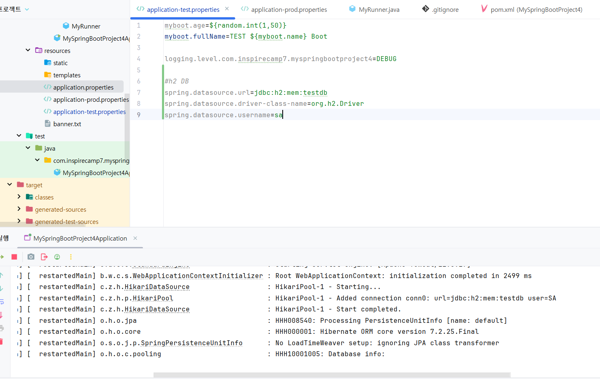

  - 사진 설명 : application-test.properties에 위 세 줄을 적고 실행하니 url=jdbc:h2:mem:testdb로 고정됨

### H2와 DB 이름 고정 정리
- 개념
  - *H2* : 자바로 만든 작은 DB. `mem`은 메모리에만 두는 방식이라 앱을 끄면 내용이 사라짐
  - 비유 : 칠판에 쓴 글씨. 바로 쓰기 좋지만 수업이 끝나면(앱을 끄면) 지워짐
  - DB 이름이 매번 바뀐 이유 : 주소를 안 적으면 스프링 부트가 내장 DB를 만들면서 이름을 아무 값으로 지음 (`spring.datasource.generate-unique-name` 기본값 true). 주소를 직접 적으면 그 이름을 씀
- 사용법

  | application-test.properties에 적는 것 | 뜻 |
  | --- | --- |
  | `spring.datasource.url=jdbc:h2:mem:testdb` | 메모리(mem)에 testdb라는 이름으로 둠 |
  | `spring.datasource.driver-class-name=org.h2.Driver` | H2에 연결하는 드라이버 |
  | `spring.datasource.username=sa` | 사용자 이름 |

  - application-test.properties에 적어서 test일 때만 고정됨. prod는 그대로 아무 이름
  - 콘솔 : `http://localhost:8080/h2-console`에서 JDBC URL 칸에 `jdbc:h2:mem:testdb`를 넣고 접속
- 공식 문서 해석
  - [내장 DB (Embedded Database Support)](https://docs.spring.io/spring-boot/reference/data/sql.html#data.sql.datasource.embedded) : 개발할 때는 메모리 DB가 편함. 저장은 안 되니 시작할 때 데이터를 넣고, 끝날 때 버릴 각오를 해야 함. H2, HSQL, Derby는 의존성만 넣으면 주소를 안 적어도 설정해 줌
  - [H2 콘솔](https://docs.spring.io/spring-boot/reference/data/sql.html#data.sql.h2-web-console) : 서블릿 웹 앱이고 spring-boot-h2console과 개발 도구(devtools)가 있으면 자동으로 켜짐. devtools가 없으면 `spring.h2.console.enabled=true`. 개발용이라 운영에서는 켜면 안 됨

### Transaction 정리

#### 개념 및 특징
- *트랜잭션* : 여러 SQL을 하나의 작업으로 묶은 것. 모두 반영되거나(COMMIT) 모두 취소됨(ROLLBACK). 반만 된 상태는 없음
- 비유 : 계좌 이체. "내 통장에서 빼기"와 "상대 통장에 넣기"는 따로 하면 안 되는 한 묶음
- 묶는 방법 (SQL)
  ```sql
  START TRANSACTION;                                                  -- 여기부터 한 묶음
  UPDATE accounts SET balance = balance - 100 WHERE name = 'Alice';   -- 보내는 통장에서 빼기
  UPDATE accounts SET balance = balance + 100 WHERE name = 'Bob';     -- 받는 통장에 넣기
  COMMIT;                                                             -- 다 됐으면 반영. 문제가 있으면 대신 ROLLBACK;
  ```
- 특징 4가지 (ACID)

  | 글자 | 이름 | 뜻 | 계좌 이체로 보면 |
  | --- | --- | --- | --- |
  | A | 원자성 (Atomicity) | 전부 되거나 전부 안 됨 | 빼기만 되고 넣기가 실패하는 일이 없음 |
  | C | 일관성 (Consistency) | 올바른 상태에서 올바른 상태로 바뀜. 정해 둔 규칙을 지킴 | 이체 전후에 두 통장의 합이 같음 |
  | I | 격리성 (Isolation) | 끝나기 전의 중간 상태가 다른 트랜잭션에 안 보임 | 이체 중에 남이 조회해도 반만 된 잔액은 안 보임 |
  | D | 지속성 (Durability) | COMMIT한 결과는 없어지지 않음 | 이체가 끝난 직후 서버가 꺼져도 기록이 남음 |

#### 왜 필요한지

| 트랜잭션이 없으면 | 트랜잭션이 있으면 | 관련 특징 |
| --- | --- | --- |
| 중간에 오류가 나서 빼기만 되고 넣기가 안 됨. 돈이 사라짐 | 오류가 나면 앞에 한 것까지 모두 취소됨 | A, C |
| 잔액 900에 두 사람이 동시에 100씩 넣음. 둘 다 900을 보고 1000으로 저장해서 100이 사라짐 | 앞사람이 끝날 때까지 기다렸다가 1000을 보고 1100으로 저장함 | I |
| 저장했다고 했는데 서버가 꺼져서 기록이 없어짐 | 끝났다고 알리기 전에 디스크에 기록해 둠 | D |

- 한 줄로 : 여러 개의 SQL이 함께 성공해야 맞는 일(이체, 주문과 재고 빼기)에서 데이터가 어긋나지 않게 하려고 씀
- 공식 문서 해석
  - [트랜잭션 (Oracle Database 개념 안내서)](https://docs.oracle.com/en/database/oracle/oracle-database/19/cncpt/transactions.html) : 트랜잭션은 SQL 문 하나 이상을 담은, 나눌 수 없는 작업 단위. 모두 COMMIT되거나 모두 ROLLBACK됨. 100줄을 고치다 20줄에서 멈추면 그 20줄도 되돌림. 트랜잭션은 DB가 파일 시스템과 다른 가장 중요한 점 중 하나임
  - [트랜잭션 (PostgreSQL 자습서)](https://www.postgresql.org/docs/current/tutorial-transactions.html) : 여러 단계를 "전부 아니면 없음"인 작업 하나로 묶는 것이 핵심. 중간 상태는 동시에 도는 다른 트랜잭션에 안 보임. 은행은 돈을 빼고 넣는 것이 모두 되거나 모두 안 된다는 보장이 필요함. BEGIN을 안 적으면 SQL 한 문장이 각각 트랜잭션 하나가 됨
  - [ACID (MariaDB)](https://mariadb.com/docs/general-resources/database-theory/acid-concurrency-control-with-transactions) : 트랜잭션은 한 덩어리로 처리하는 요청 묶음(논리적인 작업 단위). 데이터가 어긋나지 않으려면 원자성, 일관성, 격리성, 지속성을 지켜야 함. 위 표의 900원 예가 격리성 설명에 나옴

---

## 오늘 AI에게 질문한 것 (트러블슈팅)

| 시간 | 증상 · 질문 | 원인 | 해결 |
| --- | --- | --- | --- |
| 10시 (10:15) | `mvnw package`가 BUILD FAILURE. `contextLoads … Failed to load ApplicationContext` | MyRunner의 `@Value("${myboot.age")`에 닫는 `}`가 없음. 글자 `${myboot.age`를 int 칸에 넣으려다 실패함. package는 앞 단계인 test가 실패하면 못 감 | `@Value("${myboot.age}")`로 고침. 긴 오류는 맨 마지막 `Caused by`를 봄 |
| 10시 (10:34) | 인텔리J 메이븐 동기화 오류. `Unable to create injector … No implementation for ArtifactHandlerManager` | 내 코드 문제가 아님. 인텔리J(2025.2)가 Maven 3.10.1을 못 켬. 11/23과 같은 오류인데 파일이 3.10.1로 돌아가 있었음 | `.mvn/wrapper/maven-wrapper.properties`에서 3.10.1 줄에 `#`을 붙이고 3.9.11 줄의 `#`을 뺀 뒤 메이븐 창에서 다시 불러오기 |
| 10시 (10:55) | MyBootProperties의 getName이 null, getAge가 0 | `@ConfigurationProperties`에 `("myboot")`가 빠짐. 앞부분 없이 name, age를 찾다가 못 찾음. 오류가 안 나서 알아채기 어려움 | `@ConfigurationProperties("myboot")`로 고침 |
| 2시 (14:33) | 세로로 여러 줄을 고르는 단축키 Alt + Shift + Insert를 써야 하는데 키보드에 Insert가 없음 | 오류는 아님. 열 선택 모드 단축키 | Alt를 누른 채 마우스로 세로로 드래그. 또는 우클릭 › Column Selection Mode. 커서를 하나씩 늘리려면 Alt + Shift + 클릭, 끝나면 Esc |
| 2시 (14:36) | `LoggerFactory.getLogger`와 `debug`에 빨간 줄 | 이름만 같은 `java.util.logging.Logger`를 import함. 그 Logger에는 debug()가 없음 (info()는 있어서 멀쩡해 보였음) | `import org.slf4j.Logger;`로 바꿈. `"… = {}" + 값`도 `"… = {}", 값`으로 고침 (`+`로 두면 `{}`가 그대로 찍힘) |

- 오늘 오류에서 배운 것 : `}` 하나, `("myboot")` 하나, import 한 줄처럼 글자 하나가 원인이었음. 숫자 칸(int)은 바로 터지고, null이나 0은 조용히 비어 있음. 자동 import 창에 같은 이름이 여러 개면 패키지 이름을 보고 고름

### 수업 뒤에 AI 에게 물어본 것

| 질문 | 답 | 자세한 곳 |
| --- | --- | --- |
| jar 이름을 고정하는 이유, 어디에 필요한지 | 버전을 올려도 jar 이름이 안 바뀌게. Dockerfile, 실행 명령, 배포 스크립트처럼 이름을 적어 두고 쓰는 곳에 필요함 | 10시 자르파일 고정하기 |
| DDL 오토가 뭔지 | 앱을 켤 때 Hibernate가 엔티티를 보고 테이블을 어떻게 할지 정하는 값 (none, validate, update, create, create-drop) | DDL Auto |
| 타입세이프하게 사용하자가 무슨 말인지 | 이름과 타입이 맞는지 컴퓨터가 먼저 확인해 줘서 안전함. 글자로 꺼내지 말고 객체에 담아 메서드로 꺼내자 | 타입세이프하게 사용하자 |
| 빈을 고르는 게 빌더인지 프로파일인지 | 고르는 건 프로파일, 만드는 건 빌더 | 빌더 패턴 정리 |
| println이 있는데 왜 로그 라이브러리가 필요한지 | 설정 한 줄로 레벨별로 켜고 끄고, 시각과 클래스 이름이 남고, 파일로도 저장됨 | 로깅(Logging) |
| 로그 레벨을 높이면 무엇이 남는지 (반대로 적었던 것) | 덜 중요한 로그가 숨겨지고 중요한 로그만 남음 | 로깅 정리 |
| 하이버네이트의 무엇이 독보적인지 (못 들은 부분) | JPA의 사실상 표준 구현체 | 스프링부터 데이터 |
| 트랜잭션이 무엇이고 왜 필요한지 | 여러 SQL을 전부 되거나 전부 취소되는 한 묶음으로 만듦. 데이터가 어긋나지 않게 하려고 씀 | Transaction 정리 |