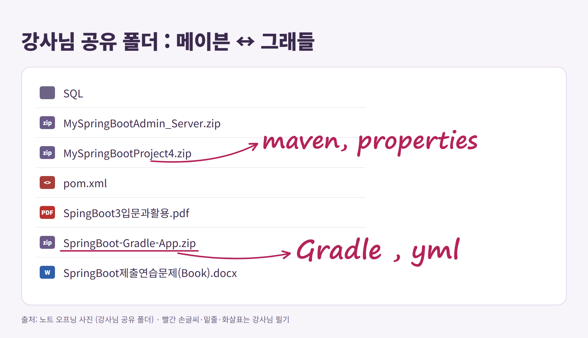
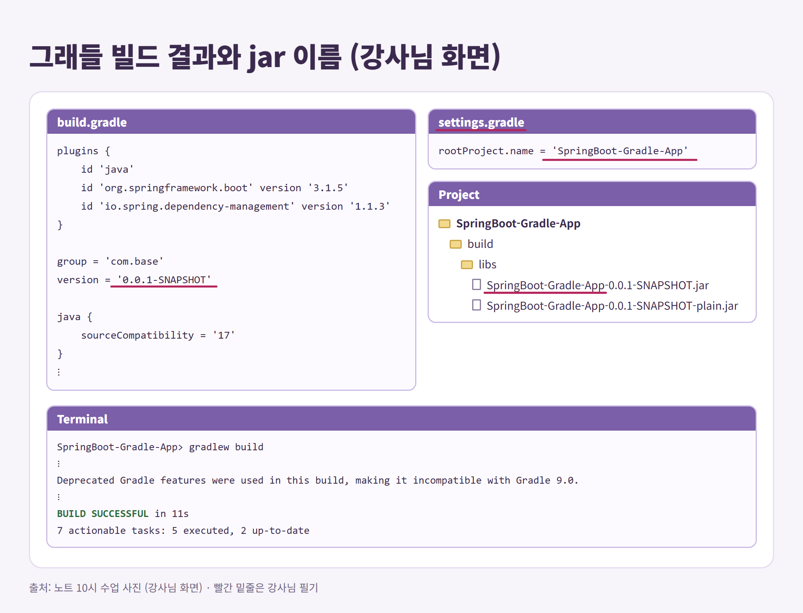
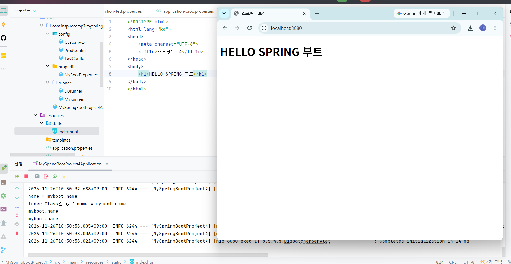
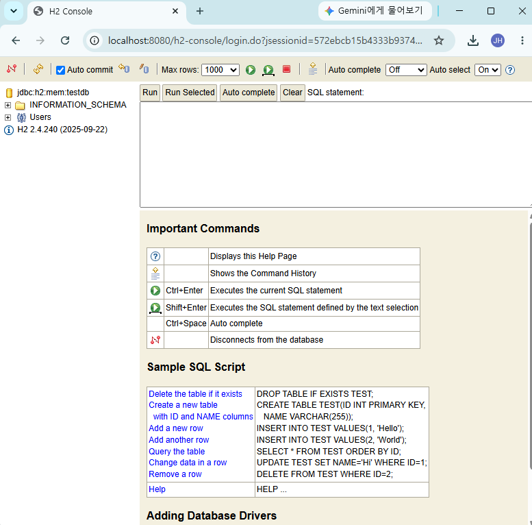
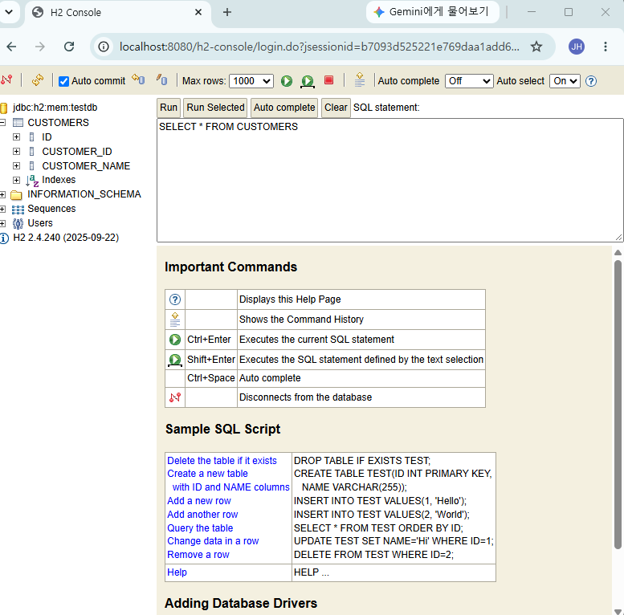
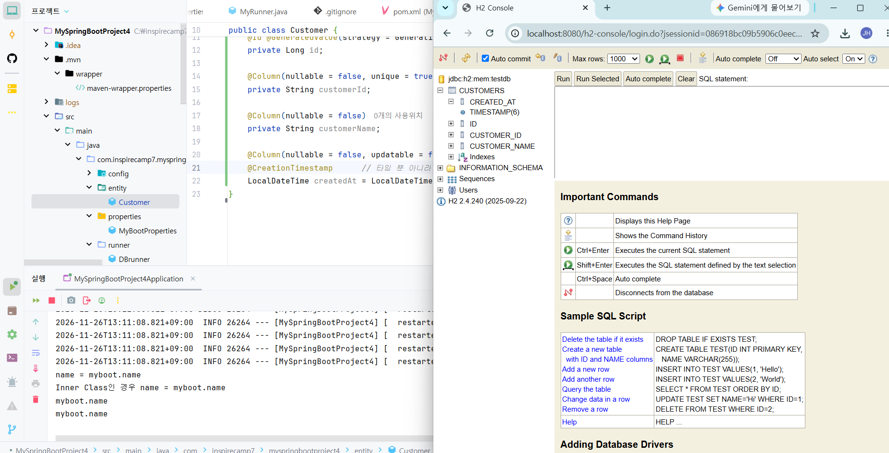
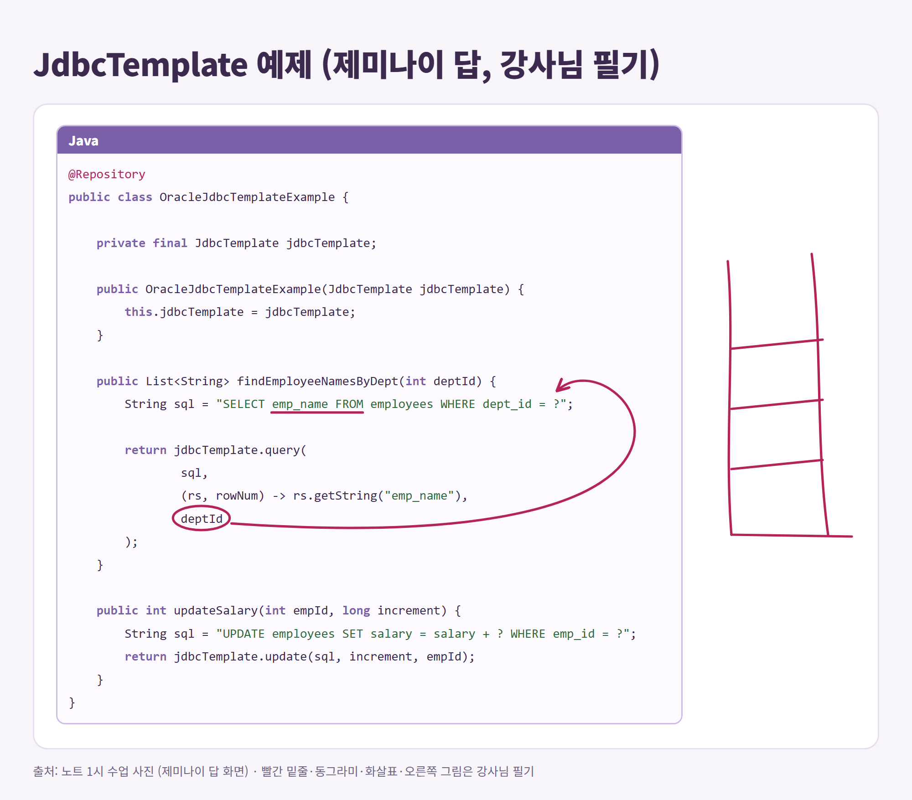
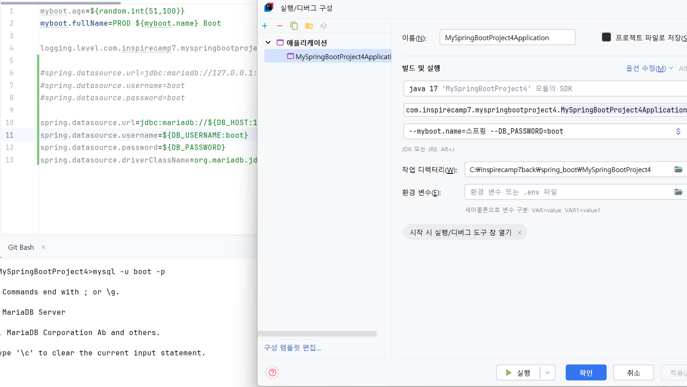
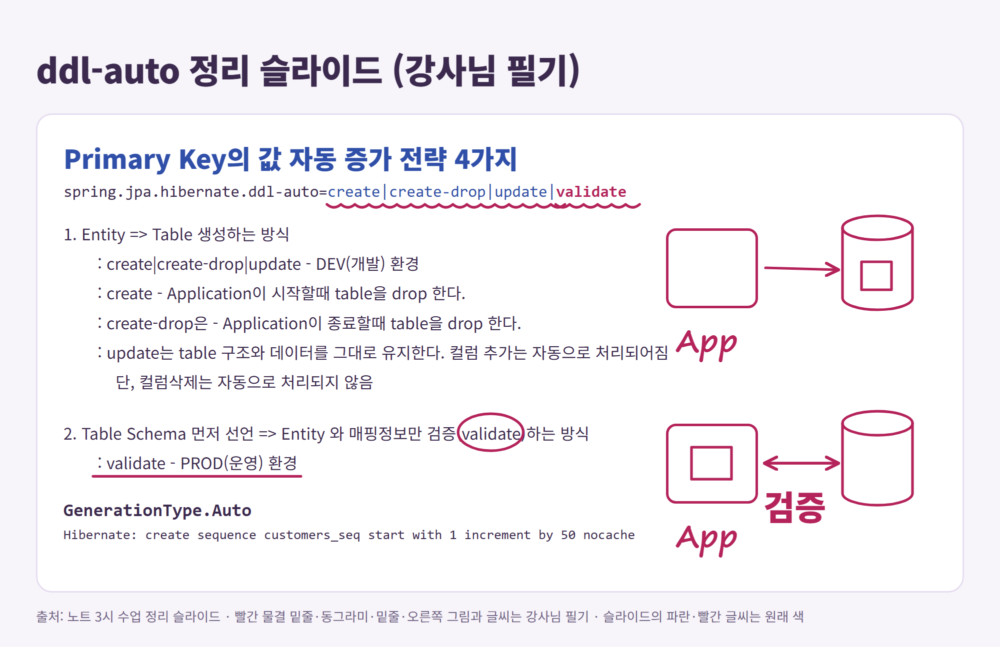
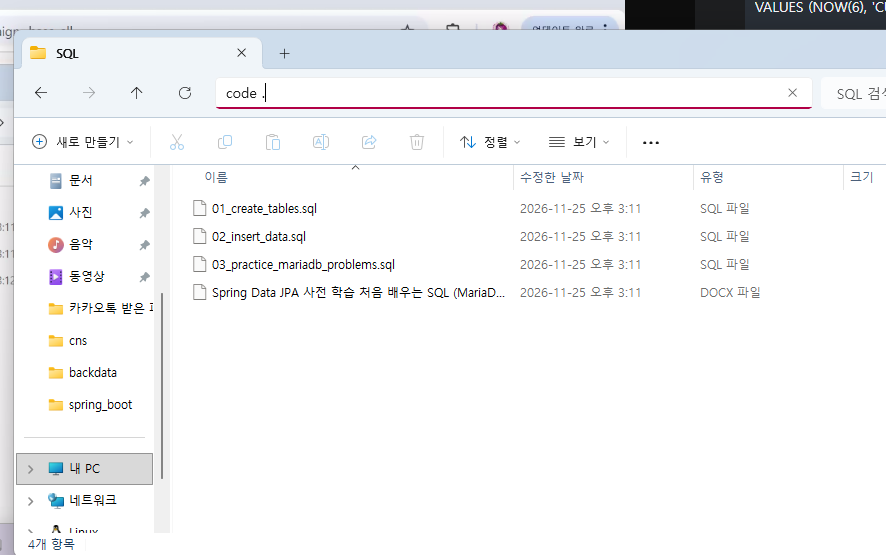

# 25일차 TIL : AI 서비스 개발을 위한 백엔드 I 9일차

🔗 [실습 레포지토리](https://github.com/easty00/SpringBoot4_Project)

## 오프닝
### 어제수업정리
1. Anonymous Inner class, Lambda Expression, Method Reference
2. 사용자정의 Properties 클래스 작성하기
3. Profile과 Environment 이해하기
  - Builder 패턴
  - @Profile, spring.profiles.active 환경변수 이해하기
  - Environment(환경별) 설정파일 작성하기
    - application-{prod}.properties
      - 중괄호 자리에 프로파일 이름이 들어간다는 뜻. 실제 파일은 application-prod.properties
  - 개체직렬화
    - 객체(메모리 속 값)를 글자나 바이트로 펼쳐서 파일에 저장하거나 네트워크로 보낼 수 있게 만드는 것. 아래 제미나이 답도 YAML을 데이터 직렬화 형식이라고 소개함
  - Properties에 종류가 많다. 
    - 11/25에 본 HibernateProperties처럼 스프링도 설정 묶음마다 Properties 클래스를 따로 둔다는 것
4. Logging Level의 이해와 SLF4J의 Logger 사용하기
5. ORM을 위한 JPA와 Hibernate와 Spring Data JPA 역할 이해하기

- 그래들 알집
  - 인텔리로 실행 후 빌드 - 그래들 세팅 파일 내의 의존성 살펴보는 중


  | | 메이븐 (`MySpringBootProject4`) | 그래들 (`SpringBoot-Gradle-App`) |
  |---|---|---|
  | 빌드 설정 파일 | `pom.xml` | `build.gradle` + `settings.gradle` |
  | 앱 설정 파일 | `application.properties` | `application.yml` |
  | 빌드 명령 | `mvnw package` | `gradlew build` |
  | 결과가 생기는 곳 | `target/` | `build/libs/` |
  | jar 이름 | `artifactId-version` (11/25에 `finalName`으로 고정) | `rootProject.name-version` (10시 실습 이어서) |
  | 의존성 한 개 | `<dependency>` 덩어리 5줄 | `implementation '...'` 1줄 |
  | 부트 버전 | 4.0.10 | 3.1.5 |

### [야믈](https://share.gemini.google/kjjHq5kQQbRZ)

  - 같은 설정을 두 모양으로 적으면 다음과 같다

  ```properties
  # properties : 점(.)으로 이어 한 줄에
  spring.datasource.url=jdbc:h2:mem:testdb
  spring.datasource.username=sa
  ```

  ```yaml
  # yml : 들여쓰기로 계층을 나눔
  spring:
    datasource:
      url: jdbc:h2:mem:testdb
      username: sa
  ```

  - 그래들 앱의 yml은 `---`로 구역을 나눠 **한 파일 안에** 프로파일별 설정을 둔다. 메이븐에서 `application-test.properties`와 `application-prod.properties` 두 파일로 나눈 것과 같은 것이다.

  ```yaml
  spring:
    profiles:
      active: test            # test 구역을 켬
  ---                         # 여기부터 새 문서
  spring:
    config:
      activate:
        on-profile: test      # test일 때만 읽는 구역
  myboot:
    fullName: ${myboot.name} Boot DEV Mode
  ```

  - 강사님 제미나이 질문 : yml의 문법을 설명하세요
    > - YML(YAML)은 사람이 읽기 쉽고 직관적인 데이터 직렬화 형식으로, 설정 파일(Docker Compose, GitHub Actions, Kubernetes 등)에 자주 쓰입니다.
    > - 기본 구조와 핵심 규칙
    >   - 들여쓰기 : 계층 구조를 나타내며 공백(Space)만 사용합니다. 탭(Tab) 문자는 문법 오류를 유발합니다. 같은 깊이의 항목은 동일한 공백 수로 맞춥니다.
    >   - 주석 : `#` 기호 뒤에 작성하며, 줄 끝까지 주석으로 처리됩니다.
    >   - 문서 구분자 : 한 파일에 여러 YAML 문서를 넣을 때 `---`로 시작하고 `...`로 끝낼 수 있습니다.
    >   - 대소문자 구분 : 키 이름과 불리언·특수 값은 대소문자를 구분합니다.
    > - 주요 데이터 타입
    >   - 키-값 쌍 (Key-Value / Mapping) : 콜론(`:`) 뒤에 반드시 공백 한 칸 이상을 두고 값을 적습니다.
    >   - 시퀀스 / 리스트 (Sequence / Array) : 하이픈(`-`) 뒤에 공백 한 칸을 두고 항목을 나열합니다.
    >   - 중첩 구조 (Nested Objects & Lists) : 들여쓰기를 이용해 객체 안에 리스트를 넣거나, 리스트 안에 객체를 넣을 수 있습니다.
    >   - 문자열 처리 (Strings) : 특수문자, 콜론(`:`), 숫자처럼 보이는 문자열, 줄바꿈이 있으면 따옴표나 블록 스칼라를 쓰는 것이 안전합니다.
    > - 자주 쓰는 고급 기능
    >   - 앵커(`&`)와 별칭(`*`) : 반복되는 설정 블록에 이름을 붙이고 재사용합니다.
    >   - 병합 키(`<<`) : 기존 맵을 가져와 일부 값만 덮어씁니다. (구현체/파서에 따라 지원 여부가 다를 수 있습니다.)
    > - 흔한 실수
    >   - 콜론 뒤 공백 누락 : `key:value`는 문자열로 해석되거나 오류가 납니다. `key: value`처럼 띄워야 합니다.
    >   - 탭 사용 : 에디터에서 Tab 키가 공백으로 변환되지 않으면 파싱 에러가 발생합니다.
    >   - 의도치 않은 타입 변환 : `on`, `off`, `yes`, `no`, `true`, `false` 같은 단어가 파서 버전에 따라 불리언으로 인식될 수 있으므로, 문자 그대로 쓰고 싶다면 따옴표로 감싸는 것이 안전합니다.

  - yml 문법 쉽게 보기
    - 비유 : 들여쓰기는 폴더 안의 폴더임. 몇 칸 들어갔는지로 누구 밑에 있는지가 정해짐. 그래서 칸 수가 곧 문법임

      | 모양 | 뜻 | 조심할 점 |
      | --- | --- | --- |
      | `키: 값` | 이름표와 값 한 쌍 | 콜론 뒤 한 칸 띄움 |
      | 들여쓰기 | 위 줄의 자식 | 공백만 씀. 탭 금지, 같은 깊이는 같은 칸 수 |
      | `- 값` | 목록의 한 칸 | 하이픈 뒤 한 칸 띄움 |
      | `[a, b, c]` | 목록을 한 줄로 적기 | |
      | `#` | 주석. 그 줄 끝까지 | |
      | `---` | 한 파일 안에서 문서 나누기 | |
      | `"…"`, `'…'` | 글자 그대로 | 콜론, 특수문자, yes·no·on·off가 들어간 글은 감쌈 |
      | `\|`, `>` | 여러 줄 글 | `\|`는 줄바꿈 그대로, `>`는 한 줄로 이어 붙임 |
      | `&이름`, `*이름`, `<<:` | 묶음에 이름 붙여 다시 쓰기 | 읽는 도구마다 지원이 다를 수 있음 |

    - 제미나이 예시를 한데 모은 것

      ```yaml
      name: app-server          # 키: 값 (콜론 뒤 한 칸)
      ports:                    # 목록
        - 80                    # 하이픈 뒤 한 칸
        - 443
      tags: [web, api, v2]      # 목록을 한 줄로
      services:
        web:                    # services 밑의 web (들여쓰기 = 자식)
          image: nginx:latest
      title: "Hello: World"     # 콜론이 든 글은 따옴표로
      multiline_literal: |      # 아래 두 줄을 줄바꿈 그대로 읽음
        첫 번째 줄
        두 번째 줄
      ```

    - 수업 코드와 연결
      - 위 프로파일 yml의 `---`가 제미나이 답의 문서 구분자임. 한 파일을 test 구역, prod 구역처럼 여러 문서로 나눔
      - `spring:` → `config:` → `activate:` → `on-profile: test`는 properties의 `spring.config.activate.on-profile=test`를 들여쓰기로 편 것
      - `${myboot.name}`은 YAML 문법이 아님. YAML은 그냥 글자로 읽고, 스프링이 실행할 때 myboot.name 값으로 바꿔 넣음
      - 아래 "그래들과 yml 정리"의 `datasource:` 한 줄만 주석 처리하면 엉뚱하게 읽히는 오류도 들여쓰기가 곧 계층이라서 생김


### 그래들 이어서 
- build.gradle 읽기 (SpringBoot-Gradle-App/build.gradle 핵심 줄만)
  ```groovy
  plugins {
      id 'org.springframework.boot' version '3.1.5'         // 부트 3.1.5
  }
  version = '0.0.1-SNAPSHOT'                                // jar 이름 뒤에 붙음
  java { sourceCompatibility = '17' }                       // 자바 17로 컴파일

  dependencies {
      implementation 'org.springframework.boot:spring-boot-starter-data-jpa'  // = <dependency> 한 덩어리
      implementation 'org.springframework.boot:spring-boot-starter-log4j2'    // 어제 바꾼 Log4j2
      runtimeOnly 'com.h2database:h2'                                          // = <scope>runtime</scope>
      runtimeOnly 'org.mariadb.jdbc:mariadb-java-client'
      compileOnly 'org.projectlombok:lombok'                                   // 컴파일할 때만 (롬복)
      testImplementation 'org.springframework.boot:spring-boot-starter-test'  // = <scope>test</scope>
  }
  configurations {
      all { exclude group: 'org.springframework.boot', module: 'spring-boot-starter-logging' }  // Logback 빼기
  }
  ```
  - 11/25에 메이븐 `<exclusion>`으로 Logback을 빼고 starter-log4j2를 넣었음. 그래들은 같은 일을 `exclude`와 `implementation` 두 줄로 함
  - `runtimeOnly`(실행할 때만), `testImplementation`(테스트할 때만)은 메이븐의 `<scope>`와 같은 뜻

- 내 cmd (SpringBoot-Gradle-App 폴더에서)
  ```
  set JAVA_HOME=C:\java\jdk-17.0.2     # 이 창에서 쓸 JDK를 17로 정함
  set PATH=%JAVA_HOME%\bin;%PATH%      # 그 JDK의 bin 폴더를 맨 앞에 둠
  gradlew build                        # 그래들로 테스트하고 jar를 만듦
  ```
  - JDK를 17로 정한 이유 : 이 앱의 그래들 8.3은 자바 20까지만 돌아감 (21은 그래들 8.5부터)
  - `gradlew`는 `JAVA_HOME`에 적힌 자바로 그래들을 켬. 그래들 버전(8.3)은 `gradle/wrapper/gradle-wrapper.properties`에 적혀 있음
  - 부트 3.1.5는 자바 17 이상이 필요해서 17로 맞춤
  - `set`은 그 cmd 창 안에서만 유효함. 창을 닫으면 사라짐

- 그런데 쌤도 우리도 사이좋게 빌드 실패함 

  ```
  BUILD FAILED in 14s
  7 actionable tasks: 5 executed, 2 up-to-date
  ```
  - 실패 원인 : 테스트(contextLoads)가 application.yml에 적힌 마리아DB(boot_db, boot 계정)에 연결하려 했는데, 그때는 DB와 계정이 없었음 (마리아DB 기록 09:49 boot 접속 거절). DB와 계정은 2시 수업에서 만듦
  - 그래들 기록(`C:\Users\user\.gradle\daemon\8.3\`, 09:49)에 남은 오류
    ```
    SpringBootGradleAppApplicationTests > contextLoads() FAILED       ← 앱이 켜지는지 보는 테스트가 실패
        java.lang.IllegalStateException ...
            Caused by: org.springframework.beans.factory.BeanCreationException ...
                Caused by: org.hibernate.service.spi.ServiceException ...
                    Caused by: org.hibernate.HibernateException at DialectFactoryImpl.java:190   ← 맨 아래
    ```
    - `contextLoads() FAILED` : `build`는 jar를 만들기 전에 테스트를 돌림. 테스트가 실패하면 jar를 안 만듦 (11/25 10시 오류와 같은 모양)
    - 맨 아래 `DialectFactoryImpl` : 하이버네이트가 DB 종류(방언, Dialect)를 알아내지 못함 = DB에 연결이 안 됨
  - zip 원본 application.yml의 DB 설정. boot_db와 boot 계정이 아직 없어서 연결이 안 됐음
    ```yaml
    datasource:
      url: jdbc:mariadb://localhost:3306/boot_db     # 마리아DB의 boot_db
      username: boot
      password: boot
    ```
  - 09:52:06에 yml을 고치고 09:52:40에 jar가 생김. 테스트 실패 0개

---

## 10시 수업

### 실습 이어서 


- 그림 설명 : 강사님 화면. build/libs에 SpringBoot-Gradle-App-0.0.1-SNAPSHOT.jar와 -plain.jar가 생김. 강사님이 jar 이름, build.gradle의 version = '0.0.1-SNAPSHOT', settings.gradle의 rootProject.name = 'SpringBoot-Gradle-App'에 밑줄을 그으심. jar 이름 = rootProject.name-version. 아래는 BUILD SUCCESSFUL
  - -plain.jar는 내 클래스만 든 jar라서 java -jar로 실행이 안 됨. 실행하는 건 -plain이 없는 jar
  - 내 build/libs : 그냥 jar는 52MB(라이브러리까지 든 실행용), -plain.jar는 10KB(내 클래스만)
  - 화면의 `Sharing is only supported for boot loader classes…` : 자바(JVM)의 경고. 결과와 상관없음
  - 화면의 `Deprecated Gradle features were used… Gradle 9.0` : 그래들 9에서는 안 될 문법이 있다는 경고. 지금은 상관없음
  - 그래들에서 jar 이름을 고정하려면 `bootJar { archiveFileName = 'app.jar' }`처럼 적음 (메이븐의 finalName)

### 그래들과 yml 정리
- 개념
  - *그래들(Gradle)* : 메이븐처럼 라이브러리를 받아 오고 빌드(테스트 + jar 만들기)를 해 주는 도구. 설정 파일이 pom.xml(XML) 대신 build.gradle
  - *yml(YAML)* : properties처럼 설정을 적는 파일. 점(.)으로 잇는 대신 들여쓰기로 계층을 나눔
  - 비유 : 같은 요리(스프링 부트 앱)를 다른 레시피 양식(메이븐/그래들)과 다른 메모 양식(properties/yml)으로 적은 것
- 자주 나는 오류
  - yml에서 `datasource:` 줄만 #으로 막으면 그 아래 줄들이 앞 줄의 자식으로 붙어서 엉뚱하게 읽힘. 들여쓰기가 곧 문법이라 아래 줄까지 같이 막아야 함
- 공식 문서 해석
  - [그래들 호환표 (Compatibility Matrix)](https://docs.gradle.org/current/userguide/compatibility.html) : 자바 버전마다 그래들을 실행할 수 있는 최소 버전이 있음. 자바 20은 그래들 8.3부터, 자바 21은 8.5부터 실행됨
  - [YAML 쓰기 (스프링 부트)](https://docs.spring.io/spring-boot/4.0/reference/features/external-config.html#features.external-config.yaml) : YAML은 JSON을 포함하는 형식이라 계층이 있는 설정을 적기 편함. 스프링 부트는 YAML을 spring.datasource.url처럼 점으로 이은 이름으로 펴서 읽음

### 파이썬
- 설치 3.12
- 엠베이블
- 랭체인
- 랭그래프

### 엠베이블·랭체인·랭그래프 정리
- 개념
  - 셋 다 LLM(챗GPT·클로드 같은 언어 모델)으로 *AI 에이전트*를 만드는 도구임
  - *에이전트* : 모델이 답만 하는 게 아니라, 필요한 도구(함수)를 골라 부르고 그 결과를 보고 다음 할 일을 정하는 프로그램
  - 엠베이블 = Embabel. README에 발음이 Em-BAY-bel로 적혀 있음 (수업 때는 임바벨로 들음)

  | | 엠베이블 (Embabel) | 랭체인 (LangChain) | 랭그래프 (LangGraph) |
  | --- | --- | --- | --- |
  | 언어 | 자바·코틀린 (JVM) | 파이썬 | 파이썬 |
  | 만든 곳 | 스프링을 만든 로드 존슨 | LangChain 팀 | LangChain 팀 |
  | 밑바탕 | 스프링, Spring AI | 랭그래프 | 없음 (가장 아래층) |
  | 일의 순서는 누가 | 프레임워크가 타입을 보고 계획 | 모델이 도구를 고르며 반복 | 개발자가 그래프로 그림 |
  | 비유 | 내비게이션. 목적지만 찍으면 길을 찾고, 한 구간 갈 때마다 다시 찾음 | 비서. 일이 끝날 때까지 알아서 도구를 꺼내 씀 | 순서도. 상자(노드)와 화살표(엣지)를 직접 그림 |

- 랭체인 (LangChain)
  - 어떤 것 : 모델·도구·프롬프트를 묶어 에이전트를 빨리 만드는 라이브러리. 공식 문서 표현은 "Agent = Model + Harness"이고, 하니스는 프롬프트·도구·미들웨어(동작을 손보는 부품)를 말함
  - 동작 : 공식 문서 정의는 "일이 끝날 때까지 도구를 반복해서 부르는 모델". 질문 → 모델이 부를 도구를 정함 → 도구 결과를 다시 모델에 줌 → 더 부를 도구가 없으면 답을 냄
  - 랭체인 에이전트는 랭그래프 위에서 돌아감. 그래서 중간 저장, 사람 확인 같은 랭그래프 기능을 같이 씀
  - 사용법 : `pip install -U langchain` + 모델 회사 패키지(`"langchain[openai]"` 등). 모델 회사 API 키가 있어야 함
    ```python
    from langchain.agents import create_agent

    def get_weather(city: str) -> str:           # 도구 = 보통 파이썬 함수
        """Get weather for a given city."""      # 도구 설명. 모델이 읽고 언제 쓸지 고름
        return f"It's always sunny in {city}!"

    agent = create_agent(
        model="openai:gpt-6.1-sol",               # "회사:모델 이름" (공식 예 그대로)
        tools=[get_weather],                      # 쓸 수 있는 도구 목록
        system_prompt="You are a helpful assistant",
    )
    result = agent.invoke(
        {"messages": [{"role": "user", "content": "What's the weather in San Francisco?"}]}
    )
    ```

- 랭그래프 (LangGraph)
  - 어떤 것 : 오래 돌고 상태를 기억하는 에이전트를 위한 아래층 실행 틀. 일의 흐름을 State·Node·Edge 그래프로 짬. 정해진 단계와 LLM이 정하는 단계를 한 그래프에 섞을 수 있음. 랭체인 없이도 씀
  - 동작
    - State : 노드들이 같이 보는 공유 메모. 보통 TypedDict로 키를 정함
    - Node : State를 읽고 일한 뒤 바꿀 값만 돌려주는 함수
    - Edge : 다음에 갈 노드. `add_edge`는 고정 화살표, `add_conditional_edges`는 함수가 갈 곳을 고르는 갈림길
    - START는 입력이 들어오는 입구, END는 끝. `compile()`을 해야 실행할 수 있고, 이때 구조를 검사하고 중간 저장(checkpointer)을 붙임
    - 실행은 구글 Pregel 방식. super-step(한 박자)씩 나아가고, 같은 박자의 노드는 동시에 돌고, 더 갈 노드가 없으면 끝남
  - 잘하는 것 : 중간 저장 뒤 실패·멈춤에서 이어 하기, 사람이 중간에 보고 고친 뒤 계속하기(human-in-the-loop), 대화 기억, 실행 중 결과를 흘려보내기(streaming)
  - 사용법 : `pip install -U langgraph`
    ```python
    from typing_extensions import TypedDict
    from langgraph.graph import END, START, StateGraph

    class State(TypedDict):            # 공유 메모의 모양
        text: str

    def node_a(state: State):          # 노드 = 함수. 바꿀 값만 돌려줌
        return {"text": state["text"] + "a"}

    graph = (
        StateGraph(State)
        .add_node("node_a", node_a)    # 상자 만들기
        .add_edge(START, "node_a")     # 입구 → node_a
        .add_edge("node_a", END)       # node_a → 끝
        .compile()                     # 실행 전에 꼭 compile
    )
    graph.invoke({"text": ""})         # 결과 {'text': 'a'}
    ```

- 엠베이블 (Embabel)
  - 어떤 것 : JVM(자바·코틀린)에서 에이전트 흐름을 만드는 프레임워크. LLM에게 묻는 일, 보통 코드, 도메인 모델(우리가 만든 클래스)을 섞어 씀. 코틀린으로 짰지만 자바에서도 자연스럽게 씀. 스프링·Spring AI 위에서 돌아감
  - 동작
    - Action(에이전트가 하는 한 단계), Goal(이루려는 것), Condition(계획할 때 따지는 조건. 액션마다 다시 따짐), Domain Model(흐름에 쓰이는 객체)
    - 계획(Plan)은 개발자가 아니라 시스템이 짬. 메서드 매개변수 타입 = 필요한 재료, 리턴 타입 = 새로 생기는 결과로 보고 액션을 이음
    - 기본 계획 방식은 GOAP(Goal Oriented Action Planning). 게임 AI에서 많이 쓰는 방법임. 액션 하나가 끝날 때마다 다시 계획함
    - 같은 타입을 만드는 액션이 여럿이면 상황과 비용을 보고 고름
  - 사용법 : 자바 21 이상, OpenAI·Anthropic·Google 중 하나의 API 키. 메이븐에 `com.embabel.agent:embabel-agent-starter`와 모델 회사 스타터(`embabel-agent-starter-openai` 등)를 넣음
  - 공식 예(StarNewsFinder)에서 메서드 머리만 추림
    ```java
    @Agent(description = "Find news based on a person's star sign")  // 이 클래스가 에이전트
    public class StarNewsFinder {
        @Action  // 재료 UserInput → 결과 StarPerson
        public StarPerson extractStarPerson(UserInput userInput, OperationContext context) { ... }
        @Action  // StarPerson → Horoscope
        public Horoscope retrieveHoroscope(StarPerson starPerson) { ... }
        @Action  // StarPerson + Horoscope → RelevantNewsStories
        public RelevantNewsStories findNewsStories(StarPerson person, Horoscope horoscope, OperationContext context) { ... }
        @AchievesGoal(description = "Write an amusing writeup based on horoscope and news")  // 여기까지 오면 목표 달성
        @Action
        public Writeup writeup(StarPerson person, RelevantNewsStories stories, Horoscope horoscope, OperationContext context) { ... }
    }
    ```
    - 공식 문서가 타입만 보고 짠 계획 : UserInput → extractStarPerson() → StarPerson → retrieveHoroscope() → Horoscope → findNewsStories() → RelevantNewsStories → writeup() → Writeup (목표 달성)
    - 공식 예의 생성자는 서비스 객체를 받고 `@Value`로 설정값을 받음. 수업에서 한 스프링 생성자 주입과 같은 모양

- 공식 문서 해석
  - [Embabel README](https://github.com/embabel/embabel-agent) : 무엇인지와 핵심 개념(Action·Goal·Condition·Domain Model). 기본 계획 방식이 GOAP이고 액션이 끝날 때마다 다시 계획한다고 설명함
  - [Embabel 사용 설명서](https://docs.embabel.com/embabel-agent/guide/1.5.0-SNAPSHOT/) : 1.4절에 위 StarNewsFinder 예와 타입으로 짠 계획, 2.2절에 메이븐 스타터, 2.3절에 준비물(자바 21+). 지금 판은 1.5.0-SNAPSHOT(개발 중인 판)
  - [LangChain 개요](https://docs.langchain.com/oss/python/langchain/overview) : create_agent와 "Agent = Model + Harness". 랭체인 에이전트가 랭그래프 위에서 돈다는 설명
  - [LangChain 빠른 시작](https://docs.langchain.com/oss/python/langchain/quickstart) : 설치, API 키 넣기, 위 날씨 에이전트 예
  - [LangChain Agents](https://docs.langchain.com/oss/python/langchain/agents) : 에이전트 정의와 구성 요소(모델·도구·시스템 프롬프트·구조화된 출력·상태), 미들웨어 목록
  - [LangGraph 개요](https://docs.langchain.com/oss/python/langgraph/overview) : 오래 도는 상태 있는 에이전트용 아래층 틀. 중간 저장·사람 확인·기억·스트리밍. 상태와 흐름을 직접 제어해야 할 때 쓰라고 함
  - [LangGraph Graph API](https://docs.langchain.com/oss/python/langgraph/graph-api) : State·Node·Edge, START/END, compile, super-step 실행 방식, 위 node_a 예

### 다시 수업 재개
- 부트 교재 42쪽 다시 보여 주심 (11/25 TIL에 옮긴 것과 같음)
  - 지원하는 In-Memory 데이터베이스 : H2(추천, 콘솔기능 제공), HSQL, Derby
  - H2 데이터베이스 의존성 추가와 설정 : pom.xml에 com.h2database / h2 / runtime
    ```properties
    spring.datasource.url=jdbc:h2:mem:testdb           # 어느 DB? H2, 메모리(mem), 이름 testdb
    spring.datasource.driver-class-name=org.h2.Driver  # 그 DB와 말하는 통역사(드라이버) 클래스
    spring.datasource.username=sa                      # H2 기본 관리자 이름 (비밀번호 없음)
    ```
- 내 DBrunner (드라이버 줄 넣기 전)
  ```java
  @Autowired
  DataSource dataSource;       // 스프링이 만들어 둔 DB 연결 빈을 받아 오는 칸

  @Override
  public void run (ApplicationArguments args) throws Exception {
      //HikariDataSource implements DataSource
      log.info("DataSource 구현 클래스 이름 = {}" , dataSource.getClass().getName());

      try (Connection connection = dataSource.getConnection()) {   // 연결 하나 빌리기. 블록이 끝나면 저절로 닫힘
          DatabaseMetaData metaData = connection.getMetaData();     // DB 정보(메타데이터) 받기
          log.info("DB Product Name = {}", metaData.getDatabaseProductName());   // DB 제품 이름
          log.info("DB URL = {}", metaData.getURL());                            // 접속 주소
          log.info("DB Username = {}", metaData.getUserName());                  // 접속 계정
      }
  }
  ```

- DB 메타 정보를 봐볼 예정
- javax.sql
  - [자바 API 문서 javax.sql 패키지의 Interface DataSource](https://docs.oracle.com/en/java/javase/17/docs/api/java.sql/javax/sql/DataSource.html) (우리말로 옮김). 강사님이 javax.sql과 DataSource에 동그라미
    - 상위 인터페이스 : CommonDataSource, Wrapper
    - 이 DataSource 객체가 가리키는 실제 데이터 소스(DB)와의 연결을 만드는 공장(factory). DriverManager 대신 쓸 수 있고, 연결을 얻을 때는 DataSource를 쓰는 쪽이 더 권장됨
    - DataSource를 구현한 객체는 보통 JNDI(자바 이름 찾기 서비스)에 등록해 둠
    - DataSource 인터페이스는 드라이버 제조사가 구현함 (뒤는 잘림). 우리 앱에서는 HikariDataSource가 구현함 (실행 로그)
- [자바 API 문서 java.sql 패키지의 Interface Connection](https://docs.oracle.com/en/java/javase/17/docs/api/java.sql/java/sql/Connection.html) (우리말로 옮김)
  - 상위 인터페이스 : AutoCloseable, Wrapper
  - 특정 DB와의 연결(세션). 이 연결 안에서 SQL 문이 실행되고 결과가 돌아옴
  - Connection 객체의 DB는 자기 테이블, 지원하는 SQL 문법, 저장 프로시저, 이 연결의 기능 같은 정보를 줄 수 있음. 이 정보는 getMetaData 메서드로 얻음
  - AutoCloseable이라서 try ( ) 괄호 안에 두면 끝날 때 저절로 닫힘 (DBrunner의 try)
    - 이 모양의 try를 try-with-resources라고 함
  - 하이버네이트가 다 해주니 괜찮지만 우리가 연결은 할 수 있어야 한다. 
    - JPA(하이버네이트)도 속에서는 이 DataSource → Connection을 씀

- 메타데이터 : DB에 대한 포괄적 정보 제공
  - 메타데이터 = 데이터에 대한 데이터. 책 내용이 데이터라면 표지의 제목·저자·출판사가 메타데이터임
  - [자바 API 문서 java.sql 패키지의 Interface DatabaseMetaData](https://docs.oracle.com/en/java/javase/17/docs/api/java.sql/java/sql/DatabaseMetaData.html) (우리말로 옮김)
    - 상위 인터페이스 : Wrapper
    - DB 전체에 대한 포괄적인 정보
    - 드라이버 제조사가 구현함. 함께 쓰는 JDBC 드라이버와 DBMS가 무엇을 할 수 있는지 사용자가 알 수 있게 해 줌
    - DBMS마다 지원하는 기능, 구현 방식, 데이터 타입이 다르고, 드라이버가 DBMS 위에 기능을 더 얹기도 함 (뒤는 잘림)

| 이름 | 패키지 | 공식 문서 첫 문장 | 우리말 | 비유 |
|---|---|---|---|---|
| `DataSource` | `javax.sql` | A factory for connections to the physical data source | 실제 DB로 가는 **연결을 만들어 주는 공장** | 전화 교환대 |
| `Connection` | `java.sql` | A connection (session) with a specific database. SQL statements are executed and results are returned within the context of a connection. | 특정 DB와의 **연결 한 건**. SQL은 이 연결 안에서 실행되고 결과도 이 연결로 돌아옴 | 통화 한 통 |
| `DatabaseMetaData` | `java.sql` | Comprehensive information about the database as a whole. | DB 전체에 대한 **종합 정보** | DB의 명함 |

- 실행 후 로컬 호스트 실행
  - DBrunner에 드라이버 줄을 추가함
    ```java
    log.info("DB Driver = {}", metaData.getDriverName());   // 쓰는 드라이버 이름
    ```
  - 실행 결과 (내 logs/spring.log)
    ```
    DataSource 구현 클래스 이름 = com.zaxxer.hikari.HikariDataSource
    DB Product Name = H2
    DB URL = jdbc:h2:mem:testdb
    DB Username = SA
    DB Driver = H2 JDBC Driver
    ```
    - sa가 SA로 나온 건 H2가 이름을 대문자로 바꿔 저장해서임
  - localhost:8080을 열었더니 나온 화면
    ```
    Whitelabel Error Page
    This application has no explicit mapping for /error, so you are seeing this as a fallback.
    There was an unexpected error (type=Not Found, status=404).
    No static resource .
    org.springframework.web.servlet.resource.NoResourceFoundException: No static resource  for request '/'.
    ```
    - /error를 처리하는 곳을 따로 만들지 않아서 대신 이 기본 화면을 보여 줌
    - type=Not Found, status=404 : 찾을 수 없음
    - No static resource for request '/' : '/' 주소에 맞는 정적 파일(static 폴더의 파일)이 없음

- 404가 남. 이유 = static에 아무것도 없어서. 
  - 웹 스타터가 있어서 톰캣이 8080에서 켜졌는데, '/'를 처리할 컨트롤러도 없고 static에 파일도 없었음
- 넣어줌 


  - 사진 설명 : resources/static/index.html에 `<h1>HELLO SPRING 부트</h1>`를 넣고 다시 실행하니 localhost:8080에 그 글자가 뜸. static의 index.html이 첫 화면(웰컴 페이지)이 됨

- [h2콘솔](http://localhost:8080/h2-console/login.jsp?jsessionid=572ebcb15b4333b937470ebbe9e3ad03)
  - jdbc:h2:mem:testdb
    - DB 연동함. 아직 든 게 없지만 다음과 같은 콘솔 기능이 존재함
    - 

      - 사진 설명 : 왼쪽 jdbc:h2:mem:testdb 아래에 INFORMATION_SCHEMA, Users만 있음 (아직 내 테이블 없음). 오른쪽 위는 SQL 입력 칸. 아래 Important Commands(중요 명령)는 Ctrl+Enter = 지금 SQL 실행, Shift+Enter = 고른 부분만 실행, Ctrl+Space = 자동 완성. Sample SQL Script는 테이블 지우기·만들기, 줄 넣기·조회·고치기·지우기 예
  - 왼쪽 INFORMATION_SCHEMA = DB가 스스로 갖고 있는 정보 표들. 위 메타데이터와 같은 종류
  - 설정 없이 켜진 이유 : 교재 44쪽은 spring.h2.console.enabled=true를 적으라고 하는데 우리는 안 적음. spring-boot-h2console jar 안의 devtools 설정에 이 값이 기본으로 켜져 있어서 인텔리J(devtools)로 켤 때만 저절로 켜짐. jar로 켜면 404

### DB 연결(DataSource) 정리
- 개념
  - *DataSource* : 스프링 부트가 spring.datasource 설정을 보고 HikariDataSource로 만들어 빈으로 등록함 (위 표의 연결 공장)
  - *커넥션 풀 (HikariDataSource)* : 연결을 미리 몇 개 만들어 두고 빌려줬다가 돌려받음 (교재 45쪽 HikariCP 기본)
  - 비유 : 커넥션 풀 = 공용 우산 꽂이, Connection = 빌린 우산 하나. 다 쓰면 꽂이에 돌려놓음(close)
- 사용법

  | 메서드 | 돌려주는 것 | H2 (오전) | 마리아DB (2시) |
  | --- | --- | --- | --- |
  | getDatabaseProductName() | DB 제품 이름 | H2 | MariaDB |
  | getURL() | 접속 주소 | jdbc:h2:mem:testdb | jdbc:mariadb://127.0.0.1/boot_db… |
  | getUserName() | 접속 계정 | SA | boot |
  | getDriverName() | 드라이버 이름 | H2 JDBC Driver | MariaDB Connector/J |
- 자주 나는 오류
  - try ( ) 없이 getConnection()만 하고 닫지 않으면 풀의 연결이 바닥남 → try ( ) 괄호 안에서 빌림

### 웰컴 페이지와 H2 콘솔 정리
- 개념
  - *웰컴 페이지* : 주소 '/'(localhost:8080)로 들어왔을 때 보여 주는 첫 화면. 부트는 static 폴더의 index.html을 씀
  - *static/* : 그대로 보내는 파일(HTML, CSS, 그림). *templates/* : 서버가 값을 채워 만드는 화면(나중에 배울 타임리프)
  - *H2 콘솔* : 브라우저에서 H2 DB 안을 보고 SQL을 쳐 보는 화면
- 사용법

  | 하고 싶은 일 | 하는 것 |
  | --- | --- |
  | 첫 화면 만들기 | src/main/resources/static/index.html |
  | H2 콘솔 열기 | http://localhost:8080/h2-console → JDBC URL 칸에 jdbc:h2:mem:testdb, User Name sa (비밀번호 없음) |

- 자주 나는 오류
  - H2 콘솔 주소 뒤의 jsessionid=…는 그때의 로그인 번호라 다음엔 안 맞음. /h2-console로 새로 들어감
- 공식 문서 해석
  - [웰컴 페이지 (스프링 부트)](https://docs.spring.io/spring-boot/reference/web/servlet.html#web.servlet.spring-mvc.welcome-page) : 부트는 정적 웰컴 페이지와 템플릿 웰컴 페이지를 다 지원함. 먼저 정적 폴더에서 index.html을 찾음
  - [H2 콘솔 (스프링 부트)](https://docs.spring.io/spring-boot/reference/data/sql.html#data.sql.h2-web-console) : 서블릿 웹 앱이고 spring-boot-h2console과 개발 도구(devtools)가 있으면 자동으로 켜짐. 개발용이라 운영에서는 켜면 안 됨

---

## 11시 수업

### 마리아DB 연동은 시간관계상 오후에 할 예정

### Entity
- 부트 교재 51쪽 : Entity 클래스 작성
  - @Entity : 엔티티 클래스임을 지정하며 DB 테이블과 매핑하는 객체를 나타내는 어노테이션. 엔티티(Entity)란 데이터베이스에서 표현하려고 하는 유형, 무형의 객체로서 서로 구별되는 것을 뜻함. 이 객체들은 DB 상에서는 보통 table로서 나타내어짐
  - @Id : 엔티티의 기본키를 나타내는 어노테이션
  - @GeneratedValue : 프라이머리 키의 값을 자동 생성하기 위해 사용되는 어노테이션. 자동 생성 전략은 AUTO, IDENTITY, SEQUENCE, TABLE이 있음
  - Entity 클래스 작성
    ```java
    // src/main/java/com/basic/boot/entity/Customer.java
    @Entity                      // 이 클래스 = 테이블
    @Getter @Setter              // 롬복이 getter, setter를 만들어 줌
    public class Customer {
        @Id @GeneratedValue(strategy = GenerationType.IDENTITY)   // 기본키. 번호는 DB가 자동으로 붙임
        private Long id;
        @Column(unique=true)     // 겹치면 안 되는 열
        private String customerId;
        @Column
        private String customerName;
    }
    ```
- JPA 시작할 때 가장 먼저 만드는 클래스
  - 엔티티 클래스가 있어야 테이블과 이을 수 있어서
- 마리아에는 엔티티가 내장된 클래스가 아니라서 바로 엔티티 클래스가 연결이 되지 않음. 추가적인 무언가를 해야 함
  - 풀어 쓰면 : 마리아DB는 H2 같은 내장 DB가 아니라서 ddl-auto 기본값이 none임. 엔티티를 만들어도 테이블이 저절로 안 생김. 그래서 DB·계정 만들기(교재 46쪽), 연결 설정(47쪽), ddl-auto=create(48쪽)가 더 필요함 (2시 수업)
- Primary Key의 값 자동 증가 전략 4가지 
  - 순차적인 값을 채워주는 전략이 유형에 따라 다름
  - h2 전략을 자동으로 맞는 걸 픽해줌
  - 다른 방법 : 아이덴티티 전략
  ```
  spring.jpa.hibernate.ddl-auto=create|create-drop|update|validate
  1. Entity => Table 생성하는 방식
  : create|create-drop|update - DEV(개발) 환경
  : create - Application이 시작할때 table을 drop 한다.
  : create-drop은 - Application이 종료할때 table을 drop 한다.
  : update는 table 구조와 데이터를 그대로 유지한다. 컬럼 추가는 자동으로 처리되어짐
    단, 컬럼삭제는 자동으로 처리되지 않음

  2. Table Schema 먼저 선언 => Entity 와 매핑정보만 검증(validate)하는 방식
  : validate - PROD(운영) 환경

  GenerationType.Auto
  MariaDB [boot_db]> desc customers;
  +------------+--------------+------+-----+---------+-------+
  | Field      | Type         | Null | Key | Default | Extra |
  +------------+--------------+------+-----+---------+-------+
  | created_at | datetime(6)  | NO   |     | NULL    |       |
  | id         | bigint(20)   | NO   | PRI | NULL    |       |
  | cust_id    | varchar(255) | NO   | UNI | NULL    |       |
  | cust_name  | varchar(255) | NO   |     | NULL    |       |
  +------------+--------------+------+-----+---------+-------+

  customers_seq Sequence 추가로 생성된다.
  MariaDB [boot_db]> desc customers_seq;
  +-----------------------+---------------------+------+-----+---------+-------+
  | Field                 | Type                | Null | Key | Default | Extra |
  +-----------------------+---------------------+------+-----+---------+-------+
  | next_not_cached_value | bigint(21)          | NO   |     | NULL    |       |
  | minimum_value         | bigint(21)          | NO   |     | NULL    |       |
  | maximum_value         | bigint(21)          | NO   |     | NULL    |       |
  | start_value           | bigint(21)          | NO   |     | NULL    |       |
  | increment             | bigint(21)          | NO   |     | NULL    |       |
  | cache_size            | bigint(21) unsigned | NO   |     | NULL    |       |
  | cycle_option          | tinyint(1) unsigned | NO   |     | NULL    |       |
  | cycle_count           | bigint(21)          | NO   |     | NULL    |       |
  +-----------------------+---------------------+------+-----+---------+-------+

  drop table if exists customers
  drop sequence customers_seq
  create sequence customers_seq start with 1 increment by 50 nocache
  create table customers (id bigint not null, 
  customer_id varchar(255) not null, 
  customer_name varchar(255) not null, primary key (id)) engine=InnoDB
  alter table if exists customers add constraint UKn6axkf7qwn8r7s7ce5gso1xpr unique (customer_id)


  GenerationType.Identity ( auto increment column ) 
  +------------+--------------+------+-----+---------+----------------+
  | Field      | Type         | Null | Key | Default | Extra          |
  +------------+--------------+------+-----+---------+----------------+
  | created_at | datetime(6)  | NO   |     | NULL    |                |
  | id         | bigint(20)   | NO   | PRI | NULL    | auto_increment |
  | cust_id    | varchar(255) | NO   | UNI | NULL    |                |
  | cust_name  | varchar(255) | NO   |     | NULL    |                |
  +------------+--------------+------+-----+---------+----------------+

  create table customers (id bigint not null auto_increment, 
  customer_id varchar(255) not null, 
  customer_name varchar(255) not null, primary key (id)) engine=InnoDB
  alter table if exists customers add constraint UKn6axkf7qwn8r7s7ce5gso1xpr unique (customer_id)
  ```
  - 위 자료 읽기
    - AUTO로 만들면 테이블 말고 customers_seq 시퀀스가 따로 생김. start with 1 increment by 50 = 1부터 50씩 (이유는 아래 정리의 자주 나는 오류)
    - IDENTITY로 만들면 시퀀스가 없고 id의 Extra 칸에 auto_increment가 붙음
    - 강사님 자료의 desc 표는 cust_id·cust_name, create table 문은 customer_id·customer_name이라 열 이름이 다름. 다른 때 찍은 결과를 모은 것으로 보임. 우리 코드로 만들면 customer_id (H2 콘솔 CUSTOMER_ID)
  - 우리는 h2 오토 방식을 사용해 볼 거고, 마리아는 아이덴티티로 해본다는 것 같음. 
  - 부트 교재 51쪽을 다시 보여 주심 (위 Entity에 옮김). 교재 예는 GenerationType.IDENTITY

  - 오류가 뜨는 거 보여주심. PK 지정이 안 되었다는 오류.
    ```java
    @Entity
    @Table(name = "customers")
    public class Customer {
        private Long id;          // @Id가 없음
    }
    ```
    ```
    …entity.Customer' has no identifier (every '@Entity' class must declare or inherit at least one '@Id' or '@EmbeddedId' property)
    ```
    - 강사님 화면. 우리말로 : Customer에 식별자가 없음. 모든 @Entity 클래스는 @Id나 @EmbeddedId 속성을 적어도 하나 선언하거나 물려받아야 함
    - 사진을 보면 private Long id;는 있지만 @Id가 안 붙어서(import …Id가 회색 = 안 쓰임) 난 오류
    - 강사님 순서 : 빈 클래스(@Entity @Table)로 켜서 이 오류 → @Id @GeneratedValue(AUTO) id와 customerId를 넣으니 켜짐 → customerId에 nullable = false, unique = true, customerName 추가
  - [PK 와 UUID](https://gemini.google.com/share/1e4728a0499f4620ec137319c605b8ae?social_preview=false&skid=e17defbc-76b5-470a-9b27-674ef5a368a8)
    - 제미나이 질문 : UUID란 무엇인가요? (답 요약)
      - 중앙에서 번호를 나눠 주지 않아도 전 세계에서 거의 안 겹치게 만드는 128비트 번호
      - 모양 : 16진수 32자를 8-4-4-4-12로 끊은 36자. 예 550e8400-e29b-41d4-a716-446655440000
      - v4는 거의 전부 무작위라 단순하지만 순서가 없어서 DB 색인에 넣을 때 느려질 수 있음. v7은 앞이 시각, 뒤가 무작위라 만든 순서대로 정렬돼서 DB에 유리
      - v1·v6은 시각+장치 정보, v3·v5는 이름을 해시함 (같은 입력이면 같은 UUID)
      - 좋은 점 : 서버 여러 대가 따로 만들어도 안 겹침. 밖에서 보고 몇 번째인지, 몇 개인지 짐작하기 어려움
      - 아쉬운 점 : BIGINT(8바이트)보다 커서(16바이트, 글자로 36자) 색인과 메모리를 더 씀
    - 수업과 연결 : 우리는 Long + AUTO (1, 2, 3… 순서 번호). UUID는 서버가 여러 대이거나 번호를 밖에 보여 주기 싫을 때 씀. JPA 3.2에는 @GeneratedValue(strategy = GenerationType.UUID)도 있음

- 콘솔에 소비자 테이블이 생긴 걸 볼 수 있음
  ```java
  @Entity
  @Table(name = "customers")                              // 테이블 이름
  public class Customer {
      @Id @GeneratedValue(strategy = GenerationType.AUTO)  // 기본키. 번호 매기는 방법은 DB에 맞게 자동
      private Long id;

      @Column(nullable = false, unique = true)             // 비우면 안 됨, 겹치면 안 됨
      private String customerId;

      private String customerName;
  }
  ```
  

  - 사진 설명 : 위 코드(내 11:31)로 실행하니 H2 콘솔에 CUSTOMERS 테이블(ID, CUSTOMER_ID, CUSTOMER_NAME)과 Sequences가 생김. 자바 customerId가 DB에서는 CUSTOMER_ID가 됨
  - Sequences가 생긴 건 AUTO가 시퀀스를 골랐다는 증거 (10시 사진에는 없었음)
  - 테이블이 저절로 생긴 이유 : ddl-auto를 안 적었고 H2는 내장 DB라 기본값이 create-drop. 켤 때 만들고 끌 때 지움

### 엔티티와 PK 자동 생성 정리
- 개념
  - *엔티티(Entity)* : DB 테이블 하나에 대응하는 자바 클래스. 객체 하나 = 테이블의 한 줄
  - *기본 키(PK)* : 한 줄을 콕 집는 번호. @Id로 표시함
  - 비유 : 엔티티 클래스 = 가입 신청서 양식, 테이블 = 신청서를 모아 둔 서류철, id = 접수 번호
- 사용법

  | 어노테이션 | 뜻 |
  | --- | --- |
  | `@Entity` | 이 클래스 = 테이블 |
  | `@Table(name = "customers")` | 테이블 이름 |
  | `@Id` | 기본 키. 없으면 앱이 안 켜짐 |
  | `@GeneratedValue(strategy = …)` | 번호를 자동으로 붙임 |
  | `@Column(nullable = false, unique = true)` | 비우면 안 됨, 겹치면 안 됨 |

  | 전략 | 번호를 누가 | 마리아DB에 생기는 것 | 비유 |
  | --- | --- | --- | --- |
  | AUTO | 구현체(하이버네이트)가 DB에 맞게 고름 | customers_seq 시퀀스 (50씩) | 알아서 해 줘 |
  | IDENTITY | DB가 INSERT할 때 붙임 | id에 auto_increment | 줄을 서면 창구가 번호를 붙여 줌 |
  | SEQUENCE | DB 시퀀스에서 받음 | 시퀀스 | 은행 번호표 기계 |
  | TABLE | 번호용 테이블에서 받음 | 번호용 테이블 | 번호 장부 |

  - 이름 바꾸기 : 자바 customerId → DB customer_id (낙타 모양 → 밑줄 모양)
- 자주 나는 오류
  - AUTO는 번호를 50개씩 미리 받아 두어서(DB에 덜 가려고), 껐다 켜면 1, 2 다음에 51처럼 건너뛸 수 있음. 고장이 아님
- 공식 문서 해석
  - [GenerationType (Jakarta Persistence 3.2)](https://jakarta.ee/specifications/persistence/3.2/apidocs/jakarta.persistence/jakarta/persistence/GenerationType.html) : AUTO는 구현체가 그 DB에 맞는 방법을 고름. IDENTITY는 DB의 identity 열, SEQUENCE는 DB 시퀀스, TABLE은 번호용 테이블로 기본 키를 붙임. 3.2에는 UUID(RFC 4122 고유 번호)도 있음
  - [IDENTITY 열 쓰기 (하이버네이트 사용자 안내서)](https://docs.jboss.org/hibernate/orm/7.2/userguide/html_single/Hibernate_User_Guide.html#identifiers-generators-identity) : IDENTITY는 테이블에 INSERT해야 번호가 생김. 그래서 줄을 실제로 넣기 전에는 id 값을 알 수 없음

---

## 1시 수업

### 실습 재개

- 추가된 것 확인


  - 사진 설명 : 내 Customer에 `@Column(nullable = false, updatable = false)`, `@CreationTimestamp`, `LocalDateTime createdAt = LocalDateTime.now();`를 추가함. H2 콘솔 CUSTOMERS에 CREATED_AT TIMESTAMP(6)이 생김. (6)은 초 아래 6자리까지 저장
  - 강사님 코드는 `@Column()` + `= LocalDateTime.now()`만 있음. 나는 교재 78쪽 User 엔티티처럼 `nullable = false, updatable = false`와 `@CreationTimestamp`까지 씀
  - 2시 코드 주석의 "스탬프까지 같이 넣어주어야 함"은 꼭 그렇지는 않음. 강사님 코드처럼 `= LocalDateTime.now()`만 있어도 시각은 들어감

- 자바.타임. 로컬데이트타임에 대한 설명
  - 자바 API 문서 java.time 패키지의 클래스 목록 : Clock, Duration, Instant, LocalDate, LocalDateTime, LocalTime, MonthDay, OffsetDateTime, OffsetTime, Period, Year, YearMonth, ZonedDateTime …
    - 자바 8부터 생긴 날짜 API. 옛 java.util.Date는 만든 뒤에도 값이 바뀔 수 있어 실수가 잦았고, java.time 클래스는 한 번 만들면 안 바뀜(불변)

- 마리아DB 확인
  ```
  C:\inspirecamp7back\spring_boot\MySpringBootProject4>mysql --version
  mysql  Ver 15.1 Distrib 10.11.18-MariaDB, for Win64 (AMD64), …     # 마리아DB 10.11.18이 깔려 있음
  ```
  - 명령 이름이 mysql인 건 마리아DB가 MySQL에서 갈라져 나와서임
  ```xml
  <!-- pom.xml -->
  <dependency>
      <groupId>com.h2database</groupId>
      <artifactId>h2</artifactId>
      <scope>runtime</scope>             <!-- H2 DB. 실행할 때만 필요 -->
  </dependency>
  <dependency>
      <groupId>org.mariadb.jdbc</groupId>
      <artifactId>mariadb-java-client</artifactId>
      <scope>runtime</scope>             <!-- 자바가 마리아DB와 말하는 드라이버 -->
  </dependency>
  ```

- [JDBC 이용한 DB 연동](https://share.gemini.google/mBS50jmK2YOC)
  - 제미나이 질문 : JDBC를 이용하여 DB와 연동하는 예제 클래스를 Oracle과 MariaDB 두 가지 버전으로 작성하세요
  - 오라클
  - 강사님이 보여 주신 오라클 JDBC 예 (제미나이 답을 메모장에 붙임)
    ```java
    private static final String JDBC_URL = "jdbc:oracle:thin:@//localhost:1521/ORCLPDB1";   // 오라클 주소
    ⋮
    String sql = "SELECT emp_id, emp_name FROM employees WHERE dept_id = "+ id +?";        // 강사님이 "+ id +를 끼워 넣어 보여 주심
    ⋮
    try (Connection conn = DriverManager.getConnection(JDBC_URL, USERNAME, PASSWORD);      // 연결 얻기
         PreparedStatement pstmt = conn.prepareStatement(sql)) {                          // SQL 준비
        pstmt.setInt(1, 10);                                                              // 첫 번째 ? 자리에 10을 넣음
        try (ResultSet rs = pstmt.executeQuery()) {                                       // 실행하고 결과 표를 받음
    ```
    - 이렇게 하면 안 됨. 뒤에 물음표 있으면 아이디에 이상한 값이 생겨도 sql이 실행되어 보안적 결함이 생김. 물음표 없이 작성해야 함
    - 풀어 쓰면 : 위험한 건 `+ id +`처럼 값을 SQL 글자에 이어 붙이는 것이고, 안전한 쪽이 ? 빈칸 + PreparedStatement. id에 "10 OR 1=1"이 들어오면 … WHERE dept_id = 10 OR 1=1이 되어 모든 직원이 나옴
    - 이렇게 입력값으로 SQL 문장 자체를 바꾸는 공격이 SQL 인젝션. 비유 : 서류 양식의 빈칸(?)에는 이름만 적을 수 있는데, 이어 붙이기는 서류 문장을 고쳐 쓸 수 있게 열어 주는 것
    - 순수 JDBC 순서 : ① DriverManager.getConnection으로 연결 → ② prepareStatement로 SQL 준비 → ③ setInt로 ? 채우기 → ④ executeQuery로 실행해 결과 표(ResultSet) 받기 → ⑤ while (rs.next())로 한 줄씩 내려가며 rs.getString("emp_name")으로 값 꺼내기
  - DB url과 코드 이름만 바뀔 뿐 오라클과 마리아는 큰 차이가 없음. 
    - 제미나이 답 끝 : 실제 서비스에서는 매번 DriverManager로 새 연결을 열지 말고 HikariCP 같은 커넥션 풀을 쓰라고 함 (10시의 HikariDataSource)
    - 오라클 ↔ 마리아DB (제미나이 답)

      | 항목 | 오라클 | 마리아DB |
      | --- | --- | --- |
      | 드라이버 클래스 | oracle.jdbc.OracleDriver | org.mariadb.jdbc.Driver |
      | 기본 포트 | 1521 | 3306 |
      | URL | jdbc:oracle:thin:@//호스트:포트/서비스명 | jdbc:mariadb://호스트:포트/DB명 |
      | 의존성 | ojdbc8 또는 ojdbc11 | mariadb-java-client |

- JDBC 템플릿 이용
  ```java
  @Repository
  public class OracleJdbcTemplateExample {
      private final JdbcTemplate jdbcTemplate;                       // 스프링이 만들어 둔 JdbcTemplate

      public OracleJdbcTemplateExample(JdbcTemplate jdbcTemplate) {  // 생성자로 받아 옴
          this.jdbcTemplate = jdbcTemplate;
      }

      public List<String> findEmployeeNamesByDept(int deptId) {
          String sql = "SELECT emp_name FROM employees WHERE dept_id = ?";
          return jdbcTemplate.query(
                  sql,
                  (rs, rowNum) -> rs.getString("emp_name"),           // 결과 한 줄 → 이름 하나
                  deptId                                             // ? 자리에 들어갈 값
          );
      }

      public int updateSalary(int empId, long increment) {
          String sql = "UPDATE employees SET salary = salary + ? WHERE emp_id = ?";
          return jdbcTemplate.update(sql, increment, empId);         // 바뀐 줄 수를 돌려줌
      }
  }
  ```
  - 제미나이 답의 코드 (import 3줄 생략 : JdbcTemplate, Repository, List)
  - 제미나이 두 번째 질문 : Spring의 JdbcTemplate을 사용하여 Oracle과 MariaDB 연동 예제를 다시 작성해서 알려 줘
  - `(rs, rowNum) -> …`는 11/25에 배운 람다. 이 자리의 타입 RowMapper는 추상 메서드가 mapRow(ResultSet rs, int rowNum) 하나뿐인 함수형 인터페이스라 람다로 줄 수 있음
  - update는 INSERT, UPDATE, DELETE에 씀

  - 만들어진 아이디는 리스트에 들어간다
    - 풀어 쓰면 : 리스트에 들어가는 건 아이디가 아니라 emp_name(직원 이름). dept_id가 deptId인 직원들의 이름 목록
  

  - 그림 설명 : 강사님이 SQL의 emp_name FROM에 밑줄, deptId에 동그라미를 치고 deptId에서 SQL의 ?로 화살표를 그으심. 오른쪽에는 칸이 여러 개인 세로 상자(리스트)를 그리심
  - deptId → ? 화살표 = query의 셋째 인자가 SQL의 ? 자리에 들어감. 오른쪽 칸 나뉜 상자 = 결과가 한 줄씩 담기는 List

- 다음 수업에서 할 거
  - DB 하나 만들것임
  - 유저 네임과 비번 지정 
  - 그랜트를 이용한 유저에게 권한 지정
  - JDBC 템플릿 예제를 직접 해볼 것 

### createdAt과 java.time 정리
- 개념
  - *LocalDateTime* : 날짜 + 시각 (시간대 없음). DB의 datetime(6)과 짝
  - *@CreationTimestamp* : 하이버네이트가 처음 저장(INSERT)할 때 그때 시각을 넣어 줌. JPA 표준이 아니라 하이버네이트 것 (org.hibernate.annotations)
  - 비유 : 접수 창구에서 찍히는 접수 도장. 창구(앱)를 안 거치면 도장이 안 찍힘
- 사용법
  ```java
  @Column(nullable = false, updatable = false)   // 비우면 안 됨, 나중에 고칠 때 이 열은 안 바꿈
  @CreationTimestamp                             // 처음 저장할 때 시각을 넣음
  LocalDateTime createdAt = LocalDateTime.now(); // 객체를 만들 때의 시각 (기본값)
  ```

  | 클래스 | 담는 것 |
  | --- | --- |
  | LocalDate | 날짜 |
  | LocalTime | 시각 |
  | LocalDateTime | 날짜 + 시각 |
  | ZonedDateTime | 날짜 + 시각 + 시간대 |
  | Duration / Period | 시간의 길이 / 날짜의 길이 |

- 자주 나는 오류
  - 터미널에서 created_at을 빼고 INSERT하면 `ERROR 1364 Field 'created_at' doesn't have a default value` → `NOW(6)`이나 시각 글자를 직접 넣음
- 공식 문서 해석
  - [@CreationTimestamp (하이버네이트 사용자 안내서)](https://docs.jboss.org/hibernate/orm/7.2/userguide/html_single/Hibernate_User_Guide.html#mapping-generated-CreationTimestamp) : JVM 안에서 하는 INSERT 전략. 하이버네이트가 JVM의 현재 시각을 그 칸의 INSERT 값으로 씀. DB가 채우는 게 아님
  - [java.time 패키지 (자바 17 API)](https://docs.oracle.com/en/java/javase/17/docs/api/java.base/java/time/package-summary.html) : 날짜, 시각, 순간, 기간을 다루는 기본 API. LocalDateTime은 날짜와 시각을 함께 담지만 시간대는 없음. 되도록 LocalDate, LocalTime, LocalDateTime을 쓰라고 권함

### JDBC와 JdbcTemplate 정리
- 개념
  - *JDBC (Java Database Connectivity)* : 자바가 어떤 DB와도 같은 방법(java.sql 인터페이스)으로 이야기하게 해 주는 표준. DB 회사는 그 인터페이스를 구현한 드라이버를 줌 (오라클 ojdbc, 마리아DB mariadb-java-client). 연결 → SQL 준비 → 실행 → 결과 읽기 → 닫기를 내가 다 씀
    - 비유 : 콘센트 규격(JDBC)은 하나, 나라마다 어댑터(드라이버)만 바꿔 끼움. 10시의 DataSource, Connection도 JDBC
  - *PreparedStatement와 ?* : SQL에 빈칸(?)을 두고 값은 따로 넣음. 값이 SQL 글자에 섞이지 않아서 SQL 인젝션을 막음
  - *JdbcTemplate* : 연결 열기·닫기, 반복, 예외 처리 같은 일을 스프링이 대신 함. 나는 SQL과 결과 한 줄을 무엇으로 바꿀지만 씀
  - 비유 : JDBC = 장 보기부터 설거지까지 혼자, JdbcTemplate = 요리(SQL)만 하면 나머지는 직원이, JPA = 메뉴만 고르면 요리까지 해 줌
- 사용법

  | | SQL은 누가 | 연결 열기·닫기 | ?에 값 넣기 | 예외 |
  | --- | --- | --- | --- | --- |
  | JDBC | 나 | 나 (try ( )로 직접) | pstmt.setInt(1, …)처럼 타입마다 | SQLException을 꼭 처리 |
  | JdbcTemplate | 나 | 스프링 (DataSource 빈을 씀) | query(sql, 매퍼, 값1, 값2…)처럼 순서대로 | DataAccessException으로 바꿔 줌 (처리 강제 안 함) |
  | JPA (하이버네이트) | 하이버네이트가 만들어 줌 | 스프링, 하이버네이트 | — | — |

- 자주 나는 오류
  - ? 개수와 넘기는 값 개수가 다르면 오류. 값은 ? 순서대로 넘김
- 공식 문서 해석
  - [Using JdbcTemplate (스프링 프레임워크)](https://docs.spring.io/spring-framework/reference/data-access/jdbc/core.html) : JdbcTemplate은 JDBC 핵심 패키지의 중심 클래스. 자원을 만들고 닫는 일을 맡아서 연결을 안 닫는 것 같은 흔한 실수를 막아 줌
  - [Data Access with JDBC (스프링 프레임워크)](https://docs.spring.io/spring-framework/reference/data-access/jdbc.html) : 누가 무엇을 하나 표가 있음. 연결 열기·닫기, 문장 준비·실행, 결과 돌기, 예외, 트랜잭션은 스프링이. 연결 정보, SQL, ?에 넣을 값, 한 줄마다 할 일은 내가
  - [JdbcTemplate (스프링 부트)](https://docs.spring.io/spring-boot/reference/data/sql.html#data.sql.jdbc-template) : 부트가 JdbcTemplate을 자동으로 만들어 두니 내 빈에 바로 주입해서 씀

---

## 2시 수업

### 마리아 DB 동기화
- 부트 교재 46쪽 : MariaDB 사용자 계정과 DB 생성
  ```
  # root 계정으로 접속하여 사용자 계정과 DB 생성
  mysql -u root -p
  MariaDB [(none)]> show databases;                                   -- DB 목록 보기
  MariaDB [(none)]> use mysql;                                        -- mysql DB로 들어감 (계정 정보가 있는 곳)
  MariaDB [mysql]> create database boot_db;                           -- DB 만들기
  MariaDB [mysql]> CREATE USER 'boot'@'%' IDENTIFIED BY 'boot';       -- 계정 boot, 비밀번호 boot. % = 어디서 접속하든
  MariaDB [mysql]> GRANT ALL PRIVILEGES ON boot_db.* TO 'boot'@'%';   -- boot_db의 모든 권한을 boot에게
  MariaDB [mysql]> flush privileges;                                  -- 권한 바로 적용
  MariaDB [mysql]> select user, host from user;                       -- 계정 목록 확인
  MariaDB [mysql]> exit;
  # boot 사용자 계정으로 접속한다.
  mysql -u boot -p
  boot 입력
  MariaDB [mysql]> use boot_db;
  ```
  - 나는 root 비밀번호를 몰라 ERROR 1045가 남 → 관리자 권한으로 연 cmd에서 `mysql -u root`(-p 없이)로 들어감. 설치할 때 윈도우 관리자도 root로 들어오게 되어 있음
    - 강사님은 root 비밀번호를 알아서 인텔리J 터미널에서 -p로 들어감. 관리자 cmd에서 root 비밀번호를 한 번 새로 정하거나 인텔리J를 관리자 권한으로 켜면 같은 방법이 됨
  - 'boot'@'%'의 @ 뒤 = 어디서 접속하는 boot인가. % = 어느 컴퓨터에서 접속하든 허용
  - 아침 그래들 빌드 실패도 같은 이유 (boot_db와 boot 계정이 없었음)
- 내 터미널 (인텔리J Command Prompt 탭)
  ```
  C:\inspirecamp7back\spring_boot\MySpringBootProject4>mysql -u boot -p
  Enter password: ****
  Server version: 10.11.18-MariaDB MariaDB Server
  MariaDB [(none)]> use boot_db;
  Database changed
  ```
  - boot 계정으로 boot_db에 들어감

- ip나 환경변수는 바뀔 수 있음. 그렇기에 url이나 DB도 그런 맥락에서 하는 것. 또한 깃에 중요 정보가 노출되는 게 경계되면 직접적인 기입을 생략한다.
  ```properties
  # application-prod.properties (6~13줄)
  #spring.datasource.url=jdbc:mariadb://127.0.0.1:3306/boot_db
  #spring.datasource.username=boot
  #spring.datasource.password=boot

  # 빈칸 ${이름:기본값} : 값이 들어오면 그 값, 없으면 : 뒤의 기본값
  spring.datasource.url=jdbc:mariadb://${DB_HOST:127.0.0.1}:${DB_PORT:3306}/${DB_DATABASE:boot_db}
  spring.datasource.username=${DB_USERNAME:boot}
  # 처음엔 ${DB_PASSWORD:boot}였다가 기본값을 지움 (깃에 비밀번호가 안 남게)
  spring.datasource.password=${DB_PASSWORD}
  spring.datasource.driverClassName=org.mariadb.jdbc.Driver
  ```
  - properties 파일의 주석(#)은 줄 맨 앞에만 씀. 값 뒤에 # 설명을 붙이면 그 글자까지 값이 됨 (이 노트 코드 블록의 줄 끝 #은 설명용)
  

  - 사진 설명 : 실행/디버그 구성의 프로그램 인수에 `--myboot.name=스프링 --DB_PASSWORD=boot`를 넣음. 기본값이 없는 ${DB_PASSWORD} 빈칸을 여기서 채움. 이 설정은 .idea에 저장되고 .idea는 .gitignore에 있어서 깃에 안 올라감
  - 빼고 켜면 `Access denied for user 'boot'@'localhost' (using password: YES)` (비밀번호 틀림) 오류가 남
    - using password: YES = 뭔가를 비밀번호로 보내긴 했다는 뜻. 못 채운 빈칸 ${DB_PASSWORD}가 글자 그대로 비밀번호로 감. 그래서 이 오류가 보이면 실행 구성에 --DB_PASSWORD=boot가 있는지부터 봄
  - 실행 구성 여는 곳 : 실행 버튼 옆 ▾ → 구성 편집. 앞의 --myboot.name=스프링은 11/25에 넣은 것
- 나중에 도커 컴포즈를 사용하게 됨. 그 경우 위에서 지정한 것을 환경변수로 도커 컴포즈에 대입을 하여 DB 호스트와 포트에 연결할 수 있게 됨
  - 강사님 화면 : compose.yaml ([같은 파일](https://github.com/vega2krookies6/dockerfile-step-by-step/blob/main/08-3-springboot-flyway-dockercompose/compose.yaml))
    ```yaml
    name: boot-flyway
    services:
      mariadb:
        image: mariadb:10.11.18
        # .env 파일의 MARIADB_* 값을 환경 변수로 전달 (= --env-file .env)
        # - 볼륨이 비어 있을 때 boot_db, boot 계정을 자동 생성
        env_file: .env
        ⋮
      app:
        image: boot-flyway-app
        # 앱에 필요한 값만 골라서 전달
        # - ${...}는 같은 폴더의 .env 파일 값으로 자동 치환됨 (Compose의 변수 치환 기능)
        environment:
          DB_HOST: mariadb          # 서비스 이름이 곧 접속 주소
          DB_PORT: "3306"
          MARIADB_DATABASE: ${MARIADB_DATABASE}
          MARIADB_USER: ${MARIADB_USER}
          MARIADB_PASSWORD: ${MARIADB_PASSWORD}
        ⋮
        depends_on:
          mariadb:
            condition: service_healthy   # MariaDB가 healthy가 된 뒤에 앱을 시작
    ```
    - DB_HOST: mariadb가 앱 properties의 ${DB_HOST} 빈칸에 들어감. 내 PC에서는 안 넣으니 기본값 127.0.0.1
    - 그래서 같은 jar, 같은 properties로 장소만 바꿔 돌릴 수 있음. 이게 빈칸을 쓰는 이유. 그 레포의 application.properties도 ${DB_HOST:localhost}처럼 기본값을 두고 비밀번호 ${MARIADB_PASSWORD}만 기본값이 없음

- 실행하면 정상 접속되는 것 확인 
  ```
  DataSource 구현 클래스 이름 = com.zaxxer.hikari.HikariDataSource
  DB Product Name = MariaDB
  DB URL = jdbc:mariadb://127.0.0.1/boot_db?user=boot&password=***
  DB Username = boot
  DB Driver = MariaDB Connector/J
  ```
  - 내 15:07 실행. 자바 코드는 그대로 두고 application.properties를 spring.profiles.active=prod로 바꿨더니 H2가 마리아DB로 바뀜
  - DBrunner는 DataSource만 보니까 자바 코드를 안 바꿔도 DB가 바뀜. URL 끝의 password=***는 드라이버가 비밀번호를 가려서 보여 준 것

- 하이버네이트 추가 : 시퀀스 있으면 드랍
  ```properties
  # application-prod.properties (15~17줄, 부트 교재 48쪽)
  # 켤 때 테이블을 지우고 새로 만듦
  spring.jpa.hibernate.ddl-auto=create
  # 하이버네이트가 만든 SQL을 콘솔에 보여 줌
  spring.jpa.show-sql=true
  # 마리아DB 방언(사투리)으로 SQL을 만들라고 알려 줌
  spring.jpa.database-platform=org.hibernate.dialect.MariaDBDialect
  ```
  - 방언(Dialect) = DB마다 다른 SQL 사투리. 같은 IDENTITY가 마리아DB에선 auto_increment, H2에선 generated by default as identity로 만들어짐
  ```sql
  Hibernate: drop table if exists customers                -- 표가 있으면 지움
  Hibernate: drop sequence if exists customers_seq         -- 시퀀스(번호 발급기)도 있으면 지움
  Hibernate: create sequence customers_seq start with 1 increment by 50 nocache
  Hibernate: create table customers (created_at datetime(6) not null, id bigint not null, customer_id varchar(255) not null, customer_name v…
  Hibernate: alter table if exists customers add constraint UKn6axkf7qwn8r7s7ce5gso1xpr unique (customer_id)   -- customerId 겹침 금지
  ```
  - 앞의 drop 두 줄 = create가 지우고 시작하는 부분. 그래서 넣어 둔 데이터가 사라짐. if exists = 없으면 그냥 넘어감 (처음 켤 때도 오류 안 남)
  - UKn6ax… = 하이버네이트가 지어 붙인 제약 이름 (UK = Unique Key). @Column(unique = true)가 이 한 줄이 됨

- 테이블 확인하면 추가된 것 볼 수 있음
  ```
  MariaDB [boot_db]> show tables;
  +-------------------+
  | Tables_in_boot_db |
  +-------------------+
  | customers         |
  | customers_seq     |
  +-------------------+
  MariaDB [boot_db]> desc customers;
  +---------------+--------------+------+-----+---------+-------+
  | Field         | Type         | Null | Key | Default | Extra |
  +---------------+--------------+------+-----+---------+-------+
  | created_at    | datetime(6)  | NO   |     | NULL    |       |
  | id            | bigint(20)   | NO   | PRI | NULL    |       |
  | customer_id   | varchar(255) | NO   | UNI | NULL    |       |
  | customer_name | varchar(255) | NO   |     | NULL    |       |
  +---------------+--------------+------+-----+---------+-------+
  MariaDB [boot_db]> desc customers_seq;     -- 칸 8개 (아래 자료의 desc customers_seq와 같음)
  ```
  - desc customers_seq는 칸 이름만 보여 줌. 실제 값(다음 번호, 50씩)은 select * from customers_seq;로 봄

- 자바 코드와 테이블 보면서 타입 설명하심
  ```java
  @Entity
  @Table(name = "customers")
  public class Customer {
      @Id @GeneratedValue(strategy = GenerationType.AUTO)
      private Long id;                                   // → id bigint(20), Key PRI

      @Column(nullable = false, unique = true)
      private String customerId;                         // → customer_id varchar(255), Null NO, Key UNI

      @Column(nullable = false)
      private String customerName;                       // → customer_name varchar(255), Null NO

      @Column(nullable = false, updatable = false)
      @CreationTimestamp      // 타임뿐 아니라 스탬프까지 같이 넣어주어야 함.
      LocalDateTime createdAt = LocalDateTime.now();     // → created_at datetime(6), Null NO
  }
  ```
  - 타입 : Long → bigint, String → varchar(255) (길이를 안 적으면 255), LocalDateTime → datetime(6)
  - desc 칸 : Field 열 이름, Type 타입, Null 비워도 되나 (NO = 안 됨), Key PRI 기본 키·UNI 유일 (unique = true → add constraint UK… unique), Extra auto_increment 등 (IDENTITY일 때)

- 아이덴티티와 오토 비교
```
GenerationType.Auto
Hibernate: create sequence customers_seq start with 1 increment by 50 nocache
Hibernate: create table customers (created_at datetime(6) not null, id bigint not null, customer_id varchar(255) not null, customer_name varchar(255) not null, primary key (id)) engine=InnoDB
Hibernate: alter table if exists customers add constraint UKn6axkf7qwn8r7s7ce5gso1xpr unique (customer_id)

GenerationType.Identity ( auto increment column ) 
Hibernate: create table customers (created_at datetime(6) not null, id bigint not null auto_increment, customer_id varchar(255) not null, customer_name varchar(255) not null, primary key (id)) engine=InnoDB
Hibernate: alter table if exists customers add constraint UKn6axkf7qwn8r7s7ce5gso1xpr unique (customer_id)
```
  - 11시 강사님 자료에 Hibernate: 줄이 더 붙은 판이라, 겹치는 desc 표와 SQL은 빼고 Hibernate: 줄만 남김 (desc 표는 11시 자료). 오전엔 자료로만 봤고 2시엔 마리아DB에 직접 만들어 확인함
  - 3시에 터미널에서 id를 안 적고 INSERT했는데 1, 2가 붙은 건 IDENTITY라서. AUTO 표의 id는 DB가 스스로 채우지 않아서 터미널에서 넣으려면 id도 직접 적어야 함


### 마리아DB 계정과 설정 빈칸 정리
- 개념
  - *DB와 계정* : 마리아DB(건물)에 boot_db(방)를 만들고 boot 계정(출입증)에 그 방 권한(열쇠)을 줌. 앱은 root가 아니라 boot로 접속함
  - *설정 빈칸 ${이름:기본값}* : 값이 밖(실행 구성, 환경 변수)에서 들어오면 그 값, 없으면 : 뒤의 기본값을 씀. 비밀번호는 기본값을 안 둬서 파일과 깃에 안 남김
  - 비유 : 빈칸 옆에 연필로 적어 둔 기본 답. 비밀번호 칸만 비워 두고 실행할 때 채움
- 사용법

  | 빈칸을 채우는 곳 | 예 | 언제 쓰이나 |
  | --- | --- | --- |
  | 명령줄 인수 | 실행 구성 프로그램 인수 `--DB_PASSWORD=boot` | 늘 먼저 |
  | OS 환경 변수 | 실행 구성 환경 변수 칸 `DB_PASSWORD=boot`, cmd `set DB_PASSWORD=boot` | 명령줄 인수가 없을 때 |
  | : 뒤의 기본값 | `${DB_HOST:127.0.0.1}` | 아무 데서도 값이 안 올 때 |

- 자주 나는 오류
  - mvnw package의 테스트에는 인텔리J 실행 구성 값이 안 들어감 → cmd에서 `set DB_PASSWORD=boot`를 먼저 치고 빌드
  - 주석으로 남긴 `#spring.datasource.password=boot`도 깃에 올라감. 진짜 비밀번호면 지워야 함
- 공식 문서 해석
  - [Property Placeholders (스프링 부트)](https://docs.spring.io/spring-boot/4.0/reference/features/external-config.html#features.external-config.files.property-placeholders) : properties의 값은 쓰일 때 Environment(환경 변수, 시스템 속성 같은 설정이 모이는 곳)를 거침. `${name}`으로 다른 값을 가져다 쓰고, `${name:default}`처럼 : 뒤에 기본값을 둘 수 있음
  - [명령줄 인수 (스프링 부트)](https://docs.spring.io/spring-boot/4.0/reference/features/external-config.html#features.external-config.command-line-args) : `--`로 시작하는 인수(예: `--server.port=9000`)를 설정값으로 바꿔 넣음. 명령줄 값은 파일의 값보다 늘 우선
  - [외부 설정 순서 (스프링 부트)](https://docs.spring.io/spring-boot/4.0/reference/features/external-config.html) : 뒤에 있는 것이 앞의 것을 덮음. … → 설정 파일 → … → OS 환경 변수 → 자바 시스템 속성 → … → 명령줄 인수 순
  - [계정 관리 SQL (마리아DB)](https://mariadb.com/docs/server/reference/sql-statements/account-management-sql-statements) : CREATE USER, GRANT, REVOKE 같은 명령으로 사용자의 접근과 권한을 안전하게 관리함

----

## 3시 수업

- 직접적으로 타임을 삽입해 넣는 것은 불가능하다. 그렇다면 어떻게 넣으면 좋을까? 마리아 DB 앱은 추후 사용할 예정이고 오늘은 터미널에서 하는 방법만 강의 예정
  - 풀어 쓰면 : 시각을 직접 넣으면 됨 (아래 NOW(6)). 안 되는 건 시각을 빼고 넣는 것 (저절로 안 채워짐)
  - 강사님 화면 (IDENTITY로 바꾼 뒤)
    ```
    MariaDB [boot_db]> desc customers;
    +---------------+--------------+------+-----+---------+----------------+
    | Field         | Type         | Null | Key | Default | Extra          |
    +---------------+--------------+------+-----+---------+----------------+
    | created_at    | datetime(6)  | NO   |     | NULL    |                |
    | id            | bigint(20)   | NO   | PRI | NULL    | auto_increment |
    | customer_id   | varchar(255) | NO   | UNI | NULL    |                |
    | customer_name | varchar(255) | NO   |     | NULL    |                |
    +---------------+--------------+------+-----+---------+----------------+
    MariaDB [boot_db]> insert into customers (customer_id,customer_name) values ('A001','홍길동');
    ERROR 1364 (HY000): Field 'created_at' doesn't have a default value
    ```
    - 오류 뜻 : created_at 칸에 넣을 값도, 기본값도 없음. @CreationTimestamp는 자바(하이버네이트)가 저장할 때 시각을 넣어 주는 것이라 터미널에서 친 SQL에는 안 채워짐
    - DB의 created_at 칸은 NOT NULL인데 기본값(Default)이 NULL이라 거절함. 마리아DB 기본 sql_mode에 STRICT_TRANS_TABLES(엄격 모드)가 있어서 경고가 아니라 오류로 멈춤

- 회원 db 삽입
  ```
  MariaDB [boot_db]> INSERT INTO customers (created_at, customer_id, customer_name)
      -> VALUES (NOW(6), 'CUST_004', '박민수');                        -- NOW(6) = 지금 시각 (초 아래 6자리까지)
  Query OK, 1 row affected (0.004 sec)
  MariaDB [boot_db]> INSERT INTO customers (created_at, customer_id, customer_name)
      -> VALUES ('2026-11-26 15:42:00.000000', 'CUST_001', '홍길동');   -- 시각을 글자로 직접
  Query OK, 1 row affected (0.002 sec)
  MariaDB [boot_db]> select * from customers;
  +----------------------------+----+-------------+---------------+
  | created_at                 | id | customer_id | customer_name |
  +----------------------------+----+-------------+---------------+
  | 2026-11-26 15:46:48.367963 |  1 | CUST_004    | 박민수        |
  | 2026-11-26 15:42:00.000000 |  2 | CUST_001    | 홍길동        |
  +----------------------------+----+-------------+---------------+
  ```
  - 내 터미널. id는 안 적었는데 1, 2가 붙음 (IDENTITY = auto_increment)
  - INSERT 줄 다음에 바로 select를 쳤을 때는 ERROR 1136 (Column count doesn't match value count). ;가 나올 때까지 한 문장이라 INSERT … select * from customers로 이어져서 칸 수가 안 맞음. 줄 앞 -> = 아직 문장이 안 끝났다는 표시

- ddl, dml, tcl 등
https://share.gemini.google/03hwjoJgulcl
  - 같은 제미나이 대화의 질문들 (답 요약)
    - 마리아DB에서 현재 권한을 확인하는 명령어는? → SHOW GRANTS; 또는 SHOW GRANTS FOR CURRENT_USER();. 다른 계정은 SHOW GRANTS FOR '사용자명'@'호스트';, 계정 목록은 SELECT User, Host FROM mysql.user;
    - (desc customers 표를 붙이고) 이 테이블의 insert 문은? → id는 auto_increment라 빼고 Null이 NO인 세 칸은 꼭 넣음. customer_id는 UNI라 같은 값을 두 번 넣으면 중복 오류
    - DDL, DML 설명과 예시 / TCL과 DCL 개념과 예시 → 아래 「SQL 문장 네 갈래 정리」

- create, create-drop은 기존 데이터를 아예 없애고 시작함
- update - 기존 컬럼에 추가. 컬럼이 자동으로 생김

- validate: DB 테이블과 구조가 맞는지 검증하는 것.
  - 운영시에 사용
  - 지금은 테이블이 있어 정상작동 
    ```
    spring.jpa.hibernate.ddl-auto=validate
    Started MySpringBootProject4Application in 6.231 seconds
    DB Product Name = MariaDB
    ```
    - 내 16:06 실행. 테이블과 엔티티가 맞아서 정상으로 켜짐
  - 그래서 테이블 구조가 바뀌면 오류가 난다
    ```java
    @Id @GeneratedValue(strategy = GenerationType.IDENTITY)
    private Long id;
    ⋮
    private String customerAddress;      // 엔티티에만 필드를 하나 더함 (테이블에는 이 열이 없음)
    ```
    ```
    Caused by: org.hibernate.tool.schema.spi.SchemaManagementException: Schema validation: missing column [customer_address] in table [customers]
    ```
    - 내 16:08 실행. 우리말로 : 스키마 검증 실패. customers 테이블에 customer_address 열이 없음
    - 오류는 맨 아래 Caused by만 보면 됨. missing column [열] in table [표] = 엔티티엔 있는데 표에는 없는 열. 교재 58쪽도 같은 실험 (customerEmail 추가 → missing column [customerEmail])
  - 테이블이 있음이 전제조건이므로 오류가 남
    ```
    MariaDB [boot_db]> drop table customers;
    Query OK, 0 rows affected (0.012 sec)
    MariaDB [boot_db]> select * from customers;
    ERROR 1146 (42S02): Table 'boot_db.customers' doesn't exist
    ```
    ```
    Caused by: org.hibernate.tool.schema.spi.SchemaManagementException: Schema validation: missing table [customers]
    ```
    - 강사님 화면. 테이블을 지우고 validate로 켜니 customers 테이블이 없다는 오류. validate는 테이블을 안 만들고 검사만 함

- 할 때마다 데이터 새로 만들고 인서트하는 러너를 쓴다면 업데이트가 아닌 크리에이트를 사용한다. 그대로 보존하려면 업데이트. 업데이트는 address 컬럼이 들어와도 반영함. 
  - 업데이트는 드랍이 없으므로 드랍 없이 테이블을 생성함
    ```
    spring.jpa.hibernate.ddl-auto=update
    Hibernate: create table customers (id bigint not null auto_increment, created_at datetime(6) not null, customer_id varchar(255) not null, customer…
    Hibernate: alter table if exists customers drop index if exists UKn6axkf7qwn8r7s7ce5gso1xpr
    Hibernate: alter table if exists customers add constraint UKn6axkf7qwn8r7s7ce5gso1xpr unique (customer_id)
    ```
    - 강사님 화면. drop table 줄 없이 create table만 실행됨 (테이블이 없어서 만듦)
    - 강사님 화면은 customerAddress를 주석으로 막은 채라 열이 추가되는 장면은 안 나옴. 사본(H2 파일 DB)으로 해 보니 필드를 더하고 update로 켜면 alter table if exists customers add column customer_address varchar(255), 다시 빼고 켜면 SQL 없이 열이 그대로 남음. 그 상태에서 validate는 통과 (표에만 남는 열은 문제 삼지 않음)

  - 데이터 삽입 후 유지 여부 확인 
    ```
    MariaDB [boot_db]> drop table customers;
    (update로 켜서 테이블이 새로 생김)
    MariaDB [boot_db]> INSERT INTO customers (created_at, customer_id, customer_name)
        -> VALUES (NOW(6), 'CUST_004', '박민수');
    MariaDB [boot_db]> INSERT INTO customers (created_at, customer_id, customer_name)
        -> VALUES ('2026-11-26 15:42:00.000000', 'CUST_001', '홍길동');
    (update로 다시 켬)
    MariaDB [boot_db]> select * from customers;
    +----+----------------------------+-------------+---------------+
    | id | created_at                 | customer_id | customer_name |
    +----+----------------------------+-------------+---------------+
    |  1 | 2026-11-26 16:17:13.967829 | CUST_004    | 박민수        |
    |  2 | 2026-11-26 15:42:00.000000 | CUST_001    | 홍길동        |
    +----+----------------------------+-------------+---------------+
    ```
    - 내 터미널 (16:16~16:18). update로 다시 켜도 넣어 둔 2줄이 남음

- 크리에이트로 변경하면 데이터를 드랍하고 테이블을 새롭게 생성하여 넣은 데이터가 사라짐
  ```
  spring.jpa.hibernate.ddl-auto=create
  Hibernate: drop table if exists customers
  Hibernate: create table customers (created_at datetime(6) not null, id bigint not null auto_increment, customer_id varchar(255) not null, customer_name varcha…
  Hibernate: alter table if exists customers add constraint UKn6axkf7qwn8r7s7ce5gso1xpr unique (customer_id)
  ```
  ```
  MariaDB [boot_db]> select * from customers;     -- create로 켜기 전 : 2줄
  MariaDB [boot_db]> select * from customers;
  Empty set (0.002 sec)                            -- create로 켠 뒤 : 다 사라짐
  ```
  - 강사님 화면

- 정리


  - 그림 설명 : 강사님 필기. create, create-drop, update, validate에 물결 밑줄, (validate)에 동그라미, validate - PROD(운영) 환경에 밑줄. 오른쪽 위는 App에서 DB 안의 테이블로 화살표, 아래는 App과 DB 사이 양쪽 화살표에 검증
  - 나중에 스키마도 운영 시 버전관리가 필요함. 이를 위한 플라이웨이라는 의존성이 있음.
    - 같은 슬라이드 아래 두 줄 : 운영환경에서는 Schema의 버전 관리가 필요함. Schema 버전관리를 해주는 Flyway 라는 라이브러리를 적용해야 함
  - 부트에 이미 적재되어있어 하기 쉽다고 함. 추후 알려주신다고 하심.
    - 부트에 Flyway 자동 설정이 있어서 의존성만 넣으면 앱이 켜질 때 알아서 돌려 준다는 뜻. 의존성은 넣어야 함 (아래 정리의 공식 문서)
  - 예 (2시 도커 컴포즈 레포) : src/main/resources/db/migration에 V1__create_memo_table.sql, V2__insert_welcome_memo.sql. ddl-auto=validate + Flyway를 같이 씀 = 표는 Flyway가 만들고 하이버네이트는 검사만

### SQL 문장 네 갈래 정리
- 개념

  | 갈래 | 하는 일 | 명령 | 오늘 어디서 |
  | --- | --- | --- | --- |
  | DDL (정의) | 그릇(구조) 만들기, 바꾸기, 없애기 | CREATE, ALTER, DROP, TRUNCATE | ddl-auto가 대신 친 create table, drop table |
  | DML (조작) | 그릇 안 데이터 넣기, 보기, 고치기, 지우기 | INSERT, SELECT, UPDATE, DELETE | 터미널 INSERT, select * from customers |
  | TCL (트랜잭션 제어) | 작업 묶음을 확정하거나 되돌리기 | COMMIT, ROLLBACK, SAVEPOINT | 11/25 Transaction 정리 (계좌 이체) |
  | DCL (권한 제어) | 계정에 권한 주기, 뺏기 | GRANT, REVOKE | 2시 GRANT ALL PRIVILEGES |

  - 비유 (제미나이) : DDL = 엑셀 표의 열 구조 만들기, DML = 표 안에 값 넣고 고치기, TCL = 장바구니 결제 확정 / 주문 취소, DCL = 출입 카드 발급 / 회수
  - ddl-auto의 DDL이 바로 이 DDL = 구조 SQL을 자동으로 칠지 정하는 설정
- 사용법
  - 터미널은 ;가 나와야 실행함. 치다가 그만두려면 \c
- 자주 나는 오류
  - DDL은 보통 되돌릴 수 없음 (DB마다 다름). drop table은 조심
- 공식 문서 해석 (마리아DB SQL 문장 목록)
  - [Data Definition (DDL)](https://mariadb.com/docs/server/reference/sql-statements/data-definition) : DB, 테이블, 인덱스 같은 스키마 객체를 만들고 바꾸고 지우는 명령
  - [Data Manipulation (DML)](https://mariadb.com/docs/server/reference/sql-statements/data-manipulation) : 데이터를 넣고, 고치고, 지우고, 조회하는 명령
  - [Transactions](https://mariadb.com/docs/server/reference/sql-statements/transactions) : START TRANSACTION, COMMIT, ROLLBACK으로 작업을 한 묶음으로 처리해 데이터가 어긋나지 않게 함

### ddl-auto와 Flyway 정리
- 개념
  - *ddl-auto* : 앱을 켤 때 하이버네이트가 엔티티를 보고 테이블(구조)을 어떻게 할지 정하는 값
  - *Flyway* : DB 구조를 바꾼 내역을 V1__, V2__ 같은 SQL 파일로 순서대로 남기고, 앱이 켜질 때 아직 안 한 것만 실행하는 도구
  - 비유 : create = 매번 새 공책, update = 쓰던 공책에 칸만 더함, validate = 공책 검사만, Flyway = 공책을 고친 내역을 번호 붙여 적은 일지
- 사용법

  | 값 | 켤 때 | 넣어 둔 데이터 | 엔티티에 필드 추가 | 엔티티에서 필드 뺌 | 언제 |
  | --- | --- | --- | --- | --- | --- |
  | create | 테이블을 지우고 새로 | 사라짐 | 새 테이블에 들어감 | 새 테이블에서 빠짐 | 개발 |
  | create-drop | create + 끌 때 지움 | 사라짐 | 〃 | 〃 | 개발 |
  | update | 없으면 만들고, 있으면 열만 추가 | 남음 | add column | 열이 그대로 남음 | 개발 |
  | validate | 아무것도 안 바꾸고 검사 | 남음 | 오류 (안 켜짐) | 통과 | 운영 |
  | none | 아무것도 안 함 | 남음 | — | — | 마리아DB일 때 기본값 |

- 자주 나는 오류
  - validate인데 테이블이 없으면 `Schema validation: missing table [customers]` → create나 update로 한 번 켜서 테이블을 만듦
  - 운영에서 create를 쓰면 다시 켤 때마다 데이터가 사라짐. 그래서 운영은 validate. 아무것도 안 바꾸고, 안 맞으면 켜지지 않아서 문제를 바로 알려 줌
  - `HHH90000025: MariaDBDialect does not need to be specified explicitly` 경고는 방언(database-platform)을 안 적어도 알아서 고른다는 뜻. 적어 둬도 동작은 같음
- 공식 문서 해석
  - [하이버네이트로 DB 준비하기 (스프링 부트)](https://docs.spring.io/spring-boot/4.0/how-to/data-initialization.html#howto.data-initialization.using-hibernate) : 값은 none, validate, update, create, create-drop. 내장 DB(H2 등)이고 Flyway·Liquibase가 없으면 기본값이 create-drop, 그 밖에는 none
  - [스키마 관리 (하이버네이트 사용자 안내서 30.1)](https://docs.jboss.org/hibernate/orm/7.2/userguide/html_single/Hibernate_User_Guide.html#best-practices-schema) : update 옵션이 있지만 운영 환경에는 맞지 않음. Flyway, Liquibase 같은 도구를 쓰고, 바꿀 때마다 스크립트를 만들어 코드와 함께 버전 관리에 둠
  - [Flyway를 앱 시작 때 실행하기 (스프링 부트)](https://docs.spring.io/spring-boot/4.0/how-to/data-initialization.html#howto.data-initialization.migration-tool.flyway) : Flyway 모듈(spring-boot-starter-flyway, DB에 따라 flyway-mysql 같은 모듈. flyway-mysql은 이름은 mysql이지만 마리아DB도 담당)을 넣으면 앱이 켜질 때 마이그레이션을 돌림. 파일은 기본으로 classpath:db/migration에 둠

---

## 4시 수업

- 원하는 폴더 탐색기에서 code . 쳐도 코드 앱이 열린다 


  - 사진 설명 : 탐색기 주소 창에 `code .`을 치면 그 폴더(SQL)가 VS Code로 열림. 폴더에는 01_create_tables.sql, 02_insert_data.sql, 03_practice_mariadb_problems.sql, Spring Data JPA 사전 학습 처음 배우는 SQL (MariaDB).docx
  - code = VS Code를 켜는 명령, . = 지금 이 폴더
- docx 「1. 시작하기 전에」
  - 이 문서는 03_practice_mariadb.sql의 실습 문제 61개(조회 49개, 데이터 변경 12개)를 풀기 위해 알아야 할 SQL을 설명함. 모든 예제는 MariaDB 10.11의 boot_db에 있는 employees(사원)와 departments(부서) 두 테이블만 씀. 최종 목표는 Spring Data JPA가 만드는 SQL을 읽고 판단할 수 있게 되는 것
  - 실습 파일

    | 파일 | 실행 계정 | 내용 |
    | --- | --- | --- |
    | 01_create_tables.sql | boot | departments, employees 테이블 생성 |
    | 02_insert_data.sql | boot | 부서 27개, 사원 107명 입력 (다시 실행하면 처음 상태로) |
    | 03_practice_mariadb_problems.sql | boot | 학생용 문제 5세트 (정답 없음, 문제마다 정답 행 수) |
    | 03_practice_mariadb.sql | boot | 같은 문제의 정답 |

  - 실습 1~4번 세트는 조회(SELECT), 5번 세트는 데이터 변경(INSERT, UPDATE, DELETE). 5번 세트는 데이터를 바꾸므로 문제 순서대로 풀고, 꼬였을 때는 02_insert_data.sql을 다시 실행함
  - 내 폴더(C:\inspirecamp7back\SQL)에는 사진의 4개만 있고 정답 파일 03_practice_mariadb.sql은 없음
  - 실행 : cmd에서 mariadb -u boot -p boot_db < 01_create_tables.sql (01 파일 맨 위 주석). <(파일 내용을 넣어 주기)는 cmd에서 되고 PowerShell에서는 안 됨
- 01_create_tables.sql의 employees(사원) 테이블 (VS Code)
  ```sql
  CREATE TABLE employees (
      employee_id    INT          NOT NULL AUTO_INCREMENT COMMENT '사원 번호',
      ⋮
      manager_id     INT                                  COMMENT '상사 사번',
      department_id  INT                                  COMMENT '부서 번호',
      CONSTRAINT pk_employees        PRIMARY KEY (employee_id),          -- PK : 사원마다 다른 번호
      CONSTRAINT uk_employees_email  UNIQUE (email),                     -- 이메일 겹침 금지
      CONSTRAINT ck_employees_salary CHECK (salary > 0),                 -- 월급은 0보다 커야 함
      CONSTRAINT fk_employees_departments FOREIGN KEY (department_id)    -- FK : 부서 번호는 부서 표에 있는 번호여야 함
          REFERENCES departments (department_id),
      CONSTRAINT fk_employees_manager FOREIGN KEY (manager_id)           -- FK : 상사 번호는 사원 표에 있는 번호여야 함
          REFERENCES employees (employee_id)
  ) ENGINE=InnoDB DEFAULT CHARSET=utf8mb4 COMMENT='사원';

  -- 부서장 → 사원 FK (employees 가 생긴 뒤에 추가)
  ALTER TABLE departments
    ADD CONSTRAINT fk_departments_manager FOREIGN KEY (manager_id)
        REFERENCES employees (employee_id);
  ```

- fk, pk에 대해 공부해라.
- sql은 비전공자는 문제 풀면서 익히시도록.

### PK와 FK 정리
- 개념
  - *PK (Primary Key, 기본 키)* : 한 줄을 콕 집는 번호. 비면 안 되고 겹치면 안 됨
  - *FK (Foreign Key, 외래 키)* : 다른 테이블의 PK를 적는 칸. 그 테이블에 없는 번호는 못 넣음 (비워 두는 건 됨)
  - *UNIQUE, CHECK* : 겹침 금지, 값 조건 (salary > 0)
  - 비유 : PK = 주민등록번호, FK = 학생 카드의 반 번호. 없는 반은 못 적음
- 사용법
  - 관계 : 사원 N : 부서 1 (한 부서에 사원 여럿). employees.manager_id → employees.employee_id처럼 자기 테이블을 가리키는 FK도 있음
  - 우리 customers : id가 PK (desc의 Key PRI), customer_id가 UNIQUE (Key UNI)
- 자주 나는 오류
  - FK에 부모 테이블에 없는 번호를 넣으면 1452 오류
  - 서로 가리키는 테이블은 그냥 지우면 FK 때문에 막힘. 01_create_tables.sql은 `SET FOREIGN_KEY_CHECKS = 0`으로 잠깐 검사를 끄고 지움
- 공식 문서 해석
  - [외래 키 (마리아DB)](https://mariadb.com/docs/server/ha-and-performance/optimization-and-tuning/optimization-and-indexes/foreign-keys) : 외래 키는 데이터가 어긋나지 않게 하는 제약. 자식 테이블의 열이 부모 테이블의 열을 가리킴. 자식 줄은 부모 줄과 값이 맞아야 하고, 안 맞는 줄을 넣으면 1452 오류. 부모 줄을 지울 때는 ON DELETE에 따라 막거나(기본) 같이 지우거나 NULL로 바꿈

--- 

## 5시 수업

### 바이브코딩 수업 : 안티그래비티
- https://future-pizza-08b.notion.site/Vibe-Coding-with-Antigravity-37b563d40032808d929df14ab2d7c58e
  - 노션 첫 페이지 목차 : Antigravity란? / Coding Agent 비교하기 / Antigravity 설치 / Antigravity CLI와 IDE로 바이브 코딩 / Antigravity2.0으로 바이브코딩 / Sub Agent 정의와 Skill로 실행하기
  - 안내 : Antigravity IDE의 Auto Save 기능을 켬. VS Code 확장 Python, Material Icon Theme, Thunder Client(REST API 클라이언트 = Postman처럼 API를 불러 보는 도구)
- https://share.gemini.google/6AsLHdEgJ9Xj
  - 제미나이 질문 : SWE-bench Verified가 무엇인가요? (답 요약) → AI 코딩 실력을 재는 시험지. 실제 GitHub 저장소의 이슈 500개(사람이 검증)를 AI가 고치게 하고, 그 저장소의 테스트를 다 통과하면 성공으로 셈. 노션 목차의 Coding Agent 비교하기와 이어짐
- 실습 폴더 `C:\inspirecamp7back\biztalk_antigravity` (파일 제목만 봄)
  - 개요서_업무말투변환기.md : 오늘 만들 것 = 업무 말투 변환기. 편하게 쓴 말을 받는 사람(상사, 고객 등)에 맞는 업무 말투로 바꿔 줌. One Day 프로젝트
  - PRD_업무말투변환기.md : PRD = 제품 요구사항 문서 (무엇을 만들지 자세히 적은 것)
  - AGENTS.md : 안티그래비티(에이전트)에게 주는 공통 지침. 언어, 산출물 형식, 절대 금지 행동(Git, 설정 파일, 네트워크 …)
  - SKILL.md : Karpathy Guidelines. 코딩 전에 생각하기, 단순하게, 필요한 곳만 고치기, 목표 중심
  - .agents/mcp_config.json : MCP 설정 파일 (지금은 빈 파일)
  - .gitignore : .env 한 줄 = 비밀 값(API 키 등)을 넣는 .env는 깃에 안 올림