# 26일차 TIL : AI 서비스 개발을 위한 백엔드 I 10일차

🔗 [실습 레포지토리](https://github.com/easty00/SpringBoot4_Project)

## 오늘 배운 것 짤막 요약

```
어제 넣은 JPA 설정 3줄 중 "방언"이 무엇인지 (오프닝)
  → 레포지토리를 하이버네이트로 직접 짜면 길고, Spring Data JPA는 인터페이스만 (오프닝)
  → Spring Data의 레포지토리 족보와 이미 있는 CRUD 메서드 (10시)
  → PK가 아닌 내 필드로 찾는 메서드는 우리가 만듦 (10시)
  → findByCustomerId 만들기, 이름 철자가 틀리면 앱이 안 켜짐 (10시)
  → 메서드 이름에 넣을 수 있는 단어(키워드) 표 (11시)
  → 이름으로 찾기 Contains, 이름으로 안 되면 @Query (11시)
  → 결과가 없을 수도 있으니 Optional (11시)
  → 이걸 시험해 볼 테스트 클래스 만들기 (11시)
────────────── 점심 ──────────────
  → Optional 다시, 교재 57쪽 테스트 예 (1시)
  → testInsert: 준비-실행-검증, 돌리는 법 (1시)
  → 비밀번호 기본값, update로 바꾸니 중복, 내 실패 3번 (1시)
  → testRead: isPresent·get → ifPresent 람다 (1시~2시)
  → 없을 때: orElseGet으로 새 객체 (2시) / orElseThrow로 예외 + Throwable 족보 (2시~3시)
  → 테스트에 @Transactional = 끝나면 롤백, 남기려면 @Rollback(false) (3시)
  → JPA로 update: select 두 번, 모든 칸 update → @DynamicUpdate (4시)
  → 트랜잭션 안이면 save 없이 고쳐짐 = 더티 체킹 (4시)
────────────── 5시 ──────────────
  → 안티그래비티 CLI, MCP, 깃허브 MCP로 저장소 만들기 (5시)
```

- 한 줄로 : **SQL을 직접 쓰지 않고, 레포지토리 인터페이스에 메서드 이름만 적으면 스프링이 SQL을 만들어 줌**
- 오후 한 줄 : **테스트로 레포지토리를 확인하고, Optional로 "없을 때"를 정하고, 트랜잭션 안에서는 객체만 고쳐도 DB가 바뀜**

## 오프닝

### Dialect
- 교재 50쪽 : Spring Data : Dialect (방언)이란? (Hibernate Dialect API Docs)
  - ANSI SQL은 모든 DBMS에서 공통적으로 사용이 가능한 표준 SQL이지만 DBMS에서 만든 SQL은 DB벤더들만의 독자적인 기능을 추가하기 위해 만든 것으로 사용하는 특정 벤더의 DBMS에서만 사용이 가능함
  - JPA는 기본적으로 어플리케이션에서 직접 JDBC 레벨의 SQL을 작성하지 않고 JPA가 직접 SQL을 생성해줌. JPA에 어떤 DBMS를 사용하는지를 알려주는 방법이 방언(Dialect)을 설정하는 방법임
  - JPA에 Dialect를 설정할 수 있는 추상화 방언 클래스를 제공하고 설정된 방언으로 각 DBMS에 맞는 구현체를 제공함
  - `hibernate.dialect=org.hibernate.dialect.MariaDBDialect`
  - 예 : MariaDB 10.3 버전 사용시 `database-platform: org.hibernate.dialect.MariaDB103Dialect`, Oracle 11g 버전 사용시 `database-platform: org.hibernate.dialect.Oracle10gDialect`

- 강사님 prod 설정 (이때는 validate)
  ```properties
  spring.datasource.url=jdbc:mariadb://${DB_HOST:127.0.0.1}:${DB_PORT:3306}/${DB_DATABASE:boot_db}
  spring.datasource.username=${DB_USERNAME:boot}
  spring.datasource.password=${DB_PASSWORD}
  spring.datasource.driverClassName=org.mariadb.jdbc.Driver

  spring.jpa.hibernate.ddl-auto=validate
  spring.jpa.show-sql=true
  spring.jpa.database-platform=org.hibernate.dialect.MariaDBDialect   # 방언 설정 줄
  ```

- 마리아만 있는 것 아님. 
- [하이버네이트 문서](https://docs.jboss.org/hibernate/orm/6.2/javadocs/org/hibernate/dialect/package-summary.html)
  - 벤더별로 다 있다고 함

### 방언(Dialect) 정리
- 개념
  - *방언(Dialect)* : 같은 일을 하는 SQL도 DB 회사마다 조금씩 다르게 씀. 하이버네이트가 SQL을 만들 때 어느 DB 말투로 만들지 정해 주는 클래스
  - 비유 : 같은 한국어라도 지역마다 사투리가 있음. 하이버네이트는 표준말(JPA)로 듣고, 방언 클래스를 보고 그 DB 사투리로 바꿔 말함
- 사용법
  - 설정 줄은 위 강사님 prod 설정의 `spring.jpa.database-platform`. 교재의 MariaDB103Dialect, Oracle10gDialect처럼 버전이 붙은 이름은 지금 하이버네이트 7.2(hibernate-core 7.2.25)에는 없음. MariaDBDialect, OracleDialect가 접속한 DB 버전을 보고 맞춰 줌
- 자주 나는 경고
  - `HHH90000025: MariaDBDialect does not need to be specified explicitly using 'hibernate.dialect'` : 방언을 안 적어도 알아서 고른다는 뜻. 적어 둬도 동작은 같음
- 공식 문서 해석
  - [org.hibernate.dialect 패키지 (하이버네이트 6.2 API)](https://docs.jboss.org/hibernate/orm/6.2/javadocs/org/hibernate/dialect/package-summary.html) : DB마다 방언 클래스가 있음(MariaDBDialect, MySQLDialect, OracleDialect, PostgreSQLDialect, H2Dialect …). 위 Dialect의 링크가 이 페이지

    | 클래스 | DB | 지원 버전 (6.2 문서, 위 링크) | 지원 버전 ([7.2 문서](https://docs.hibernate.org/orm/7.2/javadocs/org/hibernate/dialect/package-summary.html), 우리 프로젝트) |
    | --- | --- | --- | --- |
    | `MariaDBDialect` | 마리아DB | 10.3 이상 | 10.6 이상 |
    | `MySQLDialect` | MySQL | 5.7 이상 | 8 이상 |
    | `OracleDialect` | 오라클 | 11g Release 2 이상 | 19c 이상 |
    | `PostgreSQLDialect` | PostgreSQL | 10 이상 | 13 이상 |
    | `SQLServerDialect` | 마이크로소프트 SQL Server | 2008 이상 | 2014 이상 |
    | `H2Dialect` | H2 (자바로 만든 가벼운 DB) | 안 적혀 있음 | 안 적혀 있음 |

### [레포지토리](https://spring.io/projects/spring-data-jpa)

- 인터페이스 형태로 만들면 구현체를 스프링이 만들어서 자동으로 인젝션해준다고 함
  - 위 링크 = Spring Data JPA 프로젝트 소개 페이지. 앞 두 문단과 Features 정리 (셋째 문단 원문·번역은 11시 「Spring Data JPA 소개 문장」 줄에 있음)
    - Spring Data JPA는 큰 Spring Data 가족의 하나임. JPA로 레포지토리를 쉽게 만들게 해 줌
    - 데이터 접근 계층을 직접 짜면 번거로움. 아주 단순한 쿼리 하나에도 매번 똑같이 반복되는 코드(보일러플레이트)를 많이 써야 함. 페이지 나누기, 누가 언제 바꿨는지 기록하기(auditing) 같은 기능까지 붙이면 길을 잃게 된다고 함
  - Features (주요 기능)
    - Various Query Methods : 페이지 나누기, 실행할 때 조건이 바뀌는 쿼리(동적 쿼리), 내가 직접 짠 코드 끼워 넣기를 지원함
    - `@Query`로 쓴 쿼리를 앱이 켜질 때 검사함. 10시 소문자 b 오류(`findbyCustomerId`)도 앱이 켜질 때 났음(`Could not create query for method`). 메서드 이름으로 만드는 쿼리도 켤 때 미리 만들어 보기 때문
    - Querydsl : 자바 코드로 쿼리를 조립하는 도구를 지원함
    - Auditing : 엔티티를 만들거나 고친 기록을 자동으로 남김
    - Configuration : 어노테이션 설정을 쓰고, 옛날 XML 설정도 지원함
    - Support Policy : 최소 요구 버전과 업그레이드 안내는 위키에, 스프링 부트와 맞는 버전표는 따로 있다고 함

- [Spring Data JPA를 사용하는 Repository 와 Hibernate를 직접 사용하는 Repository 클래스 비교 예시](https://gemini.google.com/share/1a1d7889054ff51b2e8f27b266e4a4c1?social_preview=false&skid=9b5b82ab-8c5b-4255-aa44-e7db1857bc98)
  - 제미나이 질문 : Spring Data JPA를 사용하는 Repository 와 Hibernate를 직접 사용하는 Repository 클래스를 비교하고 예시를 보여 줘
    > - Spring Data JPA는 JPA 위에서 Repository 추상화 계층을 제공해 메서드 이름 규칙이나 쿼리 어노테이션만으로 데이터 접근 코드를 자동 생성합니다. 반면 Hibernate 직접 사용은 SessionFactory나 Session을 주입받아 Hibernate 네이티브 API로 트랜잭션·쿼리·영속성 연산을 직접 제어합니다.
    > - 주요 차이점 (Spring Data JPA Repository / Hibernate 직접 사용 Repository)
    >   - 구현 방식 : 인터페이스 선언만으로 프록시 구현체 자동 생성 / 클래스로 직접 작성하고 SessionFactory / Session 주입
    >   - 보일러플레이트 : 매우 적음 (findBy..., save, delete 등 기본 제공) / 많음 (openSession 또는 getCurrentSession, 쿼리 생성·실행 직접 작성)
    >   - 표준 이식성 : JPA 표준 기반이므로 구현체 교체에 유리 / Hibernate 고유 기능(Criteria, 네이티브 Session API 등) 의존도 높음
    >   - 세밀한 제어 : 커스텀 메서드나 EntityManager 조합 필요 / 배치 처리, 캐시/세션 상태 세밀 조정이 직관적
    >   - 예외 변환 : Spring의 PersistenceExceptionTranslationPostProcessor가 일관된 런타임 예외로 변환 / Hibernate 예외가 그대로 전파되거나 직접 변환 필요
    - 제미나이 예시 코드 (줄임)
      ```java
      // 1. Spring Data JPA : 인터페이스만 선언하면 스프링이 구현체를 만듦
      public interface MemberJpaRepository extends JpaRepository<Member, Long> {
          Optional<Member> findByEmail(String email);
          List<Member> findByActiveTrueOrderByCreatedAtDesc();
      }

      // 2. Hibernate 직접 : 클래스를 만들고 SessionFactory로 쿼리를 직접 씀
      @Repository
      public class MemberHibernateRepository {
          private final SessionFactory sessionFactory;
          ⋮
          public Optional<Member> findByEmail(String email) {
              return currentSession()
                      .createQuery("from Member m where m.email = :email", Member.class)   // HQL을 직접 씀
                      .setParameter("email", email)
                      .uniqueResultOptional();
          }
      }
      ```
    - 수업 코드와 연결 : 오늘 만든 CustomerRepository가 1번 방식. `Optional<Customer> findByCustomerId(String customerId);` 한 줄을 적으면 2번처럼 쿼리를 만들고 돌리는 코드를 스프링이 대신 만듦. 아래 "스프링 : 메서드 잘못 쓰면 에러가 남", "하이버네이트 : 직접 함" 줄이 이 비교 내용

- 스프링 : 메서드 잘못 쓰면 에러가 남
- 하이버네이트 : 직접 함. 데이터연동 클래스를 레포지토리로 선언하고 직접 구현 
- 하이버네이트보다 JPA 가 더 짧고 간단하여 수월함. 추상화가 많이 되어있기 때문
  - 제미나이 답의 선택 기준
    > - Spring Data JPA 권장 : 일반적인 비즈니스 CRUD, 페이징/정렬, 표준적인 도메인 조회가 중심인 대부분의 Spring 애플리케이션.
    > - Hibernate 직접 사용 고려 : Hibernate 고유 세부 기능을 깊이 활용하거나 레거시 Hibernate 코드를 유지보수·점진 마이그레이션하는 경우. 실무에서는 기본 CRUD는 Spring Data JPA로 두고, 복잡한 동적 쿼리만 QueryDSL이나 별도 커스텀 리포지토리로 분리하는 방식이 흔합니다.
- [하이버네이트도 훨씬 간소화된 상태이긴 함](https://gemini.google.com/share/8e8968b6af1ca9c3defa9acf762cddd3?social_preview=false&skid=f405608e-620d-47c5-8bac-f16a413f96d3)
  - 이 링크를 열면 11/26 1시에 본 JDBC·JdbcTemplate 대화(질문 3개)가 나옴
    - 제미나이 질문 ① : JDBC 를 이용하여 DB와 연동하는 예제 클래스를 Oracle과 MariaDB 두 가지 버전의 예제를 작성하세요
    - 제미나이 질문 ② : Spring 의 JdbcTemplate을 사용하여 Oracle과 Maridb연동 예제를 다시 작성해서 알려 줘
    - 제미나이 질문 ③ : MariaDbJdbcTemplateExample 를 Oracle 처럼 Employees 테이블을 사용하는 코드로 변경하세요
    > - 순수 JDBC 대비 달라지는 점 (순수 JDBC (DriverManager) / Spring JdbcTemplate)
    >   - 리소스 해제 : try-with-resources로 직접 관리 / JdbcTemplate 내부에서 자동 처리
    >   - 파라미터 바인딩 : pstmt.setInt(1, ...) 등 타입별 호출 / 가변 인자(...args)로 순서대로 전달
    >   - 예외 처리 : SQLException 체크 예외 처리 필수 / DataAccessException 언체크 예외로 변환
    >   - 커넥션 관리 : 직접 연결 생성 또는 풀 설정 / DataSource(기본 HikariCP 등) 빈 주입 활용
    - 수업 코드와 연결 : JDBC → JdbcTemplate → 하이버네이트 → Spring Data JPA로 갈수록 내가 쓸 코드가 줄어듦. JdbcTemplate까지는 SQL을 직접 쓰고, 하이버네이트부터는 객체를 다루고, Spring Data JPA는 메서드 이름만 적음 (11/26 JDBC와 JdbcTemplate 정리)

- 예전엔 MyBatis 도 많이 사용했지만 최근엔 잘 사용하지 않게 됨

---

## 10시 수업

### 실습 
#### CRUD 레포지토리
- 레포지토리도 할 일이 각자 좀 분류가 되었다는 것 같음
  - 강사님 화면 : JpaRepository 소스 (일부)
    ```java
    @NoRepositoryBean
    public interface JpaRepository<T, ID> extends ListCrudRepository<T, ID>, ListPagingAndSortingRepository<T, ID>, … {   // 할 일별 부모를 여러 개 물려받음
        void flush();
        <S extends T> S saveAndFlush(S entity);                         // 저장하고 바로 DB에 반영
        <S extends T> List<S> saveAllAndFlush(Iterable<S> entities);
        void deleteAllInBatch(Iterable<T> entities);                    // 한 번에 지우기
        void deleteAllByIdInBatch(Iterable<ID> ids);
        void deleteAllInBatch();
        ⋮
    }
    ```

- CRUD = 데이터로 하는 기본 일 네 가지의 앞글자. 비유 : 공책에 새 줄 쓰기, 읽기, 고쳐 쓰기, 지우기

  | 글자 | 뜻 | SQL | CrudRepository |
  | --- | --- | --- | --- |
  | Create | 만들기 | INSERT | save(새 객체) |
  | Read | 읽기 | SELECT | findById(id), findAll() |
  | Update | 고치기 | UPDATE | save(id가 있는 객체) |
  | Delete | 지우기 | DELETE | deleteById(id) |

  - CRUD 네 개는 모두 DML (11/26 SQL 네 갈래). 11/26 터미널의 INSERT가 C, select * from customers가 R
  - save() 하나가 C와 U를 같이 맡음. id가 없으면 새로 넣고(INSERT), 이미 있는 id면 고침(UPDATE)

- 객체들에 대한 이해가 필요하다 
  - 강사님 화면 : CrudRepository 소스 (일부)
    ```java
    @NoRepositoryBean
    public interface CrudRepository<T, ID> extends Repository<T, ID> {
        <S extends T> S save(S entity);                      // 넣기·고치기 (C, U)
        <S extends T> Iterable<S> saveAll(Iterable<S> entities);
        Optional<T> findById(ID id);                         // PK로 하나 찾기 (R)
        boolean existsById(ID id);                           // 있나 없나
        Iterable<T> findAll();                               // 전부 (R)
        Iterable<T> findAllById(Iterable<ID> ids);
        long count();                                        // 개수
        void deleteById(ID id);                              // PK로 지우기 (D)
        void delete(T entity);
        void deleteAllById(Iterable<? extends ID> ids);
        void deleteAll(Iterable<? extends T> entities);
        ⋮
    }
    ```

- 백엔드 docs 24페이지
  - 어떤 벤더를 사용하든 DB 처리, 다른 벤더사라도 공통된 것이 있을 것임. 공통인 부분 아래에서 각 DB 마다의 특화가 되어있음.
  - 자료 24쪽
    - Spring Data Core API docs : https://docs.spring.io/spring-data/commons/docs/current/api/index.html
      - 모든 Spring Data가 같이 쓰는 공통 부품(CrudRepository, Repository, Optional로 돌려주는 findById 등) 설명서
    - Spring Data JPA API docs : https://docs.spring.io/spring-data/jpa/docs/current/api/index.html
      - JPA 전용 부품(JpaRepository, @Query 등) 설명서
    - Spring Data Core - CrudRepository / Spring Data JPA - JpaRepository / Spring Data MongoDB - MongoRepository
  - 몽고 레포지토리
    - [Spring Data JPA의 JpaRepository와 같은 역할을 하는 Spring Data MongoDB의 인터페이스](https://share.gemini.google/fErbrD7pvXZU)
      - 제미나이 질문 : Spring Data JPA의 JpaRepository와 같은 역할을 하는 Spring Data MongoDB의 인터페이스는 무엇인가요? (같은 대화의 앞 질문은 위 레포지토리 비교 질문)
        > - Spring Data JPA의 JpaRepository와 같은 역할을 하는 Spring Data MongoDB 인터페이스는 MongoRepository(org.springframework.data.mongodb.repository.MongoRepository)입니다.
        > - 도메인 문서 타입과 ID 타입을 제네릭으로 받아 기본 CRUD, 페이징/정렬, 쿼리 메서드, @Query 기반 조회를 자동 구현해 줍니다.
        > - JpaRepository와의 주요 차이점
        >   - 대상 데이터 모델 : JpaRepository는 관계형 테이블 매핑 엔티티를 다루고, MongoRepository는 MongoDB 도큐먼트(@Document)를 다룹니다.
        >   - 영속성 컨텍스트 & 쿼리 방식 : JpaRepository는 JPA 영속성 컨텍스트와 JPQL을 기반으로 동작하며, MongoRepository는 MongoDB 드라이버 및 JSON 형태 쿼리(@Query)를 사용합니다.
        >   - 복잡한 연산 위임 : JPA에서 복잡한 쿼리나 세밀한 제어가 필요할 때 EntityManager나 QueryDSL을 쓰듯, MongoDB에서는 집계(Aggregation), 벌크 연산(bulkOps) 등 고급 작업에 MongoTemplate을 함께 사용합니다.
        ```java
        public interface MemberMongoRepository extends MongoRepository<Member, String> {   // 몽고 문서 + 문자열 id
            Optional<Member> findByEmail(String email);                                   // 메서드 이름 규칙은 JPA와 같음
        }
        ```
      - 수업 코드와 연결 : 우리 CustomerRepository는 `JpaRepository<Customer, Long>`. DB가 몽고DB면 부모만 MongoRepository로 바뀌고, findByCustomerId 같은 이름 규칙은 그대로 씀. 둘 다 Spring Data Core의 CrudRepository를 물려받아서 save, findById 같은 기본 메서드도 같음

- jpa api 필드를 만든 사람이 pk의 다른 메서드를 만들어서 제공할 수 있을까? 
- 필요에 따라 우리가 만들어낸 필드명을 벤더는 알 수 없음. api 만든 사람들이 필요에 필드를 만들었다지만 다 알 수는 없음. pk 만든다는 것만 대전제. 우리가 필요한게 있다면 직접 만들어야 함

- 커스터머는 드랍되었는데 왜 임플로이는 남아있을까? - 엔티티가 없어서 
  - 강사님 화면 : ddl-auto=create로 켠 뒤 터미널
    ```
    MariaDB [boot_db]> select count(*) from employees;
    | count(*) |
    |      107 |          ← create로 켜도 employees 107줄은 그대로
    1 row in set (0.001 sec)
    ```

- 강사님 코드 : findByCustomerId 추가
  ```java
  public interface CustomerRepository extends JpaRepository<Customer,Long> {
      Optional<Customer> findByCustomerId(String customerId);   // customerId 칸으로 찾기. 없을 수도 있어서 Optional
  }
  ```
  - 커스터머로 하되 안전하게 옵셔널로 감싸서 받는다. 

  - B를 소문자로 바꿔서 일부러 오류를 내본다
    ```java
    Optional<Customer> findbyCustomerId(String customerId);   // B를 소문자 b로
    ```
    ```
    Caused by: org.springframework.data.core.PropertyReferenceException: No property 'findbyCustomerId' found for type 'Customer'
    … Could not create query for method [CustomerRepository.findbyCustomerId(java.lang.String)]; No property 'findbyCustomerId' found for type 'Customer'
    ```
    - 강사님 화면. 앱이 켜지다가 멈춤. 번역 : 메서드 CustomerRepository.findbyCustomerId로 쿼리를 만들 수 없음. Customer 타입에 'findbyCustomerId'라는 속성이 없음


- 나머지 네임에 대한 파인드 메서드 만드는 방법 11시에 알려주신다고 함


- 질문 정리 (CRUD 슬라이드, 터미널 명령, findByCustomerId)
  - `JpaRepository<T, ID>`는 빈칸 두 개짜리 양식. T = 다룰 엔티티(Customer), ID = PK 타입(Long). 아침에 만든 CustomerRepository의 `<Customer,Long>`이 빈칸을 채운 것. 파일 안은 비워 둬도 메서드는 스프링이 만들어 줌

    | 슬라이드 | 쉽게 |
    | --- | --- |
    | `<S extends T> S save(S entity)` | Customer를 넣으면 Customer로 돌려줌. 돌려받은 객체에는 DB가 붙인 id가 채워져 있음 |
    | `Iterable<T> findAll()` | 전부 조회 (CrudRepository). for문으로 돌리기만 됨 |
    | `List<T> findAll()` | 전부 조회 (ListCrudRepository). get(0), size()도 됨. JpaRepository는 이쪽 |
    | `Page<T> findAll(Pageable)` | 게시판처럼 한 페이지에 몇 개씩 잘라서 조회 |
    | `Optional<T> findById(ID id)` | PK로 한 개 조회. 결과를 Optional 상자에 담아 줌 |

  - Optional = 값이 있을 수도 없을 수도 있는 상자. 없는 번호를 찾으면 null 대신 빈 상자를 줌. isPresent()로 들어 있는지 보고, orElseThrow()로 꺼냄 (비어 있으면 예외)
  - 터미널(MariaDB [boot_db]>) 명령. 끝에 ;

    | 알고 싶은 것 | 명령 |
    | --- | --- |
    | 어떤 표가 있나 | `show tables;` |
    | 표 모양 (칸 이름, 타입) | `desc customers;` |
    | 표 안의 데이터 | `select * from customers;` |
    | 딱 맞는 값으로 찾기 | `select * from customers where id = 1;` |
    | 글자 일부로 찾기 | `select * from customers where customer_name like '%t%';` |

    - like의 % = 아무 글자나 몇 개든(0개도 됨). 't%' = t로 시작, '%t' = t로 끝 (test만 나옴), '%t%' = t가 들어 있음 (test, testb)
  - 터미널 SQL ↔ 레포지토리 메서드

    | 터미널 SQL | 레포지토리 메서드 |
    | --- | --- |
    | `insert into customers …` | `save(customer)` |
    | `select * from customers` | `findAll()` |
    | `where id = 1` | `findById(1L)` |
    | `where customer_id = 'a001'` | `findByCustomerId("a001")` ← 오늘 만든 것 |
    | `where customer_name like '%t%'` | `findByCustomerNameContaining("t")` (이름으로 찾는 법은 11시 예정) |

  - findByCustomerId 읽는 법 : findBy = ~로 찾아 줘, CustomerId = 엔티티 필드 이름 customerId (DB 칸 이름 customer_id가 아님), String customerId = 찾을 값. 결과는 `Optional<Customer>` (customerId는 unique라 1명 아니면 0명)
  - B를 소문자로(findbyCustomerId) 바꾸면 앱이 안 켜짐 : `No property 'findbyCustomerId' found for type 'Customer'` = 스프링이 이름을 findBy + 필드 이름으로 나누지 못해서, 이름 전체를 Customer의 필드로 찾다가 실패함. 메서드 이름이 곧 SQL이라 대소문자까지 맞아야 함

- 강사님 수업 의도 (내 정리)
  - SQL을 터미널에서 손으로 쳐 본 다음, 같은 일을 레포지토리 메서드로 하게 해서 Spring Data JPA가 메서드 이름을 SQL로 바꿔 준다는 것을 보여 주려는 흐름
  - 기본 CRUD(save, findAll, findById, deleteById)는 이미 만들어져 있음. PK가 아닌 우리 필드(customerId, customerName)로 찾는 메서드는 벤더가 미리 알 수 없으니 우리가 이름을 지어 만듦 (위 "우리가 필요한게 있다면 직접 만들어야 함")
- 내가 이해해야 할 것
  - CRUD 네 개 = SQL 네 개(INSERT, SELECT, UPDATE, DELETE) = 레포지토리 메서드
  - JpaRepository<엔티티, PK 타입>
  - findBy + 필드 이름 규칙 (철자, 대소문자까지)
  - 결과가 없을 수 있으면 Optional로 받음
  - 실행할 때 콘솔에 찍히는 Hibernate: 줄(show-sql)이 내가 터미널에서 친 SQL과 같은지 비교해 보기


#### 표가 없어서 따라잡은 과정
  - 증상 : 강사님 화면엔 customers에 데이터가 있는데 내 터미널에선 select가 안 됨
  - 원인 : `show tables;` 결과가 departments, employees뿐. customers 표가 없었음. 어제 3시 실험에서 표를 지운 뒤 앱을 안 켰기 때문 (앱 로그도 11/26 16:19가 마지막)
  - 해결 : application-prod.properties의 `Create`를 `create`(공식 값은 소문자)로 고침 → 앱을 한 번 켜서 표를 만듦 → 터미널에서 INSERT 2줄
    ```sql
    insert into customers (customer_id, customer_name, created_at) values ('a001', 'test', now());
    ```
  - 결과 : a001 test (10:51), b001 testb (10:54). id 1·2로 강사님과 같아짐
  - 주의 : 이때 설정이 create라서 앱이나 테스트를 켤 때마다 customers가 비워짐. 데이터가 사라져도 고장이 아님 (1시에 update로 바꿈)

---

## 11시 수업

### 실습 이어서 
- Spring Data JPA 문서 › JPA Query Methods › Example 1. Query creation from method names
  ```java
  public interface UserRepository extends Repository<User, Long> {
    List<User> findByEmailAddressAndLastname(String emailAddress, String lastname);   // 이메일과 성으로 찾기
  }
  ```
  - We create a query using JPQL translating into the following query: `select u from User u where u.emailAddress = ?1 and u.lastname = ?2`. Spring Data JPA does a property check and traverses nested properties, as described in Property Expressions.
    - 번역 : 이 메서드 이름을 위 JPQL 쿼리로 바꿈. Spring Data JPA가 그 속성(필드)이 있는지 확인하고, 안쪽 속성까지 따라 들어감 (Property Expressions)
  - The following table describes the keywords supported for JPA and what a method containing that keyword translates to.
    - 번역 : 아래 표는 JPA에서 쓸 수 있는 키워드와, 그 키워드가 든 메서드가 어떤 쿼리로 바뀌는지 보여 줌
[메서드에 대한 설명](https://docs.spring.io/spring-data/jpa/reference/jpa/query-methods.html)

#### distinct
- 107건이 다 나옴
  ```
  MariaDB [boot_db]> select first_name from employees;
  | John    |
  | Sarath  |
  ⋮
  | Eleni   |
  107 rows in set (0.001 sec)
  ```
  - 강사님 화면
- 이름 중복된 거 빼고 유니크한 것만 갖고오라 distinct
  ```
  (distinct로 이름 중복을 뺀 조회)
  ⋮
  | Eleni   |
  91 rows in set (0.003 sec)        ← 같은 이름(Peter 등)이 빠져서 107 → 91
  ```
  - 강사님 화면

- Spring Data JPA 문서 › JPA Query Methods › Table 1. Supported keywords inside method names (메서드 이름 안에 쓸 수 있는 키워드)

  | Keyword | Sample | JPQL snippet |
  | --- | --- | --- |
  | Distinct | findDistinctByLastnameAndFirstname | select distinct … where x.lastname = ?1 and x.firstname = ?2 |
  | And | findByLastnameAndFirstname | … where x.lastname = ?1 and x.firstname = ?2 |
  | Or | findByLastnameOrFirstname | … where x.lastname = ?1 or x.firstname = ?2 |
  | Is, Equals | findByFirstname, findByFirstnameIs, findByFirstnameEquals | … where x.firstname = ?1 (인자가 null이면 … where x.firstname IS NULL) |

#### between
- 같은 표 이어서

  | Keyword | Sample | JPQL snippet |
  | --- | --- | --- |
  | Between | findByStartDateBetween | … where x.startDate between ?1 and ?2 |
  | LessThan | findByAgeLessThan | … where x.age < ?1 |
  | LessThanEqual | findByAgeLessThanEqual | … where x.age <= ?1 |
  | GreaterThan | findByAgeGreaterThan | … where x.age > ?1 |
  | GreaterThanEqual | findByAgeGreaterThanEqual | … where x.age >= ?1 |
  | After | findByStartDateAfter | … where x.startDate > ?1 |

  - 나머지 키워드(Like, IsNull, In, True, IgnoreCase …)와 기억할 점은 아래 「레포지토리와 쿼리 메서드 정리」 사용법 표 참조

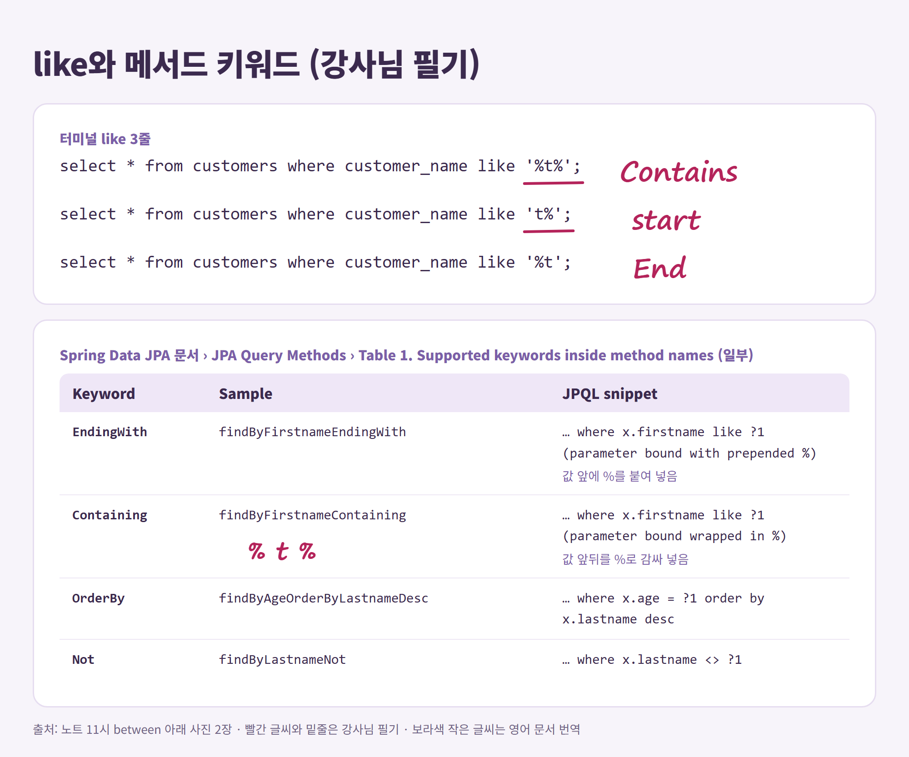

- Spring Data JPA 문서 › Repository query keywords › Query subject keywords (메서드 이름 앞부분 키워드)

  | Keyword | 뜻 (번역) |
  | --- | --- |
  | `find…By`, `read…By`, `get…By`, `query…By`, `search…By`, `stream…By` | 일반 조회 메서드. 보통 레포지토리 타입(엔티티), Collection·Streamable, Page 같은 결과를 돌려줌. findBy…, findMyDomainTypeBy…처럼 쓰거나 다른 키워드와 같이 씀 |
  | `exists…By` | 있는지 확인. 보통 boolean을 돌려줌 |
  | `count…By` | 개수. 숫자를 돌려줌 |
  | `delete…By`, `remove…By` | 지우기. 돌려주는 게 없거나(void) 지운 개수 |
  | `…First<number>…`, `…Top<number>…` | 앞에서부터 number개만. find(와 다른 키워드)와 By 사이 아무 데나 씀 |
  | `…Distinct…` | 중복을 뺀 결과만. DB마다 되는지 문서를 확인. find와 By 사이 아무 데나 씀 |

https://docs.spring.io/spring-data/jpa/reference/repositories/query-keywords-reference.html
- 위 링크 = Repository query keywords : 메서드 이름 앞부분(find…By, exists…By, count…By, delete…By, Top/First, Distinct)과 뒷부분(And, Or, Between, LessThan, Like, Containing, OrderBy, Not …)에 쓸 수 있는 키워드를 모아 둔 표
  - 자주 쓰는 키워드는 아래 「레포지토리와 쿼리 메서드 정리」 사용법 표에 모아 둠. 예약된 메서드(findById 등)도 거기 있음

https://docs.spring.io/spring-data/jpa/reference/jpa/query-methods.html
- 위 링크 = JPA Query Methods : 메서드 이름으로 쿼리를 만드는 규칙(Query Creation), 키워드 표, @Query로 직접 쓰기, 네이티브 쿼리를 설명하는 페이지

- PK 로 조회하는 것은 타고 올라가면 파인드바이 아이디가 있음 그걸로 조회. 나머지 필드 등은 레포지토리에 파인드바이(findBy) 메서드를 만들어 주어야 한다
  - 강사님 코드 : 이름으로 찾는 메서드 추가
    ```java
    public interface CustomerRepository extends JpaRepository<Customer,Long> {
        Optional<Customer> findByCustomerId(String customerId);
        List<Customer> findByCustomerNameContains(String customerName);   // 이름에 그 글자가 들어간 손님 전부 (like '%값%')
    }
    ```
  - Spring Data JPA 소개 문장 (repository에 강사님 밑줄)
    - Spring Data JPA aims to significantly improve the implementation of data access layers by reducing the effort to the amount that's actually needed. As a developer you write your repository interfaces using any number of techniques, and Spring will wire it up for you automatically. You can even use custom finders or query by example and Spring will write the query for you!
    - 번역 : Spring Data JPA는 데이터 접근 계층을 만드는 수고를 꼭 필요한 만큼으로 줄여 줌. 개발자가 레포지토리 인터페이스를 쓰면 스프링이 알아서 연결해 줌. 직접 만든 찾기 메서드나 예시로 찾기(query by example)를 써도 스프링이 쿼리를 대신 써 줌

- 안되는 건 직접 엣쿼리 함수를 이용해 직접 넣어줌
  - Spring Data JPA 문서 › Using @Query › Example 5. Declare query at the query method using @Query
    ```java
    public interface UserRepository extends JpaRepository<User, Long> {
      @Query("select u from User u where u.emailAddress = ?1")   // JPQL을 직접 씀. ?1 = 첫 번째 인자
      User findByEmailAddress(String emailAddress);
    }
    ```
    - Queries annotated to the query method take precedence over queries defined using @NamedQuery or named queries declared in orm.xml.
      - 번역 : 메서드에 @Query로 붙인 쿼리가 @NamedQuery나 orm.xml에 적은 이름 있는 쿼리보다 먼저 쓰임
  - 여기선 테이블이 아닌 엔티티를 나타냄 (User)

- 네이티브 쿼리를 쓰는 방법도 있긴 함

### 레포지토리와 쿼리 메서드 정리
- 개념
  - 족보 : Repository → CrudRepository(Spring Data Core, 기본 CRUD) → ListCrudRepository(List로 돌려줌) → JpaRepository(JPA 전용, flush·한꺼번에 지우기 등)
  - *쿼리 메서드* : 메서드 이름을 규칙대로 지으면 그 이름을 읽어서 쿼리를 만들어 줌. find…By 뒤에 엔티티 필드 이름과 키워드를 붙임
  - 비유 : 식당 주문서 양식. findBy + CustomerName + Contains처럼 칸을 채우면 주방(스프링)이 알아서 요리(SQL)함
- 사용법

  | 메서드 이름에 | SQL에서 | 예 |
  | --- | --- | --- |
  | Distinct | select distinct | findDistinctByCustomerName |
  | And / Or | and / or | findByCustomerIdAndCustomerName |
  | Between | between ? and ? | findByCreatedAtBetween |
  | LessThan / GreaterThan | `<` / `>` | findByIdLessThan |
  | StartingWith / EndingWith / Containing(Contains) | like '값%' / '%값' / '%값%' | findByCustomerNameContains |
  | Like | like ? (%는 내가 넣음) | findByCustomerNameLike |
  | OrderBy…Desc | order by … desc | findByCustomerNameOrderByIdDesc |
  | Not | `<>` | findByCustomerNameNot |
  | IsNull / IsNotNull | is null / is not null | findByCreatedAtIsNull |
  | In / NotIn | in (…) / not in (…) | findByCustomerIdIn |
  | True / False | = true / = false | findByActiveTrue (문서 예) |
  | IgnoreCase | upper(…) = upper(?) | findByCustomerIdIgnoreCase |

  - Like는 %를 안 붙여 줌. "t"만 넣으면 딱 t인 것만 찾으니 "%t%"처럼 %를 직접 넣음. Containing(Contains)은 앞뒤에 %를 붙여 줌
  - Is·Equals·Not에 null을 넘기면 = null이 아니라 is null / is not null로 바꿔 줌
  - In·NotIn에는 목록(Collection)을 넘김. IsNull·IsNotNull·True·False는 넘길 값이 없음
  - 예약된 메서드(Reserved methods) : findById, existsById, deleteById, findAllById, deleteAllById는 이름을 읽어서 만드는 게 아니라 CrudRepository에 이미 있는 기능을 그대로 부름. 위 "PK 로 조회하는 것은 타고 올라가면 파인드바이 아이디가 있음" 줄이 이 뜻
  - 이름으로 안 되면 @Query. 안에는 표 이름(customers)이 아니라 엔티티 이름(Customer)과 필드 이름을 씀(JPQL). 진짜 SQL을 쓰려면 `@Query(value = "select * from customers …", nativeQuery = true)`

### Optional
- 현재 우리가 쓴 함수에 옵셔널이 무척 많음. 자바8에서 제공하고 있는 클래스. 이것에 대한 이해가 필요함

https://docs.oracle.com/en/java/javase/17/docs/api/java.base/java/util/Optional.html

- 지금은 테스트케이스 만들고 오후수업때 자세한 내용 말하신다고 함
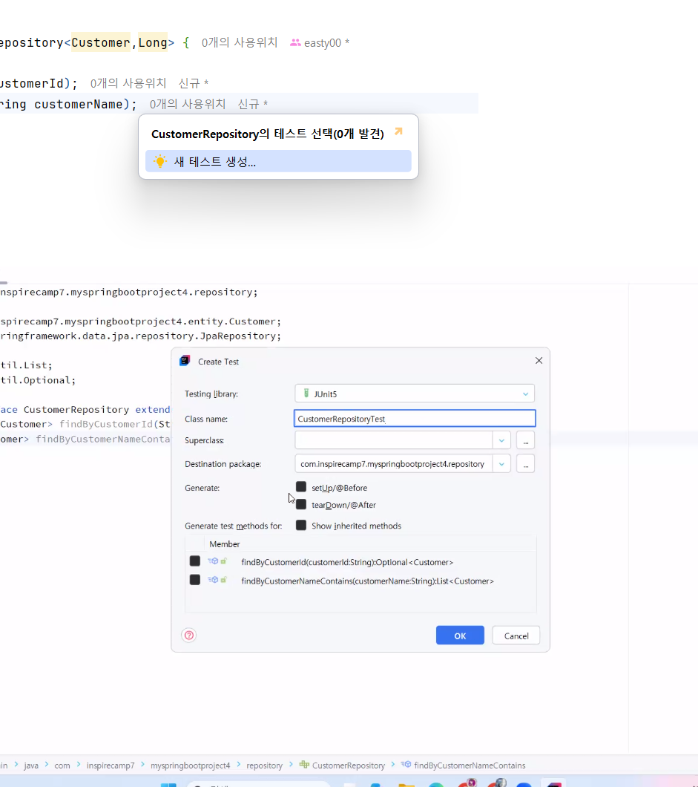
  - 그림 설명 : 위는 CustomerRepository에서 Ctrl+Shift+T를 누른 창(CustomerRepository의 테스트 선택(0개 발견) → 새 테스트 생성…), 아래는 Create Test 창
  - 번역 : Testing library = 테스트 라이브러리(JUnit5), Class name = 클래스 이름(CustomerRepositoryTest), Superclass = 부모 클래스(비움), Destination package = 넣을 패키지, Generate = 미리 만들 메서드(setUp/@Before, tearDown/@After), Generate test methods for = 테스트 메서드를 만들 대상(체크 안 함)

  - 테스트 폴더가 만들어짐
    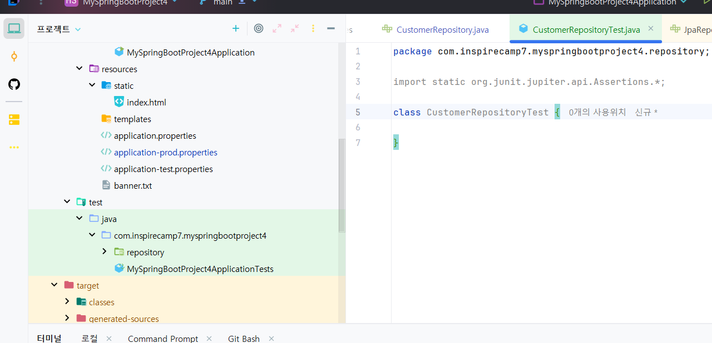

- extended with
  - 내 화면 : SpringBootTest.class 소스 (디컴파일된 .class 파일, 바이트코드 버전 61.0 = Java 17)
    ```java
    @Target({ElementType.TYPE})
    @Retention(RetentionPolicy.RUNTIME)
    @Documented
    @Inherited
    @BootstrapWith(SpringBootTestContextBootstrapper.class)
    @ExtendWith({SpringExtension.class})     // JUnit에 스프링 기능을 끼워 넣음. @SpringBootTest만 붙이면 이것도 딸려 옴
    public @interface SpringBootTest {
        ⋮
    }
    ```

---

## 1시 수업

- 옵셔널을 쓸 수 있고 널이 돌아올 수 있는 일종의 래퍼 클래스 
  - 교재 56쪽 : Optional 객체 반환 (쪽 전체는 아래 그림에 옮김)

- 방어로직이 if 문 같은 것 
- 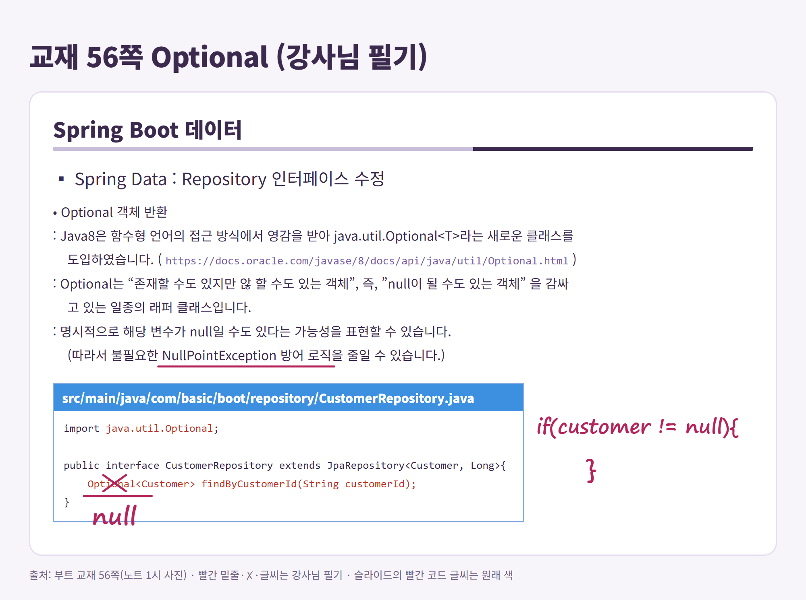
  - 그림 설명 : 강사님 필기. "NullPointException 방어 로직"에 밑줄, 코드의 Optional에 ✗와 null, 오른쪽에 if(customer != null){ }

- 결함이 좀 있다고 함 
  - 교재 57쪽 : Spring Data : JPA 테스트. 스프링 데이터 Repository 테스트 클래스 작성 : 레코드 저장 및 조회
    ```java
    @SpringBootTest
    public class CustomerRepositoryTest {
        @Autowired
        CustomerRepository customerRepository;
        @Test
        public void customer() throws Exception {
            //등록
            Customer customer = new Customer();
            customer.setCustomerId("A001");
            customer.setCustomerName("스프링");
            Customer addCustomer = customerRepository.save(customer);
            ⋮
            assertThat(addCustomer.getCustomerName()).isEqualTo("스프링");
            Optional<Customer> existCustomer = customerRepository.findByCustomerId(addCustomer.getCustomerId());
            assertThat(existCustomer).isNotEmpty();      // 상자가 차 있나
            Optional<Customer> notExistOptional = customerRepository.findByCustomerId("B001");
            assertThat(notExistOptional).isEmpty();      // 상자가 비었나
        }
    }
    ```
    - 메서드 하나에 등록, 있는 것 찾기, 없는 것 찾기를 다 넣음. 강사님은 testInsert, testRead, testReadNotFound처럼 나눠서 만드심

- 강사님 화면 : 테스트 뼈대, Customer에 @Getter @Setter
  ```java
  @SpringBootTest
  class CustomerRepositoryTest {
      @Autowired
      CustomerRepository customerRepository;   // 스프링이 만든 레포지토리를 받아 옴

      @Test
      void testInsert() {
          //Given-When-Then
          //Given (준비단계)
          Customer customer = new Customer();
          //When (실행단계)
          //Then (검증단계)
      }
  }
  ```
  ```java
  @Entity
  @Table(name = "customers")
  @Getter @Setter              // 롬복이 getXxx, setXxx를 만들어 줌. 테스트에서 setCustomerId를 쓰려고 붙임
  public class Customer {
  ```
- 리턴타입 자동생성 : 컨트롤 알트 브이 
- 임포트 : 알트엔터

- 이제 돌려봄
  ```java
  @Test
  void testInsert() {
      //Given (준비단계)
      Customer customer = new Customer();
      customer.setCustomerId("A001");
      customer.setCustomerName("스프링");
      //When  (실행단계)
      Customer addedCustomer = customerRepository.save(customer);     // INSERT
      //Then  (검증단계)
      assertThat(addedCustomer).isNotNull();                           // 돌려받은 게 있나
      assertThat(addedCustomer.getId()).isEqualTo(1L);                 // DB가 붙인 번호가 1인가 (create라 매번 1)
      assertThat(addedCustomer.getCustomerName()).isEqualTo("스프링");
  }
  ```
  - 내 코드
  - 돌리는 법 : 테스트 메서드 왼쪽 초록 ▶ → Run. 단축키 Ctrl+Shift+F10, 같은 테스트 다시 돌리기 Shift+F10, 실행 창 Alt+4. 초록 체크 = 통과
  - ?? 그런데 강사님은 실패했는데 나는 성공함
  - 이유:
    - 여기에 비번을 넣어 줘야 했다는 듯? 그런데 난 넣은 적 없음 이유는 모르겠는데 난 에러가 안 남.. 뭔가 이상한 상황... 강사님과 뭔가 다른 게 있었나 봄 
    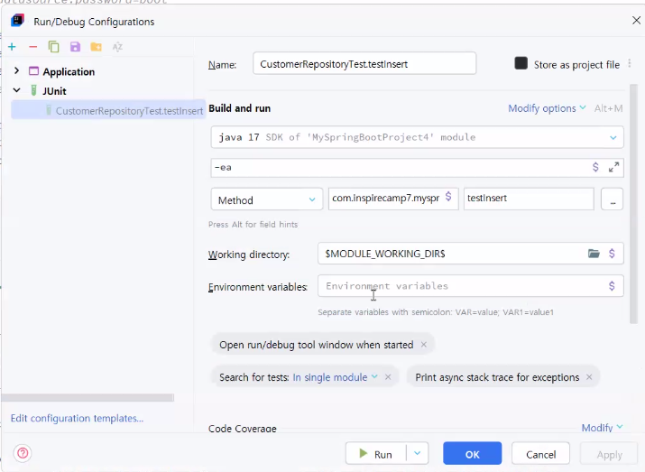
      - 강사님 화면. 번역 : Run/Debug Configurations = 실행/디버그 구성, JUnit 아래 CustomerRepositoryTest.testInsert, Build and run = 빌드와 실행, Environment variables = 환경 변수(VAR=value 모양, 여러 개는 ;로 나눔), Working directory = 작업 폴더
    - 내가 테스트 케이스에 넣은 게 아니었다 
    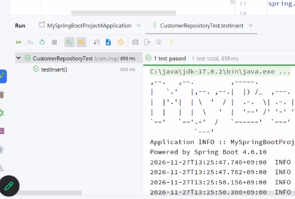
      - 강사님 화면(비밀번호 기본값을 붙인 뒤). 번역 : 1 test passed = 테스트 1개 통과
    - 내 prod 설정 12줄은 `${DB_PASSWORD:기본값}`처럼 `:` 뒤에 기본값이 붙어 있었음. 테스트는 실행 구성의 `--DB_PASSWORD`를 못 받지만 기본값으로 접속돼서 통과함. 강사님은 `${DB_PASSWORD}`(기본값 없음)라 비번이 비어서 실패 → 강사님도 `${DB_PASSWORD:boot}`로 기본값을 붙임

- 업데이트로 바꾸고 오류를 확인한다
  ```properties
  spring.datasource.password=${DB_PASSWORD:boot}     # 값이 안 들어오면 boot
  spring.jpa.hibernate.ddl-auto=update               # create → update : 켤 때 표를 안 지움
  ```
  ```
  Hibernate: insert into customers (created_at,customer_id,customer_name) values (?,?,?)
  org.springframework.dao.DataIntegrityViolationException: could not execute statement [(conn=446) Duplicate entry 'A001' for key …]
  Caused by: org.hibernate.exception.ConstraintViolationException: could not execute statement …
  ```
  - 강사님 화면. 번역 : 1 test failed = 테스트 1개 실패, 문장을 실행할 수 없음 - 'A001'이 이미 있어서 중복
- 유니크가 걸려있어 중복에러가 난다. 업데이트는 데이터를 없애지 않고 유지하기 때문.

- 다른 아이디로 만들어 넣는다. 이전 기록이 유지되며 스프링 B가 들어간다
  - 내 쪽 실패 3번 (모두 넣은 값과 기대값이 달라서)
    - `assertThat(addedCustomer.getId()).isEqualTo("B002")` → `expected: "B002" but was: 3L`. getId()는 DB가 붙인 번호(Long). 넣은 글자는 getCustomerId()로 꺼내야 함
    - 넣은 이름 "스프링"(setCustomerName)과 기대한 이름 "스프링B"(isEqualTo)가 다름
    - update라 검사가 실패해도 save()는 이미 끝나서 B00N이 DB에 남음 → 같은 값으로 다시 돌리면 중복. 번호를 올리거나 터미널에서 delete
  - 실패 이유는 콘솔 맨 아래 `expected … but was …`에 나옴


- 옵셔널
- 항상 get으로 물어보고 설명하는 게 번거롭긴 함. 다음 시간엔 람다식으로 한 번에 하는 것을 알려주신다고 함
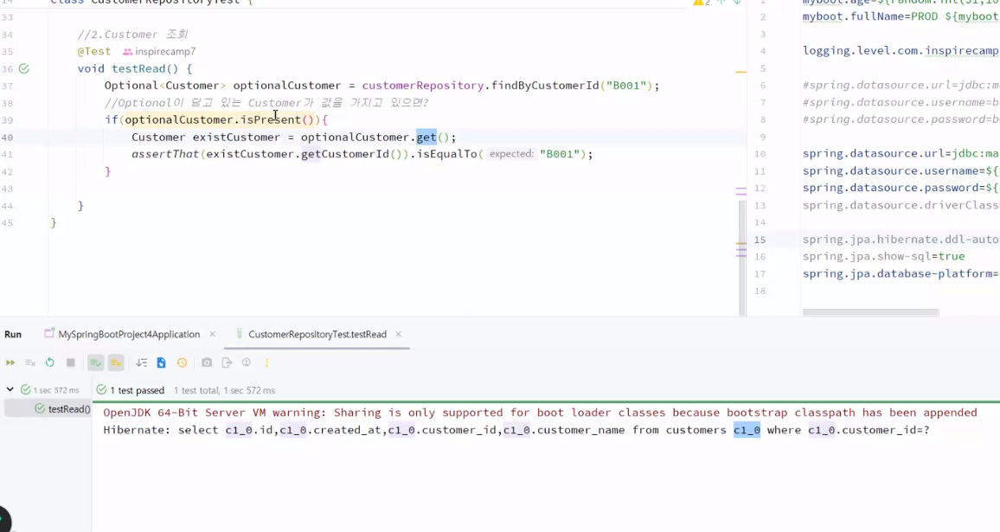
  - 강사님 화면 : testRead (isPresent로 묻고 get으로 꺼냄). 번역 : 1 test passed = 테스트 1개 통과. 콘솔에 select … where c1_0.customer_id=? 한 줄

### 테스트 클래스 정리
- 개념
  - *테스트 클래스* : 앱을 켜고 손으로 확인하던 것을 코드가 대신 확인하게 하는 클래스. src/test/java에 같은 패키지로 둠
  - *@SpringBootTest* : 스프링 부트 앱을 통째로 켠 상태에서 테스트함. 그래서 @Autowired로 레포지토리 같은 빈을 받을 수 있음
  - *Given-When-Then* : 준비 → 실행 → 검증 세 칸으로 나눠 씀
  - 비유 : 시험 문제(Given) → 답 쓰기(When) → 채점(Then)
- 사용법
  - AssertJ 검사 : `assertThat(실제).isEqualTo(기대)`, `isNotNull()`, `isNull()`, Optional이면 `isNotEmpty()`, `isEmpty()`
- 공식 문서 해석
  - [Testing Spring Boot Applications (스프링 부트)](https://docs.spring.io/spring-boot/reference/testing/spring-boot-applications.html) : @SpringBootTest는 테스트에 쓸 ApplicationContext를 SpringApplication으로 만들어 줌. JUnit 6(지금 부트 4 문서 기준)을 쓰면 @SpringBootTest에 이미 @ExtendWith(SpringExtension.class)가 붙어 있어서 따로 안 붙여도 됨. JUnit 4는 @RunWith(SpringRunner.class)
  - [AssertJ](https://assertj.github.io/doc/) : assertThat(실제 값) 뒤에 isEqualTo, isNotNull 같은 확인 메서드를 이어 붙여 읽기 쉽게 검사를 쓰게 해 주는 라이브러리

---

## 2시 수업

### 옵셔널 이어서 
- 자바 17 API 문서 › Optional › Method Summary (일부)

  | 돌려주는 것 | 메서드 | 설명 (번역) |
  | --- | --- | --- |
  | `T` | `get()` | 값이 있으면 그 값을, 없으면 NoSuchElementException을 던짐 |
  | `int` | `hashCode()` | 값이 있으면 그 값의 해시 코드, 없으면 0 |
  | `void` | `ifPresent(Consumer<? super T> action)` | 값이 있으면 그 값으로 action을 하고, 없으면 아무것도 안 함 |
  | `void` | `ifPresentOrElse(Consumer<? super T> action, Runnable emptyAction)` | 값이 있으면 그 값으로 action을, 없으면 emptyAction을 함 |
  | `boolean` | `isEmpty()` | 값이 없으면 true, 있으면 false |
  | `boolean` | `isPresent()` | 값이 있으면 true, 없으면 false |
  | `<U> Optional<U>` | `map(Function<? super T,? extends U> mapper)` | 값이 있으면 mapper를 적용한 결과를 Optional로 돌려줌 |

- 람다로 간단한 한 줄
  - 내 화면 : `optionalCustomer.ifPresent(cu`까지 치면 IntelliJ가 `customer -> {}` (`Consumer<Customer>`)를 제안함. 내 주석 "컨수머에 담겨진 T가 바로 넘어옴"
  - 강사님 코드
    ```java
    @Test
    void testRead() {
        Optional<Customer> optionalCustomer = customerRepository.findByCustomerId("B001");
        //Optional이 담고 있는 Customer가 값을 가지고 있으면?
        if(optionalCustomer.isPresent()){
            Customer existCustomer = optionalCustomer.get();
            assertThat(existCustomer.getCustomerId()).isEqualTo("B001");
        }
        //함수형 인터페이스 Customer 의 추상메서드 void accept(T t)
        optionalCustomer.ifPresent(customer -> System.out.println(customer.getCustomerName()));   // 있으면 이름 출력, 없으면 아무것도 안 함
    }
    ```
    - 주석의 "함수형 인터페이스 Customer"는 Consumer. accept(T t)를 가진 함수형 인터페이스가 Consumer임

- orElseGet
  - Supplier
  - 자바 17 API 문서 (강사님 필기 : orElse 옆에 T get(), orElseGet의 Supplier에 밑줄과 그 아래 ( ))

    | 돌려주는 것 | 메서드 | 설명 (번역) |
    | --- | --- | --- |
    | `T` | `orElse(T other)` | 값이 있으면 그 값을, 없으면 other를 돌려줌 |
    | `T` | `orElseGet(Supplier<? extends T> supplier)` | 값이 있으면 그 값을, 없으면 공급 함수가 만든 결과를 돌려줌 |
    - 같은 표의 orElseThrow, stream 줄은 아래 '다시 옵셔널로' 그림에 번역과 함께 있음

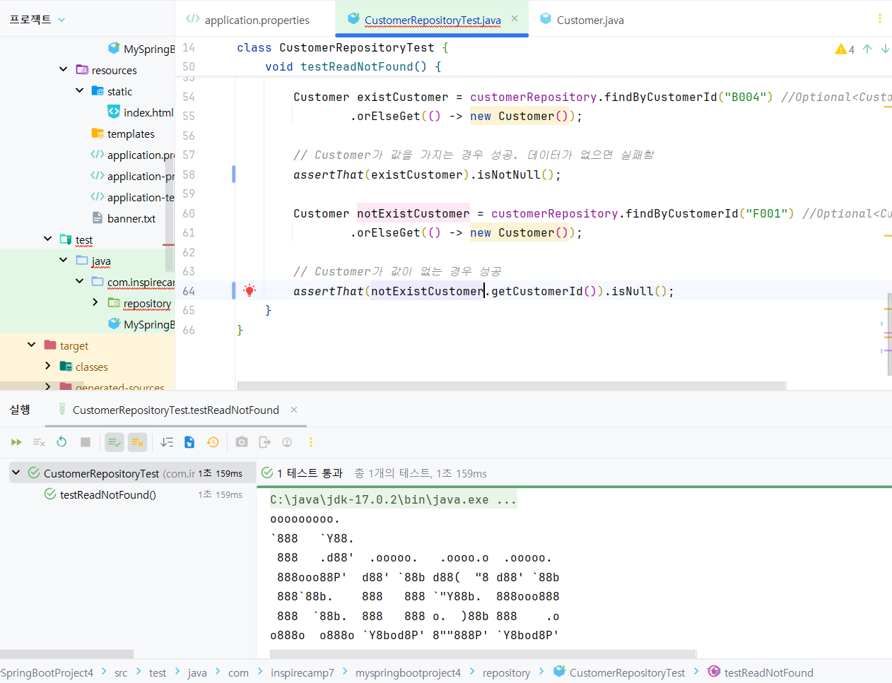
  - 내 화면 : testReadNotFound. B004는 있어서 그 손님, F001은 없어서 new Customer()라 getCustomerId()가 null. 1 테스트 통과
  - 내 첫 검사 assertThat(existCustomer).isNotNull()은 orElseGet이 절대 null을 안 줘서 늘 통과함. 강사님은 assertThat(existCustomer.getCustomerId()).isNotNull()로 안의 값을 봄

- [Throwable](https://docs.oracle.com/en/java/javase/17/docs/api/java.base/java/lang/Throwable.html)
  - 해석 : Throwable은 자바의 모든 오류와 예외의 맨 위 부모 클래스. JVM이 던지거나 throw 문으로 던질 수 있는 건 이 클래스(또는 그 자식)의 객체뿐

- 담주에 restapi 만들 예정. 그때는 익셉션(Exception)도 만들 것임
- 이 구조 이해해야 함

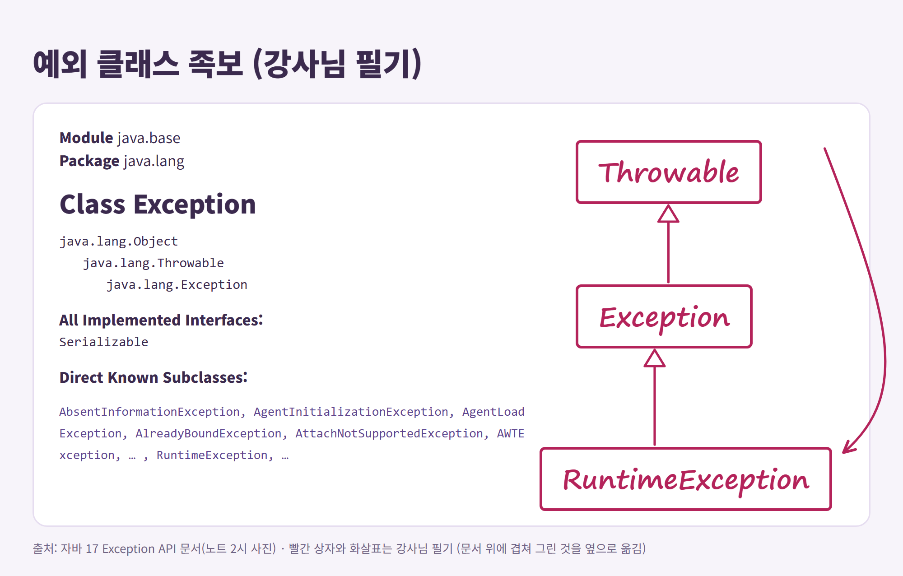

- 다시 옵셔널로
- 옵셔널에 T가 담겨있으면 반환함.

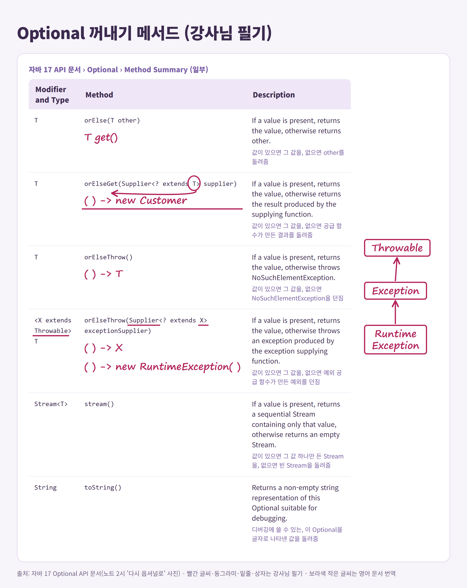

- 교재 79쪽 : RestController (JSON) – Controller #1 (다음 주 REST API)
  ```java
  @RequestMapping(value = "/users/{id}")
  public User getUser(@PathVariable Long id) {
      return userRepository.findById(id)
              .orElseThrow(() -> new BusinessException("User Not Found", HttpStatus.NOT_FOUND));   // 없으면 우리 예외를 던짐
  }
  ```
  - 강사님 필기 : 돌려주는 타입 User에 동그라미, orElseThrow(() -> new BusinessException("User Not Found" 에 밑줄, NOT_FOUND 옆에 404

- throwable 의 자식이어야 함

- 다음 시간은 업데이트에 대한 것

---

## 3시 수업

### throwable 이어서
- 내 코드 : testReadNotFoundException
  ```java
  @Test
  void testReadNotFoundException() {
      //Optional orElseThrow(Supplier<? extends X> supplier)
      // <X extends Throwable>
      // 함수형 인터페이스 Supplier 추상메서드 X get()
      Customer existCustomer = customerRepository.findByCustomerId("B004")
              .orElseThrow(() -> new RuntimeException("Customer Not Found"));   // 있으니 그대로 꺼냄
      assertThat(existCustomer.getCustomerId()).isNotNull();
  }
  ```

- 없으면 터짐. 미리 작성해둔 터짐용 문구가 출력됨

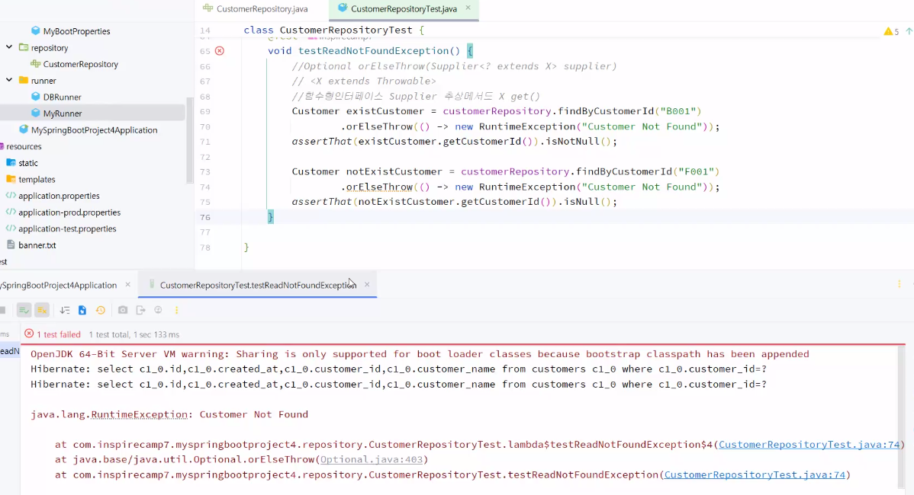

  - 강사님 화면 : F001(없는 손님) 줄을 더 넣어 돌림. 번역 : 1 test failed = 테스트 1개 실패, java.lang.RuntimeException: Customer Not Found (CustomerRepositoryTest.java:74). select가 B001, F001 두 번

https://docs.hibernate.org/orm/7.2/quickstart/html_single/#obtaining

- 위 링크 = 하이버네이트 7.2 시작 안내서 1. Obtaining Hibernate : 하이버네이트는 여러 모듈로 나뉘고 핵심 라이브러리 이름은 hibernate-core. 그래들·메이븐에 넣는 줄이 나옴(문서 예시 7.2.26.Final). 우리 프로젝트는 스프링 부트가 hibernate-core 7.2.25.Final을 넣어 줌 (실행 로그 HHH000001)

### Optional 정리
- 개념
  - *Optional* : 값이 있을 수도 없을 수도 있는 상자(래퍼 클래스). 자바 8부터. 못 찾으면 null 대신 빈 상자를 줌
  - 비유 : 택배 상자. 물건이 들었을 수도, 비었을 수도 있지만 상자 자체는 꼭 옴. 그래서 열기 전에 비었을 때 어떻게 할지 정해 둠
  - 함수형 인터페이스 두 개
    - Consumer : `void accept(T t)`. 값을 받기만 함 → `customer -> System.out.println(…)`
    - Supplier : `T get()`. 받는 건 없고 값을 줌 → `() -> new Customer()`
- 사용법

  | 하고 싶은 것 | 메서드 | 비었을 때 |
  | --- | --- | --- |
  | 들었나 묻기 | isPresent() / isEmpty() | false / true |
  | 꺼내기 | get() | NoSuchElementException |
  | 들었으면 하기 | ifPresent(x -> …) | 아무것도 안 함 |
  | 없으면 대신 | orElse(값) / orElseGet(() -> 새것) | 대신 것을 돌려줌 |
  | 없으면 예외 | orElseThrow(() -> new RuntimeException("…")) | 그 예외를 던짐 |

  ```java
  Customer c = customerRepository.findByCustomerId("F001")
          .orElseGet(() -> new Customer());                                  // 없으면 빈 손님 (null 아님)
  Customer d = customerRepository.findByCustomerId("F001")
          .orElseThrow(() -> new RuntimeException("Customer Not Found"));   // 없으면 여기서 예외
  ```
  - orElseThrow에 넣는 예외는 `<X extends Throwable>`이라 Throwable의 자식이어야 함(위 예외 족보 그림). RuntimeException 쪽은 throws를 안 적어도 됨
  - orElse(new Customer())는 값이 있어도 new Customer()를 먼저 만들고, orElseGet은 없을 때만 람다를 부름
- 자주 나는 오류
  - isPresent() 없이 get() : 비어 있으면 NoSuchElementException
- 공식 문서 해석
  - [Optional (자바 17 API)](https://docs.oracle.com/en/java/javase/17/docs/api/java.base/java/util/Optional.html) : null이 아닌 값을 담을 수도 안 담을 수도 있는 상자 객체. 주로 메서드가 돌려주는 타입으로 써서 "결과 없음"을 null 대신 나타내라고 함. Optional 변수 자체는 null이면 안 되고 늘 상자를 가리켜야 함

### 트랜잭셔널
- 내 코드
  ```java
  @Test
  @Transactional          // 이 테스트를 트랜잭션 하나로 묶음
  void testInsert() {
      Customer customer = new Customer();
      customer.setCustomerId("AB001");
      customer.setCustomerName("스프링AB");
      Customer addedCustomer = customerRepository.save(customer);
      assertThat(addedCustomer.getCustomerId()).isEqualTo("AB001");
      ⋮
  }
  ```

- 돌려보면 성공한다. 그런데 DB에는 흔적이 없다. 왜? 
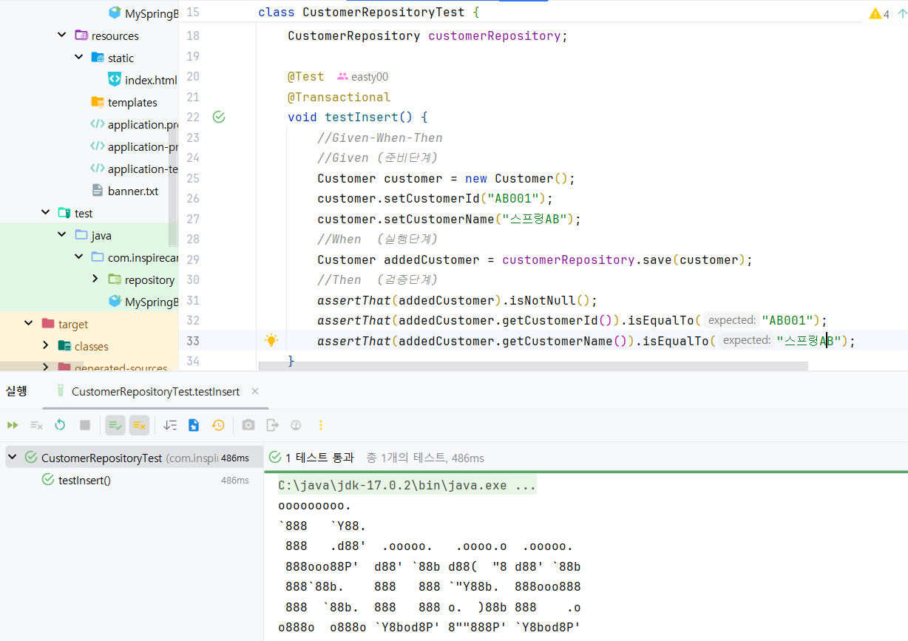
  - 내 화면 : 1 테스트 통과
  ```
  MariaDB [boot_db]> select * from customers;
  | created_at                 | id | customer_id | customer_name |
  | 2026-11-27 13:32:22.102140 |  1 | A001        | 스프링2       |
  | 2026-11-27 13:37:43.391620 |  3 | B001        | 스프링B       |
  2 rows in set (0.000 sec)          ← AB001이 없음
  ```
  - 강사님 화면
- 테스트에 트랜잭션을 시키면 롤백을 시키기 때문

- 이게 싫으면 롤백 방지를 하면 됨 ! 
  ```java
  @Test
  @Transactional
  // 등록한 데이터를 반드시 확인하고 싶으니 롤백처리를 하지 말라고 요청
  @Rollback(value = false)      // 끝나도 되돌리지 말고 저장(커밋)
  void testInsert() {
  ```
  - 내 코드

  ```
  MariaDB [boot_db]> select * from customers;
  |  1 | A001  | 스프링2  |
  |  3 | B001  | 스프링B  |
  |  5 | AB001 | 스프링AB |      ← 이번엔 남음
  3 rows in set (0.001 sec)
  ```
  - 강사님 화면. 4번이 빈 건 롤백된 실행이 번호만 쓰고 되돌렸기 때문으로 보임(마리아DB 자동 번호는 롤백해도 안 돌아감)

- https://gemini.google.com/share/afe2784becba619a6911bbccee17b5d2?social_preview=false&skid=81cb1ae5-36de-4d38-84de-5cf28369432b

  - 제미나이 질문 ① : SpringBoot 테스트 케이스의 메서드 위에 @Transactional 어노테이션을 선언하고 Insert 를 수행하는 메서드를 실행했는데 왜 테이블에 insert 한 결과가 남지 않나요? 저는 MariaDB를 사용하고 있어요.
    > - Spring Boot 테스트 메서드에 @Transactional을 선언하면 테스트가 끝난 뒤 자동으로 트랜잭션이 롤백(Rollback)되기 때문입니다. 이는 MariaDB를 사용하든 다른 데이터베이스를 사용하든 Spring Test 프레임워크의 기본 동작 방식입니다.
    > - 테스트 격리 : 테스트 하나가 DB 데이터를 영구적으로 변경하면 다음 테스트의 결과에 영향을 줄 수 있습니다. Spring은 테스트마다 깨끗한 상태를 유지하기 위해 테스트 종료 시 트랜잭션을 롤백합니다.
    > - 로그 확인 방법 : 테스트 실행 콘솔 로그를 보면 Rolled back transaction for test: ... 같은 메시지가 출력되는 것을 확인할 수 있습니다.
    > - @Commit 또는 @Rollback(false) 사용 : 롤백하지 않고 커밋하도록 지정합니다.
    > - 테스트 메서드에서 @Transactional 제거 : Repository/Service 메서드가 자체 트랜잭션(예: Spring Data JPA의 SimpleJpaRepository.save()는 기본 @Transactional)으로 커밋되도록 둡니다. 단, 이 경우 테스트 후 데이터가 DB에 남으므로 중복 키 충돌이나 테스트 간 간섭이 생길 수 있습니다.
  - 제미나이 질문 ② : insert 를 처리하는 테스트 메서드에 @Transactional을 선언하지 않으면 insert 한 결과가 DB에 바로 반영이 되나요?
    > - 네, 테스트 메서드에 @Transactional을 선언하지 않으면 insert를 수행하는 메서드가 실행되는 즉시 MariaDB에 바로 반영(커밋)됩니다.
    > - 자동 롤백 대상 제외 : Spring Test의 자동 롤백은 테스트 메서드에 @Transactional이 붙어 있을 때 동작합니다. 어노테이션이 없으면 테스트 종료 시점에 롤백할 테스트 트랜잭션 자체가 없습니다.
    > - 개별 메서드 트랜잭션 즉시 커밋 : 보통 Spring Data JPA의 repository.save()나 @Transactional이 붙은 서비스 메서드를 호출하면, 해당 메서드 실행이 끝나는 시점에 자체 트랜잭션이 커밋되어 DB에 저장됩니다.
    > - 주의할 점 : 테스트가 끝나도 insert 된 행이 MariaDB 테이블에 그대로 남습니다. 고유 키(Unique Key)나 기본 키(PK) 제약 조건이 있는 데이터를 고정 값으로 insert 하면, 테스트를 두 번 이상 실행할 때 중복 키 오류가 발생할 수 있습니다.
  - 제미나이 질문 ③ : 그렇다면 테스트메서드 위에 @Transactional을 선언하고 하는 것이 더 안전하거나 맞는 것인가요? (아래는 답을 정리한 것)
    > - 대부분의 통합 테스트(DB 연동 테스트)에서는 테스트 메서드(또는 테스트 클래스) 위에 @Transactional을 선언하고 자동 롤백을 유지하는 방식이 더 안전하고 일반적입니다.
    > - 유리한 경우 : 테스트 간 데이터 격리(실행 순서나 반복 실행으로 인한 더미 데이터 누적, 고유 키 충돌 방지), 연관관계 지연 로딩(LAZY) 검증
    > - 빼거나 주의해야 하는 경우 : 실제 커밋 시점의 DB 제약 조건·트리거 검증, 멀티스레드 / 비동기 / 별도 트랜잭션(REQUIRES_NEW) 테스트, 실제 DB 반영 상태를 눈으로 확인할 때(일시적으로 @Commit을 쓰거나 @Transactional을 빼고 확인한 뒤 원복)
    > - 정리하면 기본값은 @Transactional로 롤백 격리를 유지하고, 커밋 동작이나 별도 트랜잭션 검증이 필요한 경우에만 분리해서 테스트하는 것이 좋습니다.
  - 수업 코드와 연결 : 1시 testInsert는 @Transactional이 없어서 save()마다 바로 남았고(그래서 A001 중복 오류), 3시에 @Transactional을 붙이니 AB001이 안 남았고, @Rollback(value = false)를 붙이니 남음

- 내 코드 : 조회만 하는 테스트
  ```java
  @Test
  @Transactional(readOnly = true) //오직 조회만 시킬 때 트랜잭션을 묶어주면 된다
  void testRead() {
      Optional<Customer> optionalCustomer = customerRepository.findByCustomerId("B004");
      ⋮
  }
  ```

### 테스트와 트랜잭션 정리
- 개념
  - *트랜잭션* : 여러 DB 작업을 한 묶음으로 처리. 끝에 확정(커밋)하거나 되돌림(롤백) (11/25 Transaction 정리)
  - 테스트 메서드에 @Transactional을 붙이면 테스트가 끝날 때 자동 롤백. 테스트끼리 데이터가 섞이지 않게 하려는 것
  - 비유 : 연습장에 풀고 시험 끝나면 지우개로 지우기
- 사용법

  | 테스트 메서드에 | 끝나면 |
  | --- | --- |
  | 아무것도 없음 | save()마다 바로 커밋, 데이터가 남음 |
  | @Transactional | 롤백 (안 남음) |
  | @Transactional + @Rollback(value = false) | 커밋 (남음). @Commit도 같은 뜻 |
  | @Transactional(readOnly = true) | 읽기만 |

- 공식 문서 해석
  - [Transaction Management (스프링 프레임워크 테스트)](https://docs.spring.io/spring-framework/reference/testing/testcontext-framework/tx.html) : 테스트 트랜잭션은 기본으로 테스트가 끝나면 자동 롤백. @Commit, @Rollback으로 바꿀 수 있음. @Transactional이 없는 테스트 메서드는 트랜잭션 없이 돎

---

## 4시 수업
### 업데이트 더티체킹

#### SQL로 업데이트 
- 내 터미널
  ```
  MariaDB [boot_db]> update customers set customer_name = '스프링A' where customer_id = 'A001';
  Query OK, 1 row affected (0.003 sec)
  Rows matched: 1  Changed: 1  Warnings: 0          ← A001 이름만 바뀜
  MariaDB [boot_db]> select * from customers;
  |  1 | A001  | 스프링A  |
  |  3 | B002  | 스프링   |
  |  4 | B003  | 스프링   |
  |  5 | B004  | 스프링B  |
  |  7 | AB001 | 스프링AB |
  ```

#### JPA 로 업데이트
- 위의 방법을 JPA로 작성함
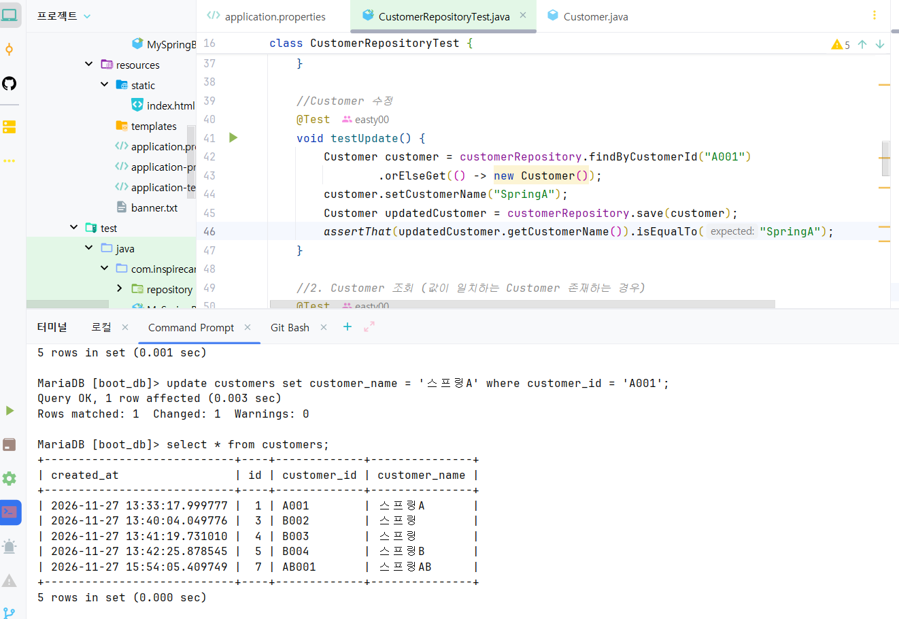
  - 내 화면 : testUpdate (A001을 찾아 SpringA로 바꾸고 save). 아래 터미널은 SQL로 바꾼 뒤 모습

- 실행하니 조회를 두 번 하고 있음 
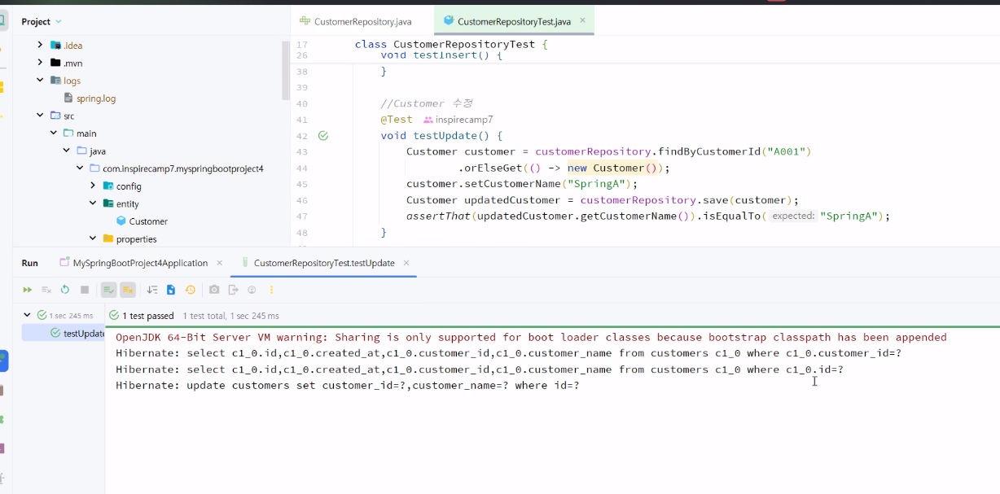
  - 강사님 화면. 번역 : 1 test passed = 테스트 1개 통과. SQL이 select(customer_id로) → select(id로) → update customers set customer_id=?,customer_name=? where id=? 세 줄
- 어떤 문제가 있을까? 
  - 채팅 : "where id?", "customerName만 바꿨는데 id까지 들어갔습니다"

- 둘 다 맞다고 함. SQL 쿼리에서는 이름만 변경했었는데 id 까지 변경되었다고 함.

- 엔티티에 다이나믹 업데이트를 선언해주면 된다
  ```java
  @Entity
  @Table(name = "customers")
  @DynamicUpdate          // update할 때 바뀐 칸만 SQL에 넣음
  @Getter @Setter
  public class Customer {
  ```
  - 내 코드

- 하지만 업데이트 쿼리가 안 나온다, 다른 값으로 해본다.
- 업데이트됨
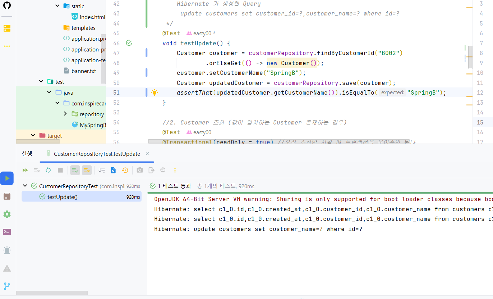
  - 내 화면 : B002를 SpringB로. 1 테스트 통과, update customers set customer_name=? where id=? (이름 칸만)
- sql도 확인
  ```
  MariaDB [boot_db]> select * from customers;
  |  1 | A001  | SpringA  |
  |  3 | B002  | SpringB  |      ← 바뀜
  |  4 | B003  | 스프링   |
  |  5 | B004  | 스프링B  |
  |  7 | AB001 | 스프링AB |
  ```

https://gemini.google.com/share/52158ea9dbc5061be5cf6c637e58a8fa?social_preview=false&skid=6244ffc3-eca6-4a1b-8614-fa38850b08b7
- 위 링크 제미나이 대화 (앞 질문 3개는 3시 링크와 같고, 네 번째가 이 질문)
  - 제미나이 질문 : 왜 select query 가 두번 실행이 되나요? (콘솔 3줄, select * from customers 결과, testUpdate 코드를 같이 붙임)
    > - 두 번째 select가 실행되는 핵심 이유는 customerRepository.save(customer)가 내부적으로 EntityManager.merge()를 호출했기 때문입니다.
    > - 첫 번째 select (where c1_0.customer_id=?) : customerRepository.findByCustomerId("B001")가 실행된 쿼리입니다. 현재 테이블에는 A001만 있으므로 결과가 비어 .orElseGet(() -> new Customer())가 호출됩니다.
    > - 두 번째 select (where c1_0.id=?) : Spring Data JPA의 SimpleJpaRepository.save()는 엔티티가 새 엔티티인지(isNew) 판단한 뒤 persist()를 할지 merge()를 할지 결정합니다. 식별자(@Id) 필드가 참조 타입(Long 등)이고 null이면 새 엔티티로 보고 persist()를 호출합니다. 반대로 식별자 필드가 원시 타입(long, int)이어서 기본값 0이 들어가 있거나, isNew() 판별 기준상 기존 엔티티로 판단되면 merge()가 실행됩니다. JPA의 merge()는 전달받은 객체의 상태와 DB 상태를 맞추기 위해 먼저 기본키(id)로 기존 행을 조회하는 select 쿼리(where c1_0.id=?)를 실행합니다.
    > - update 쿼리가 나가는 이유 : merge() 흐름을 타면서 영속성 컨텍스트에 병합된 대상에 대해 변경 사항이 반영될 때 update SQL이 생성됩니다.
    > - 점검해 볼 포인트 : Customer 엔티티의 @Id 필드 타입이 Long인지 long인지 확인해 보세요. 테스트 메서드에 @Transactional이 붙어 있다면 테스트 종료 후 롤백되므로, select * from customers; 결과에 SpringB가 보이지 않는 점도 함께 참고해 주세요.
  - 수업 코드와 연결 : "save가 merge를 불러서 id로 한 번 더 select"까지는 맞음. 하지만 강사님 DB에는 B001이 있었고(id 3, 3시 터미널), Customer의 id는 Long이라 "B001이 없어서 new Customer()" 설명은 우리 상황과 다름. 이 테스트에는 @Transactional이 없어서 findByCustomerId로 찾은 손님이 바로 관리 밖(준영속)이 되고, id가 있는 객체라 save()가 merge()를 부름. merge()가 id로 다시 select한 뒤 update함

- 트랜잭션을 걸었으면 수정할 수 있는 것이 있음
  ```java
  @Test
  void testUpdate() {
      Customer customer = customerRepository.findByCustomerId("AB001")
              .orElseGet(() -> new Customer());
      customer.setCustomerName("SpringAB");
  //  Customer updatedCustomer = customerRepository.save(customer);     // save를 주석 처리
  //  assertThat(updatedCustomer.getCustomerName()).isEqualTo("SpringB");
      assertThat(customer.getCustomerName()).isEqualTo("SpringAB");
  }
  ```
  - 내 코드 (이때는 아직 @Transactional이 없음)

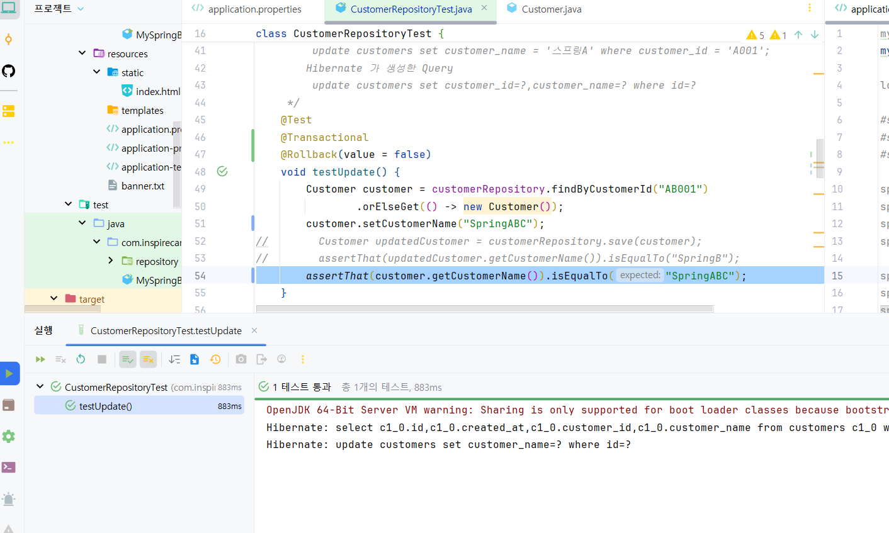
  - 내 화면 : @Transactional + @Rollback(value = false)를 붙이고 SpringABC로. 1 테스트 통과, select 한 번 + update customers set customer_name=? where id=? (save 없이)
  ```
  MariaDB [boot_db]> select * from customers;
  |  1 | A001  | SpringA   |
  |  3 | B002  | SpringB   |
  |  4 | B003  | 스프링    |
  |  5 | B004  | 스프링B   |
  |  7 | AB001 | SpringABC |      ← save 없이 바뀜
  ```

- 더티체킹에 대해 설명. 체킹되어 트랜잭션이 호출되고 세이브는 호출할 필요 없음. 롤백 막아뒀으니 자동 저장

- 담주엔 오늘 배운 거 정리하고 영속성하고 RestAPI 만들 것

### 업데이트와 더티 체킹 정리
- 개념
  - JPA에서 update는 SQL을 쓰는 게 아니라 찾은 객체를 고치는 것. DB에 반영되는 길이 두 가지
  - *merge* : 트랜잭션 밖에서 찾은 객체(준영속)를 save()하면 id로 다시 select해서 맞춘 뒤 update
  - *더티 체킹(dirty checking)* : 트랜잭션 안에서 찾은 객체는 하이버네이트가 계속 지켜봄(영속 상태). 트랜잭션이 끝날 때 처음 모습과 비교해서 바뀐 칸이 있으면 update를 알아서 보냄. save()를 안 불러도 됨
  - *@DynamicUpdate* : 하이버네이트는 기본으로 고칠 수 있는 칸 전부를 update 문에 넣음. 붙이면 바뀐 칸만 넣음
  - 비유 : 도서관에서 빌린 책(관리 중)에 고친 곳이 있으면 반납할 때 사서가 알아서 기록함. 반납한 뒤(관리 밖) 고친 책은 다시 가져가서 기록해 달라고(save) 해야 함
- 사용법

  | | 트랜잭션 없이 save() | @Transactional 안에서 고치기만 |
  | --- | --- | --- |
  | save() | 불러야 함 | 안 불러도 됨 |
  | SQL | select 2번 + update | select 1번 + update |
  | 찾은 객체 | 찾자마자 관리 끝(준영속) | 트랜잭션 끝까지 관리 중(영속) |

  ```java
  @Test
  @Transactional
  @Rollback(value = false)                       // 테스트라서 롤백을 막아야 DB에 남음
  void testUpdate() {
      Customer customer = customerRepository.findByCustomerId("AB001")
              .orElseGet(() -> new Customer());
      customer.setCustomerName("SpringABC");     // 객체만 고침 → 끝날 때 update가 나감
  }
  ```
- 자주 나는 오류
  - update가 안 나옴 : 같은 값으로 바꿔서 바뀐 게 없음. 다른 값으로 바꾸면 나옴
  - save를 뺐는데 DB가 안 바뀜 : @Transactional이 없어서 객체가 관리 밖임
- 공식 문서 해석
  - [Saving Entities (Spring Data JPA)](https://docs.spring.io/spring-data/jpa/reference/jpa/entity-persistence.html) : save()는 아직 저장 안 된 엔티티면 persist, 아니면 merge를 부름. 새것인지는 기본으로 id가 null인지로 판단함
  - [@DynamicUpdate (하이버네이트 7.2 API)](https://docs.hibernate.org/orm/7.2/javadocs/org/hibernate/annotations/DynamicUpdate.html) : update SQL을 그때그때 만들고 실제로 바뀌는 칸만 넣음. 몇 칸만 자주 바꾸면 빨라질 수 있지만 SQL을 만드는 비용이 있음

---

## 5시 수업

### 바이브코딩수업
- CLI 사용법에 대해서
  - 실습 폴더(`C:\inspirecamp7back\biztalk_antigravity`) 터미널에서 `agy` 실행. 처음 켜면 색 테마 → 약관·데이터 사용 동의(체크는 선택) → "이 폴더를 믿나요?" Yes → `>` 입력칸
  - 첫 화면 : 버전(Antigravity CLI 1.5.18), 구글 계정(Starter Quota = 무료 사용량), 모델, 작업 폴더
  - Auto 모드가 기본. 파일 고치기·안전한 명령은 묻지 않고 바로 함. Shift+Tab으로 모드 바꿈
  - `>` 칸에 치는 것

    | 앞에 붙이는 것 | 뜻 | 예 |
    | --- | --- | --- |
    | 없음 | AI에게 질문 | `1. 언어 및 소통 원칙을 알고 있나요?` |
    | `/` | CLI 설정 명령 | `/model` |
    | `!` | 터미널 명령 바로 실행 | `! dir` |

  - `/model` : ↑↓ 모델, ←→ Effort(생각 깊이), Enter. 강사님처럼 Gemini 3.8 Flash (Medium)로 바꿈. 처음부터 정하려면 `agy --model 모델이름`, 모델 목록은 `agy models`
  - `! dir` 결과가 강사님과 다름 : 내 agy는 명령을 bash로 실행해서 점(.)으로 시작하는 파일(.agents, .env, .gitignore)은 안 보임. 다 보려면 `! ls -a`. 강사님 화면은 cmd 모양이고, 한글이 깨져 보이는 건 글자 인코딩 문제
  - "언어 및 소통 원칙을 알고 있나요?" : AGENTS.md에 적어 둔 규칙을 AI가 읽었는지 확인하는 질문

- MCP에 대해서
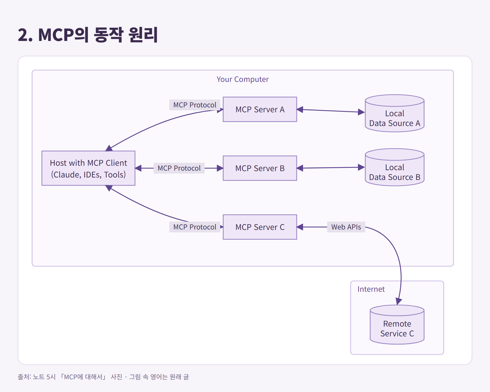
  - 그림 설명 : 내 컴퓨터(Your Computer) 안의 Host with MCP Client(Claude, IDE, 도구)가 MCP Protocol로 MCP Server A·B·C와 이야기함. A·B는 내 컴퓨터의 데이터(Local Data Source A·B)에, C는 Web APIs로 인터넷(Internet)의 Remote Service C에 붙음

- 깃허브 mcp 서버 연결하기
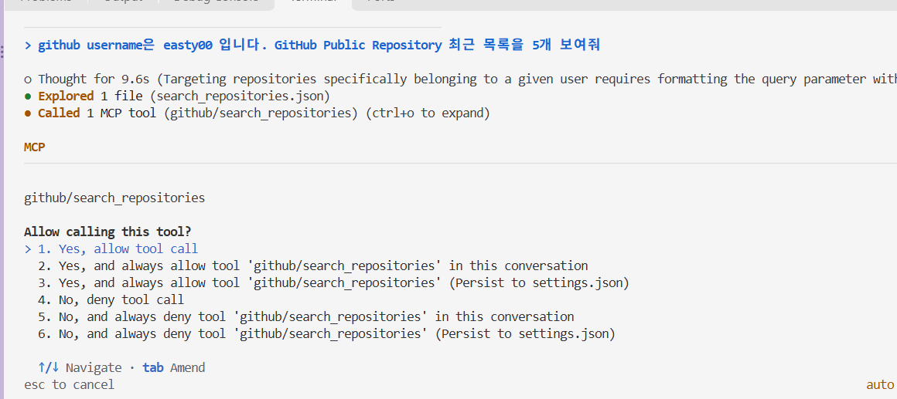
  - 내 화면. 번역 : Thought(생각함), Explored 1 file(파일 1개 살펴봄), Called 1 MCP tool(MCP 도구 1개 부름) github/search_repositories, Allow calling this tool?(이 도구를 불러도 될까요?)
  - 도구 허락 화면 번호

    | 번호 | 뜻 |
    | --- | --- |
    | 1 | 이번 한 번만 허용 |
    | 2 | 이 대화 동안 계속 허용 |
    | 3 | 앞으로도 계속 허용 (settings.json에 저장) |
    | 4 | 이번만 거절 |
    | 5 | 이 대화 동안 계속 거절 |
    | 6 | 앞으로도 계속 거절 (settings.json에 저장) |

  - 명령 실행 허락 화면은 4개 : 1 실행 / 2 이 대화 동안 같은 명령 허용 / 3 계속 허용(settings.json에 저장) / 4 취소. 수업에선 1번
  - 깃허브에 공개 저장소(biztalk-antigravity)를 만드는 건 내 컴퓨터 밖을 바꾸는 일이라 Auto 모드여도 매번 물어봄. 명령이 바뀌면 허락도 새로 받음
  - PowerShell 명령 다음에 curl 명령으로 바뀌어 다시 물어봄 : 내 agy는 bash로 실행해서, 큰따옴표 안 `$token`, `$headers`를 bash가 자기 변수로 읽고 빈칸으로 바꿔 버려 PowerShell 명령이 깨졌을 가능성이 큼. 그래서 bash에서 되는 curl로 다시 함
  - `git remote set-url origin https://github.com/easty00/biztalk-antigravity.git` : origin 주소에 붙어 있던 토큰을 빼고 깨끗한 주소로 바꿈. 뒤의 `git remote -v`로 바뀐 주소 확인

### 안티그래비티 CLI와 MCP 정리
- 개념
  - *안티그래비티 CLI(agy)* : 터미널에서 안티그래비티 에이전트에게 말로 시키는 도구. 폴더 안 파일을 읽고, 고치고, 명령을 실행함
  - *MCP(Model Context Protocol)* : AI 앱을 바깥 시스템(데이터, 도구)에 잇는 표준. 그림의 Host = 안티그래비티 CLI, MCP Server = 깃허브 MCP 서버, Remote Service = GitHub
  - 비유 : MCP는 AI 앱의 USB-C 포트. 규격이 같으면 어떤 도구든 꽂아 쓸 수 있음 (MCP 공식 소개의 비유)
- 사용법
  ```jsonc
  {
    "mcpServers": {
      "github": {                                           // 서버 이름
        "command": "npx",                                   // 서버를 켜는 명령
        "args": ["@modelcontextprotocol/server-github"],    // 깃허브 MCP 서버 패키지
        "env": { "GITHUB_PERSONAL_ACCESS_TOKEN": "(토큰)" }   // 내 GitHub에 들어갈 토큰
      }
    }
  }
  ```
  - 파일 : 실습 폴더의 .agents/mcp_config.json
  - 켤 때 정하기 : 위 /model 줄의 `--model`, `agy models` 말고도 `agy --effort 깊이`, `agy --mode auto|accept-edits|plan`이 있음
- 공식 문서 해석
  - [Antigravity CLI](https://antigravity.google/product/antigravity-cli/) : 안티그래비티 에이전트를 터미널에서 쓰는 도구(terminal-first surface). 여러 에이전트 세션에 일을 나눠 뒤에서 돌릴 수 있다고 소개함
  - [MCP 소개](https://modelcontextprotocol.io/introduction) : MCP는 AI 앱을 바깥 시스템에 연결하는 오픈소스 표준. "AI 앱을 위한 USB-C 포트"처럼 생각하라고 함
  - npm의 @modelcontextprotocol/server-github 패키지는 "Archived and unmaintained(보관됨, 더는 관리 안 함)"로 표시돼 있음. 수업에서는 잘 동작함

---

## 오늘 AI에게 질문한 것 (트러블슈팅)

| 시간 | 증상 · 질문 | 원인 | 해결 |
| --- | --- | --- | --- |
| 10시 (10:11) | CRUD를 간단히 정리해 달라고 함 | 오류는 아님 | 만들기·읽기·고치기·지우기 = INSERT·SELECT·UPDATE·DELETE = save·findById·findAll·deleteById (10시 CRUD 표) |
| 10시 (10:44) | 강사님 화면엔 customers에 데이터가 있는데 내 터미널은 select가 안 됨 | customers 표가 없었음. 어제 3시 실험에서 표를 지운 뒤 앱을 안 켬 | properties의 `Create`를 `create`로 고치고 앱을 한 번 켜서 표를 만든 뒤 INSERT 2줄 (10시 「표가 없어서 따라잡은 과정」) |
| 10시 (10:45~10:48) | 슬라이드(CrudRepository 메서드)를 터미널에 넣으라는 건지 코드를 쓰라는 건지 모름 | 오류는 아님. 레포지토리 파일은 오전에 이미 만들어 둠. `JpaRepository<Customer,Long>`이 슬라이드의 빈칸 T, ID를 채운 것 | 새로 쓸 코드는 없음. 터미널에서 INSERT와 select만 침 |
| 10시 (10:50) | 어떤 표가 있는지 보는 명령을 모름 | 오류는 아님 | `show tables;`, `desc customers;`, `select * from customers;` (10시 질문 정리의 명령 표) |
| 10시 (10:56) | 강사님이 무슨 메서드를 만들려는 건지 | 오류는 아님. 손으로 친 SQL을 레포지토리 메서드가 대신 만들어 준다는 흐름 | `where customer_id = 'a001'` = `findByCustomerId("a001")` (10시 SQL ↔ 메서드 표) |
| 1시 (13:28~13:33) | 테스트 결과 창(초록 체크)을 어떻게 띄우나 | 오류는 아님 | 메서드 왼쪽 초록 ▶ → Run. Ctrl+Shift+F10, 다시 돌리기 Shift+F10, 실행 창 Alt+4 |
| 1시 (13:32) | 강사님은 비밀번호 때문에 실패했는데 나는 통과함 | 내 prod 설정은 `${DB_PASSWORD:기본값}`처럼 기본값이 있었음. 테스트는 실행 구성의 `--DB_PASSWORD`를 못 받음 | 강사님도 `${DB_PASSWORD:boot}`로 기본값을 붙임 |
| 1시 (13:38~13:42) | 강사님과 달리 testInsert 실패. `expected: "B002" but was: 3L` | ① getId()(DB 번호)를 글자와 비교함 ② 넣은 이름 "스프링"과 기대한 이름 "스프링B"가 다름 ③ update라 실패해도 값이 남아서 같은 값이면 중복 | ① getCustomerId()로 바꿈 ② 이름을 맞춤 ③ B003, B004로 번호를 올림 (1시 「내 쪽 실패 3번」) |
| 5시 (17:19~17:22) | 강사님처럼 모델 고르는 창(Switch Model)을 띄우려면? | `agy`를 처음 켜면 처음 설정 화면이 먼저 나옴 | 색 테마 → 약관·데이터 사용 동의 → 폴더 신뢰 Yes → `>` 칸에 `/model` |
| 5시 (17:24) | `! dir` 결과가 강사님과 다름 (.agents, .env가 안 보임) | 내 agy는 명령을 bash로 실행해서 점(.)으로 시작하는 파일을 숨김 | `! ls -a` |
| 5시 (17:28) | 질문은 어떻게 하나 | 오류는 아님 | `>` 칸에 아무것도 안 붙이고 그냥 씀. `/`는 CLI 설정, `!`는 터미널 명령 |
| 5시 (17:50) | MCP 도구를 불러도 되냐는 화면(번호 1~6) | 오류는 아님. 깃허브 MCP의 저장소 검색 도구 허락 | 1번(이번 한 번만) |
| 5시 (18:04~18:05) | 저장소 만들기를 자꾸 물어봄. bash로 불려서 그런가? | 내 컴퓨터 밖을 바꾸는 일이라 Auto여도 물음. 다시 물은 건 명령이 PowerShell → curl로 바뀌어서. bash가 `$token`을 빈칸으로 바꿔 PowerShell 명령이 깨졌을 가능성이 큼 | 1번에서 Enter |
| 5시 (18:07) | git remote 명령 허락 화면 | origin 주소에 토큰이 붙어 있었음 | 1번. `git remote set-url`로 토큰을 뺀 주소로 바꾸고 `git remote -v`로 확인 |

- 오늘 오류에서 배운 것 : 테스트 실패는 모두 넣은 값과 기대한 값이 달라서였고, 이유는 콘솔 맨 아래 `expected … but was …`에 나옴. 데이터가 안 보이면 `show tables;`로 표가 있는지부터 봄. 내 agy는 bash로 돌아서 강사님(cmd)과 결과나 명령보다 무척 오랜 시간이 걸림. 다음번엔 꼭 커맨드를 써야겠음.

### 수업 뒤에 AI 에게 물어본 것

| 질문 | 답 | 자세한 곳 |
| --- | --- | --- |
| 하이버네이트 방언 문서의 벤더별 설명이 노트에 있는지 | 클래스 이름만 있었음. 주요 벤더 6개의 방언 클래스와 지원 버전(6.2 문서, 7.2 문서)을 표로 정리 | 방언(Dialect) 정리 |
| 레포지토리 링크(Spring Data JPA 프로젝트 페이지)를 정리했는지 | 셋째 문단만 11시에 번역돼 있었음. 앞 두 문단과 Features(주요 기능)를 링크 아래에 정리 | 오프닝 레포지토리 |
| 쿼리 키워드 문서에서 주로 쓰거나 기억할 것 | Like는 %를 안 붙임, IsNull·In·True·IgnoreCase, null을 넘기면 is null, 예약된 메서드(findById 등) | 레포지토리와 쿼리 메서드 정리 |