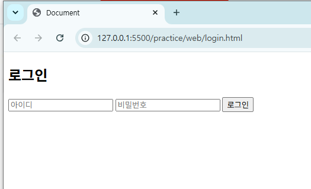
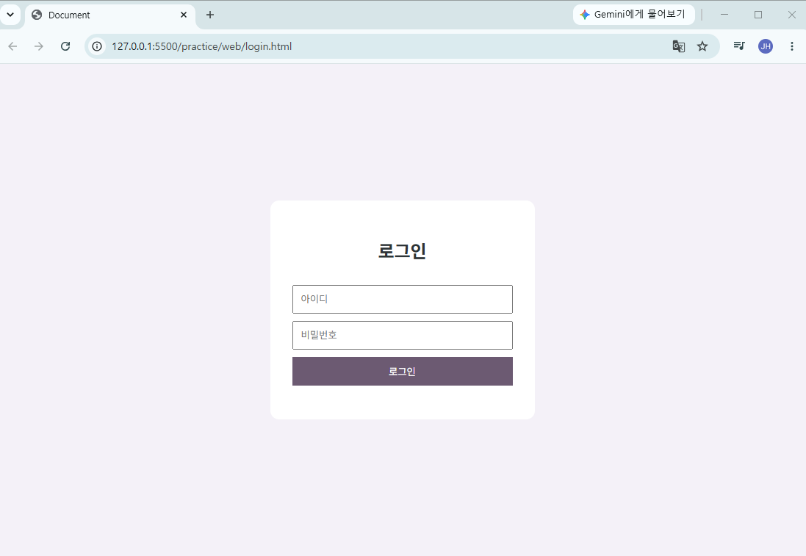
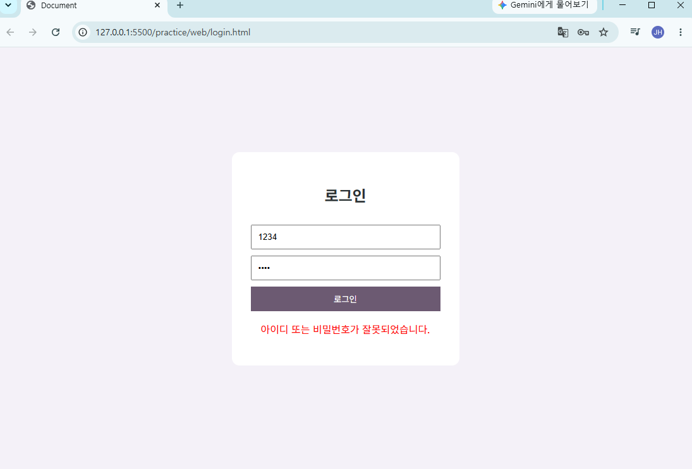
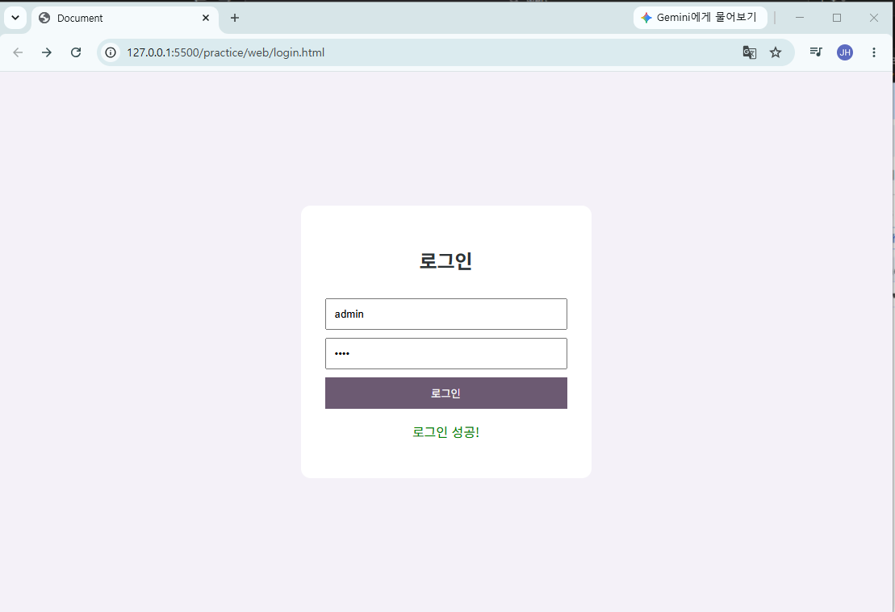
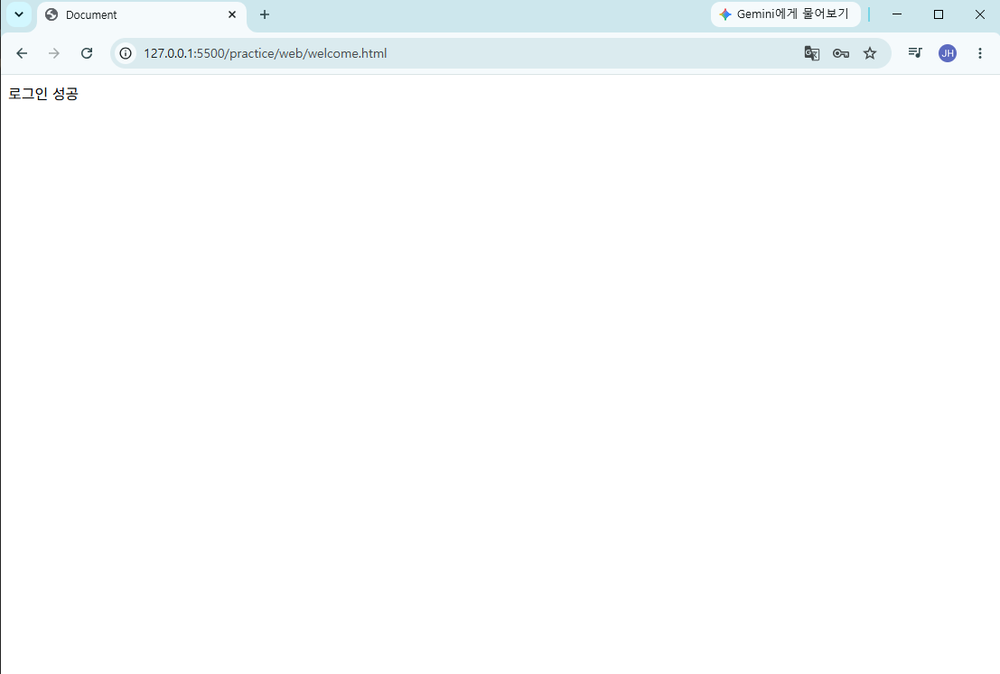

# STEP 1. 웹 서비스 이해
## 4강 : 네트워크 구조

### 기술스택
#### FE : 기술스택
  - 브라우저 도구를 통해서 사용자에 보여지는 부분을 기획하고 구현하는 영역
  - HTML : 웹 페이지의 뼈대, 구조
    - 약속되어있는 Markup, 태그를 알아야 함
    - " .html " 이라는 확장자를 가진 파일
      - 이 내부에 HTML, CSS, Script 가 들어감
      - .jsp, .asp : html 기반. jsp는 자바, asp는 마이크로소프트가 만든 기술.

> [!] HTML (HyperText Markup Language)
```
  - 웹 페이지의 뼈대(구조)
  - 시맨틱 태그( '<header>', '<article>', '<footer>')를 통한 의미전달
  - SEO(Search Engine Optimization) 및 접근성(Accessibility)에 중요
```

  - CSS
   - 반응형 디자인: 해상도 등에 따라 UI가 반응하는 디자인
    - 일반 HTML은 하지 못한다. CSS를 통해 만들 수 있다
    - bootstrap : 반응형 웹페이지를 만드는 템플릿 제공
    - 하나의 페이지를 반응형으로 만들고 싶다면 css를 이용. 간편하게 도움을 받고싶다면 bootstrap을 이용한다
  - JavaScript : 사용자의 이벤트 구현 담당
    - 요즘은 spa를 기반으로 함.

> [!] CSS (Cascading Style Sheets)
```
  - UI 스타일링
  - 반응형 디자인: Media Query (@media screen and (max-width: 768px))
  - 최신 개념:
    - Flexbox, Grid Layout
    - CSS 변수 ( --primary-color )
    - CSS-in-JS (styled-components, emotion) 
```

#### SPA
  - react.js 를 이용해 .jsx 라는 확장자를 가진 파일을 만들 수 있음 < .html 역할을 함
    - .jsx : html과 달리 하나의 component 라고 분류함
    - component = 템플릿을 가지고 있다.
      - 하지만 .html과 달리 HTML, CSS, Script가 들어있지 않음.
    - react는 Javascript를 기반으로 함. Script 안에 HTML, CSS를 만드는 구조다.
  - vue.js (.js - component(template). 스크립트기반). 확장자는 .vue
  - 한번 로드된 파일을 기반으로 동작함
    - 하나의 동적 페이지가 구현된 후 내부의 페이지 이동 시, 새로운 페이지로 가는 게 아니라, 한 페이지 내부에서 콤포넌트를 변경하여 데이터를 갱신하는 방식으로 페이지를 구현함. 그래서 SPA(Single Page) 라고 부름.
    - 화면 조각을 만드는 파일이라고 볼 수 있음.
    - 서버에 데이터를 요청하고 가져온 데이터를 뿌리는 속도가 빠름. 
    - 단점 : 초기 로딩이 느림

> [!] JavaScript
```
  - 동적 기능 구현
  - 브라우저 내에서 이벤트 핸들링, DOM 조작, 서버 통신(ajax, fetch, axios)
  - ECMAScript 표준(ES6+ > let/const, 화살표 함수, async/await 등)
```

> [!] SPA 기반 프레임워크 & 라이브러리 개념 정리
```
1. SPA(Single Page Application) 기본 개념
  - 한번 로드된 HTML, CSS, JS 파일을 기반으로 동작
  - 새로운 페이지 이동 시 전체 페이지를 다시 불러오지 않고 필요한 데이터만 서버에서 받아와 동적으로 화면 갱신.
  - 장점:
    - 빠른 화면 전환, 앱 같은 UX
    - 서버 부하 감소
  - 단점:
    - 초기 로딩 속도 느림
    - SEO(검색최적화) 어려움 > SSR(Server-Side Rendering) 보완 필요
```

#### React는 라이브러리. vue는 프레임워크
  - 둘 다 코드를 도와주는 도구. UI 구현에 특화. 컴포넌트 기능을 가짐
  - 어떤 차이가 있을까? "제어권"
    - lib : 특정기능을 수행하는 코드의 묶음. 개발자가 호출
    - framework : 코드의 묶음 + 어플의 구조와 흐름까지 제공하는 툴. 개발자의 코드를 호출함


> [!] React (라이브러리)
```
  - Facebook 개발, UI 구현에 특화
  - 컴포넌트 기반 개발 > 재사용성과 유지보수성 높음
  - Virtual DOM 기반 > 성능 최적화
  - 보완기술
    - 상태 관리: Redux, Recoil, Zustand
    - 라우팅: React Router
    - 빌드도구: CRA(Create React App), Vite, Next.js(SSR 지원)
```

> [!] Vue.js (프레임워크 성격 강한 라이브러리)
```
  - 가볍고 진입장벽 낮음
  - 템플릿 기반 문법 (HTML + JS + CSS 혼합 가능)
  - 반응성(Reactivity) 시스템 > 데이터 변경 시 자동 UI 갱신
  - 보완 기술:
    - Vue Router (라우팅)
    - Pinia / Vuex (상태관리)
    - Nuxt.js (SSR + SSG 지원)
```

---

## 5강 : API의 이해

### 실제 개발 환경 갖춰보기
- 웹개발을 위해서는 통합 개발 환경이 필요함

#### IDE(Integrated Development Environment)
  - eclipse : 자바 기반에서 많이 사용
  - vscode : 요즘 많이 사용
  - intellj
  - vscode와 intellj는 코드 편집자가 플러그인을 통해 편하게 코드 편집을 할 수 있음

#### IDE 가 설치된 후 할 일
- 우리가 만드는 소스코드 = 코드파일 관리
  - vscode_project 폴더 생성하여 내부에서 코드 폴더를 만들어 관리
  - 📂 [Web 실습](../../practice/web/)

  - 웹을 만들기 위해선 서버가 필요하다.
    - 정적 리소스를 활용한 서버를 만들 예정 : VS코드 내 확장팩 " Live Server " 사용


---

## 6강 : 요약 및 정리

### 코드작성 실습
- 배포방법까지 설명해주실 예정
  - 로컬에서 개발 배포중이지만 실제 서버는 원격에 있음. 원격에 있는 서버에 브라우저라는 도구를 이용해 실제 요청 URL을 전달하고 전달된 URL에 대한 화면을 보게 되는 구조.

#### body 영역에 원하는 태그를 이용해 화면을 구성한다
```
</head>
<body>
  
  
</body>
</html>
```

- html
  - 태그는 속성(==attribute)과 값(==value)을 갖는다 
  - 태그 안의 text 에 태그를 넣어 중첩하는 형태를 취할 수 있다.
```
- 기본 형태
<tag attr=value>text</tag>
```

#### 코드 실행

- 로컬호스트 http://127.0.0.1:5500/practice/web/login.html
  - 127.0.0.1 : 내 컴퓨터 주소. 원격 서버로 배포하면 여기가 숫자가 아닌 실제 도메인이 된다.
  - 5500 : 포트번호
  - login.html : 실행되는 파일명

#### 스타일링
  - 📂 [CSS 실습](../../practice/web/css/login.css)

- CSS : 
```
- 기본 형태
선택자(selector) {
  key : value;
  key : value; etc...
}
```
  - .selector : class 와 매핑되는  선택자
  - body가 이용자에게 보여지는 곳. body에 들어갈 css를 헤드에 기입한다
    ```
    <link rel="stylesheet" href="css/login.css">
    ```


#### 스크립트
  - 📂 [Script 실습](../../practice/web/script/login.js)

>[!] 스크립트 작성 시 실행되는 시점도 중요함.
>  - CSS 는 페이지를 그릴 때 사용해야하므로 HEAD에 둬야 스타일이 적용된다.
>  - 반면에 스크립트는 만들어진 화면에 동적 요소를 부여해야 하므로 body가 만들어진 후, </body> 바로 위에 둔다.

> [!] css와 script를 html 안에 작성하지 않는 이유
>  - 재사용성을 위해서



- 사용자가 아이디와 비밀번호를 입력한 뒤 로그인(button)을 누르면(event) 프론트에서 백엔드 서버로 요청하게 된다.
- 그것을 담당하는 것이 js.

- js에 저장된 임시계정으로 로그인 성공시, 로직에 따라 해당 페이지로 이동한다.



#### class = CSS 가 접근할 때 사용하는 속성
#### id = Script 가 접근할 때 사용하는 속성

### 홈페이지에서 F12를 누르면 개발자 콘솔에 접근할 수 있다.
