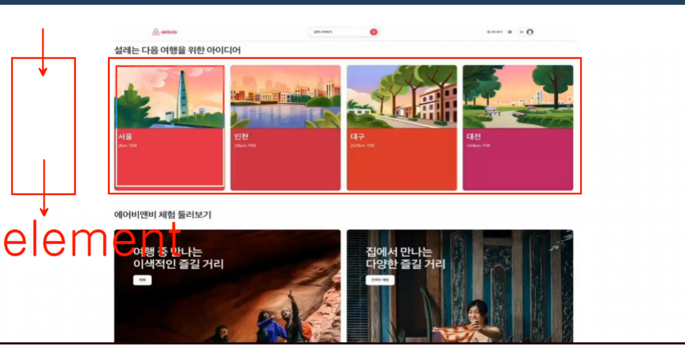
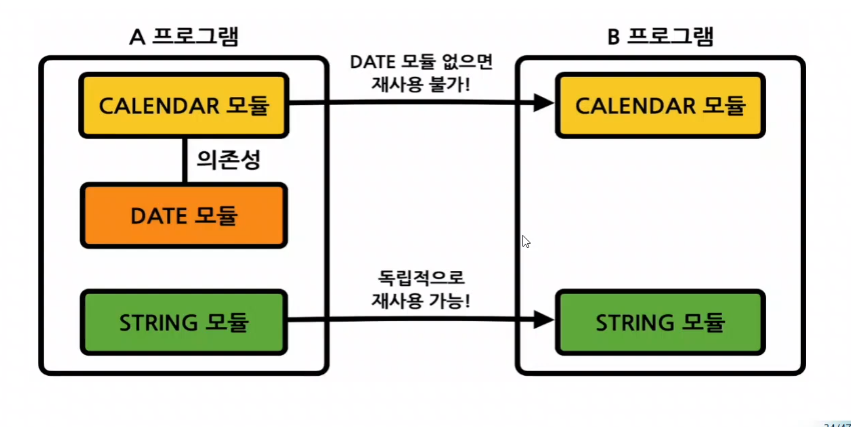
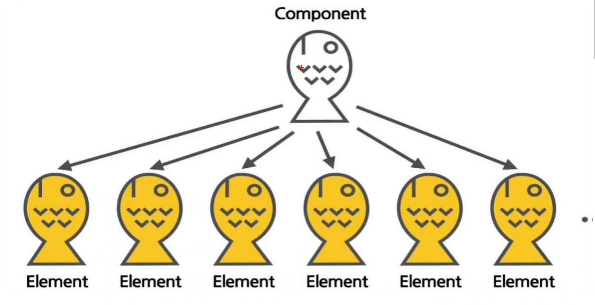
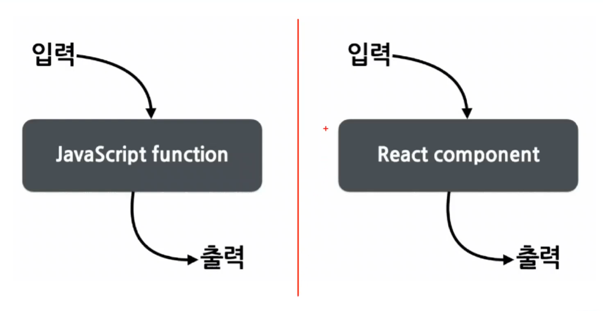
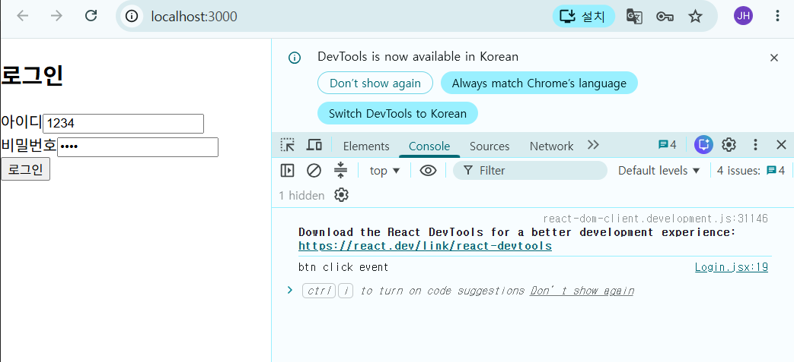
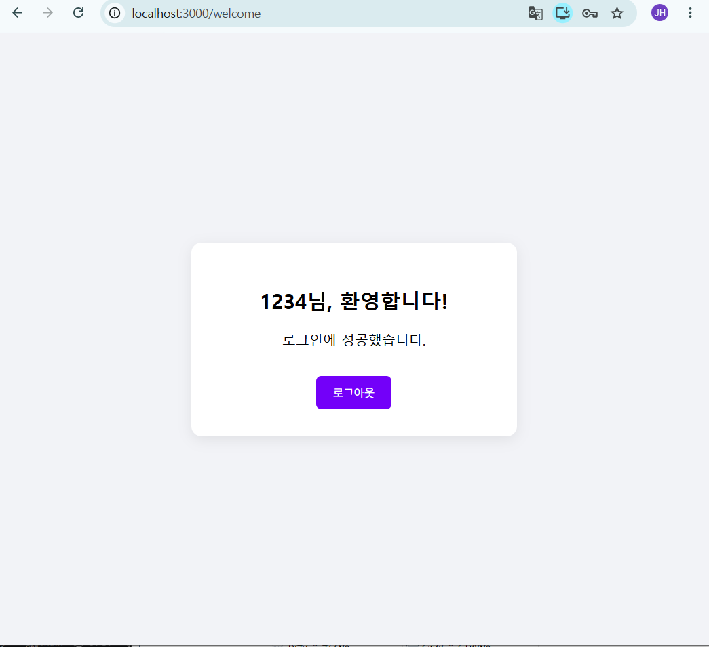

# Step 3. 탄탄한 백엔드 기초, Java
## 1강 : Java 1강 - 개발 환경 세팅

### Java = 객체지향언어

- python : 데이터 분석, 인공지능에 장점을 갖는 언어
- java : 국내 공공기관, 금융권 사이트 등 가장 많은 비율을 차지하는 언어
- java를 배워야 하는 이유
  - 국내에서 많이 사용
  - FE : 데이터를 가지고 있지 않아 다른곳에서 데이터를 가져옴
    - react, vue, html, css, script
  - BE : FE 가 가져오는 데이터들이 있는 곳
    - 주로 spring-boot 등의 아키텍처를 사용하고 **java 기반임**
  - open api

- 특징
  - 객체지향언어(OOP:Object Oriented Programming) : 실상에 존재하는 유무형의 사물을 프로그램 영역 안으로 끌어들이는 것
  - class(실세계 존재 객체를 옮겨담은 설계도) VS instance(프로그램내 동작하는 언어로 된 객체)
    - 실세계의 객체를 프로그램의 영역으로 끌어들이기 위해선 하나의 템플릿이 필요함. 그것을 클래스로 정의함.
      - Object의 명사적 특징은 변수(variable), 동사적 특징은 메서드(method)로 끌어옴
    - 클래스를 이용해 프로그램에서 사용할 수 있는 객체(instance)를 생성함
  - 변수(variable, attribute, property)
  - 메서드(method)

- 실행환경 
  - JDK(자바 개발 키트)
    - 설치 시 JVM(자바 가상 머신) : JRE(자바 실행환경) 포함
  - java 로 만든 소프트웨어의 특징
    - 기본적으로 OS 에서 동작하지 않음.
    - jdk를 인스톨하여 설치된 jvm 을 통해 라이브러리를 다운받아 자바를 이용한 app를 만들 수 있음. 이는 jvm 안에서 동작함.
    - os에 jvm만 설치되어있으면 자바로 만든 소프트웨어가 동작한다(독립성. os에 묶여있지 않음)

### JDK 설치하기
- open jdk 17
- oracle
- eclipse : adoptium 통해 배포. adopt open jdk 17
  - 현업에서 가장 많이 사용되고 있는 건 11 버전
  - spring boot(3.0 대 사용 예정 ) 사용 시 17, 21 버전 사용을 권장.


---
## Java 2강 - 변수와 자료형

### JDK 설치하기(2)
- 17버전으로 다운로드

### javac, java
- 자바언어는 기본적으로 compile, interpreter 언어
  - 자바를 사용하기 위해선 컴퓨터가 이해할 수 있는 언어로 클래스 파일을 만들어야 함.
  - 이때 javac를 이용해 컴파일하는 경우 xxx.class(0과 1로 이루어진 byte code) 확장자 파일이 만들어지고. JVM 내에서 작동할 수 있게 됨.

### 자바언어는 대소문자를 구별한다.
- 식별자(identitier)
  - 클래스(Teacher) : 반드시 첫글자는 대문자로 
  - 변수(engSum) : 소문자로 시작. 명사와 명사가 연결되는 경우 두번째 명사에 대문자 기입
  - 메서드(playing, playGround) :동사적 특징. 행위에 관련된 부분. 동사와 명사가 관련되는 경우 앞에 동사, 뒤에 대문자로 표현한 명사가 이어지는 방식

### Java 소스코드 관리
  - 📂 [Java 실습](../../practice/java)

- java_pjt 폴더 안에서 xxx.java 확장자 파일을 관리할 예정
- vscode : 확장팩 java extension 설치
  - 일반적으로 빌더 툴을 이용하는 경우가 많음
  - 그 외에는 java파일을 직접 만듬.
    - 단점 : 기본 템플릿 없이 처음부터 만들어야함.

#### 파일과 클래스의 이름은 동일해야 한다.
- 실세계의 오브젝트를 코드로 만드는 것.


---
## Java 3강 - 조건문과 반복문

### 자바언어의 변수, 타이틀, 메서드 정의.
- 변수 : 데이터를 담을 수 있는 그릇
- 변수타입 : 자바에서는 타입이 존재함
  - 기본 타입 : 데이터 값 (숫자형, 문자형, 논리형)
  - 참조 타입 : 주소값 (클래스의 위치값, 기본타입을 제외한 모든 타입)
- 변수의 구문형식
  ```
  [접근지정자][변수타입][변수명] = value;
  ```
  - 접근지정자 : 생략가능 ( public | private )
  - 변수타입 : 기본타입
    - 숫자형 : [byte, short, **int**, long] (정수) , [float, **double**] (실수)
    - 문자형 : char 
      ```
      'A'
      ```
    - 논리형 : boolean ( true / false )
    - 문자열 : String
      ```
      "ABC"
      ```
      - 대문자로 시작하는 경우 기본적으로 클래스 유형임.
      - " " 를 이용해 여러개의 문자를 열거함
    - **변수타입이 많은 이유**
      - 변수는 특정한 메모리 공간을 차지한다. 각 타입마다 메모리 공간 차지율이 다름
  - 변수명 : 식별자. 소문자로 시작
  - "=" : 좌변의 변수에 우변의 값을 할당한다. (같다는 "==" 로 표기)

- 변수의 선언위치에 따라 전역변수, 지역변수가 될 수 있다
  - 전역변수 : 클래스 블럭 안에 들어가는 것
  - 지역변수 : 자신이 속한 블럭 밖에서 사용할 수 없는 변수

- " ; "
  - 한 행이 끝나면 반드시 마지막을 세미콜론(;) 으로 끝났음을 정의함 (변수선언)


---
## Java 4강 - 배열과 메서드

### 메서드 : 데이터를 다루는 행위
  ```
  [접근지정자][반환타입][메서드이름(매개변수)] {

  }
  ```


### 클래스의 구성요소 : ( 변수 + 메서드 )

- 클래스는 다양한 메서드를 가질 수 있다
  - 각 메서드 안에서 전역으로 정의된 메서드는 어디든지 사용될 수 있다.


### 메서드의 유형
- 반환타입과 매개변수 유무에 따른 4가지 유형

- 보편적으로 많이 이용되는것 : 인자를 넣으면 반환타입이 생성되는 메서드
- 반환하는 값이 없는 경우 : void 사용
- 반환하는 값이 있는 경우 : 각 변수타입 사용 가능 + 참조타입(추후 배울 예정)
- 매개 변수 : 각 변수타입 사용 가능 + 참조타입(추후 배울 예정)


### 클래스의 목적

- instance를 만들기 위해서

- main메서드가 없는 클래스 : instance를 만들기 위한 템플릿 용도
  - 대부분의 클래스 생성이 위와 같은 용도

---
## Java 5강 - 객체지향 프로그래밍 기초

### 클래스에서 instance를 생성하기
- class 는 instance 를 만들기 위한 템플릿
- instance 는 여러개의 class 를 소유할 수 있다. 객체 생성이 되어야 class에 외부에서 접근 가능하게 된다.

- 참조타입 : 값이 아닌 주소값(객체생성)을 담는 그릇

- " . " : 앞의 변수안에 뒤의 변수가 속해있음 의미

---
## Java 6강 - 클래스와 인스턴스

### 전체적인 프로젝트의 구조
- open source spring framework
  - 이 안에 속한 MVC

- 클래스는 각각의 역할에 따른 기능들이 존재한다.
  - xxxController.java : 제어계열
  - xxxServiceImpl.java : 비즈니스로직담당(데이터필요)
  - xxxRepository.java or xxxDao.java : DB
  - xxxDTO.java or xxxVO or xxxEntity.java : 데이터를 담는 그릇

#### 이들을 package로 만들어 구분한다.
#### 패키지로 만든 클래스들은 import를 이용해 사용되어진다
  - 각 용도별로 패키지로 만들어 관리하면 효율적으로 파일들을 찾을 수 있다.

### 패키지 만들기
- 폴더, 또는 new java package 를 사용 할 수 있음
- 개발현장에 물리적인 레이어는 없지만 요청을 받는 백엔드 쪽에 제각각의 역할을 가진 레이어가 존재하고, 작업을 도와주는 프레임워크(JPA, Mybatis)를 통해 DBMS와의 작업을 전담한다.

- 각 레이어간엔 의존관계가 형성될 수 있다.
  - 의존 : 각 패키지가 가진 클래스를 서로 사용함으로서 관계를 갖는 다는 것
  - 이렇게 DB로 전달된 뒤 반환되는 데이터는 json 형태로 FE 에 전달된다.

- 백엔드 : 내부의 아키텍처 구조 = 도메인 별로 각각의 기능에 맞는 패키지들이 명세될 수 있다.

---
---

# Step 4. 생동감 있는 화면, 프론트엔드 (React)

## 1강 - React 소개 및 세팅
- 사용자 인터페이스를 빌딩하기 위한 자바스크립트 라이브러리
- Component-Based : 웹사이트를 만들기 위한 부품형태로 제공됨
- 컴포넌트 베이스의 개발도구. React로 만든 페이지에는 여러개의 컴포넌트가 존재할 수 있다.
  - 속성(props)을 전달받은 컴포넌트 안에는 여러개의 element가 생성된다. 
    - 예시 : 에어비앤비 = 대표적인 React를 쓰는 사이트
      - 최소 3개의 컴포넌트가 사용됨.
        - 페이지 컴포넌트 > 도시 컴포넌트, 체험 컴포넌트 
   

### 컴포넌트 기반으로 개발하면 좋은 점
- 재사용성(Reusability)
  
  - 의존성이 형성된 모듈은 의존성을 가진 다른 데이터를 가지고 있지 않은 프로그램에선 구동할 수 없다.
  - 하지만 독립적으로 기능하는 모듈은 다른 프로그램에서도 손쉽게 사용할 수 있다

### Rendering Elements
- SPA : react - component-based : 컴포넌트로부터 추출되는 결과물 element 가 사용자에게 보여짐 => Rendering
- 예시 : [Web 실습 login.html](../../practice/web/login.html)
  - 사용자가 제공하는 특정한 텍스트를 파싱하여 브라우저에 출력되는 모습을 의미함
- Elements : 가장 작은 빌딩 블럭. 화면에서 보이는 것들을 기술함

- component : 일종의 틀
- props : elements 를 만들기 위한 재료들
- component : elements 가 모인 하나의 파일. (xxx.jsx)

### React는 JavaScript 기반으로 만들어진다.
- 형태가 동일하다. 
  

- 다만 클래스의 개념으로도 만들 수 있지만
  - But 현재의 추세는 function 기반

### Component 만들기
- 개발환경 다운로드
  - CRA(Create React App) : node.js, CRA


---
## 2강 - JSX 문법 이해

### Node.js 기반의 개발환경 조성
- Node.js 다운로드
- React : node.js + npm 명령어 사용(node package manager)
- 리액트를 사용하는 프로젝트를 만들어준다
  ``` git bash
  npx create-react-app project_name
  ```
- 📂 [React 실습](../../practice/react)


## 3강 - Component와 Props

### 컴포넌트 만들기 실습
- html 로 만든 로그인 파일을 React를 이용하여 만들기
- React는 스크립트 기반. html을 스크립트로 파싱해야 하는 상황이 있음. 이를 위한 라이브러리들이 존재함
- 스크립트 기반으로 HTML을 쓰는 파일의 확장자 : .jxx
  - 📂 [jsx 파일 만들기](../../practice/react/react_pjt/src/component/page/Login.jsx)

- 브라우저에 css 를 입히려면 랜더링이 필요함
  - 📂 [랜더링을 도와주는 파일 만들기](../../practice/react/react_pjt/src/index.js)

- index.js 작성 후 'npm start'를 터미널에 작성하여 구동
  
  - 화면에 랜더링이 발생한다
  - 이벤트 버블링? 이 발생하지 않도록 Login.jsx에 코드 한 줄 추가
    ```
      e.preventDefault();
    ```
  - 백엔드가 존재하게 되면 이벤트가 발생하면 백엔드에 데이터를 json 형태로 전달된다. (spring boot로 제작)


## 4강 - State와 생명주기

### CSS 적용
  - 📂 [CSS파일 작성](../../practice/react/react_pjt/src/component/css/Login.css)

### 예시로 로그인 검증 진행
  ```
    if (userId === "admin" && password === "1234") {
      alert("로그인 성공") ; ## 팝업으로 출력됨
      setError("") ;
    } else {
      setError("아이디 또는 비밀번호가 올바르지 않습니다.") ;
    }
  ```

### 로그인을 눌러 로그인에 성공 시 다른 컴포넌트로 이동하고 싶어요
  - 컴포넌트 이동은 현재는 불가능. 별도의 라이브러리 설치가 필요함
  - React Router DOM

### 서버 통신 전제로 한 통신 예시
```
터미널에
npm install axios
```
  - 프론트와 백엔드 사이의 통신과 응답을 도와주는 라이브러리
  - 비동기를 기반으로 함. 처리되는 시간의 순서가 엉킬 수 있음
  - 함수 실행 시 async를 기입하면 await가 붙은 통신이 실행되는동안 기다리게 할 수 있음

- 요즘은 로그인 한 정보를 응답할 시 토큰으로 되돌려주는 경우가 많음.

- 통신이 되는 경우 react-router-dom 을 이용해 이동하거나, window.location.herf를 이용할 수 있음
```
터미널에
npm install react-router-dom
```
  - 📂 [이동할 페이지 작성](../../practice/react/react_pjt/src/component/page/welcome.jsx)

- 컴포넌트 이동을 위한 라우터 설정이 필요함
  - 📂 [App.js 수정](../../practice/react/react_pjt/src/App.js)

## 5강 - Event 처리와 활용

### 서버 통신 전제로 한 통신 예시 이어서

- 설정된 라우터를 index.js에 삽입(기존에 미리 작성해둠)
  - 주석 처리 설정/해제 : ctrl + /

- 라우터 연결후, 로그인에 성공하면 다른 컴포넌트로 이동시키기 위해서 라우터 이동을 도와주는 함수가 필요하다
```
Login.jsx에
import { useNavigate } from 'react-router-dom' ;
```

```
moveUrl('/Welcome', { state : { username : userId }}) ;
```

> [!] 참고
> - 훅이란? 
>   - 함수형 컴포넌트에 React의 기능을 "걸어서" 쓰게 해 주는 함수들. 이름이 모두 use로 시작한다.
> - useState : 컴포넌트가 값을 기억하게 해 주는 React 기능
> - 상태정보를 공유하고자 할 때 state 함수를 이용해 전달 가능

- 로그인 성공 후 페이지가 연결된 모습. 로그아웃 버튼을 누르면 다시 root 페이지로 돌아간다.
